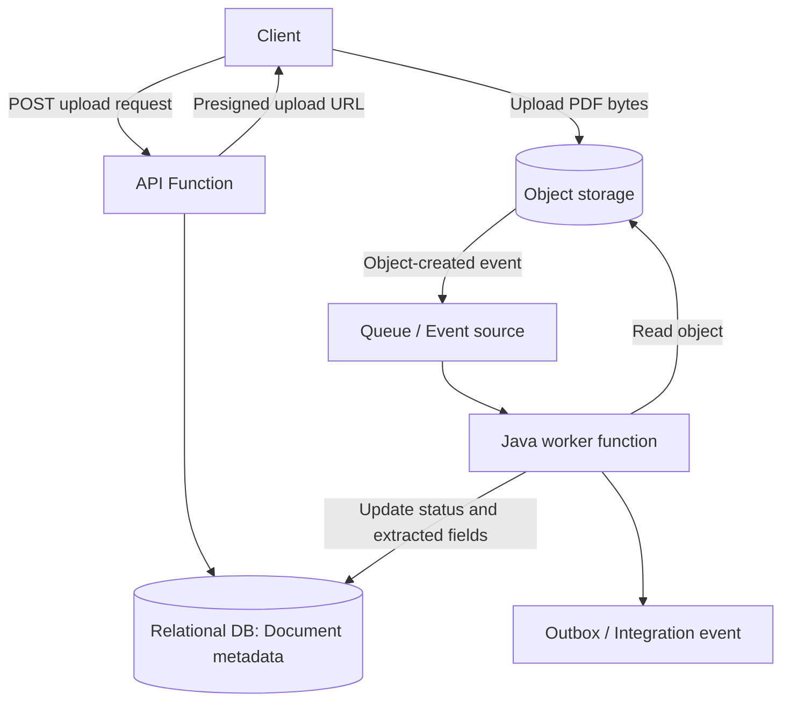

# Choosing Object Storage, Relational Databases, and NoSQL

A Java function in a serverless environment often handles data of many shapes: order information, job state, user profiles, uploaded images, CSV files, logs, or event data. No single storage type fits all of these. Choosing the wrong storage location can force the function to read excessive data, write complex queries, open too many connections, or incur high costs.

Three common service groups are **object storage**, **relational databases**, and **NoSQL databases**. Object storage suits large object/file content. Relational databases suit data with relationships, constraints, and multi-record transactions. NoSQL fits when a well-defined access pattern needs to scale by key, document, partition, or specialized structure. The decision should be based on how the application reads, writes, updates, and retains data, rather than merely on technology labels.

## 1. Start from the data and how the application uses it

Before choosing a service, describe each data group with the following questions:

1. Is the data a file/blob or structured attributes that need to be queried?
2. Does the application read by ID, by relationship, by time range, by attribute, or the entire content?
3. Does an operation update a single record or must multiple records succeed/fail together?
4. Are joins, unique constraints, foreign keys, or ad hoc queries needed?
5. Is read/write traffic steady, or are there large spikes or multiple tenants?
6. How strong does consistency need to be? Can the data tolerate replication lag between replicas?
7. How long must the data be retained, and does it require versioning, backups, restoration, or on-demand deletion?
8. What are the expected data size, payload size, and growth rate?

For example, a document intake system might need three storage mechanisms at once: profile information and processing status in a relational database; original PDF files and previews in object storage; and temporary progress state or key-based lookup data in NoSQL. Combining them does not overcomplicate the architecture as long as each data type has a clear source of truth and responsibility.

## 2. Object storage: storing files and blobs by object key

Object storage saves data as objects inside a bucket or container. Each object typically consists of byte content, an identifying key, and a set of metadata. Applications interact via APIs or SDKs such as PUT, GET, HEAD, DELETE, and multipart upload operations.

Suitable examples:

- Images, videos, audio, PDF documents, and attachments.
- CSV/JSON/Parquet files used for imports, exports, or analytics.
- Backups, data packages, artifacts, and static content.
- Results of long-running serverless jobs written out by workers after processing.

Object storage fits large data accessed by key that requires durable storage with scalable capacity. It does not replace a relational database: object keys do not inherently provide joins, business unique constraints, or multi-object transactions. Object metadata is often useful for simple attributes, while complex multi-attribute queries typically require a separate catalog, database, or search system.

### How objects are organized

An object is typically identified by a bucket and a key. For example:

```text
bucket: customer-documents
key: tenant-42/invoices/2026/11/invoice-8391.pdf

metadata:
  content-type: application/pdf
  document-id: invoice-8391
  tenant-id: tenant-42
```

Keys may contain folder-like segments, but in many services this is simply an identifier string rather than a filesystem-style directory tree. Key design should support routing, access control, lifecycle management, and lookup according to defined rules. Avoid using user-submitted filenames directly as unique keys; names can collide, contain unusual characters, or leak private information. Typically, generate keys on the server using random IDs or normalized business IDs.

### Capabilities to consider

- **Multipart upload:** splits large files into parts for upload/resume, though incomplete uploads must be cleaned up.
- **Range reads and streaming:** reads a portion of an object or streams content to avoid loading the entire file into the Java heap.
- **Versioning:** retains versions when an object is overwritten or accidentally deleted.
- **Lifecycle policies:** transitions infrequently accessed objects to cheaper storage tiers or deletes them after an expiration period.
- **Retention/Object Lock:** satisfies immutability or policy-mandated retention requirements.
- **Checksums:** verifies integrity of uploaded/downloaded data; do not rely solely on filename or size.
- **Event notifications:** triggers functions when objects are created or modified; events can be redelivered, so handlers must be idempotent.

Read-after-write consistency, version handling, and event emission behavior depend on the specific service. Some platforms provide strong read-after-write consistency for certain operations, but you should not generalize one provider's guarantees to all object storage systems. Check the service documentation and design consumers to tolerate duplicate or delayed events.

### Avoid routing large files through functions unnecessarily

An HTTP function should not receive a large file and hold all bytes in memory solely to write it to object storage. Doing so increases memory usage, duration, cost, and the risk of hitting gateway/function payload limits. A common pattern is:

1. Client calls the API to request upload permission.
2. A submission function authenticates the user, creates an upload record, and generates a time-limited upload URL.
3. Client uploads directly to object storage.
4. An object-created event or callback signals upload completion.
5. A worker function inspects the object, verifies size/checksum/format, and processes it.

A presigned URL (or equivalent mechanism) restricts permissions and validity duration to a specific operation. It remains a bearer capability: anyone holding the URL can use it while it is valid. Do not write these URLs to public logs or send them over insecure channels.

## 3. Relational databases: relational data and transactions

Relational databases organize data into tables with rows, columns, data types, and relationships. SQL enables querying, filtering, joining, aggregating, and conditional updating. Popular relational database engines provide transactions, constraints, and indexes to protect data correctness.

Typically suitable for:

- Orders, payments, invoices, and inventory.
- Accounts, profiles, ownership, and relationships between entities.
- Data requiring unique constraints, foreign keys, and database-level validation.
- Business operations requiring updates across multiple tables within a single transaction.
- Ad hoc queries or multi-dimensional reporting whose criteria may evolve.

### Transactions and consistency

Suppose an order requires creating a header, creating order lines, and decrementing inventory. If these changes must succeed or roll back together, a relational transaction is a natural choice:

```sql
BEGIN;

INSERT INTO orders (order_id, customer_id, status)
VALUES ('O-9021', 'C-1042', 'PLACED');

INSERT INTO order_lines (order_id, product_id, quantity)
VALUES ('O-9021', 'P-18', 2);

UPDATE inventory
SET available_quantity = available_quantity - 2
WHERE product_id = 'P-18'
  AND available_quantity >= 2;

-- The application must verify that the number of updated rows is 1.
COMMIT;
```

This is a simplified example. In a real implementation, the application must check the UPDATE result, handle insufficient inventory, apply appropriate locking/synchronization, and potentially write an outbox event in the same transaction. Never COMMIT if a mandatory business condition fails.

Transactions do not automatically solve all distributed systems issues. If the database transaction commits but the function times out before returning an HTTP response, the client may retry. An idempotency key or unique business key is needed so the subsequent call recognizes the operation has already completed and returns the prior result.

### Indexes and query patterns

Relational databases allow flexible queries, but queries are not automatically fast. Indexes must be designed around actual filter predicates, sort orders, and joins. Indexes speed up reads but increase storage footprint, write cost, and maintenance overhead. Use `EXPLAIN` or the database engine's query analysis tool to verify execution plans against production-like data.

### Connection challenges in serverless

FaaS can scale out many concurrent invocations. If each invocation opens a new connection to the database, connection counts can spike suddenly and exceed database limits, even if each function runs very briefly.

For example, 200 concurrent invocations, each creating a pool of 5 connections, can generate demand for up to 1,000 connections. This is an illustrative multiplication; actual numbers depend on the pool, connection creation timing, and concurrency inside the function.

Common mitigations:

- Use small connection pools and bound total concurrency based on database capacity.
- Close connections/statements/result sets after operations to return connections to the pool; do not hold connections open across unnecessary waits.
- Safely reuse a `DataSource` or client across invocations within the same runtime when the platform allows, without assuming the runtime stays alive indefinitely.
- Consider a managed connection proxy/pooler if supported by the provider.
- Reduce query counts, batch operations, or combine statements when appropriate.
- Set timeouts for connection acquisition, queries, and transactions.
- Use read replicas for read workloads if the consistency model allows.

A long-lived `static Connection` variable is not a safe pool. The connection may be closed by the database, expire, or enter an invalid state after the runtime is frozen and thawed. Use a pool/client capable of validating and recreating connections.

## 4. NoSQL: optimized for specific access patterns

NoSQL is an umbrella term for data models not primarily based on relational tables and SQL joins. There is no single NoSQL model. Common categories include:

| Type | Organization | Example use cases |
| --- | --- | --- |
| Key-value | Value lookup by key | Sessions, idempotency records, configuration by ID |
| Document | Stores documents such as JSON with flexible structure | Profiles, catalogs, configurations with varying attributes |
| Wide-column | Groups data by partition and clustering keys | Event/time-series data, large datasets partitioned by tenant or time |
| Graph | Nodes and edges representing relationships | Social/relationship networks, recommendations, pathfinding |

NoSQL often shines when a workload has stable access patterns, requires high throughput, or scales by partition. However, do not choose it merely for "flexible schema" or because NoSQL is supposedly always faster. Poor partition key design, mismatched queries, or heavy join needs can make the system complex and expensive.

### Designing around access patterns

With a key-value/document database, list all queries before designing keys. For example, a job management application might need to:

- Fetch a job by `jobId`.
- List jobs by `tenantId` and creation timestamp.
- Find running jobs to check leases.
- Update status if the current version is still `RUNNING`.

One design might use a tenant partition key and a sort key containing timestamp + job ID for per-tenant history queries, with another table or index supporting lookups by job ID. Specifics depend on the system and the service's indexing capabilities. If the partition key is a single hot value (for example, all records using the key `JOBS`), many requests will hit one partition and create a hot partition.

Denormalization is often used to avoid joins: duplicating a subset of data inside documents or items for fast reads along the access pattern. In return, when source data changes, copies must be updated or eventual consistency accepted. Define the source of truth and remediation process before duplicating data.

### Consistency and transactions in NoSQL

You cannot assume all NoSQL databases are eventually consistent. Some services provide strong consistency for certain operations, configurable consistency, conditional writes, or multi-item transactions with bounded scope. Support varies across services, regions, and APIs.

Verify specifically:

- Do reads immediately after writes reflect the new value?
- Can you perform strongly consistent reads on a single key or across multiple items?
- Can conditional updates ensure only one worker claims a job?
- How many items/partitions can a transaction span, and what are the size limits?
- What is the latency or write conflict behavior for global replication?

If business logic requires complex multi-entity transactions and flexible joins, a relational database is usually simpler. If operations are independent per key and can be modeled with conditional updates or small transactions, NoSQL can be a strong fit.

### TTL and ephemeral data

Some NoSQL databases support TTL to automatically remove expired items, which works well for sessions, cache metadata, or time-bounded idempotency records. TTL is typically an asynchronous cleanup mechanism; do not assume an item disappears at the exact second it expires. If security or business logic must reject data immediately upon expiration, the application must still check the expiration timestamp on read.

## 5. Comparing the three storage groups

| Criterion | Object storage | Relational database | NoSQL database |
| --- | --- | --- | --- |
| Data unit | Keyed object/blob | Row in a schema-defined table | Item/document/column/graph depending on model |
| Primary access | GET/PUT/DELETE by object key, stream/range | SQL, indexes, joins, transactions | Lookup/query by key, partition, index, or graph traversal |
| Suitable data | Files, media, exports, backups, large payloads | Relational and transactional business data | Workloads with clear access patterns, key/document models, and high scale |
| Transactions | No general multi-object business transactions | ACID transactions within engine scope | Service-dependent; conditional writes/transactions have specific limits |
| Multi-attribute queries | Requires supplementary catalog/search/database | Strong with SQL and joins | Depends on indexes and data model |
| Scaling | Massive object capacity | Vertical/read replicas/sharding depending on engine | Typically partition/horizontal scaling by design |
| Notable serverless issues | Large payloads, presigned URLs, duplicate events, lifecycle | Connection storms, pooling, transactions, and concurrency | Partition keys, hot keys, consistency, indexes, and denormalization |
| Common cost drivers | Capacity, requests, retrieval tiers, egress | Compute/instance, storage, I/O, connections, and backups | Read/write units or throughput, storage, indexes, replication |

These are general tendencies, not guarantees for every product. Some services offer hybrid capabilities or add querying, transaction, and caching features. Compare pricing tables, limits, and SLAs for the specific service.

## 6. Hybrid pattern: database for metadata, object storage for content

A very common pattern stores files in object storage and descriptive/status information in a database. Example of an invoice intake system:

1. Client requests an upload session.
2. API function authenticates the tenant and creates a `Document` record with status `PENDING_UPLOAD` in the relational database.
3. API returns a time-limited upload URL and a server-generated object key.
4. Client uploads the PDF to object storage.
5. An object-created event triggers a worker function.
6. Worker validates the object, updates the record to `PROCESSING`, extracts data, and stores results.
7. Worker updates metadata/status in the database and may emit an `InvoiceProcessed` integration event via an outbox.



In this pattern:

- Object storage is the source for original file content and output files.
- The relational database is the source of truth for ownership, metadata, status, and business relationships.
- The queue/event source only carries processing signals; messages should contain object key, document ID, version, or event ID rather than the entire file.
- The worker must verify the tenant, object key, and record status before processing.

If NoSQL is needed, it can be used for key-based lookup data, high-throughput state, or sessions; however, you must decide which database is the source of truth for each field. Avoid having the same business state written independently to two databases without synchronization and reconciliation.

## 7. Java: streaming object storage operations

The example below uses AWS SDK for Java v2 to illustrate an object storage API. Other providers have their own SDKs and URL signing mechanisms; the core principles are streaming data, generating keys server-side, and avoiding turning a function into a large-file proxy when clients can upload directly.

```java
import java.nio.file.Path;
import software.amazon.awssdk.core.sync.RequestBody;
import software.amazon.awssdk.services.s3.S3Client;
import software.amazon.awssdk.services.s3.model.PutObjectRequest;

public final class DocumentObjectStore {
    private final S3Client s3;
    private final String bucket;

    public DocumentObjectStore(S3Client s3, String bucket) {
        this.s3 = s3;
        this.bucket = bucket;
    }

    public void upload(Path file, String objectKey, String contentType) {
        PutObjectRequest request = PutObjectRequest.builder()
                .bucket(bucket)
                .key(objectKey)
                .contentType(contentType)
                .build();

        s3.putObject(request, RequestBody.fromFile(file));
    }
}
```

`RequestBody.fromFile` lets the SDK read the file from its path instead of the application loading the entire content into a `byte[]`. For very large files, use multipart upload or an appropriate streaming API. In production, add checksums, encryption, least-privilege IAM permissions, error handling/retries, timeouts, and overwrite/versioning policies. A client-supplied `contentType` is not reliable proof of actual format; workers should inspect file signatures or contents according to business requirements.

If object-created events can be delivered multiple times, track processing state by an appropriate composite such as bucket + key + version ID or event ID. Do not rely solely on the object key if the same key can be overwritten to create new versions.

## 8. Java: safe relational database operations

With JDBC, a `DataSource` manages the connection pool. Each invocation borrows a connection for the needed duration and returns it via try-with-resources. The following example performs a conditional status update:

```java
import java.sql.Connection;
import java.sql.PreparedStatement;
import javax.sql.DataSource;

public final class JobRepository {
    private final DataSource dataSource;

    public JobRepository(DataSource dataSource) {
        this.dataSource = dataSource;
    }

    public boolean markRunning(String jobId, long expectedVersion)
            throws Exception {
        String sql = """
                UPDATE jobs
                   SET status = 'RUNNING', version = version + 1
                 WHERE job_id = ?
                   AND status = 'QUEUED'
                   AND version = ?
                """;

        try (Connection connection = dataSource.getConnection();
             PreparedStatement statement = connection.prepareStatement(sql)) {
            statement.setString(1, jobId);
            statement.setLong(2, expectedVersion);
            return statement.executeUpdate() == 1;
        }
    }
}
```

The conditions `status = 'QUEUED'` and `version = ?` ensure only one worker claims the expected state. A worker receiving `false` must read the current state to determine whether the job was already claimed, has finished, or no longer exists. Do not treat `false` as always indicating an infrastructure error.

In serverless environments, pool configuration must account for total runtimes and overall concurrency. If each runtime maintains a pool of up to 5 connections and can scale up to 100 runtimes, the database may see demand for up to 500 connections. Set appropriate concurrency/pool sizes or use a proxy/pooler to protect the database.

## 9. Java: NoSQL and conditional writes

With NoSQL, design keys around access patterns and use conditional writes to protect state transitions. The example below uses DynamoDB SDK v2 to illustrate an operation that creates an item only if the partition key does not already exist:

```java
import java.util.Map;
import software.amazon.awssdk.services.dynamodb.DynamoDbClient;
import software.amazon.awssdk.services.dynamodb.model.AttributeValue;
import software.amazon.awssdk.services.dynamodb.model.ConditionalCheckFailedException;
import software.amazon.awssdk.services.dynamodb.model.PutItemRequest;

public final class IdempotencyStore {
    private final DynamoDbClient dynamoDb;
    private final String tableName;

    public IdempotencyStore(DynamoDbClient dynamoDb, String tableName) {
        this.dynamoDb = dynamoDb;
        this.tableName = tableName;
    }

    public boolean createIfAbsent(String key, String jobId) {
        try {
            dynamoDb.putItem(PutItemRequest.builder()
                    .tableName(tableName)
                    .item(Map.of(
                            "pk", AttributeValue.builder().s(key).build(),
                            "jobId", AttributeValue.builder().s(jobId).build()
                    ))
                    .conditionExpression("attribute_not_exists(pk)")
                    .build());
            return true;
        } catch (ConditionalCheckFailedException alreadyExists) {
            return false;
        }
    }
}
```

This is a DynamoDB-specific example, not a universal NoSQL API. In real systems, idempotency records typically also need tenant, operation, request hash, creation/expiration timestamps, and status/result. If the key already exists, read the record to compare the request hash; never assume every request reusing a key carries identical content.

## 10. Object storage triggers and safe event handling

When an object is created, the storage service can emit an event to trigger a Java function. The event typically includes bucket, key, version, or identifying metadata. The worker then reads the object and processes it.

Scenarios to anticipate:

- Events delivered multiple times due to retries or missed ACKs.
- Events arriving late or out of upload order.
- Objects overwritten or deleted before the worker reads them.
- Worker timeouts after writing partial output.
- Multiple objects uploaded concurrently for the same business record.

Handlers should verify object version/checksum and business state, use stable idempotency keys, write checkpoints, and perform conditional status updates. If the worker produces output objects, use dedicated output keys or write explicit versions so retries do not destroy the original file.

Do not rely solely on the object name to infer ownership. Cross-check the key against the record created in the API and the authenticated tenant. Event notifications are input data that must be validated; do not trust any bucket/key merely because the message arrived from an event bus.

## 11. Security and data lifecycle governance

Storage is where data can outlive invocations by a wide margin. Design must incorporate access permissions, encryption, retention, and recovery from the start.

### Object storage

- Keep buckets/containers private by default; do not enable public access merely for convenient file sharing.
- Use per-function IAM roles and least privilege scoped to the required prefixes/buckets.
- Encrypt in transit and at rest; manage encryption keys according to organizational requirements.
- Use short-lived presigned URLs scoped to specific operations and objects.
- Validate size, checksum, true file format, and scan for malware if the file type requires it.
- Enable versioning/retention when recovery or retention compliance is needed; configure lifecycle rules to clean up expired data.
- Avoid logging sensitive content or presigned URLs.

### Relational and NoSQL databases

- Authenticate via roles/secure secrets; never embed passwords in source code or unprotected environment variables.
- Use TLS, encryption at rest, network policies, and private connectivity when appropriate.
- Restrict permissions by database/schema/table or corresponding resource.
- Configure backups, point-in-time recovery, or snapshots, and regularly test restore capabilities.
- Define retention and data deletion workflows per policy; remember replicas, indexes, backups, and logs.
- Monitor connection counts, throttling, query latency, capacity, and conditional write errors.

Encryption does not replace authorization. A function that reads objects in a bucket should not be granted permission to delete the entire bucket if it only needs to read a single prefix.

## 12. Cost and performance

No storage type is universally the cheapest. Estimate costs based on actual workloads, including requests made by functions.

| Group | Cost components to inspect | Common optimizations |
| --- | --- | --- |
| Object storage | Capacity, PUT/GET/LIST, retrieval, storage classes, egress, versioning, and lifecycle | Choose storage class by access frequency, stream files, cache appropriately, clean up incomplete multiparts and expired data |
| Relational DB | Compute/instance, storage, I/O, backups, read replicas, connection proxy | Optimize queries/indexes, keep pools small, bound concurrency, batch, and scale to demand |
| NoSQL | Read/write throughput, storage, indexes, replication, backups, and retried requests | Design partition keys, reduce hot keys, use lean projections/indexes, and cache where suitable |

In serverless, costs can climb when one event triggers multiple functions, repeated retries occur, polling is overly frequent, or functions read/write excessively. Measure cost per successful business task, not just per invocation.

Metrics to observe:

- Object: bytes stored, request count, egress, retrieval, object age, upload errors, and incomplete multiparts.
- Relational: active/max connections, pool wait time, query latency p95/p99, lock wait, transaction rollbacks, and I/O.
- NoSQL: read/write units or throughput, throttling, hot partitions, conditional check failures, item size, and replication lag.
- End-to-end flow: retry counts, processing duration, success rate, and cost per business outcome.

## 13. Common design mistakes

1. **Storing large files in a database purely for convenience.** BLOBs can work in some systems, but large files are generally easier to manage and distribute in object storage while the database holds metadata and references.
2. **Storing critical business data solely in object metadata.** Object metadata does not replace database constraints and querying.
3. **Choosing NoSQL before listing queries.** Without clear access patterns, schemas/keys easily lead to expensive scans or hot partitions.
4. **Creating large connection pools in every function runtime.** Total connections can multiply with the number of runtimes and exceed database limits.
5. **Letting functions proxy entire large files.** Payloads and memory spike; consider direct uploads via presigned URLs.
6. **Assuming object-created events arrive only once.** Duplicate or delayed events can cause workers to reprocess; idempotency is required.
7. **Using two databases as equal sources of truth.** Without synchronization, versioning, and reconciliation, state will diverge.
8. **Failing to design backup/restore and retention.** Data may be restored incorrectly, retained past expiration, or lost without a recovery procedure.
9. **Overlooking retrieval and egress costs.** Cheap storage tiers can become expensive when accessed frequently or transferred across regions.

## 14. Process for choosing a storage location

You can apply the following process to each data group:

1. **Identify the source of truth.** Which fields or content represent authoritative data? Which service owns it?
2. **List access patterns.** Document reads, writes, filters, sorts, joins, updates, and expected frequency.
3. **Define transaction boundaries.** Which changes must succeed or roll back together?
4. **Select the data model.** Keyed files/blobs suggest object storage; relationships and transactions suggest relational; key/partition/document access suggests NoSQL.
5. **Check consistency and scale.** Determine acceptable latency, concurrency, hot keys, connection limits, and payload sizes.
6. **Design security and lifecycle.** Permissions, encryption, versioning, backups, retention, deletion, and restore.
7. **Estimate end-to-end cost.** Include requests, compute, indexes, replication, egress, retries, and observability.
8. **Test with representative data/load.** Measure p95/p99 latency, throughput, errors, cost, and recoverability.

### Quick reference guide

| If the data/function is primarily… | Initial direction |
| --- | --- |
| Images, videos, PDFs, import/export files, or backups | Object storage |
| Orders, payments, invoices, multi-table relationships, multi-step transactions | Relational database |
| Sessions or lookups by a single stable key | Key-value NoSQL or cache depending on durability requirements |
| Documents with flexible attributes and queries by defined keys/indexes | Document database |
| Very large datasets partitioned by tenant/time with partition-scoped queries | Wide-column or workload-appropriate NoSQL |
| Multi-hop relationships requiring graph-style traversal | Graph database |
| Business metadata alongside large files | Relational/NoSQL for metadata + object storage for files |

This is a starting point for evaluation, not an automatic decision. An application may use multiple storage types, but should limit the number of sources of truth and clearly define synchronization.

## 15. Checklist for Java serverless

- [ ] Have data, access patterns, sizes, and read/write frequencies been listed?
- [ ] Are files/blobs stored in object storage with server-managed keys?
- [ ] Do metadata, state, and business relationships have a clear source of truth?
- [ ] Are transactions placed in a relational DB when multiple changes must succeed together?
- [ ] Does NoSQL have partition keys, indexes, and conditional writes suited to real queries?
- [ ] Do functions avoid passing large payloads through HTTP/queues and avoid loading entire large files into the heap?
- [ ] Are connection pools and total concurrency within database limits?
- [ ] Are object storage/queue events processed idempotently and resilient to redelivery?
- [ ] Are IAM permissions, encryption, presigned URLs, and per-tenant access properly restricted?
- [ ] Are backups, restore tests, versioning, retention, and cleanup properly configured?
- [ ] Have requests, storage, retrieval, egress, indexes, replication, and retries been factored into costs?
- [ ] Are dashboards/alerts in place for connections, throttling, latency, storage growth, and cost per successful task?

In serverless applications, object storage, relational databases, and NoSQL solve different problems. Object storage holds file-shaped content; relational databases protect relational and transactional data; NoSQL serves key, document, or partition access patterns at appropriate scale. When chosen based on access patterns, transactions, consistency, concurrency limits, and data lifecycles, Java functions can store data efficiently while remaining scalable, recoverable, and cost-controlled.
