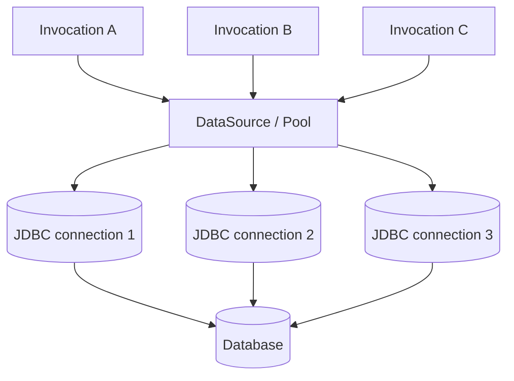
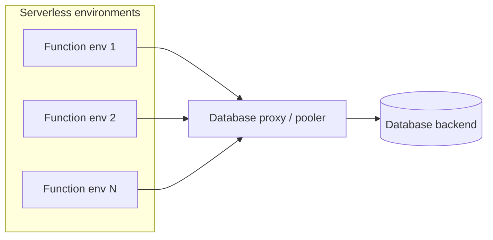

# Database Connections from Functions and Connection Exhaustion Risks

Java functions are typically launched on demand. As traffic rises, the platform can spin up additional execution environments to handle concurrent requests; as load drops, some environments may be kept for reuse or reclaimed. This scaling model lets applications respond flexibly, yet puts particular pressure on databases: each function instance may open one or more dedicated connections, while databases typically have finite connection limits.

Left uncontrolled, a traffic surge can push connection counts past `max_connections`, causing functions to wait for connections, queries to time out, or the database to reject other applications as well. Therefore, database connectivity is part of concurrency design and capacity planning—not merely a JDBC configuration detail.

Within the scope of **CLOUD_SERVERLESS**, this lesson focuses on Java functions triggered by HTTP, messages, or events, how to use JDBC connection pools, execution environment lifecycles, and solutions to protect the database when functions scale out.

## 1. Why does serverless easily put pressure on databases?

In a traditional server application, the number of processes or instances is usually controlled and relatively stable. Each instance's connection pool can be sized based on the expected instance count. With FaaS, the number of execution environments can grow rapidly with concurrency up to platform limits.

Suppose an API normally runs only 5 function environments. With each environment opening up to 2 database connections, total connections from the function stay around 10. When traffic spikes, the platform scales out to 150 environments; if each environment still holds a pool of 2 connections, that function alone can open up to 300 connections.

The database does not know those connections come from ephemeral function instances. It simply sees clients opening sessions and must allocate memory, workers, file descriptors, or internal resources for them. Once the limit is hit, new connections may be rejected even if some functions are merely holding idle connections.

Factors that increase this risk:

- Functions scale out faster than the database can scale.
- Each environment creates an oversized pool or keeps many idle connections.
- Multiple distinct functions share the same database.
- Connections are opened per invocation and not properly closed.
- Long-running queries or transactions keep connections occupied.
- Cold starts simultaneously open new connections during traffic bursts.
- Aggressive retries cause many invocations to attempt reconnecting at once while the database is already overloaded.

Key takeaway: **a pool created inside one execution environment is not a shared pool across the entire application**. When the platform spins up additional environments, each environment can create its own pool.

## 2. Function and JDBC connection lifecycles

An execution environment may live across multiple invocations, though its lifetime and reuse are controlled by the platform. An environment can be newly initialized, serve one or more invocations depending on the service model, sit idle before being reused, or be reclaimed.

For Java functions, distinguish three lifecycles:

| Component | Lifecycle | Appropriate management |
|---|---|---|
| Execution environment | Created, reused, or reclaimed by the platform | Do not assume permanent existence |
| `DataSource`/connection pool | Typically initialized once per environment and reused | Can live at application scope if the library is thread-safe and the concurrency model permits |
| JDBC `Connection`, `Statement`, `ResultSet` | Borrowed per operation or transaction | Borrow when needed and close immediately after completion |

A common pattern is initializing a shared `DataSource` at the environment scope, then borrowing a connection for each operation. A pool `DataSource` such as HikariCP is designed for concurrent use; an individual `Connection` object must not be arbitrarily shared across threads or invocations.

Do not hold a JDBC `Connection` in a static variable for permanent reuse. Connections can be closed by the database due to idle timeouts, network resets, failovers, or configuration changes. A long-warmed function environment does not guarantee that the connection inside remains valid.

Nor should a `DataSource` be recreated on every invocation when pool reuse is intended. Continuously creating new pools adds extra handshakes, authentication, management threads, and connections, increasing both cold starts and database pressure.

## 3. Using JDBC properly in Java functions

With JDBC, `Connection`, `PreparedStatement`, and `ResultSet` are all closeable resources. Use try-with-resources to ensure resources are returned to the pool even when statements throw exceptions.

```java
public final class CustomerRepository {
    private final DataSource dataSource;

    public CustomerRepository(DataSource dataSource) {
        this.dataSource = dataSource;
    }

    public Optional<Customer> findById(String customerId)
            throws SQLException {
        String sql = "SELECT id, name FROM customers WHERE id = ?";

        try (Connection connection = dataSource.getConnection();
             PreparedStatement statement = connection.prepareStatement(sql)) {
            statement.setString(1, customerId);

            try (ResultSet resultSet = statement.executeQuery()) {
                if (!resultSet.next()) {
                    return Optional.empty();
                }

                return Optional.of(new Customer(
                        resultSet.getString("id"),
                        resultSet.getString("name")));
            }
        }
    }
}
```

When a `Connection` borrowed from a pool is closed via `close()`, it is normally returned to the pool rather than closing the underlying TCP socket immediately. That is why closing the connection at the end of the operation matters: `close()` returns usage of the connection for other invocations.

Core principles:

- Borrow connections as late as possible and return them as early as possible.
- Never hold a connection while calling an HTTP service, sending an email, or waiting on non-database work.
- Use `PreparedStatement` for parameter binding and avoid concatenating SQL strings from user input.
- Close both `ResultSet` and `Statement` with try-with-resources.
- Never store a connection in a static field or share a single connection across multiple threads.
- Set explicit timeouts for connection acquisition and query execution.
- Keep transactions short; avoid waiting on users or external services while a transaction remains open.

## 4. How does a connection pool work?

A connection pool maintains a set of already established and authenticated JDBC connections. When a function needs to query, it borrows an available connection from the pool. Once processing finishes, the connection is returned to the pool for the next invocation.



Pools typically expose the following settings:

| Setting | Meaning | Risk if misconfigured |
|---|---|---|
| `maximumPoolSize` | Maximum connections in one pool | Too large increases total connections during scale-out |
| `minimumIdle` | Minimum idle connections to maintain | Too high causes many environments to hold connections even under low load |
| `connectionTimeout` | Wait time to borrow a connection | Too long hangs invocations; too short causes failures during brief spikes |
| `idleTimeout` | Idle duration before the pool may evict a connection | Misaligned with database or proxy idle timeouts |
| `maxLifetime` | Maximum lifetime of a connection in the pool | Longer than server-side limit may keep connections about to be closed |
| `validationTimeout` | Maximum time to validate a connection | Too high increases time to detect broken connections |
| Leak detection | Detects connections held open too long | Threshold too low may trigger false alarms |

A pool reuses connections within one environment, but does not automatically cap how many pools get created when functions scale out. Overall limits must be engineered through FaaS concurrency, pool sizing, and/or a database proxy layer.

## 5. Initializing a pool suited to the execution environment

On platforms that reuse environments, a `DataSource` can be created once at application scope. The example below illustrates a HikariCP configuration with a small pool. These values are merely a starting point and must be tuned for concurrency, the database, and provider limits.

```java
public final class Database {
    private static final HikariDataSource DATA_SOURCE = createDataSource();

    private Database() {}

    public static DataSource dataSource() {
        return DATA_SOURCE;
    }

    private static HikariDataSource createDataSource() {
        HikariConfig config = new HikariConfig();
        config.setJdbcUrl(requiredEnv("JDBC_URL"));
        config.setUsername(requiredEnv("DB_USERNAME"));
        config.setPassword(requiredEnv("DB_PASSWORD"));

        config.setPoolName("orders-function-pool");
        config.setMaximumPoolSize(1);
        config.setMinimumIdle(0);
        config.setConnectionTimeout(3_000);
        config.setValidationTimeout(1_000);
        config.setIdleTimeout(120_000);
        config.setMaxLifetime(1_500_000);

        return new HikariDataSource(config);
    }

    private static String requiredEnv(String name) {
        String value = System.getenv(name);
        if (value == null || value.isBlank()) {
            throw new IllegalStateException("Missing configuration: " + name);
        }
        return value;
    }
}
```

In this example, `maximumPoolSize=1` is a conservative choice for a function running one database operation at a time per environment. If an invocation genuinely runs multiple queries in parallel, or the platform allows multiple concurrent requests inside the same environment, recalculate pool size based on internal concurrency. Do not blindly copy this value across every application.

`minimumIdle=0` avoids forcing newly created environments to open connections immediately upon pool initialization. Connections are opened on demand, reducing idle connections across many environments. `maxLifetime` must be shorter than the database/proxy connection lifetime limit if one exists. `idleTimeout` and other timeout settings must also reflect real infrastructure configuration.

Do not close the `DataSource` after every invocation; doing so destroys the pool and forces the next invocation to recreate all connections. Only close the pool when the runtime provides a reliable shutdown lifecycle or in a long-running application with an explicit shutdown hook. FaaS platforms may reclaim environments without guaranteeing cleanup hooks always execute.

Never store a `Connection` in a static variable. Keep only the `DataSource`/pool and acquire connections per operation with try-with-resources.

## 6. Calculating a connection budget before scaling

To avoid exhausting connections, estimate the total connections that all functions and other applications can use simultaneously.

A conservative estimation formula:

\[
C_{total} \approx N_{env} \times P_{env} + C_{other}
\]

Where:

- `N_env`: number of execution environments that can run concurrently at the configured concurrency limit.
- `P_env`: maximum connections each environment may open.
- `C_other`: connections from other applications, migrations, admins, monitoring, batch jobs, and clients bypassing this pool.

For example, if FaaS is permitted up to 120 concurrent environments and each has a max pool of 2 connections, the function can consume up to 240 connections. If the database has a 400-connection limit and 80 must be reserved for other systems and operations, the remaining budget is 320; this single function appears within budget. However, if two other functions can also scale to 120 environments with a pool of 2 connections each, the three functions together reach 720 and exceed the limit.

When calculating, do not use average connection counts alone. Account for peak load, retries, rolling deployments, multiple functions scaling simultaneously, and connections held idle. Also reserve headroom for failovers, administrative queries, and internal database connections.

One control mechanism is capping maximum function concurrency. If the database can allocate only 150 connections to serverless workloads and each environment uses at most 2 connections, function concurrency must be capped so total connections stay within budget after accounting for other workloads. With multiple functions, allocate budgets across groups rather than letting each function claim the entire limit.

## 7. Why don't connection pools solve everything?

A pool only reuses connections within a single process/environment. When the platform scales from 10 to 200 environments, the application can have 200 independent pools. If each pool holds 5 connections, the database may see up to 1,000 connections.

Pools can also introduce other issues:

- Many environments initializing pools simultaneously during cold starts create a connection storm.
- A large `minimumIdle` keeps unnecessary connections open.
- A `maximumPoolSize` that is too low leaves invocations waiting for connections even when the database has spare capacity.
- A `maximumPoolSize` that is too high exhausts database connections during scale-out.
- Connections closed by the database while an environment sleeps cause stale connection errors on the next borrow.
- Pools leak connections if code fails to close connections or holds transactions too long.

Therefore, combine small pool sizes, concurrency limits, timeouts, proxies, or suitable database access models. Do not simply raise `maximumPoolSize` upon seeing a "connection timeout" error; first determine whether the database truly has spare capacity or whether the pool is holding connections open too long.

## 8. Using a database proxy or shared pooler

A database proxy/pooler sitting between functions and the database reduces direct backend connections. Each execution environment connects to the proxy; the proxy manages a set of backend connections to the database and shares them among clients according to the product's pooling mechanism.



Common benefits:

- Absorbs a larger number of client connections than backend connections.
- Centralizes backend connection management and mitigates connection storms.
- Assists with failovers or connection routing depending on service capabilities.
- Can integrate authentication, TLS, and secret management.

A proxy does not give the database infinite capacity. Backend connections remain finite, and the proxy can return errors or queue requests when capacity runs out. Operations retaining session state, temporary tables, session variables, prepared statements, or long transactions can reduce multiplexing efficiency because the proxy must pin the client to a backend connection (*session pinning*). Read the proxy's behavior carefully and test with your driver/ORM.

When selecting a proxy, check maximum client connections, backend connections, timeouts, transaction behavior, IAM/TLS support, regional limits, and pricing model. For PostgreSQL, PgBouncer is a widely used pooler; many cloud platforms also offer managed proxies.

## 9. Alternatives to direct JDBC connections

Not every workload needs to open direct JDBC sockets from a function. Depending on the database and access characteristics, consider:

| Access approach | Best suited when | Factors to evaluate |
|---|---|---|
| Direct JDBC + small pool | Moderate load with controlled concurrency and connection budget | Total pools grow with environment count |
| JDBC via managed proxy/pooler | Many short-lived environments need to share backend connections | Proxy cost, session pinning limits, and driver behavior |
| HTTP-based Data API | Database offers an HTTPS access API and workload fits | Latency, payload limits, transactions, and differences from JDBC |
| Serverless/autoscaling database | Spiky workloads where database scaling fits | Database scaling lag, minimums, limits, and pricing model |
| Queue + concurrency-limited workers | Asynchronous processing is acceptable and DB load must be throttled | Queue wait times and business SLAs |

When using an HTTP Data API, functions do not hold direct JDBC sockets, yet must still manage rate limits, transactions, retries, and concurrent requests. "No TCP connections from functions" does not mean zero resource limits at the database.

## 10. Timeouts and connection error handling

Database connectivity has multiple stages that can time out independently:

- DNS lookup and TCP establishment.
- TLS handshake and authentication.
- Waiting to borrow a connection from the pool.
- Waiting on a query or lock inside the database.
- Reading results and transferring data over the network.
- Committing or rolling back a transaction.

Do not set one very long timeout across all stages. Total elapsed time across stages must fit within the function timeout and request/message SLA. If an HTTP function has a 10-second timeout, spending 8 seconds waiting on the pool leaves almost no time for business processing.

When errors occur, distinguish between them:

| Error category | Example | Remediation direction |
|---|---|---|
| Pool exhausted | `Connection is not available, request timed out` | Check for leaks, long queries/transactions, pool size, and concurrency |
| Database rejects connection | Exceeded `max_connections`, too many clients | Lower concurrency/pool size, add a proxy, release connections |
| Stale connection | Socket closed while environment was idle or during DB failover | Evict bad connections, tune lifetime/validation, and retry safely |
| Query timeout | Long locks, slow queries, or overloaded database | Analyze query plans, indexes, locks, and enforce time bounds |
| Authentication failure | Wrong/expired secret or invalid IAM token | Inspect credential provisioning and refresh; do not retry infinitely |
| Network failure | Broken route, security group, DNS, or endpoint | Inspect network paths and service health |

Retry only likely transient errors, using backoff with jitter and a bounded retry count. Do not retry immediately in a tight loop while the database is overloaded, as that amplifies connection storms. Schema, permission, or invalid data errors are rarely resolved by retries.

## 11. Short transactions and avoiding holding connections during external calls

A transaction should wrap only the database operations requiring atomicity. Never open a transaction, read a record, and then call an HTTP service for several seconds before committing. While waiting on the network, both the connection and locks remain held; if many functions do this concurrently, the pool will quickly be exhausted.

For example, in an ordering flow that must update an order and request payment:

1. Open a transaction, check and update order status, and write an outbox event.
2. Commit the transaction to return the connection to the pool.
3. Have a separate worker read the outbox and call the payment service.
4. Record the payment outcome in another short transaction.

The outbox pattern decouples database operations from slow network calls and reduces the risk of writing data without emitting the event. However, the worker still needs idempotency and consistent state handling if the payment service times out.

If a task requires multiple steps that cannot fit inside a short transaction, use a workflow/saga with durable states, timeouts, and appropriate compensation steps. Never hold a connection open across the entire workflow.

## 12. Securing database connections

A connection that works reliably yet lacks security is still a production defect. Apply these principles:

- **Private networking:** place the database in a private network where appropriate; allow traffic only from authorized security groups or workloads.
- **TLS:** encrypt JDBC connections and verify server certificates; never disable hostname/certificate checks as a temporary workaround.
- **Credential management:** store usernames/passwords or auth credentials in a secret manager, never committed to repositories or packaged in artifacts.
- **Least privilege:** grant each function permissions only on the required schemas, tables, and operations. A reporting read function does not need database admin privileges.
- **Credential rotation:** design connection creation to fetch fresh credentials when establishing new connections; avoid keeping stale secrets indefinitely in static variables or static pool config.
- **IAM database authentication:** when using time-limited tokens, ensure the pool creates new connections with a valid token; do not assume an auth token can be reused indefinitely.
- **Auditing and logging:** never log passwords, access tokens, JDBC URLs containing secrets, or sensitive data.

When rotating credentials, account for currently open connections. Some databases validate passwords only at session establishment; existing connections may stay alive, while new connections fail if the pool still uses an invalidated secret. Coordinate rotation windows, secret updates, and how the pool fetches fresh credentials.

## 13. Connecting to databases in a VPC or private network

Many databases are not exposed to the public Internet. Functions need an appropriate network path to reach them, such as attaching to private subnets or using the platform's private connectivity mechanism.

When configuring, verify:

1. Bidirectional network routing exists between the function and database.
2. Security groups/firewalls permit the exact port from the authorized source.
3. DNS resolves the database endpoint within the right network and region.
4. The function has required egress if it must fetch secrets, call management APIs, or reach other services.
5. IP address/subnet capacity is sufficient for concurrency and platform-created network interfaces.
6. Do not expose the database to the public Internet merely to make function connectivity easier.

Placing a function in a VPC may impact cold starts, network setup latency, and access to public services depending on the platform. Measure using the actual deployment configuration. When using a database proxy, verify that the proxy sits on a network path reachable by the function and that policies restrict access to necessary workloads only.

## 14. Observing pools and databases

Tracking only function invocation counts is insufficient. You need visibility into whether connections are active, waiting, or held too long.

Metrics to monitor:

| Group | Suggested metrics | What to detect |
|---|---|---|
| Pool | Active, idle, total, pending/waiting borrowers | Pool exhaustion, leaks, or undersized pool |
| Acquisition | Connection acquisition time, timeout count | Invocations waiting too long for connections |
| Connection health | Creation rate, validation failures, connection errors | Stale connections or connection storms |
| Query | Query latency p50/p95/p99, timeouts, rows scanned | Slow queries and prolonged transactions |
| Database | Current connections, max connections, CPU, memory, locks | Database nearing limits or resource bottlenecks |
| FaaS | Concurrent executions, throttles, duration, cold starts | Scale-out exceeding connection budget |
| Proxy/pooler | Client connections, backend connections, queue/wait, pinning | Proxy becoming a bottleneck or reduced multiplexing |

Logs should include function name, request/correlation ID, connection acquisition time, query duration, and error type. Do not log credentials or sensitive payloads. Add alerts when pool wait times rise, database connection utilization crosses thresholds, or timeout rates spike.

To locate connection leaks, enable pool leak detection in appropriate environments, inspect stack traces, and verify every exception path closes resources. Leak detection is a diagnostic aid; it does not replace try-with-resources.

## 15. Capacity calculation example for a Java function

Suppose an order-event processing function has the following parameters:

- FaaS is configured with a maximum concurrency of 80.
- Each execution environment has a pool of at most 1 connection.
- Other services already use or are allocated 90 connections.
- The database limit is 250 connections, with 40 reserved for admin, monitoring, and headroom.

The remaining budget for the function is:

\[
C_{budget}=250-90-40=120
\]

Estimated maximum demand of the function:

\[
C_{function}=80\times1=80
\]

Under these assumptions, 80 connections fit within the 120 budget. However, if pool size increases to 2, demand becomes 160 and exceeds the budget. If a second function also scales to 80 environments with pool size 1, combined demand likewise reaches 160.

Calculations must be verified under realistic load testing. You can set lower concurrency, introduce a proxy, rate-limit consumers, or increase database capacity. When using queues, lowering worker concurrency acts as natural backpressure: messages wait in the queue instead of spawning extra function invocations and connections.

## 16. Common failures and how to prevent them

| Symptom | Possible cause | Mitigation |
|---|---|---|
| `Too many connections` | Sum of pools across environments exceeds DB limit | Calculate connection budget, reduce pool/concurrency, use proxy |
| Connection timeout in pool | Connections held too long, leaks, or pool too small | Inspect active/pending counts, query latency, and try-with-resources |
| Errors after function idle period | Connections closed by DB/network before environment reuse | Configure lifetime/validation and test resume after idle |
| Errors spike during traffic burst | Concurrent cold starts opening connections at once | Cap concurrency, keep pools small, add proxy and backoff |
| Database overloaded below max connections | Heavy queries, locks, CPU/IO, or long transactions | Analyze queries, indexes, transactions, and DB metrics |
| Function throttled yet DB still overloaded | Retries or other workloads still generating load | Adjust retries, queue concurrency, and shared budget |
| Secret rotation breaks new connections | Pool still using old credentials | Refresh credentials and verify new connection creation behavior |
| Proxy opens more backend connections than expected | Session pinning or long transactions | Check pinning behavior and optimize session usage |

Do not try to fix every error by raising `maximumPoolSize`. Identify whether the bottleneck lies in the pool, database, network, or queries before changing settings.

## 17. Pre-deployment checklist for database-backed functions

| Question | Required evidence or configuration |
|---|---|
| What is the maximum total connection count? | Formula of concurrency × pool size across all relevant functions |
| How much database connection budget remains? | Server limit minus other workloads and reserved headroom |
| Where is the pool created? | `DataSource` reused per environment; never recreated per invocation |
| Are connections closed? | Try-with-resources for connections, statements, and result sets |
| Is the pool size appropriate? | Sized from internal concurrency and connection budget |
| Are timeouts aligned? | Connection timeout, query timeout, and function timeout coordinated |
| Are stale connections handled? | Lifetime/validation, proxy behavior, and idle/failover testing |
| Are transactions short? | No connection held while calling external services or waiting on workflows |
| Is burst traffic regulated? | Reserved/max concurrency, queue backpressure, and bounded retries |
| Are credentials and networking secure? | Secret manager, TLS, least privilege, private routing, and rotation |
| Is the pool observable? | Active/idle/pending counts, acquisition latency, timeouts, and DB connections |
| Is there an overload plan? | Concurrency reduction, appropriate circuit breakers, queues, and recovery runbooks |

## 18. Maintaining stable connections in production

Managing database connections in serverless requires coordinating three layers. At the function layer, use an environment-reusable `DataSource`, borrow connections just in time, and close resources immediately afterward. At the platform layer, cap concurrency and use queues to smooth bursts. At the database layer, define a connection budget, monitor load, and consider a proxy or suitable access pattern.

Before releasing, test at least these scenarios: simultaneous cold starts, traffic bursts, environment reuse after idle periods, database failovers, secret rotation, slow queries, and approaching connection limits. Measure connection acquisition time, query latency, connection counts, and error rates.

In FaaS, function scale-out does not mean the database can scale at the same pace. By sizing connection budgets from max concurrency, keeping pools small, handling stale connections, and regulating load with queues or proxies, Java functions can leverage serverless elasticity without exhausting database connection resources.
