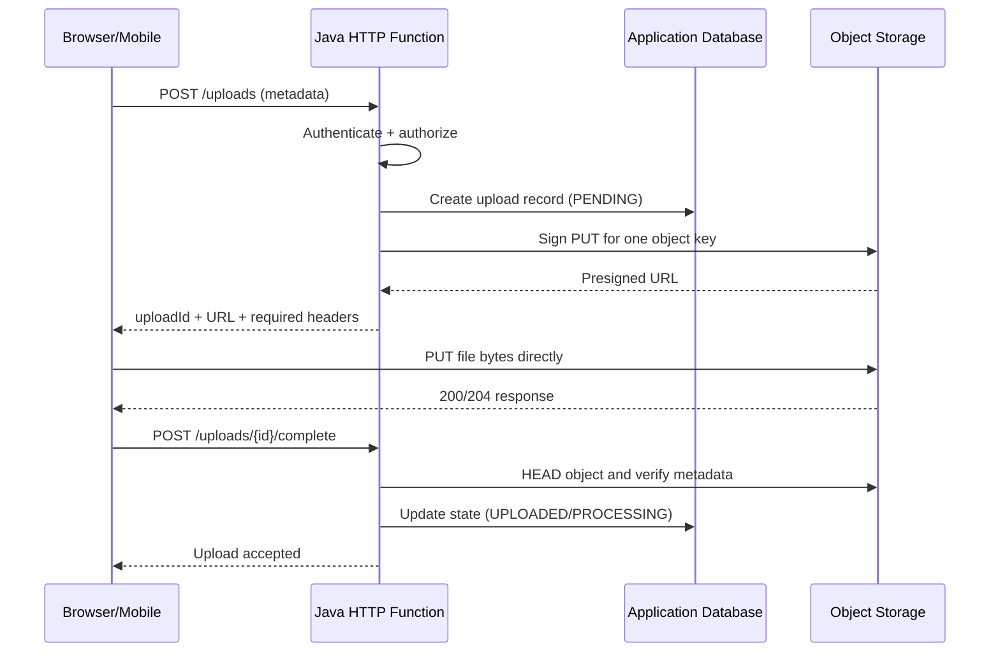
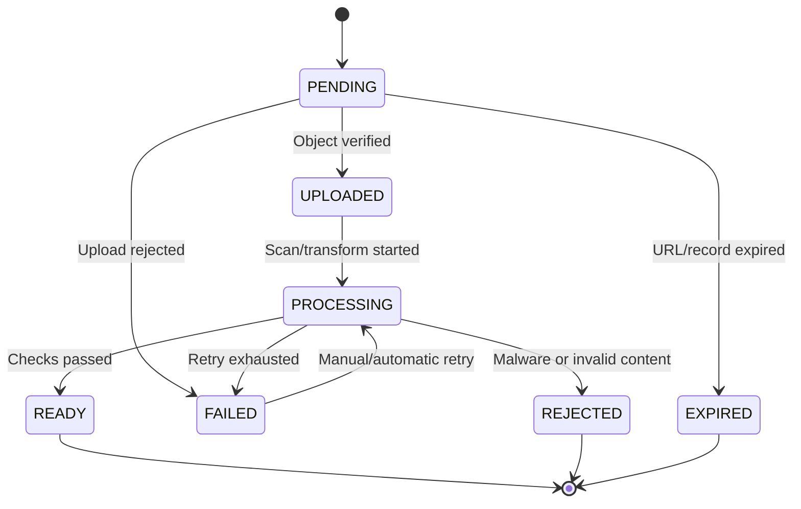

# Direct Object Storage Uploads with Presigned URLs

File uploads are a common task in serverless applications: users upload avatars, documents, videos, or data files into the system. If every byte of a file flows through the API and a Java function, the function must receive and forward large payloads. This increases execution duration, memory usage, bandwidth, and cost.

A common alternative is **direct upload to object storage using a presigned URL** (or signed URL). The backend authenticates the user, chooses the object key, and generates a signed URL with a short expiration. The client uses that URL to upload the file directly to the storage service. The Java function handles only upload authorization and status confirmation; file bytes never need to pass through the function.

This lesson covers the direct upload flow, generating presigned URLs in Java, security boundaries, post-upload object verification, and state management in serverless systems.

## 1. Object storage and presigned URLs

Object storage saves data as objects inside a bucket or container. Each object typically has:

- **Object key:** an identifying name within the bucket, often formatted like a logical path.
- **Data:** the byte content of the file.
- **Metadata:** information such as content type, size, modification time, and custom metadata.
- **Version (if enabled):** a version identifier of the object when the service supports versioning.

Object storage suits images, videos, documents, backups, and unstructured data. These services are built to absorb heavy upload and download traffic without requiring a backend intermediary to process every byte.

A presigned URL is generated using the credentials of an identity with permissions on object storage. The signature binds specific parts of the request, such as HTTP method, bucket, object key, expiration, and certain headers. Anyone holding the URL can perform the permitted operation during its validity window without receiving the backend's secrets.

Services with equivalent concepts:

- Amazon S3 presigned URL.
- Google Cloud Storage signed URL.
- Azure Blob Storage SAS (Shared Access Signature).

Signing mechanics, parameter names, permissions, and limits vary across providers. The Java examples here use AWS SDK for Java 2.x and S3; for another provider, substitute its corresponding SDK and protocol.

### A presigned URL is temporary access permission

Presigned URLs typically carry authentication data in the query string. Therefore, anyone possessing the URL can exercise the granted permission until the URL expires or the underlying credential/policy is revoked. Treat the URL like a bearer token:

- Never write full URLs into logs, analytics, or error-tracking systems.
- Never send URLs over public channels or store them where other users can read them.
- Use short expirations, just long enough for the upload operation.
- Grant permission only for a specific object key and the required HTTP method.
- Never ship secret access keys to browsers or mobile apps.

A presigned URL does not replace user authentication on the backend. The backend must still verify who is requesting the upload, whether they have permission to upload to that resource, and what file types and sizes they are allowed.

## 2. Direct upload flow

A basic upload flow consists of three main steps:

1. Client calls the backend API to request upload permission.
2. Java function authenticates and issues a presigned URL for a specific object key.
3. Client sends the file content directly to object storage using that URL.

After uploading, the application needs a confirmation step to mark the object ready or advance it to downstream processing.



Role of each component:

- **Client:** selects the file, requests the URL, sends bytes, and reports completion.
- **Java function:** authenticates, checks quotas and metadata, generates the object key, signs the URL, and verifies the outcome.
- **Database:** stores upload state, owner, object key, limits, and expiration.
- **Object storage:** receives and stores bytes directly.
- **Worker/event function:** scans for malware, generates thumbnails, extracts metadata, or promotes the object to an approved storage area.

The function never receives a request body containing the entire file in a typical upload flow. It handles the control plane (authorization and state), while object storage handles the data plane (byte transfer).

## 3. Why not proxy files through a Java function?

Suppose a user uploads a 500 MB video. If the client sends the video to the API, the function must receive the data, possibly buffer it in memory or temporary storage, and then call object storage to upload it. This adds an extra data transfer hop and consumes compute resources.

Direct upload offers these benefits:

- Reduces bandwidth flowing through the backend.
- Avoids holding large payloads in function memory.
- Shortens HTTP invocation duration.
- Reduces the risk of hitting API Gateway or runtime body-size and timeout limits.
- Lets object storage handle heavy upload traffic natively.
- Keeps the backend focused on lightweight operations like authentication, URL signing, and confirmation.

However, direct upload does not eliminate all costs. The system still incurs request fees, storage capacity, data transfer, malware scanning, image/video processing, and downloads. Account for both object storage and post-processing service costs.

Uploading through the backend can still make sense when data must be transformed inline upon receipt, inspected before persistence, uses a custom protocol, or has requirements object storage does not support. For large files, prefer streaming over buffering the whole file in memory if traffic must pass through the backend.

## 4. Authorizing uploads on the backend

Clients must never freely pick buckets and object keys. The backend must generate the object key and bind the URL to the exact allowed location.

An upload request might contain:

```json
{
  "fileName": "avatar.png",
  "contentType": "image/png",
  "sizeBytes": 245760,
  "purpose": "PROFILE_IMAGE"
}
```

This is merely client-declared metadata, not proof that the file is truly a PNG or matches that size. The backend uses it for preliminary validation and setting limits; after upload, the actual object must be verified.

The backend API should:

1. Authenticate the user's access token or session.
2. Derive `userId` from the authenticated identity, never trusting a client-supplied `userId`.
3. Verify the user has permission to upload to the target resource.
4. Validate `purpose`, allowed file types, declared size, and quotas.
5. Generate a unique `uploadId` and server-controlled object key.
6. Persist an upload record with status `PENDING` and an expiration time.
7. Generate a presigned URL scoped to the exact method, object key, headers, and duration.
8. Return the URL along with the headers the client must send.

Example response:

```json
{
  "uploadId": "upl_7f12a9",
  "uploadUrl": "https://storage.example/...",
  "method": "PUT",
  "requiredHeaders": {
    "Content-Type": "image/png"
  },
  "expiresAt": "2026-11-17T12:40:00Z"
}
```

In practice, `uploadUrl` is a long signed URL. Avoid storing that URL in the database without a clear need; storing `uploadId`, object key, expiration, owner, and expected metadata is usually sufficient.

### Object keys should be server-generated

Never use the client's raw `fileName` as the object key. Filenames may contain special characters, fake path segments, personal data, or collide with existing objects.

Keys can follow a structure such as:

```text
quarantine/{userId}/{uploadId}
```

or:

```text
incoming/{tenantId}/{yyyy}/{MM}/{randomId}
```

Use a UUID or strong random ID to prevent key guessing. `userId` and `tenantId` must come from authenticated context. The original filename can be stored separately as sanitized metadata if the application needs to display it back to the user.

Avoid putting usernames, email addresses, or sensitive data into object keys unnecessarily, as keys often appear in logs, events, and operational tools.

## 5. Generating a presigned PUT URL in Java

The example below uses AWS SDK for Java 2.x. The backend holds an `S3Presigner` configured with the environment's region and credential provider. In Lambda, the function's role has `PutObject` permissions restricted to the allowed prefix.

```java
import java.time.Duration;
import java.util.UUID;
import software.amazon.awssdk.services.s3.model.PutObjectRequest;
import software.amazon.awssdk.services.s3.presigner.S3Presigner;
import software.amazon.awssdk.services.s3.presigner.model.PutObjectPresignRequest;

public final class UploadUrlService {

    private final S3Presigner presigner;
    private final String bucket;

    public UploadUrlService(S3Presigner presigner, String bucket) {
        this.presigner = presigner;
        this.bucket = bucket;
    }

    public PresignedUpload createUpload(
            String trustedUserId,
            String contentType) {

        String uploadId = UUID.randomUUID().toString();
        String objectKey = "quarantine/" + trustedUserId + "/" + uploadId;

        PutObjectRequest putObjectRequest = PutObjectRequest.builder()
                .bucket(bucket)
                .key(objectKey)
                .contentType(contentType)
                .build();

        PutObjectPresignRequest presignRequest =
                PutObjectPresignRequest.builder()
                        .signatureDuration(Duration.ofMinutes(10))
                        .putObjectRequest(putObjectRequest)
                        .build();

        var signedRequest = presigner.presignPutObject(presignRequest);

        return new PresignedUpload(
                uploadId,
                objectKey,
                signedRequest.url().toExternalForm(),
                contentType
        );
    }

    public record PresignedUpload(
            String uploadId,
            String objectKey,
            String uploadUrl,
            String contentType
    ) {}
}
```

This snippet focuses on URL signing. A complete application must also validate the user, quotas, content-type allow-list, persist the upload record, and handle errors.

### Configuring the presigner

An `S3Presigner` can be created at application startup and reused across the execution environment's lifecycle:

```java
import software.amazon.awssdk.regions.Region;
import software.amazon.awssdk.services.s3.presigner.S3Presigner;

S3Presigner presigner = S3Presigner.builder()
        .region(Region.AP_SOUTHEAST_1)
        .build();
```

The SDK can use the environment's credential provider chain, such as a Lambda IAM role. Never hardcode static access keys and secret keys in source code. If manually creating a presigner in a long-running application, close it on shutdown. In Lambda, an instance initialized during environment initialization can be reused if lifecycle management is appropriate.

The function's IAM role needs least-privilege permissions to sign requests for the intended prefix. Check bucket policies, encryption policies, and organizational conditions. End users never receive AWS roles or credentials; they receive only a narrowly scoped presigned URL.

### Signed headers must match

In the example, content type is included in `PutObjectRequest`, so it can be part of the signed headers list. During upload, the client must send the exact `Content-Type` used at signing time. If the backend signs `image/png` but the client sends `application/octet-stream`, storage may reject the request due to a signature mismatch.

Other headers such as checksums or custom metadata can also be bound into the signature. Only instruct the client to send headers returned by the backend and confirmed as required by SDK/provider docs. Never alter headers arbitrarily after the URL is signed.

The URL has a 10-minute lifetime in this example. Actual duration should be long enough for users on slow connections, yet as short as practical. A URL can also stop working earlier if the signing credential expires or is revoked.

## 6. Direct client upload

After receiving `uploadUrl`, a browser can send the file via `fetch`:

```javascript
async function uploadFile(file, upload) {
  const response = await fetch(upload.uploadUrl, {
    method: "PUT",
    headers: {
      "Content-Type": upload.requiredHeaders["Content-Type"]
    },
    body: file
  });

  if (!response.ok) {
    throw new Error("Object storage rejected the upload");
  }

  return response;
}
```

This snippet assumes the backend returned matching `requiredHeaders` and URL. The client does not send application access tokens to object storage; the presigned URL already carries temporary authorization for the specific operation. The access token is still used when calling backend APIs to request the URL and confirm upload completion.

If an upload fails because the URL expired, the client must request a new URL from the backend. Never modify the query string or swap the object key in an old URL.

### Configuring CORS for browsers

When a browser uploads to an object storage domain that differs from the application domain, the browser enforces Cross-Origin Resource Sharing (CORS). The bucket or storage container must allow the application's origin, method, and required headers.

Conceptual configuration example:

```text
AllowedOrigins:
  - https://app.example.com
AllowedMethods:
  - PUT
AllowedHeaders:
  - Content-Type
  - x-amz-checksum-sha256
ExposeHeaders:
  - ETag
```

Actual configuration depends on the service. Allow only the required application origins, methods, and headers. CORS is not an authentication mechanism: requests from non-browser scripts or HTTP tools can still call the URL if they possess a valid URL. The signature and object permissions determine whether the request is accepted.

If the client needs to read `ETag` or checksum headers, declare them in exposed headers. Do not assume `ETag` is always the MD5 of the object; multipart uploads and certain encryption configurations change how it is computed.

## 7. How do PUT URLs and POST policies differ?

There are two common ways to upload using presigned URLs:

| Criterion | Presigned PUT | Presigned POST |
|---|---|---|
| Delivery | HTTP PUT with object as body | HTTP POST `multipart/form-data` |
| Conditions | Binds method, key, and signed headers | Can declare policy conditions |
| Size limits | Requires suitable validation design; do not assume every size header is signed as desired | With S3 POST policy, `content-length-range` can be used |
| Client | Sends raw file bytes directly | Sends form fields and file |
| Best suited | Simple PUT flows, uploading a specific object | When policy conditions like size ranges are needed |

If size enforcement right at storage is needed, an S3 presigned POST policy may fit better because it supports `content-length-range` conditions. With PUT URLs, verify what limits the service and SDK actually enforce; do not assume client-declared size metadata or a self-sent `Content-Length` is automatically signed and enforced.

Whether using PUT or POST, the backend must still inspect the object after upload. A client may declare a smaller size than reality or spoof a content type. Post-upload verification protects business state; storage-side constraints reduce the risk of wasting resources prior to inspection.

## 8. Verifying the object after upload

Receiving HTTP 200 or 204 from object storage indicates the PUT operation was accepted by the storage protocol. It does not mean the file is safe or valid under business rules.

When the client calls the complete API, the backend should:

1. Authenticate the user and verify `uploadId` belongs to them.
2. Read the upload record and confirm the current state still allows completion.
3. Verify the object exists using `HEAD` or an equivalent metadata API.
4. Compare bucket, key, size, and metadata against expectations.
5. Verify the checksum if the upload flow declared a trusted checksum.
6. Transition status to `UPLOADED` or `PROCESSING` inside a transaction.
7. Dispatch scanning/processing work via event or outbox.

Example fields to reconcile:

| Attribute | Expected source | Actual source |
|---|---|---|
| Object key | Backend-created upload record | Key queried in storage |
| Size | Limits or client-declared size | `Content-Length`/metadata from storage |
| Content type | Allowed business types | Storage metadata and content inspection result |
| Checksum | Client-sent and backend-bound checksum if any | Checksum confirmed by storage |
| Owner | Upload record bound to user/tenant | Backend verified via `uploadId` and key |

Never trust `uploadId`, `objectKey`, `sizeBytes`, or `contentType` sent by the client during the complete step without checking against the record created when issuing the URL.

### Checksum verification

Checksums help detect altered content or incomplete transfers. SHA-256 can be used if the service supports it and the upload protocol permits declaring the checksum before signing the URL.

A client-provided checksum does not prove a file is safe; it only verifies that stored bytes match the bytes the client hashed. The backend can recompute or ask storage to confirm the checksum to ensure data integrity.

Do not use `ETag` as a general-purpose checksum without knowing the service's semantics. With S3 multipart uploads, `ETag` is typically not the MD5 of the full object.

## 9. Managing upload state

Uploading is a multi-step process that can be interrupted. Store state in a database so clients and workers know what stage an object is in.



States may include:

- **PENDING:** backend created the upload record and URL; object is not yet verified.
- **UPLOADED:** object exists and passed basic checks.
- **PROCESSING:** malware scanning, metadata extraction, or derivative generation in progress.
- **READY:** file passed validation and is approved for use.
- **REJECTED:** file violated policy or is unsafe.
- **FAILED:** processing failed after retry policy exhausted.
- **EXPIRED:** upload did not complete within the allowed window.

Transitions should use conditional updates—for example, transitioning from `PENDING` to `UPLOADED` only if the record is still `PENDING`. This prevents concurrent complete requests or duplicate events from overwriting newer state.

### Do not rely solely on client callbacks

A client may call `/complete` after a successful PUT, yet that callback is not the sole proof. The client might close the browser tab, lose connectivity, or deliberately send a fake callback. The backend must inspect the object directly.

Another option is using an object-created event from storage to trigger a function. The event may arrive before or after the client callback and may be redelivered. Thus, both paths should update the same idempotent state machine.

When using storage events as completion signals, the worker must match the event to an upload record using bucket/key/version, check record state, and verify the object. Never blindly trust event payloads when metadata can be verified against storage.

## 10. Isolating untrusted objects

Files uploaded directly by clients are untrusted data, even when signed with a valid URL. The signature proves only authorization to upload under that URL, not that the contents are safe.

Use a quarantine area or separate prefix for newly uploaded objects:

```text
quarantine/{tenantId}/{uploadId}
```

After processing and validation succeed, the system can copy the object to the official prefix:

```text
approved/{tenantId}/{assetId}
```

Validation steps can include:

- Comparing size against business limits.
- Inspecting file signatures/magic bytes rather than trusting extensions or `Content-Type`.
- Scanning for malware using an appropriate service.
- Decoding or parsing files with hardened parsers and keeping libraries updated.
- Generating thumbnails or previews inside an isolated environment.
- Rejecting files with unsupported formats, malformed structure, or policy violations.
- Setting appropriate `Content-Disposition` on downloads; avoid serving arbitrary content under sensitive origins.

A file named `photo.png` with an `image/png` header can still hold entirely different content. Never rely on client-declared filenames or `Content-Type` to judge safety.

Never enable public access on a bucket merely so browsers can upload. Keep buckets private and use narrowly scoped presigned URLs. For downloads, the backend can issue a presigned GET after verifying the user is authorized to read the object in the `READY` state.

## 11. Limitations of presigned URLs

Presigned URLs are typically time-bounded bearer capabilities, not single-use tokens. While valid, a URL can be reused. With PUT to the same key, a new request can overwrite the existing object if policies and versioning allow.

Therefore:

- Generate a random, dedicated object key per upload.
- Do not issue URLs valid longer than necessary.
- Never reuse keys across users or upload sessions.
- Check the upload record and state before accepting completion.
- Consider bucket versioning or conditional writes if detecting/preserving overwritten versions is needed.
- Use bound checksums when specific content integrity must be confirmed.
- Restrict URL signing permissions and write permissions in IAM/bucket policies.

Do not claim a URL is one-time-use if the storage service provides no such guarantee. If business rules demand strict write-once semantics, add storage conditions, versioning, or an appropriate completion control workflow.

An issued URL is generally hard to revoke individually on the spot. You can wait for expiration, revoke the signing credential, or alter policies, though those options often have a broader blast radius. That is why short lifetimes and unique object keys are critical.

## 12. Uploading large files with multipart upload

A simple PUT suits small or medium objects. For large files, multipart upload splits the file into multiple parts. Clients upload each part independently and can retry a single failed part instead of resending the entire file.

General flow:

1. Backend initiates a multipart upload in object storage.
2. Backend issues presigned URLs for each part or batch of parts.
3. Client splits the file into parts and uploads them concurrently within limits.
4. Client collects the ETag/checksum of each part per protocol.
5. Backend validates the part list and calls `CompleteMultipartUpload`.
6. Storage assembles the parts into the final object.
7. Backend verifies the object and transitions the upload state.

The backend should track the storage `uploadId`, max part count, part sizes, part order, and expiration. Do not let clients finalize multipart uploads themselves if strict control is required.

If a user abandons an upload, multipart uploads can leave incomplete parts behind and incur ongoing storage charges. Configure a lifecycle rule to automatically abort incomplete multipart uploads after an appropriate interval. For standard uploads as well, run cleanup jobs for expired `PENDING` records and unreferenced quarantine objects.

## 13. CORS, networking, and user experience

Direct uploads must account for the client's network environment:

- Browsers must pass CORS preflight checks when sending PUTs or custom headers.
- Mobile networks can drop; clients should show progress and support retries.
- URLs may expire while users pick files or wait on slow networks; clients must request a fresh URL.
- With multipart, retry only failed parts rather than re-uploading the whole file.
- Clients should distinguish errors from the URL-issuing backend versus errors from object storage.
- Never display full presigned URLs in error messages or client-side logs.

CORS settings affect browsers only. Native mobile apps or CLI clients are not governed by browser CORS enforcement, yet still require a valid URL and signature.

If object storage sits in a region far from users, upload latency can climb. Consider buckets closer to users, transfer acceleration, or resumable upload mechanisms if supported by the provider and justified by cost.

## 14. Event integration and post-upload processing

Object storage can typically emit events when objects are created. These events can trigger a Java function to:

- Scan for malware.
- Generate thumbnails or previews.
- Extract metadata.
- Verify format or dimensions.
- Compute checksums.
- Copy the object to an approved prefix.
- Update the upload record to `READY` or `REJECTED`.

Event flows require idempotency. An object-created event can be redelivered or arrive out of order. Use bucket, key, version ID, or event ID as an appropriate processing key. Before transitioning states, check the current state and object version being processed.

If an image processing function hits a transient error, retry with backoff. If the file has an invalid format or malware is detected, retries will not help; transition to `REJECTED` or a DLQ according to policy. Monitor event age and queue depth to spot objects stuck in `PROCESSING`.

When copying an object from `quarantine` to `approved`, the copy and database update may not share a transaction. Design the step to be re-runnable: if the destination object already exists with the matching version/checksum, proceed with updating state instead of creating duplicate side effects.

## 15. Cost and operational limits

Direct upload usually cuts backend compute and data transfer costs, yet the entire pipeline must be evaluated:

| Component | Cost or limit factor |
|---|---|
| URL-issuing Java function | Invocation count, execution duration, memory, and secret access |
| Object storage | PUT/POST/HEAD requests, capacity, versioning, and lifecycle |
| Network | Data transfer, region, acceleration, and downloads |
| Processing | Malware scanning, thumbnails, transcoding, and metadata extraction |
| Database | Upload records, state updates, idempotency, and queries |
| Queue/event | Requests, retries, message retention, and DLQ |
| Monitoring | Logs, metrics, traces, and retention duration |

Enforce per-user or per-tenant quotas to prevent a single user from generating excessive upload URLs or objects. You can cap concurrent `PENDING` uploads, total daily bytes, and total stored objects.

Track orphaned objects, incomplete multipart uploads, expired upload records, and `REJECTED` files. Lifecycle policies purge temporary data after an appropriate retention period. Never delete objects currently being processed or required as evidence under business policy.

## 16. Common implementation mistakes

- **Letting clients pick object keys:** risks overwriting others' objects or creating uncontrolled keys; the backend should generate keys.
- **Shipping cloud credentials to browsers:** leaked credentials can grant access beyond a single object; return only presigned URLs.
- **Treating URLs as single-use:** URLs can typically be reused until expiry; use unique keys and state checks.
- **Trusting `Content-Type` or filenames:** client-declared metadata can be spoofed; inspect actual content.
- **Forgetting CORS:** browsers block requests even with valid signatures; configure required origins, methods, and headers.
- **Using CORS as security:** CORS does not stop non-browser clients; still enforce signatures and authorization.
- **Marking `READY` immediately after HTTP PUT:** the object may not yet be scanned or verified; use `UPLOADED`/`PROCESSING`/`READY` states.
- **Trusting client `/complete` callbacks blindly:** the backend must verify the object in storage.
- **Ignoring duplicate events:** storage events can be redelivered; workers must be idempotent.
- **Failing to clean up abandoned uploads:** `PENDING` records, temporary objects, and multipart parts accumulate ongoing costs.
- **Not bounding file size:** client-declared metadata is insufficient; enforce storage-level limits where possible and verify post-upload.

## 17. Practical implementation workflow

When building direct upload functionality in a serverless Java application, follow these steps:

1. Define allowed file types, purposes, size limits, and per-user/tenant quotas.
2. Design upload records with owner, object key, status, expected content type, size, checksum, and expiration.
3. Build the upload-request API; authenticate the user and check permissions before signing a URL.
4. Generate a server-controlled random object key and persist `PENDING` state.
5. Issue a presigned PUT or POST policy with minimal permissions and lifetime.
6. Return the URL along with the HTTP method and required client headers.
7. Configure browser CORS and gateway/storage request limits.
8. Have the client upload bytes directly to object storage.
9. Have the backend verify the object via `HEAD` or metadata API when the client reports completion.
10. Transition state to `PROCESSING` and trigger workers/events.
11. Scan, validate contents, generate derivatives, and transition to `READY` or `REJECTED`.
12. Clean up expired uploads, orphaned objects, and incomplete multipart uploads.
13. Monitor upload success rate, failures, storage usage, upload duration, event retries, and cost.

## 18. Key takeaways

Presigned URLs let backends grant scoped upload permissions so clients send files directly to object storage. This relieves load on Java functions and fits large files or high upload volume.

The backend must still authenticate users, generate object keys, restrict methods and lifetimes, protect URLs like bearer tokens, and verify objects after upload. Newly uploaded files should remain untrusted until inspected and processed. Combine upload records, event-driven workers, idempotency, lifecycle cleanup, and monitoring so the pipeline withstands retries, network drops, and serverless scaling.
