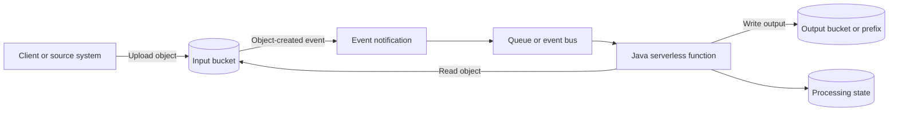
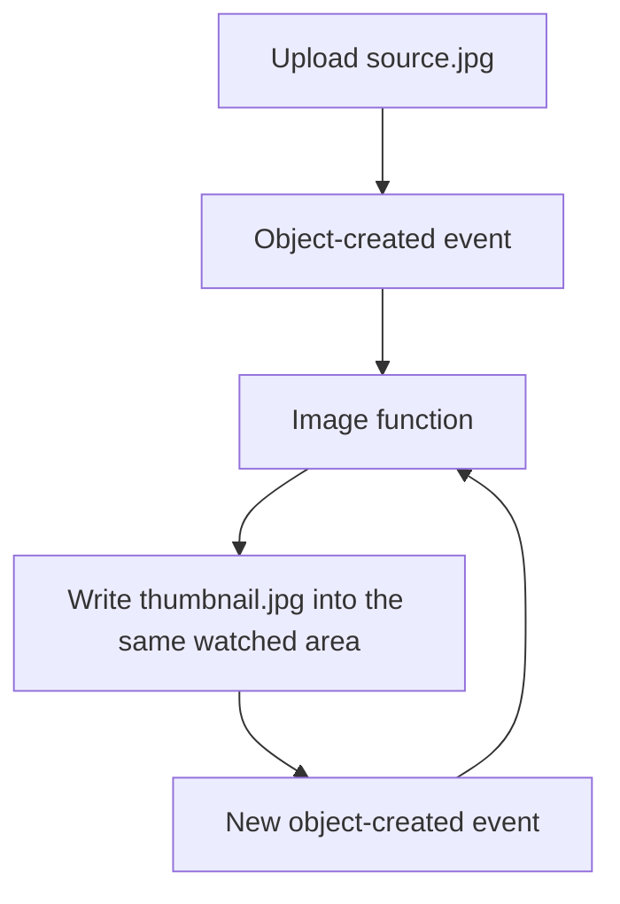
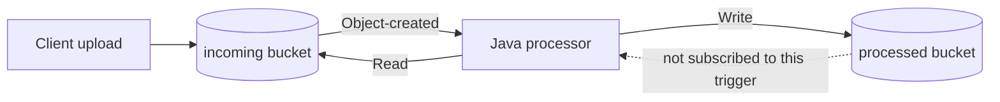

# Object Storage Triggers and Preventing Processing Loops

Object storage commonly stores images, documents, videos, data exports, and input files for background jobs. Many cloud platforms can emit events when an object is created, overwritten, completes a multipart upload, or is deleted. Those events can trigger a Java function to inspect, transform, index, or generate derivatives without another service continuously polling the bucket.

Object storage triggers are convenient, yet carry a distinct risk: **a function processes an object and writes a new object back into the same watched area, causing the new event to trigger that function again**. Without restricting event sources and write targets, the function can self-trigger infinitely, multiplying objects, invocations, logs, and costs. A similar loop can occur when a function overwrites the source file or when multiple functions trigger one another across buckets.

To use object storage events safely, you must understand event notifications, design input/output boundaries, filter events by bucket/prefix/suffix, handle duplicate and out-of-order events, and observe the full object lifecycle. This lesson focuses on those principles in Java serverless applications.

## 1. How do object storage events work?

Object storage typically emits notifications when a specific operation occurs. Depending on the provider, events can describe object creation, overwrite, multipart upload completion, deletion, or metadata changes. Events usually contain the bucket/container name, object key, operation type, timestamp, version/generation if available, and relevant metadata.

A basic flow:



Producers simply upload objects to storage. Storage emits events to a configured destination such as a queue, event bus, or directly to a function. Consumers receive the event and use the object reference to read the content. An event notification is a notice of a change that occurred—not a copy of the object and not a replacement for business state in a database.

### Event types to distinguish

| Operation type | Meaning | Processing considerations |
|---|---|---|
| Object created / finalized | A new object was created or an upload completed | For multipart uploads, process only after the entire upload finishes |
| Object overwritten | Content at the key was replaced | Version/generation is needed to identify which exact version emitted the event |
| Object deleted | An object or a version was deleted | Do not assume the object is still readable when the consumer receives the event |
| Metadata/tag updated | Metadata or tags changed | May emit separate events; avoid letting metadata updates unintentionally retrigger the same pipeline |
| Restore/copy/replication | An object was restored or copied | Decide whether this should be treated as a new input |

Event names and semantics differ across cloud providers. Some platforms emit events upon upload completion, some emit per generation/version, and some support granular event-type configurations. When implementing, verify which operations actually produce notifications and which identifier fields are available.

### Notifications do not mean exactly-once

Consumers must assume events can be delivered multiple times, arrive late, or arrive out of order. Some systems resend notifications when an endpoint fails transiently; intermediary queues can also redeliver when a function times out before acknowledging. Events for the same object can arrive in different orders if the object is updated repeatedly.

Therefore, handlers must not rely solely on "received an event" to conclude an object has not been processed. They need a stable processing key, durable state, and idempotent output writes.

## 2. How do trigger loops form?

The most common loop occurs when a function is triggered by new objects in a bucket and writes results back into the same bucket without proper filtering.



Every time the function writes a thumbnail, storage emits another event. The function treats the thumbnail as a new input, creates a thumbnail of the thumbnail, and keeps generating events. Depending on the logic, the loop can generate endless object chains, overwrite files back and forth, or cause invocations to surge rapidly.

Loops can also arise in other situations:

- A function reads objects from bucket A and writes results to bucket B, yet both A and B are configured to send events to the same function.
- A function updates tags or metadata, and that update belongs to the subscribed event group.
- A function renames or copies an object within the same watched prefix; copying creates a new object and retriggers the handler.
- Two functions A and B watch each other's output: A writes to bucket B, and B writes to bucket A.
- A pipeline writes manifests or state files into the same folder as input data, causing manifests to be processed as business inputs.
- A function rewrites the source object after processing, emitting a fresh notification for that very key.

### Impact of loops

Loops do not merely waste invocations. They can also:

- Cause sudden spikes in object counts and storage capacity.
- Escalate requests, queue depth, retries, and data transfer costs.
- Push functions to concurrency limits, throttling legitimate traffic too.
- Overwrite source data or generate corrupted outputs repeatedly.
- Produce massive logs and traces, obscuring the original root cause.
- Trigger unintended downstream pipelines.

Do not rely on concurrency limits or timeouts to stop a loop by themselves. Those limits only slow or throttle execution while events may continue to be generated and accumulate.

## 3. Designing input and output boundaries

The clearest safeguard is separating where input objects land from where outputs are written. You can use separate buckets or separate prefixes within the same bucket, depending on notification configuration capabilities and security requirements.

### Approach 1: Separate buckets



The `incoming` bucket receives only source data and emits events to the processing function. The `processed` bucket stores thumbnails, normalized files, or results. Input notifications are not subscribed on the output bucket. This provides clean isolation, convenient when the two areas have different IAM policies, retention rules, or encryption settings.

### Approach 2: Separate prefixes

If using the same bucket, a path convention could be:

```text
media-bucket/
  incoming/
    tenant-42/2026/11/source-123.jpg
  processed/
    tenant-42/2026/11/source-123.webp
  quarantine/
    tenant-42/2026/11/source-999.bin
  manifests/
    batch-2026-11-17.json
```

Notifications watch only the `incoming/` prefix. The function reads from `incoming/`, writes derivatives to `processed/`, and moves invalid objects to `quarantine/`. Output prefixes fall outside the trigger scope and thus do not retrigger the same handler.

A prefix filter is a routing filter, not a security boundary. Other users or functions can still write to that prefix if IAM allows. Combine both notification configuration and write permissions to protect boundaries.

### Comparing the two approaches

| Criterion | Separate buckets | Separate prefixes in the same bucket |
|---|---|---|
| Trigger isolation | Clear at the bucket level | Depends on exact prefix filter configuration |
| Access permissions | Easy to separate roles and policies | Requires prefix-scoped policies or appropriate conditions |
| Retention/lifecycle | Independently configurable | Requires prefix-based rules if supported by provider |
| Cost/governance | Additional buckets and configs to manage | Fewer configuration resources |
| Misconfiguration risk | Lower when only input bucket emits notifications | Outputs may leak into trigger if filter is overly broad |

Choose the approach matching your platform and required isolation. For sensitive data or multi-team pipelines, separate buckets typically clarify permissions and lifecycles. For smaller systems, separate prefixes can suffice when filters and IAM are tightly controlled.

## 4. Intentional event filter configuration

Subscribe only to the event types that actually need processing. For example, a thumbnail generator typically needs only object-creation completion events under the `incoming/` prefix with supported image extensions. It does not need to run when objects are deleted, tags change, or thumbnails are written.

Filter layers that can be combined:

1. **Bucket/container:** receive events only from the input container.
2. **Prefix:** accept only objects under `incoming/`.
3. **Suffix:** accept only target extensions or filename patterns, such as `.jpg`, `.png`.
4. **Event type:** subscribe only to creation/upload-completion operations, ignoring deletes or metadata updates if unneeded.
5. **Business rules inside the handler:** verify upload state, object type, tenant, version, and processing markers.

Conceptual configuration example:

```yaml
notification:
  source: media-bucket
  eventTypes:
    - ObjectCreated
  filters:
    prefix: incoming/
    suffixes:
      - .jpg
      - .jpeg
      - .png
  target: image-processor-function
```

This is pseudoconfiguration illustrating the concept, not deployment syntax for a specific cloud provider. Some services do not support multiple suffixes in one rule or represent filters differently. If multiple file types are needed, create multiple rules or use a broader rule and validate file types inside the handler.

### Do not rely solely on suffixes

File extensions are client-supplied and easily spoofed. An object `malware.exe` can be named `photo.jpg`. Suffix filters help reduce irrelevant events but never replace content inspection. Functions must verify size, actual format, file signatures, and scan for malware when data requires it.

### Filters must match write targets

If a function writes `processed/source.jpg` while a filter only excludes `.webp`, the output can still match a `.jpg` suffix and trigger a loop. Design explicit input/output prefixes and test with the actual output object keys. Never assume an exclusion filter based on a few filenames covers every case.

## 5. Defenses inside the Java handler

Filters at storage/brokers are the first line of defense. Handlers should still validate events before processing, because events may arrive from multiple sources, configurations can drift, or malformed messages could be pushed directly onto a queue.

A handler can verify:

- The bucket is in the configured allowlist.
- The object key falls under the permitted input prefix.
- The object key is decoded/normalized according to the provider's event format before prefix matching.
- The event type belongs to the subscribed set.
- The object version/generation has a valid format if supplied by the platform.
- The object belongs to a valid upload intent or tenant per server-side records.
- The object size is within bounds before opening streams.

The Java example below uses provider-neutral event types. An adapter receives native events from Lambda, Cloud Functions, Azure Functions, or a queue consumer and maps them to `ObjectCreatedEvent`.

```java
import java.util.Set;

public record ObjectCreatedEvent(
        String eventId,
        String eventType,
        String bucket,
        String key,
        String versionId,
        long sizeBytes
) {}

public enum HandleResult {
    PROCESSED,
    IGNORED,
    ALREADY_PROCESSED
}

public enum ClaimStatus {
    CLAIMED,
    ALREADY_COMPLETED,
    BUSY
}

public record ProcessingClaim(ClaimStatus status, String leaseToken) {}

public interface ObjectProcessor {
    void process(String bucket, String key, String versionId);
}

public interface ProcessingLedger {
    // Atomically claim and create a lease; the token identifies the invocation holding the lease.
    ProcessingClaim claim(String objectIdentity);
    // Mark completed only if leaseToken is still the active lease.
    void markCompleted(String objectIdentity, String leaseToken);
}

public final class RetryableProcessingException extends RuntimeException {
    public RetryableProcessingException(String message) {
        super(message);
    }
}

public final class ObjectCreatedHandler {
    private static final String INPUT_PREFIX = "incoming/";
    private static final Set<String> ALLOWED_TYPES = Set.of(
            "ObjectCreated", "ObjectFinalized"
    );
    private static final long MAX_BYTES = 100L * 1024 * 1024;

    private final String expectedBucket;
    private final ObjectProcessor processor;
    private final ProcessingLedger ledger;

    public ObjectCreatedHandler(
            String expectedBucket,
            ObjectProcessor processor,
            ProcessingLedger ledger
    ) {
        this.expectedBucket = expectedBucket;
        this.processor = processor;
        this.ledger = ledger;
    }

    public HandleResult handle(ObjectCreatedEvent event) {
        if (!ALLOWED_TYPES.contains(event.eventType())) {
            return HandleResult.IGNORED;
        }
        if (!expectedBucket.equals(event.bucket())) {
            return HandleResult.IGNORED;
        }
        if (event.key() == null || !event.key().startsWith(INPUT_PREFIX)) {
            return HandleResult.IGNORED;
        }
        if (event.sizeBytes() < 0 || event.sizeBytes() > MAX_BYTES) {
            throw new IllegalArgumentException("Object size is outside allowed range");
        }

        String version = event.versionId() == null ? "unversioned" : event.versionId();
        String identity = event.bucket() + "/" + event.key() + "#" + version;
        ProcessingClaim claim = ledger.claim(identity);
        if (claim.status() == ClaimStatus.ALREADY_COMPLETED) {
            return HandleResult.ALREADY_PROCESSED;
        }
        if (claim.status() == ClaimStatus.BUSY) {
            throw new RetryableProcessingException("Another invocation holds the processing lease");
        }

        processor.process(event.bucket(), event.key(), event.versionId());
        ledger.markCompleted(identity, claim.leaseToken());
        return HandleResult.PROCESSED;
    }
}
```

This example illustrates validation structure and idempotency; the adapter must properly normalize/decode object keys per the provider's event format before constructing `ObjectCreatedEvent`. `claim` must use conditional writes or unique constraints so two concurrent invocations cannot both own the work. On `BUSY`, the handler requests a later retry; on `ALREADY_COMPLETED`, it safely acknowledges the duplicate event. The lease token ensures only the invocation holding the active lease can mark completion. The example uses `record`, requiring Java 16+ (typically deployed on Java 17).

The most important part remains path conventions and source filtering: the handler accepts only the input prefix, while the processor writes outputs to a separate prefix. In production projects, centralize prefixes in shared configuration so notification settings, IAM policies, and handlers never drift out of sync.

### Writing outputs to a distinct path

Processors should take the explicit input reference and derive output keys via dedicated rules. Never overwrite the source object unless there is a clear business reason and overwrite events are handled.

```java
public record DerivedObjectKey(String value) {}

public final class ImageKeyPolicy {
    public DerivedObjectKey thumbnailKey(String inputKey) {
        if (!inputKey.startsWith("incoming/")) {
            throw new IllegalArgumentException("Unexpected input prefix");
        }
        String relative = inputKey.substring("incoming/".length());
        return new DerivedObjectKey("processed/" + relative + ".webp");
    }
}
```

This rule is illustrative. Normalize keys, restrict allowed characters, and guard against path traversal when transforming names. In object storage, keys are flat strings rather than filesystem paths, yet separators still matter for filters and prefix conventions. Never use raw user-supplied paths directly as write targets.

## 6. Idempotency and duplicate event handling

Event notifications can be redelivered. If the same object/version is processed twice, the handler must not create duplicate outputs or repeat side effects. The idempotency key should represent the object version, not merely the key name.

A commonly used key:

```text
bucket + objectKey + versionId
```

If versioning is not enabled, you can combine a stable event ID or upload checksum/metadata, though understand the limitations. Not every `ETag` is an MD5 of the content; multipart uploads or encryption can alter `ETag` semantics. If content under the same key can be overwritten, enabling versioning or using a unique key per upload is safer.

### Durable processing state

A ledger table can store:

| Field | Purpose |
|---|---|
| `object_identity` | Unique key for bucket/key/version |
| `status` | `PROCESSING`, `COMPLETED`, `FAILED` |
| `lease_owner` | Invocation currently processing |
| `lease_expires_at` | Timestamp when lease can be reclaimed after a crash |
| `attempt_count` | Number of attempts |
| `output_reference` | Output object if already created |
| `last_error` | Categorized error code, containing no secrets |
| `updated_at` | Timestamp of status update |

Claims should use atomic operations. When status is `COMPLETED`, duplicate events can be skipped. When `PROCESSING` with an active lease, other invocations should not duplicate the work. Once the lease expires, a new invocation can reclaim and resume according to policy.

Never keep processing state solely in static variables or function memory. Execution environments can be replaced and multiple instances can run concurrently. Deduplication state must live in a database, key-value store, or durable store supporting conditional writes.

### The gap between writing output and marking completion

Suppose a function creates the output object successfully but crashes before recording `COMPLETED`. The event will be redelivered and the function may produce the output again. Impact can be reduced by:

- Deriving deterministic output keys from input identity and processing version so retries overwrite the same destination.
- Using conditional creates or checking whether the output already exists with matching metadata.
- Recording the output reference and business outcome in a local transaction if sharing the same database.
- Using an outbox for subsequent events so completion state and downstream notifications stay synchronized.
- Ensuring downstream operations are idempotent under the same processing identity.

There is no single atomic transaction spanning object storage, databases, and event buses in most standard architectures. Therefore, define recovery states for every failure gap.

## 7. Versioning, overwrites, and out-of-order events

A single key can be uploaded multiple times. For example, `incoming/customer-42/profile.json` is written at 10:00 and updated at 10:05. The two events might reach the consumer in order 10:05 then 10:00. If the handler reads the latest object by key for both events, the older event could process the newer content and later overwrite newer results with stale ones.

To handle this properly:

1. Enable object versioning/generations if supported by storage.
2. Carry the version/generation in the event and read that exact version.
3. Record the source version in output metadata or the ledger.
4. When updating business state, apply results only if the version is newer than the last processed version.
5. If exact version reads are unavailable, use immutable keys per upload.

Do not use event timestamps as the sole ordering source. Use storage-assigned generations/versions or system-owned business sequences. On providers without versioning, design unique object keys per upload and use a database pointer to track the current version.

### Delete events and vanished objects

Delete notifications may arrive after the object is no longer readable. If consumers require auditing, events must carry sufficient metadata or the system must persist a metadata snapshot in a database prior to deletion. Never design delete handlers assuming they can always download the object's content.

With versioned storage, deletions may create a delete marker rather than purging all versions. Distinguish deleting a specific version from creating a delete marker/removing the current object according to provider semantics.

## 8. Access permissions and security

Functions triggered by object storage typically need read permissions on sources and write permissions on outputs. Scope permissions strictly by responsibility:

- Processor role reads only the required input prefix.
- Write permissions apply only to the output prefix/bucket.
- Grant delete permissions only when the pipeline genuinely needs to delete objects.
- Ledger/database access is restricted to the required tables or keys.
- Downstream event publish permissions go only to the function responsible for emitting them.

Keep buckets/containers private. Never treat hard-to-guess object keys as authorization. If notifications contain externally controllable buckets/keys, handlers must check bucket and prefix allowlists before calling the storage SDK. Never construct arbitrary URLs from events and fetch them; doing so risks SSRF or internal endpoint access.

Validate file contents against your threat model: cap file sizes, verify true formats, guard against archive bombs, scan for malware when required, and handle sensitive data per retention policies. Never log file contents, access tokens, or presigned URLs. Correlation IDs and object identities usually suffice for tracing.

## 9. Observing and stopping loops early

A pipeline can begin emitting looping events before total invocations spike noticeably. Monitor metrics tied to object identity and processing flow.

| Metric | Anomaly signal |
|---|---|
| Invocations by bucket/prefix | Output prefix unexpectedly triggering functions |
| Events per object identity | Same object/version notified or processed repeatedly |
| Objects created per prefix | Output count rising continuously or forming repeating naming chains |
| Queue depth and message age | Consumer overwhelmed or falling behind events |
| Duplicate/ignored event rate | Overly broad filter or duplicate event emissions |
| Retries and DLQ depth | Unreadable objects, permission errors, or processing failures |
| Invocation duration and bytes read/written | A loop repeatedly processing data or oversized files |
| Concurrency and throttling | Functions triggered beyond downstream capacity |

Structured logs should include event ID, bucket, normalized object key, version/generation, processing identity, output key, correlation ID, and outcome. Avoid logging temporary signed URLs or sensitive data.

### Circuit breakers and emergency actions

If event volume for an object or prefix spikes abnormally, pause the consumer, disable the notification rule, or exclude the output prefix from the trigger. Maintain a runbook specifying who is authorized to change configuration and how to recover queues after fixing the bug.

Setting concurrency caps and cost alerts mitigates blast radius, not replace anti-loop design. When pausing consumers, understand queue retention and retry policies to avoid dropping valid events or building unmanageable backlogs. After fixing filters, you may need to filter/redrive accumulated messages rather than blindly replaying all of them.

## 10. Design and testing workflow

When building an object-storage-triggered pipeline, follow these steps:

1. **Define input events.** Choose the bucket/container, event types, and exact operations that should trigger the function.
2. **Partition paths.** Establish input, output, quarantine, and manifest prefixes; use separate buckets when strong isolation is needed.
3. **Configure filters.** Filter by bucket, prefix, suffix, and event type; verify outputs cannot match the rule.
4. **Define object identity.** Use version/generation or immutable keys; record required checksums and metadata.
5. **Design an idempotent handler.** Validate events, atomically claim processing state, process, and write outputs to deterministic keys.
6. **Apply least privilege.** Separate permissions for reading inputs, writing outputs, updating the ledger, and publishing events.
7. **Design error handling and replay.** Define retries, DLQs, leases, existing output handling, and crash recovery across steps.
8. **Measure and alert.** Monitor event rates, duplicates, output prefixes, queue age, concurrency, and cost.

Minimum test scenarios:

- Upload a valid object to the input prefix: function executes side effects exactly once.
- Function creates an output: output does not retrigger the function itself.
- Upload an object to the output prefix: no input processing notification fires.
- Upload a file with a valid suffix but invalid content: handler rejects or quarantines it.
- Deliver the same event twice: no duplicate results are created.
- Two events for the same key/version arrive concurrently: only one invocation claims the work.
- Upload two consecutive versions and invert event order: final result reflects the correct version per policy.
- Function times out after writing output but before marking completion: retry produces no erroneous side effects.
- Object is deleted before the consumer reads it: failure is classified and handled per runbook.
- Event from an allowlist-excluded bucket or prefix: handler safely ignores or rejects it.

## Conclusion

Object storage triggers automate file processing whenever objects are added or updated. The major hazard is a function writing outputs back into a watched location and self-triggering in a loop. Separate inputs and outputs via buckets or prefixes, filter exact event types, revalidate buckets/keys inside the handler, and use version-aware object identities to prevent duplicate or out-of-order processing. Combine least privilege, a durable ledger, deterministic output keys, bounded retries, and per-prefix metrics so Java serverless pipelines operate safely and recoverably.
