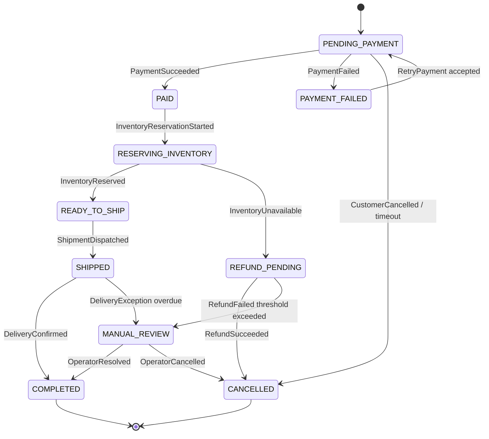

# State Machine Models for Business Workflows

A business workflow often spans multiple steps and can last anywhere from a few seconds to several days. For example, an order is created, awaits payment, reserves inventory, gets packed, is handed off to a shipping carrier, and finally completes. At each step, the system needs to know what state the order is currently in, which events are allowed to occur next, which conditions must be satisfied, and which services need to be called.

A state machine (finite state machine) is a way of modeling a workflow using a set of states and conditional transitions. When combined with workflow orchestration, a state machine coordinates Java functions, APIs, queues, and cloud services into a workflow whose progress is durably persisted. If a function times out or the execution environment is reclaimed, the workflow can resume from the saved state instead of relying on the function's in-memory state.

In the **CLOUD_SERVERLESS** module, this model is especially useful when a business process requires multiple HTTP, message, or event triggers, involves wait steps, retries, timeouts, branching logic, and compensating actions. This article builds the model from fundamental concepts to an order example and explains how to apply it in Java serverless.

## 1. What is a state machine?

A state machine describes a system in terms of possible states and the rules for transitioning from one state to another upon receiving an event. A basic state machine consists of:

- **State:** describes the current position of an entity or workflow, for example `PENDING_PAYMENT` or `SHIPPED`.
- **Event:** something that happens causing the system to evaluate a state transition, for example `PaymentSucceeded` or `DeliveryConfirmed`.
- **Transition:** the rule for moving from a source state to a target state upon receiving a matching event.
- **Guard:** an expression that must evaluate to true for the transition to be allowed, for example the paid amount equals the order total.
- **Action:** the work performed when a transition is selected or when a state is entered/exited, for example recording a payment or sending an inventory reservation request.
- **Initial state:** the state in which the workflow begins.
- **Terminal state:** a state with no further business transitions, for example `COMPLETED` or `CANCELLED`.

A simple model can be represented as a tuple:

\[
M = (S, E, T, s_0, F)
\]

Where `S` is the set of states, `E` is the set of events, `T` is the set of transition rules, `s₀` is the initial state, and `F` is the set of terminal states. Guards and actions are metadata attached to each rule in `T`.

For example, an order can transition from `PENDING_PAYMENT` to `PAID` upon receiving `PaymentSucceeded`. If it receives `PaymentFailed`, the order can transition to `PAYMENT_FAILED`. `SHIPPED` should not be allowed to revert to `PENDING_PAYMENT` simply because an old payment message is redelivered; the state machine must reject events that are invalid for the current state.

## 2. States, events, and transitions

### States must describe business facts

State names should express what is true at that point in time, not merely function names or technical details. For example:

| State name | Business meaning |
|---|---|
| `PENDING_PAYMENT` | The order has been created and is awaiting payment |
| `PAID` | Payment has been confirmed |
| `RESERVING_INVENTORY` | The system is reserving inventory |
| `READY_TO_SHIP` | Inventory has been reserved and is ready for shipping |
| `SHIPPED` | The shipping carrier has picked up the package |
| `COMPLETED` | The delivery process has completed |
| `CANCELLED` | The order was cancelled according to business rules |
| `MANUAL_REVIEW` | The workflow requires review by an authorized operator |

Avoid creating excessive states solely to reflect implementation details such as `CALLING_PAYMENT_API` or `JSON_SERIALIZED`, unless those steps matter for recovery, timeouts, monitoring, or separate observability. Conversely, do not merge states that have different allowed transitions or next actions into a single generic state.

### Events represent what has already happened

Events should be named after what has already occurred, usually in the past tense: `OrderCreated`, `PaymentSucceeded`, `InventoryReserved`, `ShipmentDispatched`. Distinguish events from commands:

- **Command:** a request asking the system to do something, for example `ReserveInventory`.
- **Event:** a notification that something has happened, for example `InventoryReserved`.

A command can be rejected or fail; an event represents a confirmed fact. Distinguishing these two concepts prevents a workflow from transitioning to `READY_TO_SHIP` merely because it sent an inventory reservation command. It should transition only after receiving a successful result or appropriate confirmation evidence.

### Transitions have a source, target, and condition

A transition is typically described as:

`source state + event + guard -> action + target state`.

For example:

| Current state | Event | Guard | Action | Next state |
|---|---|---|---|---|
| `PENDING_PAYMENT` | `PaymentSucceeded` | Amount and currency match the order | Record the payment transaction | `PAID` |
| `PENDING_PAYMENT` | `PaymentFailed` | Transaction is confirmed failed | Record the failure reason | `PAYMENT_FAILED` |
| `PAID` | `ReserveInventory` | All SKUs have sufficient stock | Send inventory reservation request | `RESERVING_INVENTORY` |
| `RESERVING_INVENTORY` | `InventoryReserved` | Reservation is valid and not expired | Save reservation ID | `READY_TO_SHIP` |
| `RESERVING_INVENTORY` | `InventoryUnavailable` | Unable to reserve sufficient stock | Initiate refund workflow | `REFUND_PENDING` |
| `READY_TO_SHIP` | `ShipmentDispatched` | Valid tracking code present | Save tracking number | `SHIPPED` |
| `SHIPPED` | `DeliveryConfirmed` | Valid proof of delivery | Record delivery completion timestamp | `COMPLETED` |

An event that has no valid transition in the current state must be handled intentionally. Depending on the event type, the system may ignore an already-processed duplicate event, log an out-of-order event, park it in a wait queue until conditions are met, or route it to manual review. Do not treat every invalid event as a retryable error by default.

## 3. State machine diagram for an order

The diagram below illustrates a sample workflow. Actual states and branches depend on sales, payment, inventory, and shipping policies.



The diagram shows that a state machine does not only model the happy path. It also models failures, cancellations, timeouts, refunds, and manual handling. As a result, the engineering team can clearly determine where every branch must terminate and what information needs to be stored to continue.

## 4. Why are state machines a good fit for serverless workflows?

A Java function is typically designed to handle a single invocation: receive a request/event, perform a unit of work, and return a result. The function may be frozen or terminated after returning a response, the execution environment may be reclaimed, and the next invocation may run in a different environment. Therefore, static memory, local variables, or temporary files cannot serve as the sole storage for the progress of a long-running workflow.

A workflow orchestrator holds state and coordinates steps. Depending on the platform, it can persist execution history, input/output of each step, timers, retry policies, parallel branches, and callback tokens. When a step fails, the orchestrator can retry, take an error branch, or wait for the next event.

| Component | Primary responsibility |
|---|---|
| Producer / API | Initiates the workflow via a command or event |
| Workflow orchestrator | Persists state, decides transitions, coordinates steps, timers, retries, and error branches |
| Java function | Executes a specific task without owning the entire workflow lifecycle |
| Queue / event bus | Transports events or commands between components |
| Database | Stores business data and invariants that must be guaranteed |
| External service | Payments, inventory, email, shipping, or partner systems |
| Monitoring / audit | Tracks executions, transitions, errors, and manual actions |

The orchestrator stores workflow progress, while the business database stores the application's canonical data. Do not turn execution history into the sole business database. Workflow state may hold IDs, step outcomes, and metadata needed for coordination; large or sensitive data should be stored in an appropriate store and passed by reference.

## 5. How do state machines and workflow orchestration differ?

A state machine is a logical model for describing states and transitions. Workflow orchestration is the mechanism for coordinating step execution according to that model. A workflow engine can execute a state machine directly; an application can also implement a state machine in code and persist state in a database.

Orchestration has a central component that tracks progress and invokes participants. Choreography relies on participants emitting and consuming events, with each participant independently deciding its next action. Both approaches can coexist:

| Criterion | Orchestration | Choreography |
|---|---|---|
| Flow control | One orchestrator decides the next step | Services react to each other's events |
| Progress tracking | Usually centralized by execution ID | Must correlate traces/events across multiple services |
| Workflow changes | Typically edits the workflow definition | Changes contracts and behavior across multiple participants |
| Central dependency | Requires an orchestrator to be available and operated | Less central coordination, but distributed flows are harder to observe |
| Best suited for | Long-running processes, complex branching, timeouts, compensation, and auditing | Simple event flows where services have low global ordering dependencies |

For example, an order workflow can have an orchestrator invoke `PaymentFunction`, wait for `PaymentSucceeded`, and then invoke `InventoryFunction`. The payment service itself can still emit a `PaymentCaptured` event for other consumers such as analytics or notifications. Orchestration drives the order workflow; event choreography propagates business facts to interested systems.

## 6. Common control-flow constructs

Workflow engines typically provide constructs analogous to programming languages:

### Sequence — sequential execution

Steps run in order. For example: validate order, calculate fees, collect payment, reserve inventory, and create shipment. The output of one step can serve as input to the next. If a step fails, the workflow applies the configured retry or error branch.

### Choice — conditional branching

Selects a branch based on data or state. For example, high-value orders require manual review; regular orders proceed directly to payment. Guards should rely on validated data and versioned business rules.

### Parallel — parallel execution

Independent steps can run concurrently, such as checking inventory across multiple warehouses or sending fraud check and tax calculation requests. The workflow can wait for all branches or apply a policy such as waiting for a minimum number of results. Define clearly what happens when only one branch fails while the others are still running.

### Map / fan-out — iterating over a list

A step can spawn multiple tasks for each item, such as checking each line item in an order. You must bound concurrency, handle per-item errors, and decide whether to continue processing remaining items when one item fails.

### Wait / callback — waiting for time or external events

A workflow can wait until a specific timestamp or wait for a partner response. For example, after sending a payment request, the workflow waits for a `PaymentSucceeded` webhook with a correlation ID. There is no need to keep a Java function running throughout the wait period; the orchestrator persists state and wakes the execution when the timer fires or the event arrives.

### Retry / Catch — retrying or handling errors

Retry specifies which errors are retried, maximum attempts, intervals, and backoff. Catch routes errors after retries are exhausted to branches such as refund, manual review, or terminal failure. Do not retry all errors with the same policy.

## 7. Designing the right state machine for the business domain

### Identify the aggregate and workflow boundaries

Before drawing a state machine, identify which business entity owns the state: the order, payment, shipment, or application dossier. A single business process may contain multiple sub-state machines. For example, an order has state `PAID`, while a payment has its own states `AUTHORIZED`, `CAPTURED`, `REFUNDED`. Do not force multiple distinct lifecycles into a single state field.

### Identify invariants

An invariant is a condition that must always hold true. For example:

- An order may transition to `SHIPPED` only when paid or under a cash-on-delivery policy.
- Total captured amount must not exceed the authorized amount.
- A reservation may be released only if that reservation exists and has not been consumed.
- An order has only one valid terminal outcome according to cancellation/completion rules.
- An event belonging to tenant A must never mutate an order belonging to tenant B.

Invariants must be enforced where canonical data is updated, typically in a database transaction or the service owning the aggregate. Workflow guards assist coordination and avoid unnecessary step invocations, but they do not replace database constraints or atomic checks because state can change concurrently.

### Handle duplicate or out-of-order events

Queues and event buses often deliver events more than once. Events may arrive late or out of global order. Every event should include `eventId`, `aggregateId`, `eventType`, `occurredAt`, `schemaVersion`, and appropriate correlation/causation IDs.

Consumers should check processed event IDs and the aggregate's version. If an event carries an older version than the current state, it can be ignored as a duplicate/stale event according to policy. If an event arrives before its prerequisite event, it can be parked, retried with limits, or routed to manual review. Do not infer ordering solely from timestamps because clocks across producers can drift.

### Define terminal states and timeouts

Every workflow needs to know when it is complete, cancelled, or requires intervention. If a waiting state has a time limit, define a timer and the action to take upon expiration. For example, `PENDING_PAYMENT` might expire after 30 minutes; however, the expiration timer and payment webhook can arrive nearly simultaneously. Atomic transitions or optimistic concurrency are required so that only one outcome wins according to policy.

## 8. Java example: controlling transitions at the business layer

States and events can be modeled using enums or sealed types. The simplified example below demonstrates transition rules; in a real system, persistence, transactions, authorization, and idempotency must be added.

```java
public enum OrderState {
    PENDING_PAYMENT,
    PAID,
    RESERVING_INVENTORY,
    READY_TO_SHIP,
    SHIPPED,
    COMPLETED,
    PAYMENT_FAILED,
    REFUND_PENDING,
    CANCELLED,
    MANUAL_REVIEW
}

public enum OrderEventType {
    PAYMENT_SUCCEEDED,
    PAYMENT_FAILED,
    INVENTORY_RESERVED,
    INVENTORY_UNAVAILABLE,
    SHIPMENT_DISPATCHED,
    DELIVERY_CONFIRMED,
    CANCEL_REQUESTED
}
```

A transition function can accept the current state and event and return the next state:

```java
public OrderState transition(OrderState current, OrderEvent event) {
    return switch (current) {
        case PENDING_PAYMENT -> switch (event.type()) {
            case PAYMENT_SUCCEEDED -> {
                requireMatchingAmount(event);
                yield OrderState.PAID;
            }
            case PAYMENT_FAILED -> OrderState.PAYMENT_FAILED;
            case CANCEL_REQUESTED -> OrderState.CANCELLED;
            default -> throw new InvalidTransitionException(current, event.type());
        };
        case PAID -> switch (event.type()) {
            case INVENTORY_RESERVED -> OrderState.READY_TO_SHIP;
            case INVENTORY_UNAVAILABLE -> OrderState.REFUND_PENDING;
            default -> throw new InvalidTransitionException(current, event.type());
        };
        case READY_TO_SHIP -> switch (event.type()) {
            case SHIPMENT_DISPATCHED -> OrderState.SHIPPED;
            default -> throw new InvalidTransitionException(current, event.type());
        };
        case SHIPPED -> switch (event.type()) {
            case DELIVERY_CONFIRMED -> OrderState.COMPLETED;
            default -> throw new InvalidTransitionException(current, event.type());
        };
        default -> throw new InvalidTransitionException(current, event.type());
    };
}
```

This is an illustrative snippet and does not cover every state in the diagram. It demonstrates several key branches, while a real implementation must also explicitly define how duplicate events, out-of-order events, and terminal states are handled. `requireMatchingAmount` must verify currency, amount, and transaction reference from a trusted source rather than relying solely on client-supplied data.

Do not update the database by reading the state, computing the new state, and writing unconditionally. Two concurrent events could both read `PENDING_PAYMENT` and overwrite each other's result. Use transactions and optimistic locking, such as a conditional update on version:

```sql
UPDATE orders
SET state = ?, version = version + 1
WHERE order_id = ? AND state = ? AND version = ?;
```

If the updated row count is 0, the state has already changed or the condition no longer holds; re-read and apply duplicate/conflict rules instead of assuming the transition succeeded.

## 9. Workflow definition and execution state

In a workflow engine, two types of data must usually be distinguished:

- **Workflow definition:** describes the states/tasks, input/output mapping, transitions, retries, timeouts, branches, and service invocation permissions. This definition is deployed with versioning.
- **Execution state:** data for a specific run, including execution ID, current state, required input, step outputs, timers, retry count, and error status.

Vendor-neutral pseudo-definition example:

```yaml
name: OrderFulfillment
startAt: ValidateOrder
states:
  ValidateOrder:
    type: task
    handler: ValidateOrderFunction
    next: ChargePayment
    retry:
      errors: [TransientDependencyError]
      maxAttempts: 3
      backoff: exponential
  ChargePayment:
    type: task
    handler: ChargePaymentFunction
    onSuccess: ReserveInventory
    onPermanentFailure: PaymentFailed
  ReserveInventory:
    type: task
    handler: ReserveInventoryFunction
    onSuccess: CreateShipment
    onFailure: RefundPayment
  CreateShipment:
    type: task
    handler: CreateShipmentFunction
    next: WaitForDelivery
  WaitForDelivery:
    type: waitForEvent
    event: DeliveryConfirmed
    timeout: PT72H
    onTimeout: ManualReview
  RefundPayment:
    type: task
    handler: RefundPaymentFunction
    next: Cancelled
  PaymentFailed:
    type: terminal
    outcome: failed
  ManualReview:
    type: terminal
    outcome: needs-attention
  Cancelled:
    type: terminal
    outcome: cancelled
```

This is pseudo-YAML to explain the concept, not a directly deployable configuration file. Each workflow engine has its own syntax, state types, retry semantics, callbacks, and data-passing mechanisms. In particular, verify whether `onFailure` catches all errors or only a specific subset, and whether the workflow retries automatically before branching.

Execution state should store only what is necessary to resume the workflow. Avoid placing full files, access tokens, unnecessary personal data, or oversized objects into history. For large payloads, store objects in object storage and pass the object key/version/checksum. Execution history typically has its own size limits, retention period, and access controls.

## 10. Retries, timeouts, and idempotency in workflows

### Retries by error type

A workflow can retry a task when encountering transient errors such as timeouts, throttling, or HTTP 503. Validation or business rule errors usually need to route to another branch instead of retrying indefinitely. A policy should include:

- List of retryable errors and non-retryable errors.
- Maximum number of attempts and backoff duration.
- Jitter to prevent multiple executions from retrying at the exact same time.
- Per-task timeouts and an overall workflow timeout.
- Post-retry exhaustion branch, such as compensation, manual review, or terminal failure.

A retry may re-invoke a function after it has already executed a side effect if the workflow missed the result due to a timeout. Therefore, tasks must be idempotent or provide a way to look up the previous run's outcome.

### Business-step idempotency keys

Do not rely solely on the execution ID for every operation. Each side effect should have a stable business key, such as `orderId + actionType` or `paymentAttemptId`. When the workflow retries `CapturePayment`, the payment service must recognize that the capture already succeeded and return the stored result instead of charging again.

A common pattern:

1. The workflow generates a stable `operationId` for the task.
2. The function sends `operationId` to the downstream service as an idempotency key.
3. The downstream service persists the key and result in durable storage with a unique constraint.
4. If the same key is received again, the downstream service returns the stored result or an in-progress status.
5. The workflow continues from that result.

If the side effect resides in the same database as the business state, both the state and the processed operation record can be written in the same transaction. When calling external services, an idempotency contract, outbox/inbox, or reconciliation step is required.

### Timeouts do not equal failures

When a function times out, the orchestrator may not know whether the side effect completed. For example, the payment provider may have captured the charge, but the response was lost. If the workflow immediately transitions to `PAYMENT_FAILED`, the business state becomes inconsistent. Use the operation ID to query the transaction status, or wait for a confirmation webhook. A timeout can transition the execution to `PAYMENT_STATUS_UNKNOWN`/reconciliation rather than asserting failure.

## 11. Sagas and compensating actions

A workflow spanning multiple services/databases generally cannot use a single distributed ACID transaction. A Saga breaks the workflow into local transactions; if a later step fails, the system executes compensating actions to bring the business state to an acceptable outcome.

Order placement example:

| Successful step | Side effect | Possible compensating action |
|---|---|---|
| Create order | Persist order in pending state | Cancel order if no other side effects exist |
| Capture payment | Collect funds | Refund payment |
| Reserve inventory | Hold stock quantity | Release reservation |
| Create shipment | Create shipping label/waybill | Cancel shipment if carrier allows |
| Send notification | Send email/SMS | Usually cannot be recalled; may send a correction notice |

Compensation is not a database rollback in the sense of erasing all traces. A refund is a new transaction; it does not erase the capture history. Releasing a reservation is also a new business action. Therefore, every compensation must be idempotent, have its own state, support retries, and have a manual review branch when it cannot complete.

A Saga can follow orchestration, where an orchestrator invokes steps and compensations, or choreography, where services emit events and react to one another. Orchestration usually makes progress and compensation branches easier to inspect; choreography can reduce reliance on a central coordinator but requires stronger correlation and end-to-end observability.

## 12. Event correlation, callbacks, and external waiting

A workflow may wait for an event from a webhook, queue, or event bus. When entering a wait, the workflow must generate a correlation token or business key to match the callback to the right execution.

For example:

1. `OrderWorkflow` sends a payment request with `paymentAttemptId`.
2. The payment provider processes it and sends a `PaymentSucceeded` or `PaymentFailed` webhook.
3. The webhook endpoint verifies the signature, checks the timestamp, and durably stores the event.
4. An adapter looks up the waiting execution by `paymentAttemptId` and sends a signal/callback.
5. The workflow verifies that the event matches the order, payment attempt, and current state before transitioning forward.

Do not expose an internal execution ID in a public URL if it can be guessed or used to access data. Callback tokens must have sufficient entropy, expiration, scoped permissions, and replay protection. An event arriving after the workflow has expired must be handled by rule: ignore with audit logging, open a reconciliation process, or route to manual review.

## 13. Workflow versioning and process changes

Business workflows evolve over time. A workflow execution may still be running when a new definition version is deployed. If an old execution continues running under new logic without controls, it may encounter states that no longer exist or execute the wrong action.

Common strategies:

- **Versioned definition:** bind each execution to the workflow version that started it.
- **Pinned task contract:** maintain input/output compatibility for functions called by older in-flight executions.
- **Explicit migration:** move running executions to a new version via audited, validated migration.
- **Backward-compatible evolution:** add states/fields in a way older versions can safely ignore where appropriate; never change the meaning of existing fields.
- **Drain old executions:** stop starting new executions on the old version and wait for running executions to complete before removing dependencies.

A state machine should include `definitionVersion`, `schemaVersion`, and event versions as needed. When changing transitions, define how existing states will be handled. Do not simply rename an enum or delete a state and expect in-flight executions to adapt automatically.

## 14. Workflow observability and operations

A workflow needs observability at both the execution level and the step level:

- Execution ID, business ID, definition version, and start/end timestamps.
- Current state, transition just executed, and the event that triggered it.
- Per-task duration, retry count, timeouts, and final outcome.
- Counts of running executions, executions waiting for callbacks, failed executions, or executions in manual review.
- Compensation success/failure rates and count of executions requiring reconciliation.
- Invocation costs, wait durations, history storage, and auxiliary services.

Logs should be structured and carry a correlation ID end-to-end. Avoid logging tokens, payment card data, secrets, or sensitive payloads. Transition audits must be detailed enough to answer who/what changed the workflow state, when, under which version, and with what outcome.

Useful alerts include: executions stuck in a state too long, callbacks nearing expiration, abnormal retry spikes, compensation failures, growing backlogs, spikes in manual review executions, and workflow failure rates exceeding thresholds. Runbooks are needed to retry, resume, cancel, or reconcile executions under proper authorization and change controls.

## 15. Common design pitfalls

| Pitfall | Consequence | How to avoid |
|---|---|---|
| Storing workflow progress in static function variables | Progress lost when environment is reclaimed or scaled out | Use an orchestrator or durable persistence |
| Transitioning state immediately after sending a command | Workflow assumes side effect succeeded even though service may fail | Wait for the result or confirmation event |
| Retrying side effects without idempotency | Double charges, duplicate emails, or duplicate shipments | Use operation IDs/idempotency keys and deduplication |
| Using timestamps to infer absolute event order | Late events or clock skew corrupt state | Use sequence/version numbers and business rules |
| Checking guards only in the workflow | Race conditions can still occur in the database | Enforce invariants via transactions/conditional updates |
| Putting large payloads or secrets inside workflow state | History bloats and data exposure risk increases | Pass references, bound payload sizes, and restrict access |
| Treating timeouts as failed side effects | Repeats an operation that already succeeded | Query by operation ID and reconcile |
| Treating compensation as a perfect rollback | Corrupted transaction history or irreversible side effects | Design compensations as distinct business actions |
| Not versioning workflow definitions | In-flight executions break when workflows change | Pin versions, migrate explicitly, or drain executions |
| Having no manual review path | Workflows get stuck when automatic recovery is impossible | Define exception states, operators, and audit trails |

## 16. Process for building a state machine for a new workflow

You can start with the following steps:

1. **Define goals and boundaries:** choose the aggregate or workflow to coordinate, and define its start trigger and completion criteria.
2. **Enumerate states:** describe business facts, including error, cancellation, waiting, and intervention states.
3. **Enumerate events and commands:** separate requests to act from facts that have happened; identify event sources and schema versions.
4. **Map transitions:** for each state, list valid events, guards, actions, and target states; decide how invalid events are handled.
5. **Specify invariants:** identify conditions that must never be violated and where they are atomically enforced in the database/service.
6. **Choose orchestration or choreography:** base the choice on flow complexity, audit needs, callbacks, timers, and operational capabilities.
7. **Design error handling:** configure retries, timeouts, DLQs, idempotency, compensations, and manual review.
8. **Design persistence and versioning:** decide which state belongs in workflow history versus the business database, and how to upgrade versions while executions are in flight.
9. **Test transitions:** test all happy paths, duplicate events, out-of-order events, concurrent timeouts, crashes after side effects, and failed compensations.
10. **Instrument and operate:** set up metrics, traces, audits, alerts, and runbooks for stuck or recoverable executions.

A good state machine must describe both normal paths and abnormal situations. If it cannot answer “what state is it in?”, “which events are allowed next?”, and “what happens if this step fails?”, the model is not yet clear enough for safe deployment.

## 17. Conclusion

A state machine represents a business workflow using states, events, transitions, guards, and actions. Workflow orchestration uses that model to coordinate Java functions and cloud services across multiple steps while persisting progress to resume after retries, timeouts, or execution environment interruptions.

When designing one, name states after business meaning, distinguish commands from events, enforce invariants at the canonical data store, handle duplicate and out-of-order events, and design retries, timeouts, idempotency, and compensations from the start. For long-running workflows or those involving branching, callbacks, and compensating actions, a clear workflow state machine makes the system easier to observe, recover, and evolve.
