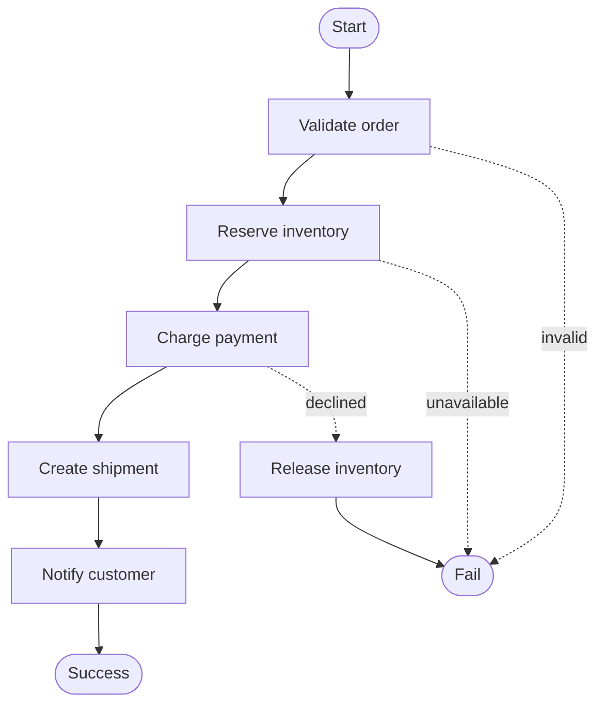
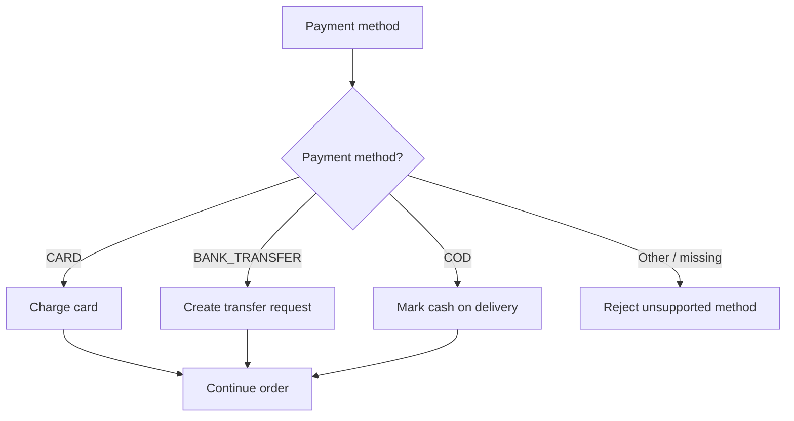
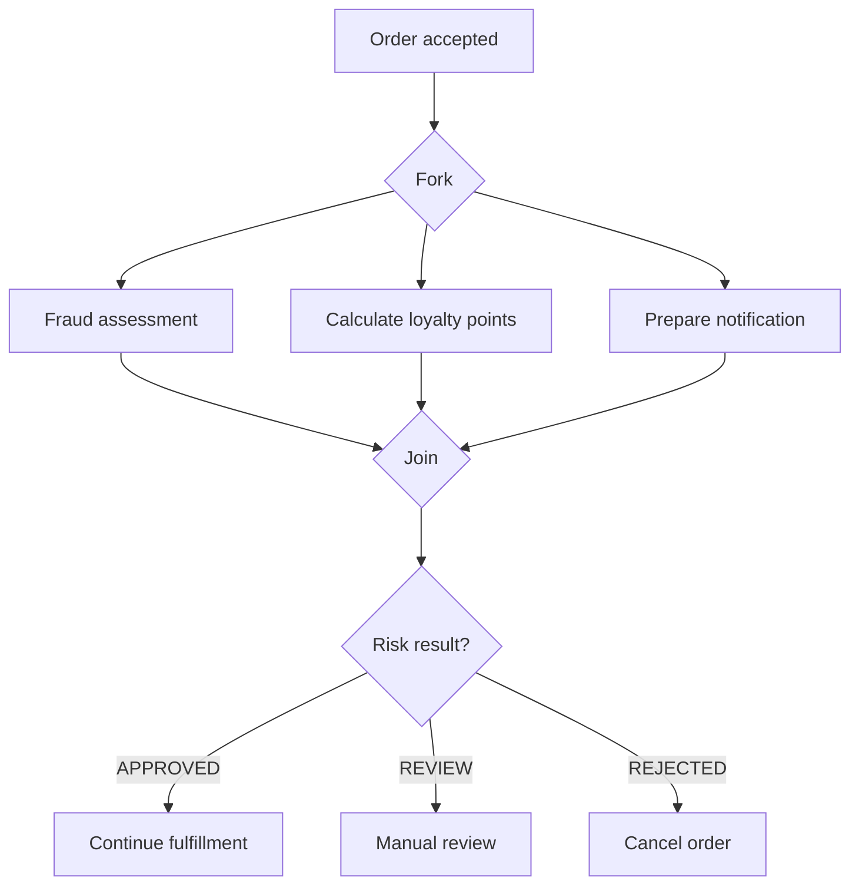
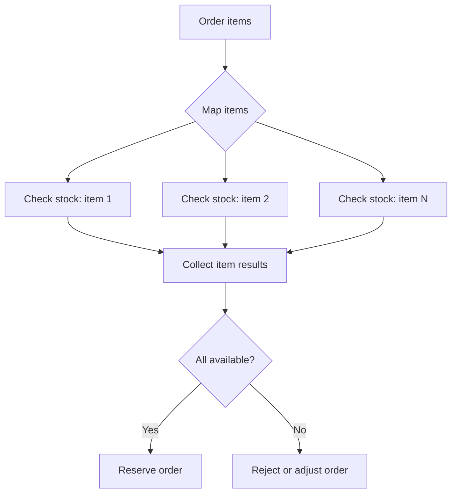
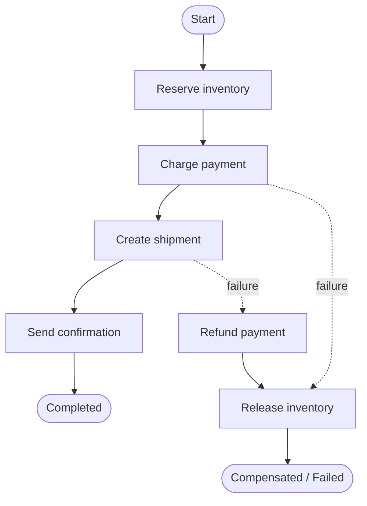

# Designing Sequential Steps, Conditional Branches, and Parallel Processing

## 1. Workflows and the role of orchestration

A business process often consists of multiple interdependent steps. When processing an order, the system may validate data, reserve inventory, collect payment, create a shipment, and send a notification. Some steps can only run after the previous step succeeds; some only run when a condition holds; and independent steps can run concurrently.

If each function directly invokes the next function, orchestration logic becomes scattered across application code. It becomes hard to see overall progress, hard to tell where a workflow stopped, and hard to recover when a step fails or an execution runs long. A workflow/orchestration service solves this by managing state and transitions between steps.

A **Workflow** is a structured specification of the steps, conditions, branches, wait durations, and error-handling behavior of a process. An **Orchestrator** is the component that executes that specification: launching tasks, persisting state, evaluating conditions, and deciding the next step. A task is typically a Java function, HTTP endpoint, or managed cloud service.

In serverless applications, a workflow engine typically persists progress durably. When a task completes, the engine records the result and transitions to the next state. If it needs to wait for an event or until a future point in time, the engine can hold the wait state without keeping a Java function thread running continuously. Specific implementation details vary by provider, yet sequential, branching, and parallel concepts apply broadly.

## 2. Modeling a workflow as a state machine

### 2.1. States, tasks, and transitions

A workflow can be modeled as a state machine. Each state represents a step or a control point. Transitions determine the next state based on task outcomes, conditions, or external signals.

A workflow typically contains the following components:

- **Start:** the entry point triggered by a request, event, or schedule.
- **Task:** executes a unit of work, such as invoking a Java function to reserve inventory.
- **Choice/Decision:** evaluates data to select a branch.
- **Parallel:** launches multiple independent branches.
- **Map/For each:** iterates over a list of items, optionally bounding concurrency.
- **Wait/Callback:** pauses until a timestamp or a continuation signal.
- **Success/Fail/End:** terminates with success, failure, or completes a branch.
- **Retry/Catch:** policies for retrying and routing when a task fails.

For example, an order workflow might have states `ValidateOrder`, `ReserveInventory`, `CheckPaymentMethod`, `ChargePayment`, `CreateShipment`, and `NotifyCustomer`. State names should clearly convey the action or purpose so logs and execution histories are easy to read.

### 2.2. Workflow state versus business state

The workflow engine stores coordination state such as “awaiting inventory reservation”, “payment branch completed”, or “waiting for partner confirmation”. The business system still needs to store canonical data for orders, payments, and inventory in its own database.

Do not treat workflow state as the sole canonical data source for the entire domain. Workflows may finish or expire according to retention policies while orders must remain queryable for years. Conversely, the business database does not necessarily need to store every granular workflow transition history record.

Clearly define which data belongs in execution state, which belongs in the business database, and which is only transient intermediate output. Workflow state should contain identifiers and data needed for coordination; large payloads or sensitive data can be stored in a separate store and passed via controlled references.

## 3. Designing sequential steps

### 3.1. When is sequential execution required?

Steps must run sequentially when a later step depends on the output or side effect of an earlier step. For example:

1. Validate that the order is valid.
2. Reserve inventory quantities in the warehouse.
3. Capture payment after inventory reservation succeeds.
4. Create a shipment after payment succeeds.
5. Send notifications once appropriate outcomes are confirmed.

If a shipment is created before payment, the system might generate shipments for ineligible orders. If an “order confirmed” email is sent before reserving inventory, the notification might not reflect actual results. Workflow ordering must reflect business dependencies, not just the order of lines of code.

### 3.2. Passing results between steps

A task can receive input from the execution context and return output for subsequent steps to use. Define clear contracts for each task, for example:

```json
{
  "orderId": "ord-42",
  "customerId": "cus-81",
  "items": [
    { "sku": "BK-7", "quantity": 2 }
  ],
  "currency": "VND",
  "total": 1850000
}
```

The `ReserveInventory` task might receive `orderId` and `items`, then return:

```json
{
  "reservationId": "res-92",
  "reserved": true
}
```

The `ChargePayment` task only needs `orderId`, `reservationId`, `total`, and securely referenced payment details. Avoid passing the entire execution payload through every task if each step only needs a small subset. Input/output mapping keeps contracts clean and reduces the risk of a task inadvertently depending on internal fields of another task.

### 3.3. Sequential workflow example



The diagram shows the happy path and an illustrative compensating path. In a real system, every error must be classified and assigned an appropriate business state; not every failure ends immediately in `Fail`.

### 3.4. Pseudoconfiguration for a task chain

```yaml
workflow: CreateOrder
startAt: ValidateOrder
states:
  ValidateOrder:
    type: task
    function: validate-order
    next: ReserveInventory

  ReserveInventory:
    type: task
    function: reserve-inventory
    next: ChargePayment

  ChargePayment:
    type: task
    function: charge-payment
    next: CreateShipment

  CreateShipment:
    type: task
    function: create-shipment
    next: NotifyCustomer

  NotifyCustomer:
    type: task
    function: notify-customer
    end: true
```

This is a conceptual configuration to illustrate a state machine, not deployable syntax for a specific workflow engine. Field names, state types, and transition declarations differ across providers.

## 4. Conditional branching

### 4.1. When is branching needed?

A Choice/Decision state evaluates one or more conditions and selects a path. For example:

- If an order is flagged as high risk, route it to manual review.
- If the payment method is card, call the card gateway; if it is bank transfer, wait for transaction confirmation.
- If the order uses express shipping, select the priority carrier service.
- If the customer is an enterprise account, apply an additional verification step.

Conditions should rely on validated, strongly typed data. Do not use a client-supplied field as the basis for granting permissions or bypassing risk checks.

### 4.2. Mutually exclusive branches

A decision usually picks exactly one branch. Conditions should be designed to be unambiguous or have an explicit evaluation order. For example:



The default branch is critical. Without a default branch, a new value or missing field can leave the workflow with no valid transition. The default branch can reject the input, route to manual review, or apply a well-defined safe behavior.

### 4.3. Pseudoconfiguration for Choice

```yaml
CheckPaymentMethod:
  type: choice
  choices:
    - when: "payment.method == 'CARD'"
      next: ChargeCard
    - when: "payment.method == 'BANK_TRANSFER'"
      next: CreateTransfer
    - when: "payment.method == 'COD'"
      next: MarkCashOnDelivery
  default: RejectPaymentMethod
```

The condition expressions in the example are pseudocode. When implementing, use the expression language supported by the workflow engine and verify semantics for missing fields, nulls, numbers, strings, and booleans. If an expression can error when accessing a nonexistent field, check for existence first or enforce schema validation in an earlier step.

### 4.4. Branches with complex business conditions

If a decision requires calling multiple services, computing a risk score, or querying data, do not cram all that logic into a Choice expression. Create a decision task such as `EvaluateOrderRisk` that returns a normalized result:

```json
{
  "riskLevel": "REVIEW",
  "reasonCodes": ["HIGH_VALUE", "NEW_CUSTOMER"]
}
```

The workflow only needs to branch on `riskLevel`. This keeps orchestration rules readable and allows business algorithms to be tested independently. Also record the policy version used if decisions must be explainable or auditable later.

## 5. Parallel execution

### 5.1. When can steps run concurrently?

Steps can run in parallel when they do not depend on each other's outputs and do not contend over a shared resource in a way that violates business correctness. Once an order is valid and persisted, the system can concurrently:

- Perform fraud assessment.
- Calculate customer loyalty points.
- Prepare notification content.
- Record analytics events.

If every branch only needs `orderId` and existing order data, they can run simultaneously. If one branch must wait for another branch's result, represent that relationship as sequential steps or a subworkflow.

### 5.2. Fork and join

A Parallel state spawns multiple branches (fork). Each branch executes independently, and then the workflow can wait for branches to finish (join) before merging results and continuing. Many workflow engines wait for all branches to succeed by default; some platforms support advanced completion criteria. Never assume every engine shares identical semantics.



Join is a synchronization point: the workflow proceeds only when the defined completion criteria are met. If one branch fails, decide whether remaining branches continue, are cancelled, await a timeout, or undergo compensation. Cancelling a branch does not automatically undo side effects that branch has already performed.

### 5.3. Pseudoconfiguration for Parallel

```yaml
EnrichOrder:
  type: parallel
  branches:
    - startAt: AssessFraud
      states:
        AssessFraud:
          type: task
          function: assess-fraud
          end: true
    - startAt: CalculateLoyalty
      states:
        CalculateLoyalty:
          type: task
          function: calculate-loyalty
          end: true
    - startAt: PrepareNotification
      states:
        PrepareNotification:
          type: task
          function: prepare-notification
          end: true
  next: DecideFulfillment
```

This is a pseudoconfiguration. A specific engine may require each branch to be a nested state machine, with different syntax for input/output, timeouts, retries, and result selectors.

### 5.4. Merging branch outputs

Branch outputs should have an intuitive structure and avoid overwriting one another. For example:

```json
{
  "fraud": {
    "riskLevel": "APPROVED"
  },
  "loyalty": {
    "points": 120
  },
  "notification": {
    "templateId": "order-confirmation-v2"
  }
}
```

Prefer keying results by branch name rather than relying solely on array index positions when the contract allows. When a branch returns large data, place only the portion needed by subsequent steps into workflow state; store large content in an appropriate store and pass a reference.

## 6. Iterating over lists and bounding concurrency (Map)

### 6.1. Map state

A Map/For each state applies the same processing step to each item in a list. For example, an order contains multiple line items; the system can check pricing or stock for each line. For large lists, running sequentially can be slow; running everything at once can overload downstream services.

A Map state usually lets you choose sequential or parallel mode and cap concurrency. That limit helps balance completion latency against the capacity of databases, partner APIs, and function quotas.

### 6.2. Per-item processing example



Conceptual configuration example:

```yaml
CheckOrderItems:
  type: map
  itemsPath: $.items
  maxConcurrency: 8
  itemProcessor:
    startAt: CheckStock
    states:
      CheckStock:
        type: task
        function: check-stock
        end: true
  next: EvaluateStockResults
```

`maxConcurrency: 8` is only an example of a concurrency limit. The right value must be based on quotas and capacity of downstream dependencies, not simply choosing the largest possible number.

### 6.3. Handling empty lists, partial failures, and aggregated results

Define behavior when the list is empty, contains malformed elements, or when only some items fail. A workflow can:

- Fail the entire batch if any item is invalid.
- Collect per-item errors and return partial results.
- Retry individual items with transient errors.
- Route permanently failing items to a manual handling queue.

Do not let a single item's error inadvertently discard successful results of other items if the business rules allow partial success. Conversely, if the entire order must be reserved atomically, include an aggregation step and a compensation mechanism to release successful reservations when another item cannot be reserved.

## 7. Timeouts, retries, and error handling in workflows

### 7.1. Timeouts for individual tasks and the whole workflow

Tasks should have timeouts matched to their workload and SLA. Too short a timeout causes false failures when a service is slow; too long a timeout holds resources and delays incident detection. The workflow also needs an overall deadline to prevent executions from running indefinitely.

When a task calls an external service, timeouts across the HTTP client, function, gateway, and workflow engine must align. For example, if the workflow times out a task after 20 seconds while the HTTP client waits 60 seconds, the function may keep running or continue producing side effects after the orchestrator has marked the task failed. Understand the platform's cancellation semantics and design external side effects to be idempotent.

### 7.2. Retrying transient errors

Retries fit errors likely to resolve on their own, such as network timeouts, throttling, or transient service errors. Policies should specify:

- Which error types are retryable.
- Maximum attempts or retry deadline.
- Exponential backoff intervals and jitter.
- Overall workflow time limit.
- Behavior when retries are exhausted.

Do not retry every error. Schema mismatches, missing permissions, or business rule violations usually require fixing data/configuration or routing to another branch. Retrying a permanent error only increases cost and creates unnecessary load.

### 7.3. Catch and error branches

A Catch/Error handler routes task errors to a defined fallback branch. That branch can log the failure, alert operations, release reserved resources, or request human review.

Do not catch every error and simply return success. That causes the workflow to report completion even though the business goal was not achieved. If proceeding with partial results is valid, represent that state explicitly such as `PARTIALLY_COMPLETED` or `PENDING_REVIEW`.

### 7.4. Compensation and Sagas

Distributed workflows usually lack a single ACID transaction spanning multiple functions and services. If inventory reservation succeeds but payment fails, `ReleaseInventory` may need to be called to compensate for the side effect. If payment was captured but shipment creation fails, a refund or manual handling may be needed.

The Saga pattern models each business step along with its corresponding compensating action:

| Forward step | Side effect | Possible compensating action |
| --- | --- | --- |
| Reserve inventory | Hold stock | Release inventory |
| Charge payment | Collect funds | Refund payment |
| Create shipment | Create waybill | Cancel shipment if carrier supports it |
| Apply loyalty points | Award points | Reverse points |

Compensating actions do not always completely undo the original side effect. An email already sent cannot be reliably “recalled”; a parcel already handed to a carrier may require a separate cancellation procedure. The workflow must track compensation outcomes, perform controlled retries, and allow transitioning to a manual intervention state.

### 7.5. Simple Saga diagram



The diagram shows a simplified case. In practice, define failures at each step, whether side effects completed, and how compensations can be retried/made idempotent. If a service call outcome is unknown due to a timeout, reconcile its state before compensating to avoid issuing a refund when the payment never occurred.

## 8. Idempotency and safety on re-execution

A workflow engine may retry tasks, recover executions, or redeliver callbacks. Consequently, a task can be invoked multiple times. Never assume each state executes exactly once.

Tasks with external side effects need a stable idempotency key, typically derived from execution ID, business ID, and step name. For example, the key `order:ord-42:charge-payment` ensures the same payment step does not create a second transaction on retry. If the payment provider supports idempotency keys, send the same key across every retry of the same business operation.

Do not generate a new key on each retry, as every call would become a brand-new request. Also do not use execution ID alone as the key if a single execution processes multiple orders or items; key scope must match the business side effect.

Tasks should persist completed results and handle “in-progress” states so two competing invocations do not both create side effects. Use unique constraints, conditional writes, or database transactions. For side effects spanning multiple systems, reconciliation or a Saga is necessary because idempotency in one service does not automatically provide a distributed transaction.

## 9. Java example for a task in a workflow

Workflow engines typically invoke functions via a platform adapter. Java business logic should accept a clear input, call a service, and return a structured result. The following example illustrates an inventory reservation task; the interfaces are application types, not a cloud provider SDK.

```java
public record ReserveInventoryInput(
        String executionId,
        String orderId,
        String idempotencyKey) {}

public record ReserveInventoryResult(
        String orderId,
        String reservationId,
        boolean reserved) {}

public interface InventoryReservationService {
    Reservation reserve(String orderId, String idempotencyKey);
}

public record Reservation(String id, boolean successful) {}

public final class ReserveInventoryTask {
    private final InventoryReservationService reservationService;

    public ReserveInventoryTask(InventoryReservationService reservationService) {
        this.reservationService = reservationService;
    }

    public ReserveInventoryResult handle(ReserveInventoryInput input) {
        if (input == null
                || input.orderId() == null
                || input.orderId().isBlank()
                || input.idempotencyKey() == null
                || input.idempotencyKey().isBlank()) {
            throw new IllegalArgumentException("Invalid reserve inventory input");
        }

        Reservation reservation = reservationService.reserve(
                input.orderId(), input.idempotencyKey());

        return new ReserveInventoryResult(
                input.orderId(), reservation.id(), reservation.successful());
    }
}
```

This task does not decide the next step itself. It simply executes one business action and returns a result; the workflow engine evaluates that result to transition states. This separation makes the task easy to test in isolation and allows the service to be reused outside the workflow.

## 10. Subworkflows, callbacks, and waiting for events

### 10.1. Subworkflows

A group of steps can be packaged into a subworkflow (nested workflow/subworkflow). For example, a `VerifyCustomer` flow can be reused across account creation, credit limit assignment, and high-value order processing. The parent workflow invokes the subworkflow, passes input, and receives output or errors according to a contract.

Create a subworkflow when a group of steps has standalone business meaning, is reused, or requires independent operational permissions/versioning. Do not slice so finely that every single task wraps a subworkflow, as that increases orchestration complexity.

### 10.2. Callbacks and waiting for external signals

Some business flows must wait on external parties: customer confirmation, carrier updates, staff approval, or bank payment confirmation. A workflow can enter a wait state and resume when it receives the corresponding callback or event.

Callbacks require an unpredictable, time-bounded, and protected token or correlation identifier. When a callback arrives, verify the sender's authenticity, check whether the execution is still waiting at the expected step, and check against event replay. Do not allow a public callback URL to resume any execution merely by knowing its execution ID.

If waiting exceeds a deadline, the workflow needs a timeout and handling branch such as expiration, reminder, cancellation, or manual handoff. Wait states should be persisted durably by the engine so no function needs to stay alive throughout the wait.

## 11. Data design and execution state limits

Execution state passed across many steps can grow rapidly. Large payloads increase state storage and data-transfer costs and can exceed workflow engine limits. Therefore:

- Pass only the fields required by subsequent steps.
- Use IDs or object references instead of embedding large files.
- Do not place secrets, tokens, or sensitive data into execution history unnecessarily.
- Define input/output schemas for each task.
- Version workflows and payloads to remain compatible with in-flight executions.
- Avoid overwriting critical context fields when merging outputs from parallel branches.

Execution history is useful for troubleshooting, yet it can also retain payloads longer than expected. Set retention policies, history read permissions, and data-masking policies according to security requirements.

## 12. Observing, testing, and operating workflows

### 12.1. Observing executions

Each execution should have an execution ID; tasks should propagate correlation IDs and business IDs through logs. Monitor at a minimum:

- Counts of started, succeeded, failed, timed-out, and cancelled executions.
- End-to-end workflow completion time and per-task duration.
- Retry rate, average retry count, and final errors by state.
- Count of executions waiting for callbacks or overdue.
- Completion time of parallel branches and the slowest branch.
- Map item counts, actual concurrency, and per-item failure rates.
- Count of successful/failed compensation runs.

Logs should include state name, execution ID, business ID, and error codes; never log secrets or sensitive payloads. Distributed tracing helps link the workflow engine with functions and external services.

### 12.2. Testing happy paths and failure paths

Do not test only the happy path. Every workflow should have tests for:

- True, false, null, and missing-field conditions at every Choice.
- All parallel branches completing, one branch failing, and multiple branches failing.
- Map with an empty list, single item, multiple items, and a failing item.
- Timeouts, retry exhaustion, and non-retryable errors.
- Callbacks arriving on time, late, duplicated, or for the wrong execution.
- Successful, failed, and retried compensations.
- Tasks invoked multiple times with the same idempotency key.
- Deploying a new workflow version while old executions are still running.

Contract tests for each task's input/output help detect incompatibilities between workflows and functions. Integration tests against the workflow engine or a realistic local emulator should verify retry, cancellation, join, and callback semantics.

### 12.3. Versioning and deployment

Changing a workflow definition can impact in-flight executions. Some engines pin the definition/version attached to an execution; other deployment approaches may cause executions to continue under new logic or require migration. Understand your platform's semantics, roll out new versions in a controlled manner, and avoid deleting old tasks/functions while older executions still reference them.

Infrastructure as Code should manage workflow definitions, task invocation permissions, event triggers, timeouts, retries, and logs/metrics. CI/CD pipelines should validate definitions, test state transitions, and deploy per environment. Maintain a rollback plan and procedures for handling running executions when making breaking changes.

## 13. When to use sequential, Choice, Parallel, or Map?

| Control construct | Use when | Example |
| --- | --- | --- |
| Sequential | The next step requires the output or side effect of the previous step | Reserve inventory before charging payment |
| Choice | Exactly one of several paths is chosen based on conditions | Route payment flow by payment method |
| Parallel | Multiple independent tasks should run simultaneously and merge at a join point | Fraud assessment, loyalty points, and notification prep |
| Map | The same task must be applied to every item in a list | Check stock for each order line item |
| Wait/Callback | Need to wait for time or an external signal | Wait for customer confirmation or partner update |
| Subworkflow | A subprocess has its own contract and lifecycle | Customer verification reused across multiple flows |

Do not choose Parallel solely to reduce latency. First confirm that branches are independent in both data and side effects. If two branches update the same record or call an API with concurrency limits, manage contention or serialize the conflicting portion.

## 14. Common design pitfalls

| Pitfall | Consequence | Fix |
| --- | --- | --- |
| Putting all orchestration logic inside functions calling one another | Hard to see overall state and recover from errors | Model transitions in a workflow engine |
| Running dependent steps in parallel | Data or side effects occur out of order | Identify dependencies before forking |
| Missing a default branch in Choice | New values or missing fields leave the execution with no path | Define a safe default and validate schemas |
| Joining without defining behavior when one branch fails | Workflow hangs indefinitely or reports false success | Configure timeouts, retries, catch blocks, and partial-result policies |
| Unbounded concurrency in Map | Overloads databases/APIs and increases throttling | Set max concurrency based on actual capacity |
| Retrying non-idempotent tasks with side effects | Duplicate charges, inventory holds, or notifications | Use stable idempotency keys and persist processing state |
| Treating workflow state as the business database | Hard to query long-term and loses data after history retention expires | Persist business state in a separate durable store |
| Compensating without reconciling the forward step's outcome | Incorrect refunds or releasing stock erroneously | Verify actual status before compensating |
| Passing large payloads through every state | Higher costs and risk of exceeding engine limits | Pass identifiers/references and keep outputs compact |

## 15. Conclusion

Workflow design is about accurately representing dependencies and handling every possible outcome. Sequential steps fit when prior outputs are required; Choice picks one branch conditionally; Parallel runs independent branches and joins them; Map applies uniform logic across a list with controlled concurrency. Wait, callback, and subworkflows extend the model for long-running processes or flows involving external systems.

A reliable serverless workflow requires clear states and contracts, timeouts, classified retries, idempotency for side-effecting tasks, compensations for distributed flows, bounded concurrency, and execution-level observability. When these rules are modeled explicitly, engineering teams can understand progress, handle errors, and evolve business logic without losing control of the overall system.
