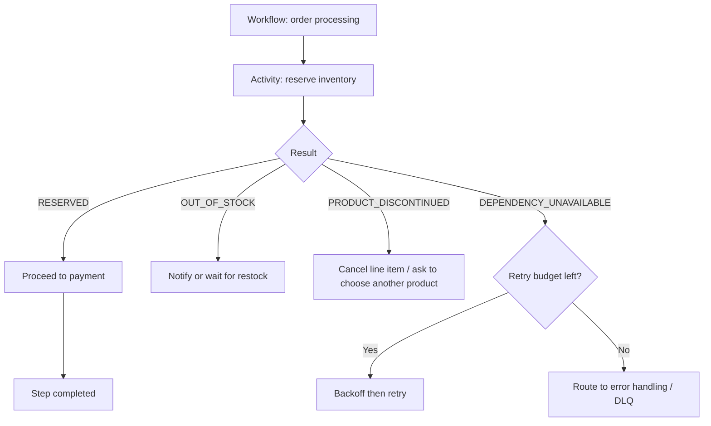
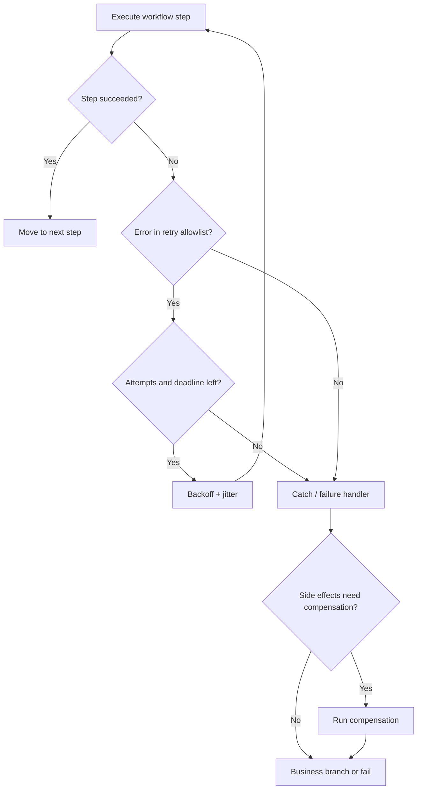
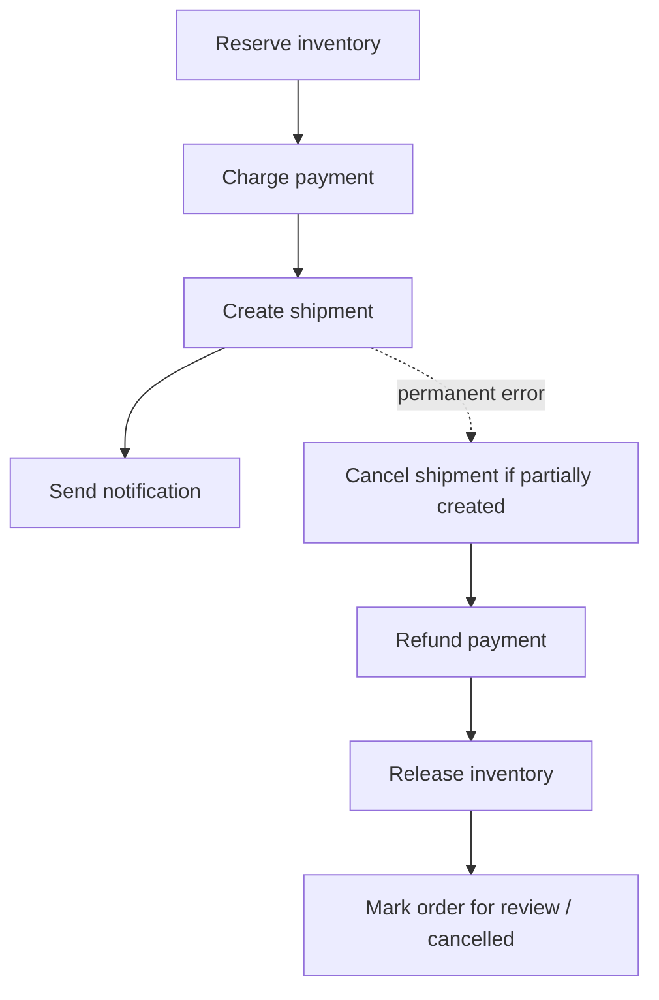
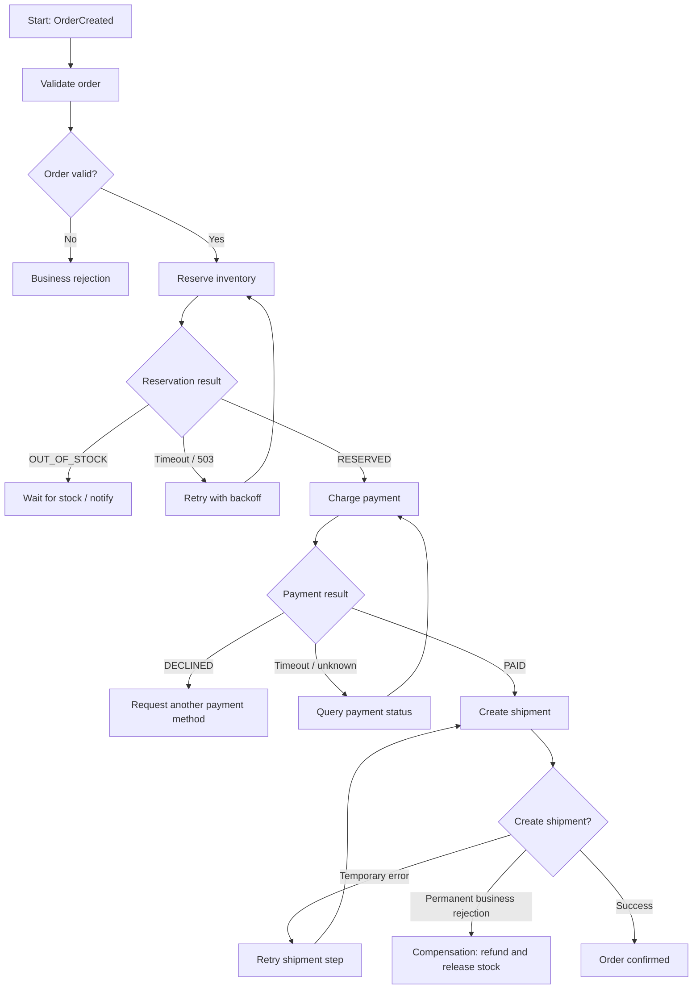

# Distinguishing Retryable Technical Errors from Business Errors

In a serverless workflow, a step can fail because an external service is temporarily unavailable, because input data is invalid, or because a request violates a business rule. These cases require different handling. If you retry every error, the workflow can loop fruitlessly, generate heavy load, and repeat side effects. If you do not retry transient errors, a brief database or API glitch can break the entire process.

The key point is that **error type** and **retryability** are related questions, not identical ones. A technical error may not be fixable via retries—for example, missing permissions or a schema mismatch. A business condition generally does not call for an immediate retry, yet it may be re-evaluated after another event alters state. The decision must depend on root cause, whether state has already changed, safety of re-execution, and the workflow's completion deadline.

This lesson explains how to classify errors, design retry policies, and handle business branches in workflows involving multiple Java functions or services.

## 1. Distinguishing technical errors and business errors

### 1.1. Technical errors

Technical errors occur when the system cannot perform an operation due to a technical component issue. For example:

- Database connection is reset or times out.
- A downstream API returns HTTP 503 because it is overloaded.
- A queue or object storage is temporarily unreachable.
- A service returns HTTP 429 and asks the client to slow down.
- A worker terminates mid-execution due to a runtime or execution environment failure.

Some technical errors are transient and may resolve on their own after a short period. These are candidates for retry. However, technical errors can also be configuration-related or non-self-healing:

- Invalid or expired credentials without a refresh mechanism.
- Function lacks permission to read a table or invoke an API.
- Payload is incompatible with the current schema.
- Incorrect endpoint URL or library incompatible with the runtime.
- Request exceeds the service's fixed size limit.

Immediately retrying these errors usually repeats the exact same failure. Configuration, permissions, data, or deployment must be fixed instead.

### 1.2. Business errors

Business errors occur when the system understands the request, but the request fails to satisfy domain rules or conditions. For example:

- Account balance is insufficient to complete payment.
- The order has already been cancelled, so it cannot transition to `SHIPPED`.
- The product is currently out of stock.
- The user does not own the requested resource.
- A discount code has expired or does not apply to this order.

These cases are typically predictable business outcomes, not infrastructure incidents. The workflow may need to end the current branch, notify the user, choose an alternative path, or run a compensating action.

Not all business conditions are permanent. For instance, out-of-stock items may become available when the warehouse restocks; a pending approval may be granted later. Still, re-attempting should be triggered by a meaningful event or scheduled time, rather than retrying continuously as with network glitches.

### 1.3. Four practical decision categories

| Category | Example | Automatic immediate retry? | Appropriate action |
| --- | --- | --- | --- |
| Transient technical | Timeout, connection reset, HTTP 503 | Usually yes, if the operation is safe and within deadline | Bounded retry with backoff and jitter |
| Configuration or contract technical | Invalid credentials, missing permissions, schema mismatch | No | Fix configuration/permissions/schema, then re-run under control |
| Business rejection | Insufficient balance, order cancelled, invalid coupon | Do not retry blindly | Return business outcome or switch to another handling branch |
| Waiting on business condition | Waiting for restock, approval, or quota replenishment | Do not retry continuously | Wait for an event, timer, or state-changing signal, then re-evaluate |

This matrix is a starting point. A specific error still must be evaluated against the dependency's contract and business rules. For example, HTTP 409 could be a transient concurrency conflict requiring a state reload, or an invalid business state transition. Retry decisions cannot rely solely on HTTP status codes.

## 2. Separating error classification from retry decisions

A sound retry decision must answer four questions:

1. **Is the cause likely to resolve itself?** A brief timeout may self-resolve; missing permissions generally will not.
2. **Has the operation already produced a side effect?** If payment was recorded but the response was lost, re-running could double-charge.
3. **Is re-execution safe?** Requires an idempotency key, conditional update, or reconciliation mechanism.
4. **Is there sufficient time and retry budget remaining?** Retrying after a business deadline has passed can be pointless or cause side effects at the wrong time.

Therefore, retrying is not just a reaction to an exception. It is a policy-driven decision governed by budgets and awareness of business state.

### 2.1. Transient vs. permanent errors

**Transient errors** typically relate to short-lived conditions: service overload, intermittent connectivity, throttling, or node failover. Retrying after a pause may succeed.

**Permanent errors** typically do not change if the exact same request is resent: malformed data, missing permissions, nonexistent endpoints, wrong token audience, or operations invalid in the current state. The root cause must be fixed before re-running.

An error's category can depend on context. For instance, a `401` caused by an expired access token may be recovered by refreshing the token and retrying once. A `403` due to missing scopes should not be retried; proper permissions must be granted. A `404` might mean a resource genuinely does not exist, or read-after-write eventual consistency depending on the system. Understand the contract before classifying.

### 2.2. Unknown errors

When there is insufficient information to decide, treat the error as `UNKNOWN`, log it, and strictly bound retries. Do not assume every unknown exception is transient by default. If the error repeats, the workflow should route to a manual review branch or dead-letter queue instead of continuing to generate load.

A safe policy can apply these rules:

- Only retry error types confirmed to be transient.
- Do not retry validation, authorization, or business rejection errors by default.
- For unknown errors, allow at most a small retry count if required by the system contract, then stop and alert.
- Every retry must preserve the original operation's business identifier and idempotency key.

## 3. Retry policies in workflows

Workflow orchestrators typically support declarative retry configuration per step. Policies should be placed at steps with enough context to know which errors are recoverable and safe to re-run.

A retry policy typically defines the following parameters:

| Parameter | Meaning |
| --- | --- |
| Initial interval | Wait duration before the first retry |
| Backoff coefficient | Multiplier increasing the wait duration after each failure |
| Maximum interval | Maximum wait duration between two attempts |
| Maximum attempts | Maximum execution attempts; explicitly document whether the initial attempt counts |
| Maximum elapsed time | Maximum total duration allocated for retries |
| Jitter | Randomness added to wait times to spread out load |
| Retryable error types | Error types permitted to be retried |
| Non-retryable error types | Errors that must route immediately to another handling branch |

Illustrative configuration example, not tied to any specific vendor syntax:

```yaml
retryPolicy:
  retryableErrors:
    - DependencyTimeout
    - DependencyUnavailable
    - RateLimited
  nonRetryableErrors:
    - InvalidRequest
    - AccessDenied
    - InsufficientBalance
    - InvalidStateTransition
  initialInterval: 1s
  backoffCoefficient: 2
  maximumInterval: 30s
  maximumAttempts: 5
  maximumElapsedTime: 2m
  jitter: full
```

In this example, the workflow retries timeouts, service unavailability, and rate limits. Data errors, permission failures, and rejected business conditions route to another branch. Actual values must reflect dependency timeouts, SLAs, provider retry limits, and business requirements.

### 3.1. Exponential backoff

Exponential backoff increases the wait interval after each failure. A simple formula is:

\[
delay_n = \min(maxDelay, initialDelay \times factor^{n-1})
\]

Example with a 1-second initial delay, factor 2, and a 30-second cap:

| Retry attempt | Wait before retry (excluding jitter) |
| --- | ---: |
| 1 | 1 second |
| 2 | 2 seconds |
| 3 | 4 seconds |
| 4 | 8 seconds |
| 5 | 16 seconds |
| 6 | 30 seconds (cap reached) |

Backoff reduces call frequency while a dependency is experiencing trouble. It also gives downstream systems breathing room to recover.

### 3.2. Jitter

If thousands of workflows all retry on a strict 1, 2, 4, 8-second schedule, they can surge requests at the exact same instant. This phenomenon is known as retry synchronization or thundering herd.

Jitter adds randomness to the wait interval. For example, *full jitter* picks a random value between 0 and the computed backoff interval. Exact implementation depends on the library or orchestrator. The goal is to spread requests out so the dependency is not overwhelmed again.

### 3.3. Retry budgets and deadlines

Never retry infinitely. Every workflow should define:

- maximum attempt count;
- maximum total retry duration;
- business deadline;
- acceptable request or cost budget;
- behavior when the budget is exhausted.

For example, an order price lock may only last 10 minutes. Retrying payment 30 minutes later may no longer match the original pricing or policy. When the deadline expires, the workflow must transition to pending review, cancellation, or reconciliation per business rules.

`Maximum attempts` must be interpreted consistently. Some platforms include the initial attempt, while others specify additional retry attempts. Document the counting convention clearly to avoid configuring more attempts than intended.

## 4. Timeouts, retries, and circuit breakers

Retries are meaningful only when each attempt is time-bounded. If a function waits indefinitely on an external API, the workflow holds executions open, consumes concurrency, and increases cost.

### 4.1. Layering timeouts

A request typically traverses multiple layers: client, API Gateway, function, HTTP client, and downstream service. Timeouts must be designed so every layer can terminate and return an error within predictable bounds.

Illustrative example:

| Layer | Timeout |
| --- | ---: |
| HTTP call to inventory service | 2 seconds |
| Single activity execution | 5 seconds |
| Workflow step | 8 seconds |
| External synchronous API | 10 seconds |
| Overall business deadline | 2 minutes |

These numbers only illustrate the relationship. Each inner call timeout must be smaller than the enclosing layer's limit, leaving enough margin to process, log, and return a response. Account for connection establishment, TLS handshake, response reading, and post-response processing.

### 4.2. Circuit breaker

A circuit breaker stops the system from repeatedly calling a continuously failing dependency. When the error rate exceeds a threshold, the breaker opens and rejects calls for a cooldown window. Afterward, it may allow a small number of probe requests (half-open) to determine whether the dependency has recovered.

Circuit breakers and retries solve two different problems:

- Retries re-attempt an operation likely to succeed after a transient error.
- Circuit breakers shed load to an unhealthy dependency to protect both sides.

Do not nest aggressive retries inside a circuit breaker and then let the workflow retry even more rounds without accounting for total request amplification. Designate one primary layer responsible for retries and coordinate circuit breakers with the retry budget.

### 4.3. Avoiding nested retry amplification

Suppose an HTTP client retries 3 times, a Java function retries 3 times, and the workflow retries 5 times. A single business operation could generate up to 45 dependency calls (depending on counting rules). That inflates load, latency, and the risk of duplicate side effects.

Place retries at the layer with sufficient context:

- HTTP clients may retry very brief, safe connection-level errors.
- Functions may handle local retries only if they can distinguish dependency errors.
- Workflows should govern business-step retries and longer wait intervals.

Do not let every layer retry independently without an overall bound. Track attempt counts at each layer and emit them as metrics.

## 5. Idempotency: the prerequisite for safe retries

Retries can re-run a step after a side effect already completed if the response never reached the workflow. For instance, a payment gateway captures funds, but the function times out before recording `PAID`. The workflow retries and sends the capture request again. Without idempotency, the customer may be charged twice.

### 5.1. Using stable keys

Every side-effecting operation should have a stable idempotency key. For example:

- `payment:{orderId}` for capturing payment on an order;
- `reserve-stock:{orderId}:{sku}` for reserving an item;
- `send-invoice:{invoiceId}` for issuing an invoice.

Do not generate a new key on each retry. The key must represent the same business operation across all attempts.

### 5.2. Persisting outcomes and processing state

An idempotency store can record the key, payload hash, processing status, and result. If the key already completed with the same payload, return the stored result. If the key is currently in progress, wait or return an in-progress status per contract. If the key exists with a different payload, reject the request because one key must never represent two distinct requests.

Claiming the key and writing business state must be coordinated via a transaction or atomic operation. Saving the key only after calling the external service is insufficient to prevent two concurrent invocations from running simultaneously. If the dependency supports idempotency keys, forward the same key downstream.

### 5.3. At-least-once delivery and the limits of exactly-once

Many event sources and workflows guarantee at-least-once delivery or redeliver when acknowledgments are missing. Consumers must therefore assume events can repeat.

“Exactly once” is rarely an automatic property across an entire chain of multiple services. A broker may guarantee semantics within a specific processing scope, but side effects in databases, payment gateways, and email providers still require dedicated mechanisms. Practical architectures rely on at-least-once delivery paired with idempotent processing and reconciliation.

## 6. Business errors should become workflow branches

Not every unfavorable business outcome should throw an exception. If a rejection condition is an expected outcome, represent it as a typed result or explicit status so the workflow can pick the right branch.

For example, an inventory reservation operation might return one of the following outcomes:

- `RESERVED`: inventory reserved successfully.
- `OUT_OF_STOCK`: insufficient stock; can notify or wait for restock.
- `PRODUCT_DISCONTINUED`: product discontinued; do not retry.
- `DEPENDENCY_UNAVAILABLE`: warehouse service unreachable; a retryable technical error.



If `OUT_OF_STOCK` is thrown as a generic exception, the workflow may retry repeatedly even though the warehouse has no stock. When represented as a typed result, the workflow can branch to wait for an `InventoryRestocked` event or close the current request.

### 6.1. When to wait and re-evaluate?

Some business conditions change over time. For example:

- Waiting for manager approval.
- Waiting for warehouse restocking.
- Waiting for customer document submission.
- Waiting for credit limits or business quotas to free up.

In these cases, the workflow can transition to `WAITING_FOR_APPROVAL`, `WAITING_FOR_STOCK`, or `PENDING_CUSTOMER_INPUT`. Upon receiving the corresponding event or reaching a scheduled time, the workflow reads the authoritative state again and decides the next step.

Avoid tight polling loops to wait for conditions. Use callbacks, events, timers, or bounded sparse checks. Set a deadline and define the outcome if the condition is not met in time.

### 6.2. Business outcomes and system errors must stay separate

For example, a payment declined due to an invalid card is a business outcome from the payment provider. A Payment API returning 503 is a technical error. Both can prevent the payment step from completing, yet the workflow must react differently:

- `PAYMENT_DECLINED`: notify the user, request another payment method, or cancel the order per policy.
- `PAYMENT_PROVIDER_UNAVAILABLE`: retry within bounds or transition to a waiting state.
- `PAYMENT_STATUS_UNKNOWN`: do not immediately resend the charge request; first query transaction status using the idempotency/reference ID to prevent double charging.

The `UNKNOWN` state is critical for financial operations. A timeout does not prove an operation failed. It only indicates the caller did not receive the result. Reconcile state before deciding to retry.

## 7. Classifying errors in Java

Java code should preserve a clear boundary between business outcomes and technical failures. Use domain result types for expected outcomes and typed exceptions for infrastructure errors.

### 7.1. Using domain results for business conditions

Illustrative example:

```java
public enum ReservationStatus {
    RESERVED,
    OUT_OF_STOCK,
    PRODUCT_DISCONTINUED
}

public record ReservationResult(
        ReservationStatus status,
        String reservationId) {
}

public final class InventoryActivity {
    private final InventoryClient inventory;

    public InventoryActivity(InventoryClient inventory) {
        this.inventory = inventory;
    }

    public ReservationResult reserve(ReserveCommand command) {
        InventoryResponse response = inventory.reserve(
                command.sku(),
                command.quantity(),
                command.idempotencyKey());

        return switch (response.code()) {
            case "RESERVED" -> new ReservationResult(
                    ReservationStatus.RESERVED,
                    response.reservationId());
            case "OUT_OF_STOCK" -> new ReservationResult(
                    ReservationStatus.OUT_OF_STOCK,
                    null);
            case "DISCONTINUED" -> new ReservationResult(
                    ReservationStatus.PRODUCT_DISCONTINUED,
                    null);
            default -> throw new IllegalStateException(
                    "Unexpected inventory response code");
        };
    }
}
```

This snippet assumes `InventoryClient` returns a valid response. If the client encounters a timeout or HTTP 503, it should throw a typed technical exception so the workflow applies retries. If the service returns `OUT_OF_STOCK`, that is a business outcome and should not be turned into a technical error just to trigger retries.

### 7.2. Using typed exceptions for technical errors

```java
public abstract class DependencyException extends RuntimeException {
    protected DependencyException(String message, Throwable cause) {
        super(message, cause);
    }
}

public final class DependencyTimeoutException
        extends DependencyException {
    public DependencyTimeoutException(Throwable cause) {
        super("Dependency call timed out", cause);
    }
}

public final class DependencyUnavailableException
        extends DependencyException {
    private final Duration retryAfter;

    public DependencyUnavailableException(
            Duration retryAfter,
            Throwable cause) {
        super("Dependency is temporarily unavailable", cause);
        this.retryAfter = retryAfter;
    }

    public Duration retryAfter() {
        return retryAfter;
    }
}

public final class InvalidDependencyConfigurationException
        extends RuntimeException {
    public InvalidDependencyConfigurationException(String message) {
        super(message);
    }
}
```

The HTTP client adapter layer is responsible for translating transport errors and response statuses into appropriate exceptions. Do not collapse all HTTP 4xx or 5xx responses into the same `RuntimeException`, as the workflow loses the information needed to pick an action.

### 7.3. Failure classifier

A classifier can produce explicit decisions instead of leaving every activity to guess on its own:

```java
public enum FailureKind {
    TRANSIENT_TECHNICAL,
    PERMANENT_TECHNICAL,
    BUSINESS_REJECTION,
    UNKNOWN
}

public record RetryDecision(
        FailureKind kind,
        boolean retry,
        Duration retryAfter,
        String reason) {
}

public final class FailureClassifier {
    public RetryDecision classify(Throwable error) {
        if (error instanceof DependencyTimeoutException) {
            return new RetryDecision(
                    FailureKind.TRANSIENT_TECHNICAL,
                    true,
                    Duration.ofSeconds(1),
                    "Dependency timeout");
        }

        if (error instanceof DependencyUnavailableException unavailable) {
            return new RetryDecision(
                    FailureKind.TRANSIENT_TECHNICAL,
                    true,
                    unavailable.retryAfter(),
                    "Dependency unavailable");
        }

        if (error instanceof InvalidDependencyConfigurationException) {
            return new RetryDecision(
                    FailureKind.PERMANENT_TECHNICAL,
                    false,
                    Duration.ZERO,
                    "Configuration must be corrected");
        }

        if (error instanceof BusinessRuleException) {
            return new RetryDecision(
                    FailureKind.BUSINESS_REJECTION,
                    false,
                    Duration.ZERO,
                    "Business condition was not satisfied");
        }

        return new RetryDecision(
                FailureKind.UNKNOWN,
                false,
                Duration.ZERO,
                "Unclassified failure");
    }
}
```

This is a code structure example, not a specific retry library or workflow API. In production, a classifier must unwrap nested exceptions, inspect status codes, and check dependency error codes. `retryAfter` should only be honored when it comes from a trusted contract, such as a validated `Retry-After` header.

Do not classify based on exception message text because messages can change across library versions or locales. Prefer exception types, stable error codes, and structured metadata.

## 8. Error handling in the workflow orchestrator

### 8.1. Retry and Catch are two distinct branches

A workflow step typically needs:

- **Retry:** re-attempt the same step when an error is recoverable.
- **Catch:** intercept non-retryable errors or errors that exhausted their retry budget to transition to another handling branch.
- **Compensation:** execute compensating actions if earlier steps produced side effects that must be logically reversed.
- **Fail:** terminate the workflow when no suitable recovery branch remains.



### 8.2. Retry only the failed step

Suppose a workflow consists of these steps:

1. Create order.
2. Reserve inventory.
3. Charge payment.
4. Create shipment.
5. Send email.

If sending the email fails temporarily, do not re-run the entire workflow starting from order creation. Retry only the email-sending step with its own idempotency key. If the workflow engine lacks per-step retries, design checkpoints or split the workflow into independently recoverable states/child workflows.

### 8.3. Do not let technical errors obscure business state

A workflow might fail while saving state after the payment provider already captured funds. In that case, never mark the order `PAYMENT_FAILED` merely because the function threw an exception. The accurate state may be `PAYMENT_UNKNOWN` or `RECONCILIATION_REQUIRED` until the transaction result is queried.

Distinguish clearly between:

- `FAILED`: confirmed business failure with no side effects requiring reconciliation.
- `RETRYING`: transient technical failure, waiting for the next attempt.
- `WAITING`: waiting on a business condition or event.
- `UNKNOWN`: undetermined whether the side effect occurred.
- `COMPENSATING`: executing compensating actions.
- `COMPLETED`: business process completed according to defined criteria.

These states must have valid domain definitions and transitions, rather than merely mirroring internal workflow engine states.

## 9. Dead-letter queues and manual handling

When a message or workflow step fails beyond the allowed attempts, the system needs a place to retain details for investigation. A dead-letter queue (DLQ) is commonly used for events/messages that cannot be processed under the current retry policy.

A useful DLQ must capture enough context to identify:

- event ID, correlation ID, and workflow execution ID;
- error type, root error code, and attempt count;
- first and last processing timestamps;
- function/workflow version that processed it;
- reference to the original payload or a protected copy;
- side-effect status if already determined.

Do not place secrets, bearer tokens, or unnecessary sensitive data into a DLQ. If payloads contain personal data, enforce encryption, access controls, and appropriate retention.

### 9.1. Redriving is not always safe

Redriving means replaying messages from a DLQ or re-running workflows after fixing the root cause. Before redriving, verify:

1. Has the root cause been fixed?
2. Is the payload still valid under the current schema?
3. Did previous side effects already occur?
4. Is the idempotency key still retained and unexpired?
5. Can replay be rate-limited to avoid sudden load spikes?

Never bulk-redrive a large DLQ into a freshly recovered dependency without rate limiting. Replay in small batches, monitor error rates, and ramp up gradually.

### 9.2. Manual review

Some failures require human judgment, such as financial transactions in an unknown state, rule violations, or requests requiring an exception. The workflow should transition to `MANUAL_REVIEW`, persist evidence, and notify operations channels. Once a decision is made, the operator issues an audited command or event to resume the workflow.

Never edit the database directly to force a workflow forward without recording who made the change, why, and the before/after states. Manual operations also require idempotency and least-privilege permissions.

## 10. Compensation and Sagas when retries are impossible

Retries work when repeating the same operation can succeed. However, if a step fails in a way that prevents continuing, earlier completed steps may need compensation.

Order placement Saga example:

| Step | Side effect | Possible compensation |
| --- | --- | --- |
| Reserve inventory | Decrement available stock | Release reservation |
| Charge payment | Record charge | Refund or initiate refund request |
| Create shipment | Create shipment | Cancel shipment if carrier allows |
| Send email | Send notification | Usually cannot be recalled; may send a correction notice |

Compensation does not erase past history. It creates a new business action to bring the system to an acceptable state. Compensating actions themselves can time out or fail, so they must have their own retry policies, idempotency, and states.



Compensation order is usually the reverse of execution order, though exact reversal is not always possible. Define domain rules and handle partial compensation failures.

## 11. Observing workflow retries and failures

A single `workflow failed` metric is not enough. You need to know which step failed, what error kind occurred, how many retries happened, and whether business side effects occurred.

### 11.1. Structured logging

Useful fields include:

- `workflowId` or execution ID;
- `stepName` and `attempt`;
- `eventId`, `correlationId`, and business key;
- `failureKind`: `TRANSIENT_TECHNICAL`, `PERMANENT_TECHNICAL`, `BUSINESS_REJECTION`, or `UNKNOWN`;
- exception type, dependency, and stable error code;
- start time, end time, and retry delay;
- idempotency key in a safe, traceable form, never logging credentials;
- side-effect status or reconciliation outcome.

Do not log raw payloads if they contain sensitive data. Use correlation IDs to stitch logs across the workflow engine, Java functions, databases, queues, and dependencies.

### 11.2. Key metrics to monitor

| Metric | What to observe |
| --- | --- |
| Workflow started/completed/failed | Volume and completion rate of workflows |
| Retry count by step/error type | Which steps retry heavily and which errors recur |
| Retry exhaustion | Number of workflows exhausting their retry budget |
| Delay until success | Impact of retries on SLAs |
| DLQ depth and oldest message age | Backlog of unhandled errors and dwell time |
| Business rejection rate | Rate of requests validly rejected by business rules |
| Unknown payment/side-effect count | Number of transactions requiring reconciliation |
| Compensation success/failure | Recovery capability after non-retryable errors |
| Dependency latency/error/throttle | Health of downstream dependencies |

Separate business rejections from technical failures on dashboards. Otherwise, error rates appear to spike even when the system is properly rejecting ineligible requests.

### 11.3. Actionable alerting

Alert when retry counts spike abnormally, workflows exhaust retry budgets, DLQs receive messages, message age exceeds SLAs, dependency circuit breakers stay open for extended periods, or `UNKNOWN` transactions increase. Business rejections may warrant a separate dashboard or anomaly alert if rates shift unexpectedly, without treating every individual rejection as a technical incident.

## 12. Comprehensive example: order payment workflow

An order-processing workflow includes these steps:

1. Validate order and pricing.
2. Reserve inventory.
3. Charge payment.
4. Persist payment status.
5. Create shipment.

Outcomes that must be distinguished:

| Step | Outcome | Workflow action |
| --- | --- | --- |
| Validate order | Invalid data or already cancelled | End business branch, do not retry |
| Reserve inventory | Out of stock | Wait for restock or ask user to re-select |
| Reserve inventory | Inventory API timeout | Retry with backoff and idempotency key |
| Charge payment | Card declined | Request another payment method or cancel order |
| Charge payment | Payment API 503 | Retry per policy with the same payment idempotency key |
| Charge payment | Timeout, unclear if charged | Query transaction status before retrying |
| Create shipment | Provider transient error | Retry only the shipment creation step |
| Create shipment | Undeliverable address | Compensate per policy, potentially refund and release stock |



In the diagram, the `Timeout / unknown` branch does not immediately resend the charge command. The workflow queries the transaction by reference or idempotency key. If already charged, it proceeds to updating status; if not charged, it decides whether to resend per policy.

### 12.1. Designing workflow states

A state model might include:

- `VALIDATING`
- `WAITING_FOR_STOCK`
- `RESERVING_STOCK`
- `PAYMENT_PENDING`
- `PAYMENT_UNKNOWN`
- `PAID`
- `CREATING_SHIPMENT`
- `COMPENSATING`
- `COMPLETED`
- `CANCELLED`
- `MANUAL_REVIEW`

Business state should live in the source-of-truth database; the workflow engine holds coordination progress. Both stores must be updated with a consistent design, correlation IDs, and recovery mechanisms when a step commits but the workflow misses the response.

## 13. Checklist for designing retries and business errors

- [ ] Taxonomy distinguishes transient technical, permanent technical, business rejection, and unknown errors.
- [ ] Expected business conditions are modeled as typed results or workflow branches.
- [ ] Validation, authorization, and business rejections are not retried by default.
- [ ] Only error types confirmed to be recoverable are retried.
- [ ] Every dependency call has a finite timeout.
- [ ] Retry policy defines initial delay, backoff, maximum delay, jitter, and attempt limits.
- [ ] Overall deadline and retry budget exist for the entire workflow.
- [ ] Unbounded nested retries across layers are avoided.
- [ ] Side-effecting operations use stable idempotency keys.
- [ ] Timeouts are never assumed to mean the operation definitely failed.
- [ ] Lookup/reconciliation step exists when side-effect state is unknown.
- [ ] Only the failed step is retried, avoiding re-running the entire workflow unnecessarily.
- [ ] Catch/failure handlers, DLQs, and redrive procedures are in place.
- [ ] Redrives are rate-limited and checked for idempotency before execution.
- [ ] Compensations have their own states, retry policies, and audit trails.
- [ ] Separate metrics exist for business rejections, technical failures, retry exhaustion, and compensations.

## Conclusion

Technical errors describe issues in runtimes, networks, dependencies, or configuration; business errors describe requests failing domain rules. Neither automatically determines whether to retry. Retry only when the root cause is recoverable, re-execution is safe, and the workflow remains within its deadline and budget.

Expected business conditions should become typed results or workflow branches. Conditions that can change over time should wait for an event or timer and then re-evaluate. When a step may have produced a side effect with an unclear outcome, reconcile before resending. When continuing is impossible, apply compensation/Saga patterns or manual review according to domain rules.

In Java FaaS, use typed exceptions for technical errors, domain results for business outcomes, idempotency for side effects, and centralized retry policies at the layer with full context. Backoff, jitter, timeouts, circuit breakers, DLQs, and step-level observability allow workflows to recover cleanly without turning a transient glitch into a cascading outage.
