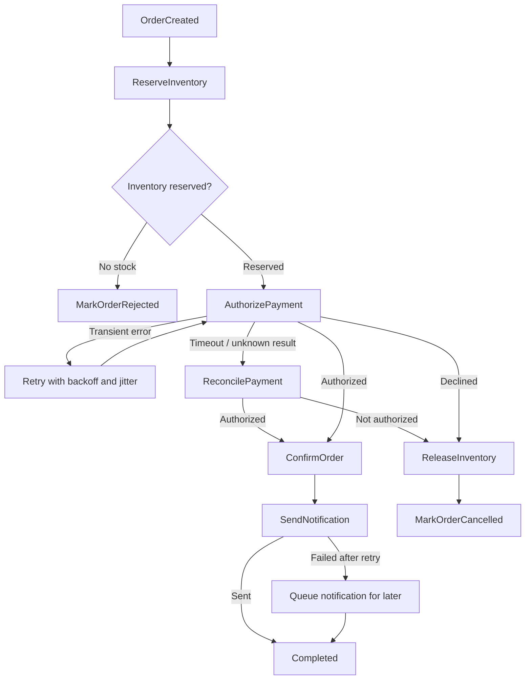

# Configuring Workflow Retries, Timeouts, and Catch Branches

## 1. Why do workflows need explicit error policies?

A serverless workflow typically invokes multiple Java functions and external services to complete a business process. For example, order processing might include validating information, reserving inventory, collecting payment, creating a shipment, and sending notifications. Each step has different execution durations, resource limits, and failure modes. A function may time out; a database may temporarily reject connections; a payment provider may rate-limit requests; or a request may be rejected due to business rules.

If a workflow stops immediately on the first error, transient glitches degrade overall process reliability. If a workflow retries every error infinitely, it can repeat an already-succeeded action, create duplicate transactions, overload downstream dependencies, and drive up costs. If a workflow catches every error and finishes with success, business data can be left incomplete without anyone noticing.

A solid error policy should answer:

- Which errors can self-recover through retries?
- How many times should it retry, how long should it wait, and is there a total time limit?
- When is a step considered timed out? When is a heartbeat needed?
- If a step fails after previous steps succeeded, what needs to be compensated?
- Which errors route to fallback branches, manual review queues, or terminal failure states?
- How can duplicate business side effects be prevented when a workflow re-runs?

In FaaS, the orchestration engine typically stores workflow state outside the functions. The engine manages scheduling, retries, timeouts, and next transitions; each function performs a clearly scoped task. This lets individual functions terminate once their work is done, while also requiring precise boundaries between function errors, downstream service errors, and workflow-level errors.

## 2. Classifying errors before configuring retries

Do not decide whether to retry solely because an exception occurred. Classify errors by recoverability and business meaning.

| Error category | Example | Usually appropriate handling |
|---|---|---|
| Transient | Connection timeout, HTTP 503, throttling, temporary broker disconnect | Retry with backoff and limits |
| Invalid data or request | Missing order ID, schema mismatch, unsupported currency format | Stop the step, return a clear error, or quarantine |
| Business rejection | Insufficient inventory, card declined, ineligible customer | Take a business branch; usually do not auto-retry |
| Configuration or permission error | Missing IAM permission, invalid secret, misconfigured endpoint | Alert and fix configuration; retries rarely help |
| Programming bug | Unexpected null, invariant violation, data conversion error | Bound retries, log error, and escalate for investigation |
| Timeout with unknown outcome | Payment request sent but connection lost before response arrived | Query status using idempotency key before resending |

An error can fall into different categories depending on business context. HTTP 404 when reading an optional resource might be a valid result; HTTP 404 from a misconfigured endpoint is a deployment bug. HTTP 409 might indicate a resolvable concurrency conflict or an already-violated business rule. Translate dependency error codes into stable error types that the workflow understands.

**Business outcomes are not always exceptions.** For instance, a declined payment is a valid workflow outcome. A Java function can return `{ "status": "DECLINED", "reason": "INSUFFICIENT_FUNDS" }`; the workflow uses a `Choice` branch to mark the order as rejected. This distinguishes “the system failed to execute the step” from “the step executed and produced a rejection”. If your organization models rejections as exceptions, attach a dedicated catcher and exclude that error type from retry policies.

## 3. What is a retry and when should it be used?

Retrying means re-executing a step after a previous attempt failed. Retries work when the failure is likely to clear after a wait—such as a temporarily overloaded dependency or a brief network interruption.

Retries are inappropriate when:

- Input data is invalid and unchanged across attempts.
- The user or business system has already rejected the action.
- Missing permissions or misconfigurations need remediation.
- A prior side effect may have occurred with an unknown outcome, and the operation lacks deduplication or status lookup.
- Additional wait time would push the workflow past its SLA or business deadline.

Every retry policy should explicitly define retryable error types, attempt limits, initial interval, backoff multiplier, maximum interval, and jitter strategy. Do not apply a single generic policy to every task, because databases, payment APIs, and email providers have different recovery characteristics.

## 4. Exponential backoff and jitter

If many workflows fail simultaneously and retry immediately, they can trigger another traffic surge against the struggling service. Exponential backoff progressively increases the wait duration after each failure.

A basic formula:

\[
delay_n = \min(delay_{max}, delay_0 \times factor^{n-1})
\]

Where:

- `delay_0` is the initial wait duration.
- `factor` is typically greater than 1, such as 2.
- `n` is the retry attempt index.
- `delay_max` caps the maximum wait duration.

For example, `delay_0 = 2 seconds`, `factor = 2`, `delay_max = 20 seconds` yields maximum wait intervals of 2, 4, 8, 16, and 20 seconds. Total wait time would be 50 seconds if all five retries are used, excluding task execution time.

Jitter adds randomness to the wait interval so workflows do not wake up at the exact same instant. With full jitter, the wait duration is sampled uniformly between 0 and the computed backoff value:

\[
delay = random(0, backoff_n)
\]

Jitter is especially valuable when many functions or workflows call the same dependency concurrently. It reduces retry storms and smooths recovery load. Document how the platform defines jitter; some platforms support full jitter, while others use equal jitter or alternative algorithms.

### Retry count and total duration

In some workflow engines, `MaxAttempts` means retry attempts after the initial invocation; other platforms define it as total executions. Never guess from the property name. For example, with one initial run and up to three retries, the task can run up to four times.

Total task duration must account for both execution time and wait intervals:

\[
T_{task} \approx \sum_{i=1}^{N} T_{attempt_i} + \sum delay_i
\]

If each invocation can run for 15 seconds, the task executes up to four times, and wait intervals are 2, 4, and 8 seconds, total duration is roughly 74 seconds. The workflow needs a timeout large enough to accommodate this duration while staying within the overall process deadline. When a dependency responds slower than expected, task timeouts can cause actual total time to deviate from estimates.

## 5. Retries must pair with idempotency

An orchestration engine may redeliver a task after a timeout or when no clear result is received. A function might also complete a call to an external service and crash before returning a response. The workflow cannot always tell whether the side effect happened.

For example, a function sends a request to charge 450,000 VND to a payment gateway. The gateway records the transaction, but the response is lost on the network. The workflow hits a timeout. If it retries as a brand-new request, the customer could be charged twice.

Use a stable idempotency key per business action:

```text
authorize-payment:ORD-2048:attempt-1
```

Every retry of the same action must use the exact same key. The payment gateway should return the stored outcome for that key or allow transaction status lookup. If the user intentionally initiates a new payment attempt, a new key can be generated under a new business attempt identifier.

Core principles:

- Never generate a fresh random idempotency key on each retry.
- Persist keys and processing states in durable storage.
- If updating business data and recording the inbox/processed key in the same database, do both inside the same transaction.
- When calling external systems, pass an idempotency key supported by that system or query status before resending.
- Retain keys longer than the window during which the workflow can retry, redrive, or replay.
- Distinguish retrying the same action from a new business request.

A timeout does not mean the external action definitely failed. When the outcome is uncertain, the recovery branch should invoke a `Reconcile` or `GetOperationStatus` step using the stable key before deciding to retry.

## 6. Multi-layer timeouts

A serverless request can be subject to multiple time limits. Do not set every timeout to the same value, because each layer has distinct responsibilities.

| Layer | Limit | Purpose |
|---|---|---|
| HTTP client in Java | Connect/read/request timeout | Bounds how long to wait on a dependency |
| Java function runtime | Function timeout | Bounds the duration of a single invocation |
| API gateway | Integration/request timeout | Bounds how long the gateway waits on a function or backend |
| Workflow task | Task/state timeout | Bounds how long orchestration waits for a step |
| Workflow execution | Overall execution timeout/deadline | Bounds the entire process |
| Heartbeat | Maximum gap between heartbeats | Detects long-running tasks that stopped making progress |

A sensible ordering is usually: dependency timeout smaller than function timeout; function timeout smaller than task timeout; and tasks plus retries fitting comfortably within the overall deadline. However, an API gateway may impose a tighter cap than the function runtime, and asynchronous integrations do not hold an HTTP connection open for the entire workflow. Always verify each platform's limits.

For example, a Java function calls a payment provider with a 2-second connect timeout and 8-second request timeout; the function timeout is 12 seconds; the task timeout is 90 seconds to cover retries and backoff; and the entire workflow has a 5-minute deadline. These numbers only illustrate layer relationships, not universal defaults.

Timeouts that are too short trigger spurious retries when a dependency is merely slightly slower than normal. Timeouts that are too long tie up resources, keep users waiting, and delay failure detection. Measure p95/p99 latency, account for cold starts, and set timeouts based on SLAs.

### Task timeouts and workflow timeouts

A task timeout occurs when a step fails to finish within its allotted window. The workflow engine may emit an error for that state so `Retry` or `Catch` can handle it, depending on platform semantics. A workflow timeout is the deadline for the entire execution; it can terminate the whole workflow and may not pass through a task's local `Catch`. Verify how your engine handles execution-level timeouts.

Crucially, a workflow timeout does not automatically cancel external side effects already sent to downstream systems. If a function already initiated a transaction or an asynchronous job, that job may keep running. External cancellation, idempotency, or reconciliation mechanisms are required.

## 7. Heartbeats for long-running tasks

For certain long-running tasks, setting only an overall timeout is insufficient. Heartbeats allow a worker to report that it is still alive and making progress. If the workflow receives no heartbeat within the configured interval, the engine can treat the task as lost or stalled.

Heartbeats are well suited for:

- Processing large files or long-running batch jobs.
- Work executed by external workers via callback/task tokens.
- Activities requiring progress tracking that can run for many minutes or hours.

A heartbeat is not the same as a “still running” log line. It is a control-plane signal the workflow engine uses to verify worker liveness. Send heartbeats only when the worker is genuinely able to continue processing; do not emit heartbeats endlessly while a task is deadlocked.

Some workflow integrations do not support heartbeats. For instance, a synchronous function call may only have an execution timeout; heartbeats are typically intended for activity workers or callback tasks using task tokens. Match the feature to the integration type supported by the platform.

## 8. Catch and error-handling branches

Retry handles recoverable errors. Catch handles errors once retries are exhausted or when an error is non-retryable. Catch routes the workflow to another state—for example, recording order failure, releasing inventory, refunding payment, alerting operations, or placing the request in a manual review queue.

An error-handling branch should clarify:

1. Which error types are caught?
2. Must the original input be preserved for investigation or compensation?
3. Could the error payload contain sensitive information?
4. Do earlier steps need to be compensated?
5. Should the workflow end in failure, complete with an alternate business state, or wait for an operator?

In AWS Step Functions, a state's `Retry` rules are evaluated before its `Catch` rules. When an error matches a retrier, the engine retries according to policy. Once retries are exhausted or no retrier matches, the engine evaluates catchers in order. `States.ALL` is normally placed last and must appear alone in `ErrorEquals`. Certain special runtime errors may not be catchable by wildcards; review your workflow engine's list of non-retryable/non-catchable errors.

### Preserving error context

When catching an error, the workflow typically receives an error name and cause or an equivalent error object. Store this information in a clearly named field for downstream steps. Do not overwrite the entire input if recovery branches still need `orderId`, `customerId`, correlation IDs, or idempotency keys.

In Step Functions, `ResultPath` can place the catcher output under a nested field in the state input, such as `$.paymentError`. The workflow can then transition to an investigation or compensation state while retaining the original input. Exact output shapes depend on the integration and how the state configures `InputPath`, `Parameters`, `ResultSelector`, or `OutputPath`.

Never return stack traces, access tokens, secret values, or raw internal causes to end users. Store technical details in access-controlled logs; workflow outputs should only carry stable error codes, necessary business fields, and correlation IDs.

## 9. Retry and Catch example with AWS Step Functions

The following Amazon States Language (ASL) snippet illustrates a task invoking a Java Lambda to authorize payment. This is a partial state machine; target states like `ConfirmOrder`, `MarkOrderRejected`, `ReconcilePayment`, and `ManualReview` must be defined in the rest of the workflow.

```json
{
  "AuthorizePayment": {
    "Type": "Task",
    "Resource": "arn:aws:states:::lambda:invoke",
    "Parameters": {
      "FunctionName": "arn:aws:lambda:region:account:function:authorize-payment",
      "Payload.$": "$"
    },
    "TimeoutSeconds": 120,
    "Retry": [
      {
        "ErrorEquals": [
          "com.example.PaymentThrottledException",
          "com.example.PaymentProviderUnavailableException"
        ],
        "IntervalSeconds": 2,
        "BackoffRate": 2.0,
        "MaxAttempts": 3,
        "MaxDelaySeconds": 20,
        "JitterStrategy": "FULL"
      }
    ],
    "Catch": [
      {
        "ErrorEquals": ["com.example.PaymentDeclinedException"],
        "ResultPath": "$.paymentError",
        "Next": "MarkOrderRejected"
      },
      {
        "ErrorEquals": ["States.Timeout"],
        "ResultPath": "$.paymentTimeout",
        "Next": "ReconcilePayment"
      },
      {
        "ErrorEquals": ["States.ALL"],
        "ResultPath": "$.unexpectedError",
        "Next": "ManualReview"
      }
    ],
    "Next": "ConfirmOrder"
  }
}
```

In this example:

- Only throttling and temporary provider unavailability errors are automatically retried.
- `MaxAttempts: 3` in Step Functions means up to three retries after the initial invocation, allowing four total executions.
- Wait intervals double with a factor of 2, capped at 20 seconds, using full jitter.
- Declined payments route to the `MarkOrderRejected` business branch.
- Timeouts route to `ReconcilePayment` because the payment outcome may be unknown.
- Other errors route to `ManualReview`; the wildcard catcher is placed last.

Error names in `ErrorEquals` must match the exact error names returned by the integration at runtime. For Java Lambda, errors may carry the exception class name or a name mapped by an adapter. Inspect actual execution histories and error payloads during integration testing rather than relying solely on class names in source code.

A Task's `TimeoutSeconds` caps the state under Step Functions semantics; the Lambda function also has its own timeout. Sum execution times and retry backoff windows so the task does not time out before retries can finish. Attributes such as `MaxDelaySeconds` and `JitterStrategy` depend on workflow service versions/capabilities; syntax and behavior differ on other engines.

## 10. Java Functions should emit meaningful errors

A workflow can choose the right branch only if functions classify errors consistently. Do not turn every failure into a generic `RuntimeException` or catch exceptions and return a fake success response.

Java example:

```java
public record PaymentCommand(
        String orderId,
        String idempotencyKey,
        long amountMinor,
        String currency) {}

public record PaymentResult(
        String paymentId,
        String status) {}

public final class PaymentFunction {
    private final PaymentGateway gateway;

    public PaymentFunction(PaymentGateway gateway) {
        this.gateway = gateway;
    }

    public PaymentResult handle(PaymentCommand command) {
        validate(command);

        try {
            return gateway.authorize(
                    command.orderId(),
                    command.idempotencyKey(),
                    command.amountMinor(),
                    command.currency());
        } catch (ProviderRateLimitException ex) {
            throw new PaymentThrottledException(ex);
        } catch (ProviderUnavailableException ex) {
            throw new PaymentProviderUnavailableException(ex);
        }
    }

    private void validate(PaymentCommand command) {
        if (command == null
                || command.orderId() == null
                || command.idempotencyKey() == null
                || command.amountMinor() <= 0
                || command.currency() == null) {
            throw new InvalidPaymentCommandException();
        }
    }
}
```

Exceptions like `PaymentThrottledException`, `PaymentProviderUnavailableException`, and `InvalidPaymentCommandException` must have stable names mapped cleanly in the workflow. `InvalidPaymentCommandException` is an input error and should not appear in the retry list. If the provider returns a payment decline as a normal business outcome, returning a `PaymentResult` with status `DECLINED` can be preferable to throwing an exception.

Functions should not implement uncontrolled multi-layer retries internally. If a function retries three times and the workflow retries the function four times, a single operation can hit the dependency twelve times (or more if the SDK also retries). Decide which layer owns retries, or set an overall budget and coordinate layers. Brief SDK retries for socket-level errors can be helpful, provided they are accounted for within the workflow's timeout and attempt budget.

## 11. Catch is not for hiding errors

A catcher may transition to a successful completion branch, but only when the workflow has reached a well-defined valid business state. For instance, if sending an email fails after several attempts, it can be recorded as `NOTIFICATION_PENDING` and queued for later delivery; the order can still be confirmed if notification is not a strict prerequisite.

Conversely, if payment fails and the workflow still marks the order `CONFIRMED`, that is a design flaw. Distinguish clearly between:

- **Fallback:** proceed using an alternative path, such as a backup provider.
- **Compensation:** execute a compensating action for an earlier step, such as releasing reserved inventory.
- **Escalation:** route to an operator or operations system, such as placing details into a manual review queue.
- **Terminal failure:** terminate the workflow in a failed state because safe continuation is impossible.
- **Business completion with warning:** the core workflow finishes while an auxiliary task such as sending notifications remains pending.

Every branch must update the workflow or aggregate state so users and downstream systems know what occurred. Never just log and exit.

## 12. Compensation and Sagas when multiple steps have succeeded

Multi-step workflows generally lack a single database transaction spanning all services. If the fourth step fails after the first three steps have committed, all changes cannot simply roll back like a local transaction.

The Saga pattern pairs each business step with its compensating action:

| Forward step | Action | Possible compensation |
|---|---|---|
| Create order | Persist order in `PENDING` state | Cancel order if no irreversible commitments exist |
| Reserve inventory | Decrement available stock or create reservation | Release reservation |
| Charge payment | Authorize or capture funds | Void or refund depending on transaction state |
| Create shipment | Book shipping | Cancel shipment if carrier permits |
| Send email | Deliver notification | Usually cannot be recalled; may send a correction notice |

When a step fails beyond retry recovery, the workflow transitions to compensating steps in an appropriate order. Compensation is a new business action that can itself fail and therefore requires retries, timeouts, idempotency, and observability.

For example, if inventory reservation succeeds but payment is declined, the workflow invokes `ReleaseInventory`. If payment times out, do not release inventory immediately before checking the transaction; payment might have succeeded. A `ReconcilePayment` step must determine status before deciding whether to proceed with confirmation or compensate.

Not every action has a perfect compensation. An email already sent cannot be “unsent”; a published event cannot be deleted from consumers that already received it. In such cases, compensation may take the form of a corrective event or follow-up business task.

## 13. Retries inside Parallel and Map/for-each

A workflow may run parallel branches or iterate over a list of items. Define the exact scope at which retries apply:

- Retrying a Task inside each item re-runs only the failed item.
- Retrying an entire Map/Parallel state may re-run items or branches that already succeeded, depending on the engine.
- A branch-level Catch may allow sibling branches to finish, though the overall output must accurately report which branches succeeded.
- A single item with permanent bad data must not trap the entire batch in endless retries.

For large lists, prefer per-item retries or small-batch retries when supported by the workflow engine. Track individual item IDs and processing states. If the whole batch is re-executed, every item must be idempotent. With concurrency caps, ensure a failing branch does not trigger excessive concurrent retries.

In AWS Step Functions, `Retry` and `Catch` are configured on states; for `Map` or `Parallel`, placement determines whether policies apply to an individual step, `ItemProcessor`, branch, or outer state. Carefully review semantics for `ItemProcessor`, branches, and nested states. Avoid placing overly broad outer catchers if doing so discards details about which specific item failed.

## 14. Retry budgets and avoiding retry storms

Multi-layer retries multiply call counts. Suppose a workflow tries a task four times, the function tries an API three times, and the SDK retries twice; one execution can emit up to 24 dependency requests. Across many concurrent executions, traffic spikes rapidly.

To keep retries under control:

- Designate a single retry owner per dependency: SDK, function, or workflow.
- Set maximum attempts and an overall deadline for the full operation.
- Use exponential backoff and jitter.
- Honor `Retry-After` headers or dependency rate-limit guidance when present.
- Cap concurrency on both workflows and functions.
- Use a circuit breaker or load-shedding mechanism when error rates cross thresholds.
- Track total attempts per business operation, not just invocation counts.
- Stop retrying when insufficient time remains to finish before the SLA.

A circuit breaker typically tracks closed, open, and half-open states. When a dependency fails continuously, the breaker opens to reject or delay new requests; after a cooldown period, probe requests are allowed through. In serverless workflows, breaker state must live in a shared store or gateway if multiple instances must respect it; never rely on local static variables as the sole source of state.

## 15. Timeouts and cancellation for asynchronous tasks

A workflow may launch a long-running job and wait for a callback or completion event. When the deadline expires, decide what happens to the running job:

- Send a cancellation request if the worker or service supports it.
- Mark the execution as expired so late callbacks cannot mutate an already-terminated state.
- Use correlation IDs or task tokens to match callbacks to the exact execution.
- Ignore or quarantine duplicate, late, or invalid callbacks.
- Reconcile side effects in case the worker finished but the callback was lost.

Never assume cancelling a workflow automatically stops a running function or external HTTP request. Cancellation must be propagated to the worker and handled cooperatively. If cancellation is unsupported, the task must be idempotent and check execution state before proceeding.

Callback tokens are sensitive control credentials. Never log tokens or expose them to untrusted clients. Only authenticated workers should be authorized to submit completion/failure callbacks. Set both timeouts and heartbeats on callback waits so workflows do not hang forever.

## 16. Dead-letter queues and manual review

Once retries are exhausted or an unrecoverable data error occurs, the workflow can forward details to a DLQ or manual review queue. An investigation message should contain at a minimum:

- Workflow execution ID and correlation ID.
- Business entity ID, such as `orderId`.
- Failed state/task name and stable error category.
- Attempt count, failure timestamp, and prior step statuses.
- Redacted input details or a reference to a securely stored record.
- Recommended next action: retry, reconcile, compensate, or manual review.

A DLQ is not a place to forget about errors. Alert when new messages arrive, monitor the age of the oldest message, and assign clear team ownership. Before redriving, fix the root cause, verify schema compatibility, and confirm operations are idempotent. Never bulk-redrive while the dependency is still overloaded.

## 17. Monitoring and diagnosing workflows

Every workflow execution should propagate a correlation ID and business ID across all steps. Structured logs should record:

- `executionId`, `stateName`, `attempt`, and `correlationId`.
- `orderId` or relevant aggregate ID.
- `errorType`, wait intervals, timeouts, and execution duration.
- Selected Catch or compensation branch.
- Idempotency/reconciliation outcome and final business state.

Never write tokens, secrets, full payloads containing personal data, or stack traces to user-accessible outputs. Keep error codes stable so dashboards can group errors across deployments.

Key metrics include workflow success rate, average retry count, task timeouts, executions exceeding deadlines, time spent in each state, compensation count, manual review volume, DLQ depth, and cost per execution. A workflow may show zero overall failures while still being unhealthy if most executions require multiple retries or frequently take degraded branches.

When investigating an execution:

1. Identify the first state that failed.
2. Inspect the error name and cause, checking whether they were masked by a generic exception.
3. Review the actual retry count and wait durations.
4. Determine whether any side effect could have occurred before a timeout.
5. Inspect the Catch branch, compensations, and business data state.
6. Redrive only after understanding checkpoints/state and the impact of re-execution.

## 18. Order processing flow design example

A workflow might consist of the following states:



Key design decisions:

1. `ReserveInventory` uses an idempotency key derived from `orderId` and reservation version. Retries will not reserve stock twice.
2. `AuthorizePayment` uses a stable idempotency key. Throttling/provider-unavailable errors can retry; declines are business outcomes; timeouts trigger reconciliation.
3. If payment is not authorized, the workflow releases the inventory reservation. This compensation step is also idempotent and has its own retry policy.
4. `ConfirmOrder` executes only when both payment and inventory preconditions are satisfied.
5. `SendNotification` is an auxiliary step. If the email provider is temporarily down, the notification job can be queued for later delivery without re-running the order transaction.
6. If compensation fails after retries, the workflow moves to manual review and preserves state until resolved.

Do not mark an execution `Completed` merely because every task returned a response. Business state must reflect the actual outcome: `CONFIRMED`, `REJECTED`, `CANCELLED`, `COMPENSATION_PENDING`, or `MANUAL_REVIEW`.

## 19. Process for configuring retries, timeouts, and Catch

When adding a task to a workflow, follow this sequence:

1. **Define the task contract:** input, output, side effects, and the business state owned by the task.
2. **Enumerate possible errors:** transient failures, business rejections, validation errors, permission issues, bugs, and timeouts.
3. **Map errors stably:** translate dependency exceptions or responses into error types recognized by the workflow.
4. **Assess idempotency:** determine whether re-running the task can duplicate effects; design keys and reconciliation.
5. **Layer timeouts:** configure dependency, function, task, and overall deadlines, accounting for cold starts and backoff time.
6. **Configure narrow retries:** retry only transient errors, capping attempts, backoff, max delay, and jitter.
7. **Configure specific Catch blocks first:** business outcomes, timeouts needing reconciliation, technical failures needing fallback or manual review; put wildcard catchers last.
8. **Design compensations:** identify which steps require compensation and how to handle failed compensations.
9. **Design DLQ/redrive:** retain enough context for investigation and controlled replay.
10. **Run fault-injection tests:** simulate timeouts, throttling, lost responses, crashes after side effects, malformed data, and dependency outages.
11. **Monitor post-deployment:** track attempts, latency, timeouts, catch paths, compensations, and business states.

## 20. Pre-deployment checklist

- [ ] Transient errors, business outcomes, and unrecoverable errors are clearly separated.
- [ ] Only errors capable of self-recovery are retried.
- [ ] Retries define max attempts, backoff, jitter, and deadlines.
- [ ] Total attempts across SDK, function, and workflow retries have been accounted for.
- [ ] Side effects carry stable idempotency keys across retries and redrives.
- [ ] Dependency, function, task, and workflow timeouts are aligned.
- [ ] Long-running tasks use heartbeats where supported by the integration type.
- [ ] Timeouts with unknown outcomes route to an appropriate reconciliation step.
- [ ] Specific Catch blocks precede wildcard catchers; errors are never silently swallowed.
- [ ] Error outputs retain needed inputs without exposing secrets or sensitive data.
- [ ] Compensations have idempotency, retries, and failure-handling branches.
- [ ] Parallel/Map states configure retries at the right item or batch scope.
- [ ] DLQ/manual review queues have clear ownership and redrive procedures.
- [ ] Correlation IDs, execution history, metrics, and alerts are in place.
- [ ] Crash-after-side-effect, timeout, retry storm, and late-callback scenarios have been tested.

## Conclusion

Retries help workflows recover from transient glitches; timeouts bound individual steps and overall execution durations; Catch routes remaining failures to business branches, compensations, or manual handling. These three mechanisms operate safely only when grounded in proper error classification, idempotency, deadlines, and durable state. In Java serverless applications, functions must emit meaningful errors, workflows must bound retries and preserve error context, and external side effects must be reconciled whenever timeouts leave outcomes uncertain. Designing these rules upfront enables controlled recovery without creating duplicate transactions or masking business failures.
