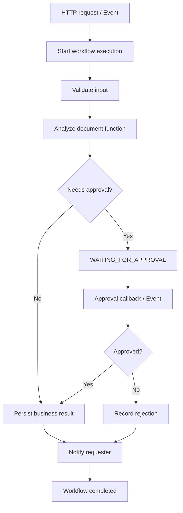
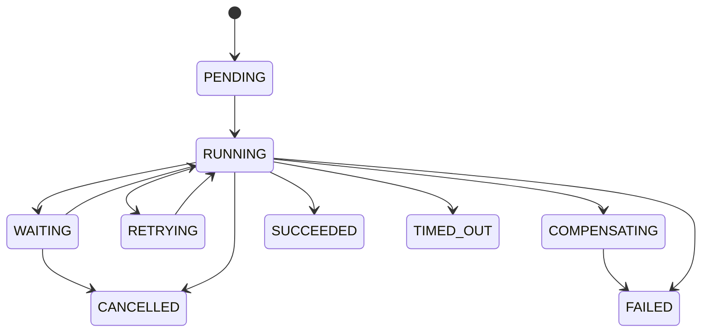
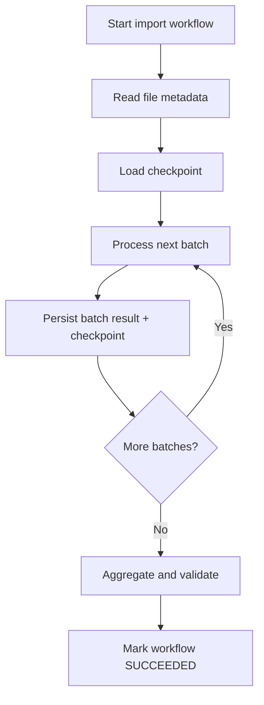
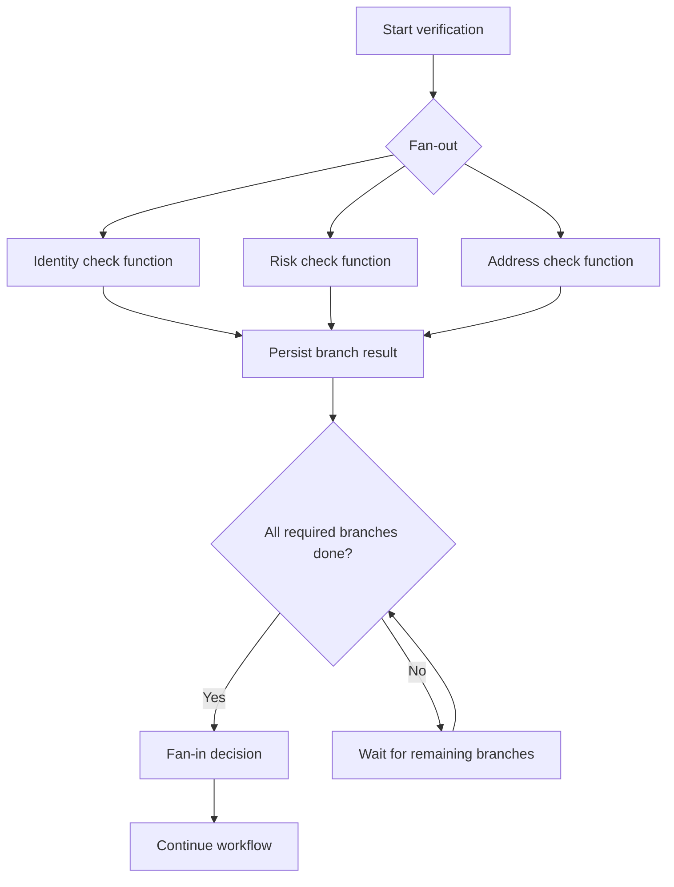

# Tracking Long-Running Workflows and Persisting Durable State

A serverless function is typically designed to receive a trigger, perform a unit of work, and terminate. However, many business processes do not finish within a single invocation: account onboarding, order fulfillment, dossier approval, data ingestion, payment reconciliation, or multi-service deployments. Such work can span minutes, hours, or wait days for user input.

Trying to keep a single function running throughout the entire process hits execution timeouts, wastes resources while waiting, and fails to recover cleanly when the runtime terminates. Instead, model the process as a **workflow execution** with durably persisted state. Each step runs inside its own function or service; the orchestrator persists progress, history, wait timers, and outcomes so execution can resume after failures or long waits.

In this model, functions execute individual work steps; the workflow owns the lifecycle of the overall process. Workflow state must exist independently of invocation memory and be inspectable, monitorable, recoverable, and manually actionable when necessary.

## 1. Distinguishing invocations, jobs, and workflow executions

Three terms are frequently conflated:

| Concept | Scope | Example |
| --- | --- | --- |
| Function invocation | A single function run triggered by HTTP, queue, event, or scheduler | A Java function validating a dossier in 800 ms |
| Job | A logical unit of business work to complete | Generating a monthly report for tenant A |
| Workflow execution | A specific run of a multi-step process with its own state and history | Intake dossier, validate, wait for approval, persist result, and notify |

A job may map one-to-one with a workflow execution, or a workflow may coordinate multiple jobs, or a job may spawn child workflows. What matters is that each execution has a unique identifier and a single authoritative source of state.

Functions are generally stateless at the invocation level: never rely on `static` variables, heap state, or temp files to remember prior steps. Workflow executions are stateful in the sense that state is durably persisted in an orchestration engine or application data store. After a function finishes, the workflow may remain `WAITING`, `RETRYING`, or `RUNNING` at another step.

## 2. What is a long-running workflow?

A workflow is a model describing steps, conditional branches, loops, wait durations, and error handling to achieve a business goal. A workflow execution is a concrete run of that definition, with inputs, current state, event history, and outputs.

Example dossier processing flow:

1. Receive request and assign an execution ID.
2. Validate input data and access permissions.
3. Analyze the document via a worker function.
4. If needed, transition the dossier to wait for staff approval.
5. Once decided, proceed to persist the outcome.
6. Send notifications and end the execution.

The process can wait days for approval without keeping a Java function alive during that period. The orchestrator persists the wait state and resumes the workflow when the matching callback or event arrives.



Long-running workflows typically exhibit one or more characteristics: waiting for external events, retrying steps, executing sequential/parallel activities, requiring checkpoints, or compensating completed actions if a downstream step fails.

## 3. Orchestration vs. choreography

Two common patterns exist for coordinating distributed components:

- **Orchestration:** a central coordinator holds the workflow definition and decides the next step. It knows where the execution stands, when to retry, which event to wait for, and completion criteria.
- **Choreography:** services emit and consume events; each service independently decides how to react and emits follow-up events. No central coordinator describes the entire process.

| Criterion | Orchestration | Choreography |
| --- | --- | --- |
| Flow control | Workflow engine or coordinator | Reactive rules inside each service |
| End-to-end progress visibility | Centralized execution state and history | Must stitch traces/events across multiple services |
| Coupling | Services depend on workflow contracts or orchestrator commands | Services depend on each other's event contracts |
| Best suited for | Processes with clear ordering, branching, timeouts, approvals, or compensations | Independent reactions, fan-out, and loose integration |
| Challenges | Workflow definitions and versions must be managed | Hard to see overall process state and debug event chains |

The two approaches are not mutually exclusive. A workflow can orchestrate core business steps while one step emits an integration event for multiple independent subscribers. Choose orchestration when explicit progress tracking and decision control matter; choose choreography when services simply react independently to facts that occurred.

## 4. Components of a durable workflow

A typical architecture includes these components:

| Component | Responsibility |
| --- | --- |
| Workflow definition | Describes states, tasks, branches, waits, retries, and transitions |
| Execution ID | Uniquely identifies one workflow run |
| Orchestrator / Workflow engine | Schedules tasks, persists progress, evaluates transitions, and recovers executions |
| Task / Activity function | Performs a specific unit of work |
| Durable state/history | Stores needed inputs, step outputs, status, and transition history |
| Event source / Queue | Delivers work items or continuation signals into the workflow |
| External callback | Lets external systems or users report outcomes for waiting steps |
| Monitoring / Operator interface | Observes, alerts, stops, retries, or handles errors needing intervention |

An orchestrator can persist state in a managed cloud service, or the application can implement its own coordinator and database. Managed services typically provide timers, retries, history, and scaling; a custom coordinator gives deep control, yet the engineering team must handle concurrency, recovery, deduplication, and versioning themselves.

An execution typically tracks `executionId`, `workflowType`, `workflowVersion`, `status`, `currentStep`, `createdAt`, `updatedAt`, `deadline`, `inputRef`, `outputRef`, and event history. Not every engine stores these fields identically; this serves as a conceptual model for the data you need to track.

## 5. Workflow states and state machines

States should express meaningful business progress rather than merely whether a function is currently running. For example:

| State | Meaning | Terminal state? |
| --- | --- | --- |
| `PENDING` | Execution created, first task not yet started | No |
| `RUNNING` | A task is actively executing | No |
| `WAITING` | Waiting on a timer, callback, or external event | No |
| `RETRYING` | A task encountered a transient failure and awaits retry | No |
| `COMPENSATING` | Executing compensating actions | No |
| `SUCCEEDED` | Workflow completed its goal | Yes |
| `FAILED` | Workflow failed with no automatic retries remaining | Yes |
| `CANCELLED` | Workflow cancelled per policy | Yes |
| `TIMED_OUT` | Execution exceeded its overall deadline | Yes, unless an explicit resume procedure exists |

The state machine must enforce valid transitions. For instance, `WAITING` can transition back to `RUNNING` on a valid callback; `RUNNING` can transition to `RETRYING` on a transient task failure; `COMPENSATING` starts only when business logic requires compensation. Never allow a late-arriving event to move a `SUCCEEDED` execution back to `RUNNING`.



In practice, the state machine can use richer business states such as `PAYMENT_PENDING`, `AWAITING_CUSTOMER`, `DOCUMENT_REVIEW`, or `FULFILLMENT`. Choose states that operators and calling systems can act upon directly.

## 6. Persisting durable state: engine state, business state, and history

Not every piece of tracked data belongs in one JSON column or in workflow history. Separate three categories:

1. **Orchestration state:** current step, timers, pending tasks, retry counts, and data the engine needs to resume execution.
2. **Business state:** orders, dossiers, payments, ownership, and canonical domain state owned by business services.
3. **Execution history/audit:** events such as task started, completed, failed, retried, callback received, and operator decisions.

The orchestration engine is the source of truth for coordination progress. The business database is the source of truth for domain data. History is an audit trail for investigation and compliance—not necessarily the store applications mutate directly for business state.

For instance, a payment workflow may hold `WAITING_FOR_PAYMENT_CONFIRMATION`, while the true transaction state must be confirmed by the Payment service or its database. Never conclude payment succeeded merely because a workflow task returned normally if the payment system has not confirmed the transaction.

### Persist only the data needed

State payloads should contain identifiers and data required by the next step: `orderId`, `customerId`, `paymentId`, `documentRef`, version, or correlation IDs. Large files, images, PDFs, and bulky analysis outputs belong in object storage; workflow state holds the URI/object key and checksum.

Carrying full payloads across every step increases history storage cost, data transfer, latency, and the risk of exceeding workflow engine input/output size limits. Also avoid putting secrets, access tokens, or unnecessary personal data into history, since histories are often retained long-term and viewable by many operators.

### Execution state example

A state snapshot might look like this:

```json
{
  "executionId": "exec-8c42",
  "workflowType": "DocumentOnboarding",
  "workflowVersion": 3,
  "status": "WAITING",
  "currentStep": "MANUAL_REVIEW",
  "businessKey": "document-2198",
  "inputRef": "s3://private-documents/tenant-42/document-2198.pdf",
  "startedAt": "2026-11-17T09:00:00Z",
  "updatedAt": "2026-11-17T09:05:12Z",
  "deadline": "2026-11-24T09:00:00Z",
  "correlationId": "req-4b61",
  "attempt": 1
}
```

This is a conceptual example; do not expose internal URIs or sensitive metadata on a public API if the caller lacks authorization. A status API can return a filtered projection while the engine keeps full coordination metadata.

## 7. Checkpoints and resuming after a function ends

A checkpoint is a point where a workflow or activity saves enough progress to resume after a failure. For chunked workloads, a checkpoint may be the processed record count, next page cursor, output object key, or completed phase.

Example of importing a one-million-row file:

1. Read file metadata and determine the number of partitions to process.
2. Split the file into bounded-size batches.
3. A worker processes one batch and persists both the batch result and checkpoint `nextBatch=5`.
4. The workflow checks if more batches remain; if so, it schedules the next task.
5. After the final batch, the workflow aggregates results and marks completion.



Checkpoints must be written safely with respect to retries. If a worker writes batch results but times out before updating the checkpoint, the batch may be re-processed. Use stable batch IDs, unique constraints, or idempotent upserts so re-execution never duplicates results.

A checkpoint is not necessarily a full state snapshot. Many workflow engines store an event history and reconstruct state by replaying history. Some engines periodically write snapshots/checkpoints to speed up recovery. Regardless of mechanism, the application must understand which data the engine safeguards versus what must be persisted in the business database.

## 8. Long waits without keeping functions alive

A workflow may need to wait for a scheduled timestamp, an event, or a human decision. Never use `Thread.sleep()` inside a Java function to wait for hours or days. That holds an active invocation, consumes compute time, and still risks timeouts.

Instead, use durable wait mechanisms:

- **Timer/delay state:** the engine stores the wake-up timestamp and resumes execution when due.
- **Wait for event:** execution enters `WAITING` and resumes upon receiving the matching event.
- **Callback/task token:** the workflow dispatches an external request and waits for a callback carrying the corresponding token or correlation ID.
- **Scheduled continuation:** persist state and schedule a continuation message/task for a later time.

For example, a payment reminder workflow can wait 24 hours after sending a notice. The engine stores the timer; the notification function exits immediately. When the timer fires, the workflow resumes to check invoice status. If the customer has paid, execution ends; if not, the workflow sends the next reminder or escalates.

### Callbacks from external systems

When waiting on an external party, the workflow can generate a callback token or unique `correlationId` and store the mapping to the execution. The callback API receives the outcome, authenticates the sender, verifies token validity, checks that the execution is waiting on the exact step, and records the callback idempotently.

Never treat a callback as valid merely because it knows the `executionId`. Callback tokens often act as bearer capabilities: anyone holding one can advance the workflow. Never place tokens in public URLs, logs, or unsecured notifications. Enforce expiration, scoped permissions, sender authentication, and replay protection.

Callbacks can arrive duplicated, late, or after the execution has timed out. The API must define explicit behavior: return success for already-processed duplicate callbacks; reject callbacks targeting the wrong step; log late callbacks for investigation; and never revive a terminated execution without a controlled resume procedure.

## 9. Workflow-level retries, timeouts, and heartbeats

Task retries and workflow-level retries operate at different scopes. If `AnalyzeDocument` fails because an API is temporarily down, the engine can retry just that step. If the workflow exceeds its overall deadline, the entire execution can transition to `TIMED_OUT` or enter an exception-handling flow.

A retry policy should specify:

- Which error types are retryable (throttling, timeouts, transient network glitches).
- Which error types are non-retryable (invalid data, insufficient permissions, business rule rejections).
- Maximum attempts and total retry duration.
- Backoff, jitter, and rate limits to prevent load spikes.
- Per-task timeouts and overall workflow deadline.
- Post-exhaustion behavior: fail, route to DLQ, wait for operator, or run compensation.

For long-running tasks, heartbeats can signal to the orchestrator that the activity is still making progress. If no heartbeat arrives within the configured window, the engine can treat the worker as lost and allow a retry. Heartbeats do not replace checkpoints; a worker may stay alive while losing progress, or a task may have committed a side effect before losing connectivity.

If the engine supports per-state timeouts, configure them explicitly. Task timeouts bound how long to wait for an activity result; heartbeat timeouts detect unresponsive workers; execution timeouts bound the entire workflow. Exact property names and behaviors vary by engine.

## 10. Side effects, idempotency, and exactly-once semantics

A workflow engine can durably record that a task was scheduled or finished, yet it cannot automatically turn an HTTP call to an external system into an atomic transaction with the engine's state store.

For example:

1. The workflow calls the Payment service to capture funds.
2. The Payment service succeeds.
3. The worker times out before reporting the result back to the orchestrator.
4. The orchestrator does not know whether the capture succeeded and retries.

If the second request initiates a new transaction, the customer could be charged twice. This is the gap between external side effects and recording outcomes in the workflow.

Required safeguards:

- Generate a stable idempotency key per execution and step, such as `exec-8c42:capture-payment`.
- Pass the exact same key across every retry of the same business operation.
- The Payment service persists the key and outcome, returning the stored result on duplicate requests.
- Persist `paymentId` or business reference into workflow state once confirmed.
- When an outcome is unknown, query status by idempotency key or business reference before retrying.

Never claim a workflow has exactly-once side effects solely because the engine persists state durably. Message delivery and activity invocations can often repeat. The practical target is safe at-least-once processing using idempotency, unique constraints, conditional writes, and reconciliation.

## 11. Sagas and compensating actions

A workflow may mutate state across multiple services. No single database transaction covers the entire process. If a later step fails, the application may need compensating actions to return the business domain to an acceptable state.

Order placement example:

| Step | Primary action | Possible compensating action |
| --- | --- | --- |
| 1 | Reserve stock in Inventory | Release stock reservation |
| 2 | Capture payment | Refund or void transaction depending on payment state |
| 3 | Create shipping order | Cancel shipping order if not yet handed off |
| 4 | Send confirmation to customer | Send correction notice if required by policy |

If step 3 fails after steps 1 and 2 succeed, the workflow can run compensations in reverse order: refund/void payment and release inventory. This is the Saga pattern.

Compensation is not automatic database rollback. A captured charge may require issuing a refund as a new transaction; a parcel handed to a carrier may not be cancellable; an email sent cannot be unsent. Therefore, compensations must be modeled with business semantics, can themselves fail, and may require operator intervention.

The `COMPENSATING` state makes recovery clearly observable. If a compensation fails, record completed steps, retry within bounds, and route the execution to a manual review queue when needed. Never mark `CANCELLED` or `FAILED` before clearly recording which side effects occurred and how compensation finished.

## 12. Parallelism, fan-out/fan-in, and child workflows

A workflow can run multiple independent branches concurrently—for example, identity verification, sanctions screening, and address validation. Once branches finish, the workflow gathers results to decide the next step.



When running branches in parallel, specify:

- Maximum branch count and concurrency cap to protect downstream services.
- Completion criteria: all branches, first successful branch, or a minimum threshold.
- How to handle failed, timed-out, or late branches.
- How to merge results and persist per-branch status.
- Whether remaining branches should be cancelled once the decision is clear.

Child workflows are useful when a subprocess is reusable, has independent timeouts/retries, or requires separate ownership. The parent execution should store the child execution ID and rules for handling child success, failure, or timeout. Do not spawn thousands of child executions without capping concurrency and cost.

## 13. Java: modeling workflow state in an application

If you build a lightweight coordinator yourself, you can start with an execution table and an event history table. The SQL below illustrates the schema structure; a managed workflow engine stores equivalent metadata internally.

```sql
CREATE TABLE workflow_execution (
    execution_id       VARCHAR(80) PRIMARY KEY,
    workflow_type      VARCHAR(120) NOT NULL,
    workflow_version   INTEGER NOT NULL,
    business_key       VARCHAR(160) NOT NULL,
    status             VARCHAR(32) NOT NULL,
    current_step       VARCHAR(120),
    state_json         TEXT NOT NULL,
    version            BIGINT NOT NULL,
    created_at         TIMESTAMP NOT NULL,
    updated_at         TIMESTAMP NOT NULL,
    deadline_at        TIMESTAMP
);

CREATE TABLE workflow_history (
    event_id           VARCHAR(80) PRIMARY KEY,
    execution_id       VARCHAR(80) NOT NULL,
    sequence_no        BIGINT NOT NULL,
    event_type         VARCHAR(80) NOT NULL,
    step_name          VARCHAR(120),
    details_json       TEXT,
    occurred_at        TIMESTAMP NOT NULL,
    UNIQUE (execution_id, sequence_no)
);
```

`state_json` holds compact coordination data, never files or secrets. `version` supports optimistic locking so two workers cannot overwrite each other's state. `workflow_history` logs key transitions for investigation; when history and snapshot updates must be atomic, write both in the same transaction.

### Java record for execution

```java
import java.time.Instant;
import java.util.Map;

public record WorkflowExecution(
        String executionId,
        String workflowType,
        int workflowVersion,
        String businessKey,
        WorkflowStatus status,
        String currentStep,
        Map<String, String> references,
        long version,
        Instant createdAt,
        Instant updatedAt,
        Instant deadlineAt
) {}

public enum WorkflowStatus {
    PENDING,
    RUNNING,
    WAITING,
    RETRYING,
    COMPENSATING,
    SUCCEEDED,
    FAILED,
    CANCELLED,
    TIMED_OUT
}
```

`references` holds required IDs or object references. For complex state, use DTOs with explicit schema versions instead of an untyped `Map<String, Object>`; this enables type checking and state upgrades when workflow definitions evolve.

### Updating state with optimistic locking

Example repository using version checks so updates succeed only if another worker has not modified the execution:

```java
import java.sql.Connection;
import java.sql.PreparedStatement;
import javax.sql.DataSource;

public final class WorkflowRepository {
    private final DataSource dataSource;

    public WorkflowRepository(DataSource dataSource) {
        this.dataSource = dataSource;
    }

    public boolean moveToWaiting(
            String executionId,
            long expectedVersion,
            String nextStep
    ) throws Exception {
        String sql = """
                UPDATE workflow_execution
                   SET status = 'WAITING',
                       current_step = ?,
                       version = version + 1,
                       updated_at = CURRENT_TIMESTAMP
                 WHERE execution_id = ?
                   AND version = ?
                   AND status = 'RUNNING'
                """;

        try (Connection connection = dataSource.getConnection();
             PreparedStatement statement = connection.prepareStatement(sql)) {
            statement.setString(1, nextStep);
            statement.setString(2, executionId);
            statement.setLong(3, expectedVersion);
            return statement.executeUpdate() == 1;
        }
    }
}
```

If `UPDATE` affects zero rows, the worker must reload state to see whether another worker updated the execution, whether it finished, or whether it no longer exists. Never overwrite using a stale snapshot. A custom coordinator also needs leases/claims, atomic transitions, timers, retry schedulers, deduplication, and recovery; these tables alone do not constitute a complete workflow engine.

## 14. Java activity: idempotency by execution and step

Each activity should receive execution ID, step name, and input references. Build a stable idempotency key for a side effect. For example:

```java
public record ActivityContext(
        String executionId,
        String stepName,
        String stepInstanceId,
        int attempt,
        String correlationId
) {
    public String idempotencyKey() {
        return executionId + ":" + stepName + ":" + stepInstanceId;
    }
}

public interface PaymentGateway {
    PaymentResult capture(String paymentId, String idempotencyKey);
}

public record PaymentResult(
        String transactionId,
        String status
) {}

public final class CapturePaymentActivity {
    private final PaymentGateway paymentGateway;

    public CapturePaymentActivity(PaymentGateway paymentGateway) {
        this.paymentGateway = paymentGateway;
    }

    public PaymentResult execute(
            ActivityContext context,
            String paymentId
    ) {
        return paymentGateway.capture(
                paymentId,
                context.idempotencyKey()
        );
    }
}
```

This example assumes the Payment service supports idempotency keys and returns the stored outcome on duplicate calls. `stepInstanceId` must stay stable across retries of the same logical step invocation, while differing across distinct legitimate iterations of the same step within a workflow. If the downstream service does not support idempotency, the application must persist an operation record and reconcile status before retrying. Never include `attempt` in the key, as each retry would become a separate transaction.

## 15. Tracking executions and end-to-end observability

A long-running workflow must answer: which executions are waiting, which step are they stuck on, which steps retry heavily, where is wait time spent, and who intervened in the process?

Monitor at a minimum:

| Metric | Operational question |
| --- | --- |
| Active executions by status | How many executions are `RUNNING`, `WAITING`, or `RETRYING`? |
| Execution age | Which executions have exceeded SLA duration? |
| Step duration p50/p95/p99 | Which steps are slow or have heavy tail latency? |
| Wait duration | How long do workflows wait on users, timers, or external services? |
| Retry count by step/error | Which steps fail repeatedly and why? |
| Timeout/failure rate | How many executions terminate unexpectedly? |
| Compensation failure | Are any side effects left uncompensated? |
| Stale activity/heartbeat | Which workers stopped responding or lost leases? |
| History/state size | Are executions storing excessive payloads or events? |

Attach `executionId`, `businessKey`, `correlationId`, `stepName`, `attempt`, and trace context to logs and traces for every activity. Use execution ID to correlate orchestrator history with function logs and event broker traces. Avoid putting high-cardinality fields such as execution ID, customer ID, or business key into metric labels; keep them in logs and traces instead.

History explains what happened, yet it requires retention policies and access controls. History may contain payloads, errors, and sensitive metadata. Redact sensitive data before saving, restrict read permissions, encrypt at rest, and enforce appropriate retention periods.

## 16. Recovery, manual retries, and handling stuck executions

An execution may remain `RUNNING` longer than expected because a worker crashed, a message was never acknowledged, a callback never arrived, or a downstream service lost connectivity. Systems must detect SLA breaches proactively instead of waiting for user complaints.

Operational tooling should support:

1. Searching executions by ID, business key, or time window.
2. Inspecting current state and step-by-step history.
3. Identifying whether a task is active, waiting, retrying, or already produced side effects.
4. Checking actual state in the authoritative business service before retrying.
5. Retrying the specific step or resuming from a checkpoint when safe.
6. Triggering compensation if the workflow partially executed and policy requires reversal.
7. Auditing operator identity, reason, timestamp, and outcome.

Never delete a stuck execution and immediately create a fresh one. The old execution may still have an active worker or committed side effects. Before retrying, verify leases, idempotency keys, and business state. If a new execution must be started, link the old and new executions via business key or `restartedFromExecutionId` for auditability.

### Replay does not mean re-executing side effects

Some workflow engines replay event history to reconstruct state and verify orchestration logic. Replaying history in such engines must produce deterministic decisions identical to the original run; side-effecting operations run inside isolated activities. During replay, the engine replays decisions without re-invoking activities whose outcomes are already recorded.

If you implement replay yourself or re-run part of a workflow with updated code, never unconditionally re-invoke payments, emails, or order creation. Use idempotent activities, persist completed outcomes, and separate historical replay from a new business run.

## 17. Workflow versioning and in-flight state

Workflow definitions evolve over time: adding validation steps, renaming states, changing payloads, or adjusting retry policies. Meanwhile, older executions may still be waiting on approvals or timers for days.

Persist `workflowVersion` when starting an execution and maintain a compatibility strategy:

- Running executions can continue on their original version if the engine retains older definitions.
- If executions must move to a new version, perform controlled, reversible state migration.
- Never alter the semantics of a state field without schema versioning or migration.
- Never remove tasks/states that in-flight executions can still visit.
- Keep compatibility with callbacks/events emitted by older versions.
- Test retry, timeout, and compensation branches whenever modifying definitions.

A safe approach is versioning workflow definitions explicitly so new executions use the new version while in-flight executions finish on the old version. Exact mechanics depend on the engine; some engines provide patching/versioning APIs or worker build compatibility controls.

## 18. Security and workflow intervention permissions

Workflow state and history can contain sensitive data. Separate permissions for starting executions, reading status, submitting callbacks, cancelling, retrying, and running compensations.

- Start APIs should allow callers to launch only workflow types matching their permissions.
- Status APIs must check permissions on both the execution and the business resource; knowing an execution ID does not grant read access.
- Workers should hold least-privilege permissions only for the services and objects needed by their steps.
- Callback endpoints must authenticate senders, verify signatures or tokens, check deadlines, and confirm the expected wait state.
- Operator actions such as retry, cancel, skip, or compensate require dedicated permissions and audit logs.
- Never place credentials, access tokens, or unnecessary personal data in workflow payloads/history.
- Encrypt state/history and enforce retention per organizational policy.

A `skip step` operation can violate business invariants. If supported, define explicitly which steps may be skipped, under what conditions, who may approve, and how substitute outputs are recorded.

## 19. Cost and limits of long-running workflows

Workflow engines may charge by state transitions, steps, requests, state retention duration, activity runtime, or concurrency. Worker functions incur separate compute charges; databases, queues, object storage, logs, and tracing also add cost. Pricing models differ across orchestration services and workflow engines.

Cost drivers include:

- Excessive status polling or workflows broken into too many tiny transitions.
- Repeated retries from overly short timeouts or downstream throttling.
- Passing large payloads through state/history across many steps.
- Unbounded fan-out spawning excessive concurrent child executions or activities.
- Long waits implemented with active compute/tasks instead of durable timers.
- Unbounded retention on execution history and audit logs.
- Compensations and redrives generating extra traffic to downstream services.

To control costs:

1. Use durable timers/wait states instead of keeping functions alive when idle.
2. Store only essential coordination data and pass references to large objects.
3. Coalesce trivial operations when doing so does not hurt retry granularity or observability.
4. Configure sensible retry limits, backoff, jitter, and deadlines.
5. Cap fan-out concurrency to match downstream capacity.
6. Enforce retention policies on execution history and business data as required.
7. Track cost per successful workflow and by execution type.

Not every process needs a workflow engine. A fast two-step chain without long waits, complex retries, or queryable progress may only need a simple coordinating service. A workflow engine delivers real value when processes involve branching, timers, callbacks, retries, compensations, or long-term tracking.

## 20. When to choose a workflow engine vs. self-managed state?

| Need | Recommended approach |
| --- | --- |
| Fast single function needing no continuation after invocation | Handle directly inside the function |
| Simple job that can be queued with status in a database | Queue + job table may suffice |
| Multi-step flow with branching, retries, waits, callbacks, and timeouts | Workflow engine/orchestrator usually fits best |
| Multi-service process requiring compensation | Orchestration supporting Sagas or a coordinator with an explicit state machine |
| Multiple services reacting independently to events | Event bus/choreography may fit |
| Long-running flow needing auditability and operator resume | Durable workflow with execution history and operational tooling |

If managing state yourself, the engineering team must build atomic transitions, optimistic locking, leases, timer schedulers, callback deduplication, retries, recovery, history, versioning, and operator tooling. Account for total operational cost and risk before deciding to build a custom workflow engine.

## 21. Long-running workflow design checklist

- [ ] Every execution has a stable ID, business key, and workflow version.
- [ ] The state machine defines explicit states, transitions, and terminal states.
- [ ] Orchestration state is durably persisted outside function heap memory.
- [ ] Business state remains owned by domain services with a clear source of truth.
- [ ] Large files/payloads live outside workflow state and are passed by reference.
- [ ] Tasks have timeouts, retry policies, backoff, and overall time limits.
- [ ] Side effects carry stable idempotency keys per execution and step.
- [ ] Waits/timers/callbacks do not keep functions alive during idle periods.
- [ ] Callbacks are authenticated, replay-protected, and handle duplicates/late arrivals.
- [ ] Checkpoints are written safely so batches or activities can re-run.
- [ ] Saga compensations are defined for side effects requiring reversal.
- [ ] Fan-out has concurrency caps and explicit fan-in rules.
- [ ] Execution history, traces, metrics, and audits are sufficient for troubleshooting.
- [ ] Stuck execution detection and manual retry/resume procedures exist.
- [ ] Workflow definitions and state schemas have a versioning strategy.
- [ ] Permissions for start/read/callback/cancel/retry/compensate are separated.
- [ ] Retention, backups, recovery, and cost per successful workflow are accounted for.

Long-running workflows allow a serverless application to continue processing across multiple invocations and extended waits without relying on an always-on function. The orchestrator persists coordination state and history; activity functions execute individual steps; the business database holds domain data; and queues or callbacks wake workflows when needed. Combining checkpoints, idempotency, bounded retries, compensations, and execution observability lets Java FaaS processes recover from errors and gives operators exact visibility into where every job stands.
