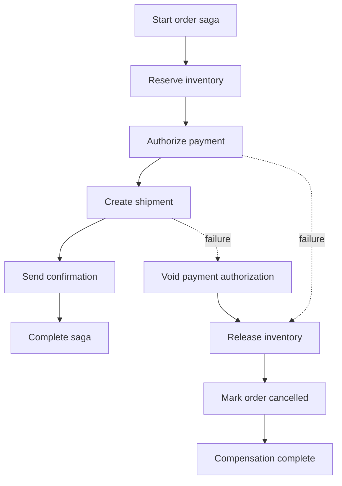
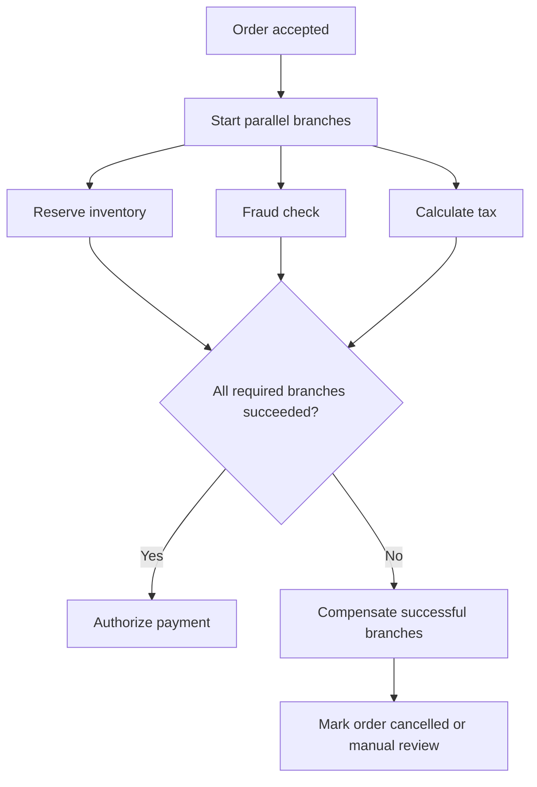

# Designing Compensating Actions with the Saga Pattern

In a serverless application, a business process can span multiple functions and independent data services. For example, creating an order may require reserving inventory, confirming payment, creating a shipment, and sending notifications. Each function typically runs a single local transaction and exits; one service's database cannot automatically roll back a transaction already committed in another service.

The **Saga** pattern solves this problem by breaking a long-running process into local transactions. Each successful step can have a compensating action to handle failures in a later step. An orchestrator or event handlers track progress, retry failing steps, and execute compensating actions according to business rules.

A Saga does not create an ACID transaction across multiple services. Instead, it produces a process with durable state and eventual consistency. Users may observe an order in `PROCESSING`, `CANCELLING`, or `COMPENSATION_REQUIRED` while the system completes subsequent steps.

## 1. The problem Sagas solve

Suppose an order placement process consists of four operations:

1. Reserve product stock in inventory.
2. Confirm payment.
3. Create a shipping request.
4. Send a confirmation notification.

Each operation may belong to a separate service and database. If inventory reservation succeeds and payment succeeds, but shipment creation fails, the system must decide how to handle already-held resources. A standard database transaction cannot automatically undo operations in both the warehouse and payment gateway.

A Saga expresses the process as local transactions and corresponding compensating actions:

| Forward step | Local transaction | Possible compensating action |
|---|---|---|
| T1 | Reserve inventory stock | Release reservation |
| T2 | Authorize/capture payment | Void authorization or issue refund |
| T3 | Create shipment | Cancel shipment if carrier allows |
| T4 | Send notification | Send correction notice; sent emails generally cannot be recalled |

If T3 fails after T1 and T2 succeed, the Saga can run compensations in dependency order: void authorization/refund payment, then release inventory. T4 never ran, so no compensation is needed for it. Each compensating action is its own business operation, can itself fail, and requires retries.

Notifications are usually auxiliary side effects. If an order is confirmed while the email provider is temporarily down, the system should typically retry sending the notification independently rather than cancelling the completed order. Make notification a mandatory Saga step only when business rules genuinely require it.

### Happy path and compensation flow



The diagram shows a linear flow for illustration. In practice, a Saga can include conditional branches, parallel branches, timeouts, retries, or steps requiring human operator intervention.

## 2. Components and boundaries of a Saga

A Saga typically consists of the following logical components:

- **Saga definition:** specifies step order, conditions, timeouts, retries, and compensating actions.
- **Orchestrator or event choreography:** decides the next step and reacts when errors occur.
- **Local transaction/activity:** performs a state change scoped to one service/database.
- **Compensating action:** executes a business operation to mitigate or reverse the effect of an earlier succeeded step.
- **Saga state store:** persists workflow state, step outcomes, operation identifiers, and transition history.
- **Message/event transport:** moves commands and events among functions, services, and the workflow engine.
- **Observability:** records correlation IDs, saga IDs, step IDs, attempts, outcomes, and errors for investigation.

`sagaId` identifies one workflow run. `correlationId` can tie the Saga to a broader request or business journey. `commandId`/`eventId` identify messages. `stepId` identifies a step in the Saga definition. These IDs are not interchangeable.

The critical boundary is the local transaction. For example, Inventory Service can reserve stock and write a reservation record to its database within one transaction. After committing, the service returns `reservationId`. The Saga saves that result so a later compensating action knows the exact reservation to release. The Saga should never mutate Inventory Service's internal tables directly.

## 3. Local transactions and compensating actions

Local transactions must enforce the invariants of the service that owns the data. Inventory Service atomically checks available stock and creates the reservation. Payment Service validates the transaction and creates an authorization or capture according to payment rules. Each service is responsible for protecting its own data.

A compensating action is not necessarily a mathematical inverse of the original operation. It is a business action that restores the system to an acceptable state:

| Committed side effect | Possible compensation | Limitations |
|---|---|---|
| Reserve stock | Release reservation | Can fail if reservation already expired or was consumed |
| Authorize card | Void authorization | May require checking authorization status first |
| Capture funds | Issue refund | Refunded funds may take time to settle back to the account |
| Create shipment | Cancel shipment | Cannot cancel once parcel is handed over to carrier |
| Send email | Send correction email | Recipient has still already seen the original email |
| Create partner account | Mark inactive or request deletion | Data may have to be retained for audit or legal compliance |

Accordingly, when designing a Saga, ask: is the operation reversible, what action compensates it, what time limits apply, what fees or external side effects exist, and who handles compensation if it fails?

### Compensation is not rollback

A database rollback discards uncommitted changes inside a local transaction. Compensation is a brand-new transaction executed after the prior change already committed. Between those two points in time, other services or users may have observed the intermediate state. Compensation can also fail, get retried, or need manual intervention.

For instance, refunding after a capture does not delete the charge history. It creates a new refund transaction linked to the original charge. Audit trails should retain both the charge and the refund to reflect accurately what happened.

## 4. Choosing orchestration vs. choreography

Two common ways to structure Sagas are orchestration and choreography.

### Orchestration: a coordinator manages progress

An orchestrator holds Saga state and decides the next command. It dispatches `ReserveInventory`, awaits the result, then dispatches `AuthorizePayment`, and proceeds to `CreateShipment`. If a step fails, the orchestrator switches to the compensation branch.

Advantages:

- Ordering, timeouts, retries, and error branches are defined in one central place.
- Overall status is easy to inspect and you know which step the flow is currently on.
- Fits multi-step workflows with branching or long wait periods.
- Can leverage a workflow engine to persist checkpoints and resume after function runtimes exit.

On the flip side, the orchestrator must be designed so it does not absorb all domain business logic. It should coordinate commands and outcomes; individual services still own their local transactions and invariants. Workflow definitions must be versioned because an in-flight Saga may still be running when a new version is deployed.

### Choreography: services react to events

In choreography, each service executes a local transaction and emits an event. The next service listens for that event and runs its own step. For example, Inventory Service emits `InventoryReserved`; Payment Service consumes it and authorizes payment; Shipping Service consumes `PaymentAuthorized` and creates a shipment.

Advantages:

- Services have fewer direct dependencies on a central coordinator.
- Fits short event chains with minimal branching and independently evolving domains.
- Events can fan out to multiple subscribers outside the Saga.

On the flip side, business flow spreads across many handlers and rules. With complex branching, timeouts, retries, or compensations, global state becomes hard to observe. Correlation IDs, event histories, timeout monitors, and stuck-Saga detection are required. Choreography does not eliminate the need for state management; state may still be tracked by a process-manager service or projection.

| Criterion | Orchestration | Choreography |
|---|---|---|
| Who picks the next step? | Orchestrator | Event-consuming service |
| Process definition | Centralized in workflow definition | Distributed across event handlers and contracts |
| Global state visibility | Usually more direct | Must aggregate events/state across multiple services |
| Coupling | Services depend on workflow commands | Services depend on event contracts |
| Best suited for | Long flows, complex branching, intricate compensation | Simple event chains across independent services |

Neither option fits every system universally. You can use orchestration for the core order Saga and choreography for secondary subscribers like analytics or notifications.

## 5. Designing Saga state

Workflow state must be durably persisted outside function memory. An invocation can end between two steps; a fresh function must resume progress from workflow state or the engine's checkpoint.

A minimal state model:

| Saga state | Meaning |
|---|---|
| `STARTED` | Workflow created, first step not yet completed |
| `RUNNING` | Executing forward steps |
| `COMPENSATING` | Failure occurred; compensating previously succeeded steps |
| `COMPLETED` | All mandatory steps succeeded |
| `COMPENSATED` | Required compensating actions completed |
| `COMPENSATION_REQUIRED` | A compensation step failed or requires an operator |
| `MANUAL_REVIEW` | Requires business decision or manual intervention |
| `CANCELLED` | Workflow stopped with a defined cancellation outcome |

Step states can include `PENDING`, `IN_PROGRESS`, `UNKNOWN`, `SUCCEEDED`, `FAILED`, `COMPENSATING`, `COMPENSATED`, and `COMPENSATION_FAILED`. `UNKNOWN` indicates an undetermined outcome—such as a timeout where the target service may have committed. Distinguish Saga failure from completed compensation: a workflow may fail its business goal while resources were still cleaned up successfully.

`COMPENSATED` describes the technical outcome of the Saga: all required compensations finished. `CANCELLED` is typically the business state of the order or process. An order may become `CANCELLED` after the Saga reaches `COMPENSATED`; while compensation is incomplete, the order might remain `CANCELLING` or `MANUAL_REVIEW`.

A workflow record should persist at a minimum:

```json
{
  "sagaId": "saga-order-1052",
  "sagaType": "CreateOrder",
  "sagaVersion": 3,
  "correlationId": "flow-77",
  "orderId": "order-1052",
  "status": "RUNNING",
  "currentStep": "AUTHORIZE_PAYMENT",
  "steps": {
    "RESERVE_INVENTORY": {
      "status": "SUCCEEDED",
      "reservationId": "reservation-501"
    },
    "AUTHORIZE_PAYMENT": {
      "status": "IN_PROGRESS",
      "operationId": "payment-auth-order-1052"
    },
    "CREATE_SHIPMENT": {
      "status": "PENDING"
    }
  },
  "version": 8,
  "updatedAt": "2026-11-17T12:40:00Z"
}
```

It is unnecessary to store the entire raw payload inside workflow state. Store only data required for recovery, result identifiers, statuses, and references to large objects in appropriate storage. Protect sensitive data and define retention policies for workflow history.

### Conditional state transitions

Multiple workers or callbacks may update the same Saga. Use version/optimistic locking or state-store transactions so two invocations never both dispatch the next command. For example, transition from `RUNNING` to `COMPENSATING` only if the current version equals the read version. If the condition fails, the worker reloads the latest state and re-evaluates.

Never dispatch a command and only afterward persist that the command was sent without protection. If the function crashes between the two operations, the workflow can stall or send duplicates. A transactional outbox or the durable dispatch guarantees of a workflow engine bind state updates and next-step scheduling together.

## 6. Rules for designing compensating actions

A well-designed compensation must satisfy these properties:

1. **Clear business target:** knows exactly which side effect to offset and the desired target state.
2. **Idempotent:** sending the same compensation multiple times produces only one effective business outcome.
3. **Reference identifier:** uses the reservation ID, authorization ID, or shipment ID saved during the forward step.
4. **Retryable:** transient failures can be retried with backoff and appropriate bounds.
5. **Observable:** records start, completion, errors, attempts, and business error codes.
6. **Unhappy-path policy:** transitions to a manual-intervention state, alerts, and preserves enough data to continue when compensation cannot complete.
7. **Does not assume external rollback:** uses void/refund/cancel APIs or corrective actions supported by the partner.

### Compensating in dependency order

For a linear chain, compensations normally execute in reverse order of succeeded forward steps. If T1 reserved inventory, T2 authorized payment, and T3 created a shipment, when T3 fails, compensate T2 first and then T1. That order avoids releasing stock while payment authorization is still active when business rules require cancelling payment first.

However, not every Saga has a simple linear reverse order. If steps ran in parallel, examine the dependency graph. A compensation runs only once dependent steps are in an appropriate state. Independent branches can compensate in parallel; dependent branches must follow reverse topological order.

### Not every step needs compensation

Some steps only write internal logs or metrics and need no compensation. Some side effects cannot be recalled, such as a sent email or delivered SMS. For those steps, use correction notices, adjustment events, or defer sending notifications until high-risk steps have completed.

## 7. Timeouts and undetermined outcomes

A timeout does not prove the downstream service operation failed. For example, Payment Service sent an authorization request to the gateway, the gateway succeeded, and the response was lost. The orchestrator sees a timeout without knowing whether an authorization exists.

Immediately sending a compensation or creating a brand-new authorization can corrupt state or double-charge. Design operations with a stable idempotency key—such as `payment-auth-{orderId}`—and provide a status-lookup API by operation ID. On timeout:

1. Mark the step `UNKNOWN` or an equivalent status instead of immediately assuming failure.
2. Query the service owning the operation using the operation ID/idempotency key.
3. If the operation succeeded, save the result into Saga state and continue or compensate according to workflow logic.
4. If the operation definitively did not occur, retry with the exact same idempotency key.
5. If status cannot be determined after a time limit, escalate to `MANUAL_REVIEW` or a reconciliation process.

For queues/events, distinguish message receipt from local transaction commit. Acknowledge only after results are durably persisted. If an acknowledgment is lost, the message may redeliver; activities must be idempotent.

## 8. Retrying forward steps vs. retrying compensations

Forward-action retries and compensation retries carry different semantics.

- **Forward retry:** re-attempts an incomplete business step, such as calling Inventory Service when throttled. Reuse the same operation ID to avoid duplicate reservations.
- **Compensation retry:** continues trying to offset an already-committed side effect, such as voiding an authorization. Reuse the same compensation ID or stable key to avoid voiding/refunding multiple times.
- **Workflow retry:** recovers an execution after the orchestrator or runtime stops. The engine must know which steps committed, which are running, and which have not yet been dispatched.

Apply exponential backoff, jitter, attempt caps, and deadlines. Retry only transient errors such as timeouts, throttling, or 5xx errors. Business errors such as insufficient stock, declined cards, or invalid addresses should route to business branches rather than retrying indefinitely.

Compensations may warrant longer retry budgets than forward steps because the system is actively recovering consistency. Define retry budgets, alert thresholds, and escalation procedures. Never mark a Saga `COMPENSATED` until all mandatory compensations are confirmed complete.

## 9. Order placement Saga example

An order workflow can be specified as follows:

| Step | Command | Success outcome | Compensation |
|---|---|---|---|
| 1 | `ReserveInventory` | `reservationId` | `ReleaseInventory` |
| 2 | `AuthorizePayment` | `authorizationId` | `VoidPaymentAuthorization` |
| 3 | `CreateShipment` | `shipmentId` | `CancelShipment` if still feasible |
| 4 | `ConfirmOrder` | Order becomes `CONFIRMED` | Usually none; this may be the business pivot/completion point |
| 5 | `NotifyCustomer` | Notification sent | Send correction notice if needed |

One design option is authorizing first and capturing only once fulfillment is confirmed. If shipment creation fails, voiding an authorization is usually simpler than refunding after capture. Choosing between authorize-then-capture and immediate capture depends on payment policies, authorization hold windows, and payment provider rules.

Order status should reflect progress—for example `PENDING`, `RESERVING_INVENTORY`, `PAYMENT_AUTHORIZING`, `PREPARING_SHIPMENT`, `CONFIRMED`, `CANCELLING`, `CANCELLED`, or `MANUAL_REVIEW`. Never let clients interpret a newly created order as fully completed while the Saga is still running.

## 10. Java example: contracts for activities and compensations

The application layer should define commands and business results independently of cloud SDKs. Function adapters receive messages, validate inputs, invoke application services, and return results to the workflow engine.

```java
public record ReserveInventoryCommand(
        String sagaId,
        String orderId,
        String operationId,
        String sku,
        int quantity) {}

public record InventoryReservation(
        String reservationId,
        String orderId) {}

public record ReleaseInventoryCommand(
        String sagaId,
        String reservationId,
        String compensationId) {}

public interface InventoryService {
    InventoryReservation reserve(ReserveInventoryCommand command);
    void release(ReleaseInventoryCommand command);
}
```

`operationId` is deterministically derived from the Saga and step, such as `saga-order-1052:reserve-inventory`. Inventory Service persists the operation ID alongside the outcome in the same transaction that creates the reservation. If the command is redelivered, the service returns the stored outcome instead of creating a new reservation.

Compensation uses the `reservationId` stored in workflow state. `compensationId` can be `saga-order-1052:release-inventory`; Inventory Service records this key so repeated calls do not release twice or create duplicate side effects.

### An idempotent implementation in the data-owning service

```java
public interface InventoryRepository {
    InventoryReservation reserveOnce(
            String operationId, String orderId, String sku, int quantity);

    // Atomically record the compensation ID and release the reservation.
    void releaseOnce(String compensationId, String reservationId);
}

public final class InventoryApplicationService implements InventoryService {
    private final InventoryRepository repository;

    public InventoryApplicationService(InventoryRepository repository) {
        this.repository = repository;
    }

    @Override
    public InventoryReservation reserve(ReserveInventoryCommand command) {
        return repository.reserveOnce(
                command.operationId(),
                command.orderId(),
                command.sku(),
                command.quantity());
    }

    @Override
    public void release(ReleaseInventoryCommand command) {
        repository.releaseOnce(
                command.compensationId(), command.reservationId());
    }
}
```

The repository methods above are illustrative contracts. In production, `releaseOnce` must record the compensation marker and release the reservation in the same transaction; if it records only the marker and crashes before releasing stock, retries would skip the missing work. Likewise, `reserveOnce` must enforce unique operation IDs and persist both the reservation and idempotency result atomically.

## 11. Java example: describing a Saga definition

A workflow definition can declare forward steps, compensation steps, retry policies, and timeouts. The workflow engine or orchestrator adapter handles state persistence and activity dispatch.

```java
import java.time.Duration;
import java.util.List;

public record RetryPolicy(
        int maxAttempts,
        Duration initialDelay,
        Duration maxDelay) {}

public record SagaStep(
        String name,
        String forwardCommand,
        String compensationCommand,
        Duration timeout,
        RetryPolicy retryPolicy) {}

public final class CreateOrderSagaDefinition {
    public static final List<SagaStep> STEPS = List.of(
            new SagaStep(
                    "RESERVE_INVENTORY",
                    "ReserveInventory",
                    "ReleaseInventory",
                    Duration.ofSeconds(10),
                    new RetryPolicy(5, Duration.ofMillis(200), Duration.ofSeconds(10))),
            new SagaStep(
                    "AUTHORIZE_PAYMENT",
                    "AuthorizePayment",
                    "VoidPaymentAuthorization",
                    Duration.ofSeconds(20),
                    new RetryPolicy(4, Duration.ofSeconds(1), Duration.ofSeconds(20))),
            new SagaStep(
                    "CREATE_SHIPMENT",
                    "CreateShipment",
                    "CancelShipment",
                    Duration.ofSeconds(15),
                    new RetryPolicy(3, Duration.ofSeconds(1), Duration.ofSeconds(15)))
    );

    private CreateOrderSagaDefinition() {}
}
```

This is a declarative model, not a complete workflow engine. The engine still needs to manage state transitions, attempt counts, timers, deduplication, versioning, event delivery, and crash recovery. A `Duration` in a definition does not create a durable timer on its own; timers must be managed by a workflow engine or a persistent scheduler.

## 12. Durable orchestration in serverless environments

Never write an orchestrator as a loop holding one function invocation open for minutes or hours. Runtimes impose timeouts, can be reclaimed, and do not preserve memory across invocations. A durable serverless workflow typically operates as follows:

1. An HTTP function validates the request, creates `sagaId`, and persists the order in `PENDING`.
2. In the same transaction, write initial workflow state and an outbox command `ReserveInventory`.
3. A dispatcher delivers the command to a queue or workflow engine.
4. An activity function executes its local transaction, persisting the operation ID and outcome.
5. The activity returns its result or emits an event; the workflow engine updates its checkpoint and schedules the next step.
6. On failure, the engine transitions the Saga to `COMPENSATING` and dispatches compensations for previously succeeded steps.
7. Upon completion, the engine persists the terminal state and emits appropriate business events.

The workflow engine can be a managed orchestration service or a custom application state machine. If self-built, handle durable timers, leases, concurrency, duplicate events, outbox/inbox, versioned state, and recovery. Never rely on a simple status table without guarantees that commands cannot be lost between state updates and message sends.

### Transactional outbox and inbox

An outbox lets a service persist business changes and outbound messages in the same database transaction. A dispatcher reads the outbox and publishes messages; if publishing succeeds before marking the outbox, messages may be resent. Consumers use an inbox/idempotency store to handle duplicates.

On the orchestrator side, step state updates and command dispatches must stay consistent. Use a workflow engine with durable execution, or write state updates and outbox commands in the same transaction. When an activity finishes, persist its outcome before acknowledging the event/command.

## 13. Sagas with parallel branches

An order may run fraud checks, inventory reservation, and tax calculation simultaneously. Parallel execution cuts total latency while making compensation more intricate.

Example:



The orchestrator must know whether each branch started, succeeded, failed, or remains undetermined. If the fraud check fails while inventory reservation succeeded, only the reservation needs compensation. If one branch times out with an unknown outcome, reconcile using its operation ID before deciding to compensate.

When branches are independent, compensations can run in parallel to reduce recovery time. If one branch depends on another's result, compensate according to the dependency graph. Never rely solely on event arrival order, because messages can be delayed or redelivered.

## 14. Points of no return and non-compensable actions

Some workflows have a **pivot transaction**: a step after which the workflow commits to moving forward and can no longer rely on routine compensation for earlier steps. For instance, before capturing funds, the system can void an authorization; once goods have shipped, cancelling an order may require a returns/refund process instead of rolling back a shipment.

Classify steps into:

- **Reversible before pivot:** can be offset cleanly via operations like releasing a reservation or voiding an authorization.
- **Pivot:** the business commitment step that moves the workflow into fulfillment, such as capturing payment or dispatching goods depending on the model.
- **Irreversible/externally visible:** side effects that cannot be completely undone, such as sending emails, SMS messages, or completed deliveries.

Order steps to defer hard-to-compensate side effects until critical preconditions are verified. When a side effect cannot be compensated, define corrective workflows: correction notices, refunds, support tickets, or return flows.

## 15. Compensation failures and manual handling

Compensations can fail because a service is unavailable, a reservation expired, a payment provider is unresponsive, or a shipment already passed a non-cancellable stage. Never silently ignore errors and mark the Saga complete.

Operational procedures should:

1. Keep the Saga in `COMPENSATION_REQUIRED` or `MANUAL_REVIEW`.
2. Record the original step, corresponding compensation, operation ID, attempt count, and last error.
3. Fire an alert carrying `sagaId`, `orderId`, and correlation ID for operations lookup.
4. Provide tools to inspect actual state in data-owning services.
5. Allow retrying compensations or recording authorized business resolutions.
6. Maintain an audit trail for every manual action.

Never let an operator manually edit multiple databases to “fix things up”. Expose administrative commands with authorization checks, idempotency, and audit history—such as `RetryCompensation`, `MarkShipmentReturned`, or `ApproveManualResolution`.

## 16. Workflow timeouts and scheduled tasks

Long-running Sagas need durable timers for conditions like waiting up to 15 minutes for payment, waiting 24 hours for partner confirmation, or auto-releasing expired reservations. Timers must be durably persisted; never use `Thread.sleep`, in-memory function timers, or a long-lived waiting invocation.

When a timeout fires, the orchestrator must inspect current state and the waiting step's outcome. A success event may have arrived late, or the service may have finished while the event was lost. Before compensating, reconcile using the operation ID and the data-owning service's state. A timeout is a signal to inspect progress, not conclusive proof that a side effect never occurred.

## 17. Versioning and in-flight Sagas

Workflows can outlive individual deployments. If you alter step ordering or compensation semantics, in-flight Sagas can continue on their old definition while new Sagas start on the new definition.

Key principles:

- Store `sagaVersion` when initiating a workflow.
- Keep handlers compatible with commands/events from still-active versions.
- Avoid changing the semantics of a step or compensation still referenced by older in-flight workflows.
- If workflow state migration is required, run controlled, auditable migrations.
- Check both active and stalled workflows before retiring old handler code.

## 18. Saga observability and operations

Saga logs and traces should capture:

| Field | Purpose |
|---|---|
| `sagaId` | Locate an entire workflow run |
| `sagaType` / `sagaVersion` | Identify the workflow definition |
| `correlationId` | Link to broader requests or business journeys |
| `stepId` | Identify the active step |
| `operationId` | Reconcile target service operations and enforce idempotency |
| `compensationId` | Uniquely identify a stable business compensation |
| `attempt` | Track retries |
| `status` | Track state transitions |
| `duration` / `errorCode` | Measure latency and classify errors |

Metrics should track active Sagas, oldest Saga age, completion latency p50/p95/p99, success rate, compensation rate, failed compensations, workflows needing manual review, retry counts, and inter-step delays. Avoid using `sagaId` or `orderId` as high-cardinality metric labels; keep those IDs in access-controlled logs and traces.

Dashboards should separate forward failures from compensation failures. With only a single “Saga failed” metric, operators cannot tell whether an order was cleanly unwound or still holds dangling reservations or authorizations.

## 19. Security and access control

Each activity function should only hold permissions to call the services and read/write the data required for its step. The orchestrator holds permission to dispatch commands and update workflow state, not administrative access across all business databases. Compensations may hold sensitive privileges such as voiding payments or releasing inventory; enforce least privilege and audit logging.

Core guidelines:

- Authenticate command/event sources and validate schemas before executing.
- Never trust client-supplied `sagaId`, `orderId`, or `correlationId` for authorization.
- Enforce tenant and resource-level permissions inside data-owning services.
- Use a secrets manager for payment provider or partner credentials.
- Never log sensitive payloads, tokens, or full payment details.
- Restrict read permissions on workflow history since it may contain sensitive business data.
- Protect compensating operations with authorization, idempotency, and audit trails.

## 20. When should you use Sagas?

Sagas fit processes that:

- Span multiple services or databases with independent transactions.
- Run longer than reasonable bounds for a single transaction or function invocation.
- Have well-defined forward steps and business compensating actions.
- Can tolerate intermediate states and eventual consistency.
- Require retries, timeouts, tracking, and recovery when a step fails.

A Saga may be overkill for a small change contained within a single database transaction. If only one write occurs, a local transaction is simpler. If side effects cannot be compensated and the business cannot tolerate intermediate states, revisit service boundaries or redesign the process.

## 21. Design checklist

- [ ] Local transactions and data-owning services are identified for every step.
- [ ] Every forward step has a stable operation ID and idempotent handling.
- [ ] Every step has a compensation or documents why compensation is impossible/unnecessary.
- [ ] Compensations reference the exact resources created during forward steps.
- [ ] Compensations are idempotent and have dedicated retry policies.
- [ ] Compensation order follows the dependency graph, typically reversing forward steps.
- [ ] Timeouts treat outcomes as potentially unknown; target service reconciliation exists.
- [ ] Saga state is durably persisted and updated with versioning/conditional writes.
- [ ] State updates and command dispatches are protected by a durable workflow engine or outbox.
- [ ] Consumers use inbox/idempotency and acknowledge only after committing local transactions.
- [ ] Separate states exist for failed compensations and manual review.
- [ ] Durable timers are used for long-running workflows.
- [ ] Parallel branches define join rules and dependency-aware compensations.
- [ ] Saga definitions are versioned to support in-flight workflows.
- [ ] Metrics, logs, and traces cover sagas, steps, attempts, and compensations.
- [ ] IAM/permissions are scoped per activity and compensating action.
- [ ] Crash-after-commit, lost responses, duplicate messages, timeouts, retries, and compensation failures have been tested.

Sagas coordinate independent local transactions into a coherent long-running business process. The pattern's reliability depends on cleanly scoped local transactions, meaningful business compensations, durable workflow state, and solid handling of timeouts, retries, and compensation failures. In Java serverless architectures, keep functions focused on short-lived activities while a workflow engine or durable coordinator manages the state and lifecycle of the Saga.
