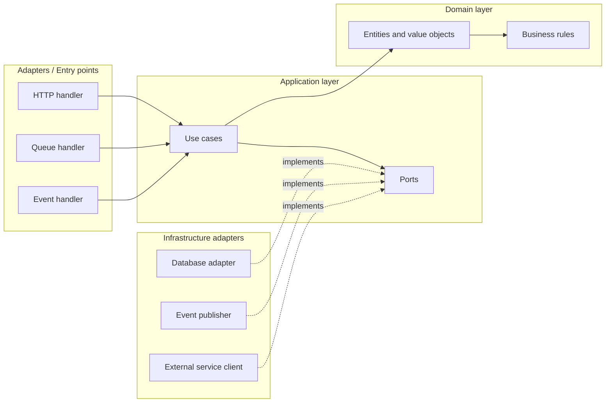

# Designing Java Handlers and Separating Business Logic

In the serverless model, a Java function is typically invoked by multiple trigger types: an HTTP request, a message from a queue, or an event emitted by another service. Each trigger has its own data representation, authentication mechanism, retry rules, and response contract. Putting all of these details into a single block of code quickly makes the handler hard to test, hard to reuse, and hard to change when integrating additional event sources.

A resilient design places the handler in the role of **data intake and transformation point**, while business logic resides in platform-independent use cases and domain models. The handler reads input, validates the technical context, maps data into a business command, invokes the use case, and then translates the result into an HTTP response or message processing outcome. As a result, the same business operation can be triggered from HTTP, a queue, a schedule, or another flow without duplicating business rules.

Within the scope of **CLOUD_SERVERLESS**, this lesson focuses on developing and deploying Java function applications triggered by HTTP, messages, or events; handling triggers, state, access permissions, retries, idempotency, cold starts, scaling, and cost. The sections below present how to structure handlers and separate code so applications remain easy to test, operate, and evolve.

## 1. What does a handler in a Java function do?

The handler is the *entry point* that the FaaS platform invokes on each invocation. The class name, interface, and method signature depend on the provider or framework adapter, but its responsibilities typically include:

- Receiving the event/request and metadata passed in by the platform.
- Reading technical information such as request ID, route, connection ID, or retry metadata if present.
- Validating the input structure and converting the payload into an appropriate DTO.
- Authenticating the identity or receiving a principal already verified by an adapter; enforcing authorization at the right layer.
- Converting transport data into an application command/query.
- Invoking the use case and translating the result into a response or processing status.
- Translating errors into an HTTP status, retry signal, dead-letter flow, or log appropriate to the trigger.

The handler should not decide rules such as which order can be confirmed, whether an amount is valid in business terms, or which state transitions are allowed. Those are the responsibilities of the application service and domain model.

For example, an HTTP handler might receive JSON to create an order, while a queue handler receives a `PaymentCaptured` event. Both handlers may invoke different use cases, yet both use the same domain model and repository ports. That way, changing an HTTP header name or event structure does not require modifying the rule that calculates the order total.

## 2. Separating adapters, application, and domain

A common organizational approach is the ports-and-adapters architecture (also known as hexagonal architecture). Directory names may vary across projects, but responsibility boundaries should stay clear.



| Layer | Responsibility | Examples |
|---|---|---|
| Entry point/adapter | Understands trigger protocol and event format | HTTP handler, SQS/queue handler, scheduled-event adapter |
| Application | Orchestrates a business action, manages use case boundaries | `CreateOrderService`, `ConfirmPaymentService` |
| Domain | Core business rules and state | `Order`, `Money`, order confirmation rules |
| Port | Declares external capabilities required by a use case | `OrderRepository`, `PaymentGateway`, `EventPublisher` |
| Infrastructure adapter | Implements a port using a specific service | JDBC repository, cloud SDK publisher, HTTP client |

Dependency direction should point inward: adapters know the application layer; the application layer knows the domain and ports; infrastructure implements the ports. The domain does not need to import cloud provider SDKs, HTTP classes, or database libraries.

You do not need to create separate Maven/Gradle modules for every layer. For small functions, separate Java packages already establish a clear enough boundary. Only split modules when project scale, team structure, or build requirements genuinely call for it.

## 3. Distinguishing transport data from business data

An HTTP request, queue message, and event may contain similar fields without necessarily sharing the same meaning or lifecycle. You should not pass raw SDK objects directly into domain services.

For example, an HTTP request might contain:

```json
{
  "customerId": "cus-1024",
  "items": [
    {"productId": "sku-17", "quantity": 2}
  ]
}
```

The adapter converts the request into an application command:

```java
public record CreateOrderCommand(
        String customerId,
        List<OrderLineInput> items,
        String idempotencyKey) {}

public record OrderLineInput(
        String productId,
        int quantity) {}
```

`CreateOrderCommand` does not contain `APIGatewayProxyRequestEvent`, a header map, or any provider-specific context object. If tomorrow the application receives the same request from a message queue, the queue adapter simply constructs the same command from the event payload.

At least four kinds of data should be distinguished:

- **Transport DTO:** reflects the JSON, headers, or event schema on the wire.
- **Command/query:** represents the intent that the application layer needs to execute.
- **Domain object:** represents business entities and rules.
- **Response/event DTO:** represents the output published externally.

Separating these types prevents wire-format changes from leaking into the domain. It also makes it clear which data is returned to clients, which data is emitted in events, and which data must remain internal.

## 4. Designing trigger-independent use cases

A use case describes an action provided by the system. It receives a command or query, coordinates the domain and required ports, and returns a result meaningful to the application.

Example port and use case declarations:

```java
public interface OrderRepository {
    Optional<Order> findById(String orderId);
    void save(Order order);
}

public interface IdGenerator {
    String nextId();
}

public record CreateOrderResult(
        String orderId,
        String status,
        long totalMinor,
        String currency) {}

public interface CreateOrderUseCase {
    CreateOrderResult execute(CreateOrderCommand command);
}
```

The use case implementation orchestrates the logic:

```java
public final class CreateOrderService implements CreateOrderUseCase {
    private final OrderRepository orders;
    private final IdGenerator ids;

    public CreateOrderService(OrderRepository orders, IdGenerator ids) {
        this.orders = orders;
        this.ids = ids;
    }

    @Override
    public CreateOrderResult execute(CreateOrderCommand command) {
        if (command.items() == null || command.items().isEmpty()) {
            throw new InvalidOrderException("Order must contain an item");
        }

        String orderId = ids.nextId();
        Order order = Order.create(orderId, command.customerId(), command.items());
        orders.save(order);

        return new CreateOrderResult(
                order.id(), order.status().name(),
                order.total().minorUnits(), order.total().currency());
    }
}
```

`Order`, `InvalidOrderException`, and the value objects are the domain components in this example. `OrderRepository` is a port; it does not prescribe whether data is persisted via JDBC or a specific managed service. An infrastructure adapter can implement the port using JDBC, an ORM, or another storage API.

In a real application, creating an order may require a transaction, product price lookup, inventory verification, and idempotency. Those details belong to the use case/domain and their corresponding ports. The handler should only coordinate input and output.

## 5. HTTP handlers: mapping requests to commands and responses

The HTTP adapter is responsible for HTTP-specific details:

- Route, method, path parameters, query parameters, and headers.
- Deserializing the body and checking content type/size limits.
- Authenticating the request or receiving a principal already verified by an authorizer.
- Mapping the request DTO to a command.
- Mapping the result to a status code, response body, and headers.
- Mapping errors to appropriate HTTP responses.

The example below uses neutral types to illustrate the boundary. A real adapter maps the gateway event into `HttpRequest` and returns an `HttpResponse` using the corresponding SDK.

```java
public record HttpRequest(
        String method,
        String path,
        String body,
        String principalId,
        Map<String, String> headers) {}

public record HttpResponse(
        int statusCode,
        Map<String, String> headers,
        String body) {}

public record CreateOrderRequest(
        String customerId,
        List<OrderLineInput> items) {}
```

The handler can be written as follows:

```java
public final class CreateOrderHttpHandler {
    private final JsonCodec json;
    private final CreateOrderUseCase createOrder;
    private final HttpErrorMapper errors;

    public CreateOrderHttpHandler(
            JsonCodec json,
            CreateOrderUseCase createOrder,
            HttpErrorMapper errors) {
        this.json = json;
        this.createOrder = createOrder;
        this.errors = errors;
    }

    public HttpResponse handle(HttpRequest request) {
        try {
            if (!"POST".equals(request.method())
                    || !"/orders".equals(request.path())) {
                return new HttpResponse(404, Map.of(), "");
            }

            CreateOrderRequest body = json.read(
                    request.body(), CreateOrderRequest.class);

            CreateOrderCommand command = new CreateOrderCommand(
                    body.customerId(), body.items(),
                    request.headers().get("Idempotency-Key"));

            CreateOrderResult result = createOrder.execute(command);
            return new HttpResponse(201, Map.of(
                    "Content-Type", "application/json"), json.write(result));
        } catch (Exception exception) {
            return errors.toResponse(exception);
        }
    }
}
```

This is an example illustrating boundaries, not a complete SDK adapter. In production, you must validate `request`, `headers`, empty bodies, content type, payload size limits, and the principal; you should catch specific exceptions rather than catching every `Exception` as in this condensed example. Never expose internal exception messages or stack traces in the response.

An HTTP handler can return `201 Created` for synchronous resource creation. If the use case only accepts a long-running job and enqueues it successfully, the appropriate response is typically `202 Accepted` along with a task ID or status lookup URL.

## 6. Message/event handlers: processing according to delivery contracts

A message adapter is responsible for understanding the envelope and delivery semantics of the event source. A handler receiving messages must determine:

- Event type and schema version.
- Message ID or event ID used for idempotency.
- Retry/attempt metadata if provided by the source.
- How to acknowledge processing, return an error, or route a message to a dead-letter queue.
- Batch semantics: whether one failing message retries the entire batch or only that message.

Example payment event:

```json
{
  "eventId": "evt-501",
  "eventType": "PaymentCaptured",
  "schemaVersion": 1,
  "data": {
    "paymentId": "pay-92",
    "orderId": "ord-18",
    "amountMinor": 450000,
    "currency": "VND"
  }
}
```

The adapter converts the payload into a command:

```java
public record PaymentCapturedCommand(
        String eventId,
        String paymentId,
        String orderId,
        long amountMinor,
        String currency) {}

public interface ConfirmPaymentUseCase {
    void execute(PaymentCapturedCommand command);
}

public final class PaymentCapturedHandler {
    private final ConfirmPaymentUseCase confirmPayment;

    public PaymentCapturedHandler(ConfirmPaymentUseCase confirmPayment) {
        this.confirmPayment = confirmPayment;
    }

    public void handle(PaymentCapturedCommand command) {
        confirmPayment.execute(command);
    }
}
```

`PaymentCapturedHandler` does not need to know which queue the message came from. The cloud-specific adapter reads the envelope, validates the schema, constructs the command, and decides whether to ack or retry based on the outcome. If the same use case is invoked from an internal HTTP endpoint, the HTTP adapter can construct the same command after verifying authorization and input data.

## 7. Preventing provider SDKs from leaking into the domain

Platform SDKs typically provide their own event classes, context objects, loggers, clients, and exceptions. These types are useful at the system boundary, but they should not become the data types used throughout the domain.

For example, do not write a domain service with a signature like:

```java
// Do not let the domain depend directly on the FaaS SDK
public Order create(APIGatewayProxyRequestEvent request,
                    Context lambdaContext) {
    // Business rules mixed with transport and runtime context
}
```

Instead, the adapter reads the SDK event and converts it into a plain Java command. The domain does not need to know whether the function was invoked by an HTTP gateway, a queue, or a test running inside the JVM.

Some runtime information is still useful to the application layer, such as correlation ID, deadline, or principal. Convert these into neutral types and pass only what the use case genuinely needs. Avoid passing the entire provider context object, as doing so increases coupling and forces tests to construct complex objects.

## 8. Dependency injection and the composition root

Use cases often need repositories, publishers, a clock, an ID generator, or external service clients. Declare these dependencies through constructors to make each class's requirements explicit and easy to substitute in tests.

```java
public final class ConfirmPaymentService implements ConfirmPaymentUseCase {
    private final OrderRepository orders;
    private final PaymentRepository payments;
    private final Clock clock;

    public ConfirmPaymentService(
            OrderRepository orders,
            PaymentRepository payments,
            Clock clock) {
        this.orders = orders;
        this.payments = payments;
        this.clock = clock;
    }

    @Override
    public void execute(PaymentCapturedCommand command) {
        // Load aggregate, check state, and apply domain rules.
        // Record timestamps via clock so tests can control time.
    }
}
```

The composition root is where infrastructure adapters, repositories, use cases, and handlers are instantiated and wired together. For a small application, this can be a single `ApplicationFactory` class; with a DI framework, it may be a module configuration or component graph.

The key principle is that the object graph is assembled in one visible and testable place. The handler receives pre-built dependencies via its constructor; it does not call `new DatabaseRepository()` inside every invocation. This avoids hidden dependencies and prevents unnecessary re-creation of clients or connection pools.

## 9. Reusing objects safely across invocations

Some platforms reuse execution environments, meaning static fields or singletons can survive across multiple invocations. This is useful for immutable or thread-safe dependencies such as JSON codecs, HTTP clients, SDK clients, and properly configured `DataSource` pools.

However, you must never assume the environment always stays warm or that invocations only run on a single instance. During scale-out, multiple environments each maintain an independent object graph. Some platforms or configurations also allow multiple concurrent requests to share the same environment, so handlers and dependencies must be evaluated for thread safety.

Guidelines:

- Reuse thread-safe clients and immutable configuration at the environment scope.
- Never store a request, principal, event payload, or mutable domain object from one invocation in a static field.
- Never share a JDBC `Connection`, transaction, or `ResultSet` across invocations.
- Avoid singletons holding unsynchronized mutable state.
- Do not rely on static variables to store business state, idempotency records, or subscriptions.
- If a dependency has a lifecycle that requires closing, verify whether the platform provides a reliable shutdown hook.

Object reuse reduces initialization overhead and cold starts, but it is only safe when dependency lifecycles and concurrency characteristics are clearly understood.

## 10. Validation and security boundaries

Validation should happen across multiple layers, each with a distinct responsibility:

1. **Transport validation:** the request contains valid JSON, the expected content type, permissible size, and protocol-level required fields.
2. **Application validation:** the use case receives all required data and checks the preconditions of the action.
3. **Domain invariants:** entities/value objects enforce rules that must always hold, such as positive quantities or non-negative totals.
4. **Authorization:** verifies that the principal has permission to perform the action on the specific resource.

Never rely solely on client-side validation. Clients can send requests directly or alter payloads. Likewise, do not treat API gateway token verification as sufficient for all business authorization; the use case still needs to check permissions against the specific order, account, or tenant.

You can translate the principal into a neutral application type:

```java
public record Actor(
        String subjectId,
        String tenantId,
        Set<String> authorities) {}

public record CancelOrderCommand(
        Actor actor,
        String orderId,
        String reason) {}
```

If a use case needs to verify order ownership, pass `Actor` or an `OrderAccessPolicy` port and perform the check at the appropriate application/domain boundary. Do not pass raw Authorization headers into the domain.

## 11. Error classification and trigger-specific mapping

A business error should not necessarily be handled the same way as an infrastructure error. HTTP clients need meaningful status codes; message consumers need to decide between ack, retry, or dead-lettering. Therefore, define error categories at the application layer and let adapters map them according to their protocol.

| Error category | Examples | HTTP adapter | Message/event adapter |
|---|---|---|---|
| Invalid input | Malformed JSON, missing required field | `400 Bad Request` | Reject payload, quarantine, or route to DLQ per policy |
| Unauthenticated | Invalid token | `401 Unauthorized` | Do not process if source requires auth; log audit event appropriately |
| Unauthorized | Cannot cancel another tenant's order | `403 Forbidden` or `404` per resource-enumeration policy | Route to permanent failure flow, do not retry indefinitely |
| Not found | Order ID does not exist | `404 Not Found` | Determine whether this is bad data or an out-of-order event |
| State conflict | Order already canceled when confirm requested | `409 Conflict` | Handle idempotently or quarantine per business rules |
| Transient error | Database timeout, downstream service overloaded | `503` or retryable error per contract | Bounded retry with backoff |
| Unexpected error | Bug or violated invariant | `500` with a safe error code | Mark failed, controlled retry or DLQ depending on error type |

Never catch all exceptions and return `200 OK` or ack the message. That misleads the platform into thinking the event succeeded even though the business action did not complete. Conversely, do not retry permanent errors such as malformed JSON, as this creates expensive retry loops.

An `HttpErrorMapper` can map business exceptions into HTTP responses; a `MessageFailurePolicy` can classify retryable versus permanent failures. Both use the same exception taxonomy while enforcing trigger-specific behavior.

## 12. Idempotency and retry boundaries

FaaS platforms may re-execute a function due to timeouts, event-source retries, client request retries, or message acknowledgment failures. Consequently, you cannot rely on an assumption that a handler runs exactly once.

For HTTP, clients can send an `Idempotency-Key`. For events, use an event ID or a stable business key. The application layer should invoke an idempotency port backed by durable storage to guarantee that multiple environments processing the same key do not produce duplicate side effects.

```java
public interface IdempotencyExecutor {
    <T> T executeOnce(String key, Supplier<T> action);
}

public final class CreateOrderIdempotently {
    private final IdempotencyExecutor idempotency;
    private final CreateOrderUseCase createOrder;

    public CreateOrderIdempotently(
            IdempotencyExecutor idempotency,
            CreateOrderUseCase createOrder) {
        this.idempotency = idempotency;
        this.createOrder = createOrder;
    }

    public CreateOrderResult execute(CreateOrderCommand command) {
        return idempotency.executeOnce(
                command.idempotencyKey(),
                () -> createOrder.execute(command));
    }
}
```

`IdempotencyExecutor` is an illustrative port. A production implementation must store the key, owner, payload hash, processing state, and outcome; claiming the key must be atomic or use conditional writes. If two invocations receive the same key concurrently, only one executes the side effect; the other receives the stored result or an in-progress status.

Idempotency does not mean every error should be retried. Only retry errors that are likely transient; configure retry limits, backoff, and jitter. For message batches, check your event source's partial batch failure mechanism so one failing record does not force retries of all already-succeeded records.

## 13. Transactions and external side effects

Use cases often coordinate a database and external services. Never open a database transaction and hold the connection while calling a payment gateway or a slow HTTP API.

A commonly used approach:

1. Within a short transaction, update business data and write an outbox event.
2. Commit to return the connection to the pool.
3. A separate worker reads the outbox and calls the external service.
4. Record the outcome in another transaction.

The outbox pattern prevents situations where the database commit succeeds but event publishing fails. Because the publisher may redeliver the same record, consumers still need idempotency. For multi-step processes, use sagas/workflows and compensating actions rather than holding a single long-lived transaction across multiple function invocations.

The handler should finish once the use case reaches the state that the trigger needs acknowledged. For example, an HTTP handler creating a background task only needs to ensure the task and launch message are durably persisted before returning `202`; it does not need to wait for the entire workflow to complete.

## 14. Context, timeouts, and cancellation

The platform may provide a deadline or remaining execution time for an invocation. The adapter should convert this information into a neutral execution context if the application needs time bounds.

Do not pass the raw SDK context object into the domain. You can define:

```java
public record ExecutionMetadata(
        String invocationId,
        String correlationId,
        Instant deadline) {}
```

The use case can use the deadline to set timeouts on downstream service calls or decide not to start an operation when insufficient time remains. However, an invocation deadline is not a state-persistence mechanism. If work cannot complete within the function timeout limit, break it into smaller steps or offload it to a queue/workflow.

When an invocation is about to run out of time, avoid leaving half-finished transactions or ambiguous side effects. Use JDBC/HTTP client timeouts shorter than the overall deadline, commit or roll back cleanly, and persist progress state so a subsequent invocation can resume or reconcile.

## 15. Organizing Java packages

An illustrative package structure for a serverless application might look like this:

```text
com.example.orders
├── domain
│   ├── model
│   │   ├── Order.java
│   │   └── Money.java
│   └── exception
├── application
│   ├── command
│   ├── result
│   ├── port
│   │   ├── OrderRepository.java
│   │   └── EventPublisher.java
│   └── service
│       └── CreateOrderService.java
├── adapter
│   ├── in
│   │   ├── http
│   │   │   └── CreateOrderHttpHandler.java
│   │   └── message
│   │       └── PaymentCapturedHandler.java
│   └── out
│       ├── persistence
│       │   └── JdbcOrderRepository.java
│       └── messaging
│           └── CloudEventPublisher.java
└── bootstrap
    └── ApplicationFactory.java
```

This is one way to organize packages, not a mandatory naming rule. The essential point is that the `domain` package does not depend on `adapter` or cloud SDKs; `application` defines ports; external adapters implement ports; and bootstrap wires components together.

If each function is a separate deployment artifact, you can share the domain/application modules and build dedicated adapters/handlers per function. Consider package size, build time, and coupling across functions. Avoid bundling every function into one large artifact if they have significantly different release lifecycles, permissions, and dependencies.

## 16. Testing handlers and use cases

Layer separation enables testing at the right boundary:

| Test type | What does it verify? | Typical dependencies |
|---|---|---|
| Domain unit test | Entity/value object rules | No cloud SDK or database required |
| Application unit test | Use cases, port coordination, business errors | Fake/mock repository, clock, publisher |
| Handler/adapter test | Mapping HTTP/event to command and result to response | JSON codec, event fixture, fake use case |
| Contract test | Payloads conform to schema and consumers understand published events | Schema, sample payloads, registry if available |
| Integration test | JDBC, queues, secrets, and SDKs work against real or emulated services | Test database, container, or cloud test environment |
| Deployment smoke test | Platform invokes handler properly; permissions and triggers are configured | Staging deployment |

An application service test example can use a fake repository:

```java
final class InMemoryOrderRepository implements OrderRepository {
    private final Map<String, Order> data = new HashMap<>();

    @Override
    public Optional<Order> findById(String id) {
        return Optional.ofNullable(data.get(id));
    }

    @Override
    public void save(Order order) {
        data.put(order.id(), order);
    }
}
```

Tests can verify that a valid command creates the expected order, an invalid command throws the appropriate exception, and the repository receives the correct data. You do not need to boot the function runtime to verify business rules.

For handlers, create fixtures for HTTP events and message events, then verify method/path routing, malformed payloads, idempotency headers, principal extraction, and error mapping. For queue adapters, test behavior when a single record fails inside a batch and confirm ack/retry results match the source contract.

## 17. Observing handlers in production

When a function handles multiple triggers, logs must indicate where an invocation came from and which use case executed. Write structured logs containing fields such as:

- Function name, environment, and trigger type.
- Invocation ID, request ID, event ID, and correlation ID.
- Use case or operation name.
- Execution duration, outcome, and classified error code.
- Retry or attempt count if provided by the source.

Do not log access tokens, passwords, secrets, full payloads containing sensitive data, or unnecessary personal information. For errors, log internal exceptions in a protected sink and return a safe error code to the client.

Metrics should distinguish between input errors, business errors, infrastructure errors, timeouts, and retries. Tracking only an aggregate error rate makes it difficult for operations teams to tell whether to fix the client, a domain rule, or an external dependency. Propagate trace context across queues/events when supported by the platform to connect multiple invocations into one end-to-end business trace.

## 18. Cold starts, dependencies, and handler size

Cold start is the time the platform needs to prepare an execution environment before handling an invocation. Java may require time to load classes, initialize frameworks, construct SDK clients, read configuration, and initialize connection pools.

Ways to reduce overhead:

- Include only necessary dependencies in the artifact; avoid pulling in an entire large framework if the function only handles a small operation.
- Initialize thread-safe clients at the environment scope when beneficial and compatible with their lifecycle.
- Defer initializing expensive components until a use case actually needs them, provided that does not increase latency on the common call path.
- Measure initialization duration separately from handler execution duration.
- Choose runtime, memory/CPU sizing, and environment pre-warming mechanisms based on measured metrics.
- Test the actual deployment artifact on the target runtime, not just inside an IDE.

Never optimize by placing request state into singletons or bypassing validation. Performance must never compromise isolation across invocations or business correctness.

## 19. Common anti-patterns

| Anti-pattern | Consequence | How to improve |
|---|---|---|
| Single handler containing all business logic and DB access | Hard to test, hard to reuse, and hard to change triggers | Separate adapters, use cases, domain, and repository ports |
| Domain importing cloud SDKs | Business logic locked to a single platform | Convert SDK events into plain Java DTOs/commands |
| Static mutable state storing invocation data | Data leaks between requests or breaks during scale-out | Use invocation-local objects and durable storage for state |
| Creating new SDK clients/pools on every invocation | Longer cold starts and connection storms | Reuse thread-safe dependencies at the environment scope |
| Sharing a JDBC Connection across invocations | Race conditions, mixed transactions, and driver errors | Borrow a connection per operation and close with try-with-resources |
| Catching all exceptions and returning success | Lost retries and hidden business failures | Classify errors by trigger and delivery contract |
| Using `Thread.sleep` to wait for background tasks | Holds the invocation open, increases cost, and risks timeouts | Offload work to a queue or workflow |
| Relying on retries for all errors | Poison messages and retry storms | Retry transient errors; route permanent errors to a DLQ |
| Using an in-memory variable as an idempotency store | Fails to deduplicate across environments | Use conditional writes or transactions in a shared store |
| Passing raw requests/contexts into the domain | Tight coupling and complex test setups | Convert into neutral commands and metadata |

## 20. Pre-deployment checklist for Java functions

| Question | Required evidence |
|---|---|
| Does the handler have a single clear responsibility? | Handles only trigger intake, mapping, and invoking the use case |
| Where do business rules live? | Domain/application services can be tested without cloud SDKs |
| How is trigger data converted? | Dedicated DTOs and mappers for HTTP/messages/events |
| Do cloud SDKs leak into the domain? | Domain and application layers have no dependency on provider event classes |
| Where are dependencies created? | Composition root and constructor injection |
| Are reused objects thread-safe? | No mutable request state in singletons or static fields |
| Are validation and authorization sufficient? | Transport checks, domain invariants, and resource-level authorization |
| Are errors mapped per trigger? | Separate HTTP error mapper and message retry/failure policy |
| Are retries safe? | Durably persisted idempotency keys/event IDs and bounded retries |
| Are transactions short? | No database connections held while calling external services |
| Are timeouts appropriate? | Dependency timeouts fit within the invocation deadline |
| Are tests aligned with boundaries? | Domain, application, adapter, contract, and integration tests |
| Is the execution flow observable? | Structured logs, metrics, correlation IDs, and traces |
| Is the artifact runtime-ready? | Trimmed dependencies, handler configuration, and staging smoke tests |

## 21. Evolving and scaling handlers over time

Initially, a function may only need one adapter, one use case, and one repository. As additional triggers or business operations emerge, extend along existing boundaries: add new adapters for HTTP or messaging, reuse a use case when the business semantics are identical, and create a separate use case when the actions truly differ.

Do not share a use case merely because two payloads share field names. An HTTP `CreateOrder` command and an `OrderImported` event may both contain a customer ID and product list while having different authorization rules, idempotency semantics, and outcomes. Unify them into the same domain operation only when their business meaning is genuinely equivalent.

When modifying a handler, test the trigger contract and the use case independently. Monitor retries, cold starts, execution duration, and cost after deployment. For long-running work, move it to a queue or workflow and persist durable state rather than keeping an invocation open.

Good Java handler design ensures the serverless platform remains merely an invocation mechanism for your application. Adapters handle communication with HTTP, messages, or events; the application layer orchestrates use cases; the domain holds business rules; and infrastructure connects databases and external services. These boundaries make Java functions easier to test, easier to scale, and less tightly coupled when changing providers or deployment models.
