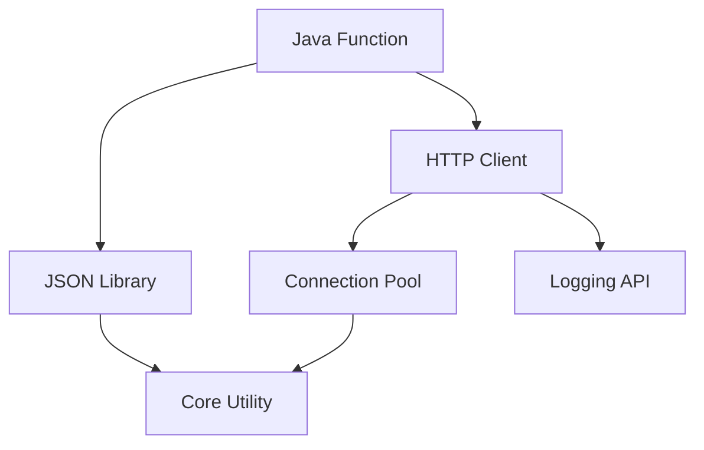

# Managing Dependencies, Classpath, and Java Package Size

## 1. Why do dependencies and packaging matter for Java FaaS?

A Java function does not consist solely of your application's `.java` files. At compile time and runtime, it also requires external libraries, transitive dependencies, configuration resources, framework metadata, and sometimes a Java runtime or native components. These artifacts must be packaged properly so the serverless platform can load the handler and execute the function.

Three concepts are directly interconnected:

- **Dependency management:** determining which libraries are needed, which versions are selected, and how transitive dependencies are resolved.
- **Classpath:** the list of directories and JARs that the Java runtime searches to locate classes and resources when loading the application.
- **Deployment package:** the deployed artifact, which may be a JAR, a ZIP containing JARs and libraries, or a container image depending on the platform.

If a dependency is missing or conflicting, the function may compile successfully yet fail during initialization or request processing. If the package layout is wrong, the runtime cannot locate the handler or resources. If the package is too large, upload, extraction, initialization, and rollout times increase; some platforms also enforce strict size limits.

Within the scope of CLOUD_SERVERLESS, the goal is to produce reproducible Java artifacts that load the right classes and resources, include all required runtime dependencies, and maintain a reasonable size to control cold starts and operational costs.

## 2. Dependency graphs and transitive dependencies

### 2.1. Direct and transitive dependencies

Direct dependencies are libraries declared and used by application code. Transitive dependencies are libraries required by another dependency. For example, a function uses an HTTP client; that HTTP client may depend on logging, TLS, or serialization libraries.



A real dependency graph can have multiple paths to the same library. The build tool must choose a version according to Maven or Gradle resolution rules. Two different libraries may request two versions of the same artifact, and the resolved version might be incompatible with one of them.

Common errors include:

- `ClassNotFoundException`: the application explicitly attempts to load a class, but the classloader cannot find it.
- `NoClassDefFoundError`: the JVM cannot use a required class at runtime; the cause may be a missing class or a previous class initialization failure.
- `NoSuchMethodError` or `NoSuchFieldError`: the class loads, but its actual API lacks a method/field expected by compiled code, usually due to a version mismatch.
- `LinkageError`: a class linkage failure, often related to binary conflicts or classloader issues.

Therefore, a passing build alone is not enough to prove the dependency graph fits the runtime environment.

### 2.2. Choosing dependencies intentionally

Only add a library when the function genuinely needs that capability. A large utility library can pull in many transitive dependencies. For instance, if you only need to parse JSON, consider a focused JSON module instead of pulling in an entire web framework or large starter.

Before adding a dependency, determine:

1. Which APIs from the library does the function actually use?
2. Does the library bring in significant transitive dependencies?
3. Does another dependency already provide the same capability?
4. Does the library support the Java runtime and CPU architecture of the deployment target?
5. Is the library needed at compile time, runtime, or only in tests?
6. Is the version receiving security updates and under a compatible license?

Avoid pulling an entire service SDK into every function if each function calls only a few APIs. When an SDK provides per-service modules or artifacts, select only the modules needed.

## 3. Scopes and configurations in Maven and Gradle

### 3.1. Maven dependency scopes

Maven uses scopes to control which classpaths a dependency appears on and whether it is packaged. Common scopes:

| Scope | Compile | Test | Runtime | Typical runtime packaging |
| --- | --- | --- | --- | --- |
| `compile` (default) | Yes | Yes | Yes | Yes |
| `provided` | Yes | Yes | Usually present in test runtime | Not treated by Maven as a runtime dependency to package |
| `runtime` | Not needed for compiling source | Yes | Yes | Yes |
| `test` | No | Yes | No | No |
| `system` | Yes via local path | Yes | Depends on configuration | Should not be used for reproducible builds |

The `provided` scope is appropriate only when the deployment environment genuinely provides that library. Some platforms pre-provide runtime/adapter APIs; in that case, the corresponding dependency can use `provided` per platform documentation. Never switch a library to `provided` merely to shrink package size, or the function may throw `ClassNotFoundException` at runtime.

Example Maven declaration:

```xml
<dependencies>
    <dependency>
        <groupId>com.fasterxml.jackson.core</groupId>
        <artifactId>jackson-databind</artifactId>
        <version>${jackson.version}</version>
    </dependency>

    <dependency>
        <groupId>org.slf4j</groupId>
        <artifactId>slf4j-api</artifactId>
        <version>${slf4j.version}</version>
    </dependency>

    <dependency>
        <groupId>org.junit.jupiter</groupId>
        <artifactId>junit-jupiter</artifactId>
        <version>${junit.version}</version>
        <scope>test</scope>
    </dependency>
</dependencies>
```

Version properties should be managed centrally in `properties`, a parent POM, or a BOM. The example above illustrates structure only; choose actual versions compatible with your JDK and libraries.

### 3.2. Gradle configurations

Gradle distinguishes configurations such as:

| Configuration | Meaning |
| --- | --- |
| `implementation` | Dependency needed for compiling and running the module |
| `api` | Dependency exposed through a library's public API when using the Java Library plugin |
| `compileOnly` | Needed only at compile time; runtime must supply it otherwise |
| `runtimeOnly` | Needed only at runtime, such as a dynamically loaded driver or provider |
| `testImplementation` | Used only for test compilation/runtime |
| `testRuntimeOnly` | Used only when running tests |

Example Gradle configuration:

```kotlin
dependencies {
    implementation("com.fasterxml.jackson.core:jackson-databind:2.x.y")
    implementation("org.slf4j:slf4j-api:2.x.y")

    // Declare compileOnly only if the runtime genuinely provides this API.
    compileOnly("com.example:function-runtime-api:1.x.y")

    testImplementation("org.junit.jupiter:junit-jupiter:5.x.y")
}
```

`2.x.y`, `1.x.y`, and `5.x.y` are illustrative placeholders, not versions to copy into a project. Replace them with concrete, verified versions. For production builds, avoid dynamic versions like `latest.release` because the same commit can yield different artifacts across builds.

### 3.3. Managing versions with BOMs and constraints

A BOM (Bill of Materials) aligns library versions across an ecosystem. Maven typically uses `dependencyManagement` to import a BOM; Gradle can use `platform(...)` or `enforcedPlatform(...)`. A BOM reduces the risk of combining co-released modules at mismatched versions.

Never force a newer version simply because it is newer. Check which dependencies require older versions, review release notes, and verify binary compatibility. When upgrading a foundational library such as logging, JSON, or an HTTP stack, run tests across all functions sharing that module.

### 3.4. Exclusions and optional dependencies

Exclusions remove a transitive dependency from the graph. Use them only after confirming the dependency is unnecessary or replaced by a compatible alternative. Excluding the wrong dependency can still allow a build to pass while failing at runtime with missing classes or providers.

```xml
<dependency>
    <groupId>com.example</groupId>
    <artifactId>legacy-client</artifactId>
    <version>${legacy-client.version}</version>
    <exclusions>
        <exclusion>
            <groupId>commons-logging</groupId>
            <artifactId>commons-logging</artifactId>
        </exclusion>
    </exclusions>
</dependency>
```

This snippet illustrates syntax only. Exclude a dependency only when a compatible replacement is already in the graph and real logging paths have been tested. Optional dependencies declared by a library are also not automatically included in consuming applications; if the function calls their APIs, the application module must declare the required dependency.

## 4. Resolving conflicts and inspecting the dependency graph

### 4.1. Version resolution rules

Maven and Gradle each apply their own resolution rules. Never infer the runtime version from a single declaration line. Inspect the resolved graph produced by the build tool.

Useful commands:

```bash
# Maven: inspect the dependency tree
mvn dependency:tree

# Maven: inspect unused or undeclared dependencies and potential issues
mvn dependency:analyze

# Gradle: inspect dependencies on the runtime classpath
./gradlew dependencies --configuration runtimeClasspath

# Gradle: find why a specific version was selected
./gradlew dependencyInsight --dependency jackson-databind --configuration runtimeClasspath
```

These commands are guidance for developers to run in their respective projects; the worker does not run builds per the scope of STEP 4.

### 4.2. Dependency convergence

Dependency convergence ensures branches of the graph do not pull in incompatible versions of the same library. You can use the Maven Enforcer plugin or Gradle dependency constraints/locking to detect or control versions.

Not every version difference causes a failure, but libraries sharing package/class names with breaking API changes must be reviewed. Resolve discrepancies in centralized version management rather than dropping an ad-hoc JAR into the package as a quick fix.

### 4.3. Version locking and reproducible builds

Reproducible builds must produce the exact same dependency graph from the same source and configuration. In Gradle, dependency locking records resolved versions. In Maven, use pinned versions, managed BOMs, and trusted repositories; avoid uncontrolled snapshot dependencies in releases.

Artifacts should be tied to a commit, build number, or checksum. When a function is redeployed, operations teams need to know exactly which JAR is running. Never patch a JAR after building or manually swap dependencies in a deploy directory.

### 4.4. Dependency security

Dependencies are part of your attack surface. Track CVEs, severity levels, support status, and licenses. Generate an SBOM (Software Bill of Materials) to inventory packaged libraries and scan it with appropriate pipeline tooling.

Not every alert can be resolved by immediately upgrading to the latest major version. Check for compatible patches, affected code paths, and framework upgrade feasibility. If an immediate upgrade is not possible, assess exposure and track a remediation plan.

## 5. Classpath and Java class loading

### 5.1. What is the classpath?

The classpath is the set of locations where the Java runtime searches for classes and resources. Each entry can be a directory containing `.class` files or a JAR file. When launching a traditional Java application, the classpath can be specified using `-cp` or `-classpath`:

```bash
java -cp "app.jar;lib/*" com.example.Main
```

On Windows, the classpath separator is `;`; on Linux/macOS, it is `:`. This example uses the Windows separator. The `lib/*` wildcard instructs the JVM to include JARs directly inside the `lib` directory on the classpath; it does not recursively search subdirectories by default.

In serverless environments, the platform usually constructs the classpath or launcher from the package layout and handler configuration. Developers do not always pass `-cp` manually. What matters is understanding where the runtime searches for classes and ensuring the artifact matches the layout the platform expects.

### 5.2. Classpath vs. module path

The Java Platform Module System (JPMS) introduced the module path alongside the classpath. A JAR containing `module-info.class` can be loaded as a named module on the module path; on the classpath, its contents are generally treated as part of the unnamed module.

Many function runtimes and libraries still operate on the classpath. Do not add `module-info.java` or switch artifacts to the module path just to "modernize" if your framework, reflection usage, service loading, or deployment platform does not fully support it. Verify how the runtime launches the application and test the final artifact.

### 5.3. Classloaders and class-loading errors

The JVM uses classloaders to locate and define classes. Standard delegation uses parent delegation, though serverless runtimes, frameworks, or containers may introduce custom classloaders. Some platforms let you choose parent-first or child-first modes; never assume the loading order is identical across environments.

Typical errors:

| Error | Common symptoms | What to check |
| --- | --- | --- |
| `ClassNotFoundException` | `Class.forName` or dynamic loading cannot find the class | Check whether the JAR is on the runtime classpath and verify the class name |
| `NoClassDefFoundError` | Required class is missing or previously failed static initialization | Inspect root cause in logs, runtime dependencies, and static initializers |
| `NoSuchMethodError` | Runtime loads a library version lacking a compiled method | Inspect dependency tree, duplicate classes, and actual resolved version |
| `ClassCastException` between two identically named classes | Two classes loaded by different classloaders | Inspect plugin/framework classloaders and classloader boundaries |
| `ServiceConfigurationError` | Provider declared in `META-INF/services` fails to load | Check service descriptor and provider JAR in the package |

Do not troubleshoot these errors by copying extra JARs into the package by trial and error. First identify which class was loaded from which JAR, version, and classloader.

### 5.4. Resources and metadata also live on the classpath

The classpath does not contain only classes. Applications may rely on `application.properties`, JSON schemas, certificate bundles, templates, migration metadata, or files in `META-INF`. If the package omits resources, errors may surface as empty configuration or `getResource(...)` returning `null` even though classes loaded cleanly.

Example reading a resource from the classpath:

```java
import java.io.InputStream;
import java.nio.charset.StandardCharsets;

public final class SchemaLoader {
    public String load() throws Exception {
        try (InputStream input = getClass().getResourceAsStream("/schemas/order.json")) {
            if (input == null) {
                throw new IllegalStateException("Missing classpath resource: /schemas/order.json");
            }
            return new String(input.readAllBytes(), StandardCharsets.UTF_8);
        }
    }
}
```

A path starting with `/` in `Class.getResourceAsStream` is resolved from the classpath root. Without `/`, the path is relative to the class's package. Verify resources inside the packaged artifact itself, not merely in `src/main/resources`.

## 6. Packaging dependencies for Java functions

### 6.1. Thin JAR and library directory

A thin JAR contains only application classes and resources; dependencies reside in separate JARs. Conceptual deployment structure:

```text
deployment.zip
├── function.jar
└── lib/
    ├── jackson-databind.jar
    ├── http-client.jar
    └── logging-api.jar
```

The advantage is that each dependency remains a distinct JAR, easy to inspect without merging contents. In return, you must ensure the launcher or platform places all `lib/*.jar` files onto the classpath. Some platforms mandate specific directories or layouts; placing libraries in the wrong directory can prevent the runtime from finding them.

### 6.2. Fat JAR / shaded JAR

A fat JAR (also called an uber JAR or shaded JAR in certain tools) bundles application and dependency classes/resources into a single JAR. This simplifies the artifact and is often suitable when the platform expects one self-contained JAR with all runtime dependencies.

Shading can also support relocation: renaming a library's package to avoid conflicts with another library. However, relocation can break reflection, class names referenced as strings, framework configs, resources, and native libraries. Never enable broad relocation without a specific reason.

Condensed Maven Shade Plugin configuration example:

```xml
<build>
    <plugins>
        <plugin>
            <groupId>org.apache.maven.plugins</groupId>
            <artifactId>maven-shade-plugin</artifactId>
            <version>${maven-shade-plugin.version}</version>
            <executions>
                <execution>
                    <phase>package</phase>
                    <goals>
                        <goal>shade</goal>
                    </goals>
                    <configuration>
                        <createDependencyReducedPom>false</createDependencyReducedPom>
                        <transformers>
                            <transformer implementation="org.apache.maven.plugins.shade.resource.ServicesResourceTransformer"/>
                        </transformers>
                    </configuration>
                </execution>
            </executions>
        </plugin>
    </plugins>
</build>
```

Plugin versions must be explicitly managed in the build. `ServicesResourceTransformer` illustrates merging `META-INF/services/*` files from multiple dependencies. Omitting this step can cause SPI providers to disappear when multiple JARs contain descriptors for the same service.

A fat JAR does not guarantee every JAR can be merged safely. Inspect duplicate resources, manifests, signatures, service descriptors, multi-release JARs, and native libraries. Some frameworks use nested JARs with custom launchers; that structure is not equivalent to a shaded JAR understood by a standard Java classpath.

### 6.3. ZIP containing artifacts and libraries

Some platforms require uploading a ZIP containing the function JAR, libraries, configuration, or supporting files. Follow the exact root layout prescribed by the platform. If the archive includes an unexpected top-level wrapper directory, the runtime may fail to locate the handler or libraries.

Do not include temporary build files, test reports, source code, caches, `.git`, IDE metadata, or development docs in the deployment ZIP if the runtime does not need them. Those files bloat the package and may inadvertently expose internal details.

### 6.4. Container images

If the serverless platform supports container images, the application can be packaged with a JRE, OS libraries, and a launcher. Containers fit workloads requiring control over system environments, native dependencies, or custom runtime layouts. In exchange, images can be larger and require build, scan, publish, pull, and rollout pipelines.

Use multi-stage builds: the first stage compiles and produces the artifact; the final stage contains only the runtime and required files. Choose a base image matching the target CPU architecture, JDK/JRE, and native libraries of the function. Never copy the entire build toolchain into the production image.

## 7. Package size and cold start impact

### 7.1. What does package size affect?

Large packages increase upload, storage, distribution, download, extraction, or mount times before a function becomes ready. They also slow down deployment pipelines and rollback releases. In some environments, the number of JARs and classes on the classpath also affects metadata scanning, provider discovery, or framework initialization times.

Cold start is the sum of multiple costs: environment provisioning, artifact download or mount, runtime startup, class loading, static initializers, framework initialization, and connection setup. Reducing package size can shrink part of a cold start, though not linearly. A function with a small JAR that boots a heavy framework or opens numerous connections can still experience slow cold starts.

Measure initialization duration separately from handler execution duration. Track p50/p95/p99 under realistic load, covering both cold invocations and invocations on reused environments.

### 7.2. Removing unnecessary dependencies

Effective steps typically include:

1. Inspect the runtime dependency tree to find unused libraries.
2. Replace large starters with smaller modules when only a subset of features is needed.
3. Exclude test dependencies from production packages using proper scopes/configurations.
4. Avoid bundling a full SDK if smaller per-service modules exist.
5. Remove unused resources, documentation, or build artifacts from the deployment archive.
6. Check for duplicate capabilities such as multiple JSON parsers, logging bindings, or unnecessary HTTP clients.

Never remove a dependency simply because no direct `import` appears in source code. Frameworks may load classes via reflection, annotation scanning, or `ServiceLoader`. Verify runtime paths, integration tests, and metadata before removing anything.

### 7.3. Shrinking, minimizing, and obfuscation

Some tools strip unreferenced classes or minimize bytecode. This can reduce artifact size, yet easily removes classes loaded dynamically by frameworks via reflection, dependency injection, annotation scanning, or service loaders.

If using a shrinker/minimizer, configure keep rules for handlers, classes referenced by name, reflective constructors, serialization models, resources, and SPI providers. Run tests against the shrunk artifact itself, not only against pre-shrunk class outputs.

Obfuscation aims to make bytecode harder to read, not to serve as a primary size optimization or secret-protection mechanism. Never embed secrets inside an artifact and expect obfuscation to protect them.

### 7.4. Dependency layers or shared library layers

Some platforms support layers to share dependencies across multiple functions. Layers can avoid repeating identical libraries in each package and simplify updating shared dependencies.

Layers are beneficial only when multiple functions genuinely share the same compatible library versions and can coordinate release schedules. Factor in layer size, mount/extraction overhead, maximum allowed layers, generated classpath, and complexity when one function needs a different version. A large layer still has to be downloaded or mounted during cold starts; never assume layers automatically make functions start faster.

If functions require conflicting library versions, a shared layer can create clashes or force synchronized upgrades. In such cases, independent packages can be easier to manage despite some dependency duplication.

### 7.5. Custom runtimes and native images

Some environments allow bundling a custom JRE or building a native executable with GraalVM Native Image. Native images can reduce initialization times for certain workloads and eliminate the need for a full JVM runtime, but impose limitations around reflection, dynamic class loading, proxies, serialization, JNI, and native libraries.

Not all FaaS platforms support native executables identically. Native builds also depend on compatible OS, CPU architecture, and build environments. Compare cold start, memory usage, package size, build time, compatibility, and maintenance cost before adopting them.

## 8. Controlling the classpath and special resources

### 8.1. Duplicate classes and loading order

If two JARs both contain a class with the same fully qualified name, the classloader loads one definition according to the environment's search rules. The outcome may depend on classpath or classloader order, producing hard-to-reproduce discrepancies between local runs and cloud deployments.

Never resolve conflicts by relying on coincidental JAR ordering. Determine which artifact owns the class, eliminate the duplicate, or use controlled relocation if both truly must coexist.

### 8.2. `META-INF/services` and ServiceLoader

Java SPI uses `META-INF/services/<fully-qualified-interface>` files to declare providers. When merging multiple JARs, these files can share identical paths. Shading tools must merge descriptors rather than overwriting one file with another.

Example provider loading:

```java
import java.util.ServiceLoader;

public final class CodecRegistry {
    public void listProviders() {
        ServiceLoader.load(Codec.class).forEach(codec ->
                System.out.println(codec.getClass().getName()));
    }
}
```

If the provider JAR is missing from the package or its descriptor was lost, `ServiceLoader` may find no implementations even though the interface exists. Test provider loading directly against the production artifact.

### 8.3. Logging providers and bindings

Applications should include a compatible logging API and provider. If a package accidentally bundles conflicting bindings/providers, the runtime may emit warnings or select an unintended implementation. Inspect the dependency tree to confirm the final logging backend, exclude unused bindings, and verify logs in the target deployment environment.

Never remove `slf4j-api` or a provider just to trim a few files without knowing which framework relies on it. Logging configuration is part of runtime behavior.

### 8.4. Reflection and serialization

Frameworks may discover classes by configured name, annotations, or default constructors. JSON serializers may require access to constructors, fields, or accessors. When using shrinkers, native images, or relocation, these dynamic paths require explicit configuration and real verification tests.

The handler class must match the exact fully qualified name configured on the platform. Constructor signatures and handler interfaces depend on the runtime adapter. If the framework requires a no-arg constructor or public class, satisfy it precisely; do not guess from another provider's example.

## 9. Inspecting artifacts before deployment

### 9.1. Inspecting JAR and ZIP contents

These commands reveal what an artifact actually contains:

```bash
# List JAR contents
jar tf target/function.jar

# View metadata and manifest
unzip -p target/function.jar META-INF/MANIFEST.MF

# List deployment ZIP contents
unzip -l target/function.zip

# Check file sizes on Linux
du -h target/function.jar target/function.zip
```

On Windows, you can use `jar tf`, `Expand-Archive -List`, or an appropriate archive tool. Exact syntax depends on installed tooling.

Verify that:

- The handler class exists in the JAR or class directory at the expected path.
- Every required runtime dependency is present on the classpath.
- Resources such as configs, schemas, and `META-INF/services` are preserved.
- No test classes, sources, caches, secrets, or unnecessary build files are included.
- The archive matches the root layout required by the platform.
- Both compressed and uncompressed sizes fall within deployment target limits.

### 9.2. Analyzing dependencies with jdeps

`jdeps` analyzes bytecode-level dependencies between classes and packages. It helps identify dependencies on JDK modules or external libraries:

```bash
jdeps --summary target/function.jar
jdeps --recursive --multi-release 17 target/function.jar
```

Replace `17` with the Java version targeting your artifact. `jdeps` does not detect all dynamically loaded dependencies via reflection, configured class names, JNI, or service loaders. Combine its output with the dependency tree and integration tests.

### 9.3. Testing the final packaged artifact

Running tests from an IDE or test classpath can mask errors because the IDE automatically adds dependencies and resources. Always test the packaged artifact itself:

1. Build from a clean workspace using the exact JDK and build profile used for production.
2. Produce the deployment package following the exact platform layout.
3. Run smoke tests using a runtime/adapter matching production.
4. Initialize the handler and load required resources.
5. Execute a sample request or event for every trigger type.
6. Inspect logs, exceptions, memory usage, and initialization duration.

For containers, run the final image using the same user, command, architecture, and environment variables as deployment. Do not test only the build stage.

## 10. Example build and packaging workflows

### 10.1. Maven

A general workflow might look like:

```bash
# Clean previous build outputs and compile/test
mvn clean verify

# Package the artifact according to the configured packaging
mvn package

# Inspect the runtime dependency graph
mvn dependency:tree -Dscope=runtime

# Inspect classes/resources inside the artifact
jar tf target/function.jar
```

When using the Maven Shade Plugin, confirm the output artifact name and avoid accidentally deploying both the original thin JAR and the shaded JAR. Exact filenames and output directories depend on the POM.

### 10.2. Gradle

Equivalent Gradle workflow:

```bash
# Clean build and run verification tasks
./gradlew clean check

# Build the archive
./gradlew build

# Inspect the runtime dependency graph
./gradlew dependencies --configuration runtimeClasspath

# List JAR contents
jar tf build/libs/function.jar
```

Packaging task names and output JARs depend on applied plugins. If using the Shadow plugin or a framework plugin, verify the final archive instead of assuming `build/libs/*.jar` is always the deployable artifact.

These commands are reference examples for project pipelines; adapt them to your actual build files, profiles, and runtime targets.

## 11. Optimizing package size while preserving correctness

Optimize in an evidence-driven order:

1. Measure current package size and cold start duration.
2. Inspect the dependency tree for large or duplicated libraries.
3. Exclude test-only dependencies from runtime packages.
4. Replace large umbrella libraries with focused modules where compatible.
5. Remove unused resources and build files.
6. Evaluate whether layers or shared dependencies can be used without version conflicts.
7. Apply shrinkers, relocation, or native images only after tests cover reflection, SPI, and resources.
8. Re-measure p95/p99, memory, package size, and runtime errors after every change.

Never optimize by megabytes alone. A tiny package that makes multiple remote calls to download plugins or configurations can increase latency and cost. Conversely, a larger dependency used on every request may be far more practical than maintaining a custom replacement.

## 12. Checklist for Java serverless packages

| Item | Verification question |
| --- | --- |
| Java version | Was the artifact compiled with a release compatible with the runtime? |
| Dependency scopes | Are runtime dependencies packaged and test-only dependencies excluded? |
| Version resolution | Is the dependency tree free of conflicts or unintended versions? |
| Reproducibility | Does the build use pinned versions, a BOM/lockfile, and trusted repositories? |
| Handler | Are the fully qualified class name and runtime contract correct? |
| Classpath | Are all required JARs placed where the runtime looks for them? |
| Resources | Are configs, schemas, `META-INF/services`, and metadata preserved? |
| Duplicate classes | Are there duplicate classes or conflicting logging providers? |
| Archive layout | Does the root layout match platform requirements? |
| Package size | Are compressed/uncompressed sizes within target limits? |
| Cold start | Have init duration and p95/p99 been measured on the final artifact? |
| Security | Have dependencies been scanned and licenses/SBOM reviewed? |
| Runtime test | Have smoke/integration tests run against the final package? |

## 13. Common issues and resolutions

| Issue | Common cause | Resolution |
| --- | --- | --- |
| Build passes but function throws `ClassNotFoundException` | Dependency left in test/provided scope or omitted from package | Inspect runtime graph and actual packaged classpath |
| `NoSuchMethodError` after deployment | Runtime loads a different version than compile time | Check dependency convergence and duplicate JARs |
| Handler not found | Incorrect class name, package layout, or handler config | Verify FQCN and deployment archive structure |
| Framework cannot find provider | `META-INF/services` overwritten during shading | Use a service-descriptor merge transformer and test ServiceLoader |
| Resource returns `null` | File missing from classpath or wrong path mapping | Check JAR contents and `getResourceAsStream` calls |
| Works locally but fails in cloud | Different classloader, runtime version, architecture, or environment | Test the exact artifact in a production-equivalent runtime |
| Package too large | Excessive starters/SDKs, duplicate dependencies, or build files included | Analyze runtime dependency tree and archive contents |
| Cold start still slow after shrinking JAR | Heavy framework init, static initializers, or large connection setup | Measure initialization phases separately and optimize by metrics |
| Shrinker drops needed classes | Reflection or SPI not statically detected | Add keep rules and test the shrunk artifact |

## 14. Conclusion

Dependency management determines which libraries enter your application and which versions execute. The classpath determines where the JVM finds classes and resources. The deployment package combines application code, dependencies, and the layout required by the serverless platform to boot the function.

To keep Java FaaS reliable, manage the dependency graph intentionally, use proper scopes, control versions, understand classloaders and resources, pick the right packaging format, and verify the final artifact itself. Package size optimization should always go hand in hand with cold start measurement, runtime testing, and security checks. A small artifact only adds value when it still contains everything the function needs to run correctly.
