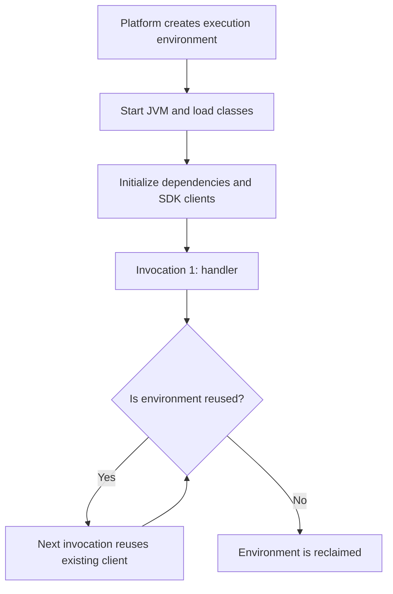

# Initializing and Safely Reusing Cloud SDK Clients

Java serverless applications routinely call object storage, databases, queues, event buses, secrets managers, or other cloud service APIs. Each call relies on an SDK client to manage endpoints, authentication, HTTP connections, retries, and request serialization. How you initialize clients affects cold starts, latency, connection counts, memory consumption, and function reliability.

A common mistake is creating a new SDK client inside every invocation. That repeats configuration loading, HTTP connection pool creation, TLS setup, and background resource allocation. When a function runs frequently, initialization overhead accumulates noticeably; if the client is not closed properly, sockets and threads can linger longer than expected. Conversely, sharing a client does not mean you can arbitrarily share every piece of state or credential across requests.

The core principle is to **reuse application-level clients scoped to a single execution environment while keeping per-invocation business data and state isolated**. You must understand whether a client is thread-safe for shared use, who owns the underlying HTTP client lifecycle, how credentials are refreshed, and what connection limits are needed for real production load.

## 1. Lifecycle of a serverless function

A FaaS platform typically creates an execution environment to load the runtime, initialize the application, and invoke the handler. After an invocation, the environment may be retained to serve subsequent requests, though the platform can also reclaim it at any time. A traffic spike can spin up many independent environments.



A client initialized at the class level or as an application singleton can be reused across subsequent invocations within the same environment. However, there is no single global client shared across your entire cloud fleet: each environment maintains its own JVM, memory, clients, and connection pools.

For example, when the platform runs 40 concurrent environments, one static client per environment can create 40 separate connection pools. Thus, reusing clients reduces overhead within each environment, but does not eliminate the need to bound concurrency and protect downstream services.

### What can be reused

Typically suitable for reuse:

- SDK service clients documented as thread-safe.
- HTTP clients and connection pools managed by the service client's lifecycle.
- Serializers, parsers, validators, and immutable configuration.
- Shared helper objects holding no per-invocation data.

Should not be stored as shared state:

- User ID, tenant ID, access token, or current request data.
- Business results updated per invocation.
- `InputStream`, response bodies, or open transactions.
- Request builders or mutable objects modified concurrently by multiple threads.
- Temporary credentials manually copied into static fields.

A shared SDK client is an infrastructure resource. It is not a place to store session or business state.

## 2. Why create a client only once?

A cloud SDK client typically manages multiple underlying components: credential providers, endpoints and regions, HTTP transport, connection pools, TLS, retry policies, serializers, metrics, and background threads for async clients.

If you construct a client inside the handler, initialization steps may repeat on every invocation:

1. Reading configuration and resolving region/endpoint.
2. Discovering or fetching credentials.
3. Initializing HTTP transport and connection pools.
4. Establishing TLS, DNS resolution, and service connections.
5. Instantiating serializers and retry strategies.

Some SDKs defer opening network connections until the first request, yet client construction can still allocate threads, pools, or connection management structures. Repeatedly creating new clients also degrades HTTP keep-alive and connection reuse.

### Comparing initialization approaches

| Approach | Advantages | Risks or costs |
|---|---|---|
| Create client per handler invocation | Configuration can vary per call | Slow initialization, excessive pools/sockets, hard to manage resource cleanup |
| Create shared client at environment scope | Reuses connections and configuration, avoids repeated setup | Must verify thread safety and keep request data outside the client |
| Create client per tenant/request | Allows distinct identities or endpoints | Can create unbounded clients, inflate pools, and risk credential leaks |
| Create singleton client via dependency injection | Centralized configuration and lifecycle management | Requires understanding framework lifecycle and initialization timing |

For clients that can be shared safely, the standard pattern is initializing once at the class level or as an application singleton. If each tenant requires distinct configuration, define clear identity boundaries and bound client counts; never create a new client per request without an explicit lifecycle policy.

## 3. Choosing the right initialization scope in Java

Three common patterns exist: static holders, instance singletons, and dependency injection. Pick the one matching your runtime and framework.

### Static holder

A static holder initializes the client when the class is first referenced. The JVM guarantees thread-safe class initialization when multiple threads access it concurrently for the first time.

```java
import software.amazon.awssdk.auth.credentials.DefaultCredentialsProvider;
import software.amazon.awssdk.regions.Region;
import software.amazon.awssdk.services.s3.S3Client;

public final class CloudClients {
    private CloudClients() {}

    private static final class S3Holder {
        private static final S3Client INSTANCE = createS3Client();
    }

    public static S3Client s3() {
        return S3Holder.INSTANCE;
    }

    private static S3Client createS3Client() {
        String region = System.getenv("AWS_REGION");
        if (region == null || region.isBlank()) {
            throw new IllegalStateException("AWS_REGION is required");
        }

        return S3Client.builder()
                .region(Region.of(region))
                .credentialsProvider(DefaultCredentialsProvider.create())
                .build();
    }
}
```

This example uses AWS SDK for Java 2.x. `S3Client` is a synchronous service client designed to be shared across threads. Each environment gets one instance. The client is created when `CloudClients.s3()` is first invoked and reused thereafter.

If a required environment variable or config setting is missing, initialization fails. That is a configuration error best caught early. In a function that uses S3 only on certain branches, a lazy holder avoids constructing the client when that branch is never taken; in exchange, the first invocation hitting the S3 branch pays the initialization cost.

### Instance-level initialization

If the runtime creates one handler instance and reuses it, you can initialize the client in the constructor:

```java
public final class ReportFunction {
    private final S3Client s3;

    public ReportFunction() {
        this.s3 = S3Client.builder()
                .region(Region.of(System.getenv("AWS_REGION")))
                .build();
    }

    public void handle(ReportRequest request) {
        // Use this.s3 for the current invocation.
    }
}
```

This scope works well when the platform ties handler instance lifetime to the execution environment. However, read the runtime contract carefully: not every framework preserves a single handler instance, and not every trigger shares the same concurrency model.

### Dependency injection singleton

In frameworks with dependency injection, registering a client as a singleton lets the framework manage a single instance inside the application context.

```java
@Configuration
public class CloudClientConfiguration {

    @Bean(destroyMethod = "close")
    public S3Client s3Client() {
        return S3Client.builder()
                .region(Region.of(System.getenv("AWS_REGION")))
                .build();
    }
}
```

This example uses Spring. Beans default to singleton scope in the application context. `destroyMethod = "close"` lets the framework close the client when the context shuts down in environments supporting lifecycle hooks. In FaaS, do not assume the platform always fires shutdown hooks or closes the context gracefully when reclaiming an environment; reusing the client while the environment stays alive remains the primary goal.

Frameworks such as Micronaut or Quarkus have their own scopes and lifecycles. Use the corresponding application/singleton scope, and verify when the framework initializes its context because eager full-application startup can lengthen cold starts.

## 4. Thread safety and sharing clients properly

A shared client is safe only when the SDK explicitly documents it as thread-safe. AWS SDK for Java 2.x service clients are designed for cross-thread sharing. Many clients in Google Cloud Java libraries and the Azure SDK are likewise immutable/thread-safe, though you must check documentation for the specific client and library version.

Do not generalize that every object in an SDK is thread-safe. Builders are generally intended only for client construction. Request builders, mutable collections, callback state, or custom parsers may need per-invocation instantiation.

Example:

```java
import software.amazon.awssdk.core.sync.ResponseTransformer;
import software.amazon.awssdk.services.s3.S3Client;
import software.amazon.awssdk.services.s3.model.GetObjectRequest;

public final class ObjectReader {
    private final S3Client s3;

    public ObjectReader(S3Client s3) {
        this.s3 = s3;
    }

    public byte[] readSmallObject(String bucket, String key) {
        GetObjectRequest request = GetObjectRequest.builder()
                .bucket(bucket)
                .key(key)
                .build();

        return s3.getObject(request, ResponseTransformer.toBytes()).asByteArray();
    }
}
```

The client is shared while each request object is created per call. Reading the entire object into memory suits only small, size-bounded objects; for large objects, stream the content and close the response stream properly.

### Never share mutable request context

Never store `currentTenant`, `currentUser`, `currentRequest`, or access tokens in singleton fields. If two invocations run concurrently, one invocation's data can overwrite another's. Pass context through method parameters or a per-request context object.

Avoid mutating the endpoint, region, or credential provider of a shared client per invocation. Those settings are generally fixed when the client is built. If tenant isolation is required, pass the business identifier in the request and enforce authorization in the service; create separate clients only when genuinely distinct identities or endpoints are needed and enforce strict cache bounds.

## 5. Credential providers and credential refresh

SDK clients typically hold a credential provider rather than static user access/secret keys. The provider fetches credentials when needed and, for temporary credentials, refreshes them before expiration.

In serverless environments, use the platform's execution role or managed identity. On AWS, for example, `DefaultCredentialsProvider` resolves credentials via the default chain, including runtime environment and role credentials. When using a role, the SDK provider obtains temporary credentials and handles refresh automatically.

Guidelines:

- Never hard-code access keys or secrets in source code.
- Never store temporary credentials in static variables to reuse indefinitely.
- Never manually call STS or identity endpoints on every invocation when the SDK provider already manages acquisition and refresh.
- Never log credentials, tokens, or Authorization header contents.
- Grant least-privilege permissions to the function's execution role or service identity.
- If assuming roles per tenant, design a bounded provider/cache keyed by identity, expiration time, and revocation policy.

### Credential caching vs. client caching

A client can outlive temporary credentials. Therefore, a shared client must hold a provider capable of returning current valid credentials rather than a single static credential object fetched once. When configuring a custom provider, verify its refresh mechanism and thread synchronization.

If credentials expire and the provider fails to refresh, authentication errors will appear after running for a while even though the initial cold start succeeded. This is why you should use official SDK providers or managed identities instead of writing custom credential caching logic unless strictly necessary.

## 6. Managing HTTP connection pools and background resources

Service clients usually own or use an HTTP client to communicate with cloud APIs. The HTTP transport manages keep-alive, connection pools, TLS, proxies, timeouts, and I/O threads. Repeatedly constructing service clients spawns numerous small pools, reduces TCP/TLS reuse, and increases open sockets.

Consider the following when configuring:

- **Connection pool size:** large enough for concurrent requests inside a single environment, yet not oversized.
- **Connection acquisition timeout:** limits how long a call waits to borrow a connection from the pool.
- **Connect/read/write timeouts:** bound connection setup and data exchange duration.
- **Keep-alive and idle connections:** leverage reusable connections while respecting proxy/NAT and idle timeout policies.
- **TLS and DNS:** long-lived connections may be dropped at the network layer; the SDK must detect and reopen stale connections.
- **Thread resources:** async clients may allocate event loops or executors; avoid creating new pools on every invocation.

### Do not close clients after every request

A shared client must survive across invocations within the same environment. Do not call `close()` at the end of every handler run, or the next invocation may receive an already-closed client.

In a continuously running Java server application, closing clients on application context shutdown makes sense. In FaaS, the process may be terminated without reliable shutdown callbacks; let the platform terminate the process and the OS reclaim resources. If your runtime or framework offers a supported lifecycle hook, you may close clients there, but never rely on shutdown hooks for business correctness.

### When using a separately shared HTTP client

Some SDKs let you supply a custom HTTP client shared across multiple service clients. This can reduce pool counts, but you must understand resource ownership: a service client may close an HTTP client it created internally, whereas an externally supplied HTTP client is typically the application's responsibility to close. Exact rules depend on the SDK. Never close a transport still used by another service client.

Unless you have specific requirements, using the default HTTP client managed by the service client carries lower lifecycle risk. Customize it only when you need explicit proxy, pool, TLS, or performance tuning that you can measure and test.

## 7. Configuring timeouts and retries within the invocation budget

SDKs may retry requests on transient errors such as throttling or network blips. The FaaS platform or queue may also retry the entire invocation. If every layer retries multiple times independently, total calls to downstream services can grow exponentially.

Allocate your time budget carefully:

1. Identify the total function timeout.
2. Reserve time for event parsing, authorization checks, data processing, and state persistence.
3. Set SDK timeouts shorter than the remaining invocation budget.
4. Bound both single-attempt timeouts and total API call timeouts.
5. Choose bounded retry modes/counts; never retry permanent data or authorization errors.
6. Ensure queue visibility timeouts or ack deadlines exceed expected processing plus retry duration.

AWS SDK for Java 2.x configuration example:

```java
import java.time.Duration;
import software.amazon.awssdk.core.client.config.ClientOverrideConfiguration;
import software.amazon.awssdk.services.s3.S3Client;

S3Client s3 = S3Client.builder()
        .region(Region.of(System.getenv("AWS_REGION")))
        .overrideConfiguration(ClientOverrideConfiguration.builder()
                .apiCallAttemptTimeout(Duration.ofSeconds(5))
                .apiCallTimeout(Duration.ofSeconds(15))
                .build())
        .build();
```

These numbers are illustrative only. Choose timeouts based on SLOs, payload sizes, downstream latency, and the function timeout. `apiCallAttemptTimeout` bounds a single attempt; `apiCallTimeout` bounds the entire call including retries. Avoid letting the SDK keep running when the function is about to time out.

### Retries and idempotency

SDK retries address only transport-level communication with a service. They do not automatically make business side effects safe. For instance, if a create request succeeds on the server but the response is lost, a retry can create a duplicate resource unless the API supports an idempotency token.

For writes, use idempotency keys or conditional requests where supported by the service. For queues/events, persist the event ID or business key in durable state storage. Distinguish transient errors, throttling, authentication failures, and data errors so you retry only recoverable conditions.

## 8. Synchronous vs. asynchronous clients

Synchronous SDKs are usually simpler to use: calls return only when results are ready. Asynchronous SDKs use dedicated event loops and connection pools, enabling non-blocking I/O when one invocation calls multiple services or handles concurrent tasks.

| Criterion | Synchronous client | Asynchronous client |
|---|---|---|
| Programming model | Call and block for result | Future/CompletionStage or reactive APIs |
| Resources | Calling thread may block | Uses I/O threads and event loops |
| Complexity | Usually simpler | Requires managing callbacks, cancellation, and exceptions |
| Best suited for | A few short calls, linear flows | Concurrent I/O or high throughput if supported by runtime |
| Risks | Holding threads while waiting | Blocking the event loop or leaving dangling tasks when invocation ends |

Async clients should also be reused at the environment scope. Never create a new event loop or executor per invocation. Never block the event loop with file I/O or heavy CPU work. If the function nears its timeout, cancel pending work and ensure background tasks do not continue writing data after the invocation returns.

Do not pick async simply because it sounds faster. For short functions with few calls, managing futures and callbacks may offer zero benefit. Measure latency, throughput, CPU, memory, and thread counts in the real runtime.

## 9. Cold starts and client initialization timing

Initializing clients before the handler executes adds work to cold starts while reducing work on subsequent invocations. Lazy initialization reduces startup time for code paths that never use a client, though the first invocation hitting that branch pays the creation cost.

Contributing factors:

- Number of SDKs and modules loaded.
- Dependency and framework size.
- Static initialization work.
- Creating HTTP transports, credential providers, and serializers.
- First network handshake to the service.
- Function memory/CPU allocation.

To optimize:

- Include only SDK modules the function actually calls.
- Avoid creating multiple identically configured clients for the same service.
- Lazily initialize dependencies used only on rare paths if doing so materially improves cold starts.
- Measure cold start duration separately from warm invocation duration.
- Use provisioned concurrency, keep-warm, or pre-warming features only when latency requirements and cost analysis justify them.

Warm environments are never guaranteed to persist. Do not rely on scheduled pings as the sole mechanism to keep connections alive or preserve in-memory state. Clients must recover connections automatically when an environment is reused after sitting idle.

## 10. System-wide connection limits and concurrency

A singleton client lives inside a single execution environment. As load grows, the platform spawns many environments, each with its own pool. If each pool allows 20 connections and the platform spins up 100 environments, the downstream service could face thousands of potential connections.

Approximate upper bound:

\[
\text{Total potential connections} \approx
\text{Number of environments} \times \text{Pool size per environment}
\]

This is an approximate upper bound; actual connection counts depend on traffic, HTTP transport behavior, and how the SDK opens sockets. Still, the formula helps surface risks before deployment.

Controls to consider:

- Set reserved concurrency or a concurrency cap on the function.
- Size pools to match actual per-environment concurrency.
- Use queues to smooth consumption rates when downstream capacity is constrained.
- Use proxies or connection pooling services when supported by the data store and platform.
- Monitor connection counts, throttling, timeouts, and downstream error rates.
- Avoid creating multiple SDK clients hitting the same endpoint simply because different code layers instantiate their own clients.

If the function runs on a platform allowing multiple concurrent invocations inside one process, account for intra-process concurrency as well. The client must be thread-safe, and the pool must handle actual parallelism. Never infer one provider's behavior from another provider's concurrency model.

## 11. Never turn client singletons into unbounded caches

Clients are usually configured for a single region, endpoint, identity, and retry set. When each tenant has its own credentials or endpoint, an easy pitfall is maintaining a static `Map<tenantId, Client>` and inserting a new client whenever a new tenant appears. In long-lived environments, that map can grow without bound, with each client retaining its own pool, threads, or credential provider.

Before creating per-tenant clients, ask:

- Does each tenant truly require a distinct SDK-layer identity, or just business authorization enforced by the API?
- Can one execution role with tenant-scoped resource policies suffice?
- Can the credential provider safely select an identity per request without data leakage?
- If multiple clients are unavoidable, how are max capacity, TTL, eviction, and resource closing enforced?
- Is there any risk of one tenant's request accidentally using another tenant's client or credentials?

Never mutate a shared client's credential provider or endpoint per request. When multiple configurations are required, use a bounded factory/cache keyed by the verified identity rather than an arbitrary client-supplied tenant string. Every cached client needs a clear lifecycle and eviction/closing policy.

## 12. Testing and observing client reuse

Reusing clients is a performance and reliability decision that must be verified in production-like environments. Checking only that a function returns the right result on a single invocation is not enough.

### Test scenarios

- Invoke the handler repeatedly within the same environment and verify clients are not recreated per invocation.
- Run concurrent requests/threads to verify the client and calling code are thread-safe when shared.
- Simulate expired or refreshed credentials to verify the provider handles rotation properly.
- Drop connections or inject throttling errors to test timeouts, retries, and connection recovery.
- Leave the environment idle and then invoke it again to confirm stale connections are detected and reopened.
- Generate concurrent load across multiple environments to verify aggregate connection counts against downstream limits.
- Verify no request data, tenant context, or tokens remain stored inside singletons.
- Verify clients/HTTP transports close cleanly in continuously running app environments and do not close after each FaaS invocation.

### Useful metrics

| Metric | Meaning |
|---|---|
| Cold start duration | Cost of initializing runtime and dependencies |
| Client initialization duration | Portion of startup spent constructing SDK clients |
| API call latency p50/p95/p99 | Actual latency of cloud API calls |
| Connection pool pending/acquired/idle | Contention and utilization of pooled connections |
| Retry count and throttling | Signals of downstream pressure or misconfigured retries |
| Timeouts and connection resets | Network, pool, or timeout budget issues |
| Concurrent environment count | Multiplier applied to pools across the fleet |
| Memory and thread count | Resources retained by clients and transports |

Logs should record service name, operation, latency, retry count, and correlation ID. Never log credentials or sensitive payloads. Avoid high-cardinality metric dimensions such as object keys, request IDs, or tenant IDs on aggregate metrics.

## 13. Common mistakes

| Mistake | Consequence | Fix |
|---|---|---|
| Creating SDK clients inside every invocation | Slow execution and excessive connection pools | Reuse thread-safe clients at the environment scope |
| Closing the client at the end of the handler | Next invocation attempts to use a closed client | Close only via supported application lifecycle hooks |
| Sharing mutable request context in singletons | Data across invocations leaks or overwrites | Keep context in local variables or method parameters |
| Caching temporary access keys in static fields | Credentials expire and cause auth failures | Use a credential provider with automatic refresh |
| Creating unbounded per-tenant clients | Exploding sockets, threads, memory, and privilege-leak risks | Use appropriate identity scoping or a bounded TTL cache |
| Oversized connection pools | Aggregate connections overwhelm downstream services | Size pools using environment count and concurrency |
| SDK timeouts longer than function timeout | Function expires while SDK calls are still pending | Budget SDK timeouts inside the invocation timeout |
| Layered retries across SDK, function, and queue | Amplified traffic and load on struggling services | Design an end-to-end retry budget and idempotency |
| Using an async client while blocking the event loop | Loses non-blocking I/O benefits and hurts throughput | Keep the event loop non-blocking and handle cancellation |
| Using static fields for business state | Data lost when environment is reclaimed or leaks across requests | Persist state durably in storage or a database |

## 14. Selection and deployment workflow

When integrating a cloud SDK into a Java function, follow this sequence:

1. **Identify required services and permissions.** Pick minimal SDK modules and a least-privilege execution identity.
2. **Verify thread safety.** Confirm the service client supports concurrent sharing per the SDK documentation for your exact version.
3. **Choose the lifecycle scope.** Use a static holder, instance singleton, or DI singleton appropriate to your runtime.
4. **Configure region/endpoint and credential provider.** Never hard-code secrets; use managed identities or refreshing providers.
5. **Configure HTTP transport.** Tune pool size, timeouts, and proxies according to concurrency and downstream quotas.
6. **Design retries.** Coordinate SDK retries with function/queue retries; add idempotency for write operations.
7. **Manage resources.** Never close clients per invocation; understand HTTP transport ownership and shutdown lifecycles.
8. **Measure and test.** Compare cold/warm latency, pool utilization, connection counts, retries, and errors under growing load.

Before releasing, be able to answer: where is the client created, how many clients exist per environment, is the client thread-safe, are credentials refreshed automatically, how many connections can pools open during scale-out, do timeouts fit inside the invocation budget, and what happens if an environment sits idle for a long period before receiving its next request.

## Conclusion

Reusing cloud SDK clients reduces initialization overhead and leverages connection pooling inside each Java serverless execution environment. Initialize thread-safe clients at the environment or application singleton scope, keep request context scoped to each invocation, rely on refreshing credential providers, and size timeouts and retries to fit the function's time budget. Remember that each environment maintains its own pool when estimating aggregate connections. For async clients or shared HTTP transports, manage threads and resource ownership according to SDK contracts. Measure cold starts, latency, connections, and errors under real load to validate your configuration.
