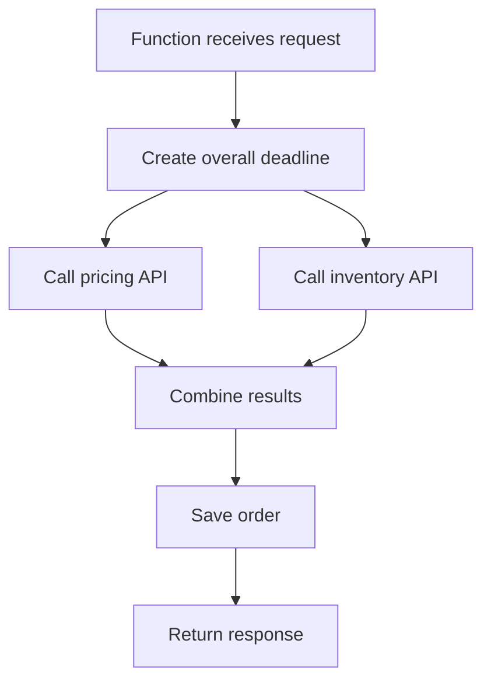

# Configuring HTTP Clients, Connection Timeouts, and Request Timeouts

Java functions in serverless environments frequently call external services: REST APIs, payment providers, database proxies, identity providers, or other microservices. An HTTP call can be delayed by DNS resolution, TCP/TLS handshakes, waiting for a pooled connection, target server processing, or response transfer. If a function waits too long, the invocation can time out, tie up resources, and cause subsequent requests to back up.

Therefore, an HTTP client needs explicit timeouts at each stage. Two foundational settings are **connection timeout** (the maximum time to establish a connection) and **request timeout** (the maximum time to wait for a request to complete per the client's contract). In serverless systems, these timeouts must fit inside the remaining invocation time budget and coordinate with retries, connection pools, and concurrency limits.

This lesson uses Java 11+ HttpClient as the primary example while explaining how to apply these concepts to pooled clients and what to watch for inside Java functions.

## 1. Why do HTTP timeouts matter in serverless?

Suppose an HTTP function receives an order-creation request. It must call a pricing service and an inventory service before returning a response. If a dependency stops responding, the function may hang until the runtime or gateway terminates the invocation.

Failing to configure explicit timeouts can lead to:

- Invocations holding CPU, memory, and connections for extended periods.
- Rising concurrent invocations while earlier requests remain blocked waiting.
- Exhausted connection pools preventing new requests from acquiring connections.
- Gateways or external clients timing out before the function finishes.
- Multi-layer retries causing traffic spikes against a struggling dependency.
- Higher compute costs even though the function accomplishes no useful work.

Timeouts bound waiting time and release resources when a dependency fails. However, a timeout does not automatically stop processing on the target server. The client may stop waiting while the server has already received and continues executing the request. That is why timeouts must be paired with idempotency and state checks for operations with side effects.

## 2. Distinguishing types of timeouts

An HTTP request passes through multiple stages, each with its own timeout or limit.

| Timeout type | Meaning | Common scenario |
|---|---|---|
| DNS lookup timeout | Limits time spent resolving a hostname to an IP address | Slow or unresponsive DNS |
| Connection timeout | Limits time spent establishing a TCP connection to the server | Unreachable server or stalled handshake |
| TLS handshake timeout | Limits time spent completing the TLS handshake | Slow TLS negotiation or certificate issues |
| Connection request/pool timeout | Limits time waiting to borrow a connection from a pool | Pool has no available connections |
| Request/response timeout | Limits time waiting for a request to receive a response per the HTTP client's contract | Slow server processing or missing response |
| Read/socket timeout | Limits time waiting for the next chunk of data on a socket | Server sends partial response and stalls |
| Overall deadline | Total time limit across the whole operation, potentially spanning multiple attempts | Must complete before the function times out |

Not every HTTP client exposes all of these timeouts as separate knobs. For example, JDK HttpClient exposes a client-level connect timeout and a per-request timeout; Apache HttpClient additionally exposes settings for pool acquisition and response/socket timeouts.

Read the exact contract of the library you use. Never set a single timeout value and assume it governs every network stage.

### Connection timeout

Connection timeout limits how long the client waits to establish a new connection to the server. If a connection cannot be established within that window, the client raises a connection timeout error.

Connection timeout is not an overall request limit. When the client reuses an existing pooled connection, establishing a new connection may not happen at all. Therefore, connect timeout never replaces request timeout.

### Request timeout

Request timeout bounds how long the client waits for a request to complete as defined by the library. It prevents the client from hanging indefinitely when a server fails to respond.

Pay attention to how the response body is read. With a body handler that buffers the entire response such as BodyHandlers.ofString(), the send call typically returns only after the body is received and converted to a String. With BodyHandlers.ofInputStream(), send can return as soon as headers arrive and hand back a stream; reading that stream happens afterward, so the application must enforce its own read time limit and close the stream properly.

### Pool acquisition timeout

When using a connection pool, a request may wait for an available connection before sending starts. This stage is distinct from TCP connection setup. If the pool reaches its limit, the client may block or fail after timing out while acquiring a connection.

JDK HttpClient does not expose a public pool-acquisition timeout parameter like some other libraries. Apache HttpClient 5 provides a connection request timeout setting to cap how long a caller waits for a connection from the manager.

## 3. Configuring timeouts with Java HttpClient

JDK HttpClient has been built in since Java 11. You can configure the connect timeout when building the client and the request timeout on each HttpRequest.

Example:

```java
import java.net.URI;
import java.net.http.HttpClient;
import java.net.http.HttpRequest;
import java.net.http.HttpResponse;
import java.time.Duration;

public final class CatalogApiClient {

    private static final HttpClient HTTP = HttpClient.newBuilder()
            .connectTimeout(Duration.ofSeconds(2))
            .version(HttpClient.Version.HTTP_2)
            .build();

    public String getProduct(String productId)
            throws Exception {

        URI uri = URI.create(
                "https://catalog.example.com/products/" + productId);

        HttpRequest request = HttpRequest.newBuilder(uri)
                .timeout(Duration.ofSeconds(4))
                .header("Accept", "application/json")
                .GET()
                .build();

        HttpResponse<String> response = HTTP.send(
                request,
                HttpResponse.BodyHandlers.ofString());

        if (response.statusCode() < 200
                || response.statusCode() >= 300) {
            throw new IllegalStateException(
                    "Catalog API returned HTTP " + response.statusCode());
        }

        return response.body();
    }
}
```

In this example:

- connect timeout is 2 seconds and is configured when building HttpClient.
- request timeout is 4 seconds and is configured on each HttpRequest.
- HttpClient is created once and reused across requests.
- BodyHandlers.ofString() reads the response body into a String before returning.
- HTTP status codes 4xx or 5xx are valid HTTP responses; send does not automatically throw an exception merely because the status is outside 2xx. The application must inspect the status code.

No default request timeout is applied unless the application calls builder.timeout(...). Configure it explicitly on requests that require a time bound.

### Handling timeout errors

JDK HttpClient can throw HttpConnectTimeoutException when a connection cannot be established in time and HttpTimeoutException when a request exceeds its timeout. Other I/O errors such as ConnectException must also be handled per application policy.

Minimal handling example:

```java
import java.io.IOException;
import java.net.http.HttpConnectTimeoutException;
import java.net.http.HttpTimeoutException;

try {
    return client.getProduct("SKU-100");
} catch (HttpConnectTimeoutException ex) {
    // Failed to establish connection within the configured time.
    throw new DependencyUnavailableException("Connect timeout", ex);
} catch (HttpTimeoutException ex) {
    // Request did not complete within the configured timeout.
    throw new DependencyUnavailableException("Request timeout", ex);
} catch (IOException ex) {
    // Other I/O failure: classify before deciding whether to retry.
    throw new DependencyUnavailableException("HTTP I/O failure", ex);
} catch (InterruptedException ex) {
    Thread.currentThread().interrupt();
    throw new RequestCancelledException("HTTP call interrupted", ex);
}
```

This snippet illustrates exception classification; DependencyUnavailableException and RequestCancelledException are application-defined exceptions. Do not retry InterruptedException automatically. An interrupted thread typically indicates cancellation or that processing must stop; restore the interrupt flag and abort the work.

## 4. Reusing HTTP clients in serverless environments

In Java functions, creating a new HTTP client per invocation forfeits connection pooling benefits and increases initialization overhead. JDK HttpClient is immutable and designed for concurrent use across threads. Therefore, you can initialize the client statically or inside an object created when the execution environment starts, then reuse it across invocations in the same environment.

Example:

```java
public final class FunctionClients {

    private FunctionClients() {}

    public static final HttpClient CATALOG_HTTP =
            HttpClient.newBuilder()
                    .connectTimeout(Duration.ofSeconds(2))
                    .build();
}
```

The handler can use FunctionClients.CATALOG_HTTP across invocations in the same environment. When the platform reuses the execution environment, the client reuses open connections and avoids part of the new-connection setup cost.

However, understand the boundaries:

- The platform may terminate an execution environment at any time; there is no guarantee a client or connection survives between invocations.
- Each execution environment has its own client and pool. They do not form a global pool across all function instances.
- As concurrency rises, the platform creates additional execution environments; total connections to downstream services can grow proportionally.
- Servers, load balancers, NATs, or proxies may close idle connections. Clients must handle stale-connection errors and retry only when the operation is safe.
- Never store business state in static fields simply because the client is reused.

With JDK HttpClient, connection pooling is managed internally and lacks a common public API to tune max connections or idle eviction in detail. If tight pool control is needed, use Apache HttpClient 5 or a library offering those controls.

### One client or multiple clients?

If requests share the same TLS, proxy, authentication, and connect-timeout policies, they can share a single client. If dependencies have differing connection requirements, create separate clients per group—for example, one client for internal services and another for partner APIs with different timeouts.

Do not create a new client per request merely to vary the request timeout. With JDK HttpClient, request timeouts are set per HttpRequest while connect timeout belongs to the client configuration.

## 5. Setting timeouts within the invocation budget

Serverless functions usually have a maximum execution duration limit. An HTTP call must finish early enough for the handler to check results, log, update state, and return a response.

Suppose a function has a 10-second budget. If it spends 8 seconds on one HTTP request, the remaining time may not suffice for business processing and returning the response. If two sequential dependencies each have an 8-second request timeout, their combined time can exceed the function limit.

Design around an **overall deadline**:

```text
invocation deadline
    = start time + invocation budget

remaining budget
    = invocation deadline - current time

HTTP attempt timeout
    <= remaining budget - reserve time
```

Reserve time covers response parsing, writing state, closing resources, and returning results. You must also account for retry backoff delays.

Example budget allocation for an 8-second function:

| Task | Example budget |
|---|---:|
| Authentication and request validation | 500 ms |
| Call dependency A | Max 2,000 ms |
| Call dependency B | Max 2,000 ms |
| One controlled retry with backoff | Max 1,000 ms |
| Persist state and build response | 1,000 ms |
| Reserve buffer | 1,500 ms |
| **Total** | **8,000 ms** |

This is an example budget, not a universal preset for every system. Measure dependency p95/p99 latency and test under realistic load to select timeouts.

### Deadlines must propagate across layers

When an API Gateway, a function, and downstream services each have independent timeouts, avoid configuring lower layers with longer timeouts than upper layers are willing to wait. For example, a gateway might sever the connection after 6 seconds while the function keeps running for 10 seconds. In that case, the function finishes work that the client never receives.

Propagate the deadline or remaining time via an internal context, or recompute it right before each call. Avoid using a fixed constant request timeout when the function may already have consumed substantial time earlier in the invocation.

## 6. Connection, TLS, and DNS timeouts

A secure HTTP connection typically involves multiple steps:

1. Resolving the hostname via DNS.
2. Establishing the TCP connection.
3. Performing the TLS handshake when using HTTPS.
4. Sending the request.
5. Receiving response headers and body.

A library's connect timeout may cover establishing a new connection as defined by its implementation, but do not assume it provides separate timeouts for DNS or every TLS phase. Consult the client's documentation and measure behavior on the actual runtime.

When dependencies use HTTPS, keep default TLS certificate verification enabled. Never disable hostname verification or trust-all certificates to work around timeout or certificate errors. Certificate failures are trust-configuration issues that must be resolved separately.

When a client reuses a pooled connection, DNS lookup, TCP connect, and TLS handshake may not occur on every request. That is one reason connection reuse lowers latency. However, long-idle connections can be closed by a network middlebox; the next request must handle the error and retry according to idempotency rules.

## 7. Connection pools and connection limits

A connection pool keeps open connections ready for reuse across requests. Pooling reduces DNS, TCP, and TLS handshake overhead, but if limits are too low, requests queue waiting for connections; if too high, the system can open too many connections to dependencies.

For libraries supporting pool configuration, consider:

- **Max total connections:** maximum open connections across a single client.
- **Max connections per route:** maximum connections to a single host or route.
- **Connection request timeout:** maximum time waiting for an available connection.
- **Connect timeout:** maximum time to establish a new connection.
- **Response/socket timeout:** limit waiting for responses or socket reads per library contract.
- **Connection TTL:** maximum connection lifetime before replacement.
- **Idle eviction:** closing connections that stay idle too long.

For example, Apache HttpClient 5 exposes configuration concepts such as ConnectionConfig, RequestConfig, and PoolingHttpClientConnectionManager. Exact API names vary by library version, so consult documentation matching your project's declared version.

### Estimating connections at scale

Suppose each execution environment allows up to 10 connections to a dependency. When the function scales to 30 execution environments, potential connections can reach around 300. If multiple functions call the same service, sum the instances across all of those functions.

Consequently, you cannot look only at one client's max connections. Calculate based on system-wide concurrency and downstream capacity.

Guidelines:

- Size pools to match concurrent requests within one execution environment.
- Cap function concurrency if a downstream dependency has tight quotas.
- Use queues or backpressure to smooth traffic spikes when appropriate.
- Monitor pending, leased, idle connections, and acquire timeouts when exposed by the library.
- Avoid opening new connections per invocation without proper closing or reuse.

## 8. Retries and timeouts must be designed together

Timeouts specify when to stop waiting. Retries decide whether to resend a request after an error. Retries can mask transient network blips, yet unbounded retries amplify load and extend processing duration.

A retry policy should define:

- Which error types are retryable.
- Maximum retry attempts.
- Backoff between attempts.
- Jitter to prevent synchronized retry storms across clients.
- How to honor Retry-After when servers return 429 or 503.
- An overall deadline spanning all attempts.
- Idempotency requirements for the operation.

### Do not retry every error

| Error | Typical handling |
|---|---|
| Connect timeout or transient network error | May perform bounded retries if the request is safe |
| Request timeout | Outcome may be ambiguous; retry only if idempotent or using an idempotency key |
| HTTP 429 | Honor Retry-After and apply backoff |
| HTTP 5xx | May perform bounded retries if the dependency can recover |
| HTTP 400/401/403/404 | Usually do not retry if request and permissions have not changed |
| HTTP 409 | Depends on conflict semantics and API contract |
| InterruptedException | Stop and restore interrupt flag; do not retry automatically |

### Backoff and jitter

A common strategy is exponential backoff: wait duration grows with attempt count. Jitter adds randomness so clients do not retry simultaneously.

Conceptual formula:

```text
delay = random(0, min(maxDelay, baseDelay * 2^attempt))
```

Never sleep longer than the remaining invocation budget. If insufficient budget remains, finish the invocation and let the appropriate upstream layer handle retries.

### POST and idempotency keys

A timeout does not prove the server never processed the request. For instance, a function sends POST /payments, the payment server creates the transaction, and the response is lost. Resending POST without deduplication can create two transactions.

For state-mutating operations, use an idempotency key if the target API supports it. The same key must correspond to the same logical operation and payload. The target server should store the key's outcome so duplicate requests receive the original result.

Do not retry POST solely because it timed out unless you know the operation is safe. For GET or read operations, retries are typically safer, though rate limits and load impact still apply.

## 9. Example of computing timeouts from a deadline in Java

The example below illustrates bounding request timeouts using remaining time. HttpClient is shared while each request receives its own timeout.

```java
import java.net.URI;
import java.net.http.HttpClient;
import java.net.http.HttpRequest;
import java.net.http.HttpResponse;
import java.time.Duration;

public final class DeadlineAwareClient {

    private static final HttpClient HTTP = HttpClient.newBuilder()
            .connectTimeout(Duration.ofSeconds(2))
            .build();

    private static final Duration MAX_ATTEMPT =
            Duration.ofSeconds(3);

    private static final Duration RESPONSE_RESERVE =
            Duration.ofMillis(300);

    public String get(
            URI uri,
            long invocationDeadlineNanos) throws Exception {

        long remainingNanos =
                invocationDeadlineNanos - System.nanoTime();

        long usableNanos =
                remainingNanos - RESPONSE_RESERVE.toNanos();

        if (usableNanos <= 0) {
            throw new IllegalStateException(
                    "No time budget remains for the HTTP call");
        }

        long attemptNanos = Math.min(
                MAX_ATTEMPT.toNanos(),
                usableNanos);

        HttpRequest request = HttpRequest.newBuilder(uri)
                .timeout(Duration.ofNanos(attemptNanos))
                .header("Accept", "application/json")
                .GET()
                .build();

        HttpResponse<String> response = HTTP.send(
                request,
                HttpResponse.BodyHandlers.ofString());

        if (response.statusCode() < 200
                || response.statusCode() >= 300) {
            throw new IllegalStateException(
                    "Dependency returned HTTP " + response.statusCode());
        }

        return response.body();
    }

    public static long deadlineAfter(Duration budget) {
        return System.nanoTime() + budget.toNanos();
    }
}
```

At the start of an invocation, the application can create a deadline:

```java
long deadline = DeadlineAwareClient.deadlineAfter(
        Duration.ofSeconds(8));
```

Then pass that same deadline to downstream dependency calls. Each call computes its remaining budget rather than starting a fresh full timeout.

This is a simple synchronous example without retries or cancellation. In production, verify status codes, classify exceptions, apply bounded retries, and ensure all attempts share the same deadline. For platform deadlines, read the remaining time from the runtime context if the provider offers that API, rather than assuming every invocation always gets a full 8 seconds.

Use System.nanoTime() to measure elapsed intervals because it is unaffected by wall-clock adjustments. Use Instant or Clock for business timestamps, never for measuring elapsed duration.

## 10. Async HTTP and request cancellation

JDK HttpClient supports sendAsync for asynchronous requests. This helps when a function calls multiple independent dependencies and waits for them in parallel. However, async does not eliminate the need for timeouts.

Example:

```java
var future = HTTP.sendAsync(
        request,
        HttpResponse.BodyHandlers.ofString());

try {
    HttpResponse<String> response =
            future.get(4, TimeUnit.SECONDS);
    // Check status and process body.
} catch (java.util.concurrent.TimeoutException ex) {
    future.cancel(true);
    throw new DependencyUnavailableException(
            "Waiting for HTTP response timed out", ex);
}
```

There are two timing layers to understand here:

- request.timeout(...) bounds the request inside JDK HttpClient.
- future.get(timeout, unit) bounds how long the caller waits on the future.

If the caller times out, canceling the future attempts client-side cancellation, but does not guarantee the target server stopped processing. The server may have received the request and continued executing. Side-effecting operations therefore still require idempotency.

When executing multiple requests concurrently, a shared deadline must cover the entire group. Do not wait on each future sequentially with a full timeout if their combined wait can exceed the invocation deadline.

In Java functions, do not return a response before mandatory work completes or is handed off to a durable system. Never leave background threads running after the handler finishes unless the runtime explicitly guarantees their lifecycle and outcome.

## 11. Timeouts when calling multiple dependencies

A function may call multiple services sequentially or in parallel.

**Sequential calls:** A completes before B starts. Total latency approximates A's duration plus B's duration plus local processing. Individual request timeouts must not add up beyond the overall deadline.

**Parallel calls:** A and B start simultaneously. Total wait time approximates the slower dependency, though the function must still handle partial failures and cancel remaining requests when no longer needed.

Example:



If A succeeds while B times out, determine whether A had side effects or was read-only. If A mutated state, never blindly call it again when the function retries. Multi-step processes may require sagas, compensation, or workflow orchestration.

For synchronous HTTP functions, consider the API Gateway or caller timeout. For event-triggered functions, offload long-running multi-dependency work to queues or workflows instead of holding an invocation open.

## 12. Impact of cold starts and connection reuse

Cold starts occur when the platform must create a new execution environment before running the function. On the first invocation, the application may initialize classes, frameworks, credential providers, and HTTP clients. The connection pool also starts empty.

Initial requests can take extra time due to:

- Runtime and library initialization.
- Loading configuration and secrets.
- DNS resolution.
- TCP and TLS handshakes.
- Initial connection pool setup.

On subsequent invocations in the same environment, the client can reuse valid connections. Still, never assume the environment stays warm indefinitely or connections will never be closed.

Ways to reduce impact:

- Initialize HttpClient during environment startup and reuse it.
- Keep dependencies lean and avoid unnecessary initialization.
- Measure cold-start latency separately from warm invocation latency.
- Set connect timeouts realistic enough for initial connection establishment.
- If pre-warmed capacity is needed, evaluate the cost and benefit of your platform's provisioned concurrency features.

Never set an overly aggressive connect timeout based solely on warm-request measurements. Establishing a brand-new connection may need more time for DNS, TCP, and TLS.

## 13. TLS security, proxies, and network configuration

HTTP clients frequently call external services over HTTPS. Keep certificate and hostname verification enabled. Never disable TLS verification to bypass certificate errors or speed up requests.

When running inside a VPC or private network, verify:

- Routes to the destination service.
- NAT gateway or egress gateway if calling the public Internet.
- Security groups and network ACLs.
- DNS resolvers and private DNS.
- Mandatory environment proxies.
- Firewalls or IP allow-lists on the receiving service.

Network misconfigurations can surface as connect timeouts, connection refused, or DNS errors. Classify causes accurately to avoid retrying a permanently broken network configuration.

Never place credentials in URLs or logs. Use Authorization headers or request-signing mechanisms documented by the service. When using a proxy, verify proxy configuration does not expose tokens or sensitive data.

## 14. Observing HTTP clients in production

Configuring timeouts alone is not enough; you need visibility into which requests are slow and at which stage.

Useful metrics:

- Request count by dependency and HTTP method.
- Latency p50, p95, and p99.
- Connect timeout and request timeout rates.
- HTTP 4xx, 5xx, and 429 rates.
- Retry counts and total backoff duration.
- Pool leased, available, pending, and acquire timeout counts when exposed by the client.
- Connection reuse rate versus new connections when measurable.
- Number of invocations timing out or finishing near the deadline.
- Cold start latency separated from warm invocation latency.

Logs should include dependency name, route template, request/correlation ID, start/end timestamps, timeout category, and HTTP status. Avoid logging full URLs if query strings carry tokens or signatures. Never log Authorization headers, cookies, or sensitive bodies.

Distributed tracing reveals how much time the function spent on each dependency. Propagate trace context or correlation IDs consistently to link spans across services.

## 15. How to choose timeout values

There is no single timeout configuration right for every API. Choose values based on dependency characteristics and caller deadlines.

A practical approach:

1. Measure baseline and p95/p99 latency of the dependency.
2. Identify the maximum time the caller and function can wait.
3. Set connect timeout long enough for new connections without dragging on.
4. Set request timeout according to the dependency's SLA and remaining invocation budget.
5. If using a pool, set an acquisition timeout so requests never wait forever.
6. Leave headroom for retries, response processing, state persistence, and returning output.
7. Test when dependencies slow down, drop connections, return 429/5xx, and under elevated concurrency.
8. Monitor metrics and tune based on observed production data.

A starting point for a low-latency internal API might be a 1–2 second connect timeout and a 3–5 second request timeout. These are initial experimentation values only, not mandatory standards. Partner APIs or long-running backends may require different settings.

Timeouts that are too short cause false errors during brief slowdowns. Timeouts that are too long hold invocations and connections unnecessarily. The goal is balancing latency, reliability, load, and cost.

## 16. Common configuration mistakes

- **Setting only connect timeout:** an established connection where the server never replies can still hang indefinitely; set request timeout too.
- **Omitting request timeout:** a single request can hang past the function deadline.
- **Setting per-attempt timeouts without an overall deadline:** cumulative retries exceed the invocation limit.
- **Retrying every exception:** can retry permanent configuration or business errors.
- **Retrying POST without idempotency:** can cause duplicate side effects when responses are lost.
- **Creating a new HttpClient per invocation:** loses reuse benefits and increases initialization overhead.
- **Sharing non-thread-safe objects:** clients can be called concurrently within the same execution environment.
- **Oversized connection pools:** during serverless scale-out, aggregate connections can overwhelm dependencies.
- **Undersized connection pools:** requests queue for connections and hit acquisition timeouts.
- **Disabling TLS verification:** weakens server authentication and risks exposing data.
- **Measuring timeouts using wall-clock time:** system clock jumps skew elapsed-time math; use System.nanoTime().
- **Assuming cancel stops the server:** the server may have already processed the request; enforce idempotency and reconciliation.

## 17. Practical implementation workflow

When adding an HTTP dependency to a Java serverless function, follow this sequence:

1. Identify the dependency's SLA, quotas, and failure modes.
2. Select an HTTP client suited to your runtime and connection-pooling needs.
3. Create a client reused across the execution environment.
4. Configure connect timeout on the client.
5. Configure request timeout per request.
6. If using a pool, configure acquisition timeout, max connections, TTL, and idle eviction.
7. Compute an overall deadline from remaining invocation time.
8. Apply bounded retries with backoff and jitter; retry only safe operations.
9. Use idempotency keys for side-effecting requests when supported by the API.
10. Verify TLS verification, credential handling, and network routing.
11. Record metrics and traces by dependency, timeout type, and retry count.
12. Test cold starts, warm invocations, slow dependencies, connection resets, and high concurrency.

## 18. Key takeaways

Connection timeout limits how long it takes to establish a new connection; request timeout limits how long the client waits for a request to complete per its contract. When using a connection pool, also budget for pool acquisition time. Every stage must fit within the serverless invocation's overall deadline.

In Java serverless, safely reuse HTTP clients across invocations in the same execution environment without assuming connections persist indefinitely. Track remaining time budgets, bound retries, enforce idempotency on side-effecting operations, and monitor latency, timeouts, pool usage, and concurrency.

Proper timeout configuration lets functions release resources promptly, prevents cascading failures when dependencies slow down, and controls compute costs as the system scales.
