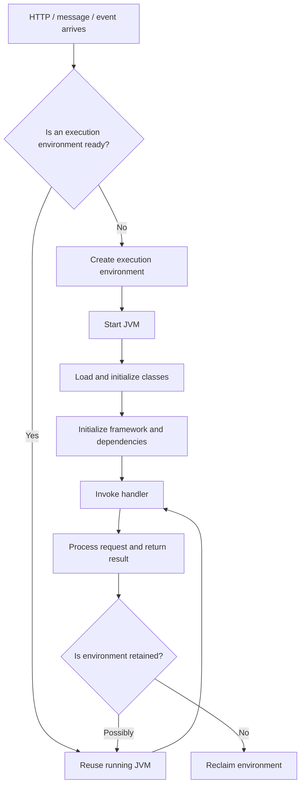

# Optimizing JVM Startup, Class Loading, and Heap Memory

Java functions in serverless environments must respond quickly even when the platform has just provisioned a fresh execution environment. Preparing the environment, booting the JVM, loading frameworks, and initializing dependencies can raise latency on the first call. When an environment is reused, already-loaded classes and shared objects remain in memory, though subsequent invocations still pay request-processing and memory-management costs.

Optimizing Java on serverless therefore requires looking at both startup and runtime execution: how the JVM boots, which classes load, what static initializers execute, how much heap is needed, how the garbage collector behaves, and what memory sits off-heap. The objective is achieving latency, stability, and cost suited to the workload while preserving correctness as the platform scales out or reclaims environments.

Within the **CLOUD_SERVERLESS** module, Java functions can be triggered by HTTP, messages, or events. Short-lived functions with bursty traffic that scale to zero are typically startup-sensitive; batch or steady-traffic functions must additionally balance throughput, memory, and GC. This lesson presents measurement and optimization practices for both scenarios.

## 1. Cold starts and warm invocations

A **cold start** is an invocation requiring a new execution environment or runtime re-initialization before the handler can process work. In Java, initialization may include sandbox provisioning, JVM startup, class loading, running static initializers, framework initialization, and constructing shared clients.

A **warm invocation** runs inside an already-initialized environment reused by the platform. The JVM is already running, many classes are loaded, and environment-scoped objects may already reside in memory. Still, there is no guarantee consecutive requests land in the same environment. Under rising load, the platform spawns new environments; as load subsides, older environments are shut down or reclaimed.



This diagram illustrates the conceptual lifecycle. Exact sequencing, reuse timing, and startup measurement depend on the platform. Some platforms report init duration separately from handler duration; others fold part of initialization into request latency. Read your target runtime's metrics and logs to know which numbers reflect cold starts.

Cold starts matter most when:

- APIs require low p95/p99 latency and may receive traffic after idle periods.
- Sudden traffic spikes force the platform to spin up many fresh environments simultaneously.
- Functions use heavy frameworks, numerous dependencies, or heavy static initializers.
- Functions handle few requests per environment, preventing JIT and caches from warming up.

If a function runs continuously or at consistently high frequency, startup may represent a tiny fraction of total execution time. In that case, optimizing throughput, allocation rate, GC, and cost can outweigh saving tens of milliseconds on startup.

## 2. JVM startup phases

When the runtime spawns a new Java process, the JVM prepares its execution environment before invoking the handler. Depending on the JDK, VM implementation, and framework, this includes:

1. Starting the process, parsing JVM flags, and setting up heap, metaspace, code cache, threads, and runtime subsystems.
2. Locating the entry point or bootstrap class and loading initial required classes.
3. Loading, linking, and initializing classes on demand as the application runs.
4. Initializing frameworks, dependency injection containers, logging, serializers, SDK clients, and configuration.
5. Invoking the handler once the runtime maps the incoming event into application input.

Not every class is loaded before the handler executes. The JVM generally loads classes lazily on demand; frameworks, however, may eagerly scan the classpath or load many classes during bootstrap. Thus, two applications with identical JAR sizes can exhibit very different startup times depending on classes actually loaded, reflection, annotation scanning, static initializers, and dependency structure.

## 3. Class loading, linking, and initialization

In the JVM class lifecycle, three crucial phases are loading, linking, and initialization.

### Loading — reading class definitions

Class loaders locate bytecode and construct corresponding `Class` objects. Bytecode may come from class directories, JARs, modules, or custom class loaders. The same class can be loaded by different class loaders; within the JVM, a class's identity comprises both its binary name and its defining class loader.

Applications using multiple frameworks may create multiple class loaders. While useful for plugins or isolation, this increases class counts and metadata in memory. Retaining references to a class loader or its instances after it is no longer needed prevents reclamation and can leak metaspace.

### Linking — wiring classes together

Linking comprises three main steps:

- **Verification:** checks that bytecode is valid and conforms to JVM constraints.
- **Preparation:** allocates memory for static fields and initializes them to type defaults. Explicit field initializers in source code run later during initialization.
- **Resolution:** translates symbolic references in the constant pool into direct references. The JVM may resolve lazily on first use rather than eagerly at load time.

### Initialization — executing initializers

Initialization runs the class's static initializers and static field assignment expressions. The JVM guarantees class initialization is synchronized per Java semantics and succeeds at most once per class loader.

```java
public final class FunctionBootstrap {
    private static final ObjectMapper JSON = new ObjectMapper();
    private static final HttpClient HTTP = HttpClient.newHttpClient();

    static {
        // Synchronous, time-consuming work here increases startup time.
        configureJson(JSON);
    }

    private FunctionBootstrap() {
    }
}
```

Creating a serializer or HTTP client for reuse can be sensible if the library supports concurrent sharing and initialization makes no network calls. However, never execute database queries, external API calls, large file downloads, or blocking credential fetches inside static initializers. Those operations lengthen cold starts and can fail class initialization when a dependency is transiently unavailable. If class initialization fails with an error, subsequent accesses in the same class loader can throw `NoClassDefFoundError` because the class remains marked erroneous.

### Eager vs. lazy initialization

Eager initialization creates dependencies as soon as the runtime boots. This lengthens cold starts while reducing initialization work on the first request. Lazy initialization creates dependencies only when first needed; startup can be faster, while the first request hitting that path pays the initialization cost.

Choose based on real execution paths:

- Dependencies required on every invocation and cheap to create: initialize once at environment scope.
- Dependencies used only on rare branches: consider lazy initialization.
- Dependencies holding expiring credentials or connections: reuse the client, while letting the library manage credential/connection refresh lifecycles.
- Dependencies carrying per-request data: instantiate or fetch during the invocation, never in shared static fields.

## 4. Reducing class loading and framework startup overhead

A Java application may bundle hundreds or thousands of framework and library classes. Startup is impacted by loaded class counts, annotation scanning, reflection, dynamic proxies, service discovery, and object graph construction.

Effective ways to cut overhead:

1. **Remove unused dependencies:** inspect the dependency tree and drop starters or modules pulling unneeded libraries.
2. **Limit component scanning:** restrict scanned packages and avoid full classpath scanning when your framework supports it.
3. **Curb unnecessary reflection:** reflection and dynamic proxies slow startup and require extra configuration for AOT/native images.
4. **Avoid oversized object graphs:** build only beans or clients needed by the handler; split rarely used capabilities into separate modules/functions when appropriate.
5. **Keep artifacts lean and clean:** drop unused resources/test data and avoid packaging duplicate library versions.
6. **Choose frameworks with suitable startup characteristics:** compare traditional frameworks against compile-time DI or AOT frameworks using benchmarks of your actual workload.
7. **Audit logging and configuration:** avoid synchronous remote config lookups or metadata fetches when safe caches or injected configuration suffice.

Frameworks like Spring Boot offer rich ecosystems, though startup scales with starters, auto-configurations, and bean counts. Micronaut, Quarkus, or AOT builds can shift metadata work to build time. That does not mean one framework is universally faster for every app; compare equivalent functionality under the same runtime, memory limit, and packaging format.

### Dependency tree and artifact size

JAR size is a useful signal, though not directly proportional to class-loading time. A large JAR containing static resources does not necessarily force the JVM to load every class. Conversely, a framework can scan many classes even in a modest artifact. Use dependency analysis to remove unused libraries, then measure actual startup time and loaded class counts.

For executable/fat JARs, inspect how nested JARs are packaged and read by class loaders. For container images, smaller layers and images speed up image pulls in some environments, though image pull time is separate from JVM startup. Optimize both and measure them separately when the platform exposes metrics.

## 5. JIT compilation and warmup

The HotSpot JVM typically starts executing bytecode with an interpreter and compiles hot methods to native machine code using the Just-In-Time (JIT) compiler. Over longer runs, the JIT leverages runtime profiling to optimize hot paths. This stabilizes steady-state throughput after warmup, though it consumes extra CPU and memory early on.

For short-lived functions, environments may be reclaimed before many methods become hot. Consequently, an application tuned for long-running service throughput may not be optimal for functions executing only a few hundred milliseconds per invocation.

Key considerations:

- **Interpreter and JIT:** code speeds up after repeated calls; single-invocation benchmarks do not represent warm performance.
- **Tiered compilation:** the JVM compiles across tiers to balance startup speed with peak machine-code quality.
- **Profile-guided optimization:** profile data can improve optimization, though it requires compatible profile capture and replay workflows.
- **Compiler threads and code cache:** the JIT consumes CPU and non-heap memory; tiny workloads may see little benefit from deep optimization.

Some JVM flags tune compilation tiers or compiler behavior, yet changing flags can hurt throughput or behave differently across JDKs. Never copy JVM flags from a blog post into production without measuring startup, p95/p99 latency, and throughput on the target runtime.

## 6. Understanding a Java function's memory footprint

Platform memory limits usually apply to the entire execution environment or container, not solely the Java heap. Process memory comprises:

| Component | Contents | What to monitor |
|---|---|---|
| Java heap | Objects, arrays, and most application data | Heap used/committed/max, allocation rate, GC |
| Metaspace | Metadata for loaded classes | Metaspace used, class/class loader count |
| Thread stacks | Per-thread call stacks | Thread count and stack size |
| Code cache | Native code compiled by JIT | Code cache usage and compiler activity |
| Direct/native buffers | Off-heap buffers, NIO, TLS, and libraries | Direct memory and RSS |
| JVM/runtime native | VM structures, GC metadata, JIT/compiler, JNI | Process RSS and native memory tracking |
| Agents/native libraries | APMs, profilers, compression, or native libs | RSS and agent configuration |

Setting `-Xmx` equal to the entire memory limit is therefore risky. The JVM needs off-heap memory as well; if the heap fills up while native memory grows, the OS or platform may kill the process before Java throws `OutOfMemoryError`.

### Heap used, committed, and max

- **Used:** heap currently occupied by objects at measurement time.
- **Committed:** heap memory the JVM has reserved from the OS for use; committed can exceed used.
- **Max:** maximum heap limit based on configuration and how the JVM detects environment limits.

`Runtime.maxMemory()` reflects the max heap seen by the JVM, not the total memory limit of the serverless environment. `Runtime.totalMemory()` approximates committed heap, and `Runtime.freeMemory()` is unused space within committed heap; none of these three numbers reports total process RSS.

### Estimating a memory budget

Start by partitioning the memory limit into budgets:

\[
M_{limit} \geq M_{heap} + M_{metaspace} + M_{stacks} + M_{direct} + M_{JVM/native} + M_{headroom}
\]

This is a budgeting model rather than an exact allocation formula. Regions vary with JDK, GC, thread counts, libraries, and load. Measure peak RSS across both cold starts and realistic concurrency, then reserve headroom for fluctuations and spikes.

## 7. Configuring heap in memory-constrained environments

Modern JVMs detect container/cgroup limits to some degree, though exact behavior depends on the JDK and how the platform enforces limits. Common options include:

- `-Xms`: initial or minimum heap size as applied by the JVM.
- `-Xmx`: maximum heap limit.
- `-XX:InitialRAMPercentage`: percentage of memory used to size initial heap on supported runtimes.
- `-XX:MaxRAMPercentage`: percentage of memory used to size maximum heap on supported runtimes.

Never assume identical percentages behave identically across every JDK or platform. Verify that the JVM detects the memory limit accurately and check `maxMemory()` in the deployed runtime. On platforms with small memory limits, account for overhead from agents, TLS, SDKs, and threads.

Example logging heap limits for diagnostics:

```java
public final class MemoryDiagnostics {
    public static void logHeapLimits() {
        Runtime runtime = Runtime.getRuntime();
        long mib = 1024L * 1024L;

        System.out.printf(
                "heap.maxMiB=%d heap.committedMiB=%d heap.freeMiB=%d%n",
                runtime.maxMemory() / mib,
                runtime.totalMemory() / mib,
                runtime.freeMemory() / mib);
    }
}
```

These numbers describe only the heap. Cross-check against platform-reported memory/RSS metrics to spot native or thread-stack growth. Avoid logging detailed memory stats on every request if it generates heavy log volume; logging at init, periodically, or above thresholds is usually sufficient.

### Sizing heap for the workload

- Too little heap triggers frequent GC, allocation failures, or function timeouts.
- Too much heap raises RSS, can lengthen certain GC cycles, and reduces how many environments fit inside a concurrency quota.
- Right-sized heap with adequate headroom usually balances better than setting max heap to the full memory limit.
- Some platforms allocate additional CPU proportionally with higher memory settings; increasing memory may cut latency via extra CPU or reduced GC, though cost may rise too. Benchmark each tier.

## 8. Garbage collection and allocation rate

Java allocates objects on the heap and the garbage collector (GC) reclaims unreachable objects. In functions, per-invocation allocation volume and the number of invocations served by an environment drive GC behavior.

Common allocation sources:

- Deserializing JSON into deeply nested object graphs.
- Copying byte arrays or Strings during encoding conversions.
- Creating transient request/response objects and temporary collections.
- Logging that formats large strings or serializes full payloads.
- Creating new HTTP clients, SDK clients, or serializers on every invocation.
- Buffering entire files/messages instead of streaming.

Reducing allocations lowers GC pressure and peak memory:

1. Reuse thread-safe clients and serializers at the environment scope.
2. Process large payloads via streams or small batches.
3. Avoid unnecessary copies of payloads and strings.
4. Bound caches, collections, and buffers with TTLs or eviction policies.
5. Never retain invocation objects in static fields, callbacks, or background threads after processing finishes.
6. Choose appropriate data structures and measure before micro-optimizing.

### Choosing a GC

G1 is the default collector in many modern HotSpot builds, though runtimes may select another collector based on JDK, memory, and configuration. Serial GC can suit small, low-CPU processes; concurrent collectors can benefit larger workloads needing shorter pauses at the expense of background resources. No single collector fits every function.

Measure pause times, allocation rate, promotion rate, old-generation occupancy, and GC CPU time under realistic load. Avoid calling `System.gc()` inside handlers to force reclamation; behavior is JVM-dependent and typically makes latency erratic.

## 9. Long-lived memory across invocations

Reused environments retain static variables, singletons, caches, thread pools, and connection pools. While this lowers initialization cost, objects can outlive the request that created them.

Never store user or request data in static fields. The example below can leak data across two invocations:

```java
public final class UnsafeFunction {
    private static String currentUserId;

    public Response handle(Request request) {
        currentUserId = request.userId();
        return buildResponse(currentUserId);
    }
}
```

Keep request data in local variables and pass it via method parameters. If the runtime allows multiple concurrent invocations within the same environment, every shared object must be thread-safe. Never assume all serverless platforms share the same concurrency model.

Common memory leak risks:

- Unbounded static caches without expiration.
- ThreadLocal values not cleared via `remove()` when threads are reused.
- Thread pools or schedulers spawning unmanaged threads.
- Listeners, callbacks, or collections holding references to large requests.
- Custom class loaders or dynamic proxies repeatedly generated and never collected.
- Connection pools retaining too many connections or failing to evict stale ones.

When a library requires ThreadLocal, always clean it up in a `finally` block:

```java
REQUEST_CONTEXT.set(context);
try {
    return process(request);
} finally {
    REQUEST_CONTEXT.remove();
}
```

## 10. Optimizing dependencies and shared clients

Creating an SDK or HTTP client on every invocation repeats DNS lookups, TLS handshakes, connection pool setup, and object allocations. When a library supports reuse, creating the client once per execution environment lowers latency and memory pressure.

```java
public final class CatalogFunction {
    private static final HttpClient HTTP = HttpClient.newBuilder()
            .connectTimeout(Duration.ofSeconds(2))
            .build();

    public Response handle(Request request) {
        // Per-invocation data is held in local variables.
        String sku = request.sku();
        return fetchCatalogItem(HTTP, sku);
    }
}
```

Shared objects must be verified for thread safety and lifecycle behavior. Some SDK clients are reusable even though underlying connections expire; the client needs refresh/reconnect mechanisms. Never hold a single bare JDBC connection in a static field indefinitely. Instead, reuse a properly configured `DataSource`/pool, cap total connections according to concurrency, and let the pool manage connection lifecycles.

Environment-level client initialization is a performance optimization, not a place to store business state. Static caches are lost whenever an environment is reclaimed and are never shared across environments. Data requiring consistency or durability belongs in a database, distributed cache, or durable storage.

## 11. Advanced startup reduction techniques

### Class Data Sharing (CDS)

Some JDKs support Class Data Sharing to persist preprocessed class metadata into an archive shareable across compatible JVMs. CDS can trim part of class loading time and memory footprint, provided the archive matches the JDK, classpath/modules, and packaging format. Usability in managed serverless runtimes depends on control over startup commands and the filesystem. Apply it only after confirming runtime support.

### Ahead-of-Time (AOT) processing

AOT shifts metadata analysis, dependency injection wiring, or reflection resolution into the build phase. Frameworks supporting AOT reduce runtime startup work, though build pipelines grow more complex and dynamic behaviors must be declared ahead of time.

### GraalVM Native Image

Native Image compiles a Java application into a native executable at build time. It can dramatically reduce startup duration and memory footprint for certain workloads, especially short, cold-start-sensitive functions. Trade-offs include:

- Longer builds and OS/architecture-specific binaries.
- Reflection, dynamic proxies, resource loading, JNI, and service loading often require explicit configuration metadata.
- Certain libraries or Java agents may not be fully compatible.
- HotSpot JIT runtime optimizations no longer apply; warmed throughput may differ.
- Debugging, profiling, and JDK patching follow different workflows.

Run integration tests against the actual native artifact in the target runtime, not just verify that the build compiles.

### Checkpoint/restore with CRaC

Coordinated Restore at Checkpoint (CRaC) lets a Java application take a checkpoint once initialized and restore from it to skip startup work. This model requires coordination across the runtime, JDK, application, and deployment platform. Before checkpointing, open resources must be handled appropriately; after restore, sockets may need reopening, credentials refreshing, and stale resources reinitializing.

### Execution environment snapshots

Some serverless platforms snapshot the environment after initialization to restore faster on cold starts. Capabilities, supported runtimes, and before-checkpoint/after-restore hooks depend on the provider. For example, AWS Lambda SnapStart supports specific Java runtimes and published function versions; consult current provider documentation before designing around it.

Because snapshots restore memory state verbatim, pay attention to:

- Do not assume random seeds, UUID generator states, or uniqueness values automatically diverge after restore if initialized before snapshot.
- Network connections, sockets, connection pools, or credentials may be stale after snapshot age; validate and refresh them in supported after-restore hooks.
- Never keep unnecessary request data or secrets on the heap prior to checkpointing.
- Do not leave background threads or in-flight tasks running if the platform does not support snapshotting that state.
- Test multiple concurrently restored environments to catch collisions or unintended shared state.

Snapshots, AOT, and native images are not free optimizations. They alter the build and runtime model; compare cold starts, warm latency, peak memory, throughput, build cost, and operational complexity.

## 12. Measuring startup, class loading, and memory

Never optimize based on intuition or laptop timings. Measure in the actual deployment environment, because CPU, filesystem, memory limits, networking, runtime version, and concurrency can differ substantially.

### Metrics to collect

| Metric | Meaning |
|---|---|
| Init duration / cold start duration | Time platform spends preparing the environment and runtime per metric definition |
| Handler duration | Time function spends handling the invocation once called |
| End-to-end latency | Latency observed by the client or producer |
| Class load count/time | Number of loaded classes and class-loading cost |
| Heap used/committed/max | Heap utilization and configured heap limit |
| Process RSS / peak memory | Actual process/environment memory, including off-heap regions |
| Allocation rate | Volume of objects allocated over time |
| GC count/pause/CPU | Frequency and overhead of garbage collection |
| Thread count | Active threads and stack/native memory impact |
| Error/timeout/OOM rate | Impact of configuration on stability |

### Useful JVM tools

- **Java Flight Recorder (JFR):** records startup, class loading, allocations, GC, threads, and CPU with configurable, bounded overhead.
- **JVM unified logging:** `-Xlog` flags emit class loading or GC logs on supported JDKs; syntax varies by version.
- **JMX / MXBeans:** exposes heap, memory pool, class loading, and GC statistics.
- **Native Memory Tracking (NMT):** analyzes categories of HotSpot native memory when enabled at JVM launch; carries overhead and excludes native allocations outside the JVM.
- **Platform metrics:** correlate peak memory, init duration, concurrency, throttling, and timeouts against JVM telemetry.

In serverless environments, a function may exit or be reclaimed before a traditional profiler attaches. Enable short recordings, export telemetry to durable storage, or use profilers compatible with your deployment runtime. Account for overhead and never capture sensitive payloads or secrets in recordings or logs.

### Controlled benchmarking workflow

1. Lock down JDK version, framework, artifact, memory/CPU settings, and trigger type.
2. Establish baselines for both cold starts and warm invocations; record init duration, handler duration, and end-to-end latency separately.
3. Run sufficient iterations to measure p50, p95, and p99; never draw conclusions from a single run.
4. Simulate traffic bursts to measure newly spawned environments, concurrency, and cold-start bursts.
5. Change one variable at a time: dependencies, static initializers, heap settings, framework, or runtime options.
6. Measure throughput, peak memory, GC, errors, and cost—not startup alone.
7. Re-verify correctness, retries, connection lifecycles, and behavior after environment reuse/restore.

If p50 improves while p99 worsens due to GC pauses or cold-start bursts, the new configuration may be unsuitable. Tie targets directly to real API or consumer SLAs.

## 13. Example: measuring heap and tracking class loading

Java exposes built-in APIs to inspect basic runtime metrics:

```java
import java.lang.management.ClassLoadingMXBean;
import java.lang.management.ManagementFactory;

public final class RuntimeDiagnostics {
    public static void logRuntimeState() {
        Runtime runtime = Runtime.getRuntime();
        ClassLoadingMXBean classes =
                ManagementFactory.getClassLoadingMXBean();
        long mib = 1024L * 1024L;

        System.out.printf(
                "heap.maxMiB=%d heap.committedMiB=%d heap.usedMiB=%d " +
                "classes.loaded=%d classes.totalLoaded=%d classes.unloaded=%d%n",
                runtime.maxMemory() / mib,
                runtime.totalMemory() / mib,
                (runtime.totalMemory() - runtime.freeMemory()) / mib,
                classes.getLoadedClassCount(),
                classes.getTotalLoadedClassCount(),
                classes.getUnloadedClassCount());
    }
}
```

These are point-in-time snapshots: `classes.totalLoaded` is the cumulative count of classes ever loaded by the JVM, while `classes.loaded` is the count currently loaded. These totals do not pinpoint which specific classes caused slowness. When diagnosing bottlenecks, combine class-loading logs or JFR with startup timeline markers.

Handlers can invoke diagnostics once during initialization or under controlled debug flags. Avoid logging on every invocation if extra serialization, I/O, and cost skew benchmark results.

## 14. Optimizing by workload profile

| Workload profile | Optimization priorities |
|---|---|
| Sparse, cold-start-sensitive HTTP API | Minimize startup, dependencies, and static initializers; consider snapshot/AOT/native image if runtime supports it |
| Continuous-traffic queue consumer | Throughput, allocation rate, GC, batch size, concurrency, and connection pooling |
| Large-file or large-payload processor | Streaming, bounded buffers, heap headroom, and temporary storage capacity |
| Multi-service aggregator function | Safe client reuse, timeouts, connection lifecycles, DNS/TLS, and downstream concurrency |
| Infrequent function with sharp bursts | Measure cold-start bursts, concurrency caps, memory/CPU sizing, and dependency capacity |
| Multi-step workflow with short tasks | Reduce per-invocation overhead and inter-step payloads; keep functions small and startup lean |

A configuration tuned for a lightweight API may perform poorly for a batch consumer. Never apply identical `-Xmx`, GC options, or thread counts across every function merely because they live in the same repository.

## 15. Common anti-patterns

| Anti-pattern | Why it causes problems | How to fix |
|---|---|---|
| Calling databases/APIs inside static initializers | Lengthens cold starts and can break class initialization | Separate I/O from class init; use timeouts and controlled lazy initialization |
| Creating new clients on every invocation | Repeats TLS, DNS, pool setup, and object allocations | Reuse thread-safe clients at the environment scope |
| Setting `-Xmx` equal to the full memory limit | Leaves zero headroom for metaspace, stacks, native memory, and runtime | Measure RSS and budget for off-heap memory |
| Raising heap blindly to dodge OOM without root cause | Masks memory leaks or unbounded payloads | Profile allocations, bound caches, and stream large payloads |
| Calling `System.gc()` in handlers | Causes erratic latency without guaranteeing immediate reclamation | Reduce allocations and let GC run per JVM policy |
| Spawning background threads and returning response | Runtime may freeze or reclaim the environment | Await work or offload to durable queues/workflows |
| Holding request/user data in static fields | Leaks data across invocations or causes race conditions | Use local variables and pass context explicitly |
| Enabling multiple agents/profilers in prod unmeasured | Inflates RSS, startup time, and CPU overhead | Select necessary instrumentation and measure impact |
| Picking native image solely for cold start | Can introduce reflection, compatibility, and throughput issues | Benchmark end-to-end and test actual native artifacts |
| Tuning from a single local laptop run | Fails to reflect cloud runtime, memory limits, and burst scaling | Benchmark in the deployment environment across many runs |

## 16. Pre-deployment checklist

- **Runtime:** Are JDK version, JVM vendor, CPU architecture, and memory limit confirmed?
- **Cold start:** Is init duration measured separately from handler duration, and do p95/p99 meet targets?
- **Class loading:** Have the dependency tree, component scanning, reflection, and static initializers been audited?
- **Initialization:** Is there any network I/O, database query, or blocking secret/config fetch in static initializers?
- **JIT:** Do workloads run long enough to benefit from JIT, or do most invocations finish before warmup?
- **Heap:** Does `Xmx` or RAM percentage leave sufficient headroom for native memory, thread stacks, and agents?
- **GC:** Have allocation rate, pause times, and GC CPU usage been measured under realistic load?
- **Concurrency:** Are static objects, clients, caches, ThreadLocal, and thread pools safe under the runtime's concurrency model?
- **Memory leaks:** Are caches bounded, files/streams closed, and per-invocation references released?
- **Optimization options:** Are CDS, AOT, CRaC, SnapStart, or Native Image supported by the runtime and tested after restore?
- **Observability:** Are init, handler, RSS, heap, GC, class loading, OOM, and timeout metrics collected?
- **Cost:** Have memory/CPU and concurrency settings been compared across latency, throughput, peak memory, and cost?

## 17. Conclusion

Optimizing Java on serverless begins with separating environment provisioning, JVM startup, class loading, framework initialization, and handler execution costs. Trimming unused dependencies, keeping static initializers lean, properly initializing shared clients, and accounting for JIT warmup can cut startup time while preserving environment reuse benefits.

For memory, distinguish Java heap from total process memory. The heap must accommodate your working set and allocation spikes while leaving headroom for metaspace, thread stacks, code cache, direct buffers, and native runtime structures. Measure GC, RSS, concurrency, and p95/p99 latency in the target environment before locking in JVM flags or memory allocations.

CDS, AOT, CRaC, runtime snapshots, and Native Image are advanced options when startup is a proven bottleneck. Each carries compatibility requirements and operational trade-offs. The right configuration is one that satisfies latency, throughput, reliability, and cost for your specific workload—not a one-size-fits-all set of JVM flags copied across every function.
