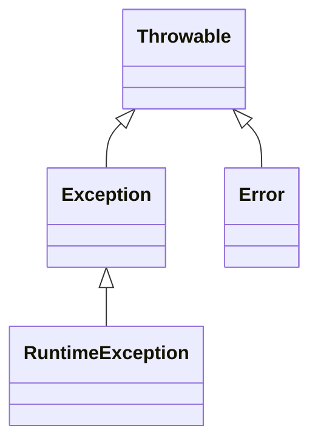
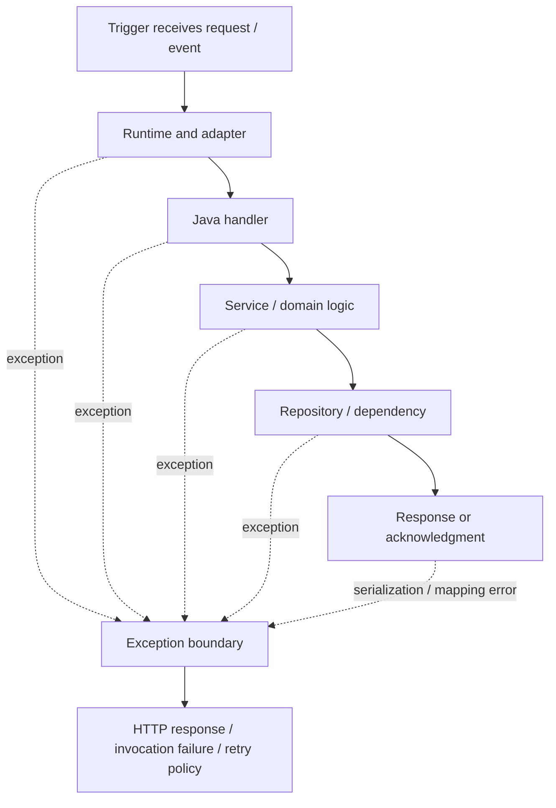
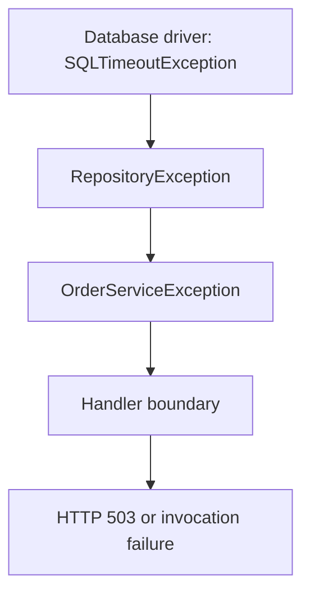

# Handling Exceptions and Preserving Error Causes in Java Handlers

A Java function can fail while validating a request, querying a database, calling an external API, or serializing a result into a response. As an error propagates across layers, preserving the original cause is vital for accurate diagnostics and for letting the runtime or workflow decide how to react. If a handler swallows an exception, replaces it with a generic message, or logs only `getMessage()`, the details needed to pinpoint the root failure vanish.

In serverless environments, exceptions also determine whether an invocation is treated as succeeded or failed. For synchronous HTTP, the application typically translates errors into an appropriate HTTP response. For asynchronous queues or events, throwing an exception versus returning normally can dictate whether a message is retried or acknowledged as processed, depending on the adapter and trigger configuration. Exception handling must therefore align with the handler boundary and trigger type.

This lesson explains how to structure exceptions in Java, preserve causes and stack traces, distinguish business errors from technical errors, handle asynchronous failures, and map errors at the FaaS boundary.

## 1. Java exceptions and the invocation lifecycle

### 1.1. Basic structure of Throwable

In Java, `Throwable` is the root class of objects that can be thrown with `throw`. Its two main branches are `Exception` and `Error`:

- **Exception:** conditions an application can anticipate or handle, such as invalid input, connection failures, or missing resources.
- **RuntimeException:** exceptions not required to be declared or caught at compile time. Examples include `IllegalArgumentException`, `NullPointerException`, and application-defined runtime exceptions.
- **Checked exception:** exception classes that do not inherit from `RuntimeException`; methods must declare `throws` or handle them with `catch`.
- **Error:** severe JVM or runtime environment problems such as `OutOfMemoryError` or `LinkageError`. Normal application code should not catch these and continue as if the invocation remained safe.



Checked versus unchecked is simply Java's mechanism for forcing callers to declare or handle exceptions. It does not determine whether an error is retryable. An `IOException` may be transient, or it may stem from an invalid file path. A `RuntimeException` may represent a business rule violation or a programming bug. Classify errors based on error type and dependency contract rather than inheritance branch alone.

### 1.2. Exceptions across function stages

An invocation typically passes through these stages:

1. The platform receives the trigger and routes it to the function.
2. The runtime initializes the environment and Java application if needed.
3. The adapter transforms the payload into handler input.
4. The handler performs validation and business logic.
5. Services/repositories call databases or external dependencies.
6. The handler produces a result and the adapter maps it to a response or message acknowledgment.

Exceptions can occur at any stage. Class-loading or static-initializer failures can occur before the handler even starts. Payload parsing failures happen inside the adapter. Query failures occur inside repositories. Serialization errors can occur after business logic has completed.



The exception boundary is the layer responsible for translating internal exceptions into a trigger-appropriate outcome. Avoid letting every layer convert errors into a generic response, which strips upper layers of the context needed to decide retries, compensation, or user messaging.

## 2. Preserving the error cause (cause chain)

### 2.1. What is a cause?

One exception can wrap another exception. The outer exception describes context at the current layer; the cause preserves the underlying failure raised below.

For example, the repository knows loading an order failed, while the JDBC driver knows the root cause was a connection timeout. You can throw `OrderRepositoryException` to add context while retaining `SQLException` as the cause.

```java
public final class OrderRepositoryException extends RuntimeException {
    public OrderRepositoryException(String message, Throwable cause) {
        super(message, cause);
    }
}

public final class JdbcOrderRepository {
    public Order findById(String orderId) {
        try {
            return queryDatabase(orderId);
        } catch (SQLException error) {
            throw new OrderRepositoryException(
                    "Could not load order " + orderId,
                    error);
        }
    }

    private Order queryDatabase(String orderId) throws SQLException {
        // Execute query via JDBC.
        throw new SQLTimeoutException("Connection timed out");
    }
}
```

When logging the outer exception, the stack trace prints the entire `Caused by` chain, allowing operators to see the original JDBC failure. In production code, ensure `orderId` contains no sensitive data before embedding it in messages or logs.

### 2.2. Wrapping exceptions properly

When crossing abstraction boundaries, use a constructor that accepts `cause`:

```java
catch (SQLException error) {
    throw new DataAccessException("Reading order failed", error);
}
```

Do not do this:

```java
catch (SQLException error) {
    // Wrong: the message is preserved, but the original cause and stack trace are lost.
    throw new RuntimeException(error.getMessage());
}
```

The broken snippet creates a brand-new exception disconnected from `SQLException`. Its stack trace only points to the `throw` line, hiding the path where the failure originated.

Useful constructors:

```java
public class DependencyCallException extends RuntimeException {
    public DependencyCallException(String message) {
        super(message);
    }

    public DependencyCallException(String message, Throwable cause) {
        super(message, cause);
    }
}
```

Use the single-argument constructor without a cause only when no underlying exception exists. Whenever translating from another exception, pass the cause.

### 2.3. When to rethrow the original exception

If the current layer adds no context and does not cross an abstraction boundary, rethrow the caught exception directly:

```java
try {
    return paymentClient.charge(command);
} catch (PaymentProviderException error) {
    metrics.increment("payment.provider.failure");
    throw error; // Preserve original exception object and stack trace.
}
```

Do not catch and rethrow if no action is taken. Let exceptions propagate naturally to the exception boundary. Catching solely to log and rethrow at every layer creates duplicate logs and noise in observability pipelines.

If you need a new exception type, wrap with the cause. If you do not, rethrow the original exception. Both approaches keep the cause chain intact.

### 2.4. Do not use `fillInStackTrace()` to mask failures

`fillInStackTrace()` resets the stack trace to the line where it is called. Invoking it while handling an exception erases the original throw site and hinders root-cause investigation. In almost all cases, there is no reason to call it manually.

Never instantiate a fresh exception inside a utility layer merely to add logging or tweak a message line. Define abstraction exceptions at meaningful boundaries and preserve the cause.

## 3. Designing custom exceptions around abstractions

### 3.1. Name exceptions for the layer's responsibility

Each layer should emit errors matching its responsibility:

- HTTP adapter: protocol errors, timeouts, status codes from remote services.
- Repository: data access failures or constraint violations.
- Domain service: business rule violations or invalid state transitions.
- Handler boundary: classifying and mapping errors to HTTP responses or invocation failures.

Never let the domain layer depend directly on `SQLException`, `HttpClientException`, or cloud provider-specific exception classes. Repositories and adapters should translate technical exceptions into internal types while preserving the cause so upper layers remain decoupled from specific libraries.

### 3.2. Distinguishing business errors from technical errors

A clean baseline model:

```java
public abstract class ApplicationException extends RuntimeException {
    protected ApplicationException(String message) {
        super(message);
    }

    protected ApplicationException(String message, Throwable cause) {
        super(message, cause);
    }
}

public final class OrderNotFoundException extends ApplicationException {
    public OrderNotFoundException(String orderId) {
        super("Order does not exist: " + orderId);
    }
}

public final class InvalidOrderStateException extends ApplicationException {
    public InvalidOrderStateException(String message) {
        super(message);
    }
}

public final class DependencyUnavailableException extends ApplicationException {
    public DependencyUnavailableException(String message, Throwable cause) {
        super(message, cause);
    }
}
```

`OrderNotFoundException` and `InvalidOrderStateException` represent predictable domain outcomes. `DependencyUnavailableException` represents a technical failure in a downstream dependency. Distinct types let handlers and workflows classify outcomes cleanly.

In larger systems, you can use a richer hierarchy or sealed interfaces/result records. Avoid creating dozens of exception classes if they do not clarify handling decisions, observability, or API contracts.

### 3.3. Never use exceptions for normal control flow

If out-of-stock is a normal expected outcome of an inventory check, return a `ReservationResult` with status `OUT_OF_STOCK` instead of throwing an exception. Exceptions belong to situations where an operation cannot fulfill its contract or the system cannot perform the work.

Example:

```java
public enum ReservationStatus {
    RESERVED,
    OUT_OF_STOCK,
    PRODUCT_DISCONTINUED
}

public record ReservationResult(
        ReservationStatus status,
        String reservationId) {
}
```

When business outcomes are represented explicitly, workflows can branch cleanly. When a dependency times out, the technical exception can be retried according to policy.

## 4. Catching in the right place and never swallowing exceptions

### 4.1. Only catch when taking concrete action

A `catch` block should perform at least one meaningful action:

- translate the exception to an appropriate abstraction while preserving the cause;
- release or restore resources/state;
- map the error to a contract response;
- attach safe observability metadata;
- decide on retry, compensation, or a business branch.

If none of these apply, let the exception propagate.

### 4.2. Avoid overly broad catches

The following code is dangerous:

```java
try {
    processOrder(event);
} catch (Exception ignored) {
    return "OK";
}
```

The handler reports success even though processing failed. With a queue trigger, the adapter may acknowledge the message and never redeliver it. Over HTTP, the caller receives a false success. The failure also loses its stack trace for investigation.

Catch specific error types and choose explicit actions:

```java
try {
    processOrder(event);
} catch (DependencyUnavailableException error) {
    throw error; // Let exception boundary/runtime apply retry policy.
} catch (InvalidOrderStateException error) {
    recordBusinessRejection(event.eventId(), error);
    return ProcessResult.rejected("ORDER_STATE_INVALID");
}
```

This example assumes `InvalidOrderStateException` is an expected business outcome that can be recorded as a completed event disposition. If the event source contract requires treating that outcome as a failure, the adapter must signal failure accordingly. The key rule is never turning technical failures into false successes.

### 4.3. Never catch `Throwable` to keep running

`catch (Throwable)` catches `Error` as well, including critical JVM failures. Most handlers should never catch `OutOfMemoryError`, `StackOverflowError`, or linkage errors and continue normal execution. Continuing can leave the environment in an unsafe state.

Only specialized runtime/diagnostic components have reason to catch `Throwable`, and even they must rethrow serious errors after minimal safe handling. In application code, catch specific exceptions, or `Exception` only when a top-level boundary genuinely requires it.

### 4.4. Do not let cleanup mask the original exception

If `finally` throws a new exception, it can overwrite the exception already propagating outward. Use try-with-resources for resources implementing `AutoCloseable`:

```java
try (Connection connection = dataSource.getConnection();
     PreparedStatement statement = connection.prepareStatement(SQL)) {
    return execute(statement, orderId);
}
```

If both the body and `close()` fail, Java attaches the closing failure as a *suppressed exception* on the primary exception. You can inspect it via `getSuppressed()` or the full stack trace.

When managing cleanup manually, ensure cleanup errors never accidentally replace the original failure. Only attach cleanup errors as suppressed exceptions when justified, keeping the primary exception intact.

## 5. Preserving causes across multiple layers

### 5.1. Each layer adds context without erasing history

A call chain might look like this:



The repository knows which database operation failed. The service knows which business operation could not proceed. The handler knows which request/event was affected and how to respond. Each layer adds its own context while keeping the prior exception as its cause.

```java
public final class OrderServiceException extends RuntimeException {
    public OrderServiceException(String message, Throwable cause) {
        super(message, cause);
    }
}

public final class OrderService {
    private final OrderRepository repository;

    public OrderService(OrderRepository repository) {
        this.repository = repository;
    }

    public Order loadForProcessing(String orderId) {
        try {
            return repository.findById(orderId);
        } catch (OrderRepositoryException error) {
            throw new OrderServiceException(
                    "Could not load order for processing",
                    error);
        }
    }
}
```

### 5.2. Preserve the original exception when adding correlation context

A correlation ID or request ID connects failures back to an invocation. Include them in logs or exception metadata, but never construct a new exception without passing the cause.

```java
try {
    orderService.process(command);
} catch (DependencyUnavailableException error) {
    throw new WorkflowStepException(
            "Step process-order failed; correlationId=" + correlationId,
            error);
}
```

If a correlation ID or business key can contain user-controlled input, sanitize or bound it before writing it into logs or messages to avoid log injection and information disclosure.

### 5.3. Never rely solely on `getMessage()`

`getMessage()` is rarely enough for diagnostics. The message may be null, overly generic, or lack any stack trace. When logging, pass the exception object itself:

```java
logger.error("Order processing failed, correlationId={}", correlationId, error);
```

Do not do this:

```java
logger.error("Order processing failed: {}", error.getMessage());
```

The second form logs only the message string, omitting the stack trace and cause chain. In production, log the full exception once at a responsible boundary rather than logging duplicates at every layer.

## 6. Handling asynchronous exceptions

Java FaaS functions may call services via `CompletableFuture`, reactive clients, or async SDKs. Exceptions in asynchronous tasks are typically wrapped in `CompletionException` or `ExecutionException`.

### 6.1. CompletionException and cause

Example:

```java
CompletableFuture<PaymentResult> future = paymentClient.chargeAsync(command);

try {
    return future.join();
} catch (CompletionException error) {
    Throwable cause = error.getCause();
    throw new PaymentCallException("Asynchronous payment call failed", cause);
}
```

`join()` throws `CompletionException` when a future completes exceptionally. `get()` typically throws `ExecutionException` and may throw `InterruptedException`. When wrapping, preserve the underlying cause so upper layers can classify the real failure.

### 6.2. Never lose InterruptedException

`InterruptedException` signals that the waiting thread was interrupted. Catching it without restoring the interrupt flag hides cancellation requests from upper layers.

```java
try {
    return future.get(timeout, TimeUnit.MILLISECONDS);
} catch (InterruptedException error) {
    Thread.currentThread().interrupt();
    throw new InvocationInterruptedException(
            "Invocation was interrupted",
            error);
} catch (ExecutionException error) {
    throw new DependencyCallException(
            "Asynchronous dependency call failed",
            error.getCause());
} catch (TimeoutException error) {
    throw new DependencyTimeoutException(
            "Dependency call exceeded its deadline",
            error);
}
```

This example assumes internal exceptions accept a cause in their constructors. Restoring the interrupt flag via `Thread.currentThread().interrupt()` lets calling code or the runtime observe the interrupted state.

### 6.3. Never abandon incomplete futures

If a handler returns a response before a future finishes, the invocation may end or the environment may be reclaimed while work is still in flight. Never launch background tasks and return success assuming the process will stay alive.

In FaaS, await async work within the invocation timeout budget, or offload work to a queue/workflow service with an independent lifecycle. A manually spawned thread inside a function does not guarantee background execution continues after the handler returns.

### 6.4. Controlled unwrapping of exception wrappers

You can write a helper to inspect deeper causes, but never blindly strip every wrapper. Wrappers can carry timeout, retry-after, or execution context. Unwrap only well-defined outer wrappers from the library while keeping context in the cause chain or logs.

```java
static Throwable unwrapCompletionFailure(Throwable error) {
    if ((error instanceof CompletionException
            || error instanceof ExecutionException)
            && error.getCause() != null) {
        return error.getCause();
    }
    return error;
}
```

This helper handles only two known wrappers. When adding application context, wrap the unwrapped cause or keep the wrapper in the cause chain or logs appropriately.

## 7. Exception boundaries by trigger type

There is no single error-handling strategy for every trigger. The adapter decides how to translate Java handler outcomes into HTTP responses, acknowledgments, or invocation failures.

### 7.1. Synchronous HTTP

For HTTP APIs, clients expect a response with an appropriate status code and body. Common mapping:

| Error category | Typical HTTP status | Notes |
| --- | ---: | --- |
| Missing or invalid token | 401 | Do not leak sensitive verification details |
| Insufficient permissions | 403 | Token may be valid, but lacks required authority |
| Malformed request/validation error | 400 or 422 | Follow API contract |
| Resource does not exist | 404 | Avoid revealing existence if security policy forbids it |
| Business state conflict | 409 | For example, invalid state transition |
| Dependency temporarily unavailable | 503 | May include `Retry-After` when known |
| Unexpected error | 500 | Client-facing message should remain safe and generic |

These are API conventions rather than mandatory mappings for every gateway. Ensure the adapter returns the response envelope expected by your API Gateway or platform. A handler can return a response object with status 500 while the FaaS invocation itself is considered successful; that differs from throwing an unhandled exception that fails the invocation.

Example exception mapper:

```java
public final class HttpExceptionMapper {
    public HttpResponse map(Throwable error, String requestId) {
        if (error instanceof InvalidRequestException) {
            return HttpResponse.json(400, "INVALID_REQUEST");
        }
        if (error instanceof OrderNotFoundException) {
            return HttpResponse.json(404, "ORDER_NOT_FOUND");
        }
        if (error instanceof InvalidOrderStateException) {
            return HttpResponse.json(409, "INVALID_ORDER_STATE");
        }
        if (error instanceof DependencyUnavailableException) {
            return HttpResponse.json(503, "SERVICE_TEMPORARILY_UNAVAILABLE");
        }

        logger.error("Unhandled request failure, requestId={}", requestId, error);
        return HttpResponse.json(500, "INTERNAL_ERROR");
    }
}
```

The mapper converts only known error types into stable response codes. Unexpected errors are logged in full at the boundary and yield a safe error code. Never return `error.getMessage()` or stack traces to clients, as they can leak SQL, hostnames, internal structures, or sensitive data.

### 7.2. Asynchronous queues and events

With queue or event triggers, handlers do not return an HTTP response to the producer. The adapter determines whether the message counts as succeeded or failed.

- On success, return according to the adapter contract so the message is acknowledged.
- On retryable technical errors, propagate the error to the adapter or report the failed record per the event source protocol.
- On business rejections treated as final outcomes, record state and acknowledge the message per business policy.
- On errors unrecoverable after retries, route the message to a DLQ/failure destination if configured.

Never catch an exception and return `null` or `OK` when work did not complete. The adapter may interpret that as success and drop redelivery. Conversely, do not throw exceptions for every business rejection if doing so causes infinite retries of the same message.

With batch triggers, a single failing record can cause the whole batch to be redelivered. When the platform supports partial batch responses, the adapter can report only failed records. Follow the provider's contract precisely and still keep every record idempotent because duplicate deliveries can occur.

### 7.3. Scheduled triggers

For scheduled functions, failures can cause a run to be skipped, retried, or rerun per scheduler policy. Never assume every platform automatically retries a failed scheduled run. Check the scheduler's retry policy, persist run state, use a period-based execution key, and design for safe catch-up runs.

For example, a daily revenue aggregation job for `2026-11-17` should use a business key like `daily-report:2026-11-17`. If the scheduler replays the same window, the function can return the already-generated result or resume from a checkpoint instead of generating duplicate reports.

### 7.4. Webhooks

Webhook senders typically await an HTTP acknowledgment. If the handler returns 2xx before durably persisting the event, the event can be lost if the function stops immediately afterward. If the handler executes the entire business workflow before responding, the sender may time out and resend even though side effects already occurred.

A common pattern:

1. Verify webhook signature and sender origin.
2. Check event ID for deduplication.
3. Persist the event durably or write to an inbox/queue.
4. Return acknowledgment per the sender contract.
5. Process business logic asynchronously with retries and idempotency.

If persisting the event fails, return an error status so the sender can retry per contract. Never assume senders always retry or follow identical retry schedules; check the provider's webhook policy.

## 8. Does throwing an exception make FaaS retry?

Not always. An exception merely signals that the handler or adapter reported an error. Whether the platform retries depends on invocation mode and trigger configuration.

| Invocation mode | Meaning when handler fails |
| --- | --- |
| Synchronous HTTP | Typically returns an error to caller or gateway; caller decides whether to resend |
| Synchronous SDK invoke | Caller receives function error details and decides on retry |
| Asynchronous invoke | Platform may retry per configured policy and route to a failure destination |
| Queue event source | Message may redeliver per visibility timeout/receive policy; batch behavior depends on adapter |
| Stream event source | Retries/checkpoints may block partition or shard progress; handle poison records per service |
| Scheduled event | Scheduler or event delivery service decides retries per configuration |

Therefore, do not rely on "throw an exception to automatically retry" as a universal rule. Identify who performs the retry: HTTP client, SDK caller, FaaS platform, queue, stream source, or workflow orchestrator.

### 8.1. Do not acknowledge messages before committing

If a consumer commits to the database before acknowledging the message, the database commit can succeed while acknowledgment fails. The message will be redelivered, so the consumer must be idempotent.

If you acknowledge the message before committing to the database, the function might terminate between acknowledgment and commit; the message disappears while business changes were never saved. Acknowledgment and commit ordering must follow the adapter contract; the standard safe pattern is durable commit first, ack second, backed by idempotency.

### 8.2. Timeouts do not prove side effects did not happen

When a function calls a payment provider and times out, the request may have reached the provider and succeeded. A timeout only tells the caller it did not receive a response in time. Before retrying a charge command, query status by transaction reference or use the provider's idempotency key.

Exception types should express unknown outcomes when appropriate—for example, `PaymentOutcomeUnknownException` rather than immediately labeling it `PaymentFailedException`.

## 9. Logging, tracing, and preserving failure details

### 9.1. Logging full exceptions at the right boundary

Logs should be written where full invocation context is available: request ID, event ID, workflow execution ID, function version, and processing step. Pass the exception object to preserve the stack trace and cause chain.

```java
logger.error(
        "Invocation failed: requestId={}, eventId={}, step={}",
        requestId,
        eventId,
        stepName,
        error);
```

If every layer logs the same exception before rethrowing, a single failure produces multiple nearly identical log entries. Typically, lower layers wrap exceptions and add context, while the boundary logs once or emits a single structured event. For expected failures such as validation errors or business rejections, log at an appropriate level without dumping stack traces on every request.

### 9.2. Never expose sensitive data

Never log:

- `Authorization` headers, access tokens, refresh tokens, or API keys;
- passwords, secrets, private keys, or credentials;
- full payloads containing personal or payment data;
- connection strings or URLs containing credentials;
- stack traces returned to end users.

Use stable error codes, correlation IDs, and approved business identifiers. Redact sensitive fields prior to logging. If raw payloads must be retained for debugging, store them in access-controlled, encrypted storage with explicit retention policies.

### 9.3. Metrics by exception category

Track error counts by category and dependency:

| Metric | Meaning |
| --- | --- |
| Handler invocation errors | Count of invocations ending in failure |
| Error count by exception type | Most frequent failure categories |
| Dependency timeouts/rate limits | Health of downstream dependencies |
| Retry attempts and retry exhaustion | Transient error levels and workflows exhausting retry budgets |
| Business rejection count | Requests rejected by business rules |
| DLQ depth and oldest event age | Unprocessed events and backlog lag |
| Cold start/init errors | Distinguishes bootstrap failures from handler failures |

Do not lump business rejections into technical error rates if dashboards measure infrastructure health. The two metrics answer different operational questions.

## 10. Common anti-patterns

| Anti-pattern | Consequence | Fix |
| --- | --- | --- |
| `throw new RuntimeException(error.getMessage())` | Loses original cause and stack trace | `throw new RuntimeException("context", error)` or internal exception with cause constructor |
| Catching and returning `OK` | Hides failures; messages may be acked prematurely | Return true outcome or let failure propagate to adapter |
| Catching `Exception` at every layer | Loses classification and adds redundant handling | Catch only where concrete action is taken |
| Catching `Throwable` and continuing | May swallow fatal JVM errors | Do not catch `Error` in normal business flows |
| Logging only `getMessage()` | Missing stack trace and cause chain | Pass the exception object to the logger |
| Logging the same exception at every layer | Duplicate logs make root causes harder to find | Log once in full at the boundary; lower layers only wrap or enrich context |
| Returning stack traces to clients | Leaks internal structure and sensitive data | Return stable error codes and log details internally |
| Retrying every exception | Retries permanent errors or business rejections | Classify errors and enforce bounded retry policies |
| Spawning threads and returning from handler | Work may be lost when instance is reclaimed | Use queues/workflows or await futures within deadline |
| Failing to restore interrupt flag | Drops thread cancellation signal | Call `Thread.currentThread().interrupt()` after catching `InterruptedException` |
| Marking payment failed on timeout | May be wrong if provider already captured funds | Use an unknown status and reconcile |

## 11. Exception handling design workflow

Before promoting a handler to production, walk through these steps:

1. **Identify the exception boundary.** Which adapter catches final exceptions and maps them to HTTP responses, acknowledgments, or invocation failures?
2. **Classify outcomes.** Distinguish validation errors, business rejections, transient technical errors, permanent technical errors, and unknown outcomes.
3. **Design a lean hierarchy.** Create abstraction-aligned exceptions; keep domain code free of driver or cloud provider SDK exceptions.
4. **Preserve causes.** Every exception wrap passes the cause; rethrows keep the original exception object intact.
5. **Align retries with triggers.** Identify who retries and with what policy; never assume exceptions automatically mean platform retries.
6. **Protect side effects.** Use idempotency keys, transactions, or reconciliation when outcomes may be ambiguous.
7. **Map errors safely.** HTTP statuses and event failures must obey the contract; never send internal messages to clients.
8. **Observe with context.** Record request/event IDs, function version, step, and full exceptions at the boundary.
9. **Test failure modes.** Exercise timeouts, connection resets, unauthorized access, validation errors, business rejections, serialization failures, and failures after side effects.
10. **Test retries.** Verify which errors retry, retry counts, deadlines, DLQ routing, and duplicate event handling.

### Test matrix

| Scenario | Expected outcome |
| --- | --- |
| Repository encounters SQL timeout | Throws internal exception with `SQLException` as cause |
| Service wraps repository exception | Cause chain still preserves repository and original JDBC exceptions |
| Validation error in HTTP handler | Returns 400/422 per contract; no automatic retries |
| Insufficient permissions | Returns 403 or contract outcome; no blind retries |
| Dependency returns 503 | Returns transient error or fails invocation per trigger contract |
| Queue handler fails before commit | Message is retried per event source configuration |
| Queue handler commits then ack fails | Duplicate delivery causes no repeated side effects |
| Payment times out after sending request | Status recorded as unknown; reconciled before resending |
| `InterruptedException` while awaiting future | Interrupt flag restored and cause preserved |
| `OutOfMemoryError` | Not caught as a business error to keep processing |
| Unexpected error | Stack trace logged at boundary; safe error code returned |

## 12. Putting it together: Java handler for queue events

A queue consumer processes `OrderPaid`. The repository may throw data access failures; the domain service may return processed outcomes or invalid state exceptions. The adapter acknowledges the message when the handler completes per contract, and reports failure when retry is required.

```java
public final class OrderPaidHandler {
    private final OrderService orderService;
    private final Logger logger;

    public OrderPaidHandler(OrderService orderService, Logger logger) {
        this.orderService = orderService;
        this.logger = logger;
    }

    public void handle(OrderPaid event, InvocationContext context) {
        try {
            orderService.markPaid(
                    event.orderId(),
                    event.eventId());
        } catch (InvalidOrderStateException error) {
            // Known business outcome: record and handle per policy.
            logger.warn(
                    "Order payment event rejected: requestId={}, eventId={}, orderId={}",
                    context.requestId(),
                    event.eventId(),
                    event.orderId());
            throw error;
        } catch (DependencyUnavailableException error) {
            // Preserve cause; let queue adapter/platform apply retry policy.
            throw error;
        } catch (RuntimeException error) {
            // Unclassified error: boundary will log stack trace and report invocation failure.
            throw new OrderHandlerException(
                    "Failed to process OrderPaid event " + event.eventId(),
                    error);
        }
    }
}
```

This example chooses to throw `InvalidOrderStateException` so the adapter can apply its policy. Another system might record the business rejection and acknowledge the message if that represents a valid terminal outcome. Decisions must align with the event source and domain contracts.

`OrderHandlerException` requires a constructor taking a cause:

```java
public final class OrderHandlerException extends RuntimeException {
    public OrderHandlerException(String message, Throwable cause) {
        super(message, cause);
    }
}
```

As a result, the final stack trace preserves the original exception. The queue adapter can inspect the exception class or error code to decide retries without parsing message text.

## 13. Pre-deployment checklist

- [ ] Exception boundaries for every trigger type are clearly defined.
- [ ] Custom exceptions reflect layer abstractions and expose cause-accepting constructors.
- [ ] `getMessage()` is never used as a substitute for `cause` when wrapping exceptions.
- [ ] Rethrows preserve the original exception when no abstraction change is needed.
- [ ] `catch` blocks are used only when taking concrete action.
- [ ] Exceptions are never swallowed to return fake success responses.
- [ ] `Throwable` is never caught to continue past fatal JVM errors.
- [ ] Try-with-resources is used for `AutoCloseable` resources.
- [ ] `InterruptedException` handling restores the interrupt flag.
- [ ] Exceptions from `CompletableFuture`/`ExecutionException` are handled while preserving causes.
- [ ] HTTP statuses, event acknowledgments, and invocation failures obey trigger contracts.
- [ ] Retries apply only to classified errors that are safe to re-execute.
- [ ] Side effects have idempotency or reconciliation for ambiguous outcomes.
- [ ] Full exception objects are logged at boundaries without exposing tokens, secrets, or sensitive payloads.
- [ ] Metrics separate technical failures from business rejections.
- [ ] Timeouts, duplicate events, post-side-effect errors, and retry exhaustion are tested.

## Conclusion

Java handlers must process exceptions at the right boundary while preserving error causes across layers. When crossing abstractions, wrap exceptions using constructors that accept `cause`; when staying within the same abstraction, rethrow the original exception. Avoid swallowing errors, logging only message strings, or catching `Throwable` to keep running. For asynchronous tasks, preserve causes when unwrapping wrappers and restore the interrupt flag upon catching `InterruptedException`.

In serverless environments, how errors are surfaced must fit the trigger. HTTP handlers map errors to API-compliant responses; queue and event handlers must report success or failure cleanly so adapters enforce acknowledgments and retry policies. Throwing an exception does not automatically mean retry. Combine error classification, idempotency, timeouts, DLQs, reconciliation, and correlation-ID logging so Java functions recover safely while retaining the evidence needed for investigation.
