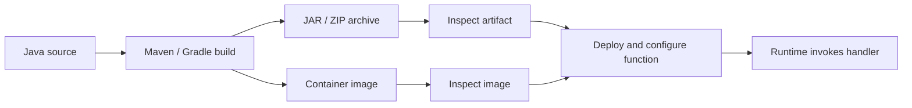

# Packaging Java Applications as Archives or Container Images

Before deploying a Java function to a serverless platform, source code must be compiled and packaged into an artifact the runtime can load. The two common options are **archives** (JAR/ZIP containing bytecode and dependent libraries) and **container images** (OCI images packaging the application together with its execution environment).

Your packaging choice affects how handlers are declared, how dependencies are managed, deployment size, runtime patching, cold starts, and security workflows. Regardless of the format, the artifact must match the Java runtime, operating system, CPU architecture, and invocation protocol required by the platform.

## 1. Where does the artifact fit in the serverless workflow?

The core workflow compiles Java source code, packages dependencies, verifies the artifact, uploads it to the platform, and configures the function so the runtime invokes the right handler.



The artifact must carry everything the application needs to run, such as compiled classes, runtime libraries, and non-sensitive configuration files. Certain components supplied by the platform, such as the Java runtime or the Lambda Runtime Interface Client, may not need to be repackaged. That depends on the deployment mode and chosen base image.

Do not treat JAR, ZIP, and container image as three mutually exclusive substitutes. JAR is Java's archive format; ZIP is typically the deployment package accepted by a platform; a container image is an OCI-compliant filesystem and metadata bundle. A JAR file can live inside a ZIP archive or inside a container image.

## 2. Packaging as a JAR or ZIP archive

### 2.1. JARs containing bytecode and dependencies

After compilation, Java code is stored as `.class` files. A JAR is a ZIP-structured archive typically holding classes, resources, and metadata under `META-INF`. A JAR may contain only application code, or bundle dependencies as a *fat JAR*/*uber JAR*.

Two common layouts exist:

- **Thin JAR:** the JAR holds only application classes and resources; dependent libraries are packaged separately inside a directory or archive following platform conventions.
- **Fat JAR / Uber JAR:** dependency classes and resources are merged into a single JAR to simplify classpath management at deployment time.

Example directory layout of a thin-JAR deployment ZIP:

```text
function.zip
└── lib/
    ├── function.jar
    ├── jackson-databind.jar
    ├── aws-lambda-java-core.jar
    └── other-runtime-dependency.jar
```

With a fat JAR, the layout may need only a single application JAR:

```text
function.zip
└── lib/
    └── function-all.jar
```

This layout is commonly used for AWS Lambda Java ZIP deployments; other platforms may expect different paths, metadata, or classpath loading conventions. Always check the deployment package rules of your target runtime.

### 2.2. Thin JARs and the classpath

Thin JARs keep dependencies separate, easy to inspect, and potentially shareable across functions. However, every required library must reside on the classpath when the runtime starts. If even one JAR is missing, the function can fail at runtime with `ClassNotFoundException` or `NoClassDefFoundError`.

If multiple dependencies supply the same class or resource, the classloader may load the wrong version. Manage versions via Maven/Gradle, avoid bundling duplicate libraries, and audit transitive dependencies. Never rely on libraries pre-installed on your development machine, because the serverless environment may lack them.

### 2.3. Fat JARs with the Maven Shade Plugin

For functions using the AWS Lambda Java runtime handler, you can use the Maven Shade Plugin to bundle application classes and dependencies into one JAR. The example below illustrates a minimal configuration; the Java version in the POM must match the selected runtime.

```xml
<properties>
    <maven.compiler.release>21</maven.compiler.release>
    <project.build.sourceEncoding>UTF-8</project.build.sourceEncoding>
</properties>

<build>
    <finalName>function</finalName>
    <plugins>
        <plugin>
            <groupId>org.apache.maven.plugins</groupId>
            <artifactId>maven-shade-plugin</artifactId>
            <version>3.6.0</version>
            <executions>
                <execution>
                    <phase>package</phase>
                    <goals>
                        <goal>shade</goal>
                    </goals>
                    <configuration>
                        <createDependencyReducedPom>false</createDependencyReducedPom>
                        <transformers>
                            <transformer implementation="org.apache.maven.plugins.shade.resource.ServicesResourceTransformer"/>
                        </transformers>
                    </configuration>
                </execution>
            </executions>
        </plugin>
    </plugins>
</build>
```

`ServicesResourceTransformer` merges service provider files under `META-INF/services`, which many libraries use with Java ServiceLoader. Applications with colliding resources, signed JARs, or specialized framework configs may require additional transformers or filters. Check dependency documentation and test booting the shaded artifact.

Build with Maven:

```bash
mvn -B clean verify
```

With the `finalName` setting above, the main artifact is expected at `target/function.jar`. Inspect its contents with:

```bash
jar tf target/function.jar
```

If you do not use a fat JAR, copy runtime dependencies into a `lib` directory using the Maven Dependency Plugin and package them alongside the application JAR. The key requirement is that directory structure and classpath match the target runtime.

### 2.4. Packaging a ZIP for the platform

Some platforms accept a ZIP deployment package. For AWS Lambda Java, for example, place the application JAR and dependencies inside `lib` and compress that directory:

```bash
mkdir -p package/lib
cp target/function.jar package/lib/
(cd package && zip -r ../function.zip lib)
```

If the JAR does not already include dependencies, copy all missing runtime JARs into `package/lib` before building the ZIP. Never include test files, build caches, unnecessary source files, or compile-only libraries in the runtime package.

The handler is usually configured separately in the platform's function settings. For AWS Lambda Java, the handler string may look like `com.example.OrderHandler::handleRequest`. The handler must exist on the classpath with a runtime-compatible method signature. Building a valid JAR does not automatically tell the runtime which class or method to invoke.

## 3. Java runtime and handler compatibility

Before building, choose a Java runtime supported by the platform and set `maven.compiler.release` or your Gradle toolchain accordingly. Compiling with a newer JDK does not guarantee bytecode runs on an older runtime. Conversely, targeting an older release may run on a newer runtime, though you must still verify libraries and APIs used by the application.

In FaaS, the handler is the entry point invoked by the platform. An application with `public static void main` does not automatically work as a FaaS function. `main` fits standalone Java processes; functions require an adapter/handler matching the platform's protocol. Some frameworks supply adapters that turn controllers or beans into handlers, but those adapters must also be packaged and configured properly.

Specifically distinguish:

- **FaaS runtime:** the platform invokes the handler via an invocation protocol. Container images, when supported, must include the matching runtime client or runtime interface.
- **Serverless container service:** the platform runs a container as a service; the application typically starts an HTTP server and listens on a platform-provided port such as `PORT`. This model does not necessarily use a Lambda-style Java handler.

Never copy a Dockerfile written for one service model and assume it works on the other. Confirm whether the platform expects a handler invocation or an HTTP server process.

## 4. Packaging as a container image

An OCI-compliant container image bundles a filesystem, system libraries, Java runtime, application code, and startup metadata. This provides tighter environment control than archives, especially when the application needs OS packages or native libraries.

Container images are generally well-suited when:

- The application requires native libraries or system utilities absent from managed runtimes.
- You need exact control over the JRE, OS libraries, and filesystem layout.
- The exact same image must be tested and promoted across compatible environments.
- The target platform supports image deployments and operations teams already manage registry, scanning, and patching workflows.

In exchange, engineering teams must maintain base images, OS security patches, image sizes, registry permissions, and build/push pipelines. Large images can increase pull or startup times on some platforms, though actual impact depends on provider image caching.

### 4.1. Multi-stage Dockerfile for AWS Lambda Java

The following example specifically targets AWS Lambda Java 21. The build stage uses Maven/JDK to produce the JAR; the runtime stage uses Lambda's base image pre-equipped with the Java runtime and Lambda Runtime Interface Client. This base image is specific to Lambda, not a universal Dockerfile for all serverless services.

```dockerfile
FROM maven:3.9-eclipse-temurin-21 AS build
WORKDIR /workspace

COPY pom.xml .
COPY src ./src
RUN mvn -B clean verify

FROM public.ecr.aws/lambda/java21
COPY --from=build /workspace/target/function.jar ${LAMBDA_TASK_ROOT}/lib/

CMD ["com.example.OrderHandler::handleRequest"]
```

In this example, the Maven Shade Plugin produces `target/function.jar`. `LAMBDA_TASK_ROOT` is the application directory expected by the Lambda base image. `CMD` declares the handler invoked by the runtime. When using a thin JAR, copy all dependencies onto the classpath per base-image conventions. When using another base image, follow that platform's runtime interface guide.

Build the image:

```bash
docker build -t order-function:dev .
```

Inspect image metadata:

```bash
docker image inspect order-function:dev
```

After testing, tag and push the image to a registry the platform can pull from, such as Amazon ECR for AWS Lambda. When deploying, reference an immutable image digest so you know precisely what code was released; mutable tags like `latest` can shift over time.

### 4.2. Dockerfile for serverless HTTP containers

For a serverless container service expecting the application to run its own HTTP server, the runtime stage can use a standard JRE with `java -jar`. General example:

```dockerfile
FROM eclipse-temurin:21-jre
WORKDIR /app
COPY target/application.jar /app/application.jar

ENV PORT=8080
EXPOSE 8080
ENTRYPOINT ["java", "-jar", "/app/application.jar"]
```

The application must read the port from the platform-specified environment variable and bind to the appropriate interface, typically `0.0.0.0`. This Dockerfile fits only applications embedding an HTTP server inside the JAR; it does not replace a Lambda handler runtime. Check your target service's health check, startup probe, concurrency, and shutdown signal requirements.

### 4.3. Choosing CPU architecture and native libraries

The image must match the CPU architecture configured for the function, typically `x86_64` or `arm64` depending on the platform. If the application uses JNI, Netty native transport, compression libraries, or OS binaries, verify CPU architecture, ABI, libc, and OS versions inside the image.

When building multi-architecture images, use Buildx or separate per-architecture builds as supported by your registry and platform. Never copy native binaries built on a Windows/macOS developer workstation into a Linux image assuming they will run. Build inside a compatible environment and test the image on the target architecture.

## 5. Comparing archives and container images

| Criterion | JAR/ZIP archive | Container image |
|---|---|---|
| Packaged contents | Application bytecode, resources, and dependencies | Application, dependencies, JRE, and required filesystem |
| Java runtime | Usually managed by platform | Usually included in the image or base image |
| OS control | Constrained to managed runtime | Higher via custom base image |
| Native libraries | Must match platform environment | Can bundle compatible system libraries |
| Release workflow | Upload archive or artifact | Build, scan, push to registry, then deploy image |
| Security patching | Update dependencies and select platform runtime | Update dependencies, JRE, and base image |
| Size and cold start | Often lean with few dependencies; still depends on classpath | Can be larger; impact depends on caching and platform |
| Best suited for | Standard Java functions with minimal OS dependencies | Custom environments or native library needs |

If a Java function needs only a standard JRE and common Java libraries, an archive is usually simpler to build and deploy. If it requires system packages, custom runtimes, or container-level environment control, an image may fit better. Factor in platform size limits, startup latency, and operational workflows.

## 6. Inspecting artifacts before deployment

Do not wait until production to discover missing dependencies or a misconfigured handler. A CI pipeline should inspect artifacts right after building.

### 6.1. Inspecting JARs and ZIPs

Baseline verification steps:

1. Confirm the artifact file exists and is non-empty.
2. Run `jar tf` to verify classes, resources, and dependencies inside the JAR.
3. Run `unzip -l function.zip` to check ZIP structure and ensure no extra top-level folder hides `lib`.
4. Verify the handler class is on the classpath, the method signature matches, and no runtime libraries are missing.
5. Run smoke tests using a runtime emulator or test environment matching the platform.

`jar tf` only proves a class exists in the archive; it does not prove the class loads cleanly or the handler succeeds. Integration tests must verify event deserialization, dependency initialization, and handler execution.

### 6.2. Inspecting container images

For images, verify:

- The image builds cleanly and uses the intended base image/runtime.
- `ENTRYPOINT` or `CMD` points to the exact handler or HTTP server launch command.
- The image targets the CPU architecture configured for the function.
- Runtime user, filesystem permissions, and writable temporary directories match platform constraints.
- The application starts, handles invocations or HTTP requests, and exits cleanly when signaled.
- No secrets appear in layers, build args, default environment variables, or image history.
- Dependencies and OS packages are scanned; deployments pin verified digests.

A successful build does not prove the image boots inside the serverless environment. Test with a runtime interface emulator or provider staging deployment using representative events and production-like permissions.

## 7. Optimizing size, cold starts, and resources

Cold starts can include execution environment provisioning, runtime startup, artifact download or mounting, class loading, and dependency initialization. Artifact size is only one factor; class counts, static initializers, framework bootstrap, network calls, and startup queries also contribute.

Optimization practices:

- Bundle only runtime-required dependencies; exclude development and test libraries.
- Avoid duplicating multiple versions of the same library or unused resources.
- Minimize work in static initializers and constructors; defer connections or data loads until genuinely needed.
- Measure initialization duration separately from handler execution duration to pinpoint cold-start bottlenecks.
- Choose archives or images based on measurements on the target platform, not file size on a developer laptop.
- Tune memory/CPU and concurrency; higher memory settings allocate more CPU on some platforms, though cost changes too.

For container images, use multi-stage builds to exclude Maven, the full JDK, and source files from the runtime image when unneeded. Pick an appropriate base image, install only required OS packages, and apply patches regularly. However, never optimize by stripping libraries required by the runtime or native dependencies at startup.

## 8. Supply chain security and configuration

Artifacts are part of your software supply chain. A tampered JAR or image could execute arbitrary code with the function's permissions. Builds and releases must therefore maintain traceability.

- Pin dependency and base-image versions; for production images, pin digests so mutable tags cannot silently change contents.
- Run dependency scans, image scans, and license checks per organizational policy.
- Generate an SBOM when required by release governance to track packaged libraries.
- Allow only authorized CI pipelines to push artifacts; grant functions minimal image-pull permissions.
- Sign artifacts or images and verify signatures where supported by your platform and toolchain.
- Never embed passwords, API keys, private keys, or `.env` files containing secrets inside JARs, ZIPs, or image layers.
- Supply environment-specific configuration through environment variables or configuration/secret managers; separate plain config from secrets.
- Use IAM roles or workload identities for service access; avoid baking long-lived credentials into artifacts.

If a secret was ever added to an image layer, deleting the file in a subsequent layer does not purge it from earlier layers. Rebuild a clean image, revoke or rotate the secret, and clean up old registry images per incident procedures.

## 9. Recommended deployment workflow

A CI/CD pipeline can follow this sequence:

1. Validate source code, dependencies, and target Java version.
2. Run unit, contract, and integration tests.
3. Build the JAR/ZIP or container image from a single pinned source revision.
4. Inspect archive or image contents, handler configuration, classpath, architecture, and startup settings.
5. Scan dependencies and images; generate an SBOM or cryptographic signature if required.
6. Push the artifact to an access-controlled repository or registry.
7. Deploy to a staging environment and run smoke tests with representative events/requests.
8. Promote the exact tested artifact by immutable version or digest.
9. Monitor startup failures, invocation errors, cold starts, latency, concurrency, and cost post-deployment.

Never rebuild a separate artifact for production when the goal is promoting the exact tested artifact. Promote the identical artifact across environments and inject environment-specific configuration externally.

## 10. Common packaging errors

| Symptom | Common cause | What to check |
|---|---|---|
| `ClassNotFoundException` | Missing dependency or misconfigured classpath | Inspect JAR/ZIP contents and dependency scopes |
| `NoClassDefFoundError` | Missing runtime dependency or prior class initialization failure | Check root exception, versions, and classloaders |
| Runtime cannot find handler | Wrong class/method name or handler missing from package | Verify handler config and `jar tf` output |
| Function works locally but fails in cloud | Differing Java runtime, architecture, env vars, or native libraries | Compare runtime, architecture, and deployment environment |
| `NoSuchMethodError` or `LinkageError` | Incompatible dependency versions | Inspect dependency tree and duplicate packaged JARs |
| Image builds but fails to start | Wrong base image, CMD/entrypoint, or runtime protocol | Use the platform's proper base image and emulator |
| Container service rejects requests | App fails to bind required port or interface | Verify `PORT` env var, bind address, and health check |
| Cold start increases after release | Larger artifact, heavier bootstrap, or slow dependency init | Compare init duration, image size, and class initialization |

When troubleshooting, retrieve startup logs and the root exception before making sweeping dependency changes. A classpath error can stem from a single transitive library; changing multiple versions at once obscures the cause.

## 11. Packaging and selection checklist

Before deploying Java serverless applications, confirm:

1. Does the platform accept JAR, ZIP, or container images, and what size limits and layout rules apply?
2. Is the target a FaaS handler runtime or a serverless container running an HTTP server?
3. Are the Java runtime and compiled bytecode versions compatible?
4. Which dependencies are needed at runtime, and do the classpath and service loaders work after packaging?
5. Are the handler class/method or container entrypoint configured accurately?
6. Are CPU architecture, native libraries, and OS libraries compatible?
7. Is the artifact free of secrets, test files, build caches, and unneeded dependencies?
8. Have package contents, smoke tests, and startup failure paths been verified?
9. Have dependencies/images been scanned, base images maintained, and immutable versions/digests recorded?
10. Have artifact size, cold start, memory, concurrency, and cost been measured in the target environment?

## Conclusion

JAR/ZIP archives fit many standard Java functions with ordinary dependencies and platform-managed runtimes. Container images fit scenarios requiring control over the JRE, operating system, or native libraries, provided the image conforms to the target service's invocation protocol. Whichever path you choose, package dependencies cleanly, configure the handler or entrypoint accurately, verify the Java runtime and CPU architecture, keep secrets out of artifacts, and test against a matching runtime before releasing.
