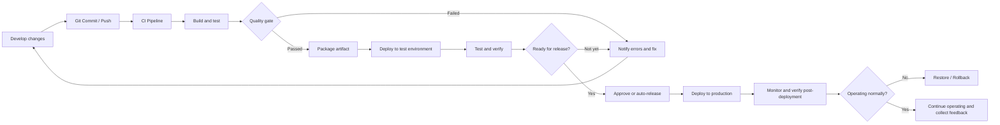

# What Is CI/CD and Its Role in the Software Development Lifecycle

## 1. Context: Why Do We Need CI/CD?

Software is built through many small changes: developers modify source code, add tests, update configurations, integrate libraries, and fix bugs. Every change can affect other parts of the system. When integration, testing, and releasing rely mainly on manual steps, development teams often encounter several problems:

- Changes are integrated late, making conflicts and compatibility bugs hard to trace to their root cause.
- Build, testing, or packaging steps are executed differently across individual machines and deployment environments.
- Releases are difficult to trace back to commits, configurations, test results, or the person who performed them.
- Bugs may only be discovered once the software reaches a user-facing or production environment.
- Releasing depends on a few individuals who know the manual process, increasing wait times and the risk of missed steps.

Continuous Integration and Continuous Delivery/Deployment (CI/CD) address these issues by placing verification and software delivery steps into an automated, repeatable, and observable process. The goal is not merely to run a build command faster. The goal is to help teams deliver small, verified changes to users frequently and under control.

## 2. What Is CI/CD?

CI/CD is a set of practices and processes that automate integrating changes, verifying quality, producing software packages, and promoting those packages across environments for release.

Three related concepts should be distinguished:

| Concept | Meaning | Expected Outcome |
|---|---|---|
| Continuous Integration (CI) | Frequently integrating source code changes into a shared branch; each change is automatically verified. | Early detection of build failures, test failures, formatting errors, or integration issues. |
| Continuous Delivery | Automatically building, testing, packaging, and preparing a version so it can be released. Pushing to production typically still requires a decision or approval. | Always having a release-eligible version ready according to a defined process. |
| Continuous Deployment | An extension of Continuous Delivery: every change that passes quality gates and release policies is automatically deployed to production. | Eligible changes can reach production without manual approval for each release. |

Continuous Delivery and Continuous Deployment share the same automation foundation. The main difference is whether the final decision to release to production is made through an intentional approval step or automatically by policy.

CI/CD does not mean every change is released immediately. Teams still need code review rules, appropriate testing, access control, approvals when necessary, and incident response plans. Automation makes the process consistent; it does not replace engineering responsibility and release decisions.

## 3. Where Does CI/CD Fit in the Software Development Lifecycle?

CI/CD connects development work with operations. It creates a continuous verification flow from a change in Git to a version running in the target environment.



A software lifecycle typically includes activities such as defining requirements, designing, coding, reviewing, integrating, testing, packaging, deploying, operating, and improving. CI/CD does not replace these activities; it provides an automated path and verification evidence for the parts that can be standardized.

| Development Stage | Role of CI/CD | Evidence or Output |
|---|---|---|
| Planning and design | Link changes to issues, requirements, or technical decisions; define testing and release criteria. | Issue references, acceptance criteria, pipeline rules. |
| Development and review | Trigger checks on push or pull request; support reviews with automated results. | Commits, pull requests, lint and static analysis results. |
| Integration | Build and run automated tests on new changes. | Pipeline status, build logs, test reports. |
| Packaging | Produce uniquely identified artifacts and store them for reuse. | Application packages, version tags or digests, build metadata. |
| Testing and acceptance | Deploy artifacts into appropriate environments and execute functional, integration, or acceptance tests. | Test results, quality reports, environment traces. |
| Release and deployment | Apply approval gates, environment configuration, secret controls, and rollout strategies. | Deployment history, released versions, approvers or approval rules. |
| Operations and improvement | Verify post-deployment health, monitor metrics, and feed incidents back into the development process. | Health checks, logs, metrics, alerts, and rollback history. |

## 4. The CI Flow: Verifying Changes as Early as Possible

A CI flow usually starts from an event in the source control system, such as pushing a commit or creating/updating a pull request. The CI system receives the event, fetches the exact source code version, and runs the declared pipeline.

Common steps include:

1. **Checkout source code:** fetch the commit to be verified. The pipeline must record the exact commit or revision that was checked out.
2. **Prepare build environment:** install dependencies and tools with controlled versions. Locking dependencies and build configurations reduces differences between runs.
3. **Fast checks:** run formatter checks, linting, type checking, or static analysis if used by the project.
4. **Build:** compile or package the source code to confirm the project can produce a deliverable.
5. **Test:** run unit tests first, followed by integration tests or other test suites appropriate for the available time and risk level.
6. **Report results:** return success/failure status to the pull request or work tracking system, along with necessary logs and reports.

For example, a pull request modifying a fee calculation function may trigger a formatter check, static analysis, build, and unit tests. If a unit test fails, the pipeline reports the error and provides logs so the pull request author can fix it before merging. As a result, the bug is caught while the change scope is still small and the responsible developer is still focused on the code they just modified.

Effective CI encourages frequent integration, reasonably sized changes, and fast feedback. If a pipeline takes too long, is frequently unstable, or generates low-value alerts, the team will tend to ignore the results. Therefore, testing should be tiered: fast checks on every pull request, deeper checks by branch or schedule, while continuously tracking and fixing flaky tests.

## 5. The CD Flow: Promoting Artifacts Across Environments

After source code passes CI steps, the system can produce an artifact—a packaged deliverable ready for deployment, such as a JAR file, npm package, container image, or installer package. Artifacts should be stored in a repository with access control and metadata management.

A typical CD flow includes:

- Building an artifact from a specific commit.
- Assigning a version or immutable identifier; storing checksums/digests where appropriate.
- Pushing the artifact to a repository.
- Deploying that same artifact sequentially through development, staging, and production environments according to policy.
- Providing environment-specific configuration at deployment time.
- Running post-deployment checks and recording the results.

An important principle is **build once, deploy to many environments**. If each environment rebuilds from source code, packages can differ due to dependencies, build timing, or configuration. By using the exact same identified artifact, teams can test the exact package intended for release and trace what version is currently running.

For example: commit `a1b2c3d` produces image `registry.example/app@sha256:...`. The pipeline deploys that image to staging, runs smoke tests, and after approval, deploys the same digest to production. A tag name like `latest` can be useful for lookup, but tags can be moved; an immutable digest or identifier determines the exact content deployed.

## 6. Pipeline as Code and Git Events

Pipeline as Code means automation steps are described in a configuration file versioned alongside the project. Depending on the platform, this file may be YAML, declarative syntax, or imperative code. This approach lets teams review pipeline changes like source code reviews, reuse rules, and revert history when needed.

Common Git events used to trigger pipelines include:

- **Push:** verify new commits pushed to a branch.
- **Pull request / merge request:** verify changes before merging.
- **Merge to main branch:** run builds, deeper tests, or produce artifacts.
- **Tag or release creation:** start versioned packaging/release workflows.
- **Scheduled or manual trigger:** execute periodic checks, maintenance, or controlled tasks.

The example below illustrates the pipeline concept without tying to a specific provider's syntax:

```yaml
name: ci
on:
  pull_request:
  push:
    branches: [main]

jobs:
  verify:
    steps:
      - checkout: source
      - run: install-dependencies
      - run: lint
      - run: build
      - run: unit-tests
```

Actual key names and trigger syntax depend on the CI/CD tool. Regardless of the platform, a pipeline must clarify the trigger event, source version, execution steps, success criteria, artifact storage method, and result reporting method.

## 7. Quality Gates and Release Controls

A quality gate is a set of conditions that must be met before a pipeline allows progression to the next step. Conditions may include:

- Build completes successfully.
- Required test suites meet defined thresholds.
- No critical issues from code analysis or vulnerability scanning per policy.
- Dependency and license checks comply with project rules.
- Artifact is created, stored, and identified successfully.
- Target environment tests and health checks pass requirements.
- Approval from an authorized person is recorded if required by the process.

Not every project needs every gate at every stage. Teams should choose conditions tied to real risks, set explainable thresholds, and assign owners when a gate fails. A quality gate is meaningless if failures are routinely bypassed or results cannot be traced.

## 8. Secrets, Access Permissions, and Environment Configuration

Pipelines often need credentials to read dependencies, push artifacts, or deploy. Tokens, passwords, private keys, and credentials are secrets; they must never be written directly into source code or committed pipeline files.

Basic practices include:

- Storing secrets in a secret manager or secret vault supported by the CI/CD platform.
- Granting least-privilege permissions per job and per environment.
- Preferring short-lived credentials or federated identity authentication when supported by the platform.
- Restricting secret access from pipelines running on untrusted source code, especially pull requests from forks.
- Masking sensitive values in logs; avoiding printing environment variables or commands containing tokens.
- Rotating and revoking credentials when personnel change or exposure is suspected.

Environment configuration also needs clear management. Non-sensitive values can be stored as versioned configuration; secrets are supplied securely at runtime. Separating configuration from the artifact enables the same application package to run across multiple environments with their own endpoints, resource limits, and policies.

## 9. Safe Deployment, Verification, and Rollback

A technically successful deployment does not necessarily mean the application is working properly. After releasing, the pipeline or operations system must verify that the application is truly ready.

Common deployment strategies:

- **Rolling update:** gradually replacing old instances with the new version.
- **Blue-green:** maintaining two environment groups and shifting traffic to the new group after verification.
- **Canary:** routing a small portion of traffic or users to the new version, observing results, and then expanding.
- **Feature flag:** releasing the code while enabling the feature via configuration or for specific user groups.

After deployment, teams can run smoke tests, health checks, critical endpoint checks, and monitor error rates, latency, logs, or business metrics. Observation windows and action thresholds should be defined in advance to avoid decisions based on gut feeling.

Rollback means returning the system to a previous working version or state when a new release causes an incident. Rollback capability depends on retaining old artifacts, configuration management, data compatibility, and deployment procedures. Database schema changes may not be simply reversible; in such cases, teams must design backward-compatible migrations, backups, or dedicated recovery procedures. Rolling back application code does not automatically restore modified data.

## 10. Tracing a Release

A reliable CI/CD process must be able to answer these questions:

- Which commit produced the production version?
- Which pipeline ran, with what configuration, and what was the result?
- Which tests, security checks, and quality gates passed?
- Which artifact was deployed to each environment?
- Who or which policy authorized the release?
- After deployment, what data verified the system, and was there a rollback?

To answer these, links must be stored between commits, pipeline runs, test reports, artifacts/digests, deployments, approvals, and verification data. Logs need timestamps, run IDs, and appropriate identifiers; read permissions and retention periods must also be defined. Good traceability aids incident investigation, satisfies audits, and pinpoints the exact version to restore.

## 11. End-to-End Example: Releasing a Web Service

Suppose a team develops a web service stored in Git and packaged as a container.

1. A developer creates a branch, modifies an endpoint, and opens a pull request.
2. The pull request event triggers the CI pipeline. The pipeline checks out the commit, installs dependencies, runs lint, builds, and executes unit tests.
3. When a test fails, the pull request receives a failed status along with logs. The developer fixes the bug and updates the pull request; the pipeline re-runs on the new commit.
4. Once reviews and all required checks pass, the change is merged into the main branch.
5. The pipeline builds an image, assigns a version identifier and digest, and pushes the image to the registry. Commit info and test results are linked to the artifact.
6. CD deploys that digest to staging using credentials retrieved from the secret manager. The pipeline runs integration tests and smoke tests.
7. After meeting quality gates and receiving policy-based approval, the same digest is deployed to production using a canary strategy.
8. The system monitors health checks, error rates, and latency. If metrics exceed thresholds, the rollout stops and the team reverts to the previous stable version via the rollback procedure.
9. Release history records the commit, artifact digest, pipeline run, approval, environment, verification results, and rollback action if any.

This example shows how CI/CD connects otherwise fragmented activities into an auditable flow. Each step has clear inputs, outputs, and transition conditions.

## 12. Benefits and Limitations of CI/CD

When well-designed and maintained, CI/CD provides several benefits:

- **Early feedback:** errors are detected close to when the change was made.
- **Repeatability:** builds, tests, and deployments follow declared steps.
- **Release velocity:** reduces manual effort and wait time between stages.
- **Quality and reliability:** mandatory checks are executed consistently.
- **Traceability:** links source code, artifacts, environments, and release history.
- **Resilience:** provides data and procedures to halt rollouts or roll back.

CI/CD also has limitations. A pipeline automating a flawed process makes mistakes faster; poor-quality tests cannot guarantee a correct product; an unstable pipeline erodes trust; and frequent deployments without observability can increase operational risk. Teams must invest in test quality, dependency management, access permissions, observability, and pipeline maintenance.

CI/CD is not synonymous with DevOps, but it is a critical technical capability supporting DevOps practices. DevOps also encompasses a culture of collaboration between development and operations, shared responsibility, feedback from production, and continuous improvement. A good pipeline helps realize these principles through concrete processes.

## 13. Foundational Principles to Remember

1. Integrate changes frequently and run automated checks on appropriate Git events.
2. Store pipelines as code for review, reuse, and traceability.
3. Produce clearly identified artifacts; prefer deploying the exact same artifact across environments.
4. Use quality gates tied to risks and agreed-upon release criteria.
5. Protect secrets, restrict permissions, and separate environment configuration from artifacts.
6. Record relationships between commits, pipelines, tests, artifacts, approvals, and deployments.
7. Verify post-deployment using technical checks and operational signals.
8. Prepare plans to halt rollouts or roll back, while considering data compatibility.

By understanding CI/CD as an end-to-end part of the software development lifecycle, DevOps practitioners can evaluate a pipeline not just by whether it runs successfully, but by its ability to produce verifiable versions, deploy safely, maintain full traceability, and recover during incidents.
