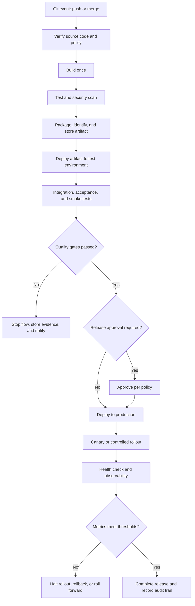

# Continuous Delivery (CD): Always Ready to Deliver Changes to Users

A development team may finish a feature, run its test suite, and produce a successful build, yet still take days to deliver that change to users. The cause usually lies in manual release steps, hard-to-reproduce environments, configuration differences across environments, lack of pre-production verification, or the absence of a reliable rollback mechanism.

**Continuous Delivery (abbreviated as CD)** closes this gap by turning the journey from a Git change to a deployable release into a repeatable, automated, and verifiable workflow. The goal is that after every qualifying change, the team always has a built, tested, packaged, and release-ready version. Choosing when to deliver that version to users may still involve a human decision.

CD is a capability of the entire team and software delivery system. The pipeline is only the visible execution layer; for the pipeline to be trustworthy, the team also needs small changes, appropriate tests, immutable artifacts, consistent environments, secure configuration and secret management, production observability, and incident response plans.

## 1. What Is Continuous Delivery?

Continuous Delivery is the practice of keeping software in a releasable state at any time. Each change passes through an automated sequence of checks and deployments to the required environments. When all quality gates pass, the team can release without having to kick off a special build and testing process on release day.

A change is considered **release-ready** when the team has enough evidence to be confident that the version:

- Was built from a specific, traceable Git revision.
- Passed the tests and quality checks specified for that type of change.
- Was packaged into an artifact with a stable identifier and stored in a controlled location.
- Was verified in an environment representative of how the software will run in practice.
- Has configuration, access permissions, and secrets supplied securely.
- Has a release, monitoring, and remediation plan in case deployment falls short of requirements.

This does not mean every commit must go straight to production. A commit may be rejected due to failed tests, security policy violations, or unmet business criteria. A commit that passes all control gates produces a releasable version; responsible stakeholders can choose to release immediately, on a schedule, or when business conditions align.

### Continuous Delivery vs. Continuous Deployment

These two terms are often used interchangeably, but they describe two different levels of automation:

| Aspect | Continuous Delivery | Continuous Deployment |
|---|---|---|
| Desired state | Every qualifying change is ready to be released | Every qualifying change is automatically deployed to production |
| Production release decision | May require approval or an intentional trigger | Executed automatically by the pipeline after quality gates |
| Human role | Can choose release timing based on product, business, or operational needs | Focuses on designing policies, control gates, and monitoring; does not approve individual routine releases |
| Prerequisites | Reliable pipeline and always-ready artifacts | All Continuous Delivery prerequisites plus high enough confidence for automated releasing |

For example, a banking service might continuously deploy to production while keeping a new feature behind a feature flag until the product team enables it for users. That can still be Continuous Delivery: the software is deployed and ready, while feature activation time is controlled separately. When every qualifying change is automatically deployed and exposed to users per defined policy, the model moves closer to Continuous Deployment.

## 2. The Continuous Delivery Flow from Git to Production

A CD pipeline typically includes the following stages. Job names and stage splits vary by CI/CD platform, but each stage must have clear inputs, outputs, and success criteria.



**Git event** is the starting point—it can be a pull request, a push to an integration branch, a merge, or a release tag creation. Pull requests typically run fast checks for early feedback; after merging, the integration pipeline creates a release candidate artifact from the accepted revision.

**Build and test** verifies source code, dependencies, and application behavior. Fast checks should run early to catch errors at low cost. Checks requiring more services or time can run in later stages.

**Packaging and artifact storage** produces a deployment unit with a clear version or digest, such as a container image, application package, or static bundle. Artifacts are stored in a registry or artifact repository with access controls and retention policies.

**Deployment and verification in intermediate environments** tests how the artifact behaves when combined with configuration, dependent services, databases, and production-like infrastructure. Test results must be bound to the exact artifact that was built.

**Production release and post-deployment verification** delivers the version to users via an appropriate rollout strategy. The pipeline checks whether the application starts up, serves requests, and maintains health metrics. A technically completed deploy is not enough to conclude a successful release.

## 3. Principles Behind a Reliable CD System

### 3.1. Use One Repeatable Release Path

The path from a Git revision to production must be described by a unified process and executed consistently. If a team has one pipeline for testing, a separate set of scripts for staging, and a different manual guide for production, steps can gradually drift apart.

The pipeline should capture all automatable steps: build commands, tests, packaging, deployment, health checks, and stage promotion conditions. Special manual actions must be documented, permission-restricted, and assigned an owner. A release should never depend on one individual's memory or a personal laptop.

### 3.2. Break Changes into Small Batches

Small changes are easier to understand, easier to test, and easier to root-cause when errors occur. When a release bundles dozens of features and multiple database changes, isolating the offending change and rolling back becomes much harder.

Teams can integrate frequently into the main branch, use feature flags to hold back unfinished user-facing features, and decouple technical deployment from feature activation timing. Feature flags need owners, review deadlines, and cleanup plans to avoid accumulating stale flags.

### 3.3. Automate Testing and Get Early Feedback

A pipeline is only useful when tests are fast and reliable enough for the team to trust the results. A common organization runs checks from fastest to slowest:

| Check Group | Objective | Examples |
|---|---|---|
| Code checks | Catch simple mistakes and convention violations | Format, lint, type check |
| Unit tests | Verify logic at a small scope | Fee calculation rules, input validation |
| Integration tests | Verify interactions between components | Repository with database, API with message broker |
| Contract tests | Verify agreements between services | Request/response schemas, event versions |
| End-to-end tests | Verify cross-system business flows | Order creation and test payment flow |
| Security tests | Detect known risks | SAST, dependency scan, secret scan, image scan |
| Performance tests | Verify load handling capability | Latency, throughput, resource utilization |
| Post-deploy smoke tests | Confirm basic functionality of the new version | Health endpoint, test login, safe read queries |

Not every change needs every type of test at every stage. Teams should select based on risk, impact, and feedback time. For example, a UI change may need browser tests; an event schema change needs contract tests; a fee calculation algorithm change needs appropriate business and regression test suites.

Flaky tests erode confidence in the pipeline. Teams should track flakiness rates and investigate root causes such as execution order dependencies, shared state, improper timeouts, or unstable environments. Never keep re-running a failed test until it passes by chance and treat the pipeline as green.

### 3.4. Build Once, Deploy to Many Environments

Once a revision passes build and test steps, the pipeline creates a single deterministic artifact. That exact artifact is promoted sequentially through test, staging, and production environments.

Suppose the pipeline builds the `orders-api` image with digest `sha256:abc...`. Both staging and production must reference that exact digest. If staging uses an image built at 10:00 AM while production rebuilds from the same branch at 3:00 PM, the two environments could receive different code, dependencies, or build tools. Rebuilding invalidates the proof that the production version is the one that was tested.

Tags like `latest` or `stable` are convenient for lookup but can be repointed to different content. For deployments, use immutable versions or digests. Pipelines must reject artifacts lacking valid provenance or not matching recorded test results.

### 3.5. Consistent Environments and Configuration Separated from Artifacts

Environments do not need identical scale, but they must be similar in factors affecting behavior: runtime versions, packaging, network topology, access permissions, dependent services, and configuration mechanisms.

Environment-specific values such as service URLs, log levels, resource limits, and feature flags should be supplied at deployment or runtime. Never embed passwords, tokens, or private keys in images, repositories, or pipeline logs. Secrets should be fetched from a secret manager with least privilege and appropriate lifetimes.

Infrastructure and environment configuration should be managed as code whenever possible. This lets teams review changes through Git, recreate environments, and trace which configuration version was used for a given deployment.

### 3.6. Define Clear Quality Gates

A quality gate is a condition determining whether an artifact may advance to the next step. A gate may require all mandatory tests to pass, no unaddressed critical vulnerabilities, a valid artifact signature, and successful deployment checks.

Each gate should specify:

- What data is evaluated and where it comes from.
- What thresholds count as pass, warning, or failure.
- Who has exception authority, and that exceptions must carry a reason, expiration, and audit trail.
- On failure, where the pipeline stops and what information it provides for remediation.

Avoid using an arbitrary number as a blanket criterion across all systems. For instance, high coverage does not prove test quality if assertions fail to check critical behavior. Quality gates should reflect real product risks and evolve as the team gathers operational data.

## 4. Designing Pipelines as Code

Pipeline as Code stores pipeline definitions in a repository or version control system. Teams can review pipeline changes just like application code, inspect history, reuse templates, and revert configurations when needed.

A pipeline should express dependencies between jobs. For example: packaging cannot proceed if the build fails; staging deployment cannot proceed if mandatory tests fail; production rollout cannot proceed without policy approval. Independent steps can run in parallel to shorten feedback time.

The example below is an **illustrative YAML model**, not syntax meant to run directly on a specific CI/CD platform:

```yaml
pipeline:
  trigger:
    - pull_request
    - merge_to_main

  jobs:
    validate:
      steps:
        - checkout_source
        - lint_and_type_check
        - unit_tests

    build_and_verify:
      needs: [validate]
      steps:
        - build_application
        - integration_tests
        - security_scans

    publish_artifact:
      needs: [build_and_verify]
      outputs:
        - immutable_artifact_digest
        - build_provenance

    deploy_staging:
      needs: [publish_artifact]
      input: immutable_artifact_digest
      steps:
        - deploy_same_artifact
        - acceptance_tests
        - smoke_tests

    deploy_production:
      needs: [deploy_staging]
      condition: quality_gates_passed
      approval: release_policy
      input: immutable_artifact_digest
      strategy: canary
      steps:
        - deploy_and_observe
        - verify_release_health
```

When translating this model to GitHub Actions, GitLab CI, Jenkins, or another platform, use that platform's exact syntax, artifact mechanism, secrets, environment protection, and permissions. Job names matter less than the contract between them: downstream jobs must know precisely which artifact they receive, which evidence they rely on, and which actions they are allowed to perform.

Key design decisions to clarify:

- **Triggers:** pull requests run fast checks; merges to main produce release candidates; tags can mark release milestones. Avoid having multiple triggers create artifacts without unified naming/identification rules.
- **Dependencies:** explicitly declare which jobs depend on which. Only run in parallel when there is no contention over data or environment state.
- **Conditions:** use conditions to restrict deployments by branch, tag, environment, and quality gate status. Do not rely on operators remembering to pick the right parameters.
- **Permissions:** build jobs do not need production write access. Deployment jobs receive only necessary permissions for the required duration.
- **Resilience:** set timeouts, bound retries, and handle pipeline cancellation. Retries are only appropriate for recoverable transient errors; retries must never hide logic bugs.
- **Concurrency:** control multiple pipelines deploying to the same environment concurrently so newer releases do not overwrite or corrupt state.
- **Readability:** name jobs and structure logs clearly so on-call engineers can identify the failing stage, associated artifact, and next action.

## 5. Artifact Management, Provenance, and Traceability

An artifact is the output of the build process, such as a container image, JAR file, package, binary, or frontend asset bundle. Artifacts need unique identifiers and must be stored in a registry or repository with access, scanning, and retention policies.

A strong traceability chain connects the following information:

| Trace Item | Question to Answer |
|---|---|
| Commit SHA and repository | Which source code produced this version? |
| Pipeline run ID | Which run built this version, when, and via what trigger? |
| Build environment and dependencies | Which tools, runtimes, and dependencies participated in the build? |
| Artifact version or digest | Exactly what content was stored and deployed? |
| Test reports and scan results | Which checks did the artifact pass? |
| Approval and deployment ID | Who or what policy authorized the release, when, and where was it deployed? |
| Configuration revision | Which configuration version was applied to the environment? |
| Release telemetry | After deployment, did the system behave as expected? |

For systems requiring software supply-chain assurance, teams can add build provenance, a Software Bill of Materials (SBOM), digital signatures, and attestations. This evidence verifies where an artifact originated, which components it includes, and which processes it went through. Signing artifacts is only meaningful when signing keys are protected and the deploying side actually verifies signatures.

Registry access control is also part of the software supply chain. Restrict who can publish, overwrite, or delete artifacts; enable audit logs; scan for vulnerabilities per policy; and retain artifacts long enough for investigation or rollback. Never bake environment secrets into artifacts since artifacts are typically shared across environments.

## 6. Promoting Versions Across Environments

A common setup includes:

| Environment | Primary Purpose | Appropriate Checks |
|---|---|---|
| Development or integration | Rapid feedback when changes integrate | Unit, integration, contract tests |
| Test or QA | Verify functionality and business flows | Acceptance tests, regression, data testing |
| Staging or pre-production | Simulate production deployment and operations | Smoke tests, targeted performance tests, migration rehearsal, config verification |
| Production | Serve real users | Health checks, canary analysis, SLOs, and business monitoring |

Not every system needs all four environments or these exact names. What matters is that test environments represent critical production risks. If staging has drastically different databases, access permissions, or configuration, staging results may fail to predict production behavior.

To prevent drift, manage configuration and infrastructure as code, periodically compare actual state against declared state, and restrict direct edits on environments. If an emergency requires direct manual intervention, record the change and sync it back to the canonical source code.

Ephemeral environments can be created per pull request or feature branch. This enables integration testing without waiting for shared environments, though it requires naming conventions, resource limits, test data management, and automatic teardown upon completion.

## 7. Controlled Production Releases

Deployment means placing a software version into a running environment. Release means making the change active for users or business operations. Both can happen together or separately. Separating them via feature flags, traffic routing, or configuration helps teams reduce risk and choose the right exposure timing.

Common deployment strategies:

| Strategy | How It Works | When Appropriate | Points of Attention |
|---|---|---|---|
| Rolling deployment | Gradually replaces groups of instances with the new version | Services with multiple instances supporting temporary multi-version coexistence | Requires compatibility between old and new versions during transition |
| Blue-green deployment | Maintains two environments; shifts traffic from old to new after verification | Need rapid cutover and a clear fallback path | Resource-intensive; shared data can still complicate rollback |
| Canary release | Routes a small percentage of traffic to the new version, observes, then ramps up | Want to test production impact within a limited blast radius | Requires accurate traffic splitting and metrics sensitive enough to detect errors |
| Feature flag | Deploys code while enabling features per user group or condition | Want to decouple deploy time from release announcement | Flags must be managed, permission-controlled, and cleaned up |

Canaries often start with a small percentage, such as 5% of traffic, then increase to 25%, 50%, and 100% if metrics meet requirements. These numbers are only illustrative; percentages, observation windows, and ramp-up criteria must fit the service's traffic volume, risk profile, and recovery capability.

When running multiple versions concurrently, APIs, message schemas, and database schemas must remain compatible during the transition window. For example, a new version should not immediately drop a field that the old version still reads. A safe rollout accounts for deployment order, coexistence duration, and the ability to revert to the previous version.

## 8. Post-Deployment Verification and Production Feedback

Pipelines should continue past the deploy command to verify the new version is actually working. Useful verification layers include:

- **Health checks:** processes start up, connect to essential dependencies, and health endpoints respond properly.
- **Smoke tests:** perform representative actions within a limited scope, avoiding unintended mutations to real data.
- **Synthetic monitoring:** run periodic user-journey checks from a user-like perspective.
- **Metrics:** monitor error rates, latency, throughput, CPU/memory usage, and business metrics.
- **Logs and traces:** correlate errors with requests, application versions, and downstream services for root-cause investigation.

Define rollout halt thresholds in advance. Examples include: 5xx error rates exceeding a threshold, p95 latency degrading noticeably against baseline, or payment success rates dropping. When adverse conditions appear, the pipeline can halt traffic increases, route traffic back to the stable version, or page on-call engineers.

Do not rely solely on a pod running or an endpoint returning HTTP 200. A service can start successfully yet miscalculate fees, emit duplicate events, or slow down business flows. Therefore, combine technical metrics with metrics reflecting outcomes users care about.

## 9. Rollback and Recovery on Failed Releases

Rollback means returning the system to a known stable state, usually by shifting traffic back to the previous version or redeploying the prior artifact. Roll forward means releasing a fixed version to advance to a healthy state. Both approaches should be prepared before an incident occurs.

A recovery plan should answer:

1. Which conditions trigger halting a rollout or initiating a rollback?
2. Who or which component is authorized to perform that action?
3. Where are the latest stable artifact and configuration identified?
4. How quickly can traffic and services be restored?
5. Is modified data compatible with the older version?
6. After recovery, what needs to be verified and communicated?

Rolling back an application does not automatically restore written data. This is especially critical for database migrations. A migration that drops a column or makes an incompatible data-type change can prevent the old version from running even if the old image is still available.

For risky schema changes, use the **expand–migrate–contract** pattern:

1. **Expand:** add new structures in a way compatible with the current version, such as adding a new column that coexists alongside the old one.
2. **Migrate:** update the application to read/write the new structure, backfill data in batches, and verify results.
3. **Contract:** remove the old structure only after all running versions no longer depend on it and the required rollback window has passed.

If data has been irreversibly transformed, teams may need to restore from backups, run compensating jobs, or roll forward with a hotfix. Rehearse recovery plans in an appropriate environment; a rollback document that has never been executed is not proof that the system can recover.

## 10. Protecting Secrets and Deployment Permissions

Pipelines typically require permissions to read repositories, write to registries, access cloud resources, and deploy to environments. If every job shares a single admin-privileged account, a compromised script can cause widespread damage.

Principles to apply:

- Grant least-privilege permissions per job and environment; test jobs do not need production deploy access.
- Prefer workload identities or OIDC for short-lived credentials over long-lived keys stored in CI variables.
- Read secrets from a secret manager; mask sensitive values in logs and never pass secrets through public artifacts.
- Protect the main branch, require reviews for pipeline changes, and control which workflow sources are allowed to run.
- Use approvals or environment protection for high-impact actions; record approver, timestamp, and reason.
- Scan source code, dependencies, container images, and infrastructure configurations according to risk policy.
- Monitor and revoke tokens, runners, or credentials when they are no longer needed.

Runners executing pipelines are also part of the trust boundary. Self-hosted runners must be kept patched, isolate jobs, restrict network access, and avoid reusing workspaces containing sensitive data across untrusted jobs.

## 11. Measuring Continuous Delivery Effectiveness

CD should be evaluated by its ability to deliver changes safely to users and how quickly feedback arrives—not just by job counts or lines of YAML.

| Metric | Meaning | Interpretation |
|---|---|---|
| Lead time for changes | Time from commit to running in production | Reduces wait times and bottlenecks in the release flow |
| Deployment frequency | Frequency of production deployments | Shows how often the team can release; must be read alongside stability |
| Change failure rate | Percentage of deployments causing service degradation or requiring remediation | Reflects the quality of changes and control gates |
| Time to restore service | Time to restore service after a change-induced incident | Reflects detection, rollback, and recovery capabilities |
| Pipeline duration | Time from trigger to completion | Helps spot slow stages and improve feedback loops |
| Flaky test rate | Percentage of tests yielding unstable results | Indicates the reliability of test signals |
| Release queue time | Time a ready artifact waits to be released | Reveals bottlenecks in approvals, release schedules, or coordination |

Never optimize a single metric in isolation. Increasing deployment frequency by skipping tests can drive up change failure rate. Cutting pipeline duration by omitting important checks can cause bugs to surface later and cost more. Read metrics together, analyze by service or team, and use them to pinpoint specific bottlenecks.

## 12. End-to-End Example: Releasing a New Version of an Order Service

Suppose the team developing the `orders-api` service needs to add an inventory validation rule before confirming orders.

**Step 1 — Create change and open pull request.** A developer branches off main, updates the logic and unit tests, and opens a pull request. The pipeline runs lint, type check, unit tests, dependency checks, and change inspection. If any mandatory check fails, the pull request is not eligible to merge.

**Step 2 — Integrate into main branch.** After code review and passing gates, the change is merged. The pipeline runs integration tests against the database and inventory service, contract tests for related APIs, and order-creation flow tests. These verify the new rule does not break existing behavior.

**Step 3 — Produce artifact.** The pipeline builds the image once, tags it with the commit SHA, generates a digest, scans the image, and publishes it to the registry. Build provenance and test results are stored for lookup. The image digest becomes the single input for subsequent deployment steps.

**Step 4 — Deploy to staging.** The pipeline deploys that exact digest to staging, loads configuration from a managed source, runs compatible migrations if needed, and executes acceptance and smoke tests. If checks fail, the pipeline halts and provides logs, reports, and the artifact identifier.

**Step 5 — Release to production.** When quality gates pass, the release owner approves per policy. The pipeline deploys a canary to a fraction of traffic. During the observation window, the system tracks error rates, p95 latency, and order confirmation success rates.

**Step 6 — Expand or recover.** If metrics remain stable, the pipeline gradually ramps traffic to 100% and records the deployment ID. If the order confirmation rate drops beyond the threshold, the rollout halts; traffic shifts back to the stable version or the team releases a fix. Afterward, the team links the incident to the commit, artifact, configuration, and telemetry to determine the root cause.

With this flow, the team can answer which commit produced the running version, what checks it passed, who authorized the release, which environments received it, and what happened after users received the change.

## 13. Common Mistakes

| Mistake | Consequence | How to Improve |
|---|---|---|
| Treating build success alone as release-ready | Integration, security, or operational issues surface only at deploy time | Clearly define mandatory checks before promoting an artifact |
| Rebuilding for each environment | Staging and production may run different contents | Build once, promote the same immutable artifact |
| Using mutable tags as deployment identifiers | Cannot be certain what content is actually running | Record immutable versions or digests |
| Manual testing at the end of the cycle | Slow feedback and pre-release bottlenecks | Automate repetitive tests, run early and based on risk |
| Ignoring flaky tests | Pipeline results lose trustworthiness | Track, fix root causes, and quarantine temporarily when needed |
| Staging diverges too far from production | Config and integration bugs surface only after release | Reduce drift; manage config and infrastructure as code |
| Storing long-lived credentials in pipeline variables | Amplifies blast radius if a runner or workflow is compromised | Use a secret manager, OIDC, and least privilege |
| Rollback exists only on paper | Unable to recover in time during real incidents | Rehearse rollbacks, retain old artifacts, and verify data compatibility |
| Checking only process status after deploy | Misses business logic bugs and degraded user experience | Combine smoke tests, technical telemetry, and business metrics |
| Ownerless feature flags | Configuration bloat and accumulation of stale code branches | Assign owners, expiration dates, and flag removal plans |

## 14. Checklist for Designing a Continuous Delivery Flow

Before considering a pipeline reliable enough for Continuous Delivery, the team can review the following questions:

- [ ] Every change is linked to a specific commit, pull request, and pipeline run.
- [ ] Pipelines can be reviewed and version-controlled like source code.
- [ ] Mandatory tests, security scans, and quality gates are clearly defined.
- [ ] Artifacts are built once, have immutable versions or digests, and are stored securely.
- [ ] Test results are bound to the exact artifact to be deployed.
- [ ] Configuration and secrets are managed separately, with least privilege, and never embedded in artifacts.
- [ ] Environments are similar enough for test results to be meaningful.
- [ ] Production deployments enforce access controls, approvals when needed, and appropriate rollout strategies.
- [ ] Post-deployment health checks, smoke tests, and observability metrics are in place.
- [ ] Rollout halt thresholds, rollback or roll-forward procedures, and owners are defined.
- [ ] Database migrations and API contract changes remain compatible while versions coexist.
- [ ] End-to-end traceability connects commits to artifacts, deployments, configurations, and production outcomes.
- [ ] The team tracks lead time, deployment frequency, change failure rate, and time to restore to improve the flow.

## 15. Conclusion

Continuous Delivery enables teams to maintain the ability to release software frequently and under control. This capability is built from a repeatable pipeline, reliable automated testing, immutable artifacts promoted across environments, securely managed configuration and secrets, and clear rollout, observability, and recovery mechanisms.

When every change passes through the same traceable flow, teams shorten pre-release wait times, detect bugs earlier, and understand the impact of each deployment. Releasing then becomes a routine operational activity—predictable and continuously improvable.
