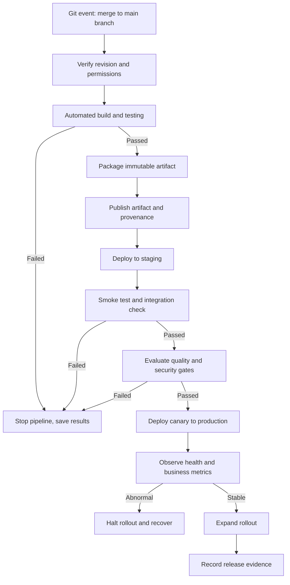

# Continuous Deployment: Automatically Deploying Qualifying Changes

*Continuous Deployment* is a release practice in which every source code change that passes all pipeline checks and policies is automatically deployed to production. Humans still design the policies, review changes, and handle exceptions; the pipeline is responsible for consistently executing build, testing, packaging, deployment, and verification steps.

The goal is not to deploy as many times as possible at all costs. The goal is to deliver small changes to users quickly, with quality evidence, knowing precisely which version is running, and with the capability to detect, limit blast radius, and recover when a release encounters an incident. To achieve this, Continuous Deployment must be built on a solid CI/CD foundation: clear Git events, pipelines managed as code, reproducible builds, immutable artifacts, controlled environment configuration, protected secrets, and post-deployment verification.

## 1. What Is Continuous Deployment?

Three concepts are often used together but describe different levels of automation:

| Concept | Focus | What Happens After a Change Passes Checks |
|---|---|---|
| Continuous Integration (CI) | Frequently integrating changes into a shared branch and running automated checks | The team gets early feedback on builds, tests, and integration conflicts |
| Continuous Delivery | Keeping software always in a releasable state | Artifacts are verified and ready to deploy; pushing to production may still require a human decision |
| Continuous Deployment | Automating production deployment as well | Changes meeting all conditions are automatically deployed to production by the pipeline |

In this guide, *deployment* means placing a software version or deployment configuration into a runtime environment. *Release* means making that functionality available to users. These two can be decoupled: a build may already be deployed while the feature remains turned off behind a feature flag. This separation lets teams deploy frequently, observe real-world behavior, and then enable features per user group or traffic percentage.

True Continuous Deployment has no routine manual approval button before each production deployment. Required conditions are defined as automatically verifiable policies. For systems with regulatory requirements, high operational risk, or particularly sensitive changes, an organization may retain a manual approval step; that model aligns more closely with Continuous Delivery. Whichever automation level is chosen, the criteria and accountable owners must be clearly published.

## 2. Why Continuous Deployment Matters

When a team bundles weeks of changes into one large release, each release carries many variables: numerous commits, configuration updates, data changes, and cross-team dependencies. If an error occurs, isolating the root cause and identifying which change to revert becomes difficult. Large releases also delay production feedback while more changes keep piling up.

Continuous Deployment shrinks the size of each change shipped to production. The pipeline runs the exact same verification process for every change, reducing manual steps and variance across releases. When a change introduces a bug, the search scope is typically smaller, and the team can halt the rollout or revert to the previous artifact faster.

These benefits only materialize when the system has trustworthy tests, compatible environments, observability, and recovery procedures. Automatically deploying an unverified change simply delivers bugs to production faster. Therefore, deployment speed must always be paired with quality evidence and impact control.

## 3. The Continuous Deployment Flow from Git to Production

A Continuous Deployment pipeline typically comprises the following stages:

1. **Receive source event:** a pull request is merged into the main branch, a new commit appears on a protected branch, or a valid release event triggers the workflow.
2. **Verify source:** identify the commit, verify branch rules, actor permissions, and input conditions. The pipeline must know precisely which revision is being processed.
3. **Build and test:** compile and run unit tests, integration tests, contract tests, and appropriate security scans. Any failed step must block downstream release stages.
4. **Package artifact:** create a deployment package with a version and content-based identifier, such as an image digest. Store the artifact in a controlled registry or repository.
5. **Deploy to verification environment:** deploy that exact artifact to staging or a production-equivalent environment, then run smoke tests, integration checks, and required policies.
6. **Evaluate quality gates:** verify test results, vulnerabilities, artifact provenance, configuration, and operational readiness. Only when all mandatory conditions pass does the pipeline proceed.
7. **Controlled production deployment:** release using rolling, blue-green, or canary strategies depending on architecture and risk level. Rollouts may start with a small fraction of traffic.
8. **Post-deployment verification:** check service health, logs, metrics, traces, synthetic transactions, and business metrics. If thresholds are breached, halt the rollout and trigger recovery procedures.
9. **Record evidence:** log the commit, pipeline run, artifact digest, environment, rollout strategy, gate outcomes, and final status.



Real-world pipelines may add infrastructure checks, data migrations, exception approvals, or notifications. Those steps need clear inputs, outputs, and error-handling behavior; the pipeline should not turn into a hard-to-trace chain of commands.

## 4. Choosing Git Events and Revisions to Deploy

Git events determine when a pipeline runs. A common pattern runs checks on every pull request, then runs the release pipeline when the pull request merges into the main branch. The main branch must be protected by code reviews, mandatory checks, and rules preventing unqualified commits from entering the release stream.

Pipelines must record the exact commit SHA. Avoid using mutable labels like `latest` as the sole identifier for production versions, as that label may point to different content on subsequent runs. When a workflow re-runs, it must distinguish between rebuilding the same revision, resuming a deployment, or creating a new release.

Two common pitfalls are duplicate runs and concurrent runs. For example, a push and a merge might trigger two nearly identical workflows. Trigger configurations should prevent redundant runs; concurrency controls must prevent two deployments from mutating the same environment in conflicting ways. If a new deployment supersedes an older one, cancellation or queuing policies must be explicitly defined.

Deployment operations should be idempotent: re-running with the same inputs must not produce corrupt state or duplicate resources. Retries should apply only to recognized transient errors. Retrying a non-idempotent operation can create duplicate records, jobs, or resources.

## 5. Managing Pipelines as Code

Pipeline as Code brings workflow definitions into the repository so they have change history, code reviews, testing, and rollback capability just like application code. A change in build or deployment logic must be reviewed carefully because it can alter access permissions, quality criteria, and release behavior.

A maintainable pipeline typically exhibits these traits:

- Steps are organized into jobs or stages by responsibility: verification, build, testing, publish, deploy, and verify.
- Shared logic is packaged into versioned actions, templates, or scripts; avoid duplicating critical command snippets across multiple places.
- Versions of actions, plugins, runner images, and build tools are explicitly pinned. Where supported, pin by digest to prevent unexpected content changes.
- Per-job permissions are scoped to exact needs. A job testing pull requests does not need production write access.
- Execution conditions, timeouts, retries, concurrency, and failure behavior are explicitly declared.
- Logs show which step ran, with which revision and artifact, without printing tokens, passwords, or sensitive data.

Avoid stuffing all release logic into one long, hard-to-read workflow. Dedicated scripts or actions can be tested independently, provided their versions and sources remain managed. Pipeline changes should undergo review and be testable in non-production environments.

## 6. Automated Builds and Testing

Builds produce deployable outputs from source code and dependencies. Reliable builds control versions of runtimes, compilers, dependencies, build tools, and configuration parameters. If the same commit produces unexplained differences across build environments, teams cannot be sure which artifact was actually verified.

Testing should form multiple layers with distinct runtimes and goals:

| Test Layer | Goal | Examples |
|---|---|---|
| Unit tests | Verify small logic units in isolation | Fee calculation rules, input validation |
| Integration tests | Verify interactions between components | Service accessing a database or message broker |
| Contract tests | Catch incompatible interface changes | API responses, event schemas |
| End-to-end tests | Verify primary user or business flows | Creating an order and receiving confirmation |
| Security tests | Detect risks in code and dependencies | SAST, dependency scan, secret scan |
| Performance tests | Detect significant performance regressions | Latency, throughput, resource usage |

Not every test has to run at every stage. Fast checks can run first for rapid feedback; slower tests can run post-build or in staging. However, all tests designated as mandatory must complete before the pipeline allows production deployment.

Flaky tests erode trust in the pipeline. Teams should maintain failure history, separate product bugs from test infrastructure errors, and fix root causes. Never repeatedly re-run until a single green run appears and treat that as passing proof. Skipped or exempted tests must have a documented reason, scope, and expiration date.

## 7. Immutable Artifacts and Traceability

An artifact is the packaged output built by a pipeline for deployment, such as a container image, package, binary, or static bundle. Once published, artifacts should be immutable: the same identifier must always resolve to the exact same content. Tags can be assigned by commit or version, while storing the digest to pinpoint the exact bytes deployed.

A key principle is **build once, promote across environments**. The pipeline builds and tests an artifact, then promotes that exact artifact through staging and production. Rebuilding separately for production risks deploying something different from what was tested. Environment-specific configuration should be injected at deploy time or runtime, per application design.

Artifact repositories need clear read/write permissions, retention policies, access to prior versions, and deletion controls. For systems requiring provenance assurance, pipelines can generate build provenance, sign artifacts, and store a Software Bill of Materials (SBOM). At deployment time, the system verifies signatures, digests, and build sources against configured policies.

For example, a release can be linked through the following chain of evidence:

```text
Commit:          8f31...c2a9
Pipeline run:    build-1842
Artifact:        registry.example/app@sha256:...
Test result:     unit PASS, integration PASS, security PASS
Environment:     production
Deployment:      canary -> 10% -> 50% -> 100%
Verification:    health PASS, error-rate PASS, latency PASS
```

The values above only illustrate the information structure. In real systems, use identifiers and paths provided by your build tools, registry, and deployment platform.

## 8. Environment Configuration and Secrets

Development, test, staging, and production environments typically differ in endpoints, scale, permissions, and data. Configuration must be managed separately from artifacts so the same artifact can be promoted across environments. Meaningful differences between staging and production must be understood and controlled; staging environments that diverge too far from production reduce the value of pre-release testing.

Configuration should have schemas, sensible defaults, and pre-deployment validation steps. Configuration changes can cause incidents just like code changes, so they require history, review, access controls, and rollback capability. For sensitive settings, never store secret values in repositories or logs.

Pipelines should retrieve secrets from a secret manager or platform identity provider. Whenever possible, use workload identities and short-lived tokens such as OIDC instead of static long-lived credentials. Each job should receive only the permissions it needs for only as long as needed. Take extra care with workflows running on untrusted pull request code: never grant those workflows access to production secrets.

If a token or secret is exposed, incident procedures must support rapid revocation and rotation. Masking strings in logs is an additional safeguard—not a substitute for restricting permissions and preventing secrets from entering output.

## 9. Quality Gates and Deployment Policies

A quality gate is a condition determining whether a pipeline may proceed to the next step. A strong gate has verifiable criteria, evidence sources, an owner, and failure behavior. Examples include:

- Mandatory tests all pass and results belong to the exact commit being released.
- No vulnerabilities exceed the organization's risk threshold; exceptions have an accountable owner and expiration date.
- Artifacts have valid digests, build provenance, and signatures per policy.
- Deployment configuration and manifests pass schema, policy, and permission checks.
- The target environment is healthy, has no conflicting active rollouts, and has sufficient capacity.
- Service-specific business or compliance conditions have been verified.

Gates should not rely solely on a metric that is easy to game, such as overall coverage percentage. Coverage helps uncover untested code paths, but it does not prove tests assert the right behavior. Combine metrics with behavioral checks, risk assessment, and concrete evidence.

In Continuous Deployment, routine gates are evaluated automatically. Policy can block high-risk changes or require a controlled exception process. If an organization requires manual approval before every production release, accurately describe that model as Continuous Delivery with a human-gated release step.

## 10. Choosing a Deployment Strategy

No single rollout strategy fits every service. The choice depends on multi-version coexistence capability, infrastructure architecture, data state, fault tolerance, and traffic routing mechanisms.

| Strategy | How It Works | Key Considerations |
|---|---|---|
| Rolling deployment | Replaces groups of instances or pods incrementally with the new version | Requires controlling unavailable instances and maintaining compatibility across coexisting versions |
| Blue-green | Maintains two environments; verifies the new one, then shifts traffic | Requires capacity for two environments and a reversible traffic-switching mechanism |
| Canary | Routes a small fraction of traffic to the new version, then ramps up | Requires sensitive metrics, representative traffic, and clear halt criteria |
| Feature flag | Deploys code while enabling features by condition or user group | Flags need owners, review dates, and cleanup plans |

Canaries can start with a small group of instances or traffic slice, then increase in steps as metrics stay stable. Percentages and observation windows must suit actual traffic; low-traffic services may need longer windows to gather enough evidence. If metrics breach thresholds, the pipeline must halt expansion and transition to recovery.

Feature flags decouple deploy time from release time. However, stale flags add complexity if left unmanaged. Every flag should have a purpose, owner, toggle condition, and removal plan once no longer needed.

## 11. Post-Deployment Verification

A deploy command returning success only indicates the platform accepted or executed the deployment operation. It does not prove the application works properly. Post-deployment validation must verify both technical health and business behavior.

Common checks include:

- **Readiness and health checks:** new instances are ready to receive traffic and essential dependencies are reachable.
- **Smoke tests:** a small suite testing critical flows right after deployment.
- **Synthetic transactions:** simulating representative user actions or end-to-end transactions.
- **Metrics:** error rates, latency, throughput, saturation, restart counts, and queue backlogs.
- **Logs and traces:** spotting new errors, exceptions, timeouts, or unusual shifts in request paths.
- **Business metrics:** payment success rates, order creation, transaction processing, or other core service KPIs.
- **Version verification:** confirming instances are serving the expected artifact digest and configuration.

Compare metrics against an appropriate baseline and observe long enough to capture real behavior. An HTTP 200 from a simple health endpoint cannot replace business-flow verification. Alert thresholds should be tuned per service rather than applying one blanket threshold to all applications.

## 12. Rollback and Recovery

Rollback returns a service to a known good state, usually by redeploying the previous artifact or shifting traffic back to the blue environment. Procedures must be prepared and tested before an incident occurs. Teams must know where the prior artifact lives, who is authorized to trigger rollback, how long it takes, and which metrics confirm service recovery.

Rollback is not always a data-reversal operation. A new version may have written data using a schema the old version cannot parse. For database changes, consider the *expand-contract* pattern:

1. Expand the schema in a backward-compatible way, such as adding a new column or table.
2. Deploy code that reads/writes compatibly during the transition period.
3. Backfill or migrate data in observable batches.
4. Switch the application to the new structure and verify results.
5. Remove the old structure only in a subsequent release, once no running version depends on it.

For changes that cannot be safely reversed, teams may need to *roll forward* with a fix instead of rolling back. Feature flags can quickly disable a faulty feature while a fix is prepared. Choosing rollback vs. roll forward must consider data impact, compatibility, and recovery time—not merely whether a deploy command can be re-run.

Pipelines must define rollout halt thresholds and subsequent actions. For instance, if error rates climb past a threshold over a sufficient observation window, the system stops canary expansion, preserves evidence, and initiates rollback or incident response. Automated rollbacks must be tested to avoid compounding errors while the system is already degraded.

## 13. Release Security and Traceability

The pipeline is part of the software supply chain and holds authority to affect production. Consequently, pipeline security must be engineered with the same rigor as application security:

- Separate permissions for reading code, publishing artifacts, and deploying to production; apply least privilege per job.
- Use workload identities and short-lived credentials wherever supported by the platform.
- Protect the main branch, workflows, and production environments with explicit review rules and administrative controls.
- Pin versions of critical actions, plugins, runner images, and dependencies; update them via reviewed changes.
- Scan secrets, dependencies, source code, container images, and infrastructure configs based on risk level.
- Keep tokens and sensitive data out of logs, debug artifacts, and caches.
- Sign and verify artifacts or provenance when supply-chain assurance is required.

A release record should answer: which commit and pull request introduced the change; who reviewed it; which pipeline built it; which tests and gates ran; which artifact digest was published; when and to which environments it was deployed; who or what policy authorized it; what post-deploy verification showed; and whether any rollbacks or exceptions occurred. This forms the foundation for incident investigations, audits, and process improvements.

## 14. Common Design Mistakes

| Issue | Consequence | Resolution |
|---|---|---|
| Rebuilding in every environment | Production artifact may differ from the tested artifact | Build once, promote the same digest |
| Using mutable tags like `latest` as sole ID | Hard to determine exact running content | Record commit SHA and immutable digest |
| Checking only deploy command success | Application may fail as soon as it takes traffic | Add health, smoke, synthetic, and business checks |
| Flaky tests repeatedly re-run | False green pipelines and loss of trust | Find root causes, track flaky tests, and manage exceptions |
| Using production credentials for all jobs | Untrusted code could hijack deployment access | Separate jobs, enforce least privilege, and use short-lived tokens |
| Retrying every error | Can repeat non-idempotent operations | Classify errors, cap retries, and design for idempotency |
| Uncontrolled data migrations | Older versions may fail to read newly written data | Use compatible migrations and expand-contract plans |
| No post-rollout metrics | Bugs are only discovered via user reports | Define SLIs, baselines, and rollout halt conditions |
| Accumulating ownerless feature flags | Branching logic grows increasingly hard to manage | Assign owners, expiration dates, and cleanup tasks |

Another mistake is optimizing pipeline duration by skipping important checks. Proper optimization starts by measuring stage durations, parallelizing independent steps, caching dependencies safely, and trimming redundant tests. Every optimization must preserve the assurance guarantees the team committed to.

## 15. Measuring Deployment Effectiveness

Five DORA metrics are commonly used to evaluate software delivery performance:

- **Deployment frequency:** how often changes are deployed to production.
- **Lead time for changes:** time from commit to running in production.
- **Change failure rate:** percentage of deployments causing service degradation or requiring remediation.
- **Failed deployment recovery time:** time required to restore service after a failed deployment.
- **Deployment rework rate:** percentage of unplanned deployments made to fix bugs or remediate production incidents.

Teams can supplement these with pipeline duration, pipeline success rate, time from detection to rollout halt, rollback rate, flaky test rate, and age of security exceptions. Metrics must be viewed together: rising deployment frequency alongside rising change failure rate and recovery time signals that quality is not keeping pace with speed.

Never use a single metric in isolation to rank individuals or pressure teams into deploying more frequently. Metrics are meaningful when they expose bottlenecks, evaluate changes over time, and guide one concrete improvement for the next iteration.

## 16. Example: Deploying a Version of an Order Service

Suppose a team develops an order service. A pull request modifying shipping fee calculation is reviewed and merged into the main branch.

1. The merge event triggers the pipeline with the change's commit SHA.
2. The pipeline builds the application, runs unit tests for fee rules, integration tests with the database, and contract tests with the payment service.
3. If all checks pass, the pipeline packages a container image, tags it by commit, and stores its digest in the registry.
4. The pipeline deploys that image to staging, runs order-creation smoke tests, and verifies fee calculation outputs.
5. Security and policy gates validate dependencies, configuration, artifact provenance, and deployment permissions.
6. The pipeline routes a small percentage of production traffic to the new version. Metrics track order creation success rate, payment errors, latency, and error logs.
7. If metrics remain steady over the defined observation window, the pipeline gradually ramps up traffic. If anomalies occur, the pipeline halts the rollout and reverts to the prior version or disables the feature flag per procedure.
8. The system records the commit, pipeline run, artifact digest, gates, deploy timestamp, rollout percentages, and verification outcomes.

In this example, traffic percentages and observation windows must be chosen based on traffic volume, risk level, and metric sensitivity. A low-volume service may need a longer window to gather sufficient data. If the change affects the order schema, the team must ensure old and new versions can coexist during the rollout window.

## 17. Continuous Deployment Design Checklist

Before enabling automated production deployment, teams should verify:

- [ ] Triggers bind to specific Git events and revisions; source branches enforce protection rules.
- [ ] Pipelines are stored as code, reviewable, and have explicit dependency versions.
- [ ] Builds are reproducible to the required degree; build and test results tie to commits.
- [ ] Critical test layers and security scans run automatically; exceptions have owners and expiration dates.
- [ ] Artifacts carry immutable identifiers, reside in a controlled registry, and promote the same digest across environments.
- [ ] Configurations are validated; secrets come from managed stores and jobs hold least privilege.
- [ ] Staging is similar enough to production to validate primary risks.
- [ ] Rollout strategy is appropriate; concurrency controls and failure behaviors are clearly defined.
- [ ] Health checks, smoke tests, metrics, logs, and traces exist for post-deployment verification.
- [ ] Rollout halt thresholds, rollback or roll-forward procedures, and data migration plans are in place.
- [ ] Release records link commits, pipeline runs, artifacts, environments, and verification results.
- [ ] The team tracks deployment frequency, lead time, change failure rate, and recovery time to drive improvements.

## 18. Conclusion

Continuous Deployment is the outcome of a trustworthy automated chain of controls. Git identifies the change; Pipeline as Code describes the process; builds and tests provide evidence; immutable artifacts ensure the exact tested content is promoted; configuration and identity protect environments; quality gates determine eligibility; rollouts and post-deployment validation limit and detect impact; rollback or roll forward enables recovery; and traceability data explains what happened.

When these pieces are designed cohesively, teams can ship small changes frequently while keeping quality and risk under control. Automation is truly valuable only when every deployment can be explained, verified, and recovered.
