# Distinguishing Build, Testing, Deployment, and Release

In CI/CD, build, testing, deployment, and release often appear back-to-back within the same pipeline. Because they happen close together, these four activities are sometimes lumped together as "pushing software to an environment." That phrasing obscures the distinct goal and output of each step, making it harder for teams to pinpoint where an error occurred, what needs approval, and how to roll back.

Distinguish them using four questions:

- **Build:** How are source code and dependencies transformed into a usable software product?
- **Testing:** What evidence shows that the product meets requirements and does not break existing behavior?
- **Deployment:** Which version is installed or updated in the target environment?
- **Release:** When and to which user audience is that feature or version made available?

A well-designed pipeline links all four activities to the same Git change, the same artifact, and the corresponding verification evidence. This enables teams to trace from commit to running version, control when users access a change, and handle incidents with solid evidence.

## 1. Build: Producing a Deployable Deliverable

A build takes source code at a specific revision along with required dependencies and tools, and produces one or more outputs usable in downstream steps. Depending on the project type, outputs may include:

- Compiled JAR files, WAR files, or library packages.
- Bundled JavaScript, CSS, and static assets for a web application.
- A container image containing the application and required runtime environment.
- An installer package, binary, or distribution package for a target platform.

Building may involve compilation, asset processing, dependency resolution, packaging, and generating version metadata. Some projects also generate checksums, signatures, or a Software Bill of Materials (SBOM) during artifact packaging and publishing.

**The critical output of a build is the artifact.** An artifact is a concrete deliverable stored for testing, deployment, or distribution. It must be tied to the source commit, version, pipeline run, and a content identifier such as a digest where supported by the format. A "build succeeded" log is helpful, but it is not enough to know precisely which binary was deployed to an environment.

For example, commit `a81c2f0` might produce the `checkout-service` image with digest `sha256:...`. When deploying, the pipeline should reference that digest rather than relying solely on an overwritable tag like `latest`.

A successful build only confirms that the artifact creation process completed under build conditions. It **does not prove** that the application works correctly, meets business requirements, or is secure. Those conclusions require evidence from testing and downstream quality gates.

## 2. Testing: Gathering Quality Evidence

Testing evaluates software behavior or attributes by comparing actual results against expected results. Depending on the test type, tests may run before, during, or after a build; for example, formatting checks and static analysis can run directly on source code, whereas integration tests require a built application and supporting services.

Common verification groups include:

| Check Type | Core Question | Examples |
|---|---|---|
| Code checks and static analysis | Does the code follow rules and show no potential defects? | Formatter, linter, static analysis |
| Unit tests | Does a small unit handle specified cases properly? | Testing order total calculation with boundary inputs |
| Integration tests | Do components collaborate correctly across real boundaries? | Service writing and reading data via a test database |
| Contract tests | Do two systems adhere to the API or message contract? | Verifying schemas and API compatibility rules |
| End-to-end tests | Do critical user journeys work from start to finish? | Creating a cart and completing an order in a test environment |
| Non-functional checks | Are operational and security limits met? | Load testing, dependency vulnerabilities, security configuration |

Not every change needs every type of test on every commit. Teams typically organize checks by speed and risk level: fast checks run early for feedback within minutes; integration, end-to-end, or load suites run at appropriate milestones. Regardless of structure, pipeline blocking conditions must be explicit: for instance, failing unit tests, security issues exceeding thresholds, or unmet coverage policies prevent the artifact from advancing.

Test results are evidence, not an absolute guarantee that software is defect-free. The value of that evidence depends on test quality, test data, environments, and scenario coverage. Therefore, pipelines should archive results, logs, and links back to the tested commit or artifact.

**Distinguishing build and testing:** build answers "was the product created?", whereas testing answers "does the product or change pass the established quality criteria?". A build can succeed while tests fail; conversely, some code checks can fail before a build even runs.

## 3. Deployment: Placing an Artifact into an Environment

Deployment is the process of installing or updating an artifact in a target environment so the software can execute there. Environments can be developer machines, integration environments, staging, production, or regional deployment clusters.

A deployment typically includes tasks such as:

- Fetching the exact stored artifact and verifying its identifier.
- Supplying environment-specific configuration, service connections, and runtime identity.
- Updating containers, servers, serverless functions, or required infrastructure resources.
- Executing data migrations when schemas change, following a designed compatibility sequence.
- Waiting for process readiness, checking health endpoints, and verifying basic functions.

Deployments can use various strategies. Rolling deployment replaces instance groups incrementally; blue-green prepares a new environment and shifts traffic; canary routes a portion of traffic to the new version before expanding. The right strategy depends on architecture, data compatibility, acceptable downtime, and system observability.

An important principle is **build once, deploy the same artifact across environments**. For example, an image that passed tests in staging should be promoted to production using that exact digest. If the pipeline rebuilds from source when promoting to production, the output may differ because dependencies, package fetch timing, build environment variables, or tools changed. Teams can then no longer be certain that production runs the exact product that was tested.

Environment-specific configuration such as service URLs, resource limits, and connection settings should be injected at deployment or startup time. Secrets must be retrieved from a secret manager or appropriate identity mechanism; never bake secrets into artifacts or print them in logs.

A successful deployment indicates the environment update completed per technical conditions. It does not prove users can access the new feature or that business flows are healthy. Therefore, post-deployment verification such as smoke tests, health checks, logs, metrics, and alerts is required.

## 4. Release: Making Changes Available to Users

Release is the decision to deliver a software version or capability to its intended audience. In a model that decouples deployment and release, software may already be deployed to production while the new functionality remains disabled for users.

Teams can control releases using:

- **Feature flags:** deploy new code while keeping the capability off; then enable it for internal staff, a customer segment, or all users.
- **Traffic shifting:** gradually route traffic to the new version while watching errors, latency, or business metrics.
- **Release schedules and approvals:** enable features only after completing reviews, support coordination, documentation, or business conditions.
- **Version distribution:** publish packages, images, or installers to a registry or distribution channel following product versioning rules.

For example, a team develops a new promo code feature. The pipeline builds and tests the new version, then deploys it to production with the feature flag off. Internal staff test it first; if metrics look steady, the team enables it for 5% of users, monitors promo application success rates and checkout errors, and only then expands. Deployment finished well before the feature was broadly released.

In some organizations, deploying to production simultaneously makes functionality visible to all users. In that case, deployment and release happen virtually together. For libraries or products distributed via package registries, "releasing" may also include publishing the artifact, tagging a version, and publishing release notes. Terminology can differ across teams; what must be agreed upon is which event marks the artifact as installed and which event marks it as usable by users.

Separating release from deployment reduces risk when feature availability timing needs control. If a business logic bug occurs after flipping a flag, the team can disable the flag to withdraw the feature while keeping the deployed version in place for investigation. This works only when the application is designed for safe toggling and data changes remain compatible.

## 5. Viewing the Entire Flow in One Pipeline

A reference flow for an application change can be represented as follows:

```mermaid
flowchart LR
    G[Git event: push or pull request] --> B[Build]
    B --> T[Testing and quality gates]
    T --> A[Store immutable artifact]
    A --> S[Deploy to staging]
    S --> V[Smoke test and verification]
    V --> P[Deploy to production]
    P --> H[Health check and observability]
    H --> R[Release: enable feature or ramp traffic]
    R --> M[Monitor users and system]
    M -->|Incident detected| X[Disable feature or rollback]
```



The diagram illustrates a conceptual order, not a mandatory sequence for every technology stack. Some checks run before build; others run against the artifact or after deployment. Real pipelines should place each check where it has all required inputs and can make an accurate decision.

Git events are **pipeline triggers**, not one of the four activities above. For example:

- When a pull request is opened or updated, the pipeline runs code checks, builds, and tests to provide feedback before merging.
- When merged into the main branch, the pipeline verifies the integrated commit, produces an identified artifact, and can deploy to staging.
- When a version tag is created or release approval is granted, the pipeline can promote the already-verified artifact, deploy to production, and execute release steps per policy.

Never assume a tag always requires rebuilding. If the artifact for that commit was already built and tested, the pipeline can reuse that exact stored artifact, provided traceability and provenance rules are satisfied.

The example below is **pseudocode**, illustrating only step dependencies; exact syntax and conditions depend on the CI/CD platform:

```yaml
triggers:
  - pull_request
  - push_to_main

pipeline:
  verify:
    steps:
      - checkout_commit
      - run_static_checks
      - build
      - run_automated_tests

  package:
    needs:
      - verify
    steps:
      - create_immutable_artifact
      - store_artifact_with_commit_and_digest

  deploy_staging:
    needs:
      - package
    steps:
      - deploy_stored_artifact_to_staging
      - run_smoke_tests

  deploy_production:
    needs:
      - deploy_staging
    steps:
      - require_production_approval_when_policy_demands
      - deploy_the_same_artifact
      - verify_health

  release:
    needs:
      - deploy_production
    steps:
      - enable_feature_or_increase_traffic_gradually
      - observe_errors_latency_and_business_metrics
```

Pipeline as Code keeps these conditions stored in the repository, reviewable via pull requests, and backed by change history. Permissions for production deployment, secret access, and release approval should be scoped by role; pipeline logs must retain enough detail to identify who or which process executed each action.

## 6. Pinpointing Failure Points and Recovery Paths

When a pipeline stops, identify the last completed activity and its evidence. Avoid labeling every post-merge failure a "deploy error," as remediation depends on the stage:

| Situation | What Is Known | Appropriate Action |
|---|---|---|
| Build fails | No valid artifact was produced | Check compiler errors, dependencies, build configuration, or tooling |
| Build succeeds, tests fail | An artifact exists but failed quality criteria | Inspect test reports, reproduce the failure, and fix the change before promoting |
| Tests pass, staging deploy fails | The artifact is tested, but environment update failed | Check permissions, configuration, connectivity, resources, and deploy logs |
| Deploy succeeds, post-deploy verification fails | The environment received the version, but system health is unverified | Halt release, investigate health checks, and consider reverting to a stable version |
| Released and users hit errors | The feature or version is already exposed | Scale back/halt rollout, disable feature flag, or roll back per tested plan |

Rollback must be designed alongside deployment. For stateless applications, redeploying the previous artifact may suffice. For databases, migrations may not be safely reversible; the expand-and-contract pattern often enables old and new versions to coexist during the transition. If the bug sits strictly behind a newly enabled feature, turning off the feature flag can mitigate impact faster than rolling back the entire application.

After recovery, the team still needs to identify root causes and preserve the associated commit, artifact, deployment, config change, and observability signals. That turns an incident into data for improving tests, quality gates, approval workflows, or rollout strategies.

## 7. Design Principles for Aligning All Four Activities

1. **End-to-end traceability:** link Git commits, pipeline runs, test results, artifacts, and deployments. During an incident, you should quickly answer which artifact production is running and which commit produced it.
2. **Build once, promote across environments:** keep artifacts immutable and use the same identifier from staging to production. Never alter artifact contents manually after testing.
3. **Set risk-based quality gates:** choose checks capable of catching critical issues, set clear thresholds, and retain evidence. Never let a single metric represent overall quality.
4. **Separate configuration and secrets from artifacts:** inject configuration per environment using secret management and least-privilege identities.
5. **Prepare verification and recovery:** define health checks, metrics, rollout halt thresholds, accountable owners, and paths back to a stable state in advance.
6. **Scope permissions per action:** permissions to run tests, publish artifacts, deploy to production, and release to users can differ. Approvals should tie to specific environments and changes.

When designing a pipeline, verify that every step has clear inputs, outputs, and success criteria. Build produces artifacts; testing provides evidence; deployment updates environments; release controls user availability. Clear boundaries make CI/CD easier to automate, trace, and recover when a change falls short of expectations.
