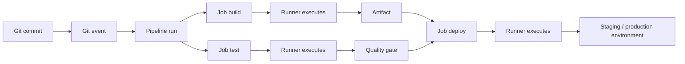

# Understanding Commit, Pipeline, Job, Runner, Artifact, and Environment

In CI/CD, a source code change passes through multiple components before becoming a running version in the target environment. To read, design, or troubleshoot a CI/CD workflow, you must first distinguish six concepts that frequently appear together: **commit**, **pipeline**, **job**, **runner**, **artifact**, and **environment**.

These concepts form a traceable chain: a commit records a change; a Git event triggers a pipeline; the pipeline orchestrates jobs; a runner executes each job; jobs produce artifacts; and finally a deploy job delivers the artifact to the appropriate environment. This is the foundation for building a CI/CD flow with testing, quality controls, release management, and operational feedback.

## 1. The Big Picture

Imagine a development team has just pushed a change to the main branch. The CI/CD system receives that event, checks the source code, compiles the application, runs tests, and produces a deployment package. If quality conditions are met, the workflow can push that package to staging for verification, and then release it to production according to organizational policy.



The diagram shows the responsibility of each component; it does not imply every platform must use the exact number of jobs or runners shown. One runner may execute multiple jobs sequentially; independent jobs can also run in parallel across multiple runners. The pipeline governs their ordering and dependency conditions.

## 2. Commit: An Immutable Milestone of Source Code

A **commit** is a record capturing the state of repository changes at a point in time. Each commit has an identifier (commit hash), descriptive message, author information, timestamp, and parent commit relationships. In Git, the hash pinpoints the exact version of source code verified or released.

For example, a commit might add input validation to an API. Looking at history, the development team can follow the hash to see which change was introduced, which base commit it built upon, and who made it.

Commits are often mentioned alongside branches and tags, yet the three serve different roles:

- **Commit:** a concrete record in source code history.
- **Branch:** a movable reference pointing to a commit, typically representing a line of development.
- **Tag:** a reference commonly used to mark a milestone, such as `v2.4.0`, helping identify a release version.

CI/CD typically reacts to a **Git event** rather than running simply because a commit exists. Events can be a `push` to a branch, opening or updating a pull request/merge request, creating a tag, a scheduled run, or a manual trigger. The same commit can generate multiple pipeline runs—for instance, once when opening a merge request and again after merging into the main branch.

Therefore, when investigating a build or deployment, record the exact commit hash. A branch name like `main` can point to a different commit later; the hash is the stable anchor identifying which source code was processed.

## 3. Pipeline: An Orchestration Workflow Described as Code

A **pipeline** is a single execution of a CI/CD workflow defined in configuration. Configuration typically lives in the repository as code, such as `.gitlab-ci.yml` or workflows under `.github/workflows/`. A pipeline can be triggered by a Git event, schedule, or manual action.

A pipeline describes what work to perform and the relationships between tasks: which job runs first, which jobs may run in parallel, which conditions skip a job, and which conditions allow the workflow to advance to release steps. A pipeline run is typically tied to the commit, branch, or tag that triggered it, and carries its own run ID, status, and execution logs.

A pipeline is not synonymous with a single build command. A complete pipeline may include:

1. Checking formatting, coding conventions, and code quality.
2. Compiling or packaging the application.
3. Running unit tests, integration tests, and required test suites.
4. Scanning vulnerabilities, checking licenses, or running quality analysis.
5. Storing artifacts and traceability metadata.
6. Deploying, running post-deployment verification, and awaiting approval if required by policy.

Many platforms organize pipelines into **stages** and **jobs**. Stages group high-level phases; jobs are concrete units of execution. Within a stage, independent jobs can run in parallel. Jobs in a later stage typically start only once upstream dependencies are satisfied. Some platforms allow declaring direct dependency graphs instead of relying solely on stage ordering.

Pipeline status is usually aggregated from job statuses and platform rules. A pipeline can succeed, fail, be running, be canceled, or wait for manual intervention. A successful pipeline only means configured steps met required conditions; it does not by itself prove the application works flawlessly in every real-world scenario.

## 4. Job: A Unit of Work with Inputs and Outputs

A **job** is a unit of work assigned by the CI/CD system to a runner for execution. A job typically declares scripts or commands, execution environment, run conditions, maximum timeout, configuration variables, and how outputs are archived.

For example, a pipeline might contain jobs `compile`, `unit_test`, `security_scan`, and `deploy_staging`. Each job serves a clear objective. If `unit_test` fails, pipeline rules can block downstream deployment jobs that depend on test results.

A job typically has the following characteristics:

- **Inputs:** source code at the selected commit, artifacts from prior jobs, configuration variables, or test data.
- **Execution commands:** commands declared in pipeline configuration or scripts inside the repository.
- **Conditions:** branch, tag, event type, changed files, prior job outcomes, or approval actions.
- **Outputs:** status, logs, test reports, artifacts, or information consumed by downstream jobs.

Jobs are usually designed small enough to be easy to understand and diagnose. When a job fails, that job's own logs show which command errored, its exit code, and which step failed. Packing build, test, and deploy into one oversized job makes root-cause analysis and selective re-runs much harder.

A job also does not necessarily map to a fixed server. The orchestrator selects a matching runner to execute the job at runtime. A job may be retried per policy; retries still belong to that pipeline run while having separate execution attempts and logs depending on the platform.

## 5. Runner: Where Jobs Execute

A **runner** is an agent or worker that picks up jobs from the CI/CD system and executes assigned commands. If the pipeline is the workflow blueprint and a job is a task, the runner is the execution capacity performing that task.

Runners can execute on virtual machines, dedicated servers, containers, or container orchestration clusters. Depending on the platform and configuration, a runner may use a shell, Docker, or Kubernetes executor. Runners typically prepare the workspace, fetch source code, initialize the environment, run scripts, stream logs, and upload artifacts to storage.

The system can select runners based on criteria such as:

- Labels or tags requested by the job, e.g., `linux`, `windows`, `docker`.
- Operating system, CPU architecture, available tools, and runtime versions.
- Network access or resources required for the task.
- Concurrency limits, current load, and security policies.

Platform-managed runners (hosted/shared runners) give teams ready-to-use execution capacity. Self-hosted runners allow deeper control over configuration, networking, and resources, though the organization assumes responsibility for patching, access control, monitoring, and securing the machines.

Key points to remember when operating runners:

- Jobs require compatible runners. If no runner matches requested tags or requirements, a job can remain pending or stuck.
- Workspaces and credentials must be properly isolated between jobs, especially when runners are shared across repositories or teams.
- Runners with access to secrets or internal networks must be tightly managed. Never grant permissions broader than a job needs.
- Never place tokens, passwords, or private keys into scripts or logs. Use the platform's secret store/CI variables and restrict access scopes.

Runners execute assigned commands; they do not decide overall release strategy. Conditions, ordering, and quality gates are declared in the pipeline and system policies.

## 6. Artifact: Outputs Produced by the Pipeline

An **artifact** is an output generated and stored by a job for use by humans or other jobs. Artifacts can be JAR/WAR files, ZIP archives, test reports, source maps, Helm charts, or container images. For containerized apps, images are usually pushed to a container registry and identified by tag or digest.

Artifacts serve two critical roles:

1. **Handoff between jobs:** the deploy job consumes the package built by the build job rather than recompiling source code.
2. **Release traceability and reproducibility:** teams can determine which commit, pipeline run, tools, and dependency versions produced a package.

Artifacts must be managed as versioned deliverables. Helpful metadata includes commit hash, pipeline ID, application name and version, toolchain version, creation timestamp, checksum or digest, and associated test and security scan results. For critical deployable artifacts, use a repository or registry with access controls, retention policies, and provenance verification.

### Distinguishing Artifacts and Caches

Both artifacts and caches store data across runs, yet their purposes differ:

| Criterion | Artifact | Cache |
|---|---|---|
| Purpose | Store outputs meant for handoff, verification, or release | Speed up execution by reusing regenerable data |
| Examples | JAR files, container images, test reports | Downloaded dependency directories, intermediate build data |
| Impact if missing | Downstream jobs may lack proper inputs to run or deploy | The workflow can usually still run, only slower |
| Management | Requires versioning, provenance, and appropriate retention | May expire or be refreshed by cache key |

Never treat a cache as proof of a released version. When deploying or rolling back, you must identify the exact artifact that was verified and approved.

## 7. Environment: Where the Application Is Deployed

An **environment** is a deployment target recognized and managed by CI/CD. Common names are `development`, `test`, `staging`, and `production`. An environment may map to a Kubernetes namespace, server cluster, cloud account, VM group, or dedicated test system.

An environment is more than a name string. It is typically bound to configuration, endpoints, access permissions, secrets, approval policies, and deployment history. For example, staging may use a separate database and test data; production uses live resources, enforces restricted deployment permissions, and has approval gates.

Environments typically serve distinct objectives:

- **Development:** supports active development and frequent integration of changes.
- **Test/QA:** verifies functionality, integration, and testing criteria.
- **Staging:** closely simulates production for pre-release verification.
- **Production:** serves real users, requiring change controls, monitoring, and recovery procedures.

Not every organization has all of these environments or names them identically. What matters is clearly defining the deployment target, data, configuration, permissions, and acceptance criteria for each environment.

A useful release principle is **build once, deploy to many environments**: build one artifact from a specific commit, test that artifact, and promote that exact artifact through staging and production. Environment-specific configuration values are supplied at deploy time. This reduces the risk of staging and production running two different packages despite sharing the same version label.

During deployment, the pipeline should record which artifact entered which environment and when. Post-deployment, include appropriate verification such as health checks, smoke tests, or operational metric checks. If verification fails, the workflow needs a way to halt the release, shift traffic back to a stable version, or roll back per designed strategy.

## 8. Example: Connecting All Concepts in a Pipeline

The following example uses GitLab CI syntax to illustrate how these concepts link together. The configuration assumes a Gradle project producing `build/libs/app.jar`; adjust this path to match your project's actual artifact name.

```yaml
stages:
  - build
  - test
  - package
  - deploy

default:
  image: eclipse-temurin:21-jdk
  tags:
    - linux
    - docker

build_app:
  stage: build
  script:
    - ./gradlew clean build -x test
  artifacts:
    paths:
      - build/libs/app.jar
    expire_in: 7 days

unit_tests:
  stage: test
  script:
    - ./gradlew test
  artifacts:
    when: always
    reports:
      junit: build/test-results/test/*.xml

package_release:
  stage: package
  needs:
    - job: build_app
      artifacts: true
    - job: unit_tests
  script:
    - mkdir -p dist
    - cp build/libs/app.jar dist/app.jar
    - sha256sum dist/app.jar > dist/app.jar.sha256
  artifacts:
    paths:
      - dist/
    expire_in: 30 days

deploy_staging:
  stage: deploy
  needs:
    - job: package_release
      artifacts: true
  script:
    - ./scripts/deploy.sh dist/app.jar
  environment:
    name: staging
    url: https://staging.example.com
  rules:
    - if: '$CI_COMMIT_BRANCH == $CI_DEFAULT_BRANCH'
```

Reading the example concept by concept:

1. A Git event creates a pipeline run for the commit being processed. Pipeline metadata identifies the commit and run.
2. The pipeline has four stages. Jobs `build_app`, `unit_tests`, `package_release`, and `deploy_staging` are concrete tasks.
3. Jobs use runners tagged `linux` and `docker`. Runners must be registered and configured to satisfy the requested tags and executor.
4. `build_app` produces the JAR file and stores it as an artifact. `unit_tests` generates JUnit reports so the system displays test results.
5. `package_release` receives the artifact from `build_app`, packages the output into `dist/`, and generates a checksum. `needs` expresses dependencies between jobs.
6. `deploy_staging` receives the packaged artifact and deploys to the environment named `staging`. The rule in this example restricts the job to running only on the default branch.

In real configurations, deployment credentials must be supplied via secrets or scoped CI/CD variables with appropriate permissions. Never write secret values directly into YAML. Add quality checks, branch protection policies, production approvals, health checks, and rollback procedures according to system requirements.

## 9. Tracing from Commit to Environment

A trustworthy CI/CD workflow must answer: **which change produced the version running in this environment, what checks did it pass, and which run deployed it?** Answering this requires linking identifiers throughout the workflow:

| Milestone | Information to Record | Question Answered |
|---|---|---|
| Commit | Commit hash, branch/tag, message | Which source code changed? |
| Pipeline run | Pipeline ID, trigger event, timestamp, status | Which execution checked that commit? |
| Job | Job ID, runner, logs, status, and reports | Which steps ran, and what were the results? |
| Artifact | Name, version, checksum/digest, provenance | Exactly which package was tested and released? |
| Environment | Target name, deployment ID, timestamp, approver or approval process | Which package is running—or ran—where? |

For example, when a bug is detected in production, the team can look up deployment history to grab the artifact digest, locate the pipeline that built the artifact, inspect job logs and reports, and pinpoint the corresponding commit. This traceability chain accelerates fault isolation, impact assessment, and selecting the right version for recovery.

## 10. Common Misconceptions

- **Treating a commit as a pipeline:** a commit only records source code state; a pipeline is a workflow execution triggered by a commit or another event.
- **Conflating pipeline and job:** a pipeline orchestrates the entire flow; a job is a single task inside that flow.
- **Treating the runner as the workflow definition:** a runner executes assigned jobs; pipeline configuration is what defines jobs, conditions, and dependencies.
- **Treating an artifact as a cache:** an artifact is an output requiring identification and handoff; a cache mainly speeds up runs and can be regenerated.
- **Rebuilding in every environment:** producing separate packages for staging and production undermines proof that both environments run the exact same tested version.
- **Treating an environment as just a name:** each environment also carries its own configuration, secrets, permissions, data, deployment history, and verification requirements.
- **Failing to link artifacts to commits:** without a hash or digest, teams struggle to prove which source code produced a running package.

## 11. Checklist When Reading a Pipeline

When onboarding onto a repository or investigating a CI/CD run, check sequentially:

1. Which event triggered the pipeline, and which commit hash is being processed?
2. Which jobs make up the pipeline, and how are they grouped into stages or a dependency graph?
3. Which jobs run in parallel, and which jobs act as blocking gates before release?
4. Which runners can pick up the jobs, and what executor and access permissions do they use?
5. Which artifacts do jobs produce, where are they stored, and do they carry checksums/digests and provenance?
6. Which environments receive the artifacts, and how are configuration and secrets supplied?
7. After deployment, are health checks, deployment records, and rollback mechanisms in place?

Once you can answer these questions, you can read any pipeline as a structured workflow with clear inputs, processing steps, outputs, and deployment targets. This forms the basis for designing pipelines as code, automating builds and tests, managing artifacts, protecting secrets, and building quality gates in CI/CD.
