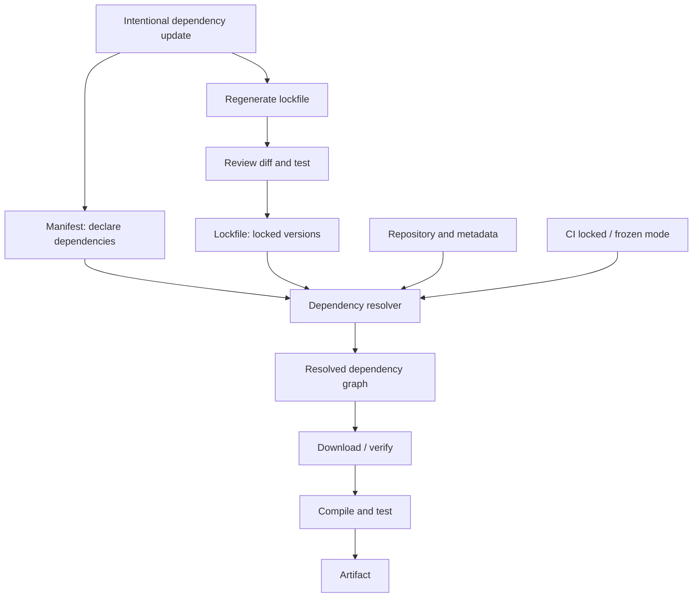
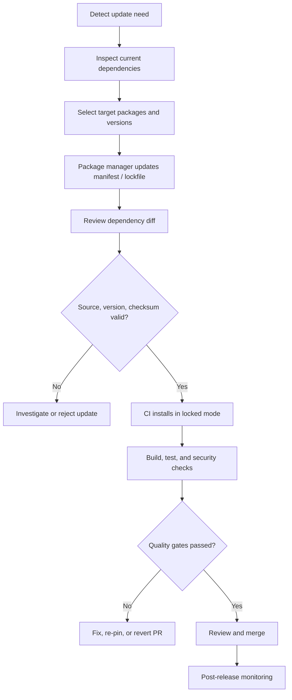

# Version Pinning and Lockfile Management When Supported by the Ecosystem

A commit may stay unchanged, yet build results can still vary if dependencies are downloaded with floating versions, a repository returns a new release, or build tools are updated unexpectedly. CI/CD must reproduce the exact set of dependencies used to compile, test, and package. Therefore, teams must manage both direct and transitive versions, record the resolved dependency state, and require pipelines to install that exact state.

Version pinning restricts the dependency versions a project accepts. A lockfile records the specific resolution outcome of a dependency set, typically including exact versions and metadata required for reproduction. The two mechanisms complement each other: the manifest describes the dependencies the project intends to use; the lockfile records the resolved dependency set. When the ecosystem supports lockfiles, commit the lockfile alongside the source code and run CI in a mode that does not silently update it.

## 1. Why Pin Versions and Use Lockfiles?

Suppose a project declares the `http-client` library with a compatible version range. Today CI resolves `4.2.1`; next week the maintainer releases `4.3.0`, introducing a behavioral change or compatibility issue. The same commit could receive different dependencies if the pipeline re-resolves from the repository.

This risk does not come only from direct dependencies. Library A may depend on B, and B on C. The project only declares A, yet the build result is affected by the entire chain of transitive dependencies. Versions of build plugins, compilers, CI actions, base images, and infrastructure providers can also alter the outcome.

Managing versions and lockfiles helps:

- Reproduce the same dependency set on developer machines, CI runners, and other build environments.
- Detect dependency changes via pull requests instead of silently picking up new versions during builds.
- Investigate failures by identifying the exact libraries and versions used.
- Review the impact of security updates, bug fixes, and compatibility changes.
- Establish a foundation for reproducible builds and software supply chain traceability.



A lockfile does not replace the manifest. The manifest explains which libraries the project depends on and usually expresses version ranges or compatibility policies. The lockfile records a concrete resolution result so subsequent installs use the same dependency set. Do not edit lockfiles by hand to force a version; use the package manager to update and verify consistency.

A lockfile is one part of the build inputs, not a guarantee that two builds will produce byte-for-byte identical outputs. Results can still differ due to OS, CPU architecture, runtime, compiler, build plugins, install scripts, environment variables, input data, or external download sources. To increase reproducibility, control both the toolchain and build environment, and record artifact provenance.

## 2. Distinguishing Manifest, Lockfile, Catalog, BOM, and Checksum

Dependency files can look similar but serve different roles.

| Type | Purpose | Examples |
|---|---|---|
| Manifest | Declares direct dependencies, constraints, and project metadata | `package.json`, `pyproject.toml`, `Cargo.toml`, `go.mod`, `build.gradle` |
| Lockfile | Records resolved dependency set with exact versions | `package-lock.json`, `pnpm-lock.yaml`, `uv.lock`, `Cargo.lock`, Gradle lockfiles |
| Version catalog | Centralizes aliases and versions for reuse across multiple modules | Gradle `libs.versions.toml` |
| BOM (Bill of Materials) | Manages a set of compatible versions, typically via dependency management | Maven BOM, Spring Boot dependency BOM |
| Checksum/integrity metadata | Verifies downloaded content matches expected values | npm integrity, Go `go.sum`, Gradle verification metadata |
| Toolchain declaration | Declares the tool/runtime versions used to build | Gradle Wrapper, `.java-version`, `.nvmrc`, `rust-toolchain.toml` |

Some ecosystems combine several roles into a lockfile; others separate them. For example, `go.mod` declares the module and minimum version requirements, while `go.sum` records checksums for module contents. Gradle dependency locking records locked versions; `gradle/verification-metadata.xml` can add checksums or signatures to verify downloaded contents. These two control layers answer two different questions: "which version is being used?" and "does the received content match the expected artifact?".

## 3. Choosing a Version Pinning Strategy

### 3.1. Exact Version

Pinning an exact version removes ambiguity during resolution. For example:

```text
http-client = 4.2.1
```

The advantage is deterministic build inputs and reduced risk of unexpectedly picking up new changes. The drawback is that the dependency does not automatically receive bug fixes or security patches; the team must maintain an active update process.

### 3.2. Version Range

Some package managers allow declaring compatible ranges, such as `^4.2.0`, `~4.2.0`, `>=4.2 <5`, or range syntax specific to the tool. Version ranges allow the project to accept certain updates without editing the manifest every time.

Do not assume every ecosystem interprets symbols identically. The semantics of caret, tilde, inclusive/exclusive bounds, and prereleases differ across package managers. Semantic Versioning is also only a publisher's commitment; a package might not strictly adhere to it. Read the rules of the tool in use.

When a lockfile is present, the manifest can keep a compatible range while the lockfile pins the exact version installed at update time. This approach lets the team decide when to upgrade while still expressing dependency compatibility bounds.

### 3.3. Dynamic and Floating Versions

Forms such as `latest`, `1.+`, `SNAPSHOT`, `*`, `main`, `stable`, or mutable container tags can point to new content over time. They are convenient for experimentation, but reduce build reproducibility.

In release pipelines, avoid relying on dynamic versions without a locking and recording step. If a system must use dynamic versions, resolve once, record the actual version/digest, verify it, and promote the exact resolved artifact across environments.

### 3.4. Rules for Choosing Pinning Levels

| Component | Typically Suitable Strategy |
|---|---|
| Direct application dependencies | Declare compatible constraints and commit lockfile |
| Transitive dependencies | Let the resolver lock via lockfile; inspect conflicts and patches |
| Build plugins and compilers | Pin exact versions or manage via catalog/toolchain |
| CI actions, orbs, reusable workflows | Pin version/revision; for sensitive components, pin immutable commit SHA |
| Container base images | Use explicit tags and digests for builds/releases requiring reproducibility |
| Terraform providers | Pin appropriate constraints and commit `.terraform.lock.hcl` |
| Runner runtimes | Choose explicit versions; avoid defaulting to `latest` |

Not everything needs to be pinned at the same level. Prioritize inputs that can alter build outputs or execution privileges, then define update policies and verification methods for each group.

## 4. Managing Direct and Transitive Dependencies

Direct dependencies are libraries declared by the project. Transitive dependencies are libraries pulled in through other dependencies. Both can contain bugs, vulnerabilities, or incompatible licenses.

Example:

```text
application
└── web-framework 6.1.0        (direct)
    ├── http-core 5.3.2        (transitive)
    │   └── codec 2.8.1       (transitive)
    └── json-mapper 3.1.4     (transitive)
```

When `codec` has a vulnerability, inspecting only the application's manifest may miss this dependency. Use a dependency tree or SBOM report to trace the path from a direct dependency to the affected package.

Common issues:

- Two libraries require different versions of the same dependency.
- A dependency is excluded in one module, yet pulled in through another module.
- The resolver selects a newer version that introduces behavioral changes.
- A package disappears from the repository or changes metadata.
- A transitive library contains a vulnerability even though the direct dependency has no update.

When resolving conflicts, do not just force a version to make the build green. Check compatibility across all consumers, read release notes, and run relevant tests. If you must override a transitive dependency, document the reason, scope, and conditions for removing the override.

## 5. Lockfiles in the JavaScript/TypeScript Ecosystem

Node.js has multiple package managers. Standardize on one tool per repository and commit its corresponding lockfile.

| Package manager | Manifest | Lockfile | Common CI install mode |
|---|---|---|---|
| npm | `package.json` | `package-lock.json` | `npm ci` |
| Yarn Classic | `package.json` | `yarn.lock` | `yarn install --frozen-lockfile` |
| Yarn Berry (Yarn 2+) | `package.json` | `yarn.lock` | `yarn install --immutable` |
| pnpm | `package.json` | `pnpm-lock.yaml` | `pnpm install --frozen-lockfile` |

### 5.1. npm

`package.json` declares dependencies and ranges. `package-lock.json` records the resolved dependency tree along with integrity info. In CI, use `npm ci` to install from the lockfile. This command requires the lockfile to match the manifest, performs a clean install, and fails if the two files are out of sync.

```bash
# Install dependencies from lockfile in CI
npm ci

# Run tests
npm test

# Intentionally update a dependency
npm install lodash@4.17.21

# View dependency tree
npm ls --all
```

`npm install` can update the lockfile when the manifest changes; therefore, do not use it as the default CI command if the goal is to detect stale lockfiles. When adding a dependency, run the update locally, review both `package.json` and `package-lock.json`, and let CI run `npm ci`.

### 5.2. Yarn

Yarn Classic and Yarn Berry have different frozen/immutable modes. Run the command matching the Yarn version pinned by the project in `packageManager` or toolchain config. Do not change the Yarn major version just to get a pipeline passing without updating and reviewing the lockfile.

```bash
# Yarn Classic
yarn install --frozen-lockfile

# Yarn Berry
yarn install --immutable
```

Yarn Berry can use Plug'n'Play or the `node-modules` linker. Caching and install settings must match the mode chosen by the project. If the pipeline uses caching, the key should include the lockfile and Yarn/Node versions to avoid reusing incompatible caches.

### 5.3. pnpm

pnpm uses `pnpm-lock.yaml`. In CI, `pnpm install --frozen-lockfile` ensures the package manager does not automatically update the lockfile. Pin pnpm and Node.js versions, for example via the `packageManager` field, Corepack, or pipeline toolchain setup.

```bash
corepack enable
pnpm install --frozen-lockfile
pnpm test
```

Do not commit multiple lockfiles to the same repository unless the team intentionally supports multiple package managers. Having `package-lock.json`, `yarn.lock`, and `pnpm-lock.yaml` simultaneously easily leads different environments to install different dependency trees.

## 6. Lockfiles in Python

Python has multiple ways to describe dependencies. `pyproject.toml` is commonly the project manifest; the lockfile depends on the environment and dependency management tool.

| Tool | Common files | Role |
|---|---|---|
| Poetry | `pyproject.toml`, `poetry.lock` | Locks resolved dependencies and package metadata |
| uv | `pyproject.toml`, `uv.lock` | Locks the dependency graph for the project environment |
| Pipenv | `Pipfile`, `Pipfile.lock` | Declares and locks dependencies |
| pip-tools | `requirements.in`, `requirements.txt` | Compiles input constraints into a pinned list, optionally with hashes |
| Plain pip | `requirements.txt` | Can pin exact versions and hashes per project policy |

### 6.1. Pinning Versions and Hashes

A requirements file listing only `requests>=2.30` still allows the resolver to pick multiple versions. When reproducibility is the goal, the output file should specify exact versions for transitive dependencies as well. Hashes can be used to require downloaded packages to match approved contents.

```text
requests==2.32.3 \
    --hash=sha256:<hash-of-approved-wheel-or-sdist>
urllib3==2.2.3 \
    --hash=sha256:<hash-of-approved-wheel-or-sdist>
```

The hash values in the example are placeholders; generate them from real artifacts and include all valid hashes for the platforms/packages allowed for installation. When using pip with `--require-hashes`, every relevant requirement must be pinned and have matching hashes.

```bash
python -m pip install --require-hashes -r requirements.txt
```

With pip-tools, keep a concise list of constraints in `requirements.in` and compile it to a pinned file:

```bash
pip-compile --generate-hashes --output-file=requirements.txt requirements.in
pip-sync requirements.txt
```

Run `pip-compile` during an intentional dependency update step; CI should only use the generated file to install and test.

### 6.2. Poetry and uv

Poetry uses `poetry.lock`; when adding or updating dependencies, run the intentional lock/update command and review the diff. In CI, `poetry install` installs according to the existing lockfile; with a suitable Poetry version, `poetry sync` can help synchronize the environment to remove extra packages.

uv uses `uv.lock`. `uv sync --locked` requires the existing lockfile to match the manifest and fails if an update is needed; this is a useful choice for CI when detecting stale lockfiles. `uv sync --frozen` skips checking/updating the lockfile, so only use it when the pipeline has a clear reason and controls inputs elsewhere.

```bash
# CI example with uv
uv sync --locked
uv run pytest
```

Pin both the Python version and the Poetry/uv/pip-tools version. The same lockfile with a different resolver version or platform markers can behave differently; lockfiles often contain platform conditions so the resolver selects the right package.

## 7. Java and JVM: Gradle, Maven, and Dependency Management

### 7.1. Gradle Dependency Locking

Gradle supports dependency locking to record resolved versions for configurations. A project can enable locking for all configurations or select specific ones.

```kotlin
// build.gradle.kts
dependencyLocking {
    lockAllConfigurations()
}
```

After enabling locking, resolve the required configurations to generate the lock state:

```bash
./gradlew dependencies --write-locks
```

The lock state is typically saved as `gradle.lockfile` per project. Commit the lockfile alongside dependency changes. When CI runs, Gradle uses the locked state; if the manifest requires a different version than the lock state, resolution can fail so the team updates the lockfile intentionally.

A Gradle version catalog (`gradle/libs.versions.toml`) centralizes aliases and declared versions. Catalogs help centralize management, but do not automatically replace dependency locking: they do not necessarily record every resolved transitive dependency.

```toml
[versions]
jackson = "2.17.2"

[libraries]
jackson-databind = { module = "com.fasterxml.jackson.core:jackson-databind", version.ref = "jackson" }
```

In the pipeline, dependency verification can be added to check artifact checksums or signatures:

```bash
./gradlew check --dependency-verification=strict
```

Verification metadata is managed in `gradle/verification-metadata.xml`. Generate and review metadata from trusted sources; do not automatically accept every new checksum without checking provenance.

### 7.2. Maven Dependency Management and BOMs

Maven uses `pom.xml` to declare dependencies. `dependencyManagement` and BOMs (Bills of Materials) help manage versions centrally, especially when multiple modules share a common set of libraries.

```xml
<dependencyManagement>
  <dependencies>
    <dependency>
      <groupId>org.springframework.boot</groupId>
      <artifactId>spring-boot-dependencies</artifactId>
      <version>3.3.4</version>
      <type>pom</type>
      <scope>import</scope>
    </dependency>
  </dependencies>
</dependencyManagement>
```

A BOM manages versions across a compatible set of dependencies, but is not a universal lockfile recording every resolved transitive artifact for every build. Maven applies mediation and dependency management rules; results are also influenced by POMs, repositories, profiles, and plugins. Therefore:

- Pin plugin versions in `pluginManagement` or explicit plugin declarations.
- Avoid version ranges and `SNAPSHOT`s in release builds unless a separate locking mechanism exists.
- Use `mvn dependency:tree` to investigate transitive dependencies and conflicts.
- Use Maven Enforcer rules such as dependency convergence or require upper bound deps when appropriate.
- Manage BOMs/parent POMs as explicitly versioned inputs.

```bash
mvn -B -ntp verify
mvn -B -ntp dependency:tree
```

If an organization requires a lockfile for Maven, choose an appropriate lock generation plugin or workflow, verifying its support level and guarantees. Do not call a BOM a lockfile because the two mechanisms do not share the same semantics.

### 7.3. Pinning the JVM Toolchain

Application dependencies are only part of the build inputs. Pin the Gradle Wrapper distribution, Maven Wrapper, JDK/toolchain, and plugins as well. Wrappers ensure the team uses the same build tool version; distribution checksums can be configured to verify the downloaded archive.

```properties
# gradle/wrapper/gradle-wrapper.properties
distributionUrl=https\://services.gradle.org/distributions/gradle-8.10.2-bin.zip
distributionSha256Sum=<approved-sha256>
```

The checksum value above is a placeholder. Obtain the checksum from the official release source or a verified internal source before adding it to the project. Never copy an unverified value.

## 8. Go Modules

Go uses `go.mod` to declare modules and dependencies. `go.sum` records checksums for verified module contents and `go.mod` files. Go Modules uses Minimal Version Selection (MVS): for each module path, the resolver chooses the minimum version satisfying all requirements in the graph according to Go's rules.

```go
module example.com/store

go 1.23

require (
    github.com/google/uuid v1.6.0
    golang.org/x/sync v0.8.0
)
```

Common commands:

```bash
# Sync module declarations and checksums
go mod tidy

# Verify checksums of downloaded modules
go mod verify

# Run tests
go test ./...
```

Commit both `go.mod` and `go.sum`. `go mod tidy` can modify both files; run it in a dependency update pull request and review the diff. Do not delete `go.sum` to fix checksum errors; investigate the module source, proxy, and cache state.

## 9. Rust and Cargo

Rust declares dependencies in `Cargo.toml`; `Cargo.lock` records resolved versions. For applications/binaries, `Cargo.lock` is normally committed so CI builds and releases use the same graph. For libraries, lockfile commit policies may differ because downstream consumers resolve dependencies from the manifest; teams should follow repository conventions and build goals.

In CI, `--locked` requires Cargo not to modify the lockfile and fail if an update is needed:

```bash
cargo test --locked
cargo build --release --locked
```

When updating dependencies, use a scoped `cargo update` or edit constraints and run Cargo to update the lockfile. Review `Cargo.lock`, especially new packages, Git sources, unusual registries, and major changes in transitive dependencies.

The Rust toolchain should also be pinned with `rust-toolchain.toml` or a consistent toolchain management mechanism. If using Git dependencies, pin a specific revision rather than a floating branch/tag.

## 10. .NET and NuGet

NuGet uses `PackageReference` in project files or `Directory.Packages.props` when using Central Package Management. `packages.lock.json` can record the resolved dependency graph. Enable lockfile generation and use locked mode during restore so CI does not silently update the graph.

```xml
<!-- Directory.Build.props or project file -->
<PropertyGroup>
  <RestorePackagesWithLockFile>true</RestorePackagesWithLockFile>
</PropertyGroup>
```

```bash
# Restore from lockfile, fail if an update is needed
dotnet restore --locked-mode
dotnet test --no-restore
```

When dependencies change, run restore in update mode, review `packages.lock.json`, and commit. If using central package versions, `Directory.Packages.props` helps standardize direct versions; a lockfile is still needed to record transitive dependencies if graph reproducibility is the goal.

## 11. Containers, CI Actions, and External Tools

Dependencies do not live solely inside language manifests.

### 11.1. Container Images

Image tags such as `node:22`, `eclipse-temurin:21-jre`, or `postgres:16` are readable, but can be updated to point to different image digests. For builds requiring reproducibility, pin the digest:

```dockerfile
FROM eclipse-temurin:21.0.4_7-jre@sha256:<approved-digest>
```

Digests must come from a trusted registry and be verified. Base image updates should go through pull requests to review OS packages, JDK/runtime, CA certificates, and security changes.

### 11.2. GitHub Actions and Reusable CI Components

An action's contents can change even if a tag remains the same when a publisher moves the tag. Pinning actions by full commit SHA references an immutable revision. Version comments can be added for human readability, alongside bots or scheduled workflows to update SHAs after review.

Reusable workflows, orbs, templates, Jenkins Shared Libraries, and plugins are also pipeline dependencies. Pin versions/refs, restrict permissions, read release notes, and test on a staging branch before rolling out upgrades broadly.

### 11.3. Terraform Providers and Infrastructure Tools

Terraform uses `.terraform.lock.hcl` to record provider selections and checksums. Commit this file so `terraform init` runs use the same locked providers. Use `terraform init -lockfile=readonly` in CI to detect needed lockfile updates rather than silently overwriting it.

Tools such as kubectl, Helm, scanners, code generators, and release CLIs also need explicit versions. A pipeline that pins application libraries but downloads `latest` for deployment tools still lacks stable inputs.

## 12. Safe Lockfile Update Workflow

Do not update all dependencies in a hard-to-review batch and merge simply because the pipeline is green. A controlled workflow can include:

1. **Identify the goal:** update to patch a CVE, get a bug fix, support a new runtime, or replace an end-of-life dependency.
2. **Inspect current versions:** check manifest, lockfile, dependency tree, security alerts, and consumers.
3. **Choose the scope:** update one package, a related group, or everything on a schedule; avoid bundling large unrelated changes.
4. **Run the package manager:** use official update/lock commands to modify the manifest and lockfile.
5. **Review the diff:** verify new packages, transitive versions, download sources, checksums, licenses, and unexpected changes.
6. **Run CI in locked mode:** install without updating the lockfile, then run compile, test, static analysis, and security scans.
7. **Assess impact:** check API changes, runtime compatibility, performance, and critical production behavior.
8. **Merge and monitor:** record new versions, monitor post-release errors, and maintain the ability to roll back to a known-good version.



## 13. Automating Dependency Updates

Bots such as Dependabot or Renovate can open pull requests when new versions or security alerts appear. Automation keeps teams from forgetting updates, though it should not imply auto-merging every change.

Bot policies can categorize updates:

- Low-risk patch updates: group into small batches and require full CI.
- Minor updates: run compatibility checks and review according to impact.
- Major updates: require migration assessment, API breaking change checks, and a transition plan.
- Security updates: prioritize by severity and exploitability; may require an expedited workflow.
- Toolchain/plugin updates: re-verify pipeline, cache, runner image, and build outputs.

Limit concurrent pull requests to avoid creating a review bottleneck. Grouping should only combine related dependencies or those sharing the same policy; bundling too many packages makes identifying the culprit hard when tests fail. Note that bots can modify manifests and lockfiles; CI must still verify lockfile sync and downloaded contents.

## 14. Caching Does Not Replace Lockfiles

Caching stores regenerable data to cut dependency download or build times. Lockfiles specify the dependency graph to install. The two mechanisms have different goals:

| Characteristic | Lockfile | Cache |
|---|---|---|
| Role | Specifies resolved versions/graph | Speeds up runs by reusing data |
| Commit to Git? | Usually yes, when supported by the ecosystem and reproducibility is needed | No; usually managed by CI |
| Cache miss | Does not alter the locked graph | Re-downloads/rebuilds data, potentially slower |
| Cache stale | Not a concept directly applicable to lockfiles; lockfiles require intentional updates | Can cause failures if keys or contents mismatch |
| Can act as source of truth? | Part of build inputs | Should not |

Cache keys should include the lockfile hash and runtime/package manager version. When the lockfile changes, the cache key changes to prevent using incompatible stale caches. Restore keys may serve as approximate caches for speed, yet the package manager must still verify and install according to the lockfile.

Conceptual example of npm caching in GitHub Actions:

```yaml
- uses: actions/setup-node@v4
  with:
    node-version: '22.11.0'
    cache: npm
    cache-dependency-path: package-lock.json

- run: npm ci
```

Caching reduces package download time, while `npm ci` remains the step that installs from the lockfile. Do not skip `npm ci` just because a cache exists. The `setup-node@v4` reference in the snippet is only to illustrate configuration; for sensitive pipelines, pin actions by full commit SHA and update through a review process.

## 15. Verifying Integrity and Dependency Sources

Pinning versions does not guarantee downloaded content is safe. Package repositories can be compromised, publisher accounts hijacked, or artifacts replaced. Additional verification layers are needed:

- **Checksum/hash:** confirm downloaded files match recorded digests.
- **Signatures:** verify artifacts are signed by a trusted identity or key.
- **Repository allowlist:** restrict which registries/repositories are allowed to serve dependencies.
- **Dependency verification:** check checksums/signatures using ecosystem metadata.
- **SBOM:** store a list of software components inside the artifact for traceability and security response.
- **Provenance:** link the artifact to source revision, workflow, builder, and build details.

A hash only proves content matches the compared value; it does not prove the publisher is trustworthy on its own. If the hash comes from the same compromised source, add signatures, provenance, or an independent source to raise confidence.

Do not embed registry tokens in dependency URLs, lockfiles, logs, or command lines. Use a secret manager and least-privilege package read permissions. If a package requires authentication, the pipeline must issue credentials scoped to the proper repository and lifetime.

## 16. Handling Lockfile Conflicts and Errors

### 16.1. Manifest and Lockfile Out of Sync

CI in frozen/locked mode can fail if the manifest changed without updating the lockfile. How to handle:

1. Identify the package manager and pinned version.
2. Run the exact tool's lockfile update command locally or in a controlled environment.
3. Review the diff to confirm changes match intent.
4. Commit both manifest and lockfile in the same change.
5. Re-run CI in locked mode to prove the latest state is valid.

Do not disable frozen mode just to turn the pipeline green. Doing so hides the fact that the repository lacks the complete inputs required to reproduce the build.

### 16.2. Conflicts When Multiple Branches Update Dependencies

Two pull requests editing the same lockfile can produce large merge conflicts. Do not resolve them by arbitrarily keeping half of a file. Rebase or update from the main branch after the prior change merges, run the package manager to re-resolve, and review the entire regenerated lockfile.

### 16.3. Dependency Missing or Unable to Download

Check registry URL, access permissions, proxy, retention policy, yanked/unpublished packages, and checksums. If an artifact was removed, consider an internal mirror or upgrading to a verified replacement version. Do not download a similarly named file from an unknown source as a substitute.

### 16.4. Vulnerable Version

Determine whether the dependency is direct or transitive, the affected version, the path in the dependency graph, and the patched version. Update the lockfile using the package manager, run compatibility tests, and re-run security scans. If no patch exists yet, evaluate removing or replacing the dependency, apply a time-bound mitigation, and record an exception per policy.

## 17. Example Dependency Workflow for a JavaScript Application

A team discovers that `http-client` has a security patch. The workflow could be:

1. A bot or developer opens a pull request updating the dependency in `package.json`.
2. Run `npm install http-client@<patched-version>` to update the manifest and `package-lock.json` using the pinned npm version.
3. Review the lockfile diff: direct version, transitive dependencies, integrity hashes, and newly pulled packages.
4. CI uses the exact Node.js and npm versions, running `npm ci` to confirm lockfile sync and install the exact dependency tree.
5. Run unit/integration tests, lint, build, and security scans.
6. Once all gates pass, merge the pull request; the release pipeline builds the artifact from the verified revision.
7. Store SBOM/provenance if supported by the workflow and monitor post-release alerts.

The core point is that CI does not pick new versions on every run. The team decides when to update, the lockfile records the new graph, and the pipeline verifies that exact graph.

## 18. Version and Lockfile Management Checklist

- [ ] Identified the standard manifest and lockfile for the repository's package manager.
- [ ] Only one primary package manager is used per workspace, unless there is a clear reason.
- [ ] Runtime, package manager, build tool, and plugin versions are pinned.
- [ ] Direct dependencies have appropriate constraints; dynamic versions are avoided in release builds.
- [ ] Lockfiles are committed alongside manifest changes when supported by the ecosystem.
- [ ] CI uses appropriate frozen/locked/readonly mode so lockfiles are not silently updated.
- [ ] Transitive dependencies are inspected via dependency trees, lockfiles, or SBOMs.
- [ ] Checksum/signature/integrity verification is enabled when supported by the ecosystem.
- [ ] Source repositories, credentials, and package download permissions are controlled.
- [ ] Cache keys are based on lockfiles and toolchains; caches do not replace locked installs.
- [ ] Dependency updates go through pull requests, review, testing, and security scans.
- [ ] Procedures exist for lockfile conflicts, removed packages, and unpatched vulnerabilities.
- [ ] Released artifacts can be traced back to the commit and dependency graph used.

Version pinning and lockfiles turn dependencies from a mutable set of choices into controllable build inputs. When the manifest describes intent, the lockfile records the resolution result, CI installs in locked mode, and an integrity layer verifies contents, teams gain a solid foundation to reproduce builds, review updates, and investigate supply chain risks.
