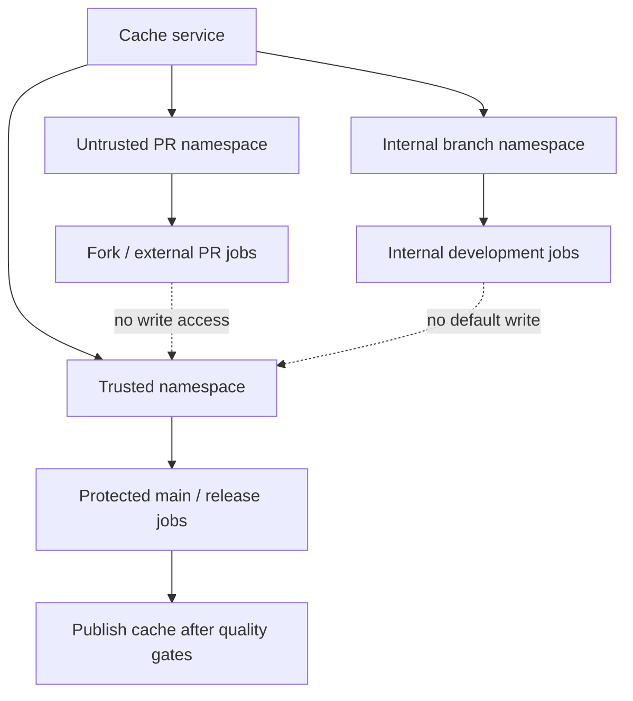

# Preventing Untrusted Data from Poisoning Shared Caches

## 1. Caching in CI/CD and Trust Risks

Caching speeds up pipelines by retaining regenerable data such as downloaded dependencies, compilation outputs, or intermediate build layers. When a subsequent job has similar inputs, it can restore saved data instead of redoing all the work.

However, caching is also a data channel across runs. If a pipeline processing untrusted source code is permitted to write to a cache used by a trusted pipeline, a contributor can poison the cache (cache poisoning). The later pipeline may then consume altered, stale, or intentionally crafted data to trigger incorrect behavior.

Example: a repository allows pull requests from forks to run tests. That job has permission to write to a cache named `java-build-main`. A malicious pull request modifies the build script to emit fake class files or write corrupted contents into the cache. After the pull request finishes, a pipeline on the main branch restores the cache with the same name and consumes the tampered outputs. If the pipeline only checks cache hit status without verifying contents, it can produce a compromised artifact from trusted source code.

The core issue is the trust boundary. A cache does not become trustworthy merely because it lives inside the CI/CD system or shares a name with the main branch. You must define who can write, who can read, what data is stored, what scope is shared, and how data is verified after restoration.

## 2. What Is Cache Poisoning?

Cache poisoning happens when data stored in a cache is altered or replaced so a subsequent run consumes unintended inputs. The contamination source can be malicious code, misconfigured pipelines, compromised dependencies, or a build that produced faulty outputs yet still published them.

Common scenarios:

- **Overwriting shared caches:** a job from an untrusted pull request writes to a key that a main-branch pipeline restores.
- **Cache key collisions:** two different workloads share the same key despite differing toolchains, dependencies, or configurations.
- **Overly broad prefix restore:** when an exact key is missing, the pipeline grabs a similar cache belonging to another source or configuration.
- **Putting build outputs into cache:** compilation outputs produced by untrusted code are reused without verifying inputs.
- **Tampered dependency cache:** downloaded package archives or local metadata are altered before the build consumes them.
- **Shared-runner contamination:** another process or user on the runner alters local cache contents before a trusted job reads them.
- **Data exposure via read access:** a cache holds config files, private source, or sensitive data that an untrusted job can download.

Cache poisoning can impact integrity, availability, and confidentiality. Altered contents can corrupt build/test outcomes; oversized or broken data can crash jobs; cached sensitive files can be read by unauthorized parties.

## 3. Classifying Sources by Trust Level

Before designing caches, classify the trigger sources and executed code. Branch names are not the sole proof of trust: a pull request can modify pipeline definitions, build scripts, and code executed in the job.

| Execution Source | Characteristics | Appropriate Cache Handling |
|---|---|---|
| Protected branches like `main` | Changes passed review and protection policies | Can publish to trusted cache after required checks pass |
| Controlled release branches | Used to produce release artifacts | Use dedicated namespace or trusted cache with restricted write access; record provenance |
| Internal development branches | Authorized organization members can push | Partition by branch or permission group; do not share production caches by default |
| Pull requests from the same repository | Authors can modify code and pipeline within PR scope | Allow reading public/appropriate caches if policy permits; restrict trusted cache writes |
| Pull requests from forks/external sources | Code and workflows may be controlled externally | Treat as untrusted; use isolated cache, never grant write access to trusted namespaces |
| Jobs running external scripts or dependencies | Behavior can change outside the repository | Pin versions, verify contents, and restrict cache publish permissions |

Trust can vary by event and repository policy. An internal contributor can still submit buggy code or have an account compromised; therefore, caches used for releases must rely on review workflows and explicit execution permissions rather than merely checking whether the submitter holds an organization account.

## 4. Distinguishing Cache Types and Risk Levels

Not every cache carries the same impact. Downloaded dependency caches can often be verified using package checksums and lockfiles. Compiled output caches carry higher risk because reused contents can directly become part of the artifact.

| Cache Type | Examples | Primary Risks | Recommended Controls |
|---|---|---|---|
| Download/dependency cache | Packages downloaded from Maven, npm, NuGet, or registries | Tampered packages/metadata or spoofed sources | Lockfiles, checksums/signatures, repository allowlist, restricted write access |
| Build/tool cache | Gradle cache, compiler cache, build-system cache | Incorrect compilation outputs reused | Keys reflecting full inputs, reproducible builds, remote cache ACLs, and integrity checks |
| Test cache | Test results or fixture data | Stale results skip tests or cause false passes | Cache only when inputs are deterministic; never skip mandatory tests based on untrusted data |
| Generated output cache | Auto-generated code, compiled schemas | Outputs mismatch current schemas or generators | Pin generators/schemas, verify checksums and dependencies |
| Docker/layer cache | Image layers or build layers | Layers contain tainted files or packages | Pin base images, control builders, scan and sign images/artifacts |
| Self-managed runner cache | Shared directory on disk or volume | Other jobs can read/write directly | Separate accounts, directory permissions, runner/pool isolation, and cache lifecycle |

The principle is identifying which data can directly affect artifacts or quality gate decisions. The closer data sits to release outputs, the stricter the requirements for provenance, write permissions, and verification.

## 5. Separating Trust Domains and Cache Namespaces

A trust domain is a boundary of runs sharing equivalent trust levels and privileges. Caches must be partitioned by trust domain so data from lower-trust sources cannot be written into areas consumed by trusted release pipelines.

An illustrative partitioning model:



Actual namespace naming can rely on repository, organization, branch class, runner pool, or a classification field supplied by the orchestration system. Never allow pull request code to pick an arbitrary namespace via user-editable inputs, as a contributor could spoof the `trusted` label.

Partitioning principles:

- One repository's cache should not automatically be shared with another if privileges and contents are not equivalent.
- Caches from forks or untrusted pull requests must stay in an isolated area.
- Caches used for official builds/releases may only be written by authorized workflows and identities.
- Development branches do not automatically get write access to release caches.
- Readable caches can also leak data; restrict read access if a cache holds private source code or internal packages.
- If a platform only scopes caches per repository or branch, design keys and trigger permissions to reliably emulate trust domains.

## 6. Designing Cache Keys with Sufficient Context

The cache key dictates which stored data a run looks up and restores. Keys that are too broad can cause outputs from other configurations to be reused. Keys that are too narrow cut cache hits and lengthen builds. The goal is a key capturing inputs affecting cache contents alongside a trust-level namespace.

Components to consider:

- Repository or project identity.
- Trust domain / execution source group.
- Operating system and CPU architecture.
- Runtime, compiler, build tool, and package manager versions.
- Lockfile or checksum of dependency declarations.
- Build configuration, profiles, compiler flags, and feature sets.
- Schema or code generator version if the cache holds generated outputs.
- Cache format version when tools alter data layout.

Conceptual key examples:

```text
trusted/order-service/linux-amd64/jdk21/gradle8.10.2/<lockfile-hash>
untrusted-pr/order-service/linux-amd64/jdk21/gradle8.10.2/<lockfile-hash>/<pr-run-id>
```

The first key targets the trusted cache; the second belongs to the untrusted domain and can include a run/PR ID to prevent cross-overwrite. Naming here is illustrative. Ensure the trust label is determined by the orchestration system, never pulled directly from PR-controlled inputs.

Avoid using only branch names as keys. Branches can be renamed, multiple runs on the same branch can execute concurrently, and unprotected branches can be freely updated by users. Also avoid using just `latest` or a static key across all toolchain versions.

## 7. Controlling Prefix Restores and Fallbacks

Some systems support restore keys or prefix fallbacks: when an exact key is missing, they look up caches whose keys begin with a prefix. This helps reuse similar caches, yet can pull data from a broader scope than intended.

For example, an exact key has the form:

```text
trusted/service/linux/jdk21/<lock-hash>
```

If fallback uses just the prefix `service/`, the pipeline could restore a cache from another branch or trust domain. At that point, the `trusted` namespace in the exact key no longer protects the restore.

Rules to enforce:

1. Prefix fallbacks must preserve the trust domain and repository scope.
2. Never fall back from untrusted to trusted or vice versa.
3. Only drop key components proven not to affect cached contents.
4. For sensitive build outputs or compiler caches, consider disabling broad fallbacks and accepting cache misses.
5. Log the actual key restored, not just the requested key.
6. Maintain a way to invalidate or rotate namespaces when cache poisoning is suspected.

A cache miss usually only makes a build slower. A cache hit from the wrong source can corrupt the artifact. When forced to choose, prioritize output integrity.

## 8. Cache Read and Write Permissions

A secure cache requires separate control over read and write permissions. Jobs may need to read a dependency cache to save time without needing permission to publish shared caches. Write permissions should be restricted to workflows with verified sources and identities.

| Job Type | Read Trusted Cache | Write Trusted Cache | Isolated Cache |
|---|---|---|---|
| Pull request from fork | Only if policy allows and data is non-sensitive | No | Yes, untrusted namespace |
| Internal pull request | Conditionally per trust policy | Usually not before approval | Can use branch-specific namespace |
| Protected main branch build | Yes | Can publish after gates pass | Can use run-specific cache |
| Release job | Yes, by controlled version/key | Can publish release cache if needed | Should isolate release namespace |
| Production deploy job | Usually does not need build cache | Must not have build cache write access | Consumes verified artifacts only |

The table above is a reference policy; organizations must tailor it to their platform and threat model. In particular, never grant cache write permissions merely because a job has permission to upload artifacts. Those two permissions differ in purpose and blast radius.

If the cache server supports ACLs, assign separate identities to publishers and consumers. If the cache platform only scopes access within a repository, still govern triggers, branch protection, fork behavior, and token permissions. Never assume all cache services share identical semantics.

## 9. Protecting Dependency Caches

Dependency caches typically store downloaded package files and metadata used by package managers. To reduce the risk of altered or substituted data:

- Use lockfiles to pin package and transitive dependency versions.
- Enable the package manager's checksum/integrity verification where supported.
- Fetch packages only from approved registries or mirrors.
- Pin the package manager version and matching cache format.
- Never share writable caches between untrusted workloads and release jobs.
- Ensure the pipeline can still re-download and verify packages if the cache is deleted.
- Avoid caching config files containing tokens, credentials, or registry authentication details.

Some package managers store caches by content hash and self-verify integrity; others depend heavily on metadata or directory state. Understand the exact mechanism before enabling sharing. Caching never replaces package signature or checksum verification.

For example, with Java dependencies, lockfiles and Gradle dependency verification help control artifact versions and contents. When restoring a Gradle cache, still let Gradle enforce its configured verification mechanism; never treat a restored cache directory as proof that packages are trustworthy.

## 10. Protecting Build Caches and Compiler Caches

Build caches store task or compiler outputs so subsequent runs can skip completed work. Because cached data can be embedded directly into artifacts, trust requirements are stricter than for dependency download caches.

A secure build cache requires:

- Keys or cache fingerprints covering every input affecting output: sources, dependencies, compilers, build flags, environment, and task implementation.
- Publishing outputs only from builds executed in trusted environments.
- Protecting remote caches with authentication and restricted write access.
- Preventing untrusted pull requests from publishing to caches read by main or release branches.
- The ability to clear caches and rebuild from scratch without altering correctness.
- Auditing publishers, write timestamps, and cache scope if supported by the backend.
- Considering signing or verifying cache metadata if supported and warranted by risk.

With a Gradle Remote Build Cache, configure dedicated write permissions for trusted CI and appropriate read access for consumers. A common pattern lets developers or PR jobs read only, while jobs on protected main branches hold write access. Verify the actual cache backend configuration; setting `isPush = false` on one client provides no protection if backend credentials still permit writes from another path.

With compiler caches such as `ccache`, cache keys must reflect compiler, flags, and relevant inputs. If two projects or trust domains share a writable cache directory, separate namespaces or backends. Never let a compiler cache bypass final binary or artifact integrity checks.

## 11. Runner Isolation and Local Caches

Even when an external cache service has strong ACLs, local caches on runners can be poisoned if multiple jobs share user accounts, filesystems, or process namespaces.

Safeguards:

- Prefer ephemeral runners for code from forks or untrusted sources.
- If using persistent runners, isolate accounts, workspaces, cache directories, and filesystem permissions by trust domain.
- Never run trusted and untrusted jobs concurrently under the same account with shared cache write access.
- Restrict mounting host volumes or the Docker socket into untrusted jobs.
- Purge or recreate local caches when a runner transitions from a lower to a higher trust domain.
- Monitor for leftover processes, unexpected files, and cache directory ownership.
- Rebuild runners when a clean state cannot be guaranteed.

Wiping only the workspace is insufficient if package caches or compiler caches live outside the workspace, such as in the runner's home directory. Identify exact locations of each cache type and govern their lifecycles separately.

## 12. Never Put Secrets or Sensitive Data into Caches

Caches typically outlive a single step and can be restored by multiple runs. Therefore, never cache:

- `.env` files holding tokens, passwords, or private keys.
- Registry credentials or package manager config files containing login info.
- SSH keys, cloud credentials, kubeconfigs, or access tokens.
- Logs that may contain user data or authorization headers.
- Database dumps or test fixtures containing unsanitized production data.
- Internal config files unnecessary for the build or lacking equivalent read permissions across consumers.

If a job needs credentials to download private dependencies, supply credentials at runtime via a secret manager or short-lived token mechanism. Never place credentials in cache keys, cache paths, outputs, or metadata. After downloading packages, verified packages may be cached if policy allows, provided authentication config files stay out of the cache.

Cache read permissions must also be treated like data read permissions. A cache may contain no passwords yet still hold private source code, config files, or internal packages. Share only with consumers holding valid access rights.

## 13. Example Secure Cache Configuration by Trust Domain

The example below is a hypothetical configuration illustrating the concept. Variable names and restore/save syntax vary across platforms; adapt them to the exact syntax of your tool.

```yaml
jobs:
  verify:
    steps:
      - name: Determine trust domain
        run: |
          if [ "$EVENT_SOURCE" = "protected-main" ]; then
            echo "CACHE_DOMAIN=trusted" >> "$CI_OUTPUT"
          else
            echo "CACHE_DOMAIN=untrusted" >> "$CI_OUTPUT"
          fi

      - name: Restore dependency cache
        uses: cache/restore
        with:
          key: "${CACHE_DOMAIN}-${OS}-${TOOLCHAIN}-${LOCKFILE_HASH}"

      - name: Verify dependencies and build
        run: ./gradlew --no-daemon clean test

      - name: Save cache from trusted source only
        if: EVENT_SOURCE == 'protected-main' && QUALITY_GATE == 'passed'
        uses: cache/save
        with:
          key: "trusted-${OS}-${TOOLCHAIN}-${LOCKFILE_HASH}"
```

This snippet expresses policy, not valid syntax for a specific platform. In real deployments, `EVENT_SOURCE` and `QUALITY_GATE` must be determined by the CI system from event context and job outcome; they must never come from arbitrary inputs controlled by a pull request. The trusted save step must run inside a job with protected publish permissions, not rely solely on a YAML condition editable by a contributor.

Another design prevents PRs from writing to shared caches at all: PRs only read trusted caches if the platform permits that safely, while all new caches write to a PR-specific namespace. Once changes merge and the trusted pipeline runs again, that pipeline creates or updates the trusted cache itself.

## 14. Detecting, Handling, and Recovering from Suspected Cache Poisoning

Warning signs:

- Clean builds and cached builds produce unexpectedly different artifacts.
- Main-branch pipelines pass or fail only when restoring a specific cache.
- A cache was created by a run or branch outside the expected trust domain.
- Files inside the cache have anomalous timestamps, owners, or contents.
- One cache key is shared across multiple runner/toolchain types.
- Abnormal jumps in cache size or cache hit rate occur.
- Build outputs contain files absent from the source tree or undeclared by any task.

When suspected:

1. Halt publishing and consuming the affected cache in sensitive pipelines.
2. Identify the key, namespace, creation timestamp, publisher, and runs that restored the cache if logs/backend track them.
3. Isolate or delete affected caches via platform tools; avoid deleting unrelated namespaces by mistake.
4. Run clean builds on trusted runners without restoring the suspect cache.
5. Verify dependencies, build outputs, and artifacts against lockfiles, checksums, or trusted sources.
6. If release artifacts may have been impacted, identify affected versions and run an assessment/re-release workflow.
7. Fix the permissions, keys, prefix fallbacks, or runner isolation issues that caused the exposure.
8. Document the incident, impact window, and recovery evidence.

Do not merely rotate the cache key to mask an incident. Without knowing where tainted data entered, a new cache could still restore the same tainted data through another prefix fallback or backend.

## 15. Cache Retention and Invalidation Policies

Caches require appropriate retention lifetimes. Overly old caches can hold incompatible dependencies or outputs; long-lived caches also expand the data surface requiring protection.

Policies can specify:

- Maximum retention duration by cache type.
- Storage caps and eviction policies.
- Cache invalidation on major toolchain upgrades or cache format changes.
- Namespace rotation when trust policies change or cache poisoning is suspected.
- Capturing investigative evidence before deleting an incident cache.
- Never retaining caches holding sensitive or personal data.
- Periodic audits of unused caches and cleanup by ownership.

Caches are regenerable, so they do not need long retention like release artifacts. Artifacts and provenance must follow release retention policies; caches generally only need to live long enough to deliver performance value. On a cache miss or eviction, pipelines must continue working correctly by re-downloading dependencies and rebuilding.

## 16. Common Anti-Patterns

| Anti-Pattern | Consequence | Improvement |
|---|---|---|
| Fork PR writes to `main` cache | Untrusted code can alter data consumed by release pipelines | Separate namespaces and block trusted cache writes from forks |
| Sharing one key across all OSes/toolchains | Restores incompatible data | Add OS, architecture, toolchain, and lock hash to keys |
| Prefix fallback ignores trust domain | Pulls caches from a different trust level | Keep trust scope in every restore prefix |
| Granting all jobs cache read/write access | Expands blast radius when one job is compromised | Separate publishers and consumers with least-privilege access |
| Caching the entire home directory | May store credentials, configs, and unintended data | Cache only necessary paths; audit contents before saving |
| Using build caches without input verification | Stale or forged outputs enter artifacts | Lock task inputs, secure remote caches, and run periodic clean builds |
| Treating caches as the sole trusted package source | Skips verifying package origins after cache restore | Enforce lockfiles, checksums/signatures, and trusted registries |
| Only rotating keys after an incident | Poisoned data may persist under other prefixes/backends | Investigate publishers, restore paths, and isolate full blast radius |
| Treating cache hits as proof of a valid build | A cache hit only shows a key match was found | Verify integrity, provenance, and test outputs |

## 17. Secure Cache Design Checklist

Before enabling caching for a pipeline, verify:

- [ ] Execution sources are classified by trust domain.
- [ ] Cache keys include repository scope, trust domain, and inputs affecting contents.
- [ ] Restore prefixes cannot cross trust boundaries.
- [ ] Untrusted jobs lack write permissions to trusted caches.
- [ ] Cache read permissions do not expose private sources, packages, or configs.
- [ ] Dependency caches are backed by lockfiles and checksum/signature verification where supported.
- [ ] Build caches are published only by trusted builders/jobs.
- [ ] Runners and local cache directories are isolated by trust domain.
- [ ] No secrets, credentials, `.env` files, or sensitive production data are cached.
- [ ] Caches have clear retention, eviction, and invalidation workflows.
- [ ] Clean builds succeed when caches miss or are purged.
- [ ] Logs capture restored keys/namespaces and publishers if supported by the platform.
- [ ] An incident workflow exists for suspected cache poisoning.

## 18. Core Practical Principles

1. Treat caches as data with provenance and trust levels to govern, not inherently safe storage.
2. Classify pipeline sources and partition caches by trust domain, repository, and purpose.
3. Allow only protected workflows to publish into caches used by trusted builds/releases.
4. Design keys from OS, architecture, toolchain, dependency locks, and content-affecting configuration.
5. Preserve trust domains in restore prefixes; accept cache misses rather than falling back across trust boundaries.
6. Verify dependencies via lockfiles, checksums/signatures, and approved package sources.
7. Protect build caches with restricted write permissions, deterministic inputs, and clean-build capability.
8. Separate runners, workspaces, local caches, and credentials between trusted and untrusted workloads.
9. Never store secrets or sensitive data in caches; govern both read and write permissions.
10. Audit publishers, retention, and maintain isolation, purge, and investigation procedures for suspected contamination.

Secure caching cuts CI/CD execution time without compromising artifact integrity. That requires teams to know where data originates, who can write or read it, which runs may restore it, and how outputs are verified. Only when caches are governed by trust domain and can be purged without breaking builds do they become a truly reliable performance optimization.
