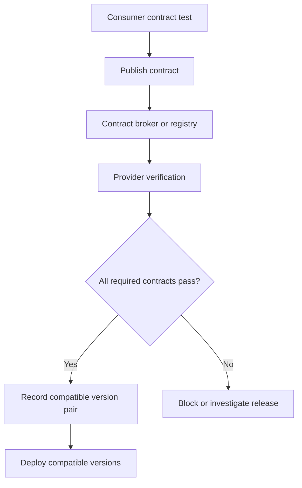
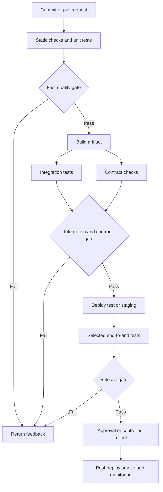

# Distinguishing Unit, Integration, Contract, and End-to-End Testing

A CI/CD pipeline can run hundreds of tests, yet a large test count does not automatically prove that software is reliable. What matters is what each test verifies, which boundary it runs at, which components it depends on, and how quickly it provides feedback.

Four common test types are **unit tests**, **integration tests**, **contract tests**, and **end-to-end tests**. They complement one another:

- Unit tests verify the logic of a small unit in isolation.
- Integration tests verify how multiple components actually work together.
- Contract tests verify that communicating parties adhere to an agreed-upon contract.
- End-to-end tests verify a business flow through the system from a user-facing perspective.

No single test type completely replaces the others. Unit tests give fast feedback but can miss configuration or communication bugs. Integration tests verify real interactions but typically require more complex environments and data. Contract tests catch mismatches between producers and consumers without standing up the entire system. End-to-end tests provide evidence about business journeys but are time-consuming and sensitive to environmental instability.

In CI/CD, an effective strategy combines test types based on risk and places them at the right stage. Fast, stable checks run early on pull requests; checks requiring multiple services run at appropriate stages; critical end-to-end flows run in production-like environments and post-deployment when needed.

## 1. Why Distinguish Between Test Types?

Each test has a different scope of observation. Relying solely on unit tests can miss database connection errors, misconfigured HTTP clients, or incompatibilities between two services. Relying solely on end-to-end tests means every small change might have to wait for a large environment to start up and a long business flow to finish.

Clear categorization helps a team answer four questions:

1. **What is being verified?** Logic of a single unit, interaction between components, a communication agreement, or a business journey?
2. **What needs to be provisioned?** Just the test process, a few real dependencies, a producer/consumer pair, or nearly the entire system?
3. **Where to look when a test fails?** In small logic, an adapter, a protocol, configuration, data, or a cross-system chain of components?
4. **At which stage should it run?** Pre-commit, on pull requests, post-build, in staging, or after production deployment?

| Test type | Primary boundary | Goal | Typical characteristics |
|---|---|---|---|
| Unit | A function, class, or small unit of logic | Verify rules and execution branches | Fast, isolated, many cases |
| Integration | Two or more connected components | Verify real interactions and configuration | Requires dependencies, data, or environment |
| Contract | Agreement between consumer and provider | Detect incompatible communication changes | Focuses on requests, responses, events, or schemas |
| End-to-end | Business flow through the system | Verify end-to-end behavior | Close to real experience, higher cost |

A test's boundary depends on the architecture. For example, testing a service with a real database might be called an integration test or a component test in some organizations. The label matters less than clearly describing which components are real, which are simulated, and which behavior is being verified.

## 2. Unit Tests: Checking Logic in a Small Scope

A unit test verifies a unit of logic with deterministic inputs and expected outcomes. The unit can be a function, method, class, or a small group of collaborating objects. The scope should be narrow enough that when a test fails, developers can quickly pinpoint the faulty logic.

### 2.1. Characteristics of Unit Tests

- **Focused:** each test verifies one behavior or a small group of related behaviors.
- **Fast:** usually runs in memory without starting external services.
- **Isolated:** does not depend on the network, a shared database, the real clock, or the execution order of other tests.
- **Deterministic:** the same inputs and initial state must produce consistent results.
- **Easy to diagnose:** test names and assertions indicate which rule no longer holds.

Unit tests typically cover normal, boundary, and error cases. For example, a shipping fee calculation function should test free-shipping orders, orders below the threshold, orders at the exact threshold, unsupported addresses, and invalid input data.

### 2.2. Unit Test Example

Suppose an ordering service has a rule granting free shipping when the total merchandise value reaches a threshold. Java example with JUnit:

```java
import static org.junit.jupiter.api.Assertions.assertEquals;

import java.math.BigDecimal;
import org.junit.jupiter.api.Test;

class ShippingFeeCalculatorTest {
    private final ShippingFeeCalculator calculator =
            new ShippingFeeCalculator(new BigDecimal("500000"),
                                      new BigDecimal("30000"));

    @Test
    void returnsZeroWhenOrderReachesFreeShippingThreshold() {
        BigDecimal fee = calculator.calculate(new BigDecimal("500000"));

        assertEquals(new BigDecimal("0"), fee);
    }

    @Test
    void returnsStandardFeeWhenOrderIsBelowThreshold() {
        BigDecimal fee = calculator.calculate(new BigDecimal("499000"));

        assertEquals(new BigDecimal("30000"), fee);
    }
}
```

This illustrative snippet assumes the class constructor and rules have been defined accordingly. The two tests check both sides of the threshold. A complete test suite could add negative values, `null`, other currencies, or region-specific rules depending on the class contract.

### 2.3. When to Use Test Doubles?

Unit tests can replace dependencies with test doubles to control inputs and observe interactions. Common types include:

| Type | Role | Example |
|---|---|---|
| Stub | Returns predefined data | Repository returns a sample order |
| Fake | Simplified implementation with working behavior | In-memory repository storing data |
| Mock | Verifies interactions or calls | Verifies the payment gateway is called exactly once |
| Spy | Records calls while keeping real or partial behavior | Tracks methods called on an object |

Test doubles are useful when dependencies are hard to instantiate or when rare failures need to be simulated. However, overusing mocks can cause tests to verify implementation details rather than behavior. A test might pass even though the real system fails because the mock simulated exactly what the source code assumed.

Prefer asserting on outcomes and state that are meaningful to the user. Only verify interactions when call order or call count is part of the contract—for example, ensuring a customer is not charged twice.

### 2.4. What Unit Tests Do Not Prove

Unit tests alone do not prove that:

- SQL executes properly against a real database.
- A JSON serializer is compatible with an external API.
- An HTTP client is configured with the right timeouts, TLS, or authentication.
- Two services agree on field names and data types.
- A container starts up properly in the deployment environment.
- Cross-system business flows work end to end.

This is why integration, contract, and end-to-end tests are needed at the appropriate boundaries.

## 3. Integration Tests: Checking Collaborating Components

Integration tests verify two or more components when they are connected together. Components can be a class and a database, a service and a message broker, an API and an identity provider, or multiple modules within the same application.

The goal is to uncover faults at integration boundaries: data mapping, SQL, transactions, serialization, protocols, configuration, timeouts, retries, authentication, and dependency error handling.

### 3.1. Examples of Integration Scopes

| Scope | Connected components | Detectable failures |
|---|---|---|
| Repository integration | Repository and PostgreSQL | Invalid SQL, wrong mapping, unexpected constraints or transactions |
| HTTP client integration | Service and mock HTTP server or test provider | Headers, serialization, timeouts, retries, and status code handling |
| Messaging integration | Producer/consumer and message broker | Routing keys, serialization, acks, retries, and dead-letter behavior |
| Module integration | Multiple modules within an application | Broken dependency injection wiring, configuration, or internal communication |
| Container integration | Application and dependencies running in containers | Ports, environment variables, health checks, and networking |

An integration test does not need to spin up the entire production stack. Choose the exact boundary you need to verify. For example, to test a repository with PostgreSQL, you can run a real PostgreSQL instance in a container while replacing the payment provider with a controlled fake server.

### 3.2. Example: Testing a Repository Against a Real Database

A repository test can spin up a temporary database, write an order, and read it back to verify mapping and transactions. Java pseudocode:

```java
@Test
void savesAndLoadsOrderFromPostgres() {
    Order order = new Order("order-10482", "customer-17", new BigDecimal("250000"));

    orderRepository.save(order);
    Order loaded = orderRepository.findById("order-10482").orElseThrow();

    assertEquals(order.id(), loaded.id());
    assertEquals(order.customerId(), loaded.customerId());
    assertEquals(order.total(), loaded.total());
}
```

This test verifies the interaction between the repository, driver, SQL, and PostgreSQL. It does not need to invoke the UI or other services to deliver value.

### 3.3. Managing Real and Fake Dependencies

Integration tests require deciding which dependencies must run for real. A real database is usually valuable when verifying SQL and transactions. An external HTTP provider can be replaced with a test server if the goal is solely to verify how the client handles responses. Some tests require a provider's sandbox environment to verify behavior that mocks cannot reliably simulate.

Explicitly document the test's scope:

- Real database, real broker, or in-memory substitute?
- Is the HTTP server a real provider, sandbox, or mock server?
- Are authentication and TLS configured as in production?
- Are the latest migrations and representative data used?
- Does the test verify protocol, configuration, or also business logic?

The name `integration test` alone does not say enough. Describing the boundary helps readers understand which kinds of bugs the test can catch and where its limits lie.

### 3.4. Test Data and Isolation

Integration tests often use shared data and resources. If tests depend on execution order, leftover data from prior runs, or a shared database modified by another test, results become flaky.

Ways to reduce contention:

- Provision a dedicated database or schema per pipeline run.
- Use transaction rollbacks when test behavior permits.
- Generate data with unique identifiers per test or shard.
- Clean up data according to ownership scope.
- Avoid depending on test execution order.
- Wait for asynchronous state using explicit conditions and timeouts rather than fixed sleeps.

### 3.5. When an Integration Test Fails

Failures can originate from the application, a dependency, the environment, or the data. The pipeline should preserve service logs, test reports, container versions, non-sensitive configuration, and correlation IDs. Retaining only the test runner's stack trace may leave the team without enough evidence to diagnose the root cause.

## 4. Contract Tests: Verifying Communication Agreements

Contract tests check that communicating parties comply with a contract. A contract describes what a consumer sends, what a provider accepts, and the structure or meaning of the exchanged data. Contracts can cover HTTP APIs, event messages, schemas, RPC interfaces, or internal protocols.

Contract tests are especially valuable when services are developed and deployed independently. Consumers and providers can change at different times; without compatibility checks, a seemingly local change can break another service.

### 4.1. Consumer and Provider

- **Consumer:** the component that calls an API, reads an event, or uses another component's interface.
- **Provider:** the component that serves an API, emits an event, or implements an interface.
- **Contract:** the set of communication rules both parties agree to follow.

For example, `orders-api` calls `inventory-api` to check stock. The consumer sends a request containing `sku` and `quantity`; the provider returns fulfillment availability along with remaining stock count. Contract tests validate requests and responses against the agreed contract.

### 4.2. Consumer-Driven Contract Testing

In consumer-driven contract testing, the consumer specifies the interactions it actually needs. The contract is published so the provider can verify that its version meets those expectations.

General workflow:

1. The consumer writes tests describing the requests and responses it needs.
2. The tool generates a contract artifact from the declared interactions.
3. The contract is stored in a broker or versioned registry.
4. The provider fetches active contracts and runs verification.
5. Verification results are published so the pipeline can decide whether the new version is safe to deploy.



Consumer-driven contract testing does not mean the provider must accept every arbitrary usage. Contracts must reflect real interactions, have clear owners, and follow lifecycle management. Old contracts with no remaining consumers can be marked deprecated and removed according to policy.

### 4.3. Schema Validation and Contract Verification

Schema validation checks that data conforms to a structure, such as JSON Schema, OpenAPI, Protocol Buffers, or AsyncAPI. It is a useful part of contract testing, though not always sufficient on its own.

Two payloads can be schema-valid yet disagree on business semantics. For instance, an `amount` field might be typed as a number on both sides, while one party interprets it in single currency units and the other in thousands. A solid contract should define types, bounds, units, requiredness, nullability rules, and key semantics.

Provider verification can check status codes, headers, fields, event keys, and certain behavioral rules. For asynchronous communication, verify event schemas, routing, versioning, and the consumer's ability to handle legacy events during transition periods.

### 4.4. Backward Compatibility and Breaking Changes

Certain changes carry a high risk of breaking consumers:

- Removing a field that a consumer reads.
- Renaming a field or changing its data type.
- Turning an optional field into a required one.
- Changing the meaning or unit of a value.
- Changing status codes, error codes, or error payload structures.
- Altering event ordering or semantics.
- Tightening validation limits that current consumers do not satisfy.

Adding an optional field is usually easier to keep compatible, though you still need to check whether consumers tolerate unknown fields in payloads. There is no universal rule guaranteeing that every "additive" change is safe.

For breaking changes, teams can version the API, support two versions during a transition window, deploy consumers first or providers first depending on the design, and only retire the old contract once all consumers have migrated.

### 4.5. Contract Tests Do Not Replace Integration Tests

Contract tests verify that both sides agree on the described communication structure and behavior. They do not prove that networking, DNS, TLS, credentials, service discovery, brokers, or production configuration work properly.

Therefore, systems still need some integration tests to verify live connectivity, alongside end-to-end tests for critical business flows.

## 5. End-to-End Tests: Verifying Business Flows from Start to Finish

End-to-end (E2E) tests verify a journey across multiple components, usually from the entry UI or API through to the final outcome. Tests may exercise the frontend, backend, database, message broker, external services, and asynchronous processing steps.

For example, an order placement journey:

1. User logs in.
2. Selects a product and adds it to the cart.
3. Enters a shipping address.
4. Confirms the order.
5. The system checks inventory and initiates a test payment.
6. The user receives an order ID and confirmation status.

E2E tests verify that components collaborate to achieve the intended business outcome. They can uncover routing, configuration, authentication, data, integration, or UI bugs that narrower tests miss.

### 5.1. Scope and Environment

E2E tests usually require a production-like environment, predictable data, and controlled dependencies. You can use a sandbox for the payment provider, an email sink instead of sending real emails, and test accounts with restricted permissions.

An E2E test does not have to run against real production. What matters is exercising the journey across major boundaries with explicitly declared levels of simulation. If every service is mocked out, the test may no longer represent true end-to-end behavior.

### 5.2. UI E2E Example

Illustrative pseudocode with a browser automation tool:

```javascript
test("customer can place an order", async ({ page }) => {
  await page.goto("/login");
  await page.getByLabel("Email").fill("buyer@example.test");
  await page.getByLabel("Password").fill(process.env.TEST_PASSWORD);
  await page.getByRole("button", { name: "Sign in" }).click();

  await page.getByRole("link", { name: "Product A" }).click();
  await page.getByRole("button", { name: "Add to cart" }).click();
  await page.getByRole("button", { name: "Checkout" }).click();
  await page.getByLabel("Address").fill("10 Test Street");
  await page.getByRole("button", { name: "Place order" }).click();

  await expect(page.getByTestId("order-status"))
    .toHaveText("Confirmed");
});
```

This is an illustrative example assuming the application exposes the corresponding labels and test IDs. Real tests must create or provision isolated accounts, products, and data per run; passwords must come from a secret manager and never be logged.

### 5.3. Keeping E2E Tests Stable

E2E tests are prone to flakiness because they depend on many components and timing. Common causes include:

- Using fixed sleeps instead of waiting for specific conditions.
- Shared or unreset test data.
- Dependent services starting slowly or unstably.
- Selectors tied to fragile UI structure.
- Tests depending on execution order or state left by prior tests.
- Calling external services without a sandbox or stable quota.
- Running in parallel while sharing the same account, cart, or data.

To reduce flaky tests, use explicit state-based waits, stable test IDs, isolated data, clean teardown, and sandboxed dependencies. Retries can help distinguish transient errors, but must never be used to turn an unstable test into a trusted pass signal.

### 5.4. Choosing High-Value E2E Flows

There is no need to turn every business case into an E2E test. Select a few critical journeys with major user or revenue impact—such as sign-in, order creation, payment, refunds, or profile updates. Detailed edge cases belong in unit, integration, or contract tests.

## 6. Comparing the Four Test Types

| Criterion | Unit | Integration | Contract | End-to-end |
|---|---|---|---|---|
| Scope | A small unit of logic | Multiple connected components | Communication agreement between parties | Cross-system business flow |
| Real dependencies | Usually minimal; use test doubles where appropriate | One or more real dependencies | Usually checks contract artifacts or provider verification | Many real components or a representative environment |
| Relative speed | Fastest | Moderate | Typically fast to moderate | Slower |
| Diagnosability | Usually clear and narrow | Depends on component count | Focused on mismatch points | Can be hard to pinpoint the failing component |
| Flakiness risk | Low when well isolated | Moderate if environment/data is unstable | Low to moderate depending on provider and broker | Higher due to many dependencies and state |
| Typical defects caught | Wrong calculation logic, wrong branch handling | SQL, serialization, configuration, protocol | Incompatible fields, schemas, semantics, or versions | Broken user flows, configuration, or overall integration failures |
| Typical pipeline placement | Every commit and pull request | Pull request, post-build, or integration stage | Pull request, provider build, and pre-release | Staging, pre-release, or post-deploy per policy |

Descriptions of speed and flakiness are tendencies, not strict rules. An integration test using an optimized container can run very quickly; a unit test coupled to a global clock or shared state can still be flaky.

## 7. How the Test Types Complement Each Other

Consider a change that adds a rule limiting item quantity in an order.

| Question | Appropriate test type | Verification example |
|---|---|---|
| Is the maximum quantity rule calculated correctly? | Unit | 0, 1, exact limit, and over limit |
| Does the repository save and load quantities properly? | Integration | Insert/update and read back from a real database |
| Does the API consumer interpret the `quantity` field as published by the provider? | Contract | Request schema, response, and error behavior |
| Can the user place an order and see the right error message? | End-to-end | UI interaction through to final outcome |

A bug can be caught across multiple layers. For example, if the provider renames `availableQuantity` to `stock`, contract tests can fail before E2E tests even run. This gives early feedback and pinpoints the exact broken communication boundary.

You do not need to repeat the exact same assertions at every layer. Each layer should contribute distinct evidence. If unit tests already cover dozens of boundary values in an algorithm, E2E tests only need to verify a couple of representative journeys through the UI.

## 8. Structuring the Testing Strategy in CI/CD

A pipeline can split testing into stages based on speed, cost, and purpose.



### 8.1. On Pull Requests

Prioritize checks that give fast feedback:

- Linting, formatting, type checking, and static analysis.
- Unit tests for affected modules.
- Contract tests for relevant consumers/providers.
- Small integration tests that finish within an acceptable time budget.
- Required secret scanning and dependency policies.

The goal is to give the author early feedback on defects before merging. If a slow test is essential for every change, optimize the environment or split it up rather than skipping it by default.

### 8.2. After Merge and Artifact Build

Once a candidate artifact is built, run integration tests against real dependencies or appropriate sandboxes. Provider-side contract verification can run to confirm supported consumers remain compatible. Tests must be tied to the exact commit and artifact that will be promoted.

### 8.3. In Staging or Pre-Production

Run critical E2E tests, migration rehearsals, smoke tests, and selected performance or security checks based on risk. The environment should mirror production in aspects that affect runtime behavior.

### 8.4. After Production Deployment

Post-deploy smoke tests verify that the service started and core endpoints respond. Synthetic monitoring can run scheduled journeys using controlled accounts and data. This is continuous operational verification and does not replace the pre-release E2E suite.

### 8.5. Running by Change Scope Without Missing Dependencies

In a monorepo, the pipeline can select tests based on changed modules and the dependency graph. If a shared library changes, run tests for the affected consumers as well. If the impact scope cannot be determined, broaden the checks or run the full relevant suite rather than treating a failed diff check as "no changes."

## 9. Illustrative Pipeline YAML Example

The example below shows how to order test types by dependencies. This is conceptual YAML, not runnable syntax for a specific platform:

```yaml
pipeline:
  trigger:
    - pull_request
    - merge_to_main

  jobs:
    validate:
      steps:
        - lint
        - static_analysis

    unit_tests:
      needs: [validate]
      steps:
        - run_unit_tests
        - publish_unit_report

    build:
      needs: [unit_tests]
      outputs:
        - immutable_artifact_digest

    integration_tests:
      needs: [build]
      steps:
        - start_test_dependencies
        - run_integration_tests
        - upload_integration_reports
        - cleanup_test_dependencies

    contract_tests:
      needs: [build]
      steps:
        - verify_consumer_provider_contracts
        - publish_contract_results

    test_gate:
      needs: [integration_tests, contract_tests]
      condition: all_required_checks_pass

    deploy_staging:
      needs: [test_gate]
      input: immutable_artifact_digest

    end_to_end_tests:
      needs: [deploy_staging]
      steps:
        - run_critical_user_journeys
        - publish_e2e_reports

    release:
      needs: [end_to_end_tests]
      condition: release_policy_approved
      input: immutable_artifact_digest
```

In this model, integration tests and contract tests can run in parallel after the artifact is built if they are independent. The gate waits for both. E2E runs only after staging deploys the exact artifact. Cleanup jobs should use the platform's always-run mechanism so dependencies are still reclaimed when tests fail; release must continue enforcing quality gate conditions.

In a real pipeline, unit tests can run in parallel with some static checks if they read the same revision and have no data dependencies. Be sure to use the exact dependency, skipped-state, and failure-condition semantics of the CI/CD tool in use.

## 10. Test Pyramid and Test Distribution Models

The test pyramid suggests that a test suite typically has many unit tests, fewer integration tests, and a smaller number of E2E tests. The reason is that unit tests are cheap and fast, whereas broad-scope tests cost more time, environment resources, and maintenance effort.

```text
              /\
             /  \
            / E2E\          Few, focused on critical flows
           /------\
          /Contract\        Verify agreements between services
         /----------\
        /Integration \      Verify boundaries and dependencies
       /--------------\
      /   Unit tests   \    Many, fast, isolated
     /__________________\
```

This is a mental guide, not a mandatory ratio. An event-driven system might need many contract tests; a data-processing application might need many database integration tests; a UI-heavy product might need several critical E2E tests.

Some teams use the test trophy or other distribution models that emphasize integration/component tests because they balance confidence and cost. Choose based on architecture, risk, and actual failure data rather than chasing the shape of a diagram.

## 11. Selecting Test Types Based on Risk

Testing rigor should scale with the impact if a change fails. Use the following table as a starting point:

| Change type | Baseline checks | Additional checks when needed |
|---|---|---|
| Algorithm or internal business rule | Unit tests with boundary cases | Integration if logic depends on data or services |
| SQL, transactions, or repository | Unit tests for mapping logic when suitable | Integration with a real database and migrations |
| API request/response | Unit tests for validation and handlers | Contract tests, integration with auth/HTTP stack |
| Shared API or event schema | Schema validation | Consumer/provider contracts and consumer integration |
| Message broker or async workflow | Unit tests for handlers | Broker integration, event contracts, E2E for critical journeys |
| UI or frontend routing | Unit/component tests | E2E for critical user journeys |
| Authentication/authorization | Unit tests for policy logic | Integration with identity provider, E2E for login and permission flows |
| Database migration | Migration validation | Integration, rehearsal, and version compatibility checks |
| Configuration or deployment change | Static/policy validation | Staging deploy, smoke tests, and rollout verification |

Risk also depends on consumer count, rollback capability, data sensitivity, and blast radius. Changing an API field used by many services may require broader contract testing than an internal change inside a single module.

## 12. Managing the Quality of the Tests Themselves

A test suite is software too and needs maintenance. A slow, flaky, or hard-to-diagnose test suite can erode the team's trust in the pipeline.

### 12.1. Flaky Tests

A flaky test yields different results when re-run under essentially unchanged conditions. Causes can include race conditions, shared data, time dependencies, unstable networks, test ordering, or resource starvation.

When a flaky test is detected:

1. Record its failure rate and run history.
2. Identify the test, environment, and dependencies involved.
3. Reproduce it with sufficient data and logs to investigate.
4. Fix the root cause, such as synchronization, isolation, timeouts, or test data.
5. If temporary quarantine is necessary, assign an owner, reason, deadline, and tracking mechanism.

Never retry indefinitely or ignore failures just to keep the pipeline green. Retries can help classify transient errors, but they are no substitute for fixing the test.

### 12.2. Test Coverage

Coverage shows which code was executed during test runs, such as line coverage or branch coverage. Coverage is useful for finding untested areas, though it does not directly measure assertion quality or the importance of verified behavior.

A test can execute a line of code without checking the result. Therefore, a single coverage threshold should not be treated as sufficient proof of quality. Combining coverage with test case reviews, mutation testing when appropriate, and real incident data provides a much better perspective.

### 12.3. Speed and Diagnosability

Track execution time per test type, queue time, failure rate, and time from test failure to root-cause identification. Tests should have behavior-descriptive names, clear reports, and logs carrying correlation IDs when spanning multiple services.

If integration tests take too long, split the suite, parallelize across isolated data, or optimize dependency startup. If the E2E suite grows too large, keep high-value journeys and push edge cases down to narrower test layers.

## 13. Data, Environments, and Secrets in Testing

Test quality depends on environment quality. Data must represent important scenarios without exposing sensitive information.

- Use synthetic or anonymized data; avoid copying raw production data into CI.
- Provision isolated data per test or shard to prevent conflicts.
- Version test fixtures and schemas when they affect test outcomes.
- Use sandboxes or controlled fake servers for external services.
- Issue least-privilege, short-lived credentials; never store secrets in source code, fixtures, or reports.
- Clean up processes, containers, databases, and temporary files after tests finish.
- Retain necessary test reports and logs per retention policy while redacting sensitive data.

A test passing in an environment that differs significantly from production can create a false sense of security. Clearly state what the test environment represents and which risks still require verification in staging or production.

## 14. Reading Test Results and Handling Failures

When a pipeline fails, the team should categorize the root cause before deciding to re-run or modify code.

| Symptom | Potential area to inspect | Appropriate action |
|---|---|---|
| Unit test fails consistently | Faulty logic or test expectation | Check assertions and recent changes |
| Integration test cannot connect to database | Service not ready, port, credentials, or network | Inspect dependency logs and health checks |
| Contract verification fails | Consumer expectation incompatible with provider | Identify the changed party, evaluate versioning and contract migration |
| E2E timeout | Slow dependency, broken selector, or stuck flow | Inspect traces, screenshots, logs, and step-by-step state |
| Test fails only when run in parallel | Shared data or resources | Isolate namespaces, fixtures, and resources |
| Test fails intermittently | Flaky behavior or unstable environment | Track history, reproduce, and fix root cause |

Do not automatically retry every failure type. Unit tests failing on assertions rarely resolve themselves; rate limits or dependency startup delays may be transient. Retries must follow a policy based on failure type and must never turn an indeterminate outcome into a pass.

## 15. End-to-End Walkthrough: Changing the Order Placement Flow

Suppose a team adds a rule disallowing order confirmation if inventory is insufficient. The change touches `orders-api`, `inventory-api`, the database, and the storefront UI.

**Unit tests:** verify the function deciding orderable quantity, including zero stock, sufficient stock, insufficient stock, invalid quantities, and boundary inputs. These tests run fast without a database or network.

**Integration tests:** verify that `orders-api` reads inventory from the database or calls `inventory-api` via an HTTP client with proper configuration and serialization. Another test verifies that the transaction does not create an order if the stock check fails.

**Contract tests:** consumer `orders-api` specifies the request and response it expects from `inventory-api`. Provider verification confirms the new version still satisfies active consumer contracts. If the `OrderConfirmed` event changes schema, event consumers are also checked.

**End-to-end tests:** a user adds a product to the cart, enters a quantity exceeding available stock, and submits the order. The UI displays the appropriate error message, no order is created, and no payment is initiated. Another journey verifies successful order creation when stock is sufficient.

**CI/CD:** unit tests and static checks run early on pull requests. Contract and integration tests run post-build, or in parallel if independent. Artifacts passing the gate are deployed to staging, where selected critical E2E tests verify the journey. Post-release, smoke tests and telemetry continue tracking order confirmation rates.

Each layer provides distinct evidence. If a contract fails, the team knows inter-service communication is no longer compatible. If a unit test fails, the bug likely resides in decision logic. If E2E fails while earlier layers pass, investigate wiring, configuration, data, or cross-system interactions.

## 16. Common Anti-Patterns

| Anti-pattern | Consequence | How to improve |
|---|---|---|
| Unit tests only | Misses integration and configuration bugs | Add integration, contract, and selected critical E2E tests |
| E2E tests only | Slow feedback, hard to pinpoint defects | Move logic and edge cases down to narrower test layers |
| Mocking every dependency | Tests pass while the real system is incompatible | Use real dependencies at boundaries that need verification |
| Over-mocking internal details | Fragile tests that break during refactoring | Test meaningful behavior and outcomes |
| Using schema validation in place of all contract tests | Misses semantics and real interactions | Verify requests/responses/events and business rules in contracts |
| Sharing test data | Race conditions and flaky results | Namespace data per run or test |
| Running E2E against uncontrolled external services | Flaky tests and extra costs | Use sandboxes, fake servers, or controlled environments |
| Retrying all failures | Masks defects and erodes trust | Retry by failure type, cap attempts, and track flakiness |
| Running all tests sequentially | Slow pipeline despite independent tests | Parallelize with isolated data and resources |
| Measuring quality solely by coverage | High coverage with weak assertions | Review tests, check behavior, and correlate with real bugs |
| Not tying tests to artifacts | Unclear which version was verified | Build once and attach test results to the commit/digest |

## 17. Testing Strategy Checklist

Before adding a test suite to a pipeline, the team can review:

- [ ] Each test clearly states the behavior and boundary being verified.
- [ ] Unit tests focus on logic, edge cases, and predictable errors.
- [ ] Test doubles are used intentionally; avoid over-mocking that undermines verification value.
- [ ] Integration tests verify key dependencies with appropriate environments or real components.
- [ ] Integration test data and resources are isolated with explicit cleanup.
- [ ] Contracts describe requests, responses, events, and key semantics between consumers and providers.
- [ ] Provider verification runs against active contracts before releasing corresponding changes.
- [ ] Breaking changes have versioning and a consumer migration plan.
- [ ] E2E tests focus on critical business journeys and have a stable environment.
- [ ] Tests do not depend on execution order, shared data, or fixed sleeps.
- [ ] The pipeline runs fast checks early and places broader tests at appropriate stages.
- [ ] Artifacts are built once; test reports are tied to the deployed commit and artifact.
- [ ] Flaky tests are tracked with an owner and resolution deadline if quarantined.
- [ ] Coverage is used to spot untested areas, not treated as the sole metric.
- [ ] Logs, reports, and screenshots do not leak secrets or sensitive data.
- [ ] Quality gates clearly distinguish pass, fail, valid skipped, and indeterminate outcomes.

## 18. Conclusion

Unit, integration, contract, and end-to-end tests check different boundaries within a system. Unit tests verify logic quickly and accurately; integration tests verify how components actually work together; contract tests protect agreements between producers and consumers; E2E tests verify critical business journeys from start to finish.

An effective CI/CD strategy does not try to force every case into one test type. The team chooses test types by risk, places them at appropriate stages, keeps data and environments stable, links results to artifacts, and improves flaky tests. When each layer provides distinct evidence and complements the others, the pipeline delivers fast feedback while building sufficient confidence before shipping changes to users.
