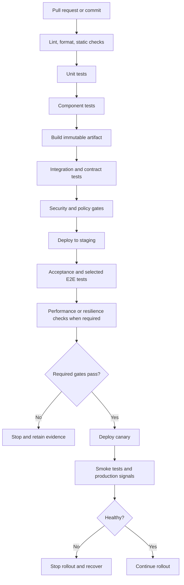

# Selecting Test Layers Based on the Risk to Detect

Not every defect is best caught by the same type of test. Unit tests can catch calculation bugs quickly and accurately, yet they do not prove a service connects properly to its database. Integration tests can catch mismatches when calling a message broker, yet they may not catch a broken business flow spanning multiple services. End-to-end tests verify user-facing behavior, yet they are often slow, hard to diagnose, and costly to maintain.

Therefore, a CI/CD testing strategy must start with the question: **how can the system fail, and what are the consequences of that failure?** Then choose the test layer capable of detecting the risk at a reasonable cost, place the test at the right point in the pipeline, and define what evidence is sufficient to let a change proceed. The goal is fast feedback for common bugs, deep verification for major risks, and validation in a live runtime environment before expanding a release.

## 1. Start from Risk, Not from Test Count

A test only has value when it checks a behavior or property that the team cares about. Having a high number of tests does not automatically mean high quality. A suite can execute thousands of cases and still miss authorization flaws, broken event schemas, or data-losing migrations.

When evaluating a risk, consider at least three factors:

- **Likelihood:** is a defect prone to appear due to complexity, change frequency, external dependencies, or incident history?
- **Impact:** if it happens, how many users, records, transactions, or services are affected? Could it cause data loss, information exposure, or service disruption?
- **Detectability and recoverability:** will the defect be caught before users are affected? Can the rollout be constrained or safely rolled back?

Teams can use a qualitative scale such as low, medium, and high to prioritize. A simple quantitative approach multiplies likelihood score by impact score, though the number only supports discussion; it does not replace engineering judgment and compliance requirements. Risks with severe consequences—such as data loss or secret exposure—require dedicated controls even when their probability is assessed as low.

For example, changing a button color usually has low impact and can be checked with component or visual tests. Changing how payment amounts are calculated carries higher impact, requiring unit tests for the rules, integration tests for the transaction flow, and potentially end-to-end tests for the checkout journey. Changing data access permissions requires permission tests across multiple layers and verification that unauthorized users cannot read resources.

## 2. Test Layer Map

Test layers differ in scope, isolation, speed, and the types of defects they can detect. Naming conventions may vary across teams; what matters is clearly describing the boundary being verified and which real dependencies are used.

| Test layer | Scope | Risks best detected | Relative cost |
|---|---|---|---|
| Static analysis and linting | Source code, configuration, dependency metadata | Syntax errors, code rules, certain security bugs, and misconfigurations | Low |
| Unit test | Function or class in isolation | Logic, data boundaries, conditional branches, wrong calculations | Low |
| Component test | A component or service with controlled dependency substitutes | Component behavior, serialization, error handling, and internal interactions | Low to medium |
| Integration test | Multiple real components connected together | Misconfigurations, SQL, transactions, serialization, broker or API communication | Medium |
| Contract test | Agreement between provider and consumer | Incompatible API or event changes | Low to medium |
| End-to-end test | User flow across multiple components | Overall integration bugs, routing, authentication, and business behavior | High |
| Acceptance test | Business conditions or acceptance criteria | Behavior that fails to meet user or business stakeholder requirements | Medium to high |
| Smoke test | Small suite verifying the system started and core functions work | Broken deploy, missing config, essential dependencies unavailable | Low |
| Exploratory test | Tester actively exploring system behavior | Unexpected cases, experiences hard to fully model in scripts | Varies by scope |

Static analysis is not a runtime test, yet it is typically an inexpensive check and should run early. Security, performance, compatibility, and resilience are testing dimensions; they can be exercised at unit, component, integration, end-to-end, or specialized environment levels. For instance, checking SQL injection can combine static analysis, endpoint tests, and penetration testing; checking performance can use microbenchmarks on a function or load tests across the entire system.

## 3. Unit Tests: Checking Logic in a Small Scope

Unit tests verify a unit of logic with controlled dependencies. Tests should run fast, produce deterministic outcomes, and fail only when the unit's behavior is wrong. Suitable cases include:

- Pricing, tax, fee, and discount calculation rules.
- Input validation and boundary conditions.
- State transitions of a business entity.
- Date, timezone, or decimal arithmetic handling.
- Policy-level authorization or permission decision functions.
- Retry, timeout, or error-classification rules within a component.

Unit tests should test observable behavior rather than coupling to unnecessary implementation details. If a test must mock nearly every dependency and verify excessive internal calls, it becomes brittle during refactoring without catching defects users actually encounter.

Example with Java and JUnit 5:

```java
import static org.junit.jupiter.api.Assertions.assertEquals;
import static org.junit.jupiter.api.Assertions.assertThrows;
import org.junit.jupiter.api.Test;

class ShippingFeeCalculatorTest {
    private final ShippingFeeCalculator calculator = new ShippingFeeCalculator();

    @Test
    void waivesFeeWhenOrderMeetsFreeShippingThreshold() {
        Money subtotal = Money.of("500000", "VND");

        Money fee = calculator.calculate(subtotal, DeliveryZone.LOCAL);

        assertEquals(Money.zero("VND"), fee);
    }

    @Test
    void rejectsNegativeSubtotal() {
        Money subtotal = Money.of("-1", "VND");

        assertThrows(IllegalArgumentException.class,
                () -> calculator.calculate(subtotal, DeliveryZone.LOCAL));
    }
}
```

This is an illustrative example; `Money`, `DeliveryZone`, and `ShippingFeeCalculator` are hypothetical application types. The test suite should cover values just below, at, and just above the free-shipping threshold, as well as the currencies and delivery zones supported by the business.

Unit tests do not prove that database queries run correctly, transactions commit, or APIs from other services are compatible. Those risks require tests at the appropriate boundaries.

## 4. Component Tests: Checking a Component with Controlled Dependencies

Component tests typically run a component or service in a relatively complete scope while replacing some external dependencies with fakes, stubs, or mocks. They sit between unit tests and integration tests.

For example, you can boot the Spring application context for a service, use an emulated database or fake repository, and send HTTP requests to controllers. This checks routing, validation, serialization, dependency injection, and error handling inside the component without standing up the whole system.

Component tests are appropriate when:

- Framework configuration and wiring within a service need verification.
- Request/response or message serialization needs verification.
- Error handling at HTTP or message-handler boundaries needs checking.
- An external dependency is difficult or expensive to spin up on every run.

Explicitly document which dependencies are real and which are substituted. If you mock the database, the test cannot prove that SQL, indexes, transaction isolation, or migrations work against a real database.

## 5. Integration Tests: Verifying Real Connected Boundaries

Integration tests verify two or more components working together. One test might launch a service with a real database in a container, send a request, and verify the data was persisted correctly. Another test might publish a message to a broker, run the consumer, and check the outcome.

Integration tests are especially valuable for detecting:

- Incorrect SQL, broken ORM mappings, or queries incompatible with the database engine.
- Improper transactions, rollbacks, and data consistency bugs.
- Incompatible serialization/deserialization between producer and consumer.
- Misconfigured connection pools, timeouts, retries, or TLS.
- Failure to handle errors from external APIs or brokers properly.
- Schema migrations failing against existing database versions.

Use real dependencies or emulators whose behavior is sufficiently close to the real dependencies. Testcontainers can help spin up databases, brokers, or dependent services in containers during test execution. However, container images must be version-managed, and tests must clean up data and containers afterward.

Example testing a repository with a database:

```java
@Testcontainers
class OrderRepositoryIT {
    @Container
    static final PostgreSQLContainer<?> postgres =
            new PostgreSQLContainer<>("postgres:16.4");

    @Test
    void persistsOrderAndCanReadItBack() {
        // Initialize DataSource from the container's JDBC URL, username, and password.
        // Run application migrations, save an Order, and read it back via the repository.
        // Assert the ID, status, and monetary values.
    }
}
```

This snippet only illustrates container declaration; initializing the DataSource and repository depends on the project's framework. In environments requiring reproducibility, pin images by digest or at least manage image versions explicitly. Never run tests against an in-memory database and conclude PostgreSQL compatibility is verified if production runs PostgreSQL.

Integration tests are usually slower than unit tests because they start processes, containers, or network connections. Group tests by dependency to reuse fixtures sensibly while maintaining data isolation between tests.

## 6. Contract Tests: Checking Agreements Between Services

In a multi-service architecture, providers and consumers can be deployed independently. If a provider changes field names, data types, status codes, or event schemas, existing consumers can break even while the provider's unit tests remain green.

Contract tests verify a specific communication agreement:

- **Consumer-driven contract:** the consumer describes how it uses an API or event; the provider verifies its current version satisfies that contract.
- **Provider contract:** the provider validates the published schemas, endpoints, or rules it commits to supporting.
- **Schema compatibility test:** verifies whether schema changes are backward- or forward-compatible according to policy.

For example, `order-service` emits an `OrderCreated` event; `billing-service` consumes it. If the provider changes `orderId` from a string to a number, contract tests can catch this before the two services deploy at different times.

```json
{
  "eventType": "OrderCreated",
  "schemaVersion": 2,
  "orderId": "ord-1042",
  "currency": "VND",
  "totalAmount": "520000.00"
}
```

Contracts must define required fields, data types, nullability rules, value semantics, versioning, and how consumers handle unknown fields. Merely checking that JSON parses is insufficient to prove two services share the same business understanding.

Contract tests do not replace integration tests. They verify the agreement at the boundary; integration tests are still needed to verify broker configuration, authentication, routing, retries, and operational behavior when two components actually communicate.

## 7. End-to-End Tests: Checking Business Flows Across the System

End-to-end (E2E) tests simulate realistic journeys across multiple layers and dependencies. For instance, a user logs in, adds items to a cart, checks out, and receives an order confirmation. E2E tests can catch defects caused by routing, configuration, authentication, inter-service communication, frontend code, or integrated dependencies.

Because of their broad scope, E2E tests typically:

- Take longer to run and consume more resources.
- Have many possible failure causes, making diagnosis harder.
- Are sensitive to data, timing, networking, and environment state.
- Easily become flaky if UI selectors, test data, or dependencies are unstable.
- Require maintenance whenever the UI or business flow changes.

Therefore, maintain a small, high-value E2E suite focused on critical journeys and cross-system risks. Do not write E2E tests for every variant of a business rule when unit or integration tests can verify them more precisely.

E2E tests require isolated data, state reset mechanisms, and controlled test accounts. Never use production accounts or real personal data in test environments. For payments, use a sandbox or a controlled fake payment provider.

## 8. Acceptance Tests: Verifying Business Criteria

Acceptance tests verify that the product satisfies acceptance criteria agreed upon with users or business stakeholders. These tests can run at the API, component, or E2E level; their defining trait is validating the requested business outcome.

Example criterion:

> When a customer's order subtotal reaches the free-shipping threshold and the address is within a supported region, the system displays a shipping fee of 0 before the customer confirms payment.

This criterion can translate into multiple tests:

- Unit tests for fee calculation and threshold rules.
- API/component tests verifying the response contains the correct fee field.
- E2E tests verifying the user sees the right fee during checkout.

Acceptance tests do not have to be a separate UI test suite. What matters is that criteria are clearly stated, paired with concrete inputs and expected results, and confirmed by business stakeholders as testing the intended behavior.

## 9. Smoke Tests and Sanity Tests After Deployment

A smoke test is a short suite verifying that a newly started or deployed application can perform essential functions. Smoke tests commonly run after deploying to staging or a production canary.

Examples:

- Health/readiness endpoints return valid statuses.
- The service can reach essential dependencies.
- A basic data-read request succeeds.
- A synthetic transaction completes within a sandbox or safe scope.
- The running version or artifact digest matches the expected release.

A sanity test is usually a focused set of checks targeting a specific change or functional area. Boundaries between these two terms can vary across organizations; explicitly define which tests run and their pass criteria.

Smoke tests do not replace pre-deployment testing. They provide evidence that the version placed into the live environment can start up and operate at a baseline level. After smoke tests pass, continue monitoring metrics, logs, traces, and business KPIs throughout the rollout window.

## 10. Selecting Tests by Risk Type

A mapping table helps teams begin designing their test portfolio:

| Risk type | Preferred test layer | Required evidence |
|---|---|---|
| Incorrect formula or business rule | Unit, acceptance | Standard cases, boundaries, and business outcomes |
| Wrong database mapping or query | Integration | Execution on a production-compatible database engine |
| Incompatible API/event change | Contract, schema compatibility | Provider-consumer contracts and schema versions |
| Misconfigured framework or dependency injection | Component, integration, smoke | Service boots and handles real requests |
| Broken user flow across multiple services | E2E, acceptance | Critical journey succeeds end to end |
| Unauthorized access or data leakage | Unit policy, API integration, security tests | Authorized users succeed; unauthorized users are denied |
| Dependency or source code vulnerabilities | SCA, SAST, secret scan, DAST, review | Scan reports tied to commit/artifact and policy gates |
| Performance degradation | Benchmark, load, stress, soak | Latency percentiles, throughput, error rate, and saturation |
| Timeouts, retries, connection drops | Integration, fault injection, resilience | Fallback behavior, retry limits, and recovery |
| Breaking migration | Migration integration, contract, rollback rehearsal | Post-migration schema/data and version compatibility |
| Environment or deployment misconfiguration | Config validation, smoke, post-deploy verification | Actual version, health, and live dependencies |
| Browser/device compatibility | Cross-browser/device, visual, E2E | Behavior and UI across the support matrix |

A single risk may require multiple test layers. For instance, data authorization can be tested with unit tests for policy logic, integration tests for endpoints and database queries, and security tests attempting unauthorized access. Multiple layers provide complementary evidence at different boundaries.

## 11. Risk Matrix and Verification Depth Decisions

Not every change requires running the exact same set of tests. Changes can be grouped by impact scope:

| Change level | Examples | Recommended minimum checks |
|---|---|---|
| Low | Static content, comments, documentation edits | Appropriate lint/format or link checks; verify build is unaffected if files are packaged in the build |
| Medium | Logic edits inside a module, adding an internal endpoint | Relevant unit, component, or integration tests; static analysis |
| High | API, event schema, query, or transaction changes | Unit + integration + contract tests; migration tests when schemas change |
| Very high | Payment, authorization, sensitive data, breaking migration changes | Specialized test suite, required security/acceptance/E2E tests, staging rehearsal, observed rollout, and recovery plan |

These are illustrative categories, not a universal policy for every organization. Teams must tailor them to their architecture, incident history, regulatory obligations, and recovery capabilities. A small configuration change can carry very high risk if it opens public access or routes traffic to the wrong system.

### Test Layer Selection Process

1. Describe the change and impacted boundaries: code, API, database, events, infrastructure, permissions, or UI.
2. List plausible failure modes and their consequences.
3. Choose the cheapest test capable of detecting each failure mode with high enough confidence.
4. Add tests at integration boundaries if defects can emerge from multiple components interacting.
5. For critical user or operational risks, add appropriate acceptance/E2E, security, performance, or post-deploy validation.
6. Place tests into the pipeline and define pass, fail, skip, retry, or waiver rules.
7. Document residual risk and the risk approver if exceptions are granted.

## 12. Structuring Tests in the CI/CD Pipeline

Tests should be ordered to catch common errors early without skipping deep verification prior to release. A reference pipeline:



Not all tests must run sequentially. Unit tests, linting, and certain independent scans can run in parallel right after checkout. Integration tests can be split by dependency or sharded. However, release jobs must wait for all mandatory gates to complete and know exactly which results belong to the commit and artifact being released.

A common lane structure:

- **Fast lane:** linting, static checks, unit tests, and fast component tests on pull requests.
- **Targeted lane:** integration/contract tests for affected modules and dependencies.
- **Full lane:** the full required suite on the main branch, on schedules, or before release.
- **Release lane:** acceptance tests, deep security/performance tests, staging rehearsal, and artifact verification.
- **Post-deploy lane:** smoke tests, synthetic transactions, and metric observation during rollout.

Lanes only organize execution timing. If a test is marked mandatory for high risk, it must never be bypassed simply because the fast lane omits it. The pipeline needs enforcement to block promotion when required evidence is missing.

## 13. Selecting Tests by Change Scope

In a monorepo or multi-module system, running every test for every change can be slow. You can use a dependency graph and change metadata to run relevant tests first. However, diff-based test selection risks missing defects if dependency links are incomplete or if a change affects shared configuration.

A safe policy should include:

- A module and dependency catalog maintained alongside source code.
- Rules mapping changed files/configs/APIs/schemas to affected tests.
- A mandatory core suite that always runs for cross-system risks, security, and releases.
- A fallback to running the full suite when impact scope cannot be determined.
- Periodic full-suite runs to catch gaps in test selection logic.
- Logs explaining why each test was selected or skipped.

For example, changing a fee-calculation function might run pricing module unit tests, checkout component tests, and a few acceptance tests. Changing a shared event schema must run contract tests across all registered consumers. Changing build scripts or foundational libraries may warrant running the full suite.

Do not rely solely on changed file names. A configuration edit can impact the entire system; a change in a small module can alter an API consumed by other services. Dependency graphs and ownership must reflect actual runtime relationships.

## 14. Test Data: Accurate, Isolated, and Reproducible

Test data directly affects reliability. Shared data can make tests order-dependent; production data can leak sensitive information; unrepresentative data can mask bugs.

Key principles:

- Build purposeful fixtures or factories and avoid opaque implicit data.
- Give each test its own data or namespace so parallel execution stays safe.
- Reset state before/after tests via transactions, controlled truncation, fresh containers, or appropriate cleanup APIs.
- Use fake clocks or time providers for deterministic date and timeout testing.
- Use fixed seeds for randomized data when reproducibility is needed; log the seed in reports.
- Never bring real personal data into CI; if production-like data is needed, anonymize it and restrict access.
- Generate boundary and error inputs, not just happy-path data.
- Version schemas and fixtures so tests reflect current contracts.

For databases, tests must clearly define isolation levels, transaction boundaries, and cleanup mechanisms. If tests run concurrently against the same database, keys and IDs must avoid collisions. If one test depends on the execution order of another, the suite may pass locally yet fail randomly in CI.

## 15. Test Environments and Production Parity

Not every test needs a production-like environment. Unit tests should run in minimal, isolated environments. Integration tests need their corresponding dependencies. E2E or acceptance tests need an environment configured close to production in factors affecting behavior.

When designing environments:

- Pin versions of databases, brokers, runtimes, and service dependencies.
- Manage configuration through the same mechanism or schema as production.
- Use dedicated test secrets with least privilege and short lifetimes.
- Never share state between untrusted pipelines and release pipelines.
- Spin up ephemeral environments per pull request when cost permits.
- Clean up temporary resources after tests and preserve environment metadata for debugging.
- Periodically audit staging-production drift that could invalidate test results.

Production-like staging does not mean using production data or credentials. Parity is needed in versions, topology, technical configuration, and request paths where relevant, while keeping data and permissions safe for testing.

## 16. Security Testing: Selecting Checks by Attack Surface

Security testing belongs at multiple stages because each technique uncovers a different class of issues:

| Method | Appropriate timing | Example risks |
|---|---|---|
| Secret scanning | Pull requests and commits | Committed tokens or private keys |
| SAST | Pull requests or main branch | Security vulnerabilities detectable in source code |
| SCA/dependency scanning | During dependency resolution and pre-release | Vulnerable libraries or disallowed licenses |
| IaC/container scanning | On infrastructure changes or image builds | Overly broad permissions, images containing vulnerable packages |
| DAST | Staging or test environments | Vulnerabilities observable while the application runs |
| API authorization tests | Unit/integration/E2E | Users accessing unauthorized data or actions |
| Penetration testing | Scheduled, major changes, or critical releases | Multi-step exploit chains and security logic flaws |

Not every finding requires blocking at the same threshold. Gates should consider severity, exploitability, exposure, patch availability, and organizational policy. Exceptions must record an owner, justification, scope, and review expiration.

Security tests must execute with appropriate privileges. Workflows checking code from forks must never receive secrets or tokens with production write access. Scan reports must also be tied to commits and artifacts; scanning a commit does not prove the deployed artifact matches if the pipeline rebuilt it afterward.

## 17. Performance Testing: Verifying Load Limits and Latency

Performance testing answers how the system behaves under expected load and as load increases. Options include:

- **Benchmark:** measures a function or component with fixed data to catch small regressions.
- **Load test:** simulates expected load over a defined period.
- **Stress test:** pushes load beyond normal levels to find degradation points or limits.
- **Spike test:** applies sudden load surges to verify burst absorption.
- **Soak test:** sustains load over long durations to detect memory leaks, queue buildup, or gradual degradation.
- **Capacity test:** determines maximum capacity and required resources.

Select metrics suited to service characteristics: p50/p95/p99 latency, throughput, error rate, CPU, memory, connection pools, queue depth, and saturation. Average latency can hide a slow tail of requests; therefore track percentiles and break metrics down by endpoint or transaction type.

Performance tests need sufficiently representative environments, data, and background load. If runners are shared across pipelines or dependencies are unstable, results become noisy. Establish baselines, alert thresholds, and meaningful comparisons. Never treat a single isolated load test run as absolute proof of production capacity.

## 18. Resilience Testing: Checking Behavior When Dependencies Fail

Distributed systems must be tested under failure conditions, not only when every dependency is healthy. Resilience tests can verify:

- Timeouts are bounded and do not hold threads or connections indefinitely.
- Retries use backoff, jitter, and maximum attempt limits.
- Circuit breakers open when a dependency fails repeatedly and recover cleanly once it becomes healthy.
- Bulkheads prevent one slow dependency from exhausting resources across the entire service.
- Queues handle duplicate or out-of-order messages as designed.
- Consumers process redelivered messages idempotently.
- Services enter a valid degraded mode or fallback when a component is unavailable.
- Data is neither lost nor unexpectedly double-processed if a process crashes mid-flight.

Fault injection or chaos testing can run in controlled environments to simulate dropped connections, high latency, process restarts, or zonal failures. Scope and blast radius must be strictly bounded; never run destructive experiments in production without safeguards, designated owners, and an immediate abort plan.

## 19. Database Migrations and Version Compatibility

Schema changes often span longer than a single deployment because multiple application versions may run concurrently during a rollout. Migration tests must verify:

- Migrations run cleanly from the currently deployed schema version.
- Existing data is preserved or transformed accurately.
- Indexes, constraints, and defaults behave as expected.
- Old and new application versions can coexist during the transition window if the deployment strategy requires it.
- Failed migrations can be detected and recovered according to plan.
- Rolling back the application does not leave the schema or data in an incompatible state.

A common pattern is *expand-contract*:

1. Add the new structure in a way compatible with the current application.
2. Deploy a version capable of reading/writing both old and new structures.
3. Backfill data and verify counts and integrity.
4. Gradually shift the application to the new structure.
5. Remove the old structure only after no running version depends on it.

Migration tests should use snapshots or fixtures representing legacy schemas and anonymized realistic data. Running migrations against an empty database is insufficient if production holds large datasets, nulls, duplicates, or complex constraints.

## 20. Flaky Tests and Test Suite Reliability

A flaky test passes and fails intermittently on identical inputs without corresponding product changes. Common causes include race conditions, fixed sleeps, time dependencies, shared test data, unstable networks, execution ordering, and missing cleanup.

When encountering a flaky test:

1. Record the test, commit, environment, seed, logs, and timestamp.
2. Determine whether the defect stems from the product, test, infrastructure, or external dependency.
3. Replace fixed sleeps with timeout-bounded polling or fake clocks.
4. Isolate data and resources across parallel tests.
5. Set sensible timeouts and clean up resources in `finally` or lifecycle hooks.
6. Track flakiness rates and how long tests stay quarantined.
7. Assign an owner and fix deadline; never leave tests ignored indefinitely.

Retries can help identify transient failures, yet an accidental pass on retry must never count as solid evidence. If policy mandates test stability, retries must be logged and flaky outcomes still investigated. Quarantined critical tests require compensating controls or a time-bounded risk acceptance decision.

## 21. Coverage and Test Quality Metrics

Code coverage shows which code paths executed during a test run. Line coverage or branch coverage can highlight untested regions, yet it does not prove assertions verified the right behavior. A test can execute every line without checking meaningful outcomes.

Combine multiple signals instead:

- Coverage per module and critical logic area.
- Mutation testing to evaluate whether tests catch deliberate faulty edits.
- Test pass/fail rates and flakiness rates.
- Feedback times of fast lanes and full lanes.
- Number of production-type defects caught by existing tests prior to deployment.
- Rate of deployments requiring rollbacks or hotfixes due to escaped defects.
- Time from bug discovery to adding a regression test.
- Coverage of contracts/APIs and critical business flows.

Never use coverage as the sole target to evaluate teams or force meaningless tests. Metrics should reveal untested risk areas and improve defect detection capability.

## 22. Quality Gates: Evidence-Based Decisions

A quality gate is a set of criteria that must be met before the pipeline advances to the next step. A solid gate must specify which tests are mandatory, which outcomes are acceptable, which revision/artifact the evidence belongs to, and how unexecuted tests are handled.

Example pre-staging gate:

- Build and mandatory unit tests succeeded.
- Critical component tests executed.
- No lint or static analysis violations exceeding policy.
- Artifact has an immutable identifier and digest.

Example pre-production gate:

- Mandatory integration and contract tests passed.
- Security scans meet policy thresholds.
- Migrations and version compatibility verified.
- Critical acceptance/E2E tests passed on staging.
- Production artifact shares the exact digest of the verified artifact.
- Rollout plan, health checks, and recovery plan are ready.

Skipped tests are not automatically passes. Gates must distinguish `passed`, `failed`, `skipped`, `cancelled`, `timed out`, and `waived`. If a test does not apply, a rule must document why. If waived, record who approved it, which risk was accepted, and its expiration.

## 23. Post-Deployment Verification and Canaries

Some defects only emerge in live environments due to real traffic, configuration, data, or production dependencies. Therefore, a testing strategy does not end when staging passes.

After deploying a canary, you can perform:

- Health/readiness checks and verification of the deployed artifact digest.
- Smoke tests on critical endpoints.
- Safe synthetic transactions that do not trigger unintended real-world transactions.
- Monitoring of error rates, latency percentiles, saturation, and logs/traces.
- Comparing canary metrics against the baseline or prior-version cohort.
- Halting expansion if thresholds are breached and triggering rollback or roll-forward procedures.

Canaries need sufficient traffic and observation time to gather meaningful signals. A low-traffic service may require a longer soak window. When sample volume is low, combine synthetic checks, technical metrics, and business verification; never infer that "no errors observed" means "safety is proven."

## 24. Practical Example: Changing the Order Placement Flow

Suppose a team modifies coupon discount rules in `order-service`. The change touches monetary amounts, the database, APIs, and events sent to billing. The team can plan tests as follows:

| Risk | Selected test | Pipeline placement |
|---|---|---|
| Incorrect discount percentage or cap calculation | Unit tests covering thresholds, decimals, and invalid inputs | Pull request fast lane |
| Wrong total persisted or inconsistent transaction | Integration tests on the same database engine as production | Targeted lane |
| API response change breaks frontend | Consumer and provider contract tests | Targeted lane, pre-merge/release |
| `OrderCreated` event incompatible with billing | Event schema/contract tests with active consumers | Before artifact promotion |
| User applies coupon at checkout but total fails to update | E2E/acceptance test for coupon application journey | Staging/release lane |
| Unauthorized user applies internal-only coupon | Authorization tests and security tests | Fast lane + security gate |
| Migration adding discount status column breaks legacy rows | Migration integration tests and expand-contract checks | Pre-staging |
| Calculation increases response time under load | Focused benchmark or load test | Release lane when change impacts performance |
| Misconfigured deploy leaves coupon permanently active | Config validation, canary metrics, and synthetic transactions | Post-deploy lane |

This plan avoids writing an E2E test for every coupon variant. Unit tests exercise many calculation cases quickly; integration tests verify the database; contract tests protect communication; a few E2E tests verify critical journeys. Post-deploy, the canary monitors order rates, errors, and response times to catch behavior that only appears under live traffic.

## 25. Anti-Patterns in Test Selection

| Anti-pattern | Consequence | How to improve |
|---|---|---|
| Relying solely on unit tests | Misses integration, configuration, and communication bugs | Add integration/contract tests at critical boundaries |
| Too many E2E tests | Slow, flaky pipeline that is hard to diagnose | Push logic variants down to unit/component; reserve E2E for critical journeys |
| Mocking all dependencies | Tests fail to reflect real database or broker behavior | Use integration tests with real dependencies at risky boundaries |
| Selecting tests purely by changed file name | Misses indirect dependencies or shared config | Use dependency graphs, policies, and full-suite fallbacks |
| High coverage with weak assertions | Code executes while buggy behavior still passes | Assert outcomes, use mutation testing, and focus on business risk |
| Retrying flaky tests until green | Masks real defects and erodes trust | Track flakiness, investigate, and fix root causes |
| Using production data in tests | Data leaks and non-reproducible outcomes | Use synthetic or anonymized data and versioned fixtures |
| Staging diverges widely from production | Tests pass while live deploys fail | Control runtime, topology, and configuration drift |
| Ignoring tests on timeout | Gates can pass unverified changes | Timeouts must fail or require controlled waivers |
| Checking only the deploy command | Unknown whether the deployed app actually works | Run smoke checks, synthetic transactions, and monitor metrics |
| Using one gate threshold for all changes | Too strict for low risk or too lax for high risk | Tailor policies by risk category and impact |

## 26. Testing Strategy Checklist

Before enforcing a strategy in the pipeline, verify:

- [ ] Key failure modes and consequences are listed for the change or service.
- [ ] Every risk maps to one or more appropriate test layers with clear rationale.
- [ ] Unit tests cover logic, boundary conditions, and critical business rules.
- [ ] Integration tests use real dependencies at high-risk boundaries.
- [ ] Contract tests protect APIs, events, and schemas between consumers and providers.
- [ ] E2E/acceptance tests focus on critical business journeys.
- [ ] Security, performance, resilience, and migration tests are included when risk demands.
- [ ] Tests are placed in the pipeline according to feedback time and release criteria.
- [ ] Diff-based test selection includes a dependency map, decision logs, and full-suite fallback.
- [ ] Test data is isolated, reproducible, and free of real personal data.
- [ ] Test environments have controlled versions/configs matching production in key aspects.
- [ ] Flaky tests are tracked with an owner and resolution deadline.
- [ ] Coverage is paired with assertion quality and other quality signals.
- [ ] Quality gates distinguish pass, fail, skip, timeout, and waiver.
- [ ] The tested artifact and deployed artifact share the exact same identifier/digest.
- [ ] Post-deploy stages include smoke tests, synthetic checks, and appropriate metric monitoring.
- [ ] Procedures exist to halt rollouts, recover, and preserve evidence when checks fail.

## 27. Conclusion

An effective testing strategy allocates tests by risk and the boundaries requiring verification. Unit tests catch logic defects at low cost; component and integration tests verify wiring and real dependencies; contract tests protect inter-service communication; E2E and acceptance tests verify business journeys; security, performance, resilience, and migration tests address specialized risk areas; smoke tests and production signals validate deployed versions.

No single test layer replaces all others. Teams should choose the smallest set of checks that delivers sufficient evidence for each risk, place them properly in the pipeline, keep test data and environments stable, address flaky tests responsibly, and block releases when mandatory gates fail. When testing decisions align with concrete risks, CI/CD provides fast feedback while safeguarding critical system behavior.
