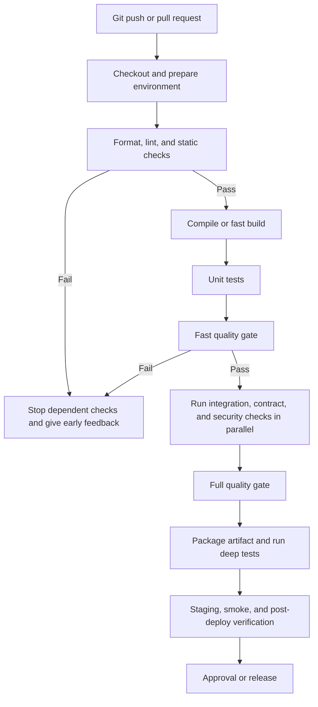
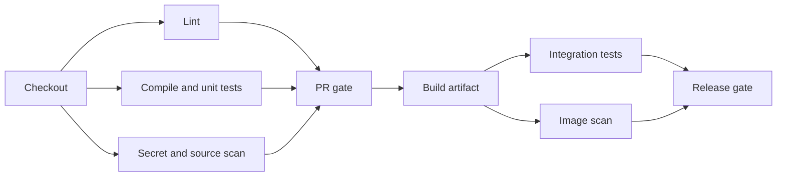

# Shifting Fast, High-Feedback Checks Left

In CI/CD, when a defect is discovered directly affects development velocity. If a formatting error, compilation failure, or unit test failure is only caught after the pipeline has built an image, deployed to staging, and executed a lengthy test suite, the team waits longer and wastes resources before receiving actionable information.

An effective strategy is **shifting fast, stable, high-signal checks to the front of the pipeline**. When a developer pushes a commit or opens a pull request, the system gives early feedback on easily detected, frequently occurring issues. Deeper checks still run at appropriate stages to evaluate integration, performance, security, and release readiness.

The goal is not simply running the shortest step first. A high-feedback check must catch meaningful bugs, produce trustworthy results, pinpoint the cause, and finish early enough while the author still has context fresh in mind. Pipeline ordering should therefore balance duration, defect-detection likelihood, severity, and cost of each check.

## 1. What Is Feedback Latency?

**Feedback latency** is the time from when a change enters the verification process until the developer receives results clear enough to decide the next step. It can be measured at multiple milestones:

- **Time to first signal:** time from push or pull request creation to the first useful signal, such as a formatter or unit test reporting a failure.
- **Time to required checks:** time to complete all mandatory checks required for merging.
- **Time to release confidence:** time to gather sufficient evidence from integration tests, security scans, staging, and release gates.

These three milestones serve different purposes. The first signal must arrive quickly to reduce developer wait time. Required checks must be thorough enough to protect the main branch. Release evidence must cover operational and business risks. Never shorten the first milestone by dropping critical checks at later stages.

For example, consider a pull request modifying fee-calculation logic. Formatting finishes in seconds, unit tests take a minute, integration tests against a test database take a few minutes, and end-to-end tests in a dedicated environment take longer. If unit tests catch a currency rounding bug, the team can fix it immediately without waiting for the end-to-end environment to provision.

## 2. Selecting High-Feedback Checks

When deciding which checks should run early, evaluate four factors:

1. **Execution time:** faster checks return results sooner, though short duration alone does not prove a check is useful.
2. **Defect-detection capability:** does the check routinely catch real bugs in the types of changes under review?
3. **Reliability:** are results consistent across runs, or does it frequently raise false alarms due to environment issues or flaky tests?
4. **Actionability:** does the output identify the file, line, test case, or failure condition so the developer can fix it quickly?

One qualitative assessment is whether a check yields high true, actionable signal per minute of wait time. You do not need to force every team into one rigid formula; use repository data to tune the ordering.

| Check type | Typical feedback value | Usually appropriate placement |
|---|---|---|
| Structure, whitespace, formatter checks | Catches formatting and convention issues very early | Local, pre-commit, or start of CI |
| Fast linting and static analysis | Catches syntax errors, risky APIs, or rule violations | Early CI, before heavy builds/packaging |
| Compilation or type checking | Catches build and type errors | Early after preparing toolchain |
| Unit tests | Fast feedback on small component logic | Early in pull request pipeline |
| Basic dependency and secret checks | Catches invalid dependencies or committed secrets | Early, depending on severity and scan time |
| Integration/contract tests | Catches inter-component defects or contract violations | After fast checks; can run in parallel |
| End-to-end tests | Verifies cross-system user flows | Later stage or in an appropriate environment |
| Load, performance, and deep checks | Evaluates behavior under load or special conditions | Scheduled pipelines, pre-release, or on risky changes |

Exact placement depends on the project. For example, a frontend project might run type checking very quickly and place it before unit tests; a project with schema generation must run the generator before compiling. What matters is keeping inter-step dependencies accurate and ensuring early signals are not delayed by unnecessary steps.

## 3. Organizing the Pipeline into Feedback Tiers

A reference pipeline can be structured into tiers:



This is a conceptual layout. Real pipelines may run compilation and certain scans in parallel, or require building an artifact before running artifact-level checks. Design the DAG around real dependencies rather than forcing independent checks into a single sequential chain.

### Tier 1: Immediate Feedback on the Developer's Machine

Formatters, linters, lightweight type checks, and relevant unit tests can run inside the IDE, pre-commit hooks, or quick local commands. Authors catch errors before pushing while change context is still fresh.

Local checks do not replace CI. Developer machines can differ from CI runners, hooks can be bypassed, and some checks need services unavailable locally. CI must still run required checks against the pushed revision.

### Tier 2: Fast Checks on Every Push/Pull Request

Run formatters/linters, static analysis, compilation, and unit tests. This group typically returns useful signals rapidly without provisioning the full system. If a check fails, the pipeline can halt downstream branches that depend on it and surface clear logs.

### Tier 3: Integration and Security Checks

Once fast checks pass, run integration tests, contract tests, dependency scans, container scans, and other risk-based checks. Independent jobs can run in parallel to reduce overall wall-clock time.

### Tier 4: Deep Testing and Release Verification

End-to-end, performance, migration tests, staging smoke tests, and post-deployment verification typically require more complex environments or data. They safeguard merge, deploy, or release decisions according to organizational policy.

## 4. Ordering Checks Properly and Parallelizing Intentionally

A practical rule is placing cheap, stable checks that catch frequent bugs ahead of resource-heavy steps. However, ordering must also respect dependencies:

- Formatters and linters usually do not require artifacts, so they can run immediately after checkout.
- Compilation requires the toolchain and possibly generated sources, so it runs after the corresponding setup/generation steps.
- Unit tests generally require compiled classes but not a database or production-like environment.
- Integration tests require backing services, containers, or databases, so they typically start after fast checks.
- Artifact-level checks require the artifact to be built and uniquely identified first.

If two checks are independent, run them in parallel. For example, source security scans, unit tests, and compilation can run concurrently if runners have enough capacity and scans do not require built artifacts. If all jobs contend for CPU or memory on an undersized runner, excessive parallelism can slow every job down and increase feedback time.

Distinguish the **critical path** from cumulative total duration. With parallel jobs, pipeline completion time depends on the longest branch plus resource queue time. Optimize pipelines by shortening the critical path, reducing queue time, and eliminating unnecessary sequential dependencies.

Example DAG:



The diagram shows multiple checks running concurrently, while the release gate only completes once all mandatory checks have produced valid outcomes. Any skipped branch must follow explicit conditions and must never be confused with a pass.

## 5. Pipeline Example with GitHub Actions and Gradle

The example below illustrates fast checks running first, followed by deeper checks only when fast checks succeed. Action SHAs are placeholders; replace them with verified full commit SHAs per repository policy.

```yaml
name: ci

on:
  pull_request:
  push:
    branches: [main]

jobs:
  fast_checks:
    runs-on: ubuntu-24.04
    steps:
      - uses: actions/checkout@<CHECKOUT_ACTION_SHA>

      - name: Check formatting
        run: ./gradlew spotlessCheck

      - name: Compile and run unit tests
        run: ./gradlew compileJava test

  integration:
    needs: fast_checks
    runs-on: ubuntu-24.04
    steps:
      - uses: actions/checkout@<CHECKOUT_ACTION_SHA>
      - name: Run integration tests
        run: ./gradlew integrationTest

  quality_gate:
    if: always()
    needs: [fast_checks, integration]
    runs-on: ubuntu-24.04
    steps:
      - name: Evaluate required results
        env:
          FAST_RESULT: ${{ needs.fast_checks.result }}
          INTEGRATION_RESULT: ${{ needs.integration.result }}
        run: |
          test "$FAST_RESULT" = "success"
          test "$INTEGRATION_RESULT" = "success"
```

This is a structural example, not a complete workflow for every project. `spotlessCheck`, `integrationTest`, and the Gradle tasks must exist in your build. If a project has no `integrationTest` task, substitute the actual task. In GitHub Actions, `needs` and `if: always()` must be used carefully so the quality gate can inspect upstream results after a failure while still returning a non-zero exit code when a mandatory check fails. With optional jobs, the gate must clearly distinguish success, failure, skipped, and cancelled per policy.

If `fast_checks` fails, the `integration` job does not need to run because its `fast_checks` dependency has not succeeded. The quality gate still runs to aggregate results and ensure the failed state is never masked.

## 6. Testing by Change Scope

In monorepos or large repositories, running every test on every change can inflate feedback latency. You can select tests using changed files and a dependency graph:

- Documentation edits may only need documentation linting.
- Changes in a Java module can run unit tests for that module and dependent modules.
- API schema changes require running contract tests and affected consumer tests.
- Build script, plugin, or shared library edits can impact many modules and require broader coverage.

Selective testing is only safe when dependency relationships are known accurately enough. A file changed in a shared library can affect multiple services even if service directories remain untouched. When the dependency graph is incomplete or uncertain, broaden the test scope or run the full mandatory suite.

Even when running only affected tests per pull request, the pipeline should still run a broader suite on merge queues, the main branch, schedules, or before release. Impact-based selection optimizes feedback, while broader runs catch dependencies missed by selection rules.

## 7. Keeping Early Signals Trustworthy

A fast check that raises frequent false alarms erodes developer trust. Developers may start ignoring warnings or retrying repeatedly until green. You must manage the quality of the test suite itself.

### Reducing Flaky Tests

A flaky test yields different outcomes when re-run against the same revision under expected conditions. Common causes include race conditions, time dependencies, test ordering, shared data, external services, or incomplete cleanup.

When a flaky test is spotted:

1. Record the test, commit, runner, timestamp, and logs from each run.
2. Distinguish product defects from environment or test synchronization bugs.
3. File an issue and assign an owner to fix the test.
4. Only quarantine temporarily with a stated reason and deadline; maintain a separate tracking signal.
5. Never let unlimited retries turn a failed test into a pass without preserving run history.

Retries can help handle transient infrastructure errors, yet they must never mask assertion failures or unstable tests. If retries are permitted, reports must retain the attempt count and outcome of each attempt.

### Writing Actionable Feedback

Good feedback identifies which check failed, which commit was tested, the relevant test case or file, where logs/reports live, and how to reproduce locally. Avoid showing only "CI failed" without context.

Preserve logs and reports even when the pipeline stops early. Diagnostic upload steps can run after failures so developers do not have to re-run jobs just to fetch logs. However, a successful log-collection step must not alter the failed status of the check itself.

## 8. Optimizing Speed Without Sacrificing Quality

You can reduce feedback latency in several ways:

- **Incremental builds:** only build affected modules or tasks when the build system tracks dependencies accurately.
- **Dependency/build caching:** reuse data with accurate cache keys and input fingerprints; never treat a cache hit as proof that tests passed.
- **Test distribution:** split independent tests across multiple shards or runners to shrink the critical path.
- **Test selection:** run change-relevant test groups paired with broader suites at protective milestones.
- **Reducing startup overhead:** use pre-baked standard runner images, dependency mirrors, and safely pre-initialized test services.
- **Selective fail-fast:** halt dependent branches when foundational checks fail while still collecting essential diagnostics.
- **Eliminating duplicate steps:** avoid running the exact same formatter or unit suite multiple times across jobs that produce no new evidence.

Optimization must be data-driven. For instance, if most wall time sits in runner queues, speeding up test commands will not solve the bottleneck. If unit tests run slowly because every test boots an entire application, improving fixtures or splitting suites may help more than adding runners.

## 9. Measuring Feedback Quality

Do not measure total pipeline duration alone. Useful metrics include:

| Metric | Interpretation | What to examine |
|---|---|---|
| Time to first signal | Time from push to first useful outcome | Queue time, startup, and check ordering |
| Time to required checks | Time to complete all mandatory checks | Critical path and unnecessary sequential jobs |
| Queue time | Time waiting for a runner before a job starts | Runner capacity, concurrency limits, and resource allocation |
| Flaky rate | Percentage of tests yielding unstable outcomes | Test quality, data, and environment |
| Actionable failure rate | Percentage of failures pointing to real fixable issues | False positives, log quality, and scan rules |
| Re-run rate | Percentage of pipelines requiring re-runs for a trustworthy result | Flaky tests, infrastructure failures, and input changes |

Analyze metrics by repository, job type, and test group. A pipeline with a low average duration that occasionally stalls for hours can deliver a worse experience than one with steady execution times. Tracking both medians and high percentiles like p90/p95 exposes abnormal slowdowns.

## 10. Common Mistakes

| Mistake | Consequence | Adjustment |
|---|---|---|
| Ordering solely by runtime | Very fast, low-value checks occupy the front | Factor in defect-detection power, reliability, and actionability |
| Putting all tests into one sequential job | Creates a long critical path and hard-to-isolate failures | Split jobs by dependency and parallelize independent checks |
| Dropping integration/security tests for speed | Increases risk of defects slipping past merge/release gates | Keep deep checks at appropriate stages with explicit gates |
| Retrying until green | Masks flaky tests or real bugs | Cap retries, store all attempts, and fix root causes |
| Selecting tests solely by changed folder | Misses impact via shared libraries | Use a dependency graph and broaden scope when uncertain |
| Marking skipped checks as success | Quality gates may approve untested changes | Distinguish valid skips from unexpected skips |
| Over-parallelizing | Runners contend for CPU/memory, increasing total time | Measure load and balance critical path against runner capacity |

## 11. Checklist for Shifting High-Value Feedback Left

- [ ] Define target times for first signal and required checks.
- [ ] Place formatters, linters, static checks, and fast unit tests at the start of the pipeline when dependencies allow.
- [ ] Prioritize checks by defect-detection value, stability, and actionability—not runtime alone.
- [ ] Split checks into jobs with clear dependencies and parallelize independent branches.
- [ ] Keep integration, contract, security, end-to-end, and performance checks at appropriate gates.
- [ ] Use selective testing only when the dependency graph is trustworthy; run broader suites at protective milestones.
- [ ] Distinguish success, failure, skipped, and cancelled in quality gates.
- [ ] Track flaky tests, cap retries, and retain diagnostics on failure.
- [ ] Measure queue time, time to first signal, time to required checks, and p90/p95.
- [ ] Optimize caching, incremental builds, and runners based on empirical metrics.

Shifting fast, high-feedback checks left helps developers catch bugs while repair costs are still low. Combined with deeper checks, clear quality gates, and operational metrics, the pipeline provides rapid feedback during development while preserving enough evidence for safe integration and release.
