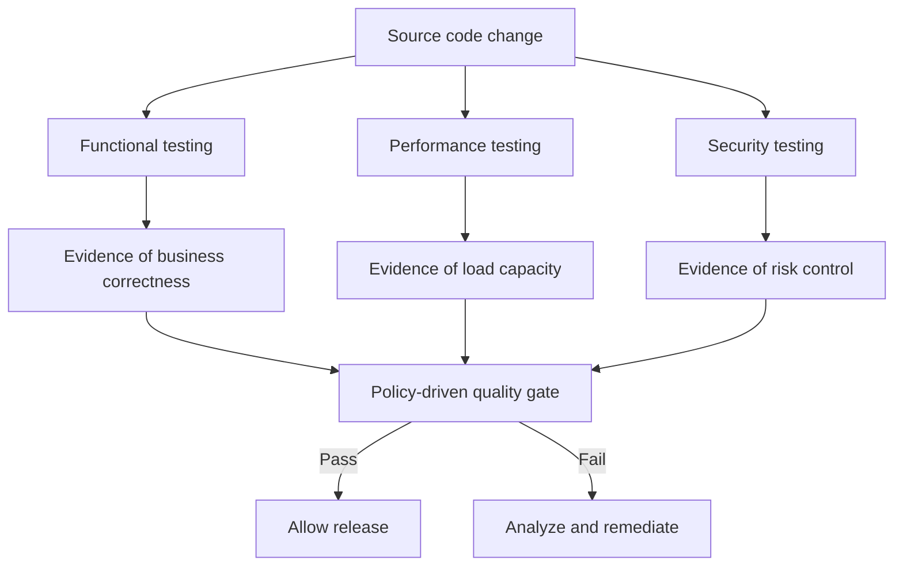
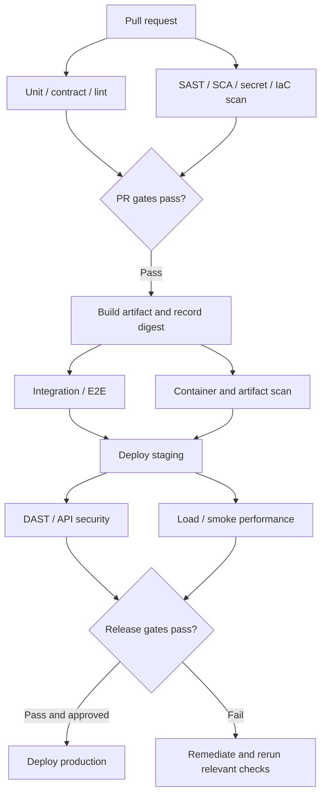

# Separating Functional Testing from Performance and Security Testing

A reliable CI/CD pipeline must answer three distinct questions: **does the application do what users need, can it handle expected load, and can it withstand attacks?** These three questions correspond to functional testing, performance testing, and security testing.

They may test the same service and sometimes share an environment or data, yet their goals, load-generation methods, failure definitions, and pass criteria are not the same. Grouping all outcomes into a single "test" job makes it hard for teams to tell which risk is controlled, when to block a release, and who needs to act on the result. Good design separates testing streams by purpose, then aggregates evidence at the appropriate quality gates.

## 1. Three Test Categories Answering Three Different Questions

| Category | Core question | What is observed | Evidence typically used for evaluation |
|---|---|---|---|
| Functional | Does the system meet requirements and business rules? | Inputs, outputs, state, API/UI behavior, data, and business flows | Assertions, test pass/fail, contracts, and bug reports |
| Performance | Does the system meet load, latency, and resource limits? | Latency, throughput, error rate, CPU, RAM, I/O, saturation, and behavior under varying load | Percentiles, throughput, error rates, resource metrics, and baseline comparisons |
| Security | Can the system be exploited or expose/modify data without authorization? | Source code, dependencies, configuration, images, APIs, access permissions, data flows, and attack surface | Findings, severity, exploitability, reproduction evidence, and remediation status |

Example with a payment API:

- Functional testing verifies that valid transactions deduct the exact amount, declined transactions leave balances unchanged, and repeated requests do not charge twice.
- Performance testing measures response times and error rates under concurrent transactions matching a defined load model.
- Security testing verifies that users cannot read another account's transactions, tokens are not leaked, the API resists malicious inputs, and dependencies contain no vulnerabilities exceeding policy thresholds.

An HTTP 200 response alone does not prove all three. The response payload may be functionally wrong, the response may be too slow, or the endpoint may allow unauthorized data access.



The three streams can run in parallel when inputs and environments allow. However, the release gate must aggregate mandatory outcomes from all three rather than letting one category's success stand in for the other two.

## 2. Functional Testing: Verifying Behavior and Business Rules

Functional testing verifies that the system satisfies specifications, requirements, and communication contracts. It focuses on **what must happen** when the system receives an input or experiences an event.

Common levels include:

- **Unit tests:** test functions or small units with dependencies substituted where appropriate, such as tax calculation or order status transitions.
- **Component/service tests:** test a component or service within a relatively isolated boundary.
- **Integration tests:** test interactions between the application and databases, message brokers, caches, or dependent services.
- **Contract tests:** verify that producers and consumers comply with API contracts or message schemas.
- **End-to-end tests:** simulate user or business flows across multiple components.
- **Acceptance tests:** verify acceptance criteria from a business or user perspective.

A solid functional test needs clear inputs, a deterministic initial state, an action under test, and expected outcomes. For APIs, assert status codes, response schemas, returned data, side effects, and access permissions. For write flows, verify database state or emitted events rather than checking UI notifications alone.

Example functional test using pytest:

```python
def test_rejects_payment_when_balance_is_insufficient(client, account):
    account.balance = 50

    response = client.post(
        "/payments",
        json={"account_id": account.id, "amount": 80},
    )

    assert response.status_code == 422
    assert response.json()["code"] == "INSUFFICIENT_FUNDS"
    assert account.refresh().balance == 50
```

This example verifies three things: the API returns the right error status, the error code is accurate, and the balance remains unchanged. In real tests, fixtures must create isolated data and clean up after each run so tests remain repeatable.

### Operational Characteristics of Functional Testing

- Run unit tests and most fast tests on every pull request for early feedback.
- Integration and end-to-end tests generally require backing services, seeded data, and longer execution times.
- Tests must be independent, repeatable, and unaffected by other tests' execution order.
- When a test fails, preserve logs, reports, minimal inputs, and correlation IDs for reproduction.
- For asynchronous tests, wait for completion conditions with a bounded timeout rather than overly long fixed sleeps.

Functional tests can catch certain performance or security issues when explicitly designed for them, yet standard business assertions do not replace dedicated load measurements or specialized security checks.

## 3. Performance Testing: Measuring Responsiveness Under Load

Performance testing evaluates how the system responds as user count, request volume, data size, or workload changes. It requires a clear load model, measurement environment, and acceptance thresholds.

### Key Metrics

| Metric | Meaning | How to interpret |
|---|---|---|
| Latency | Time to process a single request or transaction | Track p50, p95, p99; averages can hide slow distribution tails |
| Throughput | Requests or transactions completed per unit of time | E.g., requests/second or transactions/second |
| Error rate | Percentage of requests failing, timing out, or returning errors | Separate application errors, dependency errors, and load-induced failures |
| CPU/RAM | Compute and memory utilization | Examine averages, peaks, trends, and container/VM limits |
| I/O and network | Read/write and data transfer capacity | Look for disk, database, network, or connection pool bottlenecks |
| Saturation | Degree to which a resource/queue operates near its limit | Growing queues, exhausted thread pools, waiting connections, or sustained CPU overload |

A service with high throughput whose p99 latency exceeds its SLO may still fail requirements. Likewise, low latency at low load does not prove the system survives peak traffic. Read multiple metrics together and compare them against service objectives.

### Types of Performance Tests

- **Load test:** generates expected or target load to observe how the system responds under normal operating conditions.
- **Stress test:** pushes load beyond design limits to find degradation points, ceilings, and recovery behavior.
- **Spike test:** applies sudden load surges or drops to check burst handling.
- **Soak/endurance test:** sustains load over an extended period to uncover memory leaks, connection exhaustion, queue buildup, or gradual degradation.
- **Capacity test:** finds maximum capacity or resource sizing required to meet performance targets.
- **Scalability test:** evaluates how the system improves when adding instances, CPU, RAM, or processing partitions.

### Designing a Load Model

A load model should reflect how users actually exercise the system:

1. Identify primary business flows and the traffic share of each request type.
2. Determine target concurrent users or request arrival rates.
3. Model think time, data distribution, read/write ratios, and cache hit rates where meaningful.
4. Define a warm-up phase so the system stabilizes before collecting measurements.
5. Run long enough to observe trends, percentiles, and resource behavior.
6. Archive load configuration, artifact version, environment settings, and results for future comparison.

Example using k6:

```javascript
import http from 'k6/http';
import { check, sleep } from 'k6';

export const options = {
  vus: 20,
  duration: '2m',
  thresholds: {
    http_req_failed: ['rate<0.01'],
    http_req_duration: ['p(95)<500'],
  },
};

export default function () {
  const response = http.get(`${__ENV.BASE_URL}/health`);
  check(response, {
    'health endpoint returns 200': (r) => r.status === 200,
  });
  sleep(1);
}
```

This example illustrates syntax and thresholds: 20 virtual users for 2 minutes, error rate below 1%, and p95 under 500 ms. A `/health` endpoint is only suitable for basic responsiveness checks; business benchmarks must model realistic endpoints, payloads, and request distributions. Thresholds must derive from SLOs, product requirements, and environment baselines rather than reusing example numbers across services.

### Conditions for Trustworthy Performance Results

- Use an environment configured closely to production and explicitly document differences.
- Avoid multiple teams running benchmarks that contend for the same resources.
- Pin artifact versions, datasets, and load configurations when comparing runs.
- Monitor the load generator itself; an under-provisioned generator can become the bottleneck.
- Warm up caches and runtimes consistently.
- Repeat runs when noise is significant and analyze trends rather than drawing conclusions from one measurement.
- Never apply load capable of disrupting production without an approved plan, limits, and authorization.

## 4. Security Testing: Finding Weaknesses and Verifying Trust Boundaries

Security testing looks for defects that could compromise confidentiality, integrity, and availability. It inspects source code, dependencies, infrastructure configuration, container images, endpoints, and behavior under untrusted inputs.

### Common Techniques

| Technique | Timing / target | Example findings |
|---|---|---|
| SAST (Static Application Security Testing) | Analyzes source code or bytecode without running the app | SQL injection, unsafe deserialization, path traversal, data-handling flaws |
| SCA (Software Composition Analysis) | Direct/transitive dependencies and licenses | Libraries with CVEs, unsupported versions, disallowed licenses |
| Secret scanning | Repositories, commits, and sometimes git history | Committed API tokens, private keys, passwords |
| IaC scanning | Terraform, Kubernetes manifests, Dockerfiles, and cloud configs | Public storage, overly broad IAM permissions, privileged containers |
| Container/image scanning | Images and internal OS packages/libraries | Packages with CVEs, outdated base images, risky settings |
| DAST (Dynamic Application Security Testing) | Running application in a test environment | HTTP misconfigurations, exploitable injections, information-leaking endpoints |
| API security testing | Running APIs, contracts, and access permissions | Broken object-level authorization, weak auth, rate-limit abuse |
| Fuzz testing | Parsers, protocols, or APIs receiving diverse/malformed inputs | Crashes, boundary bugs, memory corruption, or abnormal states |

SAST, SCA, secret scanning, and IaC scanning can usually run early in CI since they do not require deploying the full application. DAST and API security testing require a running application, so they typically execute in integration or staging. Fuzzing can run briefly on pull requests and deeper on schedules or pre-release.

### Triaging Findings

Do not make release decisions based solely on raw alert counts. For each finding, evaluate:

- Severity and impact type.
- Exploitability given the actual architecture and configuration.
- Reachability: public internet, internal network, authenticated access, or privileged access.
- Affected data and functionality.
- Availability of a patch or supported mitigation.
- Whether the finding is a false positive or duplicates an already addressed issue.

Policies may immediately block critical/high vulnerabilities per organizational thresholds while requiring triage for remaining findings. Exceptions must designate an owner, justification, scope, mitigating controls, and expiration date. Never silence alerts permanently with an unowned `ignore` rule.

### Safety When Running Security Tests

DAST, fuzzing, and certain API tests can create records, send malformed requests, or trigger write/delete actions. Use authorized test environments, dedicated accounts, and synthetic/anonymized data. Enforce rate limits, URL scopes, time bounds, and access controls. Never scan third-party systems or production outside authorized scope.

If a scanner detects a secret in the repository, removing the secret line in a new commit is insufficient if the credential was already exposed. Revoke or rotate the credential, inspect Git history and logs that may have captured the value, and follow the organization's incident response process.

## 5. Why Not Combine All Three into One Test Job?

A single combined job typically leads to these issues:

- Unclear whether a pipeline failed due to business assertions, p95 latency, a CVE, or the test environment.
- Long-running suites delay fast feedback for developers.
- Functional tests can run in small environments, whereas benchmarks need stable resources and dynamic security scans need a deployed app.
- Retrying a monolithic job re-runs expensive benchmarks or unnecessary security scans.
- Access privileges needed for DAST or deployment may be overly granted to functional test steps.
- Inability to assign separate thresholds and owners per risk category.

Separating jobs does not mean the three categories are disconnected. They still share the same commit, artifact digest, and release record to ensure results apply to the exact same version. Each category should emit its own report, while the release gate aggregates mandatory policy outcomes.

## 6. Organizing Test Categories in the CI/CD Pipeline

A practical strategy usually uses multiple tiers to balance feedback speed and verification depth.

| Stage | Prioritized tests | Goal |
|---|---|---|
| Pull request | Unit, component, contract; lint; fast SAST, secret scan, and SCA | Catch bugs early before merging |
| Post-merge / main | Integration, API/acceptance; image/IaC scans; extended functional tests | Verify integration and main-branch artifacts |
| Staging / release candidate | E2E, DAST/API security, smoke tests, controlled load tests | Verify the deployed app in a production-like environment |
| Nightly / scheduled | Deep regression, soak, stress, fuzzing, comprehensive scans | Detect degradation and risks invisible per PR |
| Pre-production | Aggregate quality gates, review exceptions, approvals, verify artifact digest | Enable controlled release |

Not every heavy suite must run on every pull request. You can run a fast performance smoke check on critical changes while running extended load/stress/soak tests on schedules or before releases. Similarly, full DAST can run in staging while SAST/SCA/secret scans run more frequently.



This diagram illustrates a reference structure. Actual ordering must reflect dependencies: DAST needs a deployed environment; image scanning needs a built image; functional tests may run before or after build depending on how the project produces artifacts. When deploying to production, always deploy the exact artifact verified by those checks, identified by digest.

## 7. Example Job Separation in GitLab CI

The following example illustrates separating functional testing, static security scanning, dynamic testing, and performance testing. Scripts under `./ci/` are project-provided wrappers; adjust paths, tools, report formats, and conditions to your repository.

```yaml
stages:
  - verify
  - build
  - integration
  - security_static
  - deploy_test
  - security_dynamic
  - performance

functional_tests:
  stage: verify
  script:
    - ./gradlew test --no-daemon
  artifacts:
    when: always
    reports:
      junit: build/test-results/test/*.xml

security_static:
  stage: verify
  script:
    - ./ci/run-sast.sh
    - ./ci/run-dependency-scan.sh
    - ./ci/run-secret-scan.sh
  artifacts:
    when: always
    paths:
      - reports/security/

build_artifact:
  stage: build
  needs:
    - functional_tests
    - security_static
  script:
    - ./gradlew assemble --no-daemon
    - ./ci/package-and-record-digest.sh
  artifacts:
    paths:
      - build/libs/
      - reports/release/

integration_tests:
  stage: integration
  needs:
    - build_artifact
  script:
    - ./ci/run-integration-tests.sh
  artifacts:
    when: always
    paths:
      - reports/integration/

deploy_staging:
  stage: deploy_test
  needs:
    - build_artifact
    - integration_tests
  script:
    - ./ci/deploy-staging-by-digest.sh
  environment:
    name: staging

security_dynamic:
  stage: security_dynamic
  needs:
    - deploy_staging
  script:
    - ./ci/run-dast-against-staging.sh
  artifacts:
    when: always
    paths:
      - reports/dast/

performance_smoke:
  stage: performance
  needs:
    - deploy_staging
  rules:
    - if: '$CI_PIPELINE_SOURCE == "schedule" || $CI_COMMIT_TAG'
  script:
    - ./ci/run-performance-test.sh
  artifacts:
    when: always
    paths:
      - reports/performance/
```

In this example:

- `functional_tests` verifies application behavior and outputs JUnit reports.
- `security_static` runs analyses that can execute prior to deployment.
- `build_artifact` produces outputs after early gates pass and records the digest.
- `integration_tests` verifies interacting components.
- `deploy_staging` deploys the built artifact into the test environment.
- `security_dynamic` tests the running application on staging.
- `performance_smoke` runs only on schedules or release tags; this is where controlled performance measurements run.

This example illustrates dependency structure and separation of responsibilities. `deploy-staging-by-digest.sh` must retrieve the exact artifact from the build job and verify its digest without rebuilding. If a project needs performance smoke checks on every pull request, add a short job with an isolated environment and light load. Reports must match formats supported by the platform's parser to display inline in the UI; `paths` only stores files for download.

## 8. Designing Quality Gates for Each Category

Each test category needs explainable pass criteria aligned with service risk.

### Functional Gate

- Mandatory tests must execute and pass; never treat "no tests found" as success.
- Test reports must be generated, readable, and tied to the commit/artifact under evaluation.
- Critical business flows, access permissions, and side effects must be verified.
- Flaky tests must be tracked; never use unlimited retries to hide failures.

### Performance Gate

- Specify workload, environment, warm-up duration, and measurement duration.
- Set thresholds based on SLOs or approved baselines, such as p95/p99, throughput, and error rate.
- Monitor resource saturation to pinpoint causes rather than watching latency alone.
- Compare identical environment types and load profiles; document any environment changes.
- Only block releases when measurements are reliable and thresholds match the scope.

### Security Gate

- No unresolved findings exceeding policy severity/exploitability thresholds.
- Artifacts and dependencies are scanned at the exact version/digest slated for release.
- Secret scanning and configuration checks cover required scopes.
- DAST/API scans target the exact named application and environment.
- Every exception has an approver, justification, expiration, and mitigating controls.

When reports are missing, tools fail, or outcomes cannot be determined, status should fail or trigger policy handling. Never treat missing data as a pass. Also distinguish product failures from infrastructure failures—such as a full runner disk or a scanner failing to download its vulnerability database; both require action, though investigation steps differ.

## 9. Test Environments and Test Data

The three testing categories have distinct environmental needs:

| Category | Environment requirements | Data considerations |
|---|---|---|
| Functional | Dependent services startable, controllable initial state, resettable | Small fixtures, boundary values, synthetic data, isolated from other tests |
| Performance | Stable resources, near production sizing, no unplanned competing workloads | Dataset representative in size, distribution, and read/write ratio; avoid unauthorized real data |
| Security | Authorized environment, dedicated test accounts and roles, recoverable after tests | Role-based accounts, synthetic/anonymized data, test secrets, and resettable/deletable data |

Never share an environment concurrently modified by multiple pipelines for performance measurements, as other jobs distort latency and throughput. DAST or fuzzing can also create malformed records, corrupt test state, or trip rate-limit protections. Isolate per pipeline/run or use dedicated environments with explicit cleanup.

If production-like data is required, generate anonymized or synthetic datasets through an approved process. Never copy personal data, tokens, passwords, or live payment data into CI artifacts, logs, or reports.

## 10. Reading Outcomes and Handling Category Failures

A pipeline can fail in multiple categories simultaneously. Act on evidence rather than blindly re-running the entire pipeline:

| Outcome | Investigation questions | Common actions |
|---|---|---|
| Functional test fail | Which assertion failed? Was initial state stable? Did a dependency fail? | Inspect test reports/logs, reproduce with the same inputs, fix logic or test setup |
| Performance regression | Which endpoint saw p95/p99 increase? Did throughput or error rate change? Which resource saturated? | Compare baselines, traces, and metrics; locate code, query, or config changes |
| Security finding | Is the finding in a dependency, code, config, or runtime? How is it exploitable in context? | Verify, assess impact, patch or mitigate; file a time-bounded exception if permitted |
| Scanner/tool failure | Did the tool fail to run, fail to fetch vulnerability feeds, or hit expired credentials? | Classify as infra failure, restore scanner, and re-run missing checks |
| Environment failure | Did a service fail to boot, run out of resources, or fail to reset data? | Check deployment, runner, and fixtures; never pass a product whose tests did not run |

Store reports alongside commit SHA, pipeline ID, artifact digest, load profile, or scanner version. This enables teams to compare across releases and identify whether a finding or regression already existed earlier.

## 11. Anti-Patterns to Avoid

- **Unit tests only:** verifies small logic while missing integration, performance, and runtime risks.
- **Treating E2E as full coverage:** E2E is typically slow, hard to diagnose, and does not replace tests at other layers.
- **Measuring performance on shared runners:** results suffer noise from CPU, disk, or network contention from other jobs.
- **Using one latency threshold for all endpoints:** ignores differences across read, write, background flows, and SLO requirements.
- **Running security scans only before release:** secrets, dependency flaws, or misconfigurations can linger in development branches.
- **Ignoring all findings to keep the pipeline green:** destroys risk visibility and accountability.
- **Running DAST/fuzzing against unauthorized environments:** can cause outages, delete data, or impact third parties.
- **Rebuilding artifacts after testing:** the released version may differ from the tested version.
- **Failing to store reports and test configurations:** makes results impossible to reproduce or compare.
- **Unlimited retries:** masks flaky tests, environment errors, or real regressions.

## 12. Strategy Design Checklist

When reviewing a pipeline, answer:

1. Do critical business requirements have functional tests at the right layers?
2. Do tests verify data state, side effects, and access permissions?
3. Does the load model reflect real usage flows and service SLOs?
4. Are latency percentiles, throughput, error rate, and resource saturation measured?
5. Do SAST, SCA, secret, IaC, and image scans run at appropriate stages?
6. Do DAST/API security tests run against the exact deployed application in an authorized environment?
7. Are pass thresholds and exception policies explicit, owned, and time-bounded?
8. Are environments and data isolated, reset, and protected?
9. Are results tied to commits, pipeline runs, and artifact digests?
10. Does the release gate require all mandatory test categories?
11. Are reports, logs, load configurations, scanner versions, and triage evidence retained?
12. When one category fails, can developers isolate the cause and re-run only what is needed?

Separating functional, performance, and security testing lets each category measure a specific risk with appropriate methods and criteria. When results remain linked to the same commit and artifact, the pipeline can make evidence-based release decisions: verified behavior, compliant responsiveness, and security risk within acceptable bounds.
