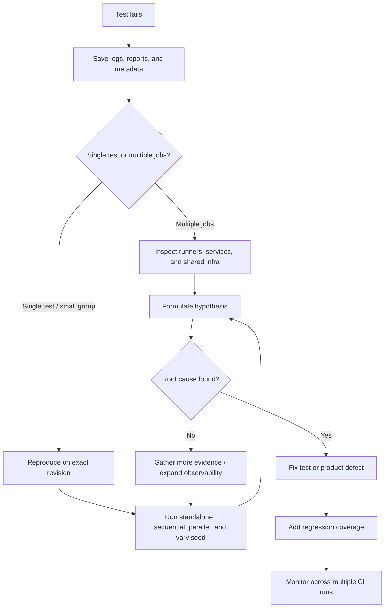

# Identifying Flaky Tests and Investigating Root Causes

A trustworthy automated test must return consistent results when source code, inputs, and controlled environmental conditions remain unchanged. A flaky test passes sometimes and fails other times even though the team is testing the exact same revision with no intentional changes to test conditions. Its outcome depends on unstable factors such as timing, test ordering, shared state, networking, machine load, or external data.

Flaky tests erode confidence in CI. When one run is red and a re-run turns green, the team wastes time determining whether it is a product defect or a test bug. Repeatedly clicking re-run until green can mask real defects and render quality gates meaningless. The right approach is preserving evidence, isolating what caused the outcome to shift, fixing the root cause, and using bounded retries strictly as a diagnostic signal.

## 1. What Is a Flaky Test and Why Address It?

A test is considered flaky when identical test conditions produce differing outcomes with no relevant change explaining the discrepancy. For example, an ordering test occasionally times out waiting for a message broker notification; another test intermittently fails because two tests write to the same database record; or a UI test asserts on an element before page rendering completes.

Not every passing re-run proves a test is flaky. A product bug might only surface under specific load, data, or schedules. A race condition inside the application can also fail intermittently; that is a nondeterministic product defect, not an excuse to label the test flaky and ignore it. Distinguish two questions:

- **Is product behavior nondeterministic?** If the application genuinely has a race, data loss, or sporadic timeout, that may be a defect requiring a fix.
- **Is the check itself nondeterministic?** If the test relies on stale state, overly tight timing, or shared data, the test can introduce noise even when the product works properly.

In practice, both issues can coexist. Flaky tests sometimes uncover real concurrency bugs in the system. Never assume every non-repeating failure is merely a test bug.

### 1.1. Common Symptoms

- The same commit and same job pass on one run and fail on another.
- Tests fail more often when run in parallel, yet pass when run alone.
- Outcomes shift based on test ordering or running the full suite.
- Tests time out on slower CI runners while passing locally.
- Tests depend on current time, calendar date, timezone, or random seeds.
- Tests call external APIs/services and fail during network or service fluctuations.
- Failures routinely vanish after a re-run with no code or data changes.
- One specific test causes subsequent tests to fail by leaving behind state.

### 1.2. Impact on the CI/CD Flow

Flaky tests impose both direct operational costs and quality risks:

| Impact | Consequence |
|---|---|
| False failures | Pull requests are blocked despite defect-free changes; developers waste time re-running jobs |
| False confidence from retries | Pipelines turning green after retries can mask real defects or load-sensitive bugs |
| Loss of trust in quality gates | Teams ignore warnings, disable tests, or weaken required checks |
| Increased feedback latency | Re-run jobs consume runner capacity and lengthen CI queues |
| Harder incident debugging | Logs lack data needed to reproduce order, seed, environment, and initial state |
| Corrupted engineering metrics | Pipeline failure rates no longer reflect actual product quality |

CI/CD is only useful when green means healthy and red is actionable. A suite riddled with flaky tests weakens both signals.

## 2. Quantifying Flakiness

Do not simply note "the test fails occasionally." Collect execution counts, failure counts, revisions, environments, and execution modes. A test failing 1 out of 2 runs has very different instability from one failing 1 out of 2,000 runs.

A straightforward ratio is:

\[
\text{Failure rate} = \frac{\text{failed test executions}}{\text{total test executions}}
\]

For flaky tests, also track pass/fail transitions on the same revision or identical input set. Useful metrics include:

- **Flake rate:** fraction of executions that fail within a defined observation window.
- **Affected runs:** number of pipeline runs impacted by the test.
- **Retry recovery rate:** fraction of initially failed tests that pass upon retry; this is an investigation signal, not a "fixed" rate.
- **Time lost:** runner time and developer wait time consumed by re-runs.
- **Flake age:** elapsed time from detection to resolution.
- **Repeatability by environment:** failure rate broken down by runner image, OS, executor type, load, or parallel mode.

Standardize denominators and measurement windows. For instance, per-execution failure rate can differ substantially from the rate of pipeline runs containing at least one failed test. Never compare two cohorts computed with different formulas.

### 2.1. Why Multiple Re-Runs Can Still Miss Defects

Suppose a test has an independent failure probability \(p\) on each run. The probability of observing at least one failure across \(n\) runs is:

\[
P(\text{detection}) = 1 - (1-p)^n
\]

For example, if failure probability is 5%, running 10 times only gives roughly a 40% chance of observing at least one failure. If probability is 1%, running 20 times gives only about an 18% chance of catching the bug. A handful of passing re-runs does not prove a test is stable.

This formula assumes independent runs and constant probability. In reality, failures may depend on an event sequence, time of day, or runner state, making runs non-independent. Treat repeated runs as a way to gather more evidence, never as a stability certificate.

## 3. Distinguishing Flaky Tests from Other Failure Modes

Before investigating, classify the initial signal:

| Observation | Potential cause to investigate | Verification direction |
|---|---|---|
| Same revision, same data passes and fails intermittently | Flaky test or timing-dependent defect | Repeat under controlled conditions; record seed and environment |
| Test fails consistently after a commit | Product regression or outdated test | Inspect diff and verify expected behavior |
| Fails only on one runner image | Environment, toolchain, or dependency discrepancy | Compare images, runtimes, locales, filesystems, and permissions |
| Fails only when run in parallel | Resource, data, or ordering contention | Run sequentially, isolate namespaces, and inspect shared state |
| Many tests fail simultaneously | CI infrastructure, backing service, or network incident | Check other jobs, service health, DNS, and registries |
| Test consistently times out under high load | System capacity or unreasonable timeout threshold | Measure latency and resource usage; find product limits |
| Fails only when suite runs after a specific test | State leak or missing cleanup | Isolate the test, reverse order, and run predecessor standalone |

Do not raise timeouts or add retries before understanding the failure class. Increasing timeouts may be valid if an old limit was tighter than legitimate processing time, yet it never fixes race conditions, deadlocks, or hung services.

## 4. Common Root-Cause Categories

### 4.1. Shared Data and State

Multiple tests share a database, bucket, queue, account, or fixed resource name. When executed in parallel, one test can delete or update records while another test reads them.

For example, two tests both create a user with email `test@example.com`. The earlier test can cause the second to fail on a unique constraint. If the suite runs sequentially in another order, the error vanishes.

Countermeasures:

- Generate isolated data per test or test worker using unique IDs.
- Use transaction rollbacks or isolated database/schema namespaces where appropriate.
- Clean up data and resources after tests, even when tests fail.
- Never depend on leftover records from prior runs.
- Avoid sharing fixed accounts, filenames, ports, or queues across jobs.

### 4.2. Execution Order and Coupled Tests

A test may inadvertently rely on a file, global variable, singleton, mock, or state left by a prior test. When runners shuffle order or distribute tests across workers, the dependent test breaks.

Countermeasures:

- Have each test set up its own required state and clean up after itself.
- Never rely on declaration order or default framework execution order.
- Run tests standalone and compare against full-suite execution.
- Shuffle execution order, randomize order, and test across multiple workers.
- Minimize global state; where unavoidable, explicitly reset before and after tests.

### 4.3. Race Conditions and Asynchronous Synchronization

Tests calling APIs, writing to databases, or awaiting messages may assert results before async work finishes. Fixed sleeps like `sleep(2)` merely guess that work completes within two seconds; on slow runners it still fails, and on fast runners it wastes time.

Wait on conditions with an explicit deadline instead:

```python
import time

deadline = time.monotonic() + 10
while time.monotonic() < deadline:
    if order_is_visible(order_id):
        break
    time.sleep(0.1)
else:
    raise AssertionError(f"Order {order_id} did not become visible in time")
```

This example uses a monotonic clock and polls an observable condition. In real projects, prefer your test framework's polling/wait utilities for structured logs, intervals, and timeouts. Distinguish waiting for legitimate eventual consistency from masking latency that breaches SLOs.

### 4.4. Time, Timezones, and Calendars

Tests relying on `now()` can break across midnight, month boundaries, leap years, or daylight saving transitions. Local machines and CI runners can also run in different timezones.

Countermeasures:

- Inject a clock or time provider instead of calling the system clock directly inside tested logic.
- Use fixed clocks in unit tests; use wall-clock time only in tests that intentionally require it.
- Store timestamps in UTC where appropriate and convert timezones at presentation boundaries.
- Explicitly test time boundaries: before, at, and after deadlines.
- Use monotonic clocks to measure elapsed intervals so wall-clock adjustments do not skew durations.

### 4.5. Randomness and Randomly Generated Data

Random seeds cause tests to generate different inputs across runs. This helps explore broader scenarios while making failures hard to reproduce if seeds are lost.

Countermeasures:

- Log the seed whenever a test uses randomness.
- Allow passing a seed to replay the exact failing case.
- Use property-based testing with seeds and shrinking to isolate minimal failing inputs.
- Keep generators scoped per test without sharing mutable random state across workers.
- Separate controlled randomness from unpredictable data returned by external services.

Example test printing its seed at startup:

```python
import os
import random

seed = int(os.environ.get("TEST_SEED", "20261118"))
random.seed(seed)
print(f"TEST_SEED={seed}")
```

A fixed seed makes a run reproducible. When exploring multiple seeds, CI should record the seed of any failing run and support re-running with that exact value.

### 4.6. Networking and External Services

Tests calling live payment gateways, email providers, public APIs, or SaaS services depend on the Internet. Outcomes fluctuate with rate limits, DNS, TLS, outages, or third-party data shifts.

Countermeasures:

- Use well-defined fakes/mocks in unit tests with zero live network calls.
- Use containerized services or team-controlled test environments for integration tests.
- Use contract tests to verify API agreements without spinning up entire external systems.
- Tests making live external connections need timeouts, safe-semantics retries, rate limits, and error classification.
- Log endpoints, request IDs, status codes, and response times; never log tokens or sensitive payloads.

Do not mock everything. Over-mocking lets tests pass while real integrations break. Use test doubles in unit tests and retain integration/contract tests to verify real boundaries.

### 4.7. Runner Resources and Load

CPU, RAM, disk, file descriptors, ports, threads, and processes are bounded resources. Tests that fly on a laptop can time out when multiple jobs share a CI runner. Some tests spawn threads without joining them, accumulating resource exhaustion.

Countermeasures:

- Collect CPU, RAM, disk, thread counts, and per-test execution times.
- Cap concurrency to match actual resource capacity.
- Close sockets, threads, processes, and file handles in teardown.
- Avoid fixed ports; bind dynamic ports and pass endpoints into tests.
- Route heavy suites to appropriately sized runners while keeping timeouts aligned with reasonable limits.

### 4.8. Environment and Toolchain Differences

Tests can depend on locale, encoding, timezone, OS, filesystem case sensitivity, JDK/Node/Python versions, package managers, or browsers. Floating runner tags like `latest` also shift over time and alter results.

Countermeasures:

- Pin runtime, toolchain, browser, and dependency versions.
- Explicitly configure locale/timezone when tests expect deterministic values.
- Run appropriate integration tests in production-like environments.
- Log runner image, OS, architecture, and tool versions.
- Maintain test matrices covering actually supported platforms rather than trusting a single local machine.

### 4.9. Weak Assertions and Test Design

Tests can assert conditions that are overly broad or overly brittle—for instance, matching strings containing exact timestamps, assuming iteration order on unordered collections, or asserting on locale-dependent error messages.

Countermeasures:

- Assert on contracts and key behavior rather than unstable implementation details.
- Assert ordering only when the API guarantees ordering.
- Apply justified tolerances for floating-point values or timing measurements.
- Assert on structured fields instead of comparing volatile full logs or raw HTML.
- Avoid asserting on internal error message text unless the wording is part of the public API.

## 5. Flaky Test Investigation Process

Investigations require structure so evidence is not lost and too many variables do not change at once.

### Step 1: Preserve the Failing Run

Capture pipeline URL/ID, commit SHA, branch/PR, job name, test name, timestamp, runner image, OS, runtime/toolchain, command, timeout, worker count, and retry status. Save stdout/stderr, test reports, screenshots/videos for UI tests, service logs, seeds, and related artifacts.

Do not save logs only from a subsequent passing re-run. The initial failure usually holds the most critical clues. If CI wipes workspaces automatically, upload reports and logs even when jobs fail.

### Step 2: Determine Blast Radius

Ask whether one test or many tests failed together. If unrelated jobs fail simultaneously, suspect shared infrastructure or services. If one specific test fails, inspect its data, ordering, and timing. If a cluster of tests sharing one database or container fails together, inspect that shared resource first.

### Step 3: Reproduce on the Exact Revision

Check out the exact commit SHA using the identical toolchain, dependency lockfile, configuration, seed, and command. Run the failing test alone first, then run the full suite. If it fails to reproduce locally, compare environments rather than declaring the test cured.

### Step 4: Vary One Factor at a Time

Test each variable individually:

1. Run sequentially instead of in parallel.
2. Run with varying worker counts.
3. Randomize test order and record the seed.
4. Run the test right after a suspected predecessor to check state leaks.
5. Run inside the exact CI container/runner image.
6. Reduce or increase load systematically to find thresholds.
7. Swap external services for service containers or appropriate fakes to separate network errors from logic bugs.

Never alter timeouts, worker counts, datasets, and mocks all at once, or you will not know which change altered the result.

### Step 5: Formulate and Test Hypotheses

Each hypothesis must predict an observable outcome—for example: "this test shares a hardcoded email; assigning a unique email per worker will eliminate the unique constraint error." Apply the change and re-run under identical conditions. If the outcome does not change, revisit the evidence and discard the hypothesis.

### Step 6: Fix the Root Cause and Add Regression Evidence

Fix either the test or the product depending on findings. Add tests guarding the discovered failure mode—such as parallel tests, fake-clock tests, exception-path cleanup tests, or delayed-message tests. Never simply raise retry counts to turn pipelines green.

### Step 7: Monitor After the Fix

Run the test across multiple CI runs and relevant execution modes. Track flake rate, retry recovery, runtime, and new failures. Close the issue only after stability evidence matches the risk level, never after a single green run.



## 6. Diagnostic Data to Collect During Investigations

A test report saying only "expected true but was false" is rarely enough. Design the test harness to capture reproducible context:

| Data category | Examples |
|---|---|
| Identifiers | Test class/name, suite, shard, worker ID, pipeline run ID |
| Revision | Commit SHA, branch, pull request, artifact version |
| Environment | OS, architecture, runner image, runtime, browser, package manager |
| Execution conditions | Command, flags, timeout, concurrency, retry count |
| Randomness | Seed, generated inputs, property-based shrinking result |
| Timing | UTC timestamp, timezone, duration, deadline, and timeout timestamp |
| Data | Test case ID, fixture version, namespace, correlation ID |
| Integration | Endpoint, service version, response status, request ID, queue offset |
| Resources | CPU/RAM/disk, threads, ports, processes, and container health |
| Evidence | Stdout/stderr, XML/JSON reports, screenshots, videos, traces, and service logs |

Retain only necessary data. Redact tokens, cookies, passwords, personal data, and sensitive payloads before uploading artifacts. More logging is not better if logs leak secrets or grow too bloated to search.

## 7. Techniques for Making Tests Stable

### 7.1. Isolate Data and Resources

Every test should use dedicated namespaces for database rows, object keys, queues, topics, users, files, and ports. IDs can combine pipeline run, worker, and test case identifiers. Teardown must execute even when assertions or setup fail; use framework fixtures/finalizers to manage lifecycles.

For service containers, provision containers per job or per test suite based on cost. When sharing containers, isolate data and reset state reliably. Never let one test wipe an entire database while another test is running.

### 7.2. Replace Sleeps with Condition Waits

Do not use fixed delays to guess when work finishes. Use deadline-bounded polling with exponential backoff where suitable and clear failure messages detailing the unmet condition. On timeout, log the last observed state and diagnostic context.

### 7.3. Control Clocks and Randomness

Inject clocks, random generators, and seeds externally. Unit tests use fixed values; integration tests use live time/randomness only when that behavior itself is under verification. When randomized tests fail, record inputs/seeds for replay.

### 7.4. Clean Up and Manage Lifecycles

Close connections, threads, processes, browsers, containers, and file handles. Avoid cleanup that runs only on success. Tests must remain safe to re-run repeatedly without relying on cleanup from a prior pipeline.

### 7.5. Choose the Right Level of Test Doubles

Unit tests can use fakes/mocks to verify logic quickly. Integration tests must verify real inter-component communication in controlled scope. Contract tests protect APIs between producers and consumers. End-to-end tests should focus on critical journeys rather than exercising every case through the full stack.

### 7.6. Stabilize Environments

Pin toolchains, dependencies, and runner images per policy. Explicitly set timezones/locales, resource limits, and service dependencies. If production supports multiple operating systems or runtimes, use a test matrix covering committed combinations while avoiding matrix bloat that adds no product value.

## 8. Retries, Quarantine, and Quality Gates

### 8.1. Retries Are a Diagnostic Tool, Not a Fix

Retries help reveal whether failures depend on timing or infrastructure. However, if pipelines automatically flip green when a retry passes, teams may never realize a test failed. For critical tests, keep status marked unstable or failed when a test only passes after retry, depending on platform capabilities.

If policy permits retries to cushion transient disruptions, ensure you:

- Cap retry attempts and wait durations.
- Retain initial failure logs and reports.
- Explicitly flag tests that were retried alongside their initial outcomes.
- Never allow unlimited retries or blind retries across all error types.
- Separate retries for recoverable infrastructure faults from retries on assertion failures.
- Track retry recovery rates and assign owners to fix flaky tests.

Never retry operations with non-idempotent side effects without duplicate-execution protection. For example, retrying a payment test could create duplicate charges if the system lacks idempotency keys.

### 8.2. Time-Bounded, Accountable Quarantine

When a test repeatedly causes false failures and cannot be fixed immediately, temporary quarantine can keep the main pipeline moving. Quarantine does not mean deleting the test or forgetting the bug.

A quarantine record should include:

- Test name and link to the issue holding evidence.
- Known root cause or active hypothesis.
- Accountable owner.
- Start date, expiration date, or review milestone.
- Where the test continues executing to collect telemetry.
- Criteria to restore the test to the quality gate.

Quarantined tests should keep running in a separate observable job. Skipping them entirely blinds the team to whether the bug persists or vanished. Long-lived quarantines must be treated as reliability technical debt.

### 8.3. Do Not Weaken Quality Gates with `continue-on-error`

Marking a job/test non-blocking can be helpful during trial rollouts, provided its status and owner remain visible. Never apply this broadly across the suite. Checks protecting data integrity, security, payments, or critical API contracts require dedicated risk-based policies.

Quality gates can classify states cleanly:

| State | Meaning | Action |
|---|---|---|
| Passed | Test executed and passed | Proceed per dependency graph |
| Failed | Test executed and failed | Block dependent steps; investigate defect |
| Flaky/unstable | Differing outcomes across runs or passed only on retry | Record and file investigation task; apply published policy |
| Quarantined | Temporarily removed from main gate while still run/observed separately | Track owner and expiration deadline |
| Skipped by condition | Intentionally excluded by scope rule | Log reason and verify selection conditions |
| Infrastructure failure | Runner or test dependency unavailable | Determine safe retry eligibility and preserve evidence |

Never collapse all states into a single green badge. Distinguish tests that executed and passed from tests that did not run or only passed after retry.

## 9. Example Tracked Retry Configuration in Gradle

Gradle can use the Test Retry plugin to run bounded retries on failed tests. Example:

```kotlin
plugins {
    id("org.gradle.test-retry") version "1.6.2"
}

tasks.withType<Test>().configureEach {
    retry {
        maxRetries = 1
        maxFailures = 5
        failOnPassedAfterRetry = true
    }
    testLogging {
        events("failed", "skipped")
        exceptionFormat = org.gradle.api.tasks.testing.logging.TestExceptionFormat.FULL
    }
}
```

This example illustrates using retries as a flaky-test detection signal: a test passing after retry still fails the task thanks to `failOnPassedAfterRetry = true`. Pin plugin versions per project policy and verify DSL compatibility with your Gradle version. Never raise `maxRetries` high merely to reduce red pipelines.

When using the plugin, retain reports and logs from both initial runs and retries. Depending on the framework and plugin, reports may be merged or stored separately; configure artifact uploads on failure so evidence is never lost.

## 10. Walkthrough: Investigating an Asynchronous Flaky Test

An integration test creates an order, then waits for an `OrderCreated` event on a queue. The test intermittently times out after 2 seconds, yet re-runs usually succeed.

**Initial observation:** failures spike when the suite runs in parallel. Failure logs fail to clarify whether the event arrived late or the consumer never ran.

**Hypothesis 1: timeout is too short.** Measure elapsed time from publish to consumer receipt. Telemetry shows some runs taking 2.4 seconds under runner load. Raising the timeout alone might cut failures yet fails to address potential consumer hangs.

**Hypothesis 2: tests share a queue.** Two tests share the same queue name and routing key; one test steals the other's event. Generating per-test-ID queues/routing keys eliminates data contention.

**Hypothesis 3: test checks the wrong synchronization condition.** The test sleeps 2 seconds and reads the database, whereas the event is only guaranteed asynchronous delivery. Replacing sleep with deadline-bounded polling, matching exact order IDs, and logging correlation IDs reveals which event is awaited.

**Fix and verification:** each test uses unique IDs, polls the condition with an appropriate deadline, and logs publish/consume timestamps plus correlation IDs. Run the test standalone, and run the full suite sequentially and in parallel multiple times on the exact CI runner image. Track retry recovery and flake rate post-fix.

Key takeaway: a test may fail due to timing, yet extending timeouts is only valid if that processing latency fits the valid contract. If latency breaches SLOs or consumers drop events, that is a product defect requiring a fix.

## 11. Integrating Flaky Test Detection into Pipelines

Pipelines should store outcomes by test name and revision to flag chronically unstable tests. A reference workflow:

1. Run the main test suite with stable settings and emit machine-readable reports.
2. On failure, archive logs, reports, seeds, environment metadata, and commands.
3. If retries are enabled, limit attempts and explicitly record initial failure states.
4. Route suspected tests to a diagnostic job capable of repeated runs, shuffled ordering, or varied concurrency.
5. Aggregate flaky tests over time windows and file owned issues.
6. Gate releases by risk; never allow tests guarding critical behavior to stay quarantined indefinitely.

Abbreviated GitHub Actions workflow always uploading test reports:

```yaml
name: Test

on:
  pull_request:
  push:
    branches: [main]

permissions:
  contents: read

jobs:
  test:
    runs-on: ubuntu-latest
    steps:
      - uses: actions/checkout@v4

      - name: Set up JDK
        uses: actions/setup-java@v4
        with:
          distribution: temurin
          java-version: '21'

      - name: Run tests
        run: ./gradlew test

      - name: Upload test reports
        if: always()
        uses: actions/upload-artifact@v4
        with:
          name: test-reports
          path: |
            **/build/reports/tests/**
            **/build/test-results/**
          if-no-files-found: warn
```

This example only illustrates preserving reports even on test failure; it does not classify flaky tests or configure retries on its own. In sensitive pipelines, pin actions by full commit SHA and update via reviewed pull requests. Ensure reports contain no secrets or user data before uploading.

## 12. Role of Tests Across CI/CD Tiers

Address flaky tests at the right tier so they do not stall every change:

| Tier | Appropriate tests | Stability requirements |
|---|---|---|
| Local / commit | Unit tests, linting, static checks | Fast, isolated, minimal external dependencies |
| Pull request | Unit, component, contract, and selective integration | Fast feedback, repeatable outcomes, actionable logs |
| Main branch | Full integration, parallel tests, and compatibility checks | Catch cross-module interaction bugs |
| Pre-release | End-to-end, migration, performance, and security tests | Production-like environment, controlled data and config |
| Post-deployment | Smoke, synthetic, and health checks | Verify live behavior with explicit timeouts and thresholds |

Never push every unstable test to later stages without justification. A flaky unit test still slows development velocity; an E2E test coupled to external services may need better isolation and placement in the right tier. The goal is placing each test where it delivers the highest signal at reasonable cost.

## 13. Managing and Prioritizing Flaky Test Debt

Not every flaky test carries identical risk. Prioritize remediation by frequency, criticality of guarded behavior, number of impacted pipelines, and potential to mask defects.

| Priority | Suggested criteria | Action |
|---|---|---|
| P0 | Frequently flaky test guarding data integrity, security, payments, or releases | Investigate immediately; keep gate active or apply controlled compensating verification |
| P1 | Flaky test frequently blocking PRs or impacting multiple teams | Assign owner and near-term fix deadline; enrich diagnostics |
| P2 | Low frequency, narrow scope, safe workaround exists | File issue, track metrics, and fix on schedule |
| P3 | Test no longer protects valuable behavior or duplicates coverage | Evaluate redesign or deliberate removal after review |

Dashboards should highlight top flaky tests, impacted pipelines, retry recovery rates, issue age, and owners. Never measure quality by raw test count alone; one high-value, stable test outweighs many redundant checks.

## 14. Harmful Practices

| Practice | Why it is dangerous | Better approach |
|---|---|---|
| Re-running repeatedly until green | Masks bugs and wastes runner capacity | Cap retries, preserve initial failures, and investigate |
| Raising timeouts for every test | Slows pipelines and hides deadlocks | Measure latency and set contract-based deadlines |
| Using longer fixed sleeps | Still timing-dependent and adds wait time | Poll conditions with timeouts |
| Running the entire suite sequentially forever | Hides parallel contention and slows CI | Isolate resources and test parallel execution systematically |
| Mocking every service | Tests stay green while real integrations break | Combine unit, contract, and integration tests |
| Skipping tests indefinitely | Loses coverage and accountability | Quarantine with issue, owner, and review deadline |
| Labeling every failure as flaky | Risks ignoring real product defects | Classify via evidence and reproduction |
| Deleting logs/reports after a passing retry | Destroys evidence of the initial failure | Upload artifacts even when jobs fail |

## 15. Flaky Test Detection and Investigation Checklist

- [ ] Failing test name, commit SHA, pipeline run, and command are recorded.
- [ ] Initial failure logs/reports are preserved prior to any retry.
- [ ] Runner image, OS, runtime, dependencies, seed, concurrency, and timeout are logged.
- [ ] Test instability is distinguished from product defects and infrastructure failures.
- [ ] Shared data, test ordering, race conditions, and cleanup are audited.
- [ ] Clocks, timezones, random seeds, and external data sources are checked.
- [ ] Tests are run standalone, in-suite, sequentially, and in parallel for comparison.
- [ ] Each hypothesis is tested by changing one controlled variable at a time.
- [ ] Root cause is fixed and appropriate regression tests are added.
- [ ] Retries are bounded, log initial results, and never silently convert flaky tests into passes.
- [ ] Quarantines carry an owner, issue, expiration date, and continued execution venue.
- [ ] Reports and logs are stored securely without leaking secrets or sensitive data.
- [ ] Metrics track flake rate, retry recovery, time lost, and issue age.
- [ ] Quality gates distinguish passed, failed, flaky, quarantined, skipped, and infrastructure failure.

Flaky tests undermine the reliability of evidence produced by CI. Resolving them thoroughly requires reproducing on the exact revision, capturing full execution context, varying one factor at a time to test hypotheses, and fixing the underlying cause. Retries and quarantines must remain temporary, observed management tools with clear owners and deadlines. Only when tests are stable, independent, and explainable does pipeline status become a trustworthy signal for integration and release decisions.
