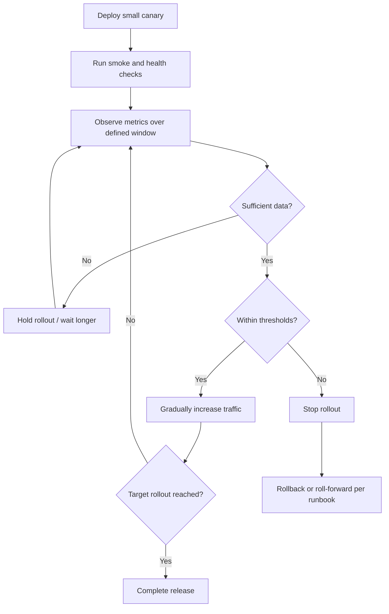
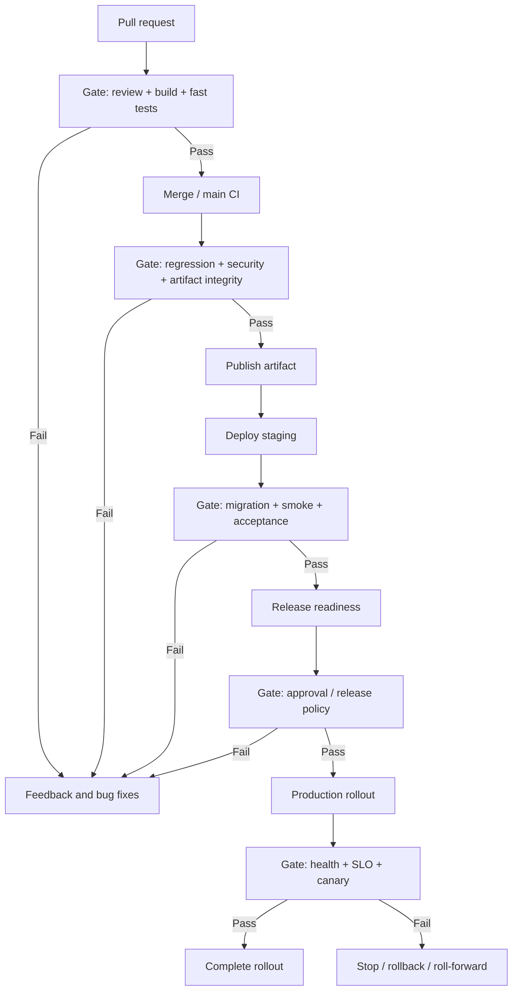

# Defining Pass Criteria for Each Pipeline Stage

## 1. What is a quality gate?

A quality gate is a set of conditions evaluated at a point in a pipeline to decide whether the workflow can advance to the next stage. A gate can inspect build results, tests, source code analysis, security, artifact validity, environment verification, or approval from an authorized person.

A gate is not an individual test. Tests, scans, reports, and metadata produce evidence; the gate applies policy to that evidence to make a decision. For example, a pipeline may run hundreds of unit tests, but the gate passes only when all required tests succeed, the report belongs to the exact commit under evaluation, and no results are missing or expired.

In CI/CD, gates turn quality requirements into consistently enforced conditions. Instead of relying on someone remembering to run tests or review a report, the pipeline can automatically block merging, packaging, promotion, or rollout when criteria are not met.

A good gate should answer four questions:

1. **What is it protecting?** Code quality, business behavior, security, artifact integrity, or deployment safety?
2. **Based on what evidence?** Test reports, scan results, checksums, deployment health, approval records, or operational data?
3. **What is the pass threshold?** Specific, verifiable, and explainable criteria.
4. **What happens if it fails?** Stop, fix, rerun, request a controlled exception, or roll back?

## 2. Distinguishing checks, thresholds, and gate decisions

A quality process typically has three interconnected layers:

| Layer | Role | Example |
|---|---|---|
| Check | Performs verification and produces results | Running unit tests, SAST, dependency scan, smoke test |
| Threshold/policy | Defines which results are acceptable | Zero failed required tests; zero unresolved Critical vulnerabilities |
| Gate decision | Allows or blocks progression | Pass, fail, pending, blocked, or time-bound waived |

For example, a security scanner might report 12 findings. The number 12 alone does not indicate whether a release should be blocked. The policy must consider severity, exploitability, reachability from the application, impact scope, remediation status, and organizational rules. Only then does the gate render a decision.

Do not set a gate based on a single number detached from context. An 85% code coverage rate may be an appropriate target for one module while still failing to ensure critical payment flows are tested. Conversely, a thin adapter module may have lower coverage yet be protected by contract tests and integration tests. Thresholds must align with the risk the gate is meant to control.

## 3. Designing gates starting from risks and objectives

Before selecting criteria, identify the risks that need to be prevented at that stage. Useful questions include:

- If a defect slips past the gate, what are the consequences for users, data, and operations?
- Which automated checks can detect the defect?
- Can evidence be collected before the pipeline advances?
- Does the check need to run against source code, the artifact, or a live environment?
- Which thresholds reflect the product's risk tolerance?
- Who owns the policy and who is authorized to handle exceptions?

For example, for a change that only updates UI copy, a pull request gate might focus on build, lint, and relevant tests. For an authorization change, the gate needs additional access-control tests, API checks, and security analysis. For a database migration, a pre-release gate must verify compatibility, execution duration, backup/restore, and data handling plans.

The matrix below provides a qualitative classification to start the discussion:

| Risk level | Characteristics | How to design the gate |
|---|---|---|
| Low | Narrow scope, easy to revert, minimal data or security impact | Fast checks and baseline criteria; keep feedback short |
| Medium | Affects a business flow or multiple components | Add relevant integration/contract tests and compatibility checks |
| High | Affects data, access permissions, money, availability, or multiple services | Specialized checks, appropriate approvals, observable rollout, and recovery plan |

Risk level should not be determined solely by line count or branch name. A few-line change in authentication logic can carry higher risk than a large behavior-preserving refactor.

## 4. Components of an auditable quality gate

A gate should be described as a structured policy. Typical components include:

| Component | Details to define |
|---|---|
| Identifier | Gate name, policy version, and applicable stage |
| Scope | Repository, service, branch/event, artifact, or environment governed by the gate |
| Input evidence | Report type, generating source, associated commit/digest, and generation timestamp |
| Mandatory conditions | Conditions that must pass for the gate to pass |
| Thresholds | Minimum/maximum levels, severity, validity window, or observation period |
| Missing data handling | Pending, fail, or rerun requirement when evidence is missing or invalid |
| Owner | Team accountable for the policy and outcomes |
| Exceptions | Approver, justification, scope, expiration, and compensating controls |
| Decision record | Pass/fail/waived outcome, timestamp, and links to supporting reports |

Crucially, the gate must evaluate the right target. A test report from an old commit cannot prove a new commit passes. A scan of an artifact with a different digest cannot prove the artifact about to be deployed is safe. An approval from a previous release does not automatically apply to the current release.

## 5. Gates at the pull request stage

A pull request is the right point to catch fast-detectable issues before changes enter a shared branch. Gates here typically protect integration readiness and code quality.

Conditions may include:

- The pull request includes a description of intent, linked issue, or acceptance criteria per team conventions.
- Source code is checked at the exact revision intended for merge.
- Required formatter checks, lint, type checks, or static analysis pass.
- The build succeeds.
- Unit tests and targeted tests relevant to the change pass.
- No committed secrets or blocking dependency/license policy violations exist.
- Required reviews are approved according to branch protection rules.
- Required checks have up-to-date results and are neither skipped nor carried over from stale runs.

Pull request gates should prioritize fast feedback. Time-consuming checks such as full end-to-end suites, heavy load tests, or dynamic scans can run in later stages if not needed for the merge decision. However, high-risk checks must not be deferred past merge without adequate compensating controls.

Example decision table:

| Condition | Passes when | When failing |
|---|---|---|
| Build | Build for the current revision succeeds | Block merge, provide logs |
| Unit tests | All required tests pass | Block merge; analyze failed/flaky tests |
| Static analysis | Zero blocking findings per policy | Fix issues or request a formal exception |
| Secret scan | No unresolved valid secrets detected | Revoke/rotate secrets and scrub history per procedure |
| Review | Required reviewer count and roles met per branch policy | Wait for valid review |

Review is a human judgment on the change; CI results do not replace review. Conversely, an approved review should not bypass required automated checks.

## 6. Gates after merge and during artifact creation

After merge, the pipeline must verify the main branch and produce a deliverable artifact. Gates at this stage typically focus on build integrity and reproducibility.

Common conditions include:

- The build is produced from a specific commit SHA on the main branch.
- Post-merge test suites pass within the defined scope.
- The artifact is built and uploaded successfully.
- The artifact has an immutable version/digest and build metadata.
- Dependencies, licenses, and security are checked against policy.
- An SBOM or provenance is generated if required by the workflow.
- No stale or unidentified artifact is accidentally reused.

A key principle is that the gate must inspect the exact artifact that will be promoted. If the pipeline builds a JAR and then scans a different file pulled from a mutable tag, the scan result no longer validates the released JAR. Link reports, metadata, and gate decisions to the artifact digest.

For containers, checks may cover image digest, base image, package vulnerabilities, image configuration, and signatures. For Java packages, checks may cover the dependency graph, licenses, metadata, and checksums. Specific criteria depend on the artifact type.

## 7. Gates when deploying to staging or test environments

Staging verifies the artifact in a production-like environment. Gates here must evaluate both application quality and environment state.

Conditions may include:

- The artifact digest matches the version that passed prior gates.
- Environment configuration is loaded properly and secrets are provisioned with least privilege.
- Migrations or schema changes execute successfully and are compatible with the currently running version.
- The application starts up and passes health checks.
- Smoke tests and integration tests succeed in the environment.
- Critical business flows meet acceptance criteria.
- No new severe errors appear in logs or metrics observed over the defined window.
- The environment is sufficiently representative for test results to be meaningful.

A staging gate should not check only the deploy command's exit status. A command returning exit code 0 may only confirm that the deployment request was submitted; it does not prove the application is ready to receive traffic or functioning correctly.

## 8. Pre-production gates

Production carries the highest impact if a faulty release goes out. Pre-production gates usually combine automated results with operational readiness and approvals.

Conditions may include:

- The artifact has passed prior gates and its digest is unchanged.
- Required tests, scans, and security reports remain valid.
- Migrations are planned, compatible, and verified in a suitable environment.
- Release notes, change lists, and linked tickets exist per policy.
- Rollout, monitoring, halt, and rollback/roll-forward plans are in place.
- Health checks, smoke tests, or canary checks in pre-production pass.
- Approval from an authorized role is recorded if required by policy.
- No active incidents or operational freezes prohibit releases under the release policy.

Manual approval is part of change control, not technical proof that the software works properly. Approvers need visibility into relevant evidence, blast radius, rollout plans, and recovery procedures. Clicking Approve must never turn failing tests or missing scan data into a pass.

For continuous automated deployment, production gates can be enforced via policy rather than per-release manual approval. This is appropriate only when automated criteria are sufficiently reliable, permissions are scoped down, and observability/rollback capabilities match the risk profile.

## 9. Post-deployment and in-rollout gates

After a new version reaches production, the pipeline must verify that the application behaves properly under real conditions. Post-deployment gates can decide whether to continue rollout, pause, or roll back.

Common signals include:

- Health/readiness checks and ready instance ratio.
- HTTP error rate or business error rate.
- p50/p95/p99 latency of critical endpoints.
- Timeout, retry, and dependency connection failure rates.
- CPU, memory, thread/connection pools, or queue backlogs.
- Business metrics such as payment success rate, failed orders, or abnormal transaction rejections.
- Logs and traces associated with the new version.

With a canary rollout, the group receiving the new version can be compared against a baseline group over an observation window. The gate expands traffic only when metrics stay within thresholds and enough data exists to draw a conclusion. If traffic is too low or metrics have not updated yet, the status should be pending/insufficient evidence rather than automatically passing.

Example decision flow:



Do not base thresholds on a single aggregate metric alone. An endpoint might show healthy latency while transaction failure rates rise. Choose signals that represent business risk and set thresholds based on baselines, SLOs, or agreed criteria.

## 10. Defining meaningful thresholds

Thresholds are the easiest part to set arbitrarily. A good threshold must be justified, measurable, and reflective of risk. Common condition categories include:

| Category | Example condition | Considerations when setting thresholds |
|---|---|---|
| Build | Build succeeds, zero compiler errors | Usually mandatory; should not be arbitrarily bypassed |
| Test | Zero failed required tests; test pass rate per policy | Distinguish real test failures from skipped or unexecuted tests |
| Coverage | Overall coverage or new-code coverage meets target | Evaluate alongside assertion quality and module risk |
| Static analysis | Zero new findings at blocking severity | Maintain a baseline, triage false positives, and assign remediation owners |
| Security | Zero vulnerabilities exceeding allowed risk threshold | Consider exploitability, reachability, exposure, and patch availability |
| Dependency/license | Zero package or license policy violations | Requires accurate data and an exception approval process |
| Artifact | Valid digest, metadata, and signature | Must bind to the exact artifact intended for release |
| Performance | Latency/error rate stays within threshold vs. baseline | Requires representative load, data, and measurement window |
| Production health | Operational signals stay within SLOs/guardrails | Do not evaluate when data is missing or during an active incident |

No single coverage percentage, vulnerability count, or latency figure fits every project. Determine thresholds from current baselines, improvement targets, business requirements, and accepted risk levels. If no baseline exists yet, start by measuring, agreeing on scope, and introducing thresholds incrementally rather than assuming an arbitrary number is an industry standard.

## 11. Using baselines and controlling new changes

In long-lived codebases, enforcing an absolute threshold across the entire system may cause the pipeline to fail constantly due to pre-existing issues. A transitional approach is to establish a reviewed baseline and focus gates on new issues or regressions relative to that baseline.

Examples:

- Do not increase the number of new Critical/High findings compared to the approved baseline.
- Coverage on newly added code is not below the agreed threshold.
- Do not increase error rates or latency beyond allowed limits during performance testing.
- Pre-existing vulnerabilities still have assigned owners and remediation deadlines; do not let the baseline become an indefinite exemption list.

A baseline must have a version, creation timestamp, scope, and approver. When scanning tools change or underlying data is updated, re-evaluate the baseline to avoid comparing non-equivalent results.

Do not rely on "block only new findings" if input data is incomplete or the scanner cannot reliably distinguish old findings from new ones. In that case, add cross-checks or apply stricter policies for high-risk areas.

## 12. Evidence freshness and integrity

A gate is trustworthy only if its evidence targets the right object, is sufficiently fresh, and has not been tampered with. Key verifications include:

- Reports are bound to the commit SHA or artifact digest under evaluation.
- Reports are generated by an approved tool and version.
- Generation timestamps fall within the policy's validity window.
- Scan/test scope covers the exact modules, environments, or images to be released.
- No required job was skipped, canceled, or left unexecuted.
- Metadata and artifacts come from sources with appropriate permissions.
- Results have not been replaced by manual reports or unrelated runs.

For instance, a passing security scan from last week cannot automatically pass an artifact built today if dependencies or source code have changed. Likewise, staging smoke tests do not prove production readiness if configuration, migrations, or deployed versions differ.

When evidence is missing, invalid, or expired, the gate should surface a clear state such as pending, blocked, or failed per policy. Never assume missing data means zero defects.

## 13. Distinguishing pass, fail, pending, skipped, and waived

A gate should expose statuses clear enough for operators to understand what happened:

| Status | Meaning | Common action |
|---|---|---|
| Pass | All required conditions have valid evidence and meet thresholds | Allow next step |
| Fail | Evidence shows one or more conditions did not meet criteria | Block, fix issue, and rerun |
| Pending | Insufficient evidence or checks have not completed yet | Wait for results or investigate stuck jobs |
| Skipped | Check did not run due to conditions or configuration | Verify whether skipping is permitted by policy |
| Waived | Exception approved through a bounded process | Proceed within approved scope, expiration, and compensating controls |
| Error/Unknown | Unable to evaluate due to system error, malformed data, or unavailable source | Controlled retry or block per policy |

Avoid collapsing `skipped`, `waived`, and `pass` into the same green status. A skipped test does not prove the test succeeded. An approved waiver does not mean the risk has disappeared. A scanner connection error does not mean the scanner found no vulnerabilities.

## 14. Handling exceptions and waiver mechanisms

In practice, an emergency release may be needed when a condition has not been met—for example, when a scanner suffers an outage or a finding is confirmed as a false positive. Exceptions must be governed so they do not turn into permanent workarounds.

A waiver should record:

- Which gate/condition is waived and its exact scope of application.
- The associated artifact digest, commit, or release.
- Justification and supporting evidence for the decision.
- Residual risk and temporary mitigation measures.
- The requester and the authorized approver.
- Start timestamp, expiration deadline, and revocation conditions.
- Ticket/owner and remediation plan if the issue still needs resolution.

A pull request author should not be allowed to self-waive a gate protecting their own change. For security or production gates, approvers must have appropriate independence under organizational policy. Waivers must not automatically carry over to other commits, artifacts, or releases unless that scope is explicitly documented.

If a scanner fails, the team must distinguish an exception allowing the workflow to continue from a conclusion that the product is safe. Alternative checks can be run, or the team can wait for service recovery. If risk is high and no alternative evidence exists, policy should block the release.

## 15. Manual approval and human accountability

Manual approval is suitable for decisions requiring business or operational accountability, such as production releases, high-impact migrations, or enabling features for all users.

A useful approval step should display:

- Version, commit, and artifact digest intended for deployment.
- Results from prior gates and links to supporting reports.
- Scope of services, environments, user segments, and traffic levels.
- Rollout plan, deployment window, and on-call operator.
- Known risks, active waivers, and halt conditions.
- Rollback/roll-forward runbook and backup/migration status if applicable.

Approval must be bound to the specific release and artifact. If the artifact changes after approval, re-evaluation is required per policy. Approvers must also know what action their approval authorizes and for what time window.

Do not require manual approval for every minor step when automated gates are reliable and risk is low. Excessive approvals create queues, slow down delivery, and train approvers into rubber-stamping out of habit.

## 16. Gates for migrations and data changes

Database or data changes carry unique risks because rolling back application code does not automatically revert data. Migration gates must examine:

- Whether the migration runs against a representative schema with an acceptable execution time.
- Whether it is compatible with both old and new application versions during rollout.
- Whether there are potential table locks, table rewrites, or downtime.
- Whether data can be backed up/restored or reconstructed.
- Whether the migration is idempotent or provides a way to determine execution state.
- Whether post-migration verification exists for row counts, integrity, and business rules.
- Whether a contingency plan exists if the new application is incompatible with the post-migration schema.

For large changes, consider an expand-and-contract strategy: expand the schema in a backward-compatible way first, deploy application code that reads/writes in the transitional format, migrate data, verify, and then drop old columns or structures in a later release.

Migration gates should validate both preparation steps and actual execution outcomes. Checking only that a script has valid syntax is not enough to prove a migration is safe on production data.

## 17. Security and dependency gates

Security gates must translate scan results into actionable policy. Evidence types can include:

- SAST: static application security testing on source code.
- SCA/dependency scan: inspection of third-party libraries and components.
- Secret scan: detection of credentials committed into repositories or artifacts.
- Container/image scan: inspection of image packages and configuration.
- DAST or API security testing: testing of running applications.
- License policy: verification of dependency usage terms.

When setting thresholds, weigh severity, exploitability, reachability, exposure, privilege level, affected data, and patch availability. Not every finding with the same severity rating poses the same actual risk. However, downgrading severity must be evidence-based and documented, never done just to turn the pipeline green.

A policy might stipulate no releases when an exploitable Critical vulnerability exists in a deployed component; High vulnerabilities must be remediated within SLA or covered by a waiver; lower findings are logged and tracked. This is only an example policy. Organizations must set thresholds and SLAs according to environment, compliance mandates, and risk appetite.

Gates must also handle cases where the scanner failed to run, the vulnerability database is stale, or the dependency graph is incomplete. An empty scan result caused by a failed scan must never be treated as clean.

## 18. Post-deployment gates: health, SLOs, and canary

Post-deployment gates should rely on user-meaningful indicators. SLIs/SLOs or rollout-specific guardrails can be used.

For example, an API service might track:

| Signal | Question | Action when threshold exceeded |
|---|---|---|
| Error rate | Has the request error rate increased compared to baseline? | Stop traffic expansion, investigate, or roll back |
| Latency | Do p95/p99 exceed targets for critical endpoints? | Hold canary or reduce traffic |
| Availability/readiness | Are instances ready and serving traffic steadily? | Stop rollout if failing |
| Dependency health | Are errors rising on databases, queues, or external services? | Investigate interactions and consider rollback |
| Business metric | Have payment, order creation, or processing success rates dropped? | Trigger business and release incident procedures |

Thresholds should be compared against baselines over an equivalent timeframe with sufficient data. Avoid overreacting to brief, insignificant spikes, yet do not wait too long when severe signals appear. Predefine the observation window, minimum sample size, emergency halt conditions, and alert recipients.

If a canary lacks enough traffic to evaluate, the gate should hold the rollout in a waiting state or use supplemental checks. Never auto-expand simply because no alerts fired.

## 19. Organizing gates across pipeline stages

A pipeline can place gates at the following transition points:



Not every project needs to split into this exact number of stages. Some gates may live inside jobs; others may be enforced by the deployment platform or an independent policy engine. What matters is that decision points have clear owners, evidence, and statuses.

| Stage | Gate objective | Primary evidence | Decision |
|---|---|---|---|
| Pull request | Protect change quality | Review, build, lint, unit tests, fast scans | Allow merge or request changes |
| Post-merge | Protect main branch and build output | Regression, integration, scans, commit and build metadata | Allow artifact publication |
| Package/publish | Protect artifact integrity | Artifact digest, provenance, SBOM/signature if required | Allow storage and promotion |
| Staging | Verify in representative environment | Deploy record, migration, smoke, acceptance tests | Allow release readiness |
| Pre-production | Control production changes | Prior gates, release plan, approval/policy | Allow rollout start |
| Post-deployment | Verify real-world behavior | Health, metrics, logs, traces, canary analysis | Continue, pause, or recover |

## 20. Example: designing gates for an order processing service

Suppose a Java service handles order creation, fee calculation, and payment. The team needs to release a change adding discount rules. A bug could miscalculate totals or let users apply unauthorized promotions.

Gates can be designed as follows:

| Stage | Specific conditions | Evidence to retain |
|---|---|---|
| Pull request | Build, lint, discount formula unit tests, authorization tests, and review pass | Commit SHA, test report, review record, scan result |
| Post-merge | Database integration tests, API contract tests, and checkout regression suite pass | Pipeline run ID, test report, dependency scan |
| Artifact | JAR is produced with valid checksum and provenance; no security findings exceed threshold | Artifact digest, build metadata, SBOM/scan report |
| Staging | Compatible migration, smoke tests, and simulated order creation and payment flows succeed | Deployment record, migration report, acceptance result |
| Pre-production | Release notes, rollout plan, on-call engineer, and policy-required approval are present | Approval record, release ID, runbook link |
| Canary | Error rate, latency, and payment success rate stay within guardrails for sufficient duration | Per-version metrics, observation window, rollout decision |

If staging smoke tests fail, the gate prevents production deployment. If the canary shows rising payment failures, the system halts traffic expansion and triggers the runbook. If a scanner lacks fresh data, the security gate remains blocked/pending per policy rather than defaulting to pass.

This example shows that a gate is not a single checkpoint at the end of the pipeline. Each stage must control the risks appropriate to the data and decisions at that stage.

## 21. Example policy as code

A policy can be expressed in illustrative YAML to clarify conditions:

```yaml
qualityGates:
  pullRequest:
    required:
      - build.success == true
      - unitTests.failed == 0
      - requiredReviews.approved == true
      - secretScan.status == "completed"

  artifact:
    required:
      - artifact.digest != null
      - provenance.sourceCommit == pipeline.commit
      - dependencyScan.status == "completed"
      - security.criticalUnresolved == 0

  staging:
    required:
      - deployedArtifact.digest == artifact.digest
      - smokeTests.failed == 0
      - migration.status == "success"

  production:
    required:
      - releaseApproval.status == "approved"
      - rolloutPlan.exists == true
      - rollbackPlan.exists == true

  postDeploy:
    required:
      - health.status == "healthy"
      - canary.errorRate <= policy.maxErrorRate
      - canary.windowComplete == true
```

This is an illustrative policy, not the syntax of a specific engine. In a real system, you must define data types, handling of missing fields, report ingestion, data freshness, and commit/artifact binding. An expression like `security.criticalUnresolved == 0` is meaningful only if the scanner completed and scan coverage was complete.

Policies should be version-controlled and reviewed like source code. When changing thresholds, know which gates are affected, when changes take effect, and whether in-flight releases need re-evaluation.

## 22. Measuring quality gate effectiveness

Gates must protect quality while also supporting development flow. Metrics to track include:

- **Gate failure rate:** percentage of runs failing per gate and root causes.
- **False positive rate:** percentage of findings or alerts determined to be inaccurate.
- **Time to feedback:** time from trigger until a gate decision is reached.
- **Time waiting for approval:** time spent waiting for human sign-off.
- **Waiver frequency:** how often and why exceptions are used.
- **Escaped defects:** defects that slipped past gates and were caught later or in production.
- **Rollback/hotfix rate:** percentage of releases requiring rollback or hotfix.
- **Evidence freshness/completeness:** percentage of decisions backed by evidence matching the right revision, full scope, and valid timeframe.

Do not optimize by reducing failure counts or gate duration at all costs. A gate that never fails may signal overly lax thresholds or unexecuted checks. A gate that fails constantly due to flaky tests may train the team to ignore results. Categorize root causes and improve check quality, thresholds, and environments.

## 23. Common anti-patterns

| Anti-pattern | Consequence | How to improve |
|---|---|---|
| A single gate at the end of the pipeline | Defects are caught late, making it hard to pinpoint the offending stage | Place gates at appropriate transition points |
| Gate checks only whether the job is green | May miss missing reports, skipped tests, or wrong-revision scans | Verify evidence, scope, and freshness |
| One threshold for every module | Fails to reflect each component's risk and characteristics | Classify by risk, baseline, and objectives |
| Using coverage as the sole quality criterion | Can hit coverage targets without testing critical behaviors | Combine assertions, business tests, and escaped-defect tracking |
| Approval replacing testing | Human sign-off does not prove the application works correctly | Base approvals on evidence and never bypass mandatory gates |
| Treating missing data as pass | Failed scanners or unexecuted tests still allow releases through | Define pending/blocked states and handle missing evidence |
| Unbounded waivers | Temporary exceptions become default policy | Record owner, justification, scope, expiration, and remediation plan |
| Scan reports unbound to artifacts | May scan one file while deploying another | Bind reports to commits and artifact digests |
| Canary watching only one metric | Misses business degradation despite healthy technical signals | Select multiple representative SLIs and an adequate data window |
| Too many manual gates | Creates queues and rubber-stamp approvals | Automate repeatable decisions; reserve approval for appropriate risks |

## 24. Quality gate design checklist

Before introducing a gate into a pipeline, verify:

- [ ] The objective and risks the gate controls are clearly described.
- [ ] The scope and pipeline stage are defined.
- [ ] Pass/fail conditions are measurable and explainable.
- [ ] Thresholds are grounded in baselines, business requirements, or risk policy.
- [ ] Evidence is bound to the exact commit, artifact digest, or environment.
- [ ] Data sources are sufficiently fresh, complete, and traceable.
- [ ] Pending, failed, skipped, error, and waived statuses are distinguished.
- [ ] Failure actions and accountable owners are clear.
- [ ] Exceptions record approver, justification, scope, expiration, and compensating controls.
- [ ] Manual approvals provide enough information to make a decision.
- [ ] Production gates include rollout, observation, and rollback/roll-forward plans.
- [ ] Policies are versioned, reviewed, and decision history is retained.
- [ ] Metrics exist to track false positives, feedback time, and escaped defects.

## 25. Core practice principles

1. Treat a quality gate as a policy decision based on evidence, not a single test step.
2. Place gates at transition points: pull request, post-merge, artifact creation, staging, production, and post-deployment.
3. Choose criteria based on change risk and each stage's objective.
4. Define justified thresholds and verify both scope and freshness of evidence.
5. Bind every report and decision to the exact commit, artifact digest, and environment.
6. Distinguish pass, fail, pending, skipped, error, and waived; never treat missing data as passing.
7. Manage exceptions with an owner, justification, expiration, and mitigation measures.
8. Use manual approval for decisions needing human accountability, never as a substitute for technical evidence.
9. Verify post-deployment via health, SLOs, business metrics, and canary checks before completing rollout.
10. Measure gate effectiveness and refine thresholds, test quality, and feedback time.

Effective quality gates help teams advance from one stage to the next with explainable confidence. When criteria, evidence, and exception handling are clearly defined, the pipeline preserves integration speed while controlling quality, security, and release risk.
