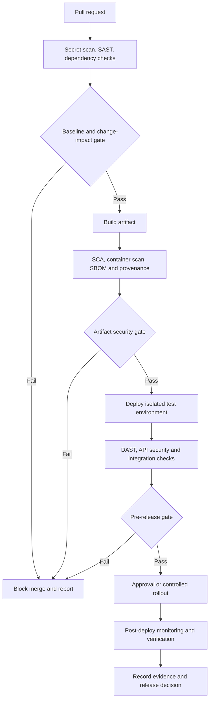

# Placing Security Checks by Impact Level

A CI/CD pipeline can run a wide variety of security tools, yet running more tools does not automatically make a release safer. If every alert blocks every pull request, development teams face long wait times, struggle to distinguish critical flaws from low-impact issues, and gradually lose trust in the quality gate. If only a lightweight pre-merge scan runs, serious risks may go undetected until the artifact is already deployed.

The right approach is to place security checks according to **the impact level of the change and the assets affected**. A change touching authentication, authorization, sensitive data handling, or Internet-exposed paths requires a different level of scrutiny than a documentation or static UI change. Tiering must be grounded in context, exploitability, blast radius, and finding confidence, while keeping baseline checks for every change.

This lesson covers how to assess security risk, select check types by impact, design quality gates across CI/CD stages, handle findings and exceptions, secure the pipeline itself, and monitor post-deployment risk. The goal is to match the right checks to the right changes, block unacceptable risk, and retain sufficient evidence to explain release decisions.

## 1. Security gates in the CI/CD workflow

A security gate is a set of security conditions that must be met before a pipeline advances to the next stage. A gate can block merging, block release artifact creation, block promotion, or block deployment to a specific environment.

A reference workflow:

~~~mermaid
flowchart TD
    A["Source code / configuration change"] --> B["Assess impact area"]
    B --> C["Baseline checks on every change"]
    C --> D["Risk-based deep checks"]
    D --> E{"Findings exceed threshold?"}
    E -- "Yes" --> F["Block next step and triage"]
    F --> G["Fix issue or review controlled exception"]
    G --> D
    E -- "No" --> H["Review and merge"]
    H --> I["Scan artifact and verify provenance"]
    I --> J{"Artifact meets policy?"}
    J -- "No" --> F
    J -- "Yes" --> K["Deploy to test environment"]
    K --> L["DAST / API tests / configuration checks"]
    L --> M{"Ready for release?"}
    M -- "No" --> F
    M -- "Yes" --> N["Approve and deploy"]
    N --> O["Runtime monitoring and risk handling"]
~~~

A security gate does not have to be a single tool. It can aggregate results from multiple sources such as SAST, SCA, secret scanning, Infrastructure as Code checks, container scanning, DAST, deployment configuration checks, and manual review.

It is essential to define upfront:

- Which assets, data flows, or environments are being protected?
- What types of risk could the change introduce?
- Which checks are suited to detect those risks?
- What finding level is permitted to proceed?
- Who is accountable for remediation or approving exceptions?
- What evidence is stored alongside the run and artifact?

## 2. Assessing impact before selecting checks

Checks should not be chosen solely by the number of modified files or a tool's severity score. You need to understand which assets the change touches and what attack paths it might open.

Assessment can follow these dimensions:

| Dimension | Question to answer | High-impact example |
|---|---|---|
| Asset value | What data does this component protect or process? | Identity information, financial data, encryption keys |
| Exposure | Where can the component be accessed from? | Public APIs, Internet endpoints, partner services |
| Permissions and privileges | What actions can the component perform? | Authentication, authorization grants, administration, command execution |
| Exploitability | What conditions and effort does an attacker need? | Unauthenticated, remotely exploitable, public exploit available |
| Blast radius | If exploited, how far does the impact spread? | Multiple tenants, all accounts, or the entire system |
| Detectability | Does the tool have sufficiently reliable evidence? | Direct reachable call path to a dangerous sink |
| Recoverability | Can consequences be contained or reversed? | Can tokens be revoked quickly, or is exposed data irrevocable? |

A qualitative rating scales impact into low, medium, high, or critical. Rating levels must be agreed upon by the team using concrete criteria. Avoid assigning labels by gut feel or letting each team interpret them differently.

### 2.1. Distinguishing severity from risk

Severity describes the technical seriousness of a vulnerability on a scoring scale. Risk reflects the likelihood and impact when that vulnerability exists within a specific system context.

For example, a library with a High-severity alert used only in a build component that never runs in production may carry lower operational risk than a Medium-severity authorization bug in a public API handling sensitive data. Conversely, a High-severity library vulnerability can become an urgent risk if the version is exploitable, has a reachable call path, and the component is exposed.

An assessment should combine:

- Vulnerability severity or CVSS score if available.
- Practical exploitability and required preconditions.
- Exposure of the affected component.
- Reachability of the vulnerable code or function.
- Data sensitivity and asset value.
- Blast radius if exploitation succeeds.
- Existing mitigations and incident detection capability.

Sources such as known-exploited vulnerability catalogs or exploit-prediction scores can add context. They do not replace assessing the architecture, configuration, and exposure of your system.

### 2.2. Assessing by change, not only across the whole repository

On a pull request, identify which areas the change touches:

- Authentication, sessions, tokens, or authorization.
- Public APIs, gateways, or integration endpoints.
- Sensitive data processing, encryption, or storage.
- Database queries, serialization, or file uploads.
- Infrastructure, network policies, IAM, or secrets.
- Dependencies, base images, or build scripts.
- Logging, auditing, and monitoring systems.
- Pipelines, runners, or release configuration.

Changes in these areas can trigger deeper checks. However, even a small line-count change can have high impact if it sits in a shared library or a privileged execution path.

### 2.3. Threat modeling for high-impact changes

Threat modeling identifies assets, trust boundaries, threat actors, attack paths, and controls. You do not need a lengthy review session for every pull request. A short set of screening questions works well for sensitive changes:

1. Where does the change accept data or requests from?
2. Which trust boundaries does the data cross?
3. With what privileges does the component execute actions?
4. Whose data can it read, modify, delete, or disclose?
5. If inputs are attacker-controlled, what could happen?
6. Which automated checks can verify security assumptions?
7. Is specialist review or manual testing required?

Threat modeling should produce concrete assumptions and checks, such as requiring per-tenant authorization tests or verifying that an upload endpoint cannot write files outside its allowed directory.

## 3. Tiering checks by impact level

Checks can be structured as follows. This is a reference model; teams must tune thresholds to their architecture, data requirements, and organizational policy.

| Impact level | Change characteristics | Appropriate checks |
|---|---|---|
| Low | Documentation, static content, or changes that do not affect data flows or permissions | Secret scanning, baseline dependency checks, relevant configuration lint |
| Medium | Standard application logic, internal components, limited special privileges | SAST, SCA, security-aware unit/component tests, IaC scan if infrastructure is present |
| High | Authentication, authorization, public APIs, sensitive data, file handling, or network/IAM changes | Deep SAST, SCA with reachability, secret scan, IaC/container scan, security-focused tests, specialist review |
| Critical | Privilege boundaries, payment systems, keys/credentials, multi-tenant isolation, or wide blast radius | All relevant checks, DAST/API testing, threat modeling, security review, and targeted manual testing before release |

Certain checks should run on every change because their cost is low and preventive value is high, such as detecting committed secrets or checking direct dependencies. Heavier checks can be triggered by change scope, on the main branch, on artifacts, or prior to release.

Do not let a "minor change" label automatically skip checks. If an impact-analysis tool cannot determine scope, the pipeline should broaden checks or require review. A "not required to run" status must have an explicit reason.

## 4. Choosing the right types of security checks

Each tool type observes a different slice of the system. Select checks based on the risks you need to detect rather than running a single tool and treating its output as comprehensive.

| Check type | Primary detection | Typical timing |
|---|---|---|
| Secret scanning | Tokens, keys, or credentials committed to source | Pull request and repository |
| SAST | Security flaw patterns in source code | Pull request, main branch |
| SCA | Vulnerable dependencies or non-compliant licenses | Pull request, build, and release |
| IaC scanning | Policy-violating infrastructure configurations | When Terraform, manifests, or policies change |
| Container scanning | Vulnerabilities in base images and image packages | Post-image build, pre-publish/deploy |
| DAST | Flaws observable while the application is running | Test/staging environment |
| API security testing | Authentication, authorization, validation, and API behavior | Targeted on pull requests, staging |
| Fuzz testing | Failures on malformed or randomized inputs | Per module, nightly, or pre-release |
| Penetration testing | Exploit chains and risks needing manual evaluation | Major changes, critical releases, or scheduled |
| Runtime security monitoring | Anomalous behavior in live environments | Post-deployment and continuously |

### 4.1. Secret scanning

Secret scanning searches for tokens, private keys, passwords, or credential-shaped strings in source code and change history. Any confirmed real secret must be handled as a credential exposure incident: revoke or rotate it, determine access scope, and audit where the data was shared.

Never merely delete the string in a follow-up commit and consider the issue closed. Secrets can persist in Git history, logs, artifacts, or caches. Tools should support context-aware detection, and teams must have a revocation procedure.

### 4.2. SAST

SAST analyzes source code or bytecode without running the application. It can find flaws such as injection, unsafe input handling, data leaks, authentication bugs, or dangerous APIs.

SAST results must be reviewed along data paths and context. An alert may be a false positive if the tool misses an upstream validation or encoding step. Conversely, zero alerts do not prove code is safe if rules do not cover the flaw class or framework in use.

### 4.3. SCA and dependency reachability

SCA inspects third-party libraries and components for known vulnerabilities, license issues, or supply-chain risks. Distinguish direct from transitive dependencies, and runtime components from build-only components.

When evaluating a dependency vulnerability, check the actual version inside the artifact, exploitation preconditions, affected functionality, and whether the application calls the vulnerable code. Reachability helps prioritize, yet a vulnerability should not be automatically exempted solely because static analysis did not find a call path.

### 4.4. IaC and container scanning

IaC scanning catches misconfigurations before provisioning, such as overly broad IAM permissions, public storage, open network rules, or missing encryption. Container scanning checks the base image and packages bundled inside the image.

Scan the exact configuration version or image that will be deployed. Scanning a Dockerfile alone does not replace scanning the built image, because build steps may add packages or the base image may have changed.

### 4.5. DAST, API tests, and manual testing

DAST probes a running application from the outside. It fits once a stable test or staging environment is available. API security tests can target authentication, authorization, resource ownership checks, rate limits, and validation.

For changes affecting trust boundaries or special privileges, targeted manual testing may be necessary. Automated tools do not always grasp business semantics, such as whether one user should be allowed to access a record belonging to another tenant.

## 5. Placing checks at the right pipeline stage

Not every check needs to run at the same time. Staging checks appropriately provides fast feedback early in the flow and sufficient evidence prior to release.

| Stage | Baseline checks | Impact-driven supplemental checks |
|---|---|---|
| Pull request | Secret scan, fast SAST, basic SCA, config lint | Authorization tests, threat review, IaC scan, deep SAST |
| Post-merge | SAST/SCA on integrated state, dependency and build checks | Integration security tests, dependent-module checks |
| Post-artifact build | Metadata, digest, and provenance verification | Container scan, SBOM, signatures, package policy checks |
| Staging | Health checks, environment config, and smoke tests | DAST, API security tests, sensitive-flow testing |
| Pre-production | Verify required gates, approvals, and vetted artifact | Security review, manual testing, migration/permission checks |
| Post-deployment | Monitor errors and runtime behavior | Alerts on anomalous access, config drift, new vulnerabilities |

A check type may appear at multiple stages for different purposes. For instance, SCA on pull requests catches newly added dependencies. Container scanning after build verifies the packages actually present in the image. Re-checking before release confirms the artifact about to deploy still satisfies current policy.

### 5.1. Pull request: early detection and bounded feedback time

Pull requests are ideal for fast checks and tests directly tied to the change. Required gates should return feedback quickly enough for developers to fix issues within the same review cycle.

For high-impact changes, consider adding:

- Role-based authentication and authorization tests.
- Cross-tenant access tests.
- Specialized SAST rules or queries for sensitive modules.
- IaC scans when IAM, firewall, or storage configurations change.
- Mandatory review from the security component owner.

If a pull request modifies a shared library, expand check coverage to dependent components. If scope cannot be determined reliably, run a broader test suite per policy.

### 5.2. Post-merge and on artifacts

After merge, the pipeline must verify the actual integrated state. When building artifacts, scan the exact package or image to be released, bind results to its digest, and store metadata.

If an artifact is rebuilt after scanning, prior scan results are no longer sufficient evidence for the new artifact. The workflow must ensure the exact same digest is tested, promoted, and deployed.

### 5.3. Staging and pre-production

Staging suits checks requiring a running application, such as DAST, API security tests, and deployment configuration checks. Use controlled test data and tightly scoped credentials.

Before production, the pipeline must confirm all required gates passed, any exceptions remain valid, and the artifact digest matches the approved version. If configurations or dependencies changed after the last check, assess whether earlier results remain valid.

## 6. Designing pass/fail thresholds

Security tools typically return many findings with varying severities and confidence levels. Quality gates must convert results into unambiguous decisions.

Thresholds can be defined using:

- Severity or impact level.
- Exploitability and exposure.
- Finding confidence.
- Whether a reachable path exists to the vulnerable function.
- Whether the component ships in the release artifact or environment.
- Whether verified mitigations are in place.
- Whether the finding was introduced by the current change or pre-existing.

Illustrative qualitative policy example:

| Finding level | Pull request | Pre-release |
|---|---|---|
| Critical, exploitable in an exposed component | Block merge or require urgent remediation | Block release |
| High, affecting sensitive functions or critical data | Block or require security review and explicit remediation plan | Block unless approved mitigations exist |
| Medium, with a realistic exploit path | Block when directly tied to the change or required by policy | Remediate or cover with a time-bound exception |
| Low, minor impact or hard-to-meet preconditions | Log and prioritize per policy | Track and remediate within SLA |
| Informational or verified false positive | Do not block; record triage rationale | Do not block if evidence and scope remain valid |

The table above is a reference framework, not numerical thresholds for every organization. Teams must publish clear policies specifying what always blocks, what requires authorized review, and what merely creates a ticket.

### 6.1. Prioritizing new findings (delta gating)

Long-lived repositories may already have many legacy alerts. Enabling a new gate that blocks all historical findings immediately may overwhelm the team's capacity to fix everything at once.

A practical rollout approach:

- Prevent new high-risk findings from entering the main branch.
- Establish a baseline for triaged legacy findings.
- Track and systematically burn down the baseline on a schedule.
- Block if a legacy finding increases in severity, becomes reachable, or changes exposure scope.
- Never automatically assume all legacy alerts are safe.

Delta gating stops security debt from growing, yet still requires deadlines and owners to resolve existing debt. Otherwise, the baseline becomes a permanent exemption list.

### 6.2. Context-aware thresholds

Avoid applying a single blanket threshold across all modules. A public service handling credentials likely needs stricter thresholds than an internal tool storing no sensitive data. However, changes to an internal tool can still affect the supply chain or administrative privileges.

Context-aware policies should rely on team-agreed asset classifications and exposure ratings, never on project names or developer convenience.

## 7. Handling false positives and exceptions

A false positive is a finding that, upon investigation, is confirmed not to be a vulnerability in the current context. Never dismiss an alert simply because it breaks the pipeline or has not yet been reproduced.

The triage workflow should record:

1. Tool, rule, and scanner version.
2. Affected file, component, or artifact.
3. Data flow and exploitation preconditions.
4. Evidence showing whether the finding is true, false, or undetermined.
5. Reviewer and evaluation timestamp.
6. Exemption scope if granted, along with review expiration date.

### 7.1. Controlled exceptions

An exception may be required when no patch exists yet, a patch breaks compatibility, or an emergency release must mitigate an incident. Every exception must specify:

- Specific justification and scope.
- Residual risk level.
- Temporary compensating controls.
- Accountable owner and approver.
- Expiration date or mandatory re-evaluation milestone.
- Link to a tracking ticket or remediation plan.

Avoid wildcards or disabling an entire rule when only one path or dependency version requires an exception. Do not allow a pull request author to self-approve exceptions for their own changes when policy requires independent review.

### 7.2. Never use retries to mask security failures

Retries help when a scanner encounters transient network errors or service unavailability. But if a scanner fails to run, that status never equates to passing the check.

Distinguish clearly:

- Pass: check completed with no findings exceeding thresholds.
- Fail: findings exceed thresholds.
- Error: tool or environment could not complete the check.
- Skipped: intentionally omitted under documented conditions.
- Waived: finding exempted with approval and expiration.

For mandatory pre-release checks, Error or Skipped must never auto-convert to Pass. Policy may permit emergency overrides, but only with a separate decision and documented evidence.

## 8. Supply chain and artifact checks

Security risk does not reside solely in source code. Dependencies, build tools, base images, runners, workflows, and artifacts can all be compromised.

A workflow can combine:

- SCA on dependency manifests and lockfiles.
- Scanning actual dependencies inside packages or images.
- SBOM generation to inventory components inside the artifact.
- Digest verification to ensure contents have not changed.
- Signatures and provenance to verify the builder and source origin.
- Policies validating approved package registries and base images.
- Access controls over artifact publish and promote permissions.

Artifacts must be scanned after building because actual outputs can differ from what source alone suggests. When promoting across environments, preserve the exact same digest so verification results stay bound to the deployed payload.

If a new vulnerability is disclosed after an artifact was built, the release gate may need to re-evaluate the pending artifact. An old scan does not guarantee the artifact still complies with current policy.

## 9. Securing the pipeline and runners themselves

Pipelines hold permissions to read source code, access secrets, publish artifacts, and deploy. Consequently, CI/CD configuration and runners are part of the security scope that must be verified.

Key controls include:

- Scope token permissions per job and per repository.
- Never expose production secrets to forked PRs or untrusted code.
- Separate PR-handling runners from runners with publish/deploy privileges.
- Use short-lived credentials and workload identity where supported.
- Review changes to workflows, build scripts, and policies.
- Restrict outbound network access and internal service reachability.
- Keep runners patched, isolated, and cleaned up after each job.
- Protect caches and artifacts against overwrite or poisoning.
- Write audit logs for publish, approval, and deploy operations.

A workflow edit can alter how secrets are issued or how jobs execute. Treat sensitive pipeline changes like privileged infrastructure changes during review.

## 10. Example impact-based security policy

The example below illustrates how to structure a policy conceptually. It is not native syntax for a specific CI/CD platform or scanner:

~~~yaml
security_policy:
  baseline:
    on_every_pull_request:
      - secret_scan
      - dependency_scan
      - fast_sast
    on_release_artifact:
      - artifact_digest
      - container_scan
      - sbom_generation
      - provenance_verification

  impact_profiles:
    low:
      additional_checks: []
      gate: baseline_pass

    medium:
      additional_checks:
        - focused_sast
        - component_security_tests
      gate: no_new_high_risk_findings

    high:
      additional_checks:
        - deep_sast
        - dependency_reachability_review
        - iac_or_container_scan
        - authorization_tests
        - security_owner_review
      gate: high_risk_findings_resolved

    critical:
      additional_checks:
        - threat_model_review
        - dast_or_api_security_tests
        - manual_security_review
        - release_artifact_verification
      gate: explicit_security_approval

  exception:
    requires:
      - documented_reason
      - residual_risk
      - mitigation
      - owner
      - approver
      - expiry_date
~~~

In real implementations, map each check and gate to platform tools, conditions, permissions, and statuses. Never rely solely on a self-declared impact field from the PR author to skip checks. Combine path ownership, dependency graphs, asset classifications, and responsible-owner review.

## 11. Sample scenario: changing an API handling sensitive data

Suppose a pull request adds an endpoint allowing users to download reports containing account data.

1. Change analysis shows the endpoint is public, handles sensitive data, and requires authentication. The change is rated high impact.
2. The pull request runs secret scan, SAST, SCA, and unit tests. Security tests verify that a user cannot download another account's report.
3. Because the change involves upload/download and authorization, the team adds validation, path traversal, and per-tenant access control checks.
4. The API owner reviews a brief threat model covering data sources, tenant boundaries, access permissions, logging, and download limits.
5. After merge, the pipeline builds the artifact, generates an SBOM, scans dependencies, and verifies the digest.
6. The artifact is deployed to staging. DAST or API security tests probe the running endpoint with test accounts and test data.
7. If a severe authorization flaw is found, the pipeline blocks the release. The team fixes the defect and re-runs checks on the new artifact.
8. Once gates pass, an authorized approver approves production. The pipeline deploys the exact vetted artifact and verifies the version.
9. Post-deployment, the team monitors access errors, anomalous requests, and indicators of data leakage.

This scenario demonstrates that a single change needs layered checks: SAST catches code flaws, authorization tests verify business rules, DAST tests live behavior, and artifact scanning validates the exact shippable package.

## 12. Investigating when a security gate fails

When a gate fails, do not look only at the total alert count. Identify which specific finding stopped the pipeline and what evidence backs that decision.

Investigation workflow:

1. Identify the pipeline run, commit SHA, artifact digest, and failed stage.
2. Identify the scanner, rule, vulnerability database version, and policy configuration.
3. Inspect the finding location, data path, and affected component.
4. Verify whether the artifact or dependency actually includes the flagged component.
5. Assess exposure, exploitability, and blast radius.
6. Classify as a true vulnerability, false positive, insufficient evidence, or scanner error.
7. Choose remediation: patch code, upgrade dependency, update configuration, reduce exposure, or request a time-bound exception.
8. Rerun the relevant checks and store resulting evidence.

### Common scenarios

| Symptom | Possible cause | Resolution |
|---|---|---|
| PR blocked by legacy alerts | Unmanaged baseline or policy blocking full history | Separate new vs. legacy findings; plan debt burndown |
| SCA flags vulnerability missing from artifact | Dependency is build/test-only or stripped from package | Verify dependency tree and actual artifact contents |
| High false-positive rate in SAST | Rules do not recognize framework or custom validation | Verify data path, tune rules, and document rationale |
| Scanner fails to execute | Registry, license, network, or service outage | Mark Error and fix infra; never treat as Pass |
| DAST fails on staging | App not ready, bad test data, or broken auth | Check environment, test accounts, and request logs |
| Artifact scan differs from source scan | Base image or packages added during build | Scan final image/package and reconcile digest |
| Expired exception still applied | Missing owner or no automated expiration enforcement | Revoke waiver and return finding to the gate |
| Gate bypassed in emergency release | Emergency process failed to record decision | Log approver, rationale, risk, and post-release review plan |

## 13. Measuring security gate effectiveness

A good security gate both reduces risk and produces actionable feedback. Track:

| Metric | Meaning | Usage |
|---|---|---|
| Security check feedback time | Time from trigger until results return | Optimize scanners and stage checks appropriately |
| New threshold-exceeding findings rate | New risk prevented prior to merge/release | Identify change areas needing deeper checks |
| False positive rate | Rate of contextually inaccurate alerts | Improve rules and scanner accuracy |
| Time to remediate critical findings | Time from confirmed finding to fix | Gauge response capacity by risk level |
| Active waiver count | Approved risk debt currently carried | Monitor owners and expiration dates |
| Gate Error/Skipped rate | Rate of incomplete checks | Surface infra issues or overly broad filters |
| Defect escape / security incident | Risks reaching later environments or production | Identify coverage gaps |
| Artifacts with provenance and digest | Traceability of output origin | Strengthen supply-chain controls |

Never optimize solely for lower finding counts or higher pipeline pass rates. Finding counts can drop simply because scanners were disabled or scope narrowed. Read metrics alongside coverage, tool versions, scanned artifact counts, verification results, and real incidents.

## 14. Practice roadmap

You can practice on a sample repository following these steps:

1. **Map assets:** identify public APIs, sensitive data, privileged components, registries, and deployment targets.
2. **Classify changes:** create rules detecting authentication, authorization, data, dependency, IaC, and pipeline areas.
3. **Establish a baseline:** enable secret scan, SAST, and SCA on pull requests; distinguish new findings from existing debt.
4. **Create impact profiles:** define low, medium, high, and critical levels using exposure, exploitability, and blast radius criteria.
5. **Attach specialized checks:** add authorization tests, IaC/container scans, DAST, or manual review for high-impact areas.
6. **Design pass/fail:** define which findings block merge, publish, or deploy; specify Error and Skipped handling.
7. **Verify artifacts:** generate digests, SBOMs, or provenance per policy; scan the exact tested artifact.
8. **Manage exceptions:** create a waiver with owner, approver, mitigations, and expiry; verify expired waivers stop applying.
9. **Simulate failures:** introduce a controlled security flaw in a test environment and confirm the gate catches and halts at the right stage.
10. **Measure:** track feedback time, false positives, new findings, exceptions, and escaped defects.

### Completion criteria

Learners can consider the exercise complete when they demonstrate the ability to:

- Distinguish technical severity from contextual system risk.
- Assess impact based on assets, exposure, exploitability, and blast radius.
- Select appropriate security check types for each change category.
- Place security gates at pull request, artifact, staging, and pre-production stages.
- Configure pass/fail rules and distinguish Pass, Fail, Error, Skipped, and Waived.
- Manage baselines and new findings without hiding security debt.
- Manage false positives and time-bound exceptions.
- Verify artifact security via digests and provenance evidence.
- Explain how to protect runners, secrets, and pipelines.
- Trace security decisions back to commits, artifacts, and deployments.

## Conclusion

Placing security checks by impact level focuses pipelines on the risks a change can introduce. Baseline checks maintain security hygiene across every change; deep checks activate when changes touch sensitive assets, trust boundaries, or privileged operations. Artifacts, staging, and production each enforce dedicated gates to verify actual outputs and real-world behavior.

A trustworthy quality gate pairs severity with context, declares explicit pass/fail thresholds, handles false positives and exceptions transparently, and binds evidence to commits and artifacts. When teams know why a change was blocked, who is accountable, and what conditions permit progression, security becomes an operable part of the CI/CD flow.

# Placing Security Checks by Impact Level

A small UI tweak may affect only presentation, while a few lines changed in authentication can expose every user's data. If every change must run the exact same heavy security suite, the pipeline slows down and teams look for ways to bypass controls. If only a minimal suite runs for every change, high-risk areas remain under-protected.

In CI/CD, **security checks must be selected according to the change's impact level and the assets it can affect**. Pipelines should enforce a mandatory baseline for all changes, then escalate verification when changes touch sensitive data, authentication, authorization, network boundaries, infrastructure, critical dependencies, or production delivery paths.

Impact depends on more than line counts or scanner-reported severity. You must evaluate exploitability, exposure, component privileges, data sensitivity, blast radius, and recoverability. Quality gates turn this evaluation into explicit conditions to proceed, warn, require review, or halt release.

## 1. Why place security checks by impact level?

A CI/CD pipeline processes diverse changes: documentation updates, business logic fixes, library upgrades, API changes, IAM policy edits, Dockerfile updates, or Kubernetes manifest adjustments. These changes do not carry identical risk.

For example:

- Fixing a typo in documentation rarely affects runtime behavior, though workflow protections and secret checks still matter if files might hold sensitive data.
- Changing a logging library can ripple across many services, even though the library itself does not process payment data.
- Changing authentication or authorization logic can expose data across many users.
- Modifying IAM policies, network policies, or pipeline credentials can widen access across an entire environment.
- Changing base images or dependencies can introduce malicious code or vulnerabilities into multiple artifacts.

Applying the exact same level of scrutiny to everything creates two problems: low-risk changes wait on unnecessary steps, while high-risk changes may slip through without specialized validation.

An impact-based strategy helps:

1. Direct the right checks to the right changes and stages.
2. Catch issues early when remediation cost is still low.
3. Reserve deep checks and specialist review for high-consequence areas.
4. Keep feedback fast without lowering security standards.
5. Produce traceable evidence for release decisions.

## 2. Distinguishing finding severity from change impact

These two concepts are related, yet not identical.

- **Finding severity:** how severe a specific issue's technical impact is rated by a tool or specialist. For example, a remote code execution vulnerability is normally more severe than a low-impact missing security header.
- **Change impact:** the scope and consequences if the change under review contains a flaw or is exploited. A change may affect sensitive data, multiple services, or administrative privileges.

A High-severity finding in a dev-only test library carries a different operational risk than an equal-severity finding in a library packaged into an Internet-facing service. Conversely, an IAM change might trigger zero scanner alerts yet still cause severe impact if misconfigured.

Never let a single scanner score drive the entire decision. Combine severity, exploitability, reachability, required privileges, exposure, and affected assets.

### Factors to consider

| Factor | Assessment question | High-impact example |
|---|---|---|
| Asset sensitivity | Does the component handle PII, financial data, secrets, or critical assets? | Customer database or payment credentials |
| Exposure | Is the component reachable from the Internet or untrusted networks? | Public APIs, administrative endpoints |
| Privileges | What permissions does the component run with? | Service account with multi-bucket write or cluster-admin access |
| Exploitability | Is there a practical exploit path, known exploit, or low barrier? | Dependency with an actively exploited flaw in an enabled component |
| Blast radius | Does the change affect one module or many services/environments? | Shared libraries, base images, or shared workflows |
| Detectability | Are logs, alerts, and signals adequate to detect anomalous behavior? | Sensitive endpoint lacking audit logs |
| Recoverability | Can you roll back or revoke permissions quickly? | Destructive data migration or leaked long-lived credentials |

You do not have to convert every factor into an arithmetic formula. What matters is that criteria are published, consistent, and explainable during review.

## 3. Classifying impact levels for policy enforcement

A simple model divides changes into four levels. Organizations may adjust names and thresholds, provided trigger conditions are clearly defined.

| Level | Description | Examples | General handling |
|---|---|---|---|
| **L0 — Low** | No runtime or access-control changes; narrow scope, easily reversible | Docs, comments, non-executable static content | Automated baseline, standard review |
| **L1 — Standard** | Logic changes inside one component without touching sensitive boundaries | Display logic or non-sensitive data processing | Baseline plus file/module-targeted checks |
| **L2 — Elevated** | Dependency, API, data, integration, or config changes potentially affecting multiple components | Runtime library upgrade, API schema change, container image update | Additional scans and compatibility tests; relevant owner review |
| **L3 — High/Critical** | Potentially affects sensitive data, authN, authZ, secrets, privileged infra, or production delivery paths | IAM, authentication, payment flows, network exposure, CI credentials | Deep checks, policy-required approvals, and pre-release verification |

This classifies change impact, not vulnerability severity. A change can be escalated if it touches multiple systems or critical assets. When information is insufficient to assess impact, never default to Low; request more context or apply a more conservative tier.

### Scope-based classification examples

- Editing CSS on a public page: typically L0 or L1 depending on build and serving mechanics.
- Upgrading a parser library handling user-uploaded files: at least L2 because untrusted input passes through that dependency.
- Changing an API returning account data: L2 or L3 depending on data, permissions, and consumer count.
- Modifying order ownership authorization logic: L3 because a bug could allow reading or modifying other users' data.
- Granting a CI role write access to production: L3 because it affects the entire delivery chain.

## 4. Security baseline for every change

Tiering does not exempt certain changes from all checks. Every change must pass a minimal baseline protecting the repository and software supply chain.

A baseline typically includes:

- Branch protection and change review per repository policy.
- Secret scanning to catch committed tokens, private keys, or credentials.
- Baseline dependency checks and detection of policy-prohibited packages.
- Static checks or SAST suited to the language and source type.
- Validation of pipeline definitions and workflow permissions.
- Verification of change origin, commit, and pipeline identity.
- Denying production secrets to pull-request jobs or untrusted sources.

Some checks may apply only to touched files or components, but credential protection, pipeline review, and release policies must always stay active. If path filters fail to determine scope, the pipeline must fall back to broader checks rather than assuming no impact.

## 5. Types of security checks in CI/CD

No single tool covers every risk. Each check type observes a distinct layer of the system.

| Check type | Objective | Typical timing |
|---|---|---|
| SAST (Static Application Security Testing) | Analyze source code for security flaw patterns such as injection, unsafe data handling, or control-flow flaws | Pull request and build |
| SCA (Software Composition Analysis) | Identify vulnerable dependencies, license issues, or provenance risks | Pull request, build, and scheduled |
| Secret scanning | Detect secrets committed into repositories or artifacts | Every commit, pull request, and pre-publish |
| IaC scanning | Inspect Terraform, Kubernetes, cloud policies, and Dockerfiles | On config changes and pre-deploy |
| Container/image scanning | Inspect OS packages, libraries, and configuration inside images | Post-build and pre-promotion |
| DAST (Dynamic Application Security Testing) | Test a running application via UI or API | Test environment/staging |
| API security testing | Verify API authentication, authorization, validation, rate limiting, and error handling | Scoped on PRs, staging, and targeted runs |
| Fuzz testing | Supply malformed or random inputs to uncover handling bugs | Specialized components, nightly, or pre-high-risk releases |
| License/policy check | Verify components and configurations comply with organizational policy | Build and pre-publish |
| Provenance/signature verification | Verify artifacts were built from trusted sources and pipelines | Pre-deploy and artifact ingestion |

### 5.1. SAST

SAST inspects code without executing the app. It can spot unsafe string concatenation in SQL queries, unvalidated input passed to system commands, weak cryptographic APIs, or unsafe error handling.

SAST is valuable early because developers can fix issues directly in the pull request. Still, results depend on language support, rules, data-flow capability, and configuration. Each finding requires contextual review: can data reach the sink, is input truly untrusted, and is the code path reachable in production?

### 5.2. SCA and dependency management

SCA inventories dependencies and checks them against vulnerability, license, and policy feeds. Teams must examine direct and transitive dependencies, actual packaged versions, and exploitability under current usage.

Do not look solely at CVE counts. Determine whether the package ships in the production artifact, whether the vulnerable module is enabled, whether a call path exists to the vulnerable code, and whether a compatible patch is available. Pin versions or lockfiles for critical dependencies, retain SBOMs, and track updates.

### 5.3. Secret scanning

Secret scanning searches diffs for tokens, keys, and credentials. If a real secret is committed, removing that line in a later commit does not invalidate the leaked secret. Revoke or rotate the credential, inspect logs and access history, and scrub Git history per policy if needed.

Secret scanning should run both on diffs and on a schedule across the repository. Diff scans catch new leaks quickly; full scans uncover older secrets or catch matches for newly added patterns. Keep raw secret values out of logs.

### 5.4. IaC and infrastructure configuration

IaC scanning catches mistakes such as unintended public storage, overly permissive security groups, privileged containers, missing encryption, or broad IAM policies. A small change in a Terraform module can impact many environments; evaluate consuming modules and stacks.

Pair scan findings with infrastructure plans or diffs to see which resources will be created, modified, or destroyed. High-impact permission or network changes require platform or security owner review plus a rollback plan.

### 5.5. DAST and live API testing

DAST probes a running application through its exposed surface. It catches HTTP misconfigurations, exploitable endpoints, missing input validation, or unexpected authentication behavior.

DAST requires controlled environments and test accounts. Do not run destructive payloads or heavy scans against production without an approved process. For APIs handling sensitive data, test horizontal privilege escalation (BOLA/IDOR), function-level authorization, rate limits, and error handling.

### 5.6. Containers, artifacts, and supply chain

Container scans detect vulnerabilities in base images and installed packages. Artifact security also demands origin verification: which commit built the image, which pipeline produced it, which dependencies went into it, and whether the artifact changed post-build.

SBOMs inventory software components; provenance records the build process and origin; digital signatures verify integrity and signer identity. These attestations are meaningful only when signing keys are protected and deployers actually enforce verification.

## 6. Mapping impact levels to check suites

Once a change is classified, the pipeline selects the corresponding check suite. The table below is a reference baseline:

| Impact level | Minimum checks | Escalated checks | Release decision |
|---|---|---|---|
| L0 — Low | Secret scan, repository and pipeline policy checks | Relevant documentation or static-file checks | Standard workflow |
| L1 — Standard | Baseline, appropriate SAST/SCA, module tests | Config or dependency checks when touched | Automated quality gate |
| L2 — Elevated | Baseline, SAST/SCA, secret scan, relevant artifact scan | Contract/API tests, IaC or container scan, owner review, and integration testing | Promote only when required checks pass |
| L3 — High/Critical | All relevant checks from lower tiers | Specialist security review, authorization checks, DAST/API security, threat review, provenance verification, and recovery plan | Policy-governed approval; may require observed rollout |

Not every L3 change needs every tool. For instance, an IAM change may benefit more from policy simulation and permission review than from DAST. An API authentication change needs authorization tests, contract tests, and targeted DAST. Check suites must reflect the specific risk type rather than merely adding more jobs.

## 7. Assessing risk by change type

A practical approach is building a catalog of change types and default check suites. Pull request authors may declare scope, yet the pipeline must validate it using changed paths, metadata, and dependency graphs to prevent self-downgrading risk.

| Change type | Primary risks | Priority checks |
|---|---|---|
| Authentication/session | Account takeover, auth bypass, improper token handling | SAST, auth tests, session lifecycle, DAST/API security, specialist review |
| Authorization/tenant boundary | Cross-tenant data access or unauthorized actions | Role/tenant authorization tests, integration and E2E on critical flows |
| Payment/financial logic | Incorrect transactions, double charging, payment data exposure | Unit/integration, provider contracts, idempotency, security review, and audit checks |
| Database/schema migration | Data loss or exposure, overly broad permissions | Migration validation, IaC/DB policy, backup/restore checks, version compatibility |
| Dependency/runtime | Library vulnerabilities, malicious packages, license violations | SCA, lockfile review, SBOM, container scan, and package source checks |
| CI workflow/runner | Secret leakage, running untrusted code with high privileges | Workflow policy, secret exposure review, permission audit, and provenance |
| IAM/network/infrastructure | Privilege escalation, public resources, unintended access paths | IaC scan, plan review, policy tests, and owner approval |
| Public API/event schema | Broken consumers or incorrect data semantics | Contract tests, schema validation, authZ tests, and integration |
| Static UI/documentation | Script injection, unsafe links or content depending on rendering | Secret scan, dependency scan, and appropriate content checks |

A single change may span multiple categories. For example, editing API authentication touches both API contracts and data access; the pipeline must merge check requirements rather than picking just one category.

## 8. Building quality gates with explicit thresholds

A quality gate is a set of conditions deciding whether a change or artifact may move to the next stage. A good gate is evidence-based, exposes clear statuses, and has a policy owner.

A security gate may verify:

- Zero newly confirmed real secrets.
- Zero vulnerabilities exceeding specified severity/risk thresholds without remediation or a valid waiver.
- Dependencies and licenses comply with policy.
- IaC introduces no prohibited configurations.
- The artifact is scanned and carries an immutable identifier.
- Provenance and signatures are valid if required by policy.
- Impact-specific checks have completed.

### Never use severity alone as the sole threshold

For example, a policy might block Critical vulnerabilities exploitable from the Internet even without an observed exploit in the wild; block High findings in sensitive-data components; and allow Medium findings in developer tooling to be fixed within an SLA. Still, these are only policy examples. Organizations must define concrete thresholds based on assets, environments, and risk appetite.

CVSS is a signal of a vulnerability's technical severity, not a complete product risk assessment. Factor in exploitability, exposure, privileges, data, and mitigations. A high-CVSS CVE in a package not shipped in runtime may pose lower risk than one in an exploitable package exposed on a public endpoint.

### Gate statuses must be clearly distinguished

| Status | Meaning | Action |
|---|---|---|
| `pass` | All required checks passed | Allow next step |
| `fail` | Policy violation or required check failed | Halt flow and require remediation |
| `warning` | Issue needs attention but is not blocking under policy | Assign owner and deadline if needed |
| `waived` | Approved, active exception exists | Allow within waiver scope and log audit trail |
| `not_applicable` | Check does not apply per defined rules | Record rationale; never apply to mandatory baseline checks |
| `unknown/error` | Insufficient data or tool failed to execute | Fall back or halt based on risk level |

Never treat scanner errors, missing reports, or skipped jobs as `pass`. For critical security checks, unknown status should trigger fallback checks or block release until evidence is produced.

## 9. Placing checks into the right CI/CD stages

Security checks should span the entire software lifecycle. Running everything at the end of the pipeline slows feedback and raises fix costs.



### 9.1. On pull requests

Run fast checks capable of flagging issues directly on the diff:

- Secret scanning.
- SAST and source configuration checks.
- SCA for changed dependencies and relevant runtime dependencies.
- IaC scanning when infrastructure files change.
- Mandatory review for pipeline, policy, authentication, or authorization files.
- Unit or contract security tests for sensitive areas.

Never grant production secrets to jobs executing untrusted pull-request code. If integration checks are needed, use sandbox credentials with restricted permissions and data.

### 9.2. After building the artifact

Scan the actual artifact, not just source files. Some dependencies are introduced during build or reside in the base image. Store the SBOM, digest, scan results, and provenance bound to the artifact. Artifacts should be built once and promoted across environments.

### 9.3. On staging or pre-production

Run DAST, API security tests, runtime configuration checks, and role-based access verification. For infrastructure changes, compare the planned state against policy and confirm no unintended privilege expansion.

The environment should mirror production across key boundaries while using safe data and credentials. Never run destructive tests against systems holding real data without an approved plan.

### 9.4. Before and during production rollout

Verify the artifact digest, signature, and provenance. For high-risk changes, use policy-required approvals, canarying, or phased rollouts. Monitor error rates, authentication failures, anomalous access, and business metrics. If negative signals cross thresholds, halt rollout or trigger recovery procedures.

### 9.5. Post-release

Track newly disclosed dependency alerts, configuration drift, secret exposures, and vulnerabilities published after build time. Scheduled SCA and image scans surface new risks in running artifacts even when the repository has no new commits.

## 10. Policies for findings, false positives, and exceptions

Scanners can generate inaccurate or under-contextualized findings. If every finding blocks the pipeline, teams lose trust and create arbitrary exceptions. If every finding is ignored, the gate becomes meaningless.

### Finding handling workflow

1. Confirm whether the finding is reproducible and targets the right component.
2. Check whether the package or code path is actually used in the artifact and runtime.
3. Assess exposure, exploitability, privileges, and related data.
4. Identify a patch, mitigating configuration, or way to remove the dependency.
5. Assign an owner and remediation deadline based on risk.
6. Rerun scans or verification tests after remediation.

False positives require evidence and reviewer sign-off. Do not add a permanent blanket ignore just because a scanner misfired once. Rule suppressions should be scoped to a specific finding, file, or package and carry a review date.

### Controlled exceptions

An exception may be needed when no patch is available, a patch introduces breaking incompatibilities, or an emergency release must resolve an incident. An exception must record:

- Finding and affected artifact or service.
- Reason it cannot be fixed immediately.
- Residual risk level and potential impact.
- Compensating controls such as disabling an endpoint, restricting network access, reducing privileges, or increasing monitoring.
- Accountable owner and authorized approver.
- Expiration date and mandatory re-review conditions.
- Verification plan once a patch is applied.

Exceptions must never turn into a blanket pass for all versions. They apply strictly to the approved finding, artifact, environment, and timeframe. Expiration must automatically return the finding to the gate or require a fresh decision.

## 11. Access control and protecting pipeline security checks

The pipeline is part of the software supply chain. If scan or build jobs can be edited to bypass policy, the entire quality gate can be defeated.

Key principles include:

- Protect workflows, scan scripts, policies, and config files with proper review and ownership.
- Pin actions, plugins, images, and tools to trusted versions or digests.
- Separate code-reading jobs, artifact-publishing jobs, and deployment jobs; avoid sharing broad permissions across all jobs.
- Use OIDC/workload identity and short-lived credentials whenever possible.
- Never grant production secrets to pull requests from forks or untrusted origins.
- Run scanners in managed environments; record rule versions and vulnerability database versions.
- Protect scan outputs and provenance from post-generation tampering.
- Verify the artifact prior to deployment rather than trusting mutable tags or prior job statuses alone.
- Audit-log approvals, waivers, policy edits, and deployment actions.

If a change author could modify a policy file to downgrade their own change's risk tier, require independent review or protect policies in a trusted repository/branch. Risk classification may be hinted in the pull request, but the final decision must rely on data the pipeline independently verifies.

## 12. Example security policy as code

The definition below is conceptual illustrative YAML, not an executable schema for a specific tool:

```yaml
security_policy:
  baseline:
    always:
      - secret_scan
      - pipeline_policy_check
      - dependency_inventory
    untrusted_pull_request:
      production_secrets: deny
      deployment_permissions: deny

  impact_levels:
    L0:
      checks: [secret_scan, repository_policy]
      release: automatic_if_required_checks_pass

    L1:
      checks: [secret_scan, sast, sca, module_tests]
      release: automatic_if_required_checks_pass

    L2:
      checks:
        - secret_scan
        - sast
        - sca
        - artifact_scan
        - relevant_iac_or_api_checks
        - dependency_impact_tests
      review: service_owner
      release: require_all_gates_pass

    L3:
      checks:
        - secret_scan
        - sast
        - sca
        - artifact_scan
        - provenance_verification
        - specialized_security_tests
        - threat_or_security_review
      review:
        - service_owner
        - security_owner
      release: protected_approval_and_observed_rollout

  findings:
    confirmed_secret: block_and_revoke
    critical_exploitable_in_runtime: block
    high_in_sensitive_or_exposed_component: block_until_remediated_or_waived
    other_findings: assign_owner_and_due_date

  unknown_result:
    action: fail_closed_for_production
    pull_request: run_broader_checks

  waiver:
    require_owner: true
    require_approver: true
    require_expiry: true
    require_compensating_controls: true
```

In real deployments, map `impact_levels` to file paths, component metadata, dependency graphs, and change types. Jobs must emit machine-readable statuses for gate aggregation. The `unknown_result` rule must be enforced consistently whenever a scanner fails to run, diffs are missing, or dependency graphs are incomplete.

## 13. End-to-end example: changing API access permissions

Suppose a team updates `orders-api` to add an endpoint allowing users to download invoices. The endpoint handles financial data and must enforce order ownership.

**Impact assessment:** the change touches authentication/authorization, financial data, and a public API. The team classifies it as L3. Reviewers identify risks including accessing another user's invoice, bypassing tenant boundaries, leaking data in logs, or unsafe file responses.

**Pull request checks:** the pipeline runs secret scan, SAST, SCA, and unit tests for authorization policies. Integration tests exercise the endpoint with valid tokens, expired tokens, unauthorized users, and cross-tenant users. Contract tests verify response schemas and error codes.

**Artifact checks:** the image is built once, scanned for image and runtime dependency issues, and paired with an SBOM and provenance. The artifact digest is saved alongside test results. If a real secret or runtime-exploitable critical vulnerability is detected, the gate blocks promotion.

**Staging checks:** DAST/API security tests run using synthetic accounts and data. Tests confirm user A cannot access user B's invoice by tampering with the ID in the URL. The security owner reviews results and the rollout plan.

**Release:** the release requires policy-mandated approval, deploys via canary, and monitors abnormal 401/403 spikes, failed invoice downloads, server error rates, and audit events. If cross-tenant access or anomalous behavior is detected, rollout halts and the team disables the endpoint or rolls back to a stable version.

**Post-release:** the team retains reports, artifact digests, approvals, and deployment records. Any unaddressed findings have owners, due dates, and compensating controls. When a waiver expires, the gate requires re-evaluation before the next release.

This example illustrates how scrutiny scales with change impact. The same baseline pipeline runs, but access-control changes add authorization tests and specialist review because the consequences of a defect exceed those of a routine UI edit.

## 14. Measuring security gate effectiveness

Security gates should be evaluated on both detection capability and impact on delivery speed.

| Metric | Meaning | Usage |
|---|---|---|
| Time to detect | Time from vulnerability introduction until pipeline detection | Evaluate early-detection effectiveness |
| Time to remediate | Time from confirmed finding to fix | Track remediation capacity by risk level |
| Findings by impact/severity | Count of findings by impact tier and severity | Spot concentrated risk areas |
| False positive rate | Share of findings determined inaccurate | Tune rules and scanner configs |
| Gate failure rate | Rate of pipelines blocked by security gates | Analyze policies, real defects, and tool errors |
| Waiver count and age | Number and lifetime of exceptions | Catch lingering waivers or overly broad policies |
| Coverage by component | Percentage of services/artifacts with required checks | Find unprotected gaps |
| Secret exposure incidents | Incidents of secrets committed to repos/logs/artifacts | Gauge secret management effectiveness |
| Vulnerability recurrence | Previously fixed vulnerabilities reappearing | Audit dependency policies and root causes |

Never make low finding counts the sole objective. Counts can shrink simply because scanners were turned off or scan scope narrowed. Read them alongside coverage, tool versions, scanned artifact counts, verification results, and actual incidents.

## 15. Common anti-patterns

| Anti-pattern | Consequence | How to improve |
|---|---|---|
| Every change runs the same heavy scan suite | Slow pipelines and teams seek bypasses | Use a baseline and escalate by change type/risk |
| Relying on CVSS alone | Ignores exposure, exploitability, and asset sensitivity | Combine severity with runtime context and business impact |
| Scanning only source code | Misses dependencies, images, and deployment configs | Scan source, dependencies, IaC, and artifacts appropriately |
| Scanning only at the end of the pipeline | Late feedback and costly fixes | Shift fast checks left onto pull requests |
| Treating scanner failures as pass | Releases proceed without evidence | Return `unknown/error`, fall back, or fail closed |
| Silencing findings with permanent ignores | Vulnerabilities persist without owners | Use scoped waivers with approvers and expiration dates |
| Checking only direct dependencies | Misses flaws in transitive dependencies | Scan actual packaged dependencies and retain SBOMs |
| Trusting mutable artifact tags | Deployed payload may differ from scanned payload | Use immutable digests and verify signatures/provenance |
| Untrusted pull requests receiving production secrets | Workflows can leak credentials | Isolate permissions and use sandbox/short-lived credentials |
| Running DAST without authorization tests | Misses horizontal access or tenant boundary flaws | Add role- and subject-based API authorization tests |
| Gates without owners | Findings bounce between teams unresolved | Assign service owners, security owners, and remediation SLAs |
| Measuring only finding counts | Can game metrics by shrinking scan scope | Track coverage, remediation, waivers, and incidents together |

## 16. Checklist for placing security checks by impact level

Before enforcing a policy in a pipeline, teams can review:

- [ ] A mandatory security baseline exists for all changes.
- [ ] Impact levels and matching change examples are clearly defined.
- [ ] Classification considers data, exposure, privileges, exploitability, blast radius, and recoverability.
- [ ] Finding severity is evaluated alongside usage context and runtime environment.
- [ ] SAST, SCA, secret scan, IaC scan, and artifact scan are placed at appropriate stages.
- [ ] Changes to authentication, authorization, payments, schemas, IAM, and pipelines have dedicated checks.
- [ ] DAST/API security tests run in controlled environments.
- [ ] Artifacts have immutable digests; SBOMs, provenance, and signatures are stored/verified per policy.
- [ ] Jobs from untrusted pull requests never receive production secrets or deploy rights.
- [ ] Quality gates distinguish pass, fail, warning, waived, not applicable, and unknown.
- [ ] Scanner errors or missing evidence are never treated as pass.
- [ ] Findings have owners, priorities, deadlines, and fix verification methods.
- [ ] Waivers include justification, approver, compensating controls, and expiration date.
- [ ] Workflows, scanners, policies, and scan outputs are protected from unauthorized edits.
- [ ] Policy-required approvals and observed rollouts exist for high-impact changes.
- [ ] Coverage, time to detect/remediate, false positives, and open waivers are tracked.

## 17. Conclusion

Placing security checks by impact level focuses CI/CD on delivering the right evidence for each change. A baseline protects every commit and pipeline; changes touching dependencies, APIs, data, or infrastructure trigger expanded checks; changes affecting authentication, authorization, secrets, and production require specialist review and deeper verification.

A reliable quality gate combines change impact with finding severity and exploitability, enforces explicit thresholds, distinguishes unknown states, governs time-bound exceptions, and binds evidence to artifacts. When policies are enforced consistently from pull request to production, teams can ship quickly with protection proportional to real-world risk.
