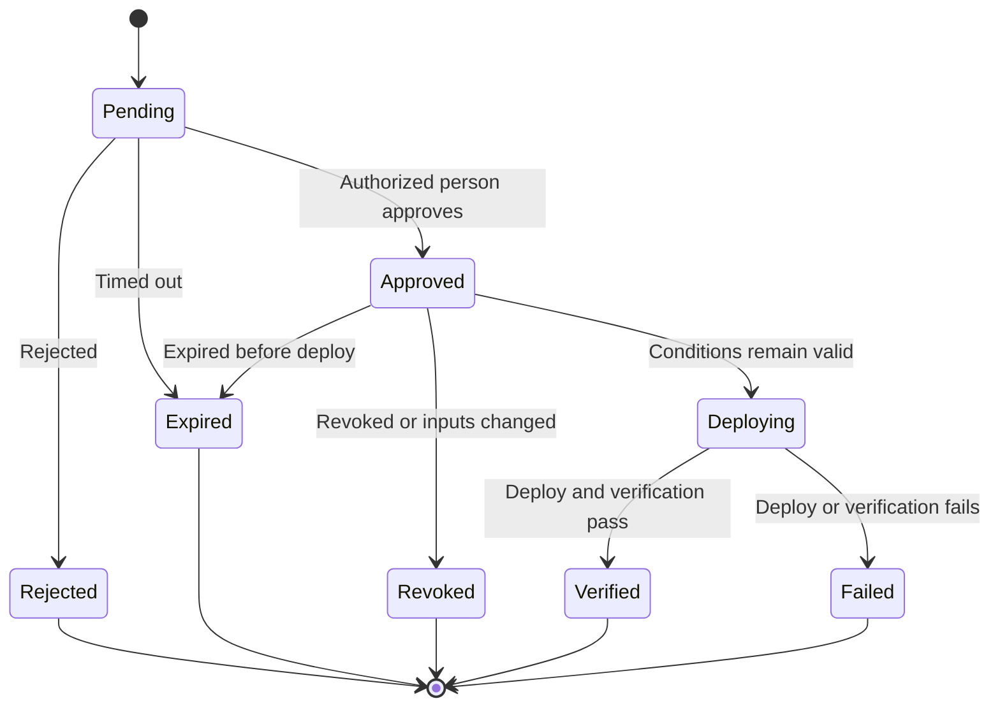

# Designing Manual Approvals Based on Risk and Accountability

In CI/CD, not every change requires a human to click a button to authorize deployment. A small bug fix that passed testing and affects only a development environment can be deployed automatically. A database schema change, authentication policy change, network update, or production configuration change can severely affect data and users, so an authorized person should review it prior to deployment.

**Manual approval** is a control gate in the delivery workflow: the pipeline pauses before a high-risk action, surfaces evidence for an accountable person to evaluate, and proceeds only after a valid decision is recorded. This gate must be grounded in risk and role accountability, be time-bound, carry supporting evidence, and bind to the exact artifact and target environment.

Manual approval does not replace automated testing, code review, security checks, or post-deployment monitoring. It adds an accountable decision at points where the organization needs a human to accept residual risk or confirm operational readiness.

## 1. When is manual approval needed?

An approval gate is valuable when the upcoming action carries substantial impact and an authorized person or group must weigh evidence before proceeding. Examples:

- Production deployments for services serving many users or critical transactions.
- Schema, migration, or data changes that may be hard to reverse.
- Changes to authentication, authorization, encryption, firewalls, IAM, or network boundaries.
- Changes to shared infrastructure, clusters, databases, DNS, or storage systems.
- Releases carrying security findings accepted under an exception.
- Changes with a large blast radius affecting multiple services or multiple tenants.
- Releases outside normal hours or during sensitive operational events.
- Operations capable of causing disruption, data loss, or requiring coordination with another operations team.

Conversely, if every commit requires someone to click a button with no new information to evaluate, the gate only creates queues and conditions approvers into rubber-stamping out of habit. Automate machine-verifiable checks and reserve human judgment for cases involving genuine risk or accountability.

## 2. Distinguishing deployment approval from other controls

A delivery workflow contains multiple control types. They may connect, yet answer different questions:

| Control | Question | Accountable person or mechanism |
|---|---|---|
| Code review | Was the code change reviewed and approved prior to merge? | Repository reviewers/maintainers |
| Automated quality gate | Did tests, scans, policies, and technical conditions pass? | Pipeline and automated tooling |
| Change approval | Is the change permitted under change management policy? | Change owner, change manager, or CAB per policy |
| Deployment approval | Is deploying this specific artifact to this specific environment authorized right now? | Environment/release approver |
| Post-deployment verification | Is the deployed version behaving correctly and safely? | Pipeline, monitoring systems, and operators |

A reviewed pull request does not mean a production deployment is approved. Likewise, a deployment approver should not substitute for test execution or security scanning. Automated gates must complete before asking an approver for a decision, unless a separate exception workflow is defined.

## 3. Assessing risk before selecting approval tiers

Do not choose the number of approvers based solely on environment name. Production usually carries stricter rules, yet a minor change in production can carry less risk than a destructive data migration in a shared environment. Evaluate the nature of the change and the impact if something fails.

Factors to consider:

| Factor | Assessment question | High-risk example |
|---|---|---|
| Business impact | If a defect occurs, which business workflows suffer? | Payments, login, checkout, or transaction processing goes down |
| Blast radius | How many services, users, tenants, or deployment regions are affected? | Shared library update or cluster serving multiple products |
| Data | Could data be lost, corrupted, or exposed? | Column-dropping migration, encryption change, or large data transformation |
| Security | Does it change permissions, trust boundaries, or attack surface? | Broad IAM grants, authentication changes, or opening network ingress |
| Reversibility | Can you roll back quickly and safely? | Incompatible schema change or irreversible data writes |
| Complexity | Are there multiple components, manual steps, or synchronized dependencies? | Multi-service release requiring coordinated versions |
| Exposure | Is the service Internet-accessible or handling sensitive data? | Public API processing PII or financial data |
| Timing | Does it overlap peak traffic, freeze windows, or major events? | Major change right before financial reconciliation or a sales event |
| Evidence | Are tests, scans, rehearsals, and recovery plans complete? | Missing migration rehearsal results or unverified rollback |

### Using an explainable risk matrix

A simple approach is scoring **likelihood** and **impact** on a 1–5 scale, then consulting their product to group changes. This is a discussion aid, not an exact mathematical measurement.

| Level | Example score range | Suggested handling |
|---|---|---|
| Low | 1–4 | Automatic when required gates pass; log audit event |
| Medium | 5–9 | One authorized reviewer confirms when required by policy |
| High | 10–15 | Independent approval; may require service owner plus SRE or security depending on risk |
| Very high/critical | 16–25 | Multiple accountable parties, change window, phased rollout, and verified recovery plan |

These score ranges are illustrative only. Organizations must define scales, thresholds, and overrides per service. Certain conditions can mandate escalation even if the total score is low—for example, destructive data operations, administrative privilege changes, regulated data handling, or critical security findings. Never let a low numeric score hide a risk of special nature.

Record both **inherent risk** before mitigations and **residual risk** after tests, canaries, backups, approvals, or rollback readiness. Approvers must understand the residual risk they are accepting.

## 4. Determining approval tiers by risk level

A sample policy might break tiers down as follows:

| Tier | Examples | Approval model |
|---|---|---|
| Automatic | Doc changes, minor fixes in low-impact services, development environments | Pipeline proceeds automatically when automated gates pass; deployment is still logged |
| Single approver | Narrowly scoped production change with clear rollback and passing tests | Service owner or delegated approver confirms |
| Independent approval | Changes affecting data, security, shared infra, or multiple services | Deployer cannot self-approve; appropriate reviewers such as service owner, SRE, or security |
| Multi-party/quorum | Critical changes with cross-team impact or low reversibility | Requires all mandatory roles or policy-defined vote count before proceeding |

Not every high-risk change needs every approval group. Match reviewers to the risk type: security review for permission and attack-surface changes; database owner for migrations; SRE/operations for operability; product/business owner for timing and business impact. Multiple approvers from the same function do not necessarily provide independent perspectives.

### Separating implementer and approver

For sensitive actions, enforce separation of duties:

- The person who authored or triggered the deployment cannot self-approve that deployment when policy requires independent approval.
- Approvers must belong to a group authorized for the corresponding environment or change type.
- Service accounts, bots, or deployment tokens must never impersonate human approvers.
- For quorums, each approver needs an individual identity; never share one group account.
- If an approver is also the on-call operator, policy must state when dual roles are acceptable and how conflicts are recorded.

Code review and deployment approval may be handled by different groups. Deployment approvers must assess release readiness and delivery risk rather than merely counting how many people approved the pull request.

## 5. Defining each role's accountability

Approvals are meaningful when each role knows what it must check and what it is accountable for.

| Role | Primary responsibility | Evidence or action |
|---|---|---|
| Change/request owner | Describe objective, scope, and impact of the change | Ticket, change record, acceptance criteria |
| Developer/release owner | Prepare artifact, tests, deployment plan, and recovery plan | Commit, pipeline, digest, release notes, rollout/rollback plan |
| Service owner | Confirm the change matches service behavior and risk tolerance | Impact assessment, dependencies, readiness, and release window |
| SRE/operations | Evaluate operability, observability, capacity, and recovery | Dashboards, alerts, health checks, runbooks, rollback readiness |
| Security reviewer | Assess findings, access permissions, threats, and security exceptions | Scan reports, threat assessment, mitigations, or exception records |
| Change approver/manager | Verify process, scheduling, and required coordination | Change window, conflict check, decision, and audit trail |
| Release operator | Execute deployment within approved scope | Deployment ID, logs, rollout status, and verification |

In small teams, one person may hold multiple roles if permitted by policy. For high-risk changes, require at least one independent perspective and never let a single individual propose, approve, and verify success for a sensitive action.

## 6. Evidence package reviewers need to inspect

An Approve button adds little value if reviewers must hunt across dozens of jobs for details. The pipeline should assemble a concise **approval summary** linking to detailed evidence and answering key questions.

Minimum evidence package contents:

1. **Change:** ticket/change ID, repository, commit SHA, PR/MR, and behavioral summary.
2. **Artifact:** name/version, registry, digest, or checksum of the exact package ready for deployment.
3. **Testing:** status of unit, integration, acceptance, and required tests; links to reports.
4. **Security:** SAST/SCA/DAST results, image/IaC scans, open findings, and approved exceptions.
5. **Risk:** risk level, blast radius, affected data, dependencies, and residual risk.
6. **Deployment plan:** environment, timing, rolling/canary/blue-green strategy, sequence, and on-call operator.
7. **Verification:** health checks, smoke tests, SLOs/metrics to watch, and observation duration.
8. **Recovery:** halt conditions, rollback target, data/config restoration steps, and accountable owner.
9. **Prior approvals:** change window, security exceptions, prior reviewers, and active conditions.

Present information proportionally to risk. Low-risk changes may need only a brief summary. Critical changes require detailed plans, rehearsal evidence, and confirmations from dependent teams. Approvers must be able to open raw logs/reports and verify provenance when needed.

Never include secrets, tokens, private keys, or personal data in an approval summary. Provide only safe references to access-controlled storage systems.

## 7. Binding approval decisions to a specific artifact and environment

An approval decision is valid only for the exact action reviewed. If an approver signs off on image `sha256:abc...` for deployment to `staging`, the pipeline must never substitute another image digest or retarget `production` without re-evaluating policy.

An approval record should bind at minimum to:

- Change/request ID and pipeline run ID.
- Commit SHA and artifact digest.
- Environment or target resource.
- Deployment configuration/manifest version.
- Rollout strategy and instance/traffic scope.
- Approver identity, role, and timestamp.
- Policy version, rationale, and approval conditions.
- Expiration time or conditions that invalidate the approval.

### Approvals must invalidate when inputs change

The following events normally require re-evaluation or fresh approval:

- Rebuilding produces a new artifact digest.
- The commit or release candidate changes.
- The target environment, cluster, region, or tenant changes.
- Manifests, migrations, or configs affecting change risk are altered.
- A new security finding emerges or a required gate flips from pass to fail.
- The change window expires or operational conditions no longer hold.
- The approver revokes the decision before deployment begins.

Approvals should carry an expiration and apply to an explicit deployment scope. If an approval can be reused indefinitely, someone could reuse an old decision for a different artifact or environment the approver never reviewed.

## 8. Lifecycle of an approval request

A simple state machine keeps pipelines and audit logs consistent:



Each status carries a distinct meaning:

- **Pending:** request created and awaiting the right person or quorum.
- **Approved:** required conditions and approvers have signed off.
- **Rejected:** approver declined, with rationale or requested changes.
- **Expired:** deadline passed or change window is no longer valid.
- **Revoked:** decision withdrawn or inputs changed, invalidating the prior approval.
- **Deploying:** pipeline has started the approved action.
- **Verified:** rollout and post-deployment checks passed.
- **Failed:** deployment or verification failed; remediation or recovery is required.

Never use an "approved" status to represent both approval and deployment success. Approval authorizes the action; operational outcomes must be recorded separately.

## 9. Reviewer decision workflow

Approvers should follow a short, consistent checklist:

1. Confirm proper authority and ensure no self-approval violation.
2. Read the objective, scope, ticket, and planned deployment timing.
3. Verify the commit, artifact digest, and environment match the request.
4. Review required automated gates, open findings, and active exceptions.
5. Assess blast radius, defect detectability, and rollback capability.
6. Confirm on-call staff, runbooks, dashboards, and change window readiness when risk warrants.
7. Choose approve, reject, or request more information; record rationale per policy.

Approvers need not read every log line when summaries and gates are well designed. Still, they must have access to underlying evidence and never approve solely because the pipeline is green or because someone else already clicked approve.

### Approve, reject, and request changes

- **Approve:** authorizes the exact artifact, environment, and timeframe stated.
- **Reject:** denies due to risk or unmet criteria; records rationale so the release team knows what to fix.
- **Request changes:** asks for updates to plans, evidence, or scope. Once updated, the pipeline regenerates the summary and may require a fresh approval request.
- **Defer:** postpones to another change window; the old approval does not automatically apply to the new time if operational conditions shift.

Do not allow editing change-request contents after approval while retaining the old decision. The system must store a revision or fingerprint of the approved payload.

## 10. Example approval implementation in GitLab CI

GitLab CI can create a manual job for production deployment. Deployment privileges can be restricted using protected environments and rules governing who is allowed to deploy. Specific deployment approval features and configuration options depend on your organization's GitLab version/edition and setup; verify against your actual platform.

Minimal example:

```yaml
stages:
  - verify
  - build
  - deploy

verify_release:
  stage: verify
  script:
    - ./ci/run-required-checks.sh

build_release:
  stage: build
  needs:
    - verify_release
  script:
    - ./ci/build-and-publish-by-commit.sh
    - ./ci/write-release-manifest.sh
  artifacts:
    paths:
      - release-manifest.json

deploy_production:
  stage: deploy
  needs:
    - job: build_release
      artifacts: true
  environment:
    name: production
  when: manual
  allow_failure: false
  script:
    - ./ci/verify-approved-release.sh release-manifest.json
    - ./ci/deploy-by-digest.sh release-manifest.json
    - ./ci/verify-production-health.sh
```

In this example:

- `verify_release` runs required checks before building.
- `build_release` creates the artifact and a release manifest containing the commit and digest.
- `deploy_production` pauses for manual action and is not treated as an optional skippable job.
- Scripts verify the release manifest and deploy by digest to preserve the exact built artifact.
- After deploy, health verification emits its own separate result.

`when: manual` introduces a manual pause; to make it an accountable approval, configure deployment permissions/protected environments, control who can trigger the job, and log operator identity. If multiple approvers or approval rules are required, use the appropriate GitLab deployment approval feature for your edition or an integrated change management system. A single manual button alone does not prove independent approval occurred.

## 11. Example approval implementation in GitHub Actions

GitHub Actions can use **environment protection rules** for the `production` environment. The workflow attaches a job to an environment; required reviewers, branch/tag restrictions, and self-approval prevention are configured in repository/environment Settings rather than YAML alone.

```yaml
name: Release

on:
  workflow_dispatch:

jobs:
  verify:
    runs-on: ubuntu-latest
    steps:
      - uses: actions/checkout@v4
      - run: ./ci/run-required-checks.sh
      - run: ./ci/build-and-publish-by-commit.sh

  deploy-production:
    needs: verify
    runs-on: ubuntu-latest
    environment:
      name: production
    steps:
      - uses: actions/checkout@v4
      - run: ./ci/verify-approved-release.sh
      - run: ./ci/deploy-by-digest.sh
      - run: ./ci/verify-production-health.sh
```

When an environment has required reviewers, the job waits for a decision under configured protection rules before receiving authorization to proceed. Restrict deployable branches/tags, enable self-approval prevention if required by policy, and scope secrets to the right environment. Environment protection features vary by plan and repository type; verify your actual configuration.

This illustrative workflow does not yet generate a release manifest or pass artifacts between jobs. In a real implementation, upload/download the artifact from the verify/build job, store the digest, and verify that exact digest in the deploy job. Never rebuild a different image after environment approval has been granted.

## 12. Emergency approvals (break-glass)

Situations arise requiring immediate action to restore service—for example, rolling back a broken version or blocking an actively exploited vulnerability. If standard approval workflows introduce dangerous delay, organizations may design a tightly scoped emergency (break-glass) path.

Break-glass is not a license to bypass every control. A proper design requires:

- Explicitly defining eligible triggers, such as incident severity or risk of data loss.
- Granting access solely to designated on-call/incident commander roles.
- Using short-lived, revocable privileged credentials with dedicated logging.
- Limiting actions to recovery goals, prioritizing prepared rollbacks or mitigations.
- Recording justification, incident ID, actor, timestamp, artifact/configuration, and blast radius.
- Notifying service owner/security/change owner per incident procedures.
- Requiring post-action review: risk assessment, log audit, revocation of temporary rights, and backfilling missing approvals/records.

Never use break-glass to ship new features or skip tests under schedule pressure. If an emergency patch must deploy, choose minimum safely runnable checks, restrict rollout, monitor closely, and record the risk acceptance decision.

## 13. Monitoring post-approval and post-deployment

Approval does not end release accountability. Before starting, the pipeline must verify the approval is still valid and conditions have not changed. During rollout, the system should monitor step-by-step status and halt if safety conditions cease to hold.

Conditions to monitor include:

- Rollout completion and ready instance/replica counts.
- Passing health checks and smoke tests.
- Error rates, latency percentiles, and saturation within thresholds.
- Absence of new security alerts or severe business errors.
- Migrations and dependencies working properly with the deployed version.

If verification fails, the pipeline must halt rollout or trigger rollback per policy. Deployment records must retain outcome, operator, artifact digest, environment, and incident links if any. Never mark an approval as "successful" simply because an approver clicked accept.

## 14. Audit trail and decision traceability

An approval decision must remain auditable months later. Audit records should capture:

| Field | Contents |
|---|---|
| Approval ID | Identifier for the approval request |
| Change ID | Linked ticket/change record |
| Subject | Approved commit SHA, artifact digest, and configuration |
| Target | Environment, cluster/region, and deployment scope |
| Risk | Risk level, classification rationale, and residual risk |
| Decision | Approved, rejected, expired, or revoked |
| Approver | Identity, group/role, and decision timestamp |
| Reason | Justification, conditions, or accepted exceptions |
| Policy | Policy version and applied rules |
| Execution | Deployment ID, start/end timestamps, and outcome |

Logs need access controls and retention periods aligned with organizational policy. For sensitive changes, ensure audit records cannot be altered or deleted by the deployment operator. If decisions are recorded in an external change management system, the pipeline must store the ID and link for reverse traceability.

## 15. Anti-patterns to avoid

- **Requiring a button click for every deployment:** creates queues, approval fatigue, and slows low-risk changes.
- **Self-approval by the implementer:** eliminates independence on changes requiring two-person control.
- **Approving solely because the pipeline is green:** overlooks blast radius, change windows, rollback, and residual risk.
- **Not binding approvals to digests:** allows deploying a different artifact than the one the reviewer inspected.
- **Non-expiring approvals:** old decisions can be reused after conditions have changed.
- **Editing contents after approval:** the reviewer is no longer approving the change actually being executed.
- **Omitting rejection/exception rationale:** prevents learning from decisions and hinders audits.
- **Too many approvers from the wrong roles:** adds latency without improving review quality.
- **Using shared accounts:** obscures who actually made the decision.
- **Treating a manual job as full deployment approval:** a click trigger may lack permission limits, separation of duties, or an audit trail.
- **Skipping post-deploy verification:** the decision was approved, yet nobody knows whether execution was safe.
- **Break-glass without post-incident review:** emergency paths become routine, poorly governed shortcuts.

## 16. Manual approval gate design checklist

Before introducing an approval gate into a pipeline, verify:

1. Which risks make approval necessary? Which conditions can be automated instead?
2. Are the risk scale and escalation thresholds clearly defined?
3. Who is authorized to approve each change type and environment?
4. Are implementers prevented from self-approving when independence is required?
5. Are separation of duties or quorums sufficient for high-risk changes?
6. Does the approval summary include ticket, commit, artifact digest, tests, scans, blast radius, and rollback plan?
7. Is the approval bound to a specific environment, configuration revision, and expiration?
8. Do changes to the artifact, target, or findings invalidate existing approvals?
9. Are pending, approved, rejected, expired, revoked, and execution outcome states clearly separated?
10. Can approvers inspect underlying evidence and record decision rationale?
11. Is there a bounded, audited break-glass workflow with mandatory post-action review?
12. Are post-deploy health checks, metrics, rollout halts, and conditional rollbacks in place?
13. Does the audit trail capture identity, policy version, decision, and deployment ID?
14. Are approval gates periodically reviewed to prevent approval fatigue and stale permissions?

Manual approval is valuable when it puts the right person at the right moment to evaluate the right risks. When approval tiers match impact, evidence binds to immutable artifacts, accountability is clear, and decisions are logged, CI/CD can automate most work while maintaining necessary control over critical releases.
