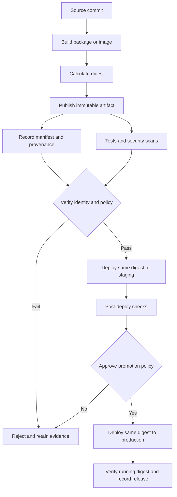

# Identifying Artifacts with Versions, Checksums, or Digests

In CI/CD, a single build can produce many files: JARs, binaries, packages, container images, frontend bundles, manifests, test reports, and a Software Bill of Materials (SBOM). As the pipeline moves these outputs through testing, staging, and production, the team needs to know precisely **which artifact was built, verified, and deployed**. Human-readable filenames or tags help people search, but they are not enough to prove the underlying contents have not changed.

Artifact identification must combine version information with a content identifier. The version describes the release semantics or build run; the checksum/digest identifies the exact bytes; and the manifest and provenance link the artifact to the commit, pipeline, toolchain, and verification evidence. When origin authentication is required, digital signatures prove that the artifact or metadata was produced by a trusted identity.

The goal is for the pipeline to be able to answer: which version this artifact belongs to, which commit it was built from, whether it is the exact file that passed tests, whether it was altered during transfer or storage, who or which workflow created it, and which exact digest production is running.

## 1. What Does Artifact Identity Include?

No single field fully describes an artifact's identity. A release record typically requires multiple components:

| Component | Role | Example |
|---|---|---|
| Artifact name | Helps humans recognize the product and package type | `order-service` |
| Release version | Expresses the product version under a compatibility policy | `2.4.1` |
| Build identity | Distinguishes builds of the same source/version | Pipeline run `1842`, attempt `1` |
| Source revision | Identifies the source code that was built | Full Git commit SHA |
| Checksum/digest | Identifies the byte contents | `sha256:...` |
| Artifact location | Specifies where to download the artifact | Package registry or OCI registry |
| Platform/variant | Distinguishes architecture or output format | `linux/amd64`, `linux/arm64` |
| Provenance | Links the output to its source and build process | Attestation from an authenticated workflow |
| Signature | Verifies the identity that signed the artifact or metadata | Signature per organizational policy |

You can think of an artifact's identity as a set of fields:

```text
Artifact identity
  product       = order-service
  version       = 2.4.1
  build         = run-1842-attempt-1
  source        = git:9f4c...e81a
  location      = registry.example/team/order-service
  digest        = sha256:ab12...89ef
  platform      = linux/amd64
```

Name, version, and build number aid discovery. The source SHA traces back to source code. The digest pinpoints the exact content. Location enables downloading. Provenance and signature provide evidence of origin. Depending on the artifact type, some fields may not apply, but a production-deployable package needs at least one immutable content identifier and traceability back to the build run.

## 2. Distinguishing Source Version, Release Version, and Build Identity

A single commit can be built multiple times. A single release version can have multiple candidates before release. Therefore, you should not use the same concept to represent source code, release meaning, and build execution.

- **Source revision:** the immutable commit SHA or revision checked out. It identifies the state of the source code, not the entire build environment.
- **Release version:** the product version seen by users or dependent systems, typically following Semantic Versioning or a dedicated policy.
- **Build identity:** the CI run ID and attempt, distinguishing two builds from the same commit.
- **Artifact digest:** the content identifier computed from the artifact's bytes after packaging or publishing.

For example, commit `9f4c...e81a` might be built in run `1842` to produce candidate `2.4.1-rc.1`, then built again in another run after a toolchain change. Two artifacts must not be treated as identical simply because they share the same source SHA. If the digest differs, the content differs; the cause must be explained and a separate build identity assigned.

A release version should only be assigned to an artifact approved through the release process. If the organization rebuilds to fix a packaging error, it must create a new build identity and follow clear versioning/release rules; never overwrite an artifact that has already been tested or released.

## 3. Using Semantic Versioning Properly

Semantic Versioning (SemVer) represents a version in the form:

```text
MAJOR.MINOR.PATCH
```

- **MAJOR:** incompatible changes to the public contract or API.
- **MINOR:** adding functionality in a backward-compatible manner.
- **PATCH:** backward-compatible bug fixes.

For example, `2.4.1` may be a bug-fix release on the `2.4` line. Rules for bumping versions must be based on the contract the product commits to, not simply on the number of commits or builds.

SemVer also supports pre-release and build metadata:

```text
2.5.0-alpha.1
2.5.0-rc.2
2.5.0+build.1842
2.5.0-rc.2+build.1842
```

Pre-release identifiers such as `alpha.1` or `rc.2` indicate a version is not yet stable. Build metadata after the `+` sign can record build information, but according to SemVer rules it does not affect version precedence. Thus, `2.5.0+build.1842` and `2.5.0+build.1901` share the same precedence; build metadata does not replace a digest or an immutable ID.

Not every artifact requires SemVer. A library with a public API typically benefits from SemVer; an internal deployment image might use a release version plus commit/build ID. Regardless of the convention chosen, the version must be defined and used consistently across package metadata, registry tags, release records, and deployment systems.

## 4. Commit SHAs and Build Numbers Do Not Replace Digests

A commit SHA identifies the contents of a Git tree/commit under Git's hashing algorithm. It does not directly identify the bytes of a JAR or container image. Build results also depend on compilers, build tools, dependencies, parameters, operating systems, timestamps, and other inputs.

A build number distinguishes runs, but it also does not prove that two runs produced identical contents. A pipeline might rerun the same commit with a different toolchain or differently resolved dependencies. Therefore:

- Record the commit SHA for source traceability.
- Record the pipeline run ID and attempt for execution traceability.
- Compute the checksum/digest over the actual output.
- Bind test reports, SBOMs, provenance, and signatures to the same artifact digest.

If the same source and controlled inputs produce different digests, investigate the discrepancy before releasing. If the project aims for bit-for-bit reproducible builds, the digests of two independent builds must match according to defined criteria.

## 5. What Are Checksums and Digests?

A checksum is a value computed from data contents to verify whether the content has changed unexpectedly. In CI/CD, cryptographic checksums such as SHA-256 are commonly used to identify files and verify integrity.

A digest is a value representing content under a hash algorithm. In OCI container registries, a digest is typically expressed as `sha256:<hexadecimal-value>`. The terms checksum and digest are sometimes used interchangeably in casual conversation; what matters is knowing the algorithm, input data, and format being hashed.

Illustrative example:

```text
Artifact: order-service-2.4.1.jar
Algorithm: SHA-256
Digest:    8a2f...d91c
```

If even a single byte in the file changes, the SHA-256 digest will almost certainly change. SHA-256 is suitable for integrity checks and content identification in standard release workflows. Do not use MD5 or SHA-1 for modern security purposes because they have known collision weaknesses.

A digest does not encrypt data, hide content, or prove who created the file. It is strictly a content fingerprint under the chosen algorithm.

## 6. Integrity Differs from Authenticity

This is an essential distinction when designing a software supply chain:

| Mechanism | What It Proves | What It Does Not Prove Alone |
|---|---|---|
| SHA-256 checksum | The current file matches the digest being compared against | Who created the file or whether the file is trustworthy |
| HTTPS/TLS | The connection to the endpoint is authenticated by certificate and data in transit is protected | Which source produced the artifact in the registry |
| Digital signature | Content or metadata was signed by the corresponding key/identity and was not altered after signing | That the software is secure or that the signer is authorized to approve releases if policy is undefined |
| Provenance/attestation | Describes the source, builder, process, and inputs that created the artifact per system evidence levels | That the content is bug-free or that claims are true if the builder is untrusted |

If an artifact and its checksum file are stored side by side in a location where an attacker can overwrite both, the attacker can replace the file and compute a new checksum. The comparison would still pass. To prevent this, expected digests must be obtained from a trusted source or protected by signatures, separate write permissions, and audit logs.

A strong workflow typically combines digests with signatures and provenance. The consumer verifies the digest of the downloaded bytes, verifies the signature against a trust policy, and checks whether the provenance shows an authorized source repository, revision, workflow, and builder.

## 7. Computing and Verifying Checksums for Package Files

For file-based packages, a pipeline can generate a checksum sidecar immediately after packaging. Example on Linux:

```bash
sha256sum build/libs/order-service.jar > build/libs/order-service.jar.sha256

# Verify the file against the recorded checksum
sha256sum --check build/libs/order-service.jar.sha256
```

The first command writes the filename and digest to the sidecar. The second command reads the sidecar and recomputes the digest to compare. The file to verify must sit at the exact path referenced by the sidecar; if the package is moved, the manifest must be updated or regenerated accordingly.

On Windows PowerShell:

```powershell
$actual = (Get-FileHash -LiteralPath '.\build\libs\order-service.jar' -Algorithm SHA256).Hash.ToLowerInvariant()
$expected = (Get-Content -Raw -LiteralPath '.\build\libs\order-service.jar.sha256').Trim().Split(' ')[0].ToLowerInvariant()

if ($actual -ne $expected) {
    throw 'Artifact SHA-256 does not match the expected checksum.'
}
```

The PowerShell snippet assumes the sidecar has the digest as its first token. In real-world systems, use a manifest with an explicit schema and a proper parser rather than relying on arbitrary text formats.

The checksum should be generated after the artifact is finalized and before upload. After downloading in another job or environment, the consumer recomputes the digest and compares it with the value published by the producer via controlled metadata. Do not compute a checksum on a temporary file and then deploy a different file.

## 8. Identifying Container Images by OCI Digest

Container images are often published with human-readable tags, for example:

```text
registry.example/team/order-service:2.4.1
registry.example/team/order-service:9f4c2e1
```

Tags help with discovery, but a registry may allow a tag to be repointed to a different manifest. If a tag is updated, the same pull command can download different contents at a later time. Therefore, when deploying, use a digest:

```text
registry.example/team/order-service@sha256:ab12...89ef
```

The registry returns the manifest digest after publishing. The pipeline must store that exact digest and pass the digest-based image reference to scan, staging, and production jobs.

For multi-architecture images, a manifest list/image index can point to separate manifests per platform such as `linux/amd64` and `linux/arm64`. The index digest identifies the set of platform manifests; the runtime can select the sub-manifest matching the host architecture. When investigating or requiring exact deployments, record explicitly whether the digest in use is the index digest or the platform-specific manifest digest, along with the corresponding platform.

The `latest` tag should not be used as a release identifier. Version or commit tags remain useful for humans, but deployment environments should receive a verified immutable digest.

## 9. Manifest: Consolidating Artifact Metadata in One Place

A manifest is a document describing an artifact and the attributes needed by consumers to verify or use it. It does not replace the artifact itself. A good manifest includes a schema/version, name, type, version, source revision, build identity, location, digest, and links to evidence.

Example JSON manifest:

```json
{
  "schemaVersion": 1,
  "name": "order-service",
  "version": "2.4.1",
  "build": {
    "runId": "1842",
    "runAttempt": 1,
    "builder": "ci://trusted-project/build-workflow"
  },
  "source": {
    "repository": "https://git.example/team/order-service",
    "commit": "9f4c2e1...e81a"
  },
  "artifact": {
    "uri": "registry.example/team/order-service@sha256:ab12...89ef",
    "mediaType": "application/vnd.oci.image.manifest.v1+json",
    "digest": {
      "algorithm": "sha256",
      "value": "ab12...89ef"
    },
    "platform": ["linux/amd64", "linux/arm64"]
  },
  "evidence": {
    "sbom": "oci://registry.example/team/order-service-sbom@sha256:...",
    "provenance": "oci://registry.example/team/order-service-attestation@sha256:..."
  }
}
```

This is an illustrative structure, not a mandatory schema from OCI or a specific CI tool. The digest and URI values in the example are placeholders. Real manifests should be validated against a versioned schema; fields that do not apply can be omitted or represented according to a documented convention.

The manifest should be stored alongside the artifact or within the release record, with controlled write permissions and a signature if it is used as a source for deployment decisions. If a manifest can be modified without leaving a trace, it is not reliable evidence.

## 10. Linking Artifacts to SBOMs and Provenance

An SBOM lists the software components inside an artifact, usually including packages, versions, and dependency relationships. SBOMs help teams audit dependencies, check licenses, and identify affected artifacts when a library has a vulnerability.

Provenance describes how an artifact was created: source repository and revision, builder identity, workflow, parameters, and key dependencies/inputs. Depending on the format and system, provenance may be issued as a signed attestation.

The key point is that SBOMs and provenance must be bound to the exact artifact digest. If an image is rebuilt, the old image's SBOM does not automatically describe the new image even if the tag name is identical. Vulnerability scan results must record the analyzed digest.

A release record can link:

- Source commit SHA.
- Workflow run ID and attempt.
- Artifact version, URI, and digest.
- SBOM and provenance references.
- Unit, integration, contract, and security scan results.
- Signature verification result.
- Deployed environment and post-deploy verification results.

During an incident, the team can trace backward from the image digest in production to the package, source commit, dependencies, and the CI run that produced it.

## 11. Digital Signatures and Origin Verification

Digital signatures use a private key or managed identity to sign an artifact, checksum, manifest, or attestation. Consumers verify the signature using the corresponding public key or trust root. With workload identity-based signing, the system verifies the issuer and identity of the workflow that signed.

A verification policy must answer:

- Who or which workflow is authorized to sign artifacts for this repository?
- Which identities are accepted: project, repository, workflow path, branch, tag, or environment?
- Which digest must the signature be bound to?
- Is a transparency log or attestation required?
- How are revoked keys or invalidated identities handled?
- Who manages the trust root and updates policies?

Simply checking that "a signature exists" is not enough. A valid signature from an unauthorized identity must still be rejected. Likewise, a signature only proves the content was signed by that identity; it does not prove the code is bug-free or passed every quality gate. That must be captured in policy and provenance.

Do not store private signing keys in repositories or artifacts. Prefer a key management service, hardware-backed keys, or appropriate keyless/workload identity signing mechanisms. Signing permissions should only be granted to jobs from trusted sources after mandatory gates pass.

## 12. Registries and Immutability Policies

An artifact registry or package repository stores and distributes artifacts by name, version, or digest. A well-managed registry should provide:

- Clear namespaces/projects for each product or team.
- Separation of push, pull, delete, and admin permissions.
- Immutable tag/version policies for published releases.
- Audit logs for publishing, metadata changes, and deletions.
- Retention and cleanup rules by artifact type.
- Replication/backups aligned with recovery requirements.
- TLS and client authentication mechanisms.
- The ability to download older artifacts by digest for rollback.

Immutable tags prevent reusing the same version tag for different content. However, this policy must be configured on the registry itself; naming a tag after a commit does not make the tag immutable by itself. Digests remain the more reliable content identifier.

Do not grant release registry write access to every pull request workflow. Build jobs from untrusted branches can upload temporary run-scoped artifacts only. Release publish jobs must verify the branch/event, source revision, gates, and identity before receiving write access to the release namespace.

## 13. Build Once, Promote the Same Digest Across Environments

A key release principle is to build an artifact once, then promote that exact artifact through staging and production. Each environment may use its own configuration and secrets, but the package or image contents should retain the same digest.

Reference flow:

1. Check out the specified commit SHA.
2. Build the package/image and compute the digest.
3. Publish to the registry and retrieve the digest-based URI.
4. Test, scan, and generate SBOM/provenance bound to the digest.
5. Staging deploys that exact digest and verifies the running version.
6. Quality gates evaluate evidence and approve promotion.
7. Production deploys the same digest using production environment configuration.
8. Save the release record and post-deploy verification results.



If a production job rebuilds from source or re-resolves a tag, it may produce contents different from the tested artifact. When a bug fix is required, create a new build with a new identity, rerun the required gates, and release under the version policy.

## 14. Verifying Artifacts After Download

Consumers must not assume a downloaded file is always valid. After downloading, verify:

1. The artifact came from an authorized registry or run ID.
2. Name, version, media type, and platform match the target.
3. The digest computed from downloaded bytes matches the expected digest.
4. The signature is valid and the signer identity satisfies the trust policy if required.
5. Provenance references the expected repository, commit, and builder.
6. Test/security gates tied to the same digest have passed.
7. The artifact has not expired or been revoked by policy.

Do not extract or execute files from unverified sources in jobs with sensitive permissions. Archives can contain unusual paths or files crafted to exploit extraction steps. When extracting, restrict the target directory and check for path traversal.

If a checksum mismatch occurs, halt use of the artifact, preserve metadata and logs, and inspect the download source, caches, registry replication, and upload/download steps. Do not compute a new checksum to overwrite the expected value just to make the pipeline pass; doing so destroys original evidence.

## 15. Example: Storing Checksums for a JAR in a Pipeline

The shell example below illustrates building, computing a checksum, and writing minimal metadata:

```bash
set -euo pipefail

SOURCE_SHA="$(git rev-parse HEAD)"
BUILD_ID="${CI_PIPELINE_ID:-local}"
VERSION="2.4.1"
PACKAGE="build/libs/order-service.jar"

./gradlew --no-daemon --console=plain clean build
test -s "$PACKAGE"

sha256sum "$PACKAGE" > "$PACKAGE.sha256"

printf 'version=%s\n' "$VERSION" > build/artifact.properties
printf 'source_sha=%s\n' "$SOURCE_SHA" >> build/artifact.properties
printf 'build_id=%s\n' "$BUILD_ID" >> build/artifact.properties
printf 'sha256=%s\n' "$(sha256sum "$PACKAGE" | awk '{print $1}')" >> build/artifact.properties
```

In this example, `CI_PIPELINE_ID` is a platform-dependent variable; when running locally it falls back to `local`. Real pipelines should use the platform's build ID variable and also record repository identity, workflow run attempt, toolchain, dependency snapshot, and registry URI. The `artifact.properties` file is illustrative metadata, not a provenance standard.

After uploading the package and sidecar, the consumer job downloads both and runs `sha256sum --check`. If the artifact crosses a trust boundary, the checksum and metadata must be protected by a signature or a storage source with separate write permissions.

## 16. Example: Deploying Containers by Digest

Suppose the pipeline builds an image and pushes it to a registry with a release tag. The registry returns digest `sha256:ab12...89ef`. The pipeline records the image reference:

```text
registry.example/team/order-service@sha256:ab12...89ef
```

Subsequent jobs use that exact reference:

```bash
# Scan the exact published image
scanner image registry.example/team/order-service@sha256:ab12...89ef

# Deploy to staging by digest
deploy-tool set-image order-service \
  registry.example/team/order-service@sha256:ab12...89ef

# Record the expected image reference in the release record
printf '%s\n' \
  'registry.example/team/order-service@sha256:ab12...89ef' \
  > deployed-image.txt
```

`scanner` and `deploy-tool` are illustrative command names. In real systems, use the syntax of the scanner and deployment platform in operation. Post-deploy verification must read the actual image digest from the running workload or deployment status and compare it against the expected digest; merely writing the reference to a file does not prove the runtime pulled the right image.

## 17. Versioning and Naming Conventions for Artifacts

Artifact names should be readable, consistent, and free of sensitive information. A possible convention is:

```text
<product>-<release-version>-<platform>-<build-id>.<extension>

order-service-2.4.1-linux-amd64-1842.tar.gz
order-service-2.4.1-windows-x64-1842.zip
```

For container images, the repository path indicates the product; the tag indicates the version or build; the digest identifies the contents. For package registries, the version is typically part of the package coordinates. Do not stuff all metadata into the filename because filenames can face length or character limits and become hard to manage.

Naming rules should answer:

- Are stable releases, pre-releases, and snapshots distinguished?
- Are builds from pull requests published to a separate namespace?
- Do build retries create a new build ID or a new attempt?
- How are multiple platforms/architectures named?
- Can artifacts be overwritten?
- Which versions are permitted for production deployment?
- Is there a process to deprecate or revoke versions?

Do not use a standalone timestamp as the sole version. Timestamps are easy to read but do not prove content and can collide when resolution is insufficient or clocks drift. Timestamps can be included in metadata for investigation, but identity should rely on pipeline IDs and digests.

## 18. Retention, Promotion, and Rollback

Artifacts must be stored long enough to support deployment, investigation, and recovery. Retention policies should vary by data type:

| Data Type | Recommended Policy |
|---|---|
| Temporary pull request artifacts | Short retention, for review/debugging only |
| Snapshot builds | Retain per testing and traceability needs; clean up by age or status |
| Release candidates | Retain throughout verification and release decision windows |
| Production artifacts | Retain for the rollback support window and audit requirements |
| SBOM/provenance/signatures | Retain for the artifact lifecycle or longer per compliance policy |
| Logs/test reports | Retain long enough for investigation and gate proof |

Do not delete production artifacts currently deployed or within the rollback window. If registry replication has latency, verify that the digest is available in the target region before rolling out.

Rollback should reference the digest of a known-good release, not a mutable tag like `previous`. The release record should specify the prior digest, corresponding configuration, and database state. If migrations are not backward-compatible, rolling back the application alone may not suffice; a roll-forward or separate data recovery plan is required.

## 19. Registry Security and Artifact Supply Chain

Artifacts are executable inputs in production, making the registry and publishing workflow part of the security boundary.

Measures to apply:

- Grant least-privilege permissions to build, scan, promote, and deploy jobs.
- Separate temporary artifact namespaces from release namespaces.
- Use short-lived credentials or workload identity where supported by the platform.
- Enable immutable release/tag policies and audit logging.
- Verify checksums/digests after upload and download.
- Sign artifacts or attestations using authorized identities.
- Verify provenance, source repository, commit, and builder before deployment.
- Scan dependencies, images, and SBOMs according to policy.
- Restrict delete permissions; protect artifacts currently deployed.
- Never include secrets in packages, public manifests, or unprotected metadata.

A valid checksum does not replace a security scan. A valid signature does not replace functional testing. Each piece of evidence answers a different question and must be combined in quality gates.

## 20. Handling Digest Mismatches or Overwritten Versions

When a consumer detects a digest mismatch, halt the pipeline at the verification boundary. Potential causes include:

- File corruption during upload/download.
- The job downloaded the wrong artifact from another run or repository.
- A tag was moved to point to a different manifest.
- The artifact was rebuilt while stale metadata was still used.
- Registry replication or caching returned unexpected content.
- The manifest/checksum was updated alongside the file by an unauthorized identity.
- The pipeline computed the digest on a pre-packaged file or on a different platform.

Investigation procedure:

1. Record the expected digest, actual digest, URI, run ID, attempt, and timestamp.
2. Determine which bytes were hashed: the package before upload, the file after download, or the registry manifest.
3. Check the source run and artifact ID to rule out downloading the wrong item.
4. Check tag/version history, push/delete permissions, and registry audit logs.
5. Verify the manifest, signature, and provenance.
6. If the artifact is no longer trustworthy, revoke or quarantine it and create a new build from a verified revision.
7. Re-run tests and policy gates on the new artifact; do not reuse evidence attached to the old digest.

Never overwrite an already released version to "fix" a checksum. Create a new identity per versioning rules and record the relationship between the revoked old version and its replacement.

## 21. Common Anti-Patterns

| Anti-Pattern | Consequence | Improvement |
|---|---|---|
| Identifying only by filename | Two different contents can share the same name | Store version, build ID, and digest |
| Using `latest` to deploy | The tag can point to different contents | Deploy using an immutable digest |
| Using commit SHA instead of artifact digest | The same commit can yield different outputs | Record both source SHA and digest |
| Using build number as content proof | Build ID does not identify bytes | Compute the checksum on the actual artifact |
| Storing checksums beside artifacts without protection | Both file and checksum can be replaced | Protect metadata, sign, or fetch expected digest from a trusted source |
| Using MD5/SHA-1 for security purposes | Fails modern collision-resistance requirements | Use SHA-256 or a policy-approved algorithm |
| Rebuilding in each environment | Tested artifact may differ from production artifact | Build once, promote the same digest |
| Overwriting the same version/tag | Loses traceability and reproducibility | Enable immutability, create a new build identity |
| Not linking SBOM/provenance to digest | Unclear which artifact the evidence describes | Bind all attestations to the digest |
| Checking only that a signature exists | An unauthorized signer can still sign | Verify identity and trust policy |
| Deleting artifacts too early | Unable to roll back or investigate | Set retention based on release lifecycle |

## 22. Artifact Identification Checklist

Before using an artifact in a release pipeline, verify:

- [ ] The artifact has a clear name and type.
- [ ] The release version follows the documented convention.
- [ ] The build identity distinguishes runs and attempts.
- [ ] The source commit SHA is stored in metadata.
- [ ] SHA-256 or an equivalent digest is computed on the actual output.
- [ ] Artifact location and media type are clearly recorded.
- [ ] Container images are deployed by digest instead of mutable tags.
- [ ] The manifest has a schema version and is validated.
- [ ] The checksum is verified after download at the consumer.
- [ ] Expected digests/manifests are protected against simultaneous tampering with the artifact.
- [ ] Signatures are verified against identity and trust policy where applicable.
- [ ] Provenance links to the correct repository, revision, builder, and workflow.
- [ ] SBOM, scan reports, and test evidence are tied to the same digest.
- [ ] Staging and production use the same artifact digest.
- [ ] The registry enforces least privilege, audit logs, and immutable release policies.
- [ ] Retention is sufficient for deployment, rollback, and audits.
- [ ] Rollback references the digest of a known-good release.
- [ ] A digest mismatch halts the pipeline and preserves investigation evidence.

## 23. Conclusion

Artifact identification requires combining meaningful versions with immutable content identifiers. A release version conveys compatibility changes; build identity distinguishes executions; source SHA traces back to source code; checksums or digests identify bytes; manifests consolidate metadata; and signatures and provenance provide evidence of origin.

In CI/CD, build once, compute digests on the actual artifacts, publish to a controlled registry, verify digests along with trust policies before use, and promote the exact same digest through staging to production. When test reports, SBOMs, provenance, and release records are all bound to the same artifact identity, the team can prove precisely which version was tested and is running, while maintaining a reliable basis to investigate or roll back during incidents.
