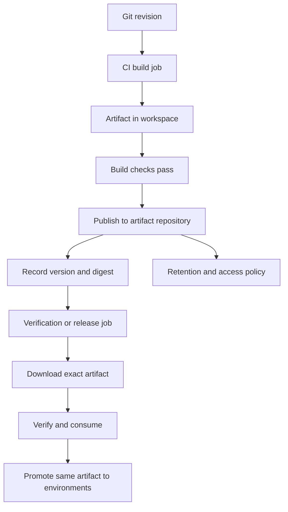

# Storing Artifacts in Appropriate Repositories Instead of Relying on CI Workspaces

A pipeline may build successfully, yet its output becomes unreliable if it only resides in a runner's temporary working directory. The runner may be destroyed after the job, the workspace may be recreated, or the next job may execute on a different machine. In such cases, build files vanish or it becomes impossible to determine exactly which file was built and tested.

Artifacts must be stored in a location with a lifecycle independent of the runner. An appropriate repository allows different jobs and pipelines to download the exact output, supports repeated deployments, stores version history, enforces access control, and traces an artifact back to the commit that produced it.

The core principle is to treat an artifact as an output with its own identity and lifecycle. A workspace serves a single execution; a cache accelerates runs; an artifact repository stores outputs meant to be shared, consumed, or released. Separating these three roles ensures CI/CD does not depend on the ephemeral state of job runners and enables promoting the exact same artifact across multiple environments.

## 1. What Is an Artifact and Why Does It Need Dedicated Storage?

An artifact is an output generated from source code or a processing workflow that can be consumed in a subsequent step. Depending on the project, an artifact may be:

- A JAR, WAR, or EAR file for a Java application.
- A packaged library published to a Maven repository.
- A ZIP, TAR, or installer package.
- A container image stored in an OCI registry.
- A package such as npm, Python wheel, NuGet, or an OS package.
- A binary, static asset, or auto-generated documentation bundle.
- A manifest, SBOM, provenance record, and reports associated with a build.

Not every file generated in CI is a release artifact. Temporary logs, intermediate files, compiler caches, or build directories may serve only a single job. The team must identify which outputs must be retained, which are strictly for diagnostics, and which can be regenerated at any time.

If artifacts are stored only in the workspace, a pipeline can run into issues:

- A subsequent job runs on a different runner and cannot see the previous job's files.
- The runner is deleted after the job finishes, completely losing the output.
- A retry overwrites or mixes files with a previous run.
- It is impossible to re-download the exact artifact from an older release.
- There is no certainty whether the file being deployed is the same file that passed testing.
- There are no clear access, retention, or deletion policies.
- Incident investigation becomes difficult because files cannot be linked to commits, pipeline runs, and verification results.

Dedicated storage turns a build output into a manageable object across the entire release lifecycle.

## 2. Distinguishing Workspaces, Artifact Repositories, and Caches

These three storage types often appear together in CI, yet they serve distinct purposes.

| Component | Purpose | Lifecycle | Examples |
|---|---|---|---|
| Workspace | Provides a working directory for a single job | Usually short-lived, may be destroyed after the job | Source checkout, build directory |
| Artifact repository | Stores identified outputs for consumption by other jobs, projects, or environments | Governed by versions and retention policies | Maven repository, OCI registry, generic package store |
| Cache | Reduces re-download or recomputation time | Can be evicted and recreated; not a source of truth | Gradle dependency cache, npm cache, compiler cache |

A workspace is where a job reads source code and creates files. It is not durable storage. A cache is a performance optimization; if a cache is empty, the workflow must still succeed from authoritative inputs. An artifact repository stores objects meant to be shared or released.

A file may appear in all three places at different stages. For example, Gradle produces a JAR in the workspace; CI uploads the JAR to an artifact repository; a later job downloads that JAR for verification; and the Gradle cache retains downloaded dependencies to speed up the next build. These copies serve different roles and must not be confused.

Do not use a cache as a release artifact repository. Caches typically have eviction mechanisms, changing keys, and weaker retention guarantees. If a release exists only in a cache, the team may be unable to retrieve it when rollback or investigation is required.

## 3. Choosing a Repository Based on Artifact Type

The repository should match the format and consumption model of the artifact. A generic store can hold many file types, but dedicated package registries typically provide better metadata, dependency resolution, and versioning mechanisms.

| Output Type | Appropriate Repository | Consumption Model |
|---|---|---|
| JAR/WAR/EAR and Java libraries | Maven repository | Gradle or Maven resolves dependencies by group, artifact, and version |
| npm packages | npm registry | Package manager installs by name and version |
| Python wheel/sdist | Python package index | pip or package management tools |
| NuGet packages | NuGet feed | dotnet restore or NuGet client |
| Container images | OCI/Docker registry | Runtime or orchestrator pulls images by tag/digest |
| DEB/RPM or OS packages | Package repository | Package manager installs by version |
| ZIP, TAR, standalone binaries | Generic artifact/package store | Downloaded by version, release ID, or digest |
| Reports, SBOMs, provenance | Artifact store or evidence management system | Retrieved by pipelines, security tools, and auditors |

Platforms typically provide one or more repository types: registries integrated with source code hosting, Maven/npm/PyPI feeds, OCI registries, or dedicated artifact managers. The product name matters less than its ability to satisfy the usage contract.

When selecting a repository, evaluate:

- Does it support the exact formats and package manager protocols required?
- Does it support immutable versions or digest-based retrieval?
- Does it provide separate read/write permissions per project, team, or environment?
- Does it support metadata, checksums, signatures, or provenance?
- Does it support retention, cleanup, and immutable releases?
- Can data be replicated or restored if the repository experiences an outage?
- Does it integrate securely with CI without storing long-lived tokens?
- Does it meet the organization's data residency, audit, and retention requirements?

You do not need a single repository for every artifact type. Java libraries should be published to a Maven repository so dependency resolution works properly; container images belong in an OCI registry; build reports or internal bundles that do not fit a package standard can use a generic artifact store.

## 4. Designing the Storage Flow from Build to Consumption

A basic flow consists of four steps:

1. **Build:** create the artifact from a specific revision.
2. **Publish:** upload the artifact to the appropriate repository once required build checks pass.
3. **Verify:** download the artifact from the repository, verify its identity, and run necessary checks.
4. **Consume or promote:** another job, another project, or a deployment environment fetches the exact artifact for use.

Diagram:



Publishing should happen only after the artifact is complete and mandatory build-step checks have passed. Do not upload a partially written file that a downstream job might mistakenly download. If a release consists of multiple related files, publish them alongside a manifest or release bundle so consumers know which set of files belongs to the same release.

Consuming jobs should fetch artifacts by immutable version or digest. Never rely on the workspace directory of a previous job or an alias name that could point to a newer build.

## 5. Exchanging Artifacts Between Jobs and Between Pipelines

There are two distinct needs:

**Transferring files within the same pipeline run.** Many CI platforms provide built-in upload/download artifact steps so a build job can pass files to test or packaging jobs. This is a convenient way to exchange outputs within a single run.

**Storing and sharing across runs or across projects.** When an artifact needs to be fetched by a different workflow, a separate release pipeline, a consumer project, or a deployment environment, publish it to an artifact repository with an independent lifecycle.

Built-in CI artifact transfer is useful, but it should not be assumed to be a long-term release repository. Retention periods may be short, access permissions may be tied to the run, and identification schemes can be platform-dependent. For releases that require reuse or rollback, store them in a repository managed under release policies.

For example, a pipeline may upload a JAR for immediate use by an integration test job. Once the release is approved, that same JAR is published to a Maven or generic repository and assigned a release version. When the pipeline promotes to staging and then production, it fetches the exact verified version/digest rather than rebuilding.

## 6. Traceable Artifact Naming and Versioning

An artifact must have an unambiguous identifier that is unique within the repository scope and matches how it is consumed.

Common components include:

- Product or module name.
- Product version.
- Commit SHA or revision.
- Build run ID.
- Target OS/architecture when multiple variants exist.
- Artifact type or classifier.
- Content digest.

For example, filenames may include the release version and classifier:

```text
orders-service-2.4.0.jar
orders-service-2.4.0-sources.jar
orders-service-2.4.0-linux-amd64.tar.gz
orders-service-2.4.0-windows-x64.zip
```

Do not use a generic name like app.jar as the sole identifier in long-term storage if files can be overwritten. Friendly names can still be used in the workspace, but the repository needs a version or digest to pinpoint the exact contents.

For builds from unreleased commits, snapshot or development versions accompanied by commit SHA and run ID can be used. For official releases, versions should follow project conventions and be treated as immutable once published.

Do not overwrite a release version that has already been consumed. If a bug is discovered, create a new version or patch release and record its relationship to the prior version. Replacing content behind the same version destroys traceability and can trick two environments into appearing to run the same version while actually running different binaries.

## 7. Distinguishing Tags, Versions, and Digests

These three terms are often used together, though they are not identical:

| Identifier | Meaning | Notes |
|---|---|---|
| Version | Version label per product convention | Can be immutable by policy, though you must check if the repository allows overwrites |
| Tag | Friendly reference name pointing to an object | Mutable; can be updated to point to another object |
| Digest | Hash value identifying exact content | Suitable for exact verification and referencing |

For container images, tags such as 2.4.0 or stable help humans identify builds, whereas the digest identifies the actual image content. For JAR or ZIP files, SHA-256 can be recorded in metadata or a manifest.

A release pipeline should store both the human-readable version and the digest. During deployment, use the digest when supported by the platform. When displaying to humans, show the version alongside a portion of the digest for quick verification.

Do not treat the latest tag as proof of the artifact that was just tested. A tag can change after verification finishes. If an alias must be used, resolve the alias to a digest before deployment and record that digest in the release record.

## 8. Metadata to Store Alongside Artifacts

A file and filename alone may not explain an artifact's origin. Store metadata linking the output to the process that created it.

A manifest may include:

- Artifact name and version.
- Digest and hashing algorithm.
- Repository and commit SHA.
- Source branch or tag.
- Build run ID and pipeline definition revision.
- Build timestamp.
- JDK, Gradle/Maven, or relevant toolchain versions.
- Dependency lock or required dependency information.
- Target OS/architecture.
- Referenced test and quality gate results.
- SBOM or provenance if available.
- Identity of the system that built and published the artifact.

Conceptual JSON manifest example:

```json
{
  "name": "orders-service",
  "version": "2.4.0",
  "source": {
    "repository": "team/orders-service",
    "commit": "a1b2c3d4e5f6"
  },
  "build": {
    "runId": "ci-1842",
    "toolchain": {
      "java": "21",
      "gradle": "8.x"
    }
  },
  "artifact": {
    "file": "orders-service-2.4.0.jar",
    "digest": {
      "algorithm": "sha256",
      "value": "..."
    }
  }
}
```

The values in this example are illustrative. Real manifests should use a team-agreed schema and may be signed or stored in a trusted evidence system. Never put tokens, passwords, or secrets into metadata.

Metadata should be stored alongside the release or linked via an immutable identifier. If metadata lives only in temporary runner logs, it may disappear before the team needs to investigate.

## 9. Publishing Java Artifacts to a Maven Repository

For Java projects, a Maven repository is well-suited for JAR/WAR files and libraries because Gradle or Maven can resolve dependencies by group, artifact, and version.

Gradle provides the Maven Publish plugin to describe publications. Below is a conceptual configuration example:

```kotlin
plugins {
    id("java-library")
    id("maven-publish")
}

group = "com.example.orders"
version = providers.gradleProperty("releaseVersion")
    .orElse("0.0.0-dev")
    .get()

publishing {
    publications {
        create<MavenPublication>("library") {
            from(components["java"])
            artifactId = "orders-domain"
        }
    }

    repositories {
        maven {
            name = "internal"
            url = uri(
                providers.gradleProperty("artifactRepositoryUrl").get()
            )
            credentials {
                username = providers.environmentVariable("REPO_USER").orNull
                password = providers.environmentVariable("REPO_TOKEN").orNull
            }
        }
    }
}
```

This example must be adapted to your actual build. Do not hardcode sensitive URLs, users, or tokens directly inside build files. URLs can be passed via properties or environment configuration; credentials should be retrieved from a secret manager or protected CI variables. For repositories supporting workload identity/OIDC, prefer short-lived credentials.

CI can invoke the publish task once the build and checks pass. Determine the target repository by version type: snapshot/development builds can go to a snapshot repository, while official releases go to an immutable release repository. Do not allow a pull request job from a fork to have permission to publish release packages.

Consumers declare the repository and versioned dependency. Example:

```kotlin
repositories {
    maven {
        url = uri("https://packages.example.com/maven/releases")
    }
}

dependencies {
    implementation("com.example.orders:orders-domain:2.4.0")
}
```

The illustrative URL must be replaced with the actual endpoint. Consumers should resolve specific versions or use appropriate dependency locking. Avoid dynamic versions in release workflows when deterministic results are required.

## 10. Publishing Container Images to an OCI Registry

Container images should be stored in an OCI registry so runtimes and orchestrators can pull them by repository, tag, and digest.

Basic flow:

1. Build the image from a specified revision.
2. Tag with the version and commit or build identifier.
3. Push the image to the registry.
4. Resolve the digest recorded by the registry.
5. Save the digest in release metadata.
6. Verification and deployment pull the image by digest.

Illustrative command example:

```bash
IMAGE="registry.example.com/team/orders-service"
VERSION="2.4.0"

docker build -t "$IMAGE:$VERSION" .
docker push "$IMAGE:$VERSION"
docker inspect --format='{{index .RepoDigests 0}}' "$IMAGE:$VERSION"
```

The registry and version values are examples only. Verify that the returned digest corresponds to the pushed manifest, especially for multi-architecture images. If a build produces a manifest list, the release record should store the manifest list digest and may also record the per-platform image digests.

Do not push different content under the same release tag. If a push partially fails, check the registry state before retrying and ensure the retry does not cause an immutable tag to point to unintended content.

## 11. Read and Write Permissions on Artifact Repositories

An artifact repository is part of the software supply chain. If any job has write access to the release repository, untrusted code could replace packages or images used in production.

Separate permissions by role:

- Build/PR jobs typically need only read access to dependencies.
- Verification jobs may need read access to published artifacts.
- Snapshot publish jobs have write access to a dedicated snapshot area.
- Release jobs have write access to the release repository subject to conditions and approvals.
- Deploy jobs need only read access to specific artifacts and deployment permissions for the target environment.
- Repository administrators manage policies, retention, and access permissions, subject to auditing.

Apply the principle of least privilege. Never share a single token with read/write/delete access across the entire registry for every workflow. If the platform supports OIDC or workload identity, issue short-lived credentials scoped to repository, workflow, branch, and environment.

Key control points:

- Separate pull and push permissions.
- Restrict release publishing from untrusted branches or tags.
- Do not grant delete permissions on release artifacts to routine jobs.
- Audit publish, overwrite, delete, and permission-change operations.
- Verify publisher identity when consuming critical artifacts.
- Never store tokens in source code, image layers, or logs.

## 12. Protecting Integrity and Origin

Storing a file in a registry does not automatically guarantee it is valid or trustworthy. Pipelines must verify the integrity and origin of artifacts.

Commonly used measures:

**Checksum/digest.** Compute SHA-256 or registry digests to detect content alterations during upload/download.

**Signature.** Sign artifacts or metadata using a managed identity. Consumers verify the signer against a trust policy.

**Provenance.** Record the source revision, builder, workflow, and inputs that produced the artifact.

**SBOM.** Store a list of dependencies and software components to support vulnerability and license management.

**Immutable release.** Prevent overwriting already published release versions.

Digests identify content, signatures verify signer identity, and provenance explains how an artifact was produced. They complement one another and do not replace functional testing.

If an artifact is downloaded from an untrusted repository or has unsigned metadata, consumers should not rely solely on filename or version. Verify source, digest, and evidence against organizational policies.

## 13. Artifact Retention and Lifecycle

Not every artifact needs to be kept forever. Unlimited retention increases costs and retains unnecessary data. Deleting too early destroys rollback, audit, or incident reproduction capabilities.

Categorize as follows:

| Artifact Category | Recommended Policy | Rationale |
|---|---|---|
| Pull request builds | Short-term retention | Serves review and debugging while the PR remains relevant |
| Snapshot/development | Retain by version count or duration | Prevents accumulation of experimental builds |
| Official releases | Retain per product and support policies | Needed for rollback, redeployment, and traceability |
| Currently deployed artifacts | Retain at least while referenced by an environment | Prevents environments from pointing to deleted files |
| Logs and test reports | Per investigation and audit requirements | Serves as evidence for the build/release |
| Cache | Can be deleted and rebuilt | Not a source of truth |

Retention should consider:

- Support window for each version.
- Ability to roll back to prior versions.
- Retention period for logs and evidence.
- Audit or contractual requirements.
- Storage capacity and cost.
- Which resources are still referenced by deployments or consumers.

Cleanup should be automated by policy while excluding releases currently in use or marked for retention. Before deleting, the system should check whether an artifact is referenced by any environment or release record.

## 14. Safe Cleanup and Preserving Releases

A cleanup job with permissions to delete the wrong artifact can break rollback or prevent old pipelines from re-running. Therefore, delete permissions should be separated from publish and deploy permissions.

A safe cleanup workflow:

1. Identify the artifact category and its corresponding retention policy.
2. List artifacts that have expired.
3. Exclude versions currently deployed or pinned in releases.
4. Respect keep/hold labels and legal/audit retention holds.
5. Emit audit events for the deletion list and outcomes.
6. Review post-cleanup reports to catch accidental deletions.

Do not run broad wildcard delete commands without verifying scope. Do not allow PR workflows to delete packages in release repositories. For multi-file artifacts, ensure cleanup does not remove manifests or metadata while the primary file is still referenced.

If long-term retention is required at lower cost, cold or archive storage tiers can be used. Verify restore times and retrieval costs to ensure the approach meets recovery objectives.

## 15. Availability, Backup, and Recovery

An artifact repository can become a critical dependency for the entire release process. If the repository goes down, pipelines may fail to download dependencies, publish releases, or redeploy previous versions.

Teams should evaluate:

- Does the repository provide an appropriate SLA or availability tier?
- Is there cross-region or cross-cluster replication?
- Are metadata and blobs backed up together?
- Can versions, digests, permissions, and metadata all be restored?
- Does restore time meet release/rollback needs?
- Is downloading stored artifacts tested periodically?
- Is there a mirror strategy for external dependencies if an upstream registry experiences an outage?

Backups are meaningful only when they can be restored and verified. A backup missing metadata or mappings between versions and blobs may be insufficient to reuse the artifact.

For critical releases, periodically test re-downloading an older artifact, verifying its digest, and running a minimal smoke test. This confirms the repository preserves exact contents and traceability information.

## 16. Do Not Confuse Artifacts with Dependency Caches

A dependency cache typically stores downloaded packages so subsequent builds do not have to re-download them. An artifact repository stores outputs that a project intends to release or share. A Maven repository may both serve dependencies and host internal packages, but a local Gradle or Maven cache is not a place for publishing official releases.

Examples:

- Gradle cache stores resolved dependencies and certain task output caches.
- Maven local repository stores packages locally for builds on the same machine.
- Maven remote repository stores internal or release packages for multiple consumers.
- OCI registry stores images for deployments to pull.
- CI cache helps reuse data across jobs when keys match.
- CI artifact transfer passes files between jobs within a single pipeline run.

When another project needs to use a library, it should fetch the package from the repository by version rather than accessing `.gradle` or `.m2` directories on a build runner. When production needs an image, it should pull from an OCI registry by digest rather than relying on an incidental image cache on a runner.

If a cache is cleared, builds may be slower but must still succeed. If a release artifact is deleted, the system may be unable to redeploy or roll back. That is the fundamental lifecycle difference.

## 17. Handoffs Between Jobs Independent of the Same Runner

A pipeline may be split into build, test, package, publish, and deploy. Jobs do not necessarily run on the same runner. Therefore, files must be transferred through an explicitly supported mechanism.

Conceptual workflow example:

```yaml
jobs:
  build:
    steps:
      - checkout source
      - run build and tests
      - upload artifact to CI artifact storage

  verify:
    needs: [build]
    steps:
      - download artifact from build run
      - verify checksum
      - run consumer tests

  publish:
    needs: [verify]
    steps:
      - publish verified artifact to release repository
      - record immutable version and digest

  deploy:
    needs: [publish]
    steps:
      - download or pull artifact by digest
      - deploy to target environment
```

Step names in the example are conceptual descriptions that should be replaced with the CI platform's actions. What matters is that each job receives the artifact from a declared source and verifies the exact revision.

If build and verify are two jobs within the same run, CI artifact transfer may suffice. If a release must outlive the run's artifact retention period, publish to the official repository before the job or run expires.

## 18. Do Not Rebuild When Promoting Across Environments

An artifact that has been built and verified should be promoted through development, staging, and production using the same content identifier. If each environment rebuilds from source, differing dependencies, toolchains, or build timestamps can produce different binaries.

The flow should be:

- Build creates the artifact once.
- Publish stores the version and digest.
- Verification tests that exact artifact.
- Staging deploys the same digest.
- Production deploys the same digest after approval.
- The release record logs the actual digest in each environment.

Environment configuration such as service URLs, feature flags, and secrets should be injected at deployment time. Never modify a binary or image to turn a staging configuration into a production one.

If an artifact fails checks or needs fixes, build a new artifact with a new version/digest and re-run the workflow. Never overwrite already tested release content while keeping old evidence.

## 19. Repository Organization and Partitioning Conventions

An artifact store may host many projects, development branches, and release types. Organize it so consumers know where to fetch from and publishers know where to write to.

Common partitioning dimensions:

- By team or project.
- By ecosystem/package type.
- By release, snapshot, or development tier.
- By trust level.
- By environment or deployment region if policy requires.

Avoid creating too many tiny repositories that differ only in name without distinct policies. Conversely, avoid dumping packages of all trust levels into one shared write area if permissions and retention cannot be cleanly separated.

Example logical structure:

```text
artifact-storage/
├── java-releases/
├── java-snapshots/
├── npm-internal/
├── python-internal/
├── container-images/
├── generic-builds/
└── release-evidence/
```

This is solely an organizational model; platforms may use projects, namespaces, repositories, feeds, or paths differently. Favor partitioning that reflects actual permissions and lifecycles rather than an overly deep directory tree.

## 20. Controlling Upstream Dependencies and Download Sources

An artifact repository often acts as a proxy or mirror for external dependencies. This helps control download sources, cache dependencies, and reduce reliance on public services.

When using a proxy repository:

- Allow only approved upstream sources.
- Record dependency versions and checksums.
- Enable blocking or quarantining packages that violate policies.
- Prevent internal packages from being confused with public packages of the same name.
- Control who can publish to internal namespaces.
- Avoid configuring consumers to fetch the same package coordinates from multiple sources with unclear precedence.

Dependency confusion can occur when an internal package and a public package share the same name or namespace, causing a package manager to pull from the wrong source. Using internal namespaces, repository routing, and explicit precedence rules reduces this risk.

Do not let a release pipeline automatically download an unpinned dependency from an uncontrolled source and publish a product without recording its inputs. Lockfiles, dependency verification, and proxy repositories improve traceability.

## 21. Handling Publish Failures and Retries

Artifact uploads can fail due to network glitches, timeouts, quotas, or permissions. Retries must be designed not to produce ambiguous versions or overwrite contents.

Before retrying:

- Determine whether the upload actually completed.
- Check whether the version or digest already exists in the repository.
- If the artifact already exists, compare its digest and metadata.
- If the version exists with different content, halt and investigate.
- Use atomic uploads or staging areas if supported by the repository.
- Do not mark a release as successful until metadata or manifests are complete.

A single publish step may upload multiple files. If only a subset succeeds, consumers must not treat the release as ready. A manifest or release index written as the final step can mark the artifact set as complete.

Retries should apply only to transient, recoverable errors. Permission failures, version conflicts, quota limits, or invalid artifacts require fixing the underlying cause. Never retry indefinitely.

## 22. Real-World Scenario: Rollback When the Artifact Is No Longer in the Workspace

Suppose a service is deployed from a pipeline. A few days later, the new version causes errors and the team must revert to the previous version. The runner that created the old build has been destroyed and the workspace no longer exists. If the artifact lived only in the job's build directory, the team may be forced to rebuild from an old commit.

Rebuilding may produce different results if toolchains, dependencies, or upstream sources have changed. It also takes time and may not reproduce the exact binary that previously ran.

If the artifact was published to a repository with an immutable version and digest, the team can:

1. Locate the release record for the previous version.
2. Fetch the exact artifact or image by digest.
3. Verify the checksum/signature according to policy.
4. Redeploy that artifact.
5. Record the rollback and verification results.

This is why release artifacts need a lifecycle independent of the workspace and must be retained at least as long as the version may need to be restored.

## 23. Common Anti-Patterns

| Poor Practice | Consequence | Improvement |
|---|---|---|
| Storing outputs only in the workspace | Files are lost when the runner is destroyed | Publish to an artifact repository |
| Using a cache as a release repository | Cache is subject to eviction or key changes | Store releases in a repository with retention policies |
| Reusing a single generic filename and overwriting | Cannot identify the binary from each run | Version artifacts and record digests |
| Using the latest tag to deploy | May pull newer unintended contents | Deploy by digest |
| Rebuilding in each environment | Staging and production may run different binaries | Build once, promote the same artifact |
| Granting every job push/delete access | Untrusted code can replace packages | Separate pull/push/delete permissions |
| Publishing releases from untrusted PRs | Unreviewed artifacts may be released | Restrict triggers and publisher permissions |
| Not storing metadata | Hard to trace source and toolchain | Store manifest, commit, and build run ID |
| Deleting artifacts with wildcards | May delete currently deployed versions | Apply retention with reference checks and auditing |
| Keeping every build forever | Rising costs and unnecessary data | Set retention policies by artifact type |
| Backing up without testing restores | Unknown whether data is actually recoverable | Drill restores and verify digests |
| Publishing multiple files without a manifest | Consumers may fetch an incomplete set | Mark release completion as the final step |

## 24. Project Adoption Roadmap

Artifact management can be introduced to a project through these steps:

1. **Inventory outputs:** determine which files are release artifacts, which are reports, and which are merely caches.
2. **Select appropriate repositories:** Maven/npm/PyPI/OCI or generic stores matching the format and consumer tooling.
3. **Define versioning:** establish conventions for release versions, snapshots, commit SHAs, and build IDs.
4. **Configure permissions:** separate pull, push, delete, and deploy permissions; grant least-privilege credentials.
5. **Publish after build passes:** upload complete artifacts and verify the result.
6. **Store metadata:** commit, build run, toolchain, digest, and SBOM/provenance as needed.
7. **Switch consumers to the repository:** downstream jobs and other projects fetch by version or digest.
8. **Promote the same artifact:** do not rebuild when moving between staging and production.
9. **Configure retention:** retain releases long enough; clean up snapshots and temporary builds by policy.
10. **Test restore:** re-download an older artifact, verify it, and test deploying it.
11. **Monitor operations:** observe storage size, publish/download failures, retrieval latency, and anomalous access.

Start with one critical artifact type, such as a JAR or container image, then expand to other packages. Before migrating all consumers, validate permissions, versioning, digests, and retention on a pilot release flow.

## 25. Measuring Artifact Management Effectiveness

A well-run artifact repository reduces dependence on runners and shortens recovery time. You can track:

- Percentage of releases with stored artifacts and immutable identifiers.
- Percentage of deployments referencing digests instead of mutable tags.
- Publish and download durations.
- Upload/download failure rates due to network, permissions, or quotas.
- Storage consumption across release, snapshot, and temporary build categories.
- Percentage of artifacts with complete metadata, digest, and provenance.
- Time required to restore an older artifact.
- Number of failed rollbacks caused by missing or expired artifacts.
- Cleanup accuracy in deleting targeted objects without affecting active releases.

Do not optimize costs by deleting releases still within their support window or needed for rollback. Conversely, do not keep every artifact indefinitely without classification. Retention must balance cost with operational and audit requirements.

## 26. Pre-Use Artifact Checklist

- [ ] Artifacts are stored outside the runner workspace.
- [ ] The repository matches the artifact format and consumer tooling.
- [ ] Artifact versions or identifiers are unique per policy.
- [ ] Official releases cannot be overwritten.
- [ ] Digests are computed and stored alongside trusted metadata.
- [ ] Links to repository, commit, and build run exist.
- [ ] Pull, push, and delete permissions are separated by role.
- [ ] CI uses short-lived credentials or protected secrets.
- [ ] Consuming jobs fetch artifacts from the repository by version/digest.
- [ ] Caches are never treated as the source of truth for releases.
- [ ] Staging/production promotion reuses the exact same artifact.
- [ ] Retention guarantees currently deployed versions remain downloadable.
- [ ] Cleanup excludes artifacts currently referenced.
- [ ] Backups and restores are tested periodically.
- [ ] Logs and audit trails are sufficient to trace publish, download, and delete events.

## Conclusion

Artifacts need storage and a lifecycle independent of the CI workspace. Workspaces serve a single run, caches speed up builds and can be regenerated, while artifact repositories hold identified outputs for consumption by other jobs, projects, and environments.

By choosing the right repository type, enforcing immutable versioning, storing digests and metadata, scoping permissions by role, and configuring proper retention, teams can reliably re-download tested binaries, promote identical artifacts across environments, and roll back whenever necessary. This ensures pipelines do not depend on runner lifetimes and keeps every release traceable throughout its lifecycle.
