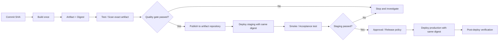
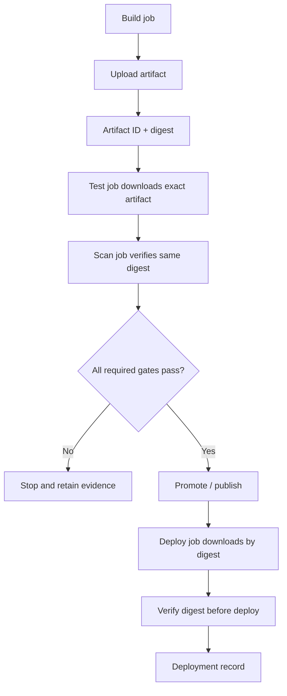
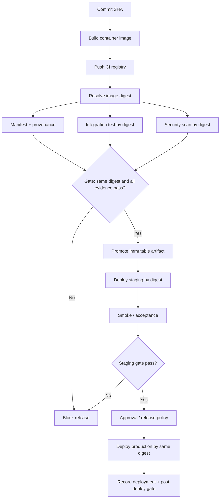

# Handing Off the Exact Verified Artifact to Deployment

## 1. Why Must We Hand Off the Exact Artifact?

In CI/CD, a build creates a deployable product, commonly called an artifact. An artifact may be a JAR file, package, binary, container image, frontend bundle, or release archive. The pipeline then runs tests, security scans, stores the artifact in a repository, and moves it across environments such as staging and production.

A common design mistake is testing one package while deploying another. For instance, a CI job builds `service.jar` and passes tests. A subsequent deploy job checks out the `main` branch again, runs another build, and deploys the new file. Even though both builds use the same branch name, they may differ in commit, dependencies, toolchain, configuration, or fetch timing. Test results from the first package do not prove the second package was tested.

The principle of handing off the exact artifact requires the pipeline to maintain a verifiable link between:

- The source code and revision that were built.
- The build run and environment that created the artifact.
- The specific artifact produced, identified by version or digest.
- The tests, scans, and quality gates executed against that artifact.
- The handoff record and deployment into each environment.

The goal is to build once, verify the exact product, and promote that exact product across environments. When staging tests artifact digest `X`, production must also receive digest `X`. Environment configurations may differ, but the application payload must remain unchanged per release policy.

## 2. What Is an Artifact in a CI/CD Process?

An artifact is an output intentionally produced or collected in a pipeline for storage, verification, distribution, or deployment. Not every file appearing in a workspace is a release artifact. Temporary files, intermediate logs, and caches have different lifecycles and purposes.

| Artifact Type | Examples | Purpose |
|---|---|---|
| Binary/package | JAR, WAR, ZIP, MSI, DEB, RPM | Installing or running the application |
| Container image | OCI image, Docker image | Deploying the application along with its filesystem and runtime dependencies |
| Frontend bundle | JavaScript/CSS bundle, static site archive | Distributing web content |
| Mobile package | APK, AAB, IPA | Releasing mobile applications |
| Infrastructure package | Helm chart, Terraform module, deployment bundle | Deploying or configuring infrastructure |
| Test/quality evidence | Test report, coverage report, scan report | Proving verification checks were executed |
| Release metadata | Manifest, SBOM, provenance, signature, checksum | Identifying, tracing, and verifying the product |

Some files such as SBOMs and test reports are not directly runnable payloads, yet they are artifacts supporting release decisions and must be linked to the exact payload. The pipeline should clearly classify which artifacts are deployed, which serve as evidence, and which are solely for debugging.

## 3. Distinguishing Artifacts, Workspaces, Caches, and Source Revisions

These components often sit close together in a pipeline but cannot substitute for one another:

| Component | Nature | Usable as Deployment Input? |
|---|---|---|
| Source revision | Source code identified by commit or revision | Typically an input to the build, not the final deployment package |
| Workspace | Temporary working directory of a job | No; an identified artifact should be published |
| Cache | Regenerable data used to speed up runs | No; caches are not a source of truth for releases |
| Artifact | Output product stored and identified | Yes, once verified and compliant with policy |
| Deployment record | Record stating which artifact was deployed where and when | Operational evidence, not the payload |

For example, `build/libs/order-service.jar` in the workspace is merely a temporary output file. After the pipeline uploads it to an artifact repository, computes a checksum, and saves metadata, it becomes a managed artifact. The deploy job must fetch the exact artifact by ID or digest from the repository rather than grabbing an arbitrary leftover file on a runner.

Caches can speed up builds, but they can be evicted or altered. Workspaces may be deleted after a job. Release artifacts require clearer lifecycles, access controls, and retention because environments will reuse them.

## 4. Identifying Artifacts by Version and Digest

To ensure accurate handoff, an artifact needs an identifier. Two approaches are commonly used:

- **Human-readable version/tag:** e.g., `order-service:2.4.1`, `build-1042`, or `release-2026.11.18`.
- **Content digest/checksum:** e.g., SHA-256 of a JAR file or OCI digest of a container image.

Versions help humans recognize releases. Digests pinpoint exact content. Tags can be moved or overwritten if the registry permits; thus, a tag alone does not prove the downloaded content matches what was verified.

Example for a JAR file:

```bash
sha256sum order-service.jar
```

Example for a container image:

```text
registry.example.com/platform/order-service@sha256:<digest>
```

During deployment, prefer referencing immutable digests. Tags/versions can be displayed for humans, but the system should record the actual digest deployed. For file-based artifacts, checksums should be stored in protected metadata or a manifest; for OCI images, the manifest/index digest is the appropriate content identifier.

If a registry copies an image elsewhere, verify the digest at the destination. When a registry or intermediary tool rewrites a manifest or converts formats, the digest can change even if the layers remain the same. Do not assume copying preserves the digest; inspect the content and record the relationship between the source artifact and its copy.

## 5. The Principle of Build Once, Promote Across Environments

Build once means generating an artifact from a specified revision once for a release workflow. Promote through environments means moving that same artifact across environments such as development, staging, and production.



This workflow prevents staging from running one file while production runs a freshly built file. It also simplifies investigation: if production fails, the team can look up the exact artifact digest, commit, and corresponding test reports.

Rebuilding in each environment can introduce differences due to:

- Changed dependencies or package repositories.
- Updated toolchains, builder images, or runners.
- Different environment variables or build profiles.
- External resources fetched at build time.
- Changed timestamps, random seeds, or packaging order.
- A commit/branch advancing to a new revision.

If an artifact genuinely needs to vary by environment, revisit the design. Normally, endpoint configurations, feature flags, and secrets should be supplied at deployment time. If a separate package must be built due to technical constraints, treat it as a new artifact, re-run appropriate checks, and record its relationship to the source artifact.

## 6. Testing the Exact Artifact, Not Just Source Code

Source code tests and artifact tests serve different purposes. Unit tests typically run during the build to verify logic. After packaging, you must ensure the package is constructed properly and can be downloaded, installed, and run in the target environment.

Checks performed on the artifact include:

- The artifact exists, has the right format, reasonable size, and a digest.
- The package contains the required files, modules, resources, and metadata.
- The container image has the expected entrypoint, user, ports, and configuration.
- Actual dependencies inside the package comply with policy and contain no unexpected components.
- Security scans run against the exact artifact or image digest.
- The artifact can be pulled from the registry using the deployment identity.
- Smoke or integration tests run against the exact artifact downloaded from the repository.
- Signatures and provenance are valid if required by the workflow.

For example, a pipeline can build a JAR, upload it to a repository, and then have an integration job download that JAR by artifact ID and run it against a test database. This verifies that the published product is consumable by downstream steps while reducing the risk of testing one file in the workspace and accidentally publishing another.

For containers, scan the image by digest after pushing it to the registry. Scanning source code does not replace scanning the package/image because dependencies or files may be added during packaging.

## 7. Artifact Repositories and Registries

An artifact repository stores and distributes managed artifacts. Depending on the ecosystem, you can use a Maven repository, package registry, OCI registry, object storage, or dedicated artifact management platform.

A suitable repository should support capabilities matching your needs:

- Store artifacts with stable identifiers and metadata.
- Control upload, download, overwrite, and delete permissions.
- Support versions/tags and digests/checksums.
- Store provenance, SBOMs, signatures, and test reports, or links to them.
- Provide retention, replication, backup, and recovery mechanisms.
- Record audit logs of who or which identity published, downloaded, deleted, or promoted an artifact.
- Separate development, staging, and release repositories where needed.
- Enforce policies preventing overwrites of published versions.

Do not use a runner's workspace directory or an unmanaged shared drive lacking clear permissions and history as an official release repository. If a store does not enforce immutability natively, supplement it with write-once policies, versioning, restricted delete permissions, or independent digest storage.

## 8. Controlled Artifact Publishing

Publishing moves an artifact from the workspace into a repository for consumption by other jobs or systems. Before publishing, a pipeline should define:

- Which artifact is permitted for upload and its exact source path.
- Which commit/run produced the artifact.
- Which name, version, digest, and metadata are attached.
- Which quality gates must pass before publishing.
- Which identity is authorized to upload and which target repository is allowed.
- Whether overwriting versions/tags is permitted.
- Which additional test reports, SBOMs, provenance, or signatures must be saved.

A secure pattern is separating the Build/Test job from the Publish job. The Build/Test job produces and verifies the artifact; the Publish job receives only the artifact uploaded/handed off from the prior job and holds the required registry write permissions. Separating permissions ensures jobs executing untrusted code do not implicitly hold credentials to publish releases.

Do not publish release artifacts from every pull request. A PR may produce artifacts for internal testing in a separate repository or temporary namespace, but those artifacts must be clearly marked as ineligible for release and never confused with official releases.

## 9. Artifact Handoff Manifest

A manifest is a machine-readable document describing an artifact and the details needed for verification and handoff. A minimal manifest may record:

| Field | Meaning |
|---|---|
| Artifact name | Product name |
| Version | Display version |
| Digest | Immutable content identifier |
| Source revision | Commit SHA that was built |
| Pipeline run | ID of the run that created the artifact |
| Repository location | Download location of the artifact |
| Build metadata | Toolchain, builder image, non-sensitive build parameters |
| Test/scan evidence | Links and status of verification checks |
| Provenance/SBOM | Origin information and software components |
| Created at | Timestamp when the artifact was created |

Example YAML manifest:

```yaml
artifact:
  name: order-service
  version: "2.4.1"
  type: container-image
  reference: "registry.example.com/platform/order-service@sha256:<digest>"
  digest: "sha256:<digest>"
source:
  repository: "https://example.com/platform/order-service.git"
  commit: "8d3f2a1c..."
build:
  pipelineRun: "ci-1042"
  builderImage: "registry.example.com/ci/java-builder@sha256:<builder-digest>"
evidence:
  unitTests: "passed"
  integrationTests: "passed"
  securityScan: "passed"
  provenance: "oci://registry.example.com/attestations/order-service"
```

This is an illustrative schema, not a mandatory standard. In real systems, define data types, authoritative sources, and verification methods for each field. Never place secrets, tokens, or credentials inside manifests. Report links should point to access-controlled data tied to the digest.

## 10. Handing Off Artifacts Between Jobs

In multi-job pipelines, the deploy job may run on a different runner than the build job. Therefore, never assume files in the build workspace automatically appear in the deploy job.

Typical handoff flow:

1. The Build job creates the artifact and computes its digest.
2. The Build job uploads the artifact to a repository or the pipeline's artifact mechanism.
3. The pipeline stores the artifact ID/reference and metadata as outputs.
4. The Test/Scan job downloads the exact artifact by ID/digest and generates evidence.
5. The Publish or Promote job confirms gates and moves the artifact into the release repository.
6. The Deploy job downloads the artifact by immutable identifier and checks the digest before deploying.



An artifact ID may be an internal pipeline ID, an immutable URL, or package coordinates. Regardless of the mechanism, downstream jobs must verify that the downloaded content matches the digest approved by the gates. Never rely on filename alone as proof.

## 11. Promotion and Environment Separation

Promotion moves a qualifying artifact from one state or repository to the next state/environment. This can use a single shared registry with separate repositories/tags, or separate registries per environment.

| Model | How It Works | Control Points |
|---|---|---|
| Single repository, multiple environments | Artifact keeps the same reference; deployment records indicate the environment | Deploy permissions, digests, and environment configuration |
| Single registry, stage-based repositories/channels | Promote by adding metadata/tags or updating status | Avoid overwritable tags; preserve digests and history |
| Dedicated registry per environment | Copy/promote artifacts to staging then production registries | Verify digests after copying, audit trails, and publish permissions |
| Immutable release repository | Artifacts enter the release area only after gates pass | Write-once policies, retention, and approvals |

Promotion must not trigger a rebuild. If copying an artifact between registries is necessary, verify the digest at both source and destination. With OCI images, copying preserves the manifest digest if manifest contents and blobs are unchanged; if a tool converts media types or rewrites manifests, the digest may change. When the digest changes, verify contents through the appropriate process and record the copy relationship rather than automatically treating the two references as the same artifact.

## 12. Separating Environment Configuration from Artifacts

An artifact should contain software capable of running across multiple environments. Values that vary by environment are typically provided at deployment time:

- Endpoints for databases, message brokers, and dependent services.
- Feature flags and managed business configurations.
- Replica counts, CPU/memory limits, and runtime parameters.
- Secrets, certificates, and credentials.
- Namespace, domain, or ingress names.
- Logging, tracing, and telemetry policies.

Secrets must be fetched from a secret manager or secure credential provider at deployment time. Never bake production passwords into JARs, container images, or manifests. Non-sensitive configuration can be version-controlled and linked to releases, while explicitly recording which configuration version was used.

If an application requires compile-time configuration, treat it explicitly as a build input. When changing compile-time configuration produces a different binary, treat it as a new artifact, re-test it, and do not consider it the same artifact merely because the source commit matches.

## 13. Protecting Artifact Integrity and Origin

Artifacts can be tampered with after publishing, downloaded from the wrong repository, or created by an untrusted pipeline. Common protective measures include:

- Computing the digest immediately upon creation and re-verifying after upload/download.
- Enabling immutable versions or policies forbidding release overwrites.
- Restricting publish, delete, and promote permissions by identity.
- Using digital signatures to verify the release origin when required.
- Generating provenance/attestations linking the subject digest to source revision, builder, and workflow.
- Storing an SBOM to identify software components inside the artifact.
- Scanning the artifact by digest and storing results with the release record.
- Enabling audit logs and appropriate retention.

A checksum proves downloaded content matches a known checksum, but it does not prove who built the artifact or whether it is safe. Digital signatures verify the signer and integrity against a trust store; provenance describes how the artifact was produced; SBOMs describe its components. These pieces of evidence reinforce one another.

## 14. Controlling Access Permissions During Handoff

Pipeline jobs do not all need the same permission levels:

| Job | Typical Permissions Needed | Permissions That Should Not Be Granted by Default |
|---|---|---|
| Build | Read source/dependencies, write workspace, upload temporary artifacts | Deploy to production, delete releases, administer registries |
| Test/Scan | Read artifacts and write reports | Overwrite release artifacts or hold production access |
| Publish | Read gate-passed artifacts, write to target repository | Modify source code or hold unrelated deploy permissions |
| Promote | Read source artifacts, update target status/repository | Rebuild or alter payloads without creating a new artifact |
| Deploy staging | Read artifacts, fetch staging credentials, update staging | Production credentials |
| Deploy production | Read approved artifacts, use production credentials per policy | Arbitrary artifact publishing or modifying provenance |

Use distinct identities per job or per environment where supported by the platform. Tokens should be short-lived and least-privilege. Pull requests from forks must never receive credentials to publish releases or deploy to production. Never log secrets or write them into manifests.

## 15. Retention, Cleanup, and Redeployment Capability

Release artifacts must be kept long enough to support rollback, investigation, and redeployment. Retention should distinguish between:

- Temporary pull request artifacts.
- Internal build artifacts.
- Gate-passed and promoted artifacts.
- Production release artifacts.
- Test reports, scan reports, SBOMs, provenance, and deployment records.

Policies can specify retention periods, storage quotas, replication, backups, and deletion criteria. Never delete artifacts currently in production use or needed for rollback. Once a version reaches end of support, deletion should follow release policies and dependency checks.

To guarantee redeployment capability, preserve the artifact or ensure the registry can serve the exact digest again. Keeping only a tag name is insufficient if the tag can be overwritten. Deployment records must log the actual reference and digest.

Artifacts must not be modified in place after release. If a bug is found in a package, build a new artifact from a defined revision or fix process, rerun required checks, and release a new version. Replacing contents under the same version destroys traceability and can leave environments running different binaries under the same name.

## 16. Handling Failures During Handoff

Several scenarios require explicit handling:

| Scenario | Appropriate Action |
|---|---|
| Artifact upload fails | Do not proceed to deploy; retry in a controlled manner and verify repository state |
| Post-download digest mismatch | Halt deployment, quarantine the artifact, and investigate the source/transfer path |
| Missing test report or provenance | Leave the gate blocked/pending per policy; regenerate evidence from the exact artifact |
| Artifact missing or past retention | Do not silently rebuild inside a deploy job; restore the exact artifact from backup or create a newly tested release |
| Tag points to a different digest | Halt promotion/deployment, inspect tag history, and use the approved digest |
| Registry copy changes the digest | Verify payload/manifest per procedure, record source-target mapping, and assess if rescanning is needed |
| Staging artifact differs from production artifact | Halt release, reconcile deployment records and digests before continuing |
| Registry unavailable | Hold release state; never substitute files from unapproved sources |

Retries are appropriate for transient errors like upload timeouts. Retries cannot fix a digest mismatch or invalid provenance. Those cases must stop and be investigated.

## 17. End-to-End Example: Handing Off a Container Image for a Java Service

Suppose a team develops `order-service`, builds it into a container image, and deploys it to Kubernetes.

1. A pull request is merged after review and passing CI. The pipeline records the commit SHA.
2. The Build job uses a pinned builder image, builds the container image, and pushes it to the CI registry tagged with the run ID.
3. The pipeline retrieves the image digest from the registry and stores a manifest containing repository, commit, run ID, builder, and digest.
4. The Test job pulls the image by digest, starts it in an integration environment, and runs tests. The Security Scan job scans that exact digest.
5. The gate passes only when mandatory tests/scans pass and evidence is linked to the same digest.
6. The artifact is promoted to a release repository or marked for release with immutable metadata.
7. The Deploy Staging job pulls the image by digest, deploys with staging configuration, and runs smoke/acceptance tests.
8. Following approval or release policy, the Deploy Production job uses the exact digest that ran in staging.
9. The system stores a deployment record containing environment, cluster, namespace, release ID, image digest, timestamp, and executing user/identity.
10. If a post-deploy gate fails, the rollout halts and the runbook restores the previous stable digest.



In this example, staging and production can use different ConfigMaps/Secrets, replica counts, and endpoints. The image digest remains identical. If a new image must be built after staging because baked-in configuration changed, that is a new artifact and must be verified again.

## 18. Measuring Artifact Handoff Quality

A solid handoff process should measure both integrity and efficiency:

- **Artifact traceability:** percentage of release artifacts with complete commit SHA, pipeline run, and digest.
- **Digest verification rate:** percentage of download/promote/deploy operations that successfully verify digests.
- **Artifact promotion consistency:** percentage of environments running the exact approved digest.
- **Build-to-deploy lead time:** time elapsed from successful build to deployment.
- **Artifact retention availability:** ability to re-download historical artifacts within required timeframes.
- **Deployment provenance completeness:** percentage of deployment records with complete artifact, environment, and identity data.
- **Artifact mismatch incidents:** number of incidents caused by deploying the wrong version or an artifact different from the tested one.

Do not optimize only for publish speed or cache hit rates while skipping digest verification. A fast pipeline that cannot prove staging and production run the same payload undermines release reliability.

## 19. Common Anti-Patterns

| Anti-Pattern | Consequence | Improvement |
|---|---|---|
| Rebuilding inside the deploy job | Deployed artifact may differ from tested artifact | Download the published artifact by ID/digest |
| Using a mutable tag as the sole identifier | Tag can point to new contents | Deploy by digest, keep tags for display |
| Testing a workspace file while publishing another | Evidence does not apply to the released product | Test the exact uploaded and re-downloaded artifact |
| Using a shared folder between jobs | Jobs may read stale files or overwrite each other | Use an artifact store with explicit outputs |
| Scanning source code without scanning the artifact | Components added during packaging may be missed | Scan the exact package/image digest |
| Copying between registries without verifying destination | Artifact may be rewritten or copied incorrectly | Verify digest/manifest at the destination |
| Granting publish and delete access to all jobs | Increases risk of replacing or deleting releases | Separate identities, enforce least privilege, and audit |
| Embedding secrets in images/manifests | Secrets persist and can spread | Inject secrets at deploy time from a secret manager |
| Deleting release artifacts too early | Cannot roll back or redeploy | Set retention based on release lifecycle and operational needs |

## 20. Artifact Handoff Checklist

Before allowing a deployment, verify:

- [ ] The artifact was built from a specific commit/revision.
- [ ] The artifact has an immutable version and digest.
- [ ] The artifact is stored in a repository/registry with clear permissions and retention.
- [ ] Tests, scans, and quality gates are bound to the exact artifact digest.
- [ ] Provenance, SBOMs, and signatures are generated/verified when required by policy.
- [ ] The deploy job downloads the artifact from an approved repository, not a random workspace file.
- [ ] The digest is re-verified after download or promotion.
- [ ] Staging and production use the exact same approved digest.
- [ ] Environment configuration and secrets are supplied at deployment time, not embedded in the payload.
- [ ] Build, test, publish, promote, and deploy permissions are separated by role.
- [ ] Old artifacts and deployment records are retained long enough for rollback/redeployment.
- [ ] When a digest or evidence mismatches, the pipeline stops and reports a clear error.

## 21. Core Practical Principles

1. Treat artifacts as outputs with their own identity and lifecycle, separate from workspaces and caches.
2. Build from a specific revision, produce the artifact once, and compute its digest immediately upon creation.
3. Test, scan, and evaluate the exact artifact that will be deployed.
4. Store the artifact alongside metadata, provenance, SBOMs, checksums, and gate evidence per policy.
5. Publish to a repository with access control, audit logging, retention, and overwrite protection.
6. Hand off between jobs using artifact IDs/references and digest verification, not filenames.
7. Promote the same artifact through staging and production; only vary environment configuration at deployment time.
8. Separate build, test, publish, promote, and deploy permissions; never grant production credentials to jobs that do not need them.
9. Save deployment records pointing to the actual digest and retain artifacts long enough to roll back or redeploy.
10. Stop the release when artifacts, digests, or evidence mismatch; never rebuild to mask a handoff failure.

Handing off the exact artifact turns a pipeline into a verifiable release chain: from commit to build, from build to evidence, from evidence to promotion, and from promotion to deployment. When every step uses the same content identifier, the team can prove the running product is the exact product that was tested and approved.
