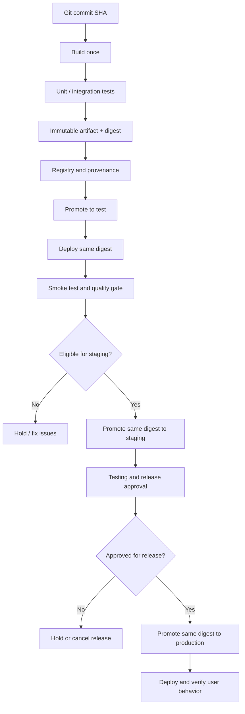

# Distinguishing Artifact Promotion from Rebuilding for the Next Environment

A reliable pipeline must ensure that the version tested in a prior environment is the exact version delivered to the next environment. Once source code has been built and packaged into an artifact, the release process should **promote the same immutable artifact** through development, test, staging, and production. If each environment rebuilds from the same commit, outputs can differ because dependencies, toolchains, base images, build parameters, or external state have changed.

Artifact promotion is the act of advancing an already built and verified artifact to the next state, environment, or release channel without altering the artifact's contents. Rebuilding means executing the build process again from source and inputs to create a new artifact. The two operations serve different purposes: promotion preserves previously gathered test evidence; rebuilding produces a new output and therefore requires re-identification, re-verification, and re-testing as a new version.

## 1. The Build Once, Promote Many Model

A CI/CD flow can be divided into two groups of activities:

- **Build and verify:** check out a specific revision, install dependencies from a lockfile, run checks, package, and emit an artifact. The artifact is identified by version/digest alongside metadata about its origin.
- **Promotion and deploy:** fetch the exact stored artifact, verify signatures/provenance/policy, supply the target environment's configuration and secrets, deploy, and verify results. When criteria are met, that same artifact is promoted onward.



For example, commit `a1b2c3d` produces a container image with digest `sha256:...`. That image is deployed to test, staging, and then production. Each environment may use different endpoints, databases, feature flags, and secrets, yet the image digest remains identical. This allows the team to prove production is running the exact artifact that passed pre-release checks.

## 2. How Do Promotion and Rebuilding Differ?

| Criterion | Artifact Promotion | Rebuilding for the Next Environment |
|---|---|---|
| Primary input | Existing, identified artifact | Source revision plus build inputs |
| Output | Identical artifact contents; release status/channel/metadata may change | New artifact with a new digest or checksum if contents differ |
| Test evidence | Can reuse evidence tied to the exact tested artifact, plus target-environment checks | Must re-verify the new artifact; prior artifact test results do not automatically apply |
| Dependencies/toolchain | No need to re-resolve and rebuild the application | May re-resolve dependencies, plugins, toolchains, and base images |
| Traceability | Links the exact same digest directly across environments | Must trace each build individually to its source, inputs, and results |
| Divergence risk | Lower if the artifact and metadata remain immutable | Higher because inputs or build environments may drift |
| When to use | Standard release workflows | When a genuinely different variant, bug fix, dependency update, or different build target is needed |

Promotion does not mean simply changing a tag and assuming everything is safe. The system must still verify the artifact, access permissions, target configuration, approvals, and deployment status. Nor is rebuilding always wrong: sometimes you must produce binaries for another architecture, apply a security patch, or change compile-time options. When rebuilding, the new output must be treated as a new artifact and pass through all required gates.

## 3. Why Does Rebuilding per Environment Reduce Reliability?

Suppose a pipeline builds the same commit three times: once for test, once for staging, and once for production. Even with the same source SHA, the following inputs can still change:

- Dependency ranges get re-resolved and receive different versions.
- Package repositories or container registries return new contents under the same tag.
- Runner images, JDKs, Node.js versions, compilers, or build plugins were updated.
- Build scripts fetch files from unpinned URLs or without checksum verification.
- Build time, timestamps, random seeds, or auto-generated data alter the output.
- Environment variables, build profiles, or compile flags differ across environments.
- Stale caches, workspace state, or tools on runners alter the output.

When production fails, the team cannot be certain that the production artifact matches the artifact tested in staging. Comparing commit SHAs is insufficient; you must compare artifact digests or checksums.

Rebuilding also creates an audit gap: test reports are attached to build run A, whereas production runs output from build run C. Without proof that A and C produced identical contents, A's test results cannot assert that C was tested.

## 4. Artifacts Must Have Immutable Identifiers

### 4.1. Tags and Digests Do Not Mean the Same Thing

A tag is a human-readable name, such as `orders:1.8.0`, `orders:release-2026-11`, or `orders:staging`. Tags can typically be moved to point to different content. A digest is computed from the manifest or blob contents according to registry format and acts as a content identifier.

For OCI container images, digest references typically look like:

```text
registry.example.com/orders@sha256:0123456789abcdef...
```

Tags help humans find versions; digests pinpoint exact contents. Pipelines should capture the digest returned by the registry after pushing and use that digest in all deploy steps. Never rely on `latest` or overwritable environment tags to identify tested artifacts.

### 4.2. Immutable Artifacts in Registries

Artifact repositories or container registries should enforce policies preventing published versions from being overwritten. For package versions, enable immutability or rules forbidding version reuse. For containers, restrict release tag push permissions, tag by commit, and deploy by digest.

If an artifact is copied to another registry during promotion, verify that the destination digest equals the source digest. Copying identical manifest and layer contents usually preserves the digest, though certain repackaging, conversion, or recompression operations can produce different contents. If the digest changes, treat it as a different artifact and re-verify. Also ensure associated signatures, SBOMs, and attestations are transferred or referenced accurately.

### 4.3. Versions, Checksums, and Metadata

An artifact should carry enough metadata to answer:

- Which repository and commit SHA was it built from?
- Which build run/workflow produced it?
- What were the toolchain versions, dependency lockfiles, and build parameters?
- Which tests, scans, and quality gates ran, and what were their results?
- In which registry is the artifact stored, and under which version and digest?
- Who or which workload created, signed, and promoted the artifact?

Do not rely solely on filenames or tags. For packages lacking registry digests, store strong checksums like SHA-256 alongside metadata and re-verify after download. Metadata should be attached to the artifact or stored in a system with immutable links.

## 5. Distinguishing Artifacts, Environment Configuration, and Secrets

A common reason teams rebuild per environment is that staging and production need different configurations. However, most operational settings should be supplied at deployment time or runtime rather than compiled into the artifact.

| Component | Examples | Appropriate Management Approach |
|---|---|---|
| Artifact | JAR, binary, frontend bundle, OCI image | Build once, identify by version/digest, store in registry |
| Environment configuration | API endpoints, database host, log level, feature flags | Versioned configuration store, deployment manifest, or runtime config |
| Secrets | Passwords, API tokens, private keys, certificates | Secret manager or platform secret mechanism, least privilege |
| Deployment specification | Namespace, replica count, traffic policy, rollout strategy | Reviewed and traceable deployment configuration/IaC |
| Release metadata | Commit, artifact digest, approvals, timestamp, deployer | Release record/audit log |

For instance, the same image can receive different `DATABASE_URL` values in staging and production. Actual values are supplied via a secret manager; deployment manifests reference only the secret name or version, containing no plaintext. Configuration should be versioned or fingerprinted so you know which config ran in each environment.

### 5.1. Do Not Embed Secrets in Artifacts

Never place production passwords, tokens, or private keys into Docker build arguments, image layers, JAR resources, frontend bundles, or packaged configuration files. Secrets can persist in layer history even if deleted in a later layer. Frontend bundles cannot keep secrets either because data is sent to the browser.

If an application needs secrets at startup, fetch them from a secret manager or runtime platform. Grant credentials via workload identity where supported; limit scope, lifetime, and permissions. Logs must never print secret values.

### 5.2. Configuration That Can Change Without Rebuilding

Prefer externalizing values that vary by environment: endpoints, resource limits, log levels, feature flags, queue names, and integration parameters. Configuration must be schema-checked, reviewed, and versioned. If a configuration change significantly affects behavior, re-run smoke tests or integration checks on the target environment.

Not every value can move to runtime. Some frontends require a public API base URL at build time if the bundle does not support runtime configuration; native binaries may require target-specific compilation. In such cases, clearly identify each artifact as a distinct variant and do not claim the same digest was promoted across all environments.

## 6. Controlled Promotion Process

A practical workflow can include the following steps.

### Step 1: Build and Verify on a Specific Revision

The pipeline checks out the commit SHA, uses pinned dependency lockfiles and toolchains, runs required lint/test/scan checks, and creates the artifact. Record the commit, build run, dependency metadata, and build configuration. Never build from a floating branch without recording the actual revision.

### Step 2: Push the Artifact to a Registry

Push the artifact to an access-controlled registry. Retrieve the digest/checksum from the registry or compute it after re-downloading. Attach build origin metadata, SBOM, and provenance if supported by the system. Release artifacts must not be overwritten.

### Step 3: Verify Before Deployment

Check the digest, signature, provenance, policy compliance, vulnerabilities, and release origin. Accept only artifacts created by trusted workflows/builders from revisions meeting policy. Deploy jobs must not rebuild on their own.

### Step 4: Deploy to the First Environment

Deploy the exact digest to the test or development environment. Supply that environment's configuration and secrets. Save a release record containing digest, config version, deployment identity, timestamp, and outcome.

### Step 5: Verify and Decide Promotion

Run smoke tests, integration tests, synthetic checks, and inspect relevant metrics. If checks fail, halt promotion, preserve evidence, and investigate. If they pass, mark the artifact eligible for the next environment.

### Step 6: Promote the Same Digest Through Staging and Production

Subsequent promotions reference the same digest. Production may require dedicated approvals or quality gates. After deployment, verify that the live runtime is actually running the expected digest and that user behavior meets criteria.

### Step 7: Record Release History

Record the artifact digest, commit, configuration, environment, deploying user/workflow, approvals, check results, and timestamps. This history supports investigation, auditing, and rollback.

## 7. Example: One Container Image Across Three Environments

Suppose the `orders` service is built from commit `a1b2c3d`. The pipeline builds the image and pushes it to the registry:

```bash
IMAGE=registry.example.com/orders
VERSION=1.8.0
COMMIT_SHA=a1b2c3d

docker build -t "$IMAGE:$VERSION" -t "$IMAGE:$COMMIT_SHA" .
docker push "$IMAGE:$VERSION"
docker push "$IMAGE:$COMMIT_SHA"
```

This snippet illustrates tagging by version and commit. In a production pipeline, capture the digest from the build tool's push output, save it as a job output, and use that digest for every deployment. Do not rely on tags as the final identifier because tags can be moved.

An example deployment manifest can reference the digest:

```yaml
apiVersion: apps/v1
kind: Deployment
metadata:
  name: orders
spec:
  template:
    spec:
      containers:
        - name: orders
          image: registry.example.com/orders@sha256:0123456789abcdef...
          env:
            - name: APP_ENV
              value: staging
            - name: DATABASE_URL
              valueFrom:
                secretKeyRef:
                  name: orders-db
                  key: url
```

The digest in this example is a placeholder. `APP_ENV` may differ in production; `DATABASE_URL` is pulled from the environment's Secret. When promoting, change the target environment and corresponding secret/config references while keeping the image digest unchanged.

| Environment | Artifact | Configuration/Secrets | Primary Checks |
|---|---|---|---|
| Test | `orders@sha256:...` | Test database, mock endpoints | Unit/integration/smoke tests |
| Staging | Same `orders@sha256:...` | Staging database, production-like integrations | Regression, contract, synthetic checks |
| Production | Same `orders@sha256:...` | Production database, production secrets | Health, canary metrics, smoke tests, and user behavior |

If each environment runs a separately built image, explain why and record each image digest as an independent artifact. Sharing a tag or commit does not prove they are identical.

## 8. Pipeline Example: Build Once, Deploy Many

The GitHub Actions snippet below illustrates the pattern: the build job outputs a digest; the staging and production deploy jobs consume that digest. Syntax and actions must be adapted to your actual registry, deployment platform, and permissions policy.

```yaml
name: Release orders

on:
  push:
    tags: ['v*']

permissions:
  contents: read

jobs:
  build:
    runs-on: ubuntu-latest
    permissions:
      contents: read
      packages: write
    outputs:
      digest: ${{ steps.image.outputs.digest }}
    steps:
      - uses: actions/checkout@v4

      - name: Build and push image
        id: image
        uses: docker/build-push-action@v6
        with:
          context: .
          push: true
          tags: ghcr.io/example/orders:${{ github.sha }}

  deploy_staging:
    needs: build
    runs-on: ubuntu-latest
    permissions:
      contents: read
      packages: read
    environment: staging
    steps:
      - name: Deploy exact digest
        env:
          IMAGE_DIGEST: ${{ needs.build.outputs.digest }}
        run: ./deploy.sh staging "ghcr.io/example/orders@$IMAGE_DIGEST"

      - name: Verify staging
        run: ./smoke-test.sh staging

  deploy_production:
    needs: [build, deploy_staging]
    runs-on: ubuntu-latest
    permissions:
      contents: read
      packages: read
    environment: production
    steps:
      - name: Deploy exact digest
        env:
          IMAGE_DIGEST: ${{ needs.build.outputs.digest }}
        run: ./deploy.sh production "ghcr.io/example/orders@$IMAGE_DIGEST"

      - name: Verify production
        run: ./smoke-test.sh production
```

This is a structural example, not a complete production workflow. Add secure registry login, pin actions by full commit SHA per policy, verify digest/provenance before deploying, scope `packages: write` exclusively to the build job where possible, and restrict deployment permissions by environment. The `deploy.sh` script must accept the image by digest and never build it itself. The production environment should enforce appropriate approvals/checks.

The key point is that the `digest` output from the build job flows into the deploy jobs. The staging and production jobs do not run build commands; they deploy the exact same built content. If staging verification fails, the dependency graph prevents the production job from running.

## 9. Promoting Across Different Registries or Accounts

Some organizations use separate registries for development, staging, and production, or isolate cloud accounts by environment. In that case, promotion may involve copying artifacts from a source registry to a target registry.

The copy process must:

- Read the artifact by digest from the source registry.
- Verify signatures, provenance, and policy compliance before copying.
- Copy the full manifest and layers without rebuilding or altering content.
- Verify the digest at the destination registry after copying.
- Transfer or link corresponding signatures, SBOMs, and attestations.
- Record identity, timestamp, source, and destination of the promotion.

If the target registry cannot preserve the manifest or the digest changes due to format conversion, treat the output as a new artifact. Record the source-destination relationship and run required checks before deploying.

Do not grant production registry push permissions to every pull request pipeline. Only trusted release workflows need write access; deploy jobs should hold read-only artifact permissions and minimal deployment permissions.

## 10. Which Artifact Do Quality Gates and Approvals Bind To?

A quality gate is valuable only if you know which specific artifact it evaluated. Test results from a commit or build run do not automatically apply to every artifact produced from that same source.

Evidence should bind to one or more identifiers:

- Commit SHA and repository.
- Build run ID, workflow revision, and builder identity.
- Artifact name/version and digest.
- SBOM, provenance, signature, and scan results.
- Deployed environment and config version/fingerprint.
- Test suite, results, timestamp, and test scope.
- Approvals, approver identity, and applied policy.

If an artifact digest changes after a packaging, compression, signing, or copying step, determine whether the operation altered artifact contents or only attached external metadata. Evidence must bind to the exact object. For example, signing an OCI image can create a signature/attestation referencing the digest without modifying the image; however, if the image is rebuilt after testing, the new digest must not inherit old test results.

Gates can be placed at multiple stages:

| Stage | Example Criteria |
|---|---|
| Pre-publish | Build/tests pass; dependency and license policies pass |
| Post-publish | Digest exists; provenance/signature valid; artifact has not been replaced |
| Pre-staging | Artifact from authorized source; tests and scans pass |
| Post-staging | Smoke/regression/synthetic tests pass; metrics within thresholds |
| Pre-production | Approvals and change policies satisfied; target configuration valid |
| Post-production | Runtime executes exact digest; health and user metrics pass |

## 11. When Is Rebuilding Actually Necessary?

Build once does not mean a single artifact can serve every platform. Certain scenarios require distinct artifacts:

### 11.1. Different Architectures or Operating Systems

Native binaries for `linux/amd64` and `linux/arm64` may require separate compilation. You can create an OCI multi-platform image manifest pointing to per-architecture images; each child image has its own digest, while the manifest list/index has an overall digest. Promotion must preserve both the index and the tested child images.

### 11.2. Compile-Time Features or Native Dependencies

Some products require enabling/disabling modules at compile time, linking native libraries, or producing platform-specific bundles. When a choice cannot move to runtime, create variants with distinct names and digests, record build parameters, and test each variant.

### 11.3. Security Updates or Bug Fixes

If a vulnerability is discovered in a dependency or base image after an artifact was built, a rebuild may be necessary to incorporate the patch. This produces a new artifact, not a promotion of the old artifact. Re-run tests, scans, and provenance verification, then release a new version/digest.

### 11.4. Artifacts Dependent on Specialized Build Environments

Certain signing, packaging, or certificate-provisioning processes yield target-specific outputs. Prefer separating signing/release steps into metadata or post-build operations that do not alter the payload whenever possible. If outputs genuinely change per environment, manage each output as a separate variant.

### 11.5. Rules When Creating Multiple Variants

- Clearly define the target (OS, architecture, runtime, feature set) and build parameters.
- Pin toolchains, dependencies, and base images for each target.
- Attach distinct commit SHA, build run, digest, and provenance to each variant.
- Run appropriate tests on each target; never extrapolate results from another variant without evidence.
- Promote each verified variant through the environments it serves.
- Never assign the same ambiguous version/tag to different contents without distinguishing metadata.

## 12. Database Migrations and Cross-Version Compatibility

Promoting the same artifact keeps the application consistent, but it does not automatically guarantee data and schema compatibility. A deployment can fail if a production migration has already executed and a rollback brings back an older application version.

For schema changes, prefer the expand-and-contract strategy:

1. **Expand:** add new columns/tables/indexes in a way the old version continues to function.
2. **Deploy:** roll out the new artifact capable of reading/writing both old and new structures.
3. **Migrate:** backfill or transform data in observable, safely resumable batches.
4. **Switch:** switch the application to the new structure and verify behavior.
5. **Contract:** drop old structures only after no active version or consumer requires them.

Migrations should be versioned, logged, checked before and after execution, and paired with a recovery plan. Never execute destructive migrations during a build step. If a migration has irreversible side effects, prepare a roll-forward or separate data recovery plan.

## 13. Rollback and Recovery Using Promoted Artifacts

When production experiences an incident, rollback typically means redeploying the digest of the previously verified artifact. This is fast and traceable as long as the registry retains the artifact and its metadata.

Before rolling back, verify:

- The old artifact still exists in the registry and its signature/provenance remain verifiable.
- Current runtime configuration is compatible with the old version.
- How the database schema and data have changed.
- Whether emitted messages/events can still be understood by the old version.
- Whether feature flags or routing can revert safely.
- Whether rollback requires approvals or notifications under policy.

Rollback is not always the right answer. If data has been transformed incompatibly, you may need to roll forward with a new hotfix artifact. If the bug lies solely in configuration or a feature flag, you can restore the configuration without changing the artifact. Record before-and-after digests, timestamps, rationale, and verification results.

## 14. Common Anti-Patterns

| Anti-Pattern | Risk | Better Practice |
|---|---|---|
| Building separately for test, staging, and production | Each environment may receive different content | Build once, promote the same digest |
| Using `latest` to deploy | The tag may point to newer content | Deploy by digest or immutable version |
| Passing production secrets in build args | Secrets may linger in layers/logs/caches | Fetch secrets at runtime from a secret manager |
| Assigning the same version to different contents | Unclear which artifact is running | Give every artifact its own digest and release identity |
| Testing staging, then deploying a freshly rebuilt artifact | Test evidence does not apply to the new output | Deploy the exact tested digest |
| Copying between registries without checking digests | Destination artifact may differ from source | Compare digests and verify metadata |
| Updating production config without versioning | Hard to reproduce release state | Version configuration and store fingerprints |
| Rebuilding to swap environment endpoints | Increases divergence risk and leaks config in bundles | Externalize runtime configuration where possible |
| Rolling back the app without checking schema | Old version may fail to read new data | Use backward-compatible migrations and a recovery plan |

## 15. Promotion Pipeline Design Checklist

- [ ] Builds are tied to a commit SHA and controlled toolchains/dependencies.
- [ ] Artifacts are built once per target and stored in a trusted registry.
- [ ] Every artifact has an immutable version and digest/checksum; never rely on mutable tags.
- [ ] Metadata/provenance links the artifact to source, workflow, builder, and build inputs.
- [ ] Published artifacts cannot be overwritten; push permissions are restricted.
- [ ] Environments receive identical digests when the goal is promoting the same artifact.
- [ ] Environment configuration and secrets are supplied externally with versioning and proper permissions.
- [ ] Deploy jobs verify digest/signature/policy and never rebuild on their own.
- [ ] Tests, scans, approvals, and release records are tied to the exact artifact digest.
- [ ] When copying across registries, destination digests are verified and related metadata is preserved.
- [ ] When rebuilds/variants are required, each output is identified and tested as a distinct artifact.
- [ ] Data migrations have compatibility, rollback, or roll-forward strategies.
- [ ] Rollback can redeploy the prior artifact and verify the live runtime.
- [ ] Post-deploy checks verify live runtime digest, health, metrics, and user behavior.

Artifact promotion bridges evidence from build to production: the exact same content created, tested, verified, and deployed across environments. Rebuilding produces a new output and therefore requires its own identity and evidence. When artifacts are immutable, configurations are managed externally, and every promotion is gated, teams achieve traceable releases, minimize cross-environment drift, and recover faster when incidents occur.
