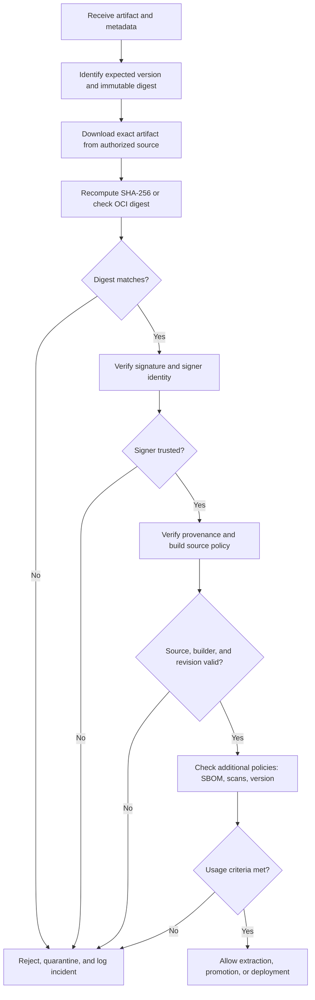

# Verifying Artifact Integrity Before Use

An artifact is a packaged output from a build: a JAR, ZIP, binary, container image, package, or deployment bundle. Once created, an artifact may pass through storage, downloads, copies, security scans, approvals, and deployments. Every handoff introduces the risk of the content being corrupted, swapped, or misassociated with another version.

Therefore, before extracting, executing, pushing to a registry, or deploying an artifact, the pipeline must verify that the received content is indeed the approved content. Verification must answer three distinct questions:

- **Integrity:** do the received bytes match the expected content?
- **Authenticity:** who or which system attested to this artifact?
- **Origin (provenance):** which source code, build process, tools, and dependencies created the artifact?

Checksums identify content and detect alterations. Digital signatures verify the person or system holding the key that signed the content. Provenance provides evidence of how the artifact was built. These mechanisms complement one another; a valid checksum alone does not prove an artifact is safe or built from the right commit.

## 1. Why Must We Verify Before Use?

Artifacts are often assumed to be stable outputs of CI/CD, yet they can still change after a successful build. Several scenarios can occur:

- Files become corrupted during upload, download, or copying between systems.
- A user or job with write permissions replaces an artifact with another file while keeping the same name and version.
- A registry or mirror returns a package whose contents differ from the package previously inspected.
- A container tag such as `latest` or `1.4` is updated to point to a different image after staging tested it.
- An artifact from an untrusted pull request is accidentally passed to a privileged release job.
- A cache containing a stale or poisoned artifact is reused in a release flow.
- A file is downloaded from an unclear source while sharing the name of an official artifact.
- An artifact has a valid checksum yet was built by a workflow or builder not approved by the organization.

If a pipeline checks only for a green build and consumes files by name, the system may deploy contents different from what was tested. This breaks traceability and makes incident investigation extremely difficult.

### Risks to Distinguish

| Risk | Example | Required Evidence |
|---|---|---|
| Data corruption | ZIP file corrupted in transit | Recomputed digest matches trusted digest |
| Artifact substitution | Different JAR uploaded under the same name | Valid signature or digest from a protected manifest |
| Publisher spoofing | Someone creates a file and computes their own checksum | Signature verified against trust root and authorized identity |
| Wrong build source | Artifact is signed but built from an unapproved fork or commit | Provenance showing expected source repository, revision, and builder identity |
| Wrong deployment target | Staging tests digest A, while production pulls a tag pointing to digest B | Deployment manifest pinning the exact verified digest |
| Replay of an old version | Cryptographically valid artifact that has been revoked or is no longer allowed for release | Version policy, release state, and revocation checks |

Integrity verification must bind to the exact object that will be used. If a pipeline verifies one file and a later step re-downloads by mutable name or tag, prior evidence no longer guarantees the new file.

## 2. Distinguishing Checksums, Digital Signatures, and Provenance

These three types of evidence are commonly used together, yet they answer different questions.

| Mechanism | What Does It Prove? | What Does It Not Prove Alone? |
|---|---|---|
| Hash/digest such as SHA-256 | Identifies byte contents; detects differences from a reference digest | Who created the file, its build source, or whether it is safe |
| Sidecar checksum such as `.sha256` | Allows recipients to recompute and compare digests | Authenticity if the checksum file was downloaded from the same untrusted source |
| Digital signature | Content or digest was signed by the corresponding key and unaltered since signing | Which source code, workflow, and dependencies produced the content without provenance |
| Provenance/attestation | Records source, builder, process, and attributes of the build run | That the artifact is completely safe or free of vulnerabilities |
| SBOM | Lists software components declared inside the artifact | That the SBOM matches the artifact unless bound and verified by digest |

### Hashes and Digests

A hash is the output of a hash function applied to file contents. SHA-256 produces a 256-bit digest, typically represented as 64 hexadecimal characters. Changing even a single byte will almost certainly alter the digest.

Example on Linux:

```bash
sha256sum application.jar
```

On PowerShell:

```powershell
Get-FileHash .\application.jar -Algorithm SHA256
```

A digest should be tied to a clear artifact identifier: name, version, repository, commit, or immutable reference. For container images, digests typically take the form `sha256:<64-hex-characters>`.

A hash is neither a secret nor a signature. Anyone who alters a file can compute a new hash. If an attacker can replace both the artifact and the `.sha256` file, the comparison will still succeed. Therefore, the reference digest must come from an independent trusted source or be protected by a digital signature.

### Digital Signatures

Digital signatures are created with a private key and verified with a public key or trusted identity mechanism. When a signature is valid, the recipient has evidence that the content was signed by the holder of the corresponding private key and has not been altered since signing.

Public keys must be distributed and protected through an organization-approved trust root. If an attacker can replace the artifact, the signature, and the public key used by the recipient, verification becomes meaningless. Never download a public key from the same untrusted location and treat it as authoritative.

### Provenance and Attestations

Provenance describes the origin and build process of an artifact. Useful provenance typically records:

- Source repository and revision/commit SHA.
- Builder identity and executed workflow.
- Build timestamp or duration window.
- Build parameters and key input dependencies.
- Digest of the generated artifact.
- Steps or predicates describing how the artifact was produced.

An attestation is a structured statement about an artifact, typically signed by the builder or release system. Recipients must verify the attestation's signature and then evaluate the predicate content against policy. A valid signature only tells you the attestation came from a verified identity; it does not by itself confirm every claim inside meets release policy.

## 3. Verification Flow Before Using an Artifact

A secure flow should verify sequentially from identity to content, signer identity, and build origin before allowing the artifact to proceed.



These steps may be carried out by different jobs or systems. What matters is that verification results bind to the exact digest used in the subsequent step.

### Execution Sequence

1. **Identify the target artifact:** obtain repository, package, version, commit, and digest from a release manifest or protected orchestration source.
2. **Download the artifact:** fetch only from authorized registries or storage; record the immutable identifier and download details.
3. **Verify the digest:** recompute the hash or retrieve the OCI manifest digest and compare against the trusted reference value.
4. **Verify the signature:** validate the artifact or image signature using an approved public key, certificate chain, or identity provider.
5. **Verify provenance:** check source repository, commit, builder, workflow, parameters, and subject digest.
6. **Evaluate policies:** check version, revocation status, SBOM, scan results, and relevant quality gates.
7. **Consume the exact verified object:** extract, deploy, or promote the exact file/digest that passed verification.

If any mandatory condition fails, the pipeline must halt and retain diagnostic evidence. Never automatically bypass signature or digest failures just to unblock a release queue.

## 4. Verifying Checksums for File Artifacts

### Generating a Checksum Manifest

After a successful build, the release job can create a checksum file beside the artifact:

```bash
sha256sum application.jar > application.jar.sha256
```

The `.sha256` file can be stored alongside the artifact so recipients can detect transfer corruption. However, if both artifact and sidecar are fetched from the same storage area where an attacker could alter both, the checksum cannot authenticate the release origin.

To verify:

```bash
sha256sum --check application.jar.sha256
```

An `OK` result indicates the recomputed digest matches the value recorded in the sidecar. Operators must still verify that the sidecar came from a release manifest or validly signed source.

### Comparing Against a Trusted Reference Digest

When the digest is supplied via a signed manifest or a controlled release channel, recompute and compare directly:

```bash
EXPECTED_SHA256="<digest-from-verified-release-manifest>"
ACTUAL_SHA256="$(sha256sum application.jar | awk '{print $1}')"

test "$ACTUAL_SHA256" = "$EXPECTED_SHA256"
```

The placeholder must be replaced with the actual digest from the verified manifest. Never pull the expected digest from an untrusted file sitting next to the artifact and treat the comparison as proof of authenticity.

On PowerShell:

```powershell
$expectedSha256 = "<digest-from-verified-release-manifest>"
$actualSha256 = (Get-FileHash .\application.jar -Algorithm SHA256).Hash.ToLowerInvariant()

if ($actualSha256 -ne $expectedSha256.ToLowerInvariant()) {
    throw "Artifact SHA-256 mismatch"
}
```

When comparing, normalize case and strip unnecessary whitespace in the manifest reader layer. Never truncate digests or compare only a substring.

### Verifying Multiple Files with a Manifest

A release may consist of a JAR, ZIP, migration bundle, SBOM, and configuration files. A checksum manifest verifies each file:

```text
<sha256-jar>  application.jar
<sha256-zip>  application-distribution.zip
<sha256-sbom> sbom.spdx.json
```

On Linux:

```bash
sha256sum --check SHA256SUMS
```

The manifest must describe the exact set of released files. If a file is missing or extra relative to policy, the pipeline must detect it instead of checking only whichever files happen to be present. For critical releases, sign the manifest itself to bind the file list and digests to the release identity.

## 5. Verifying Signatures on Binary Files

Signatures may be created using GPG, minisign, cosign, or an internal signing system. Regardless of the tool, policy must define which public keys/certificates are trusted, which signer identities are permitted, and which artifact types are signed.

### Example Using a GPG Detached Signature

The publisher signs the file:

```bash
gpg --armor --detach-sign --output application.jar.asc application.jar
```

The recipient verifies using a public key installed from a trusted key store:

```bash
gpg --verify application.jar.asc application.jar
```

The command succeeds when the signature is valid for that key. You must also verify that the public key's fingerprint belongs to the organization's approved release key. A valid signature from an untrusted key still fails policy.

### Example Using Cosign to Sign a Blob

In a key-based workflow, the publisher signs the artifact:

```bash
cosign sign-blob --key cosign.key --output-signature application.jar.sig application.jar
```

The recipient verifies using a public key distributed through a trusted channel:

```bash
cosign verify-blob --key cosign.pub --signature application.jar.sig application.jar
```

Private keys must be stored in a secret manager or dedicated signing service—never committed to a repository or bundled into an artifact. In systems supporting keyless signing, workload identities and short-lived certificates can be used; during verification, bind the expected OIDC issuer and signer identity per policy.

A blob signature confirms the file was signed by the corresponding key/identity. To know which commit and workflow built the artifact, inspect the provenance attestation as well.

## 6. Verifying Container Images by Digest

For container images, tags such as `service:latest`, `service:1.2`, or `service:release` can be moved to point to different images. When deploying, use an immutable digest:

```text
registry.example.com/team/service@sha256:<image-digest>
```

The build workflow can push the image and capture the digest returned by the registry. The release manifest stores this digest. Staging and production use the exact same digest to guarantee identical image contents.

### Inspecting Digests

Registry or container tooling can inspect manifests and compare digests. Example with Docker:

```bash
docker buildx imagetools inspect registry.example.com/team/service:1.2.0
```

Once the approved digest is confirmed, pull by digest reference:

```bash
docker pull registry.example.com/team/service@sha256:<image-digest>
```

Never use a mutable tag as the sole basis for release decisions. To preserve human readability, store both tag and digest, while pinning the digest in deployment steps.

### Verifying Image Signatures with Cosign

With a reliably distributed public key:

```bash
cosign verify --key cosign.pub registry.example.com/team/service@sha256:<image-digest>
```

With keyless signing, verification settings must validate the certificate identity and OIDC issuer matching the release workflow. Avoid overly broad identity patterns—such as accepting any workflow across an entire organization—when policy permits only a specific repository and workflow.

Verify the signature on the exact digest being deployed. Verifying a tag and later deploying that tag introduces a time-of-check to time-of-use gap: the tag could change after verification.

## 7. Verifying Provenance and Builder Identity

An artifact with a valid signature could still originate from the wrong source or an unauthorized workflow. Provenance binds the artifact to the process that created it.

Key claims to evaluate:

| Attribute | Example Policy Condition |
|---|---|
| Subject digest | Digest inside the attestation must match the artifact in use |
| Source repository | Must be the official repository, not a fork |
| Source revision | Commit must belong to an approved release branch or tag |
| Builder identity | Must be an organization-trusted CI builder or workflow |
| Workflow path/ref | Must be a managed, reviewed release workflow |
| Build parameters | No unauthorized parameters altering the artifact |
| Dependencies | Input components must come from controlled sources and versions |
| Build type | Must match the build process permitted by policy |

### Example Checking SLSA Provenance with Cosign

For an image with a SLSA provenance attestation and a trusted public key:

```bash
cosign verify-attestation --key cosign.pub --type slsaprovenance registry.example.com/team/service@sha256:<image-digest>
```

This command verifies the attestation signature and requested predicate type. Afterward, a policy engine or subsequent check step must parse the predicate to confirm source repository, revision, builder identity, and subject digest satisfy requirements. Seeing that an attestation signature is valid does not automatically verify that every provenance field complies with organizational policy.

If using keyless signing, attestation verification must constrain identity and issuer. Trust policies should live in a version-controlled repository or policy system so reviewers can inspect changes.

### Verifying SBOMs Bound to the Exact Artifact

An SBOM lists dependencies or components identified in the software. When using an SBOM as input to scans or release decisions, verify:

- The SBOM was generated for the exact artifact digest.
- The SBOM came from an approved builder or system.
- The format and schema version are supported.
- Scan results attach to the same digest, not a mutable tag.
- The SBOM is regenerated whenever the artifact is rebuilt or contents change.

A valid SBOM belonging to a different artifact provides no evidence for the file about to be deployed.

## 8. Placing Verification Steps at the Right Points in CI/CD

Checking once early in a pipeline is insufficient if an artifact is copied across registries, mirrors, or other systems before use. Verify at trust boundaries where an artifact is received or before a critical action occurs.

| Point in Flow | What to Verify | Action on Failure |
|---|---|---|
| Post-build | Output digest, test results, and metadata | Do not publish artifact |
| Pre-upload/publish | Manifest and release signature | Stop publish, retain logs |
| Post-download from registry | Actual digest and signature | Quarantine file or image |
| Pre-scan/SBOM | Identifier of the scanned artifact | Reject reports attached to a different digest |
| Pre-staging promotion | Signature, provenance, and release policy | Do not promote |
| Pre-production deploy | Staging-verified digest, approvals, and release state | Block deployment |
| Admission/runtime | Image digest and signature/provenance policy | Deny invalid workloads |

In a promotion flow, staging and production should use the same digest. If the pipeline rebuilds during promotion, that produces a new artifact that must be re-tested, re-signed, re-scanned, and re-approved per policy.

## 9. Pipeline Example: Verifying a JAR Before Deployment

The example below illustrates a job downloading a released artifact and verifying checksums and signatures before letting the deploy step run. The `release.pub` public key is managed in a protected, reviewed repository as trust configuration; signatures are published alongside the artifact.

```yaml
name: Verify and deploy artifact

on:
  workflow_dispatch:
    inputs:
      release_id:
        description: Approved release identifier
        required: true
        type: string

permissions:
  contents: read
  actions: read

jobs:
  verify-and-deploy:
    runs-on: ubuntu-latest
    environment: production
    steps:
      - name: Checkout trusted verification policy
        uses: actions/checkout@v4
        with:
          ref: main

      - name: Download release files
        env:
          RELEASE_ID: ${{ inputs.release_id }}
        run: ./scripts/download-release.sh "$RELEASE_ID"

      - name: Verify checksum manifest signature
        run: cosign verify-blob --key .github/keys/release.pub --signature release/SHA256SUMS.sig release/SHA256SUMS

      - name: Verify checksums
        run: cd release && sha256sum --check SHA256SUMS

      - name: Verify artifact signature
        run: |
          cosign verify-blob --key .github/keys/release.pub --signature release/application.jar.sig release/application.jar

      - name: Deploy artifact
        run: ./scripts/deploy.sh release/application.jar
```

This is an illustrative skeleton that must be completed before production use:

- `download-release.sh` must fetch by immutable release ID and validate the allowed source repository. Inputs are passed via environment variables to avoid interpolating user data directly into shell commands.
- `SHA256SUMS` has its signature verified before use. Downloading a sidecar from the same location as the JAR without verifying its signature detects transfer errors only.
- Public keys must be distributed through a protected repository/policy or independent trust store. Key changes require review and rotation procedures.
- The workflow must also verify provenance if policy mandates specific build sources, commits, and builders.
- Verification and deployment occur within the same job/workspace so the exact verified file is used. If split across jobs, hand off the artifact via an identified mechanism and re-verify digest/signature in the deploy job.
- `environment: production` enforces an approval gate only when corresponding protection rules are configured on the environment. Cosign should be installed at a managed version, and workflow execution refs should be restricted per release policy.
- This example does not declare full platform-specific artifact download permissions or deployment identities. Adapt it to your actual release system.

A stronger implementation wraps verification in a reusable workflow or internal action, returns the verified digest, and forces the deploy job to use that exact digest. Never pass a filename that could be swapped and assume it remains the verified file.

## 10. Preserving Identity Across Environments

A common mistake is testing `service:1.5.0` in staging, then having the production pipeline pull that same tag again. If the tag was moved, production can receive a different image.

Release manifests should store immutable identifiers:

```json
{
  "release": "1.5.0",
  "sourceCommit": "<full-commit-sha>",
  "artifact": {
    "uri": "registry.example.com/team/service",
    "digest": "sha256:<64-hex-characters>"
  },
  "verification": {
    "signature": "verified",
    "provenance": "verified",
    "sbomDigest": "sha256:<64-hex-characters>"
  }
}
```

This manifest is a structural example only. In real systems, `verified` statuses must come from actual verification results, and the manifest should be signed or stored in a controlled release system.

The promotion flow should work as follows:

1. Build and create the artifact.
2. Compute the digest, sign the artifact, and generate provenance.
3. Verify signature, provenance, and policy.
4. Deploy that exact digest to staging.
5. Run smoke tests and verification in staging.
6. Approve the release based on that digest.
7. Deploy to production using the exact digest verified in staging.

Any change that alters the digest must be treated as a new artifact. Re-run relevant checks and generate fresh evidence.

## 11. Handling Verification Failures

Never automatically retry indefinitely or skip verification when a checksum, signature, or provenance check fails. First classify the failure:

| Failure Type | Possible Causes | Action |
|---|---|---|
| Digest mismatch | File corrupted, wrong version, tampered, or wrong manifest | Halt use, re-download from authorized source, compare digests, and quarantine if recurring |
| Signature not found | Signing step skipped, signature file missing, or wrong artifact | Do not deploy; inspect release process and subject binding |
| Invalid signature | File altered, wrong signature, or wrong public key | Halt workflow; inspect trust root and artifact origin |
| Unauthorized signer | Artifact signed by an account/workflow outside policy | Reject; inspect source workflow and signing permissions |
| Provenance mismatch | Wrong repository, commit, builder, or subject digest | Reject; re-verify build origin and release metadata |
| Missing attestation | Builder failed to generate provenance or storage step failed | Treat as insufficient evidence; never assume passing |
| SBOM digest mismatch | SBOM belongs to another artifact or is stale | Generate/fetch SBOM for the exact digest and re-run scans |
| Revoked version | Cryptographically valid artifact no longer permitted for use | Block promotion/deployment and choose another approved release |

When artifact tampering is suspected, retain the digest, URI, download timestamp, registry response, run ID, and verification logs. Never log private keys, tokens, or authentication data. Quarantine the artifact for investigation and revoke write permissions or credentials if compromise is detected.

### Fail Closed and Exceptions

For mandatory gates, unknown states, missing evidence, or failing verification tools must be treated as failures. If the organization supports a break-glass process, exceptions must require an approver, rationale, scope, expiration, and post-action audit evidence. Never turn exceptions into the default configuration.

## 12. Protecting Trust Roots and Key Lifecycles

Signatures are trustworthy only when the verification system can reliably identify the permitted public key or identity. Trust roots must be managed separately from artifacts and follow an update procedure.

Fundamental principles:

- Private keys are stored in an HSM, KMS, or controlled secret manager; restrict who and which jobs may sign.
- Never grant signing permissions to jobs executing untrusted pull request code.
- Public keys or certificate policies are distributed via independent channels with review and change history.
- Bind signer identities to specific repositories, workflows, refs, environments, or builders.
- Maintain procedures for key rotation, certificate expiration, key revocation, and key compromise response.
- Retain signature and attestation evidence for the timeframe needed for investigation and re-verification.

With keyless signing, trust policies must verify the certificate chain, OIDC issuer, and identity claims. A valid certificate issued to a workflow outside the release scope must still be rejected.

## 13. Practices That Create a False Sense of Security

| Practice | Why It Is Insufficient | Improvement |
|---|---|---|
| Checking only filename and version | Contents can change while the name stays the same | Pin digests and verify signatures |
| Downloading JAR and `.sha256` from the same untrusted source | An attacker can replace both | Verify manifests/signatures against an independent trust root |
| Using a container tag as the deployment identifier | Tags can be repointed | Deploy using `image@sha256:...` |
| Accepting any valid signature | An unknown key can sign a file too | Constrain signer identity and trust policies |
| Verifying signatures while ignoring provenance | A signed file might come from a fork or wrong workflow | Inspect source, revision, and builder claims |
| Verifying an image tag, then deploying the tag | Contents can change between check and deploy | Verify and deploy the exact same digest |
| Scanning one version while deploying another | Reports do not represent the actual artifact | Bind scan results to the digest |
| Automatically accepting new checksums | Can legitimize tampered dependencies or artifacts | Review source and reason for checksum changes |
| Skipping verification errors for emergency releases | Loses proof of what is running | Use break-glass with approval and post-action audit |
| Verifying only in the build job | Artifacts can change after upload or mirroring | Re-verify at receiving boundaries and before use |

## 14. Pre-Use Artifact Verification Checklist

Before extracting, executing, promoting, or deploying, verify:

- [ ] The artifact has a clear repository, version, and immutable identifier.
- [ ] The expected digest comes from a verified manifest or source.
- [ ] The digest is recomputed on the exact file to be used and matches completely.
- [ ] Sidecar checksums are not treated as authenticity proof if retrieved from the same untrusted source.
- [ ] Artifact/image signatures are verified using a public key or certificate chain belonging to an approved trust root.
- [ ] Signer identity and OIDC issuer satisfy repository, workflow, ref, and environment policies.
- [ ] Provenance attestation has a valid signature and a subject digest matching the artifact.
- [ ] Source repository, commit, builder, and build workflow match the approved release.
- [ ] SBOM and scan results bind to the exact same digest.
- [ ] The version or digest has not been revoked and remains permitted for use.
- [ ] The artifact is deployed using the exact verified digest; mutable tags are never re-resolved.
- [ ] Any failed verification step blocks the workflow per policy.
- [ ] Logs record run ID, digest, signer, and policy outcome without exposing secrets.
- [ ] Trust roots, signing keys, and signing permissions follow protection, rotation, and revocation procedures.
- [ ] Exceptions require approval, scope, expiration, and post-action audit.

Verifying integrity before use acts as a protective gate across the artifact lifecycle. Digests confirm contents, signatures confirm signer identity, and provenance reveals build source and process. When this evidence binds to the same immutable artifact and is checked at the right usage boundaries, teams deploy the exact contents that were tested, approved, and traced.
