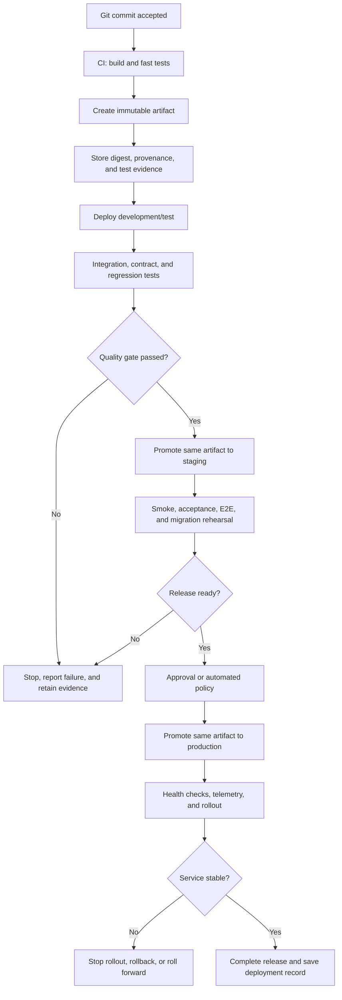
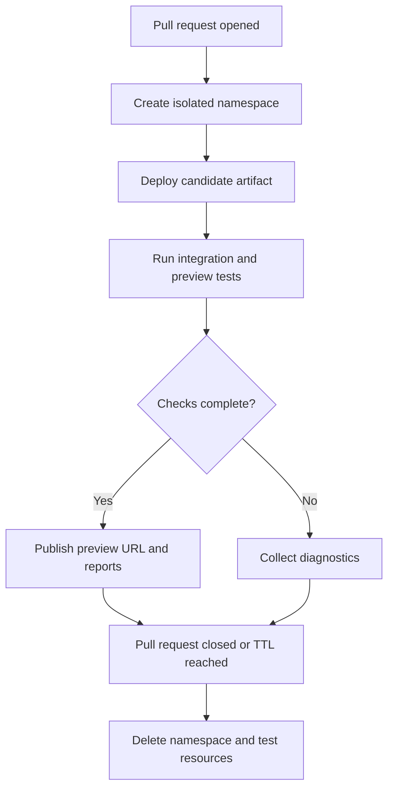

# Organizing Development, Testing, Pre-Production, and Production Environments

An application may run fine on a developer's machine and yet fail when deployed to production. The cause does not necessarily lie in the source code: the runtime version may differ, an environment variable may be missing, the database may use a different schema, a dependent service may be unavailable, access permissions may differ, or network configuration may change across locations.

In CI/CD, the development, testing (test/QA), pre-production (staging/pre-production), and production environments form distinct verification checkpoints along the path of delivering software to users. Each environment has its own purpose, isolation level, data, access permissions, and readiness criteria. They need to be organized consistently enough for test results to be meaningful, while remaining isolated enough that experimentation does not impact real users.

A key principle is **building an artifact once and promoting the same artifact across environments**, while supplying configuration and secrets per environment through controlled mechanisms. As a result, the version tested in staging is the exact content that will be deployed to production; differences between environments reside in declared configuration, data, and infrastructure—not in an unverified separate build.

## 1. Why Multiple Environments Are Needed

Each environment answers a different set of questions in the software lifecycle:

- Development: can developers build and test changes quickly?
- Test/QA: does the change's behavior meet requirements without breaking existing functionality?
- Staging/pre-production: do the artifact, configuration, and deployment process behave closely to production?
- Production: does the release serve users safely, reliably, and meet operational objectives?

If there is only a single shared environment, development, testing, and operations activities can overwrite each other's state. An experimental migration can corrupt another team's data; an automated test can send real emails; a new build can alter behavior that users rely on.

Conversely, creating too many environments without governance rules forces the organization to maintain numerous configuration sets, credentials, and infrastructure stacks. Environments gradually drift apart, costs rise, and no one knows which environment reflects the canonical state.

The goal is not to create as many environments as possible. Choose enough environments to validate product risks, clearly define each purpose, and automate provisioning, configuration, updates, and teardown.

## 2. Role of Each Environment

### 2.1. Development

Development is where developers integrate and verify changes during active work. This environment may run on a personal workstation, containers, a shared namespace, or ephemeral branch-based environments.

Common characteristics:

- Prioritizes fast feedback and experimentation.
- Can use synthetic data, mock services, or local dependencies.
- Allows deeper debugging and observability than production.
- Changes frequently and can be recreated on demand.
- Should not contain production secrets or real user data.

Development does not need to match production in scale, but it must remain compatible in aspects that affect logic: language version, runtime, dependencies, packaging format, and configuration structure. If local uses PostgreSQL while test uses another database with different semantics, certain bugs will only surface late in the cycle.

### 2.2. Test or QA

Test/QA verifies changes in a controlled environment. This environment can be used to run integration tests, contract tests, regression tests, acceptance tests, and manual testing.

Characteristics:

- Artifact versions and configurations must be recorded.
- Test data is reproducible and isolated per test suite or pipeline run.
- Dependencies need a stable state, health checks, and a reset mechanism.
- Multiple tests can run in parallel if namespaces and data are isolated.
- Operations that send emails, payments, SMS, or webhooks should point to sandboxes or test sinks.

Test/QA typically requires the ability to restore initial state. If test results depend on stale data or execution order, the environment produces flaky tests and erodes confidence in the pipeline.

### 2.3. Staging or pre-production

Staging simulates how the application will be deployed and operated in production. This is where the release candidate is validated with configuration, deployment procedures, network topology, and dependencies close to reality.

Staging is typically used to:

- Verify that the immutable artifact deploys properly.
- Run smoke tests, acceptance tests, and critical end-to-end flows.
- Rehearse database migrations, rollbacks, or roll-forwards.
- Verify permissions, certificates, secret integration, and service connectivity.
- Evaluate health checks, logging, metrics, tracing, and alerts.
- Test rolling, blue-green, or canary strategies under near-production conditions.

Staging must be sufficiently similar to production in factors that can alter behavior, though it does not necessarily need the same scale or data. Synthetic or anonymized data, sandbox accounts, and appropriate resource limits can be used.

### 2.4. Production

Production is the environment serving users and processing real data. Every change here must go through a process with traceability, appropriate permissions, and recoverability.

Characteristics:

- Access permissions are restricted and audited.
- Secrets, certificates, and workload identities are centrally managed.
- Running configuration, infrastructure, and versions are traceable.
- Deployments include health checks, telemetry, and rollout halt thresholds.
- Backups, recovery plans, and migration handling procedures are in place.
- High-impact changes require approval or policy guardrails.

Do not use production as a routine testing environment. When real-world behavior must be verified, prefer canary releases, synthetic monitoring, or scoped experiments with controlled data.

### Overview comparison table

| Criterion | Development | Test/QA | Staging/Pre-production | Production |
|---|---|---|---|---|
| Objective | Development and debugging | Functional verification | Release and operational verification | Serving users |
| Change frequency | Very frequent | Per pipeline or test cycle | Per release candidate | Per release process |
| Data | Synthetic or personalized | Fixtures and test data | Synthetic/anonymized near-realistic | Protected real data |
| Access permissions | Development team | QA team and pipelines | Release/operations team | Restricted, audited, and least privilege |
| Dependencies | Partially mockable | Stable, resettable | Production-like | Real services |
| Typical checks | Unit, debug, local integration | Integration, contract, regression | Smoke, acceptance, E2E, migration rehearsal | Health, SLO, synthetic, telemetry |
| Isolation level | Per machine/branch | Per team/run | Per release or system | By trust boundary and real data |

## 3. Artifact Promotion Flow Across Environments

A reliable release flow must distinguish building from deploying. Building produces an artifact from specific source code and dependencies. Deploying places that artifact into an environment with appropriate configuration.



Artifacts must have an immutable version or digest, such as a container image referenced by SHA-256 digest. Do not rebuild in staging or production simply because different configuration is needed. Rebuilding can produce different contents due to changing dependencies, package fetch times, or build tools.

A deployment record should link:

- Repository and commit SHA.
- Pipeline run ID and build tool.
- Artifact name, version, and digest.
- Test reports, scan results, SBOM, and provenance.
- Environment, configuration revision, and deployment ID.
- Approver or approving policy.
- Post-deployment verification results.

This enables the team to pinpoint the exact running artifact and configuration when a production incident occurs.

## 4. Keeping Environments Consistent While Isolated

Environments do not need to be identical in every detail. Development may have fewer instances than production; staging may use a smaller database; test may use mock services. What must stay consistent are the factors that can alter application behavior.

### Factors to keep similar

- Language version, runtime, and operating system/container base image.
- Dependency versions, drivers, and protocols.
- Packaging format and application entrypoint.
- API structures, event schemas, and database schemas.
- Authentication, authorization, and TLS mechanisms.
- Loading mechanisms for configuration, secrets, and feature flags.
- Health checks, logging, metrics, and tracing.
- Migration and deployment procedures.

### Factors that can vary by environment

- Instance count, CPU, memory, and autoscaling limits.
- Dependency URLs, hostnames, accounts, and endpoints.
- Log levels and sampling rates.
- Data volume or test fixture count.
- Feature flags and enabled user segments.
- Human and service account access permissions.
- Quotas, rate limits, and maintenance schedules.

Differences must be explicitly declared and justified. If staging runs an older database version than production or disables TLS while production enforces TLS, staging test results may fail to catch real-world defects.

## 5. Separating Configuration from Artifacts

The artifact should contain the application code and runtime components needed to execute, while environment-dependent values are supplied at deploy time or runtime.

For example, the same image `orders-api@sha256:...` can be deployed to test, staging, and production. Each environment receives:

- Its corresponding database endpoint.
- URLs for the inventory or payment service.
- Log and tracing levels.
- Timeout, connection pool, and resource limits.
- Feature flags.
- Appropriate secrets and certificates.

Do not build three separate images just to bake in three environment config files. Doing so breaks build-once-promote and makes it difficult to prove production is running the tested contents.

### 5.1. Common configuration sources

| Source | Suitable for | Notes |
|---|---|---|
| Environment variables | Simple runtime values, endpoints, feature switches | Avoid passing secrets via logs or command line |
| Mounted config files | Structured config or multiple related values | Manage versions and read permissions |
| Config service | Centrally updated or audited config | Must manage availability and caching |
| Secret manager | Passwords, tokens, private keys, certificates | Grant least privilege and short-lived credentials |
| Platform manifest | Replicas, resource limits, health probes, network | Manage as code and review changes |

### 5.2. Example environment configuration

Below is an illustrative configuration containing no secrets:

```yaml
application:
  name: orders-api
  port: 8080

runtime:
  log_level: INFO
  request_timeout_ms: 2500

dependencies:
  inventory_url: ${INVENTORY_SERVICE_URL}
  database_url: ${DATABASE_URL}

features:
  new_order_flow: false
```

`DATABASE_URL` can be an endpoint or connection string without a password. Database credentials should be retrieved separately from a secret manager or via workload identity. Environment configuration must be validated for schema and required values before the application serves traffic.

## 6. Managing Secrets by Environment

Production secrets must not be copied to development or test. Each environment should have its own credentials, least-privilege permissions, and an appropriate lifecycle.

Principles:

- Use a secret manager or workload identity mechanism instead of storing passwords in the repository.
- Issue short-lived credentials for CI jobs whenever possible.
- Separate deployment identities for staging and production.
- Never share database passwords or cloud keys across environments.
- Restrict who can read secrets; access logs must be audited.
- Rotate tokens and certificates according to policy.
- Do not write secrets into images, artifacts, caches, or test reports.
- Verify the application does not print secrets when misconfigured or when connections fail.

Pull requests from untrusted sources must not receive production secrets. If integration tests are required, use sandbox credentials with restricted permissions and synthetic data.

## 7. Managing Data Across Environments

Data is a common source of environment divergence and security risk. Production typically holds real data; test and staging need sufficiently representative data to verify behavior without exposing user information.

### 7.1. Development and test

Prefer synthetic data, fixtures, or data factories. Data should be reproducible, uniquely scoped per test run, and cleaned up after use. Tests should not depend on state left over from previous runs.

### 7.2. Staging

Staging may need data close to production distributions to test performance, business rules, or migrations. If using a data copy, anonymize or transform sensitive data, enforce access controls, and set retention limits.

### 7.3. Production

Production uses real data and requires backup, retention, encryption, access control, and audit policies. Never allow test cleanup routines to touch production data. Migrations must include compatibility, verification, and recovery plans.

### 7.4. Do not synchronize production data arbitrarily

Copying a production database to staging can introduce personal information, tokens, emails, addresses, or financial records into a less controlled environment. When representative data is needed, build a sanitization and anonymization pipeline, record lineage, verify outputs, and automatically expire copies.

## 8. Network and Access Isolation

Each environment should have network boundaries and identities aligned with its trust level.

| Environment | Typical appropriate network and access |
|---|---|
| Development | Accessible via VPN or internal network; do not expose databases to the Internet; personal or dev identities with limited permissions |
| Test/QA | Network sandbox; allow runners and test services to access only required dependencies; automated accounts with narrow permissions |
| Staging | Production-like topology; controlled ingress; access restricted to release/QA teams; use sandbox endpoints |
| Production | Network segmentation, private endpoints where appropriate, least privilege, auditing, and emergency access procedures |

Do not grant test runners direct access to every database or cluster out of convenience. Separating identities and network policies limits blast radius if a job or dependency is compromised.

## 9. Managing Infrastructure and Environment Configuration as Code

Infrastructure as Code (IaC) and Configuration as Code describe the desired state of environments in a repository. Teams can review changes, run policy checks, recreate environments, and compare actual state against declared specifications.

Components that can be managed as code:

- Networks, subnets, routes, firewalls, and security groups.
- Compute, container clusters, namespaces, and autoscaling.
- Database instances, backup policies, and parameters.
- IAM roles, service accounts, and permissions.
- Secret references and secret access policies.
- DNS, certificates, and ingress.
- Monitoring, alerts, log routing, and dashboards.
- Deployment manifests, resource limits, and health probes.

Example repository structure:

```text
deploy/
  modules/
    application/
    database/
    networking/
  environments/
    dev/
    test/
    staging/
    production/
  policies/
  pipelines/
```

Shared modules keep environments structurally consistent; environment-specific configuration only holds reviewed differences. Avoid copying full manifests and editing them manually per folder, as copies will gradually diverge.

### 9.1. Reviewing infrastructure changes

Pipelines can run formatting, validation, linting, policy checks, and generate a plan before applying. For production, plans must be reviewed under proper authorization and match the revision being applied. IaC state must be stored in an appropriate backend with locking and access controls; never place sensitive state into public artifacts.

### 9.2. Avoiding manual edits that cause drift

Drift is the divergence between actual state and declared state. If someone modifies a security group directly in the cloud console, the next deployment may overwrite the change or fail to detect unexpected configuration.

When direct emergency intervention is required, record the reason, actor, and exact change; then update the canonical source code or reconcile the environment back to the desired state. Periodic drift checks and alerts for high-impact changes should be in place.

## 10. Database Configuration and Migrations Across Environments

Databases often differ in capacity, data volume, and operational tuning, yet schemas and migration processes must be managed consistently.

A safe migration should consider:

- Is it compatible with currently running application versions?
- Does it lock tables or cause prolonged disruption?
- Does it require batched data backfills?
- Can it be re-run safely?
- Are backups or data recovery options in place?
- Will an application rollback still work once the new schema is applied?

The expand–migrate–contract pattern often enables zero-downtime deployments:

1. **Expand:** add new columns or structures in a way still compatible with the old application.
2. **Migrate:** deploy the application capable of reading/writing the new structure, backfill data in batches, and verify.
3. **Contract:** remove old structures only after no version or consumer depends on them and the rollback window has closed.

Staging should rehearse migrations on representative data volumes, measure duration, and check for locks. Production requires appropriate observability and recovery plans. Never assume rolling back an image reverses a destructive schema or data migration.

## 11. Organizing Ephemeral Environments per Branch or Pull Request

In large systems, shared development or test environments can become bottlenecks. Ephemeral environments provision an isolated environment per pull request or pipeline run.

Example:



Benefits of ephemeral environments:

- Branches do not overwrite each other's state.
- QA or reviewers can inspect the exact pull request build.
- Integration tests run against production-like configuration.
- Environments are created and torn down by pipelines, reducing manual effort.

However, costs and orphaned resources must be controlled. Each environment must have an owner, run ID, resource limits, TTL, isolated data, and automated cleanup when the pull request closes or the pipeline is canceled.

Ephemeral environments should not replace staging for all release checks. Staging is still needed to validate deployment flows and production-representative configurations.

## 12. Promotion, Approvals, and Deployment Permissions

Promotion means advancing the exact same verified artifact to the next environment. Each promotion requires clear conditions and an audit trail.

Example policy:

| Environment transition | Typical conditions |
|---|---|
| Development → Test | Build succeeds, unit tests and fast checks pass |
| Test → Staging | Integration/contract tests pass, artifact has digest and scan report |
| Staging → Production | Smoke/acceptance/E2E pass, migration and rollback plans ready, approval if policy requires |
| Production rollout → complete | Health checks and telemetry meet thresholds, deployment record saved |

Approvals should be evidence-based: commit, artifact digest, test reports, scan results, release notes, configuration changes, and recovery plans. Approvals should never be a rubber-stamp button without context.

Deployment permissions must be separated by environment. Test deploy jobs do not need production write access; production jobs receive permissions only at the required step. Prefer OIDC/workload identity and short-lived credentials over long-lived keys stored in pipeline variables.

## 13. Application Configuration and Feature Flags

Feature flags decouple code deployment from feature activation. A release can be deployed to production while a new feature is enabled only for internal staff, a small group, or a percentage of users.

Feature flags are useful when:

- Rolling out gradually to user cohorts.
- Quickly disabling a faulty feature without redeploying the entire application.
- Testing behavior in production with limited blast radius.
- Deploying backend and frontend changes in compatible steps.

However, flags add configuration state. Every flag needs an owner, purpose, review expiration, change permissions, and a removal plan. Do not let stale flags linger indefinitely or allow environments to diverge arbitrarily without traceability.

For security-sensitive configuration, such as enabling admin endpoints or changing permissions, dedicated quality gates and audits are required; do not treat every feature flag as a harmless toggle.

## 14. Verifying an Environment Before Serving Traffic

A tool-level successful deployment does not mean the application is ready to serve users. Post-deployment state must be verified.

Common checks:

- **Startup/readiness probes:** the process has started and is ready to accept traffic.
- **Liveness checks:** the process is running and not deadlocked by application criteria.
- **Smoke tests:** basic operations via API or UI.
- **Dependency checks:** database, cache, message broker, and required services are reachable.
- **Configuration validation:** required variables, config schemas, certificates, and secret references are valid.
- **Security verification:** service account permissions, network exposure, and runtime policies meet requirements.
- **Telemetry:** error rate, latency, saturation, and business metrics remain within thresholds.

Readiness should not merely check that the process is alive if the application cannot yet connect to essential dependencies. Conversely, liveness should not depend on every external service, as a flaky dependency could cause the orchestrator to continuously restart the application.

## 15. Managing Differences and Drift Across Environments

Some differences are intentional—for example, production having more replicas than test. Other differences represent unwanted drift—for example, staging missing a required variable or running a different TLS version than production.

Differences should be managed in three categories:

1. **Declared differences:** environment-specific configuration with an owner and justification.
2. **Auto-generated differences:** endpoints, secret references, or resource IDs provisioned by the platform and recorded in deployment records.
3. **Unintended differences:** manual edits, version mismatches, or missing configuration relative to the canonical source.

Ways to reduce drift:

- Use shared IaC modules and configuration templates.
- Pin runtime and dependency versions via lockfiles or image digests.
- Validate configuration against schemas before deployment.
- Compare actual state against declared state.
- Restrict direct edits in environments.
- Record the config revision in deployment records.
- Enforce the same critical policies across staging and production.

## 16. Example Pipeline Structure for Four Environments

The following YAML illustrates how promotion can be structured. This is a conceptual structure that must be adapted to the specific syntax of your CI/CD platform:

```yaml
pipeline:
  trigger:
    - pull_request
    - merge_to_main
    - release_tag

  build:
    steps:
      - checkout_revision
      - lint_and_unit_tests
      - build_application
      - create_immutable_artifact
      - publish_artifact_and_provenance

  deploy_test:
    needs: [build]
    environment: test
    artifact: build.artifact_digest
    steps:
      - load_test_configuration
      - deploy_same_artifact
      - run_integration_and_contract_tests

  deploy_staging:
    needs: [deploy_test]
    condition: required_tests_pass
    environment: staging
    artifact: build.artifact_digest
    steps:
      - load_staging_configuration
      - deploy_same_artifact
      - run_smoke_acceptance_and_e2e
      - rehearse_migration_and_recovery

  deploy_production:
    needs: [deploy_staging]
    condition: release_ready
    environment: production
    approval: production_release_policy
    artifact: build.artifact_digest
    steps:
      - verify_artifact_signature_and_digest
      - load_production_configuration
      - deploy_with_canary
      - verify_health_and_telemetry
```

In a real implementation, `environment` must bind to the platform's environment protections, secret scopes, and deploy permissions. `artifact_digest` must be passed as an immutable value. If staging or production jobs rebuild source code, the promotion pipeline loses consistency.

## 17. End-to-End Example: Releasing a Change to orders-api

Suppose a team adds inventory validation before confirming an order.

**Development:** the developer runs the service in a container with a local database and an inventory mock. Unit tests verify quantity rules; local config contains no production credentials.

**Test/QA:** the pipeline creates an isolated database schema, deploys the candidate artifact, and runs integration tests against PostgreSQL alongside contract tests between `orders-api` and `inventory-api`. QA validates sufficient stock, out-of-stock, and timeout cases. Test data is scoped to the pipeline run and cleaned up after reports are uploaded.

**Staging:** the exact same artifact digest is promoted to staging. Configuration connects to sandbox inventory and payment services, with production-like telemetry enabled. The team runs smoke tests, E2E ordering flows, and migration rehearsals. Release owners verify release notes, dashboards, and the rollback plan.

**Production:** the pipeline verifies the digest and provenance, loads production secrets via workload identity, and performs a canary rollout. A feature flag keeps the new feature off or enabled only for a small cohort. The team monitors error rates, latency, order confirmation rates, and inventory-check failures.

**Completion or recovery:** if metrics remain healthy, the rollout gradually increases traffic and enables the feature per policy. If errors spike, the team halts the rollout, toggles the flag off, or reverts to the stable artifact. If a migration modified the schema, compatibility must be verified before rolling back the application.

Because the same artifact flows through test, staging, and production, the team can focus investigations on configuration, permissions, data, or infrastructure differences rather than suspecting rebuilt code.

## 18. Common Anti-Patterns

| Anti-pattern | Consequence | Improvement |
|---|---|---|
| Building separately per environment | Artifacts may differ despite the same commit | Build once, promote the same digest |
| Letting staging diverge too far from production | Configuration errors surface only after release | Keep runtime, network, auth, and critical dependencies aligned |
| Using production data in tests uncontrolled | Leaks personal and financial data | Use synthetic or anonymized data, enforce retention limits |
| Sharing secrets across environments | One leaked credential compromises multiple environments | Separate secrets and identities by environment |
| Granting test runners production access | Untrusted code can impact real data | Separate credentials, networks, and deploy permissions |
| Editing configuration directly in the console | Drift and loss of auditability | Manage as code, audit, and reconcile with canonical source |
| Treating staging like real production | Tests may send real emails/payments or alter live data | Use sandboxes and safe data |
| No TTL on ephemeral environments | Resources and costs accumulate | Attach owner, run ID, TTL, and cleanup |
| Rubber-stamp approvals | Approvers lack evidence to evaluate risk | Surface digest, test reports, scans, and recovery plans |
| Skipping post-deploy verification | Deployment succeeds while app fails to serve traffic | Health checks, smoke tests, and telemetry |
| Feature flags without owners | Complex configuration state and poor traceability | Assign owner, expiration, and cleanup plan |
| Rollback relying solely on old images | Migrations or data may be incompatible | Design compatible migrations and rehearse recovery |

## 19. CI/CD Environment Organization Checklist

Before considering an environment pipeline ready, the team can review:

- [ ] Each environment has a clear purpose, owner, and user group.
- [ ] Development, test, staging, and production have appropriate access boundaries.
- [ ] Runtime, dependencies, packaging, and config structure align on critical points.
- [ ] Artifacts are built once, assigned an immutable version/digest, and promoted across environments.
- [ ] Environment configuration is separated from artifacts and version-controlled.
- [ ] Secrets and workload identities are separated by environment, least-privileged, and audited.
- [ ] Test/QA uses synthetic or anonymized data with reset and cleanup mechanisms.
- [ ] Staging is close enough to production to verify deploys, migrations, auth, networking, and telemetry.
- [ ] Production has backups, monitoring, rollout guardrails, and recovery procedures.
- [ ] Infrastructure and configuration are managed as code with reviews and drift detection.
- [ ] Database migrations are planned for compatibility with concurrently running versions.
- [ ] Ephemeral environments have an owner, run ID, resource limits, and TTL.
- [ ] Approvals are backed by test reports, scan results, artifact digests, and recovery plans.
- [ ] Deployment records store commit, artifact, config revision, approval, and post-deploy results.
- [ ] Smoke tests, health checks, and telemetry verification run before completing rollout.
- [ ] Feature flags have an owner, purpose, change permissions, and review expiration.

## 20. Conclusion

Development, test, staging, and production are environments with distinct goals and trust levels along the same software delivery pipeline. Development optimizes experimentation speed; test/QA verifies behavior; staging validates releases under near-production conditions; production serves users with strict security, reliability, and recoverability requirements.

A strong CI/CD system keeps environments consistent on behavior-affecting factors, separates configuration and secrets by environment, manages data safely, and promotes the exact same immutable artifact. When infrastructure is managed as code, drift is detected, deployment permissions are scoped, and every deployment includes verification and traceability, teams can move changes across environments in a controlled and predictable manner.
