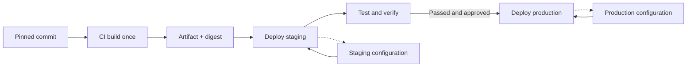
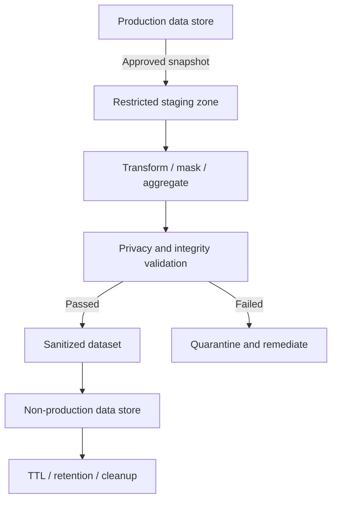

# Maintaining Necessary Parity Without Copying Sensitive Data

A bug that only appears in production and cannot be reproduced in staging often forces the team to ask: where do the two environments differ? Different runtime version, configuration, network, database, feature flag, or data? If staging differs too much from production, test results struggle to predict real behavior. Yet copying raw production data into development or testing environments introduces the risk of exposing personal information, business secrets, and credentials.

The goal of environment management is to **maintain parity in the factors that affect system behavior, while restricting data and access permissions to match each environment's needs**. Parity does not mean everything must be identical. Applications should use the exact same tested artifact; runtime, schema, topology, and policies must be close enough for results to be meaningful; while endpoints, secrets, data, and access permissions must be separated per environment.

## 1. Understanding Environment Parity

**Environment parity** is the intentional level of similarity across environments such as development, test, staging, and production. It helps reduce bugs that only surface due to environment differences, such as system libraries, database versions, request routing, or resource limits.

Parity does not require staging to have the same scale, real data, or access permissions as production. Instead, identify the characteristics that impact test outcomes and reproduce them at an appropriate level.

| Component | What should stay similar? | What can differ by environment? |
|---|---|---|
| Application | Same artifact digest, same code version | Replica count or rollout level |
| Runtime/toolchain | Compatible runtime version, base libraries, and architecture | Resource scale or controlled debug profiles |
| Application configuration | Same schema, data types, default rules, and loading mechanism | URLs, endpoints, feature flags, environment-capacity limits |
| Database | Same engine/major version, schema, and migrations | Storage size, dataset, accounts, and data |
| Network/topology | Connection flows, TLS, service discovery, and key policies | Network ranges, hostnames, node counts, traffic limits |
| Queue/cache/search | Same service type, semantics, and compatible version | Cluster size, TTL, or load-based capacity |
| Security | Same authentication model, authorization, and least-privilege principles | Separate identities, secrets, roles, and permission scopes |
| Observability | Same log, metric, trace, and health check types | Sampling rate, retention, and detail level per environment |
| Data | Same structure, relationships, distribution, and edge cases to test | Use synthetic or transformed data instead of real sensitive data |

An environment can have fewer replicas than production while still running the exact same image, schema, and retry policy. This is usually far more valuable than building a massive staging environment running a different application or database version.

## 2. Identifying What Must Match and What Must Be Isolated

Before building staging, define each environment's purpose and acceptable differences. For example:

- **Development:** prioritizes fast feedback, easy resets, optional debugging, and small datasets.
- **Test/QA:** prioritizes stable state, deterministic test data, and repeatability.
- **Staging:** simulates production closely in runtime, schema, network flows, observability, and deployment mechanics.
- **Production:** optimizes availability, security, capacity, operations, and protection of real data.

A practical approach is to list behavior-affecting factors and rank their importance:

| Parity level | Component | Reason |
|---|---|---|
| Mandatory | Artifact digest, schema/migrations, runtime major version, serialization/protocol, auth flow | Differences can directly alter behavior or compatibility |
| High | Database engine, queue/cache semantics, TLS, network policies, timeout/retry | Can cause integration failures, load issues, or security bugs |
| Based on test goal | CPU/RAM, replica count, data volume, cache size, rate limits | Must approximate production for benchmarks; can be scaled down for functional tests |
| Intentionally different | Endpoints, secrets, accounts, data, permissions, and deployment regions | Must be isolated to protect production systems and real data |

Do not evaluate parity solely by comparing two configuration files. Inspect actual state as well: running images, dependent service versions, database schemas, network routes, policies, and loaded test data.

## 3. Using the Same Artifact Across Environments

A core CI/CD principle is **build once, promote the same artifact across environments**. The pipeline builds an artifact from a pinned commit, runs tests against that artifact, and deploys the exact same contents to staging and production. When moving across environments, only configuration and secrets provisioned for the target environment change.

Example with a container image:

```text
registry.example.com/team/orders@sha256:abc123...
```

Staging and production should reference this exact digest. Never rebuild a separate image for production just to swap a database URL or toggle a feature. Those values should be loaded via external configuration outside the artifact.



If staging and production run two different digests, staging results no longer prove that the production artifact has been tested. If platform-specific variants are strictly necessary, clearly define each platform's artifact, test every variant, and record the corresponding provenance.

## 4. Managing Configuration by Environment

Configuration determines where the application connects, which limits apply, and which behaviors are enabled. Separate configuration from source code and packaging, while still managing it with clear versioning and rules.

Common configuration groups:

- Endpoints and service discovery: database URLs, queues, caches, external APIs.
- Application behavior: timeouts, retries, batch sizes, feature flags, rate limits.
- Resources: connection pools, worker counts, memory limits, concurrency.
- Security: issuer, audience, certificate references, policies, and roles.
- Observability: log levels, metrics endpoints, trace sampling, and alert routing.

Maintain a safe default configuration alongside environment-specific override layers. Required values must be validated at startup; if missing or malformed, the application should fail clearly rather than falling back to a dangerous default endpoint.

Example `.env.example` template containing only variable names and placeholder values:

```dotenv
APP_ENV=staging
LOG_LEVEL=INFO
DATABASE_URL=postgresql://app:<password>@db.example.invalid:5432/orders
REDIS_URL=redis://cache.example.invalid:6379/0
PAYMENT_API_BASE_URL=https://sandbox-payments.example.invalid
PAYMENT_API_TOKEN=<injected-at-runtime>
FEATURE_NEW_CHECKOUT=false
```

Never commit real `.env` files, tokens, passwords, private keys, or certificates with private keys. Template files show developers the configuration structure without exposing real values.

### Example ConfigMap and Secret reference in Kubernetes

```yaml
apiVersion: v1
kind: ConfigMap
metadata:
  name: orders-config
  namespace: staging
data:
  APP_ENV: "staging"
  LOG_LEVEL: "INFO"
  FEATURE_NEW_CHECKOUT: "false"
  PAYMENT_API_BASE_URL: "https://sandbox-payments.example.invalid"
---
apiVersion: apps/v1
kind: Deployment
metadata:
  name: orders
  namespace: staging
spec:
  replicas: 2
  selector:
    matchLabels:
      app: orders
  template:
    metadata:
      labels:
        app: orders
    spec:
      containers:
        - name: orders
          image: registry.example.com/team/orders@sha256:abc123...
          envFrom:
            - configMapRef:
                name: orders-config
          env:
            - name: PAYMENT_API_TOKEN
              valueFrom:
                secretKeyRef:
                  name: orders-payment-token
                  key: token
```

The ConfigMap holds non-secret configuration. The Secret reference points to a Secret provisioned in the `staging` namespace; the token value never appears in the manifest. For production, use a dedicated namespace, Secret, and workload identity. By default, Kubernetes Secrets are stored in API objects and do not automatically guarantee encryption at rest in every setup; enable encryption at rest, enforce strict RBAC, and consider an external secret manager or workload identity.

## 5. Never Copy Production Secrets and Permissions to Non-Production

Non-production environments typically have broader human access, more experimental pipelines, and shorter data lifecycles. If production credentials are shared, a compromised experimental job or developer account can become an entry point into production.

Principles to enforce:

- Each environment uses separate application identities, service accounts, database users, and tokens.
- Grant least privilege per service and action; avoid shared administrative accounts.
- Prefer workload identities or short-lived credentials over long-lived static keys.
- Fetch secrets at runtime from a secret manager; never embed secrets in images, source code, logs, or artifacts.
- Never reuse release-signing private keys or production deploy credentials in staging.
- Separate network and IAM boundaries; non-production runners must have no direct network path to production resources.
- Rotate credentials upon expiration or suspected exposure; revoke immediately when no longer needed.
- Audit secret reads and privileged actions.

Do not copy production secrets to staging even when staging needs to simulate integrations. Use sandbox accounts, mock services, or narrowly scoped test credentials.

## 6. Keeping Test Data Valuable Without Carrying Sensitive Data

For testing to be meaningful, data must preserve key characteristics such as structure, relationships, distribution, and edge cases. That does not mean retaining real people's names, phone numbers, emails, addresses, identifiers, or transaction contents.

Three common approaches:

| Data generation approach | Description | When suitable |
|---|---|---|
| Synthetic data | Generates new data from schemas, business rules, and target distributions | Unit, integration, performance, demos, and repeatable tests |
| Masked/transformed data | Transforms source data to reduce identifiability while keeping certain traits | When simulating complex real-world structures or distributions that are hard to synthesize |
| Anonymized/aggregated data | Removes or aggregates identifying details under a risk-assessment process | Trend analysis, statistical testing, and reporting |

These terms do not automatically guarantee safety. A dataset with names removed can still identify individuals if exact birth dates, postal codes, locations, transaction timestamps, or rare attribute combinations remain. Re-identification risk must be evaluated in the context of the data and who can access it.

### Synthetic data: generating new data from rules

Synthetic data is generated from schemas and business rules rather than pulled directly from real user records. A good dataset should include:

- Valid records respecting foreign keys and constraints.
- Diverse business states: new, processing, completed, failed, canceled.
- Boundary values: empty, minimum, maximum, Unicode characters, large numbers, boundary timestamps.
- Distributions close to expected load: order sizes, item counts, transactions over time.
- Rare but critical scenarios: retries, duplicates, race conditions, out-of-order events.
- Fixed seeds for reproducible test suites, while never using fixed seeds to generate security secrets.

Illustrative Python example using Faker to generate fake test data:

```python
from faker import Faker
import random

seed = 7319
fake = Faker("vi_VN")
fake.seed_instance(seed)
rng = random.Random(seed)

customers = []
for customer_id in range(1, 101):
    customers.append({
        "id": customer_id,
        "name": fake.name(),
        "email": f"customer-{customer_id}@example.test",
        "tier": rng.choice(["standard", "silver", "gold"]),
    })
```

This is synthetic illustrative data; the `.test` domain is reserved for testing. In real projects, generate consistent relationships across customers, orders, payments, and inventory, and ensure you never accidentally generate addresses or contact details that could reach real people.

### Masking, tokenization, and pseudonymization

If realistic data shapes are needed, sensitive fields can be transformed:

- Replace names, emails, phone numbers, and addresses with valid-format fake values.
- Replace customer IDs with deterministic tokens to preserve cross-table relationships.
- Round or generalize timestamps and locations to reduce identifiability.
- Strip free-text fields that may contain personal information or secrets.
- Replace account numbers, transaction IDs, and payment data with sandbox values.

Distinctions:

- **Masking** is a general term for obscuring or altering data fields.
- **Pseudonymization** replaces direct identifiers with pseudonyms, though re-linking may remain possible, especially if mapping tables or keys are retained.
- **Tokenization** replaces values with tokens; the system maintains a token vault or separate mapping mechanism to detokenize when authorized.
- **Anonymization** aims to make re-identification of individuals impossible by reasonable means within the usage context. This is an outcome requiring evaluation, not merely dropping a column.

If a mapping table or decryption key still exists, the data is generally still pseudonymized rather than truly anonymous. Mapping tables must be stored separately, encrypted, and access-restricted; ideally, never bring them into non-production environments.

## 7. Preserving Data Integrity and Distribution After Transformation

A poor masking pipeline can render data unusable. For instance, changing customer IDs independently across tables breaks foreign keys; shifting order creation dates without shifting payment dates creates nonsensical timelines; replacing all values with a single constant destroys cardinality and skews performance results.

After generating or transforming data, verify:

1. **Referential integrity:** foreign keys and cross-table relationships remain valid.
2. **Uniqueness:** fields requiring uniqueness remain unique after substitution.
3. **Domain constraints:** enums, formats, ranges, checksums, and business rules remain valid.
4. **Distribution:** distributions of counts, lengths, statuses, and frequencies align with test goals.
5. **Temporal consistency:** chronological ordering and relationships between events make sense.
6. **Edge cases:** empty values, large payloads, error cases, duplicates, and rare states remain present as needed.
7. **Privacy checks:** no secrets, direct identifiers, or policy-violating sensitive free text remain.

For relational data, generate consistent mappings within a single data-generation pass so a customer maps to the same synthetic ID across all related tables. This mapping only needs to exist during transformation and should be destroyed if retention is unnecessary.

## 8. Secure Data Refresh Workflow

If production snapshots must be used to model complex data, the workflow must be designed as a dedicated sensitive-data processing pipeline. Never dump a production database and upload it straight into staging.



Reference workflow:

1. Define the purpose, required fields, and minimum necessary scope.
2. Approve the snapshot per data policy; record both requester and approver.
3. Create the snapshot inside a restricted zone with encryption, narrow access, and audit logging.
4. Run transformations using versioned tooling and reviewed rules.
5. Validate privacy, referential integrity, formats, distributions, and residual data.
6. Export the sanitized dataset only after validation passes; delete or expire raw snapshots per policy.
7. Load the dataset into the non-production environment using a dedicated identity.
8. Enforce retention/TTL, refresh schedules, and cleanup automation.
9. Record metadata on source, timestamp, transform version, and check results; never write sensitive records to logs.

If transformation or validation fails, data must remain quarantined; never push partial or unverified snapshots to staging. Raw copies must be protected throughout their entire lifetime and never kept indefinitely merely for convenience on the next refresh.

## 9. Maintaining Load Parity Without Real Data

Performance testing often requires large datasets with production-like distributions. Synthetic datasets can be generated from aggregated statistics:

- Row counts per table and relationship ratios.
- Distributions of order sizes, item counts, statuses, and data age.
- Read/write query ratios, cache hit rates, and hot-key skew.
- Transaction arrival patterns and traffic bursts.
- Large, rare, or heavily skewed record edge cases.

Real records are not needed to simulate skew or hot keys. Synthetic keys can follow a Zipf distribution or concentrate access on specific groups, provided the test reflects the assumptions under evaluation. Record the seed and generator version to compare benchmark runs accurately.

For functional tests, a small dataset covering business rules and edge cases is usually more effective than a massive data copy. For performance tests, size and distribution must match measurement goals. For security tests, use simulated role-based accounts, fake sensitive data, and misconfigured access scenarios.

## 10. Controlling Drift Between Desired Configuration and Actual State

**Configuration drift** occurs when an environment's actual state diverges from its managed configuration. For example, an engineer edits a ConfigMap directly on the cluster, upgrades a database minor version outside the process, or manually adds an environment variable during an incident and forgets to update configuration code.

Drift stops staging from representing reviewed configuration. It also makes incident reproduction harder because the repository no longer reflects reality.

Control measures:

- Manage infrastructure and application configuration using IaC or versioned configuration.
- Review configuration changes via pull requests and pipelines just like source code.
- Use policies to restrict direct modifications to managed resources.
- Periodically compare desired state against actual state and alert on drift.
- Store configuration revisions alongside deployment records.
- When direct emergency fixes are needed, log a change/incident record and reconcile the change back into the repository afterward.
- Avoid maintaining manually edited per-environment manifest copies with no shared lineage.

With Terraform, for example, `plan` reveals differences between desired configuration and provider-observed state. Manage state securely, enable state locking during concurrent operations, and protect outputs since plans/state may contain sensitive data. Never place raw state or full plans into public artifacts.

## 11. Example Organization of Staging and Production Configuration

A repository layout can separate shared base configuration from per-environment overrides:

```text
deploy/
  base/
    deployment.yaml
    service.yaml
    configmap.yaml
  overlays/
    staging/
      kustomization.yaml
      config-patch.yaml
    production/
      kustomization.yaml
      config-patch.yaml
```

The `base` contains workload structure, health checks, and shared settings. Overlays override only values that truly differ, such as endpoints, replica counts, resource requests/limits, or feature flags. Secrets are referenced from a separate management system rather than stored directly in overlays.

Example Kustomize staging overlay:

```yaml
apiVersion: kustomize.config.k8s.io/v1beta1
kind: Kustomization
namespace: staging
resources:
  - ../../base
images:
  - name: registry.example.com/team/orders
    digest: sha256:abc123...
patches:
  - path: config-patch.yaml
```

The production overlay can use the exact same image digest with its own namespace, endpoints, and resource sizing. Avoid duplicating the entire base into two independent YAML trees that will drift apart. Include CI checks on rendered manifests to verify required fields and prevent production config from pointing to sandbox databases or payments, as well as preventing staging from pointing to production.

## 12. Automated Checks to Maintain Safe Parity

Pipelines can run pre-deployment checks:

- Confirm staging and production use the same artifact digest for the same release candidate.
- Compare runtime, database engine/version, and schema migration level.
- Validate configuration against schemas; check required variables and invalid values.
- Scan manifests to detect production endpoints in staging or sandbox endpoints in production.
- Verify no literal secrets exist in repositories, artifacts, or rendered manifests.
- Validate IAM/RBAC, network policies, and service accounts per environment.
- Confirm datasets are labeled with lineage, transform version, and TTL.
- Verify privacy/integrity reports before loading refreshed data.
- Detect drift and block releases when drift affects behavior.

Simple illustrative script checking environment endpoints:

```bash
#!/usr/bin/env bash
set -Eeuo pipefail

case "$APP_ENV" in
  staging)
    [[ "$PAYMENT_API_BASE_URL" == *"sandbox"* ]] || {
      echo "Staging must use the payment sandbox endpoint" >&2
      exit 1
    }
    ;;
  production)
    [[ "$PAYMENT_API_BASE_URL" != *"sandbox"* ]] || {
      echo "Production cannot use the payment sandbox endpoint" >&2
      exit 1
    }
    ;;
  *)
    echo "Unknown APP_ENV: $APP_ENV" >&2
    exit 2
    ;;
esac
```

This is an illustrative example, not a comprehensive check for every URL. In production systems, parse URLs properly, compare exact hostnames/allowlists, and validate configuration with schemas. Never print secret values in error messages.

## 13. Common Anti-Patterns

- **Copying the entire production database to staging:** increases data exposure risk and widens access scope.
- **Stripping only names and emails:** individuals may still be re-identified via birth dates, addresses, timestamps, or attribute combinations.
- **Sharing secrets across environments:** a breach in non-production can open a path into production.
- **Building separately per environment:** staging and production may execute different bytes.
- **Manually editing per-environment config:** creates drift and breaks traceability.
- **Keeping only shared config without verifying overrides:** critical settings may point to the wrong endpoint or toggle the wrong feature flag.
- **Synthetic data without referential integrity:** tests fail due to invalid data rather than application logic.
- **Masking without post-transform validation:** datasets still retain secrets, identifiers, or sensitive free text.
- **Keeping raw snapshots indefinitely:** extends the window and scope of exposure risk.
- **Using tiny datasets for every test type:** fails to reproduce production performance or distributions.
- **Using production-like data without a clear purpose:** collects more sensitive data than testing requires.
- **Failing to link datasets to generator versions:** makes test results impossible to reproduce reliably.

## 14. Checklist for Designing Parity-Aligned and Secure Environments

Before onboarding an environment into the pipeline, verify:

1. Have you defined which components must match for test results to be meaningful?
2. Do environments deploy the exact same artifact digest for the same release candidate?
3. Are runtime, database engine, schemas, protocols, and dependencies version-compatible?
4. Are shared configuration and environment overrides version-controlled and reviewed?
5. Are endpoints, feature flags, resource limits, and network routes validated per environment?
6. Are secrets, service accounts, database users, and IAM/RBAC permissions isolated?
7. Are non-production runners blocked from accessing production resources?
8. Is test data purposefully synthetic, masked, or transformed with re-identification risk assessed?
9. Are referential integrity, distributions, and edge cases verified after data generation/transformation?
10. Do source snapshots have restricted processing zones, encryption, auditing, and deletion workflows?
11. Do non-production datasets have TTLs, owners, and refresh/cleanup schedules?
12. Is configuration drift checked and is config revision stored alongside deployments?
13. Do logs/reports prove artifact, configuration, and dataset lineage without exposing sensitive data?
14. When drift or privacy check failures are detected, does the pipeline halt before deploying/loading data?

Maintaining environment parity means preserving the traits that alter software behavior: artifacts, runtimes, schemas, topology, protocols, and configuration mechanics. Protecting data means limiting what enters each environment, who can access it, and how long it persists. When both goals are engineered together, staging can mirror production closely enough for trustworthy testing without carrying real production data and privileges elsewhere.
