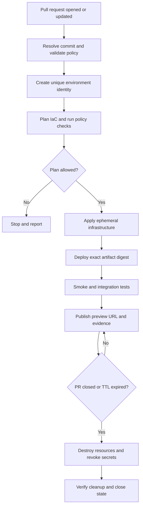

# Introduction to Infrastructure as Code and Ephemeral Environments

CI/CD pipelines do more than build packages and run tests. To verify a change closely to how it will operate upon release, teams often need a database, message broker, network, dependent services, configuration, and appropriate permissions. If someone must manually provision resources for every test run, environments easily drift, wait times grow, and stale resources are left behind.

Infrastructure as Code (IaC) describes infrastructure in files that can be reviewed, version-controlled, validated, and applied automatically. Combining IaC with temporary environments (*ephemeral environments* or *preview environments*), a pipeline can spin up an isolated environment for a pull request or experiment, deploy the exact artifact under test, run tests, and tear down resources upon completion.

The goal is not to build a full production replica for every change at all costs. The goal is to define reproducible infrastructure, control differences across environments, isolate risk, shorten feedback loops, and manage resource lifecycles from creation to deletion.

## 1. What Is Infrastructure as Code?

Infrastructure as Code is the practice of managing infrastructure resources using definitions stored in a repository and processed by automation tooling. Instead of logging into a console and manually creating each resource, teams declare desired state such as networks, subnets, databases, buckets, clusters, service accounts, policies, or deployments.

An IaC definition typically specifies:

- Which resources must exist and the dependencies between them.
- Which attributes are configurable per environment.
- Which provider, module, or tool versions are used.
- Which roles and identities are permitted to create, read, modify, or delete resources.
- How actual state is compared against desired state.
- How infrastructure is validated, applied, updated, and decommissioned.

IaC turns infrastructure changes into reviewable changes. A pull request can show which subnets, IAM permissions, firewall rules, or database settings will change before anything is applied. Git history records who proposed each change and which changes were accepted.

IaC does not automatically make infrastructure secure or correct. A configuration file can still specify overly broad permissions, publicly exposed databases, or expensive resources. You must combine code review, syntax checks, policy-as-code, plan reviews, least privilege, and post-apply verification.

## 2. Why Describe Infrastructure as Code?

Manual infrastructure management creates hidden state: a security group edited directly, an environment variable existing only on one host, a database configured differently from documentation, or an unowned resource. These discrepancies make staging and production inconsistent and turn disaster recovery into a slow ordeal.

IaC provides several benefits:

- **Change history:** infrastructure configurations are reviewed and stored in Git history.
- **Reproducibility:** the same definitions and inputs can produce environments following established conventions.
- **Pre-change inspection:** plan or diff tools reveal intended changes before applying them.
- **Reduced repetitive work:** pipelines can provision test or preview environments on demand.
- **Easier drift detection:** comparing declared configuration against actual state surfaces out-of-band modifications.
- **Policy enforcement:** validate regions, network exposure, encryption, tagging, permissions, and cost limits.
- **Decommissioning support:** temporary resources can be cleaned up according to a defined lifecycle.

These benefits materialize only when the team governs the IaC code, state, credentials, modules, providers, policies, and operational processes together. A repository containing Terraform files while people continue editing directly in the console quickly loses trustworthiness.

## 3. Declarative Model and Desired State

Many IaC tools follow a *declarative* model: authors describe the desired end state, and the tool determines the operations needed to converge actual infrastructure to that state. For example, declare a database with its engine version, size, encryption, and network placement. When configuration changes, the tool computes the corresponding update plan.

Some tools or scripts are *imperative*: authors specify each step to create, update, or delete. Both styles can be combined, provided you know which step manages state and which merely executes a single action.

With declarative IaC, keep in mind:

- Describe the final state rather than one-off procedural actions.
- Assign stable resource names with ownership conventions.
- Declare dependencies so tooling knows creation and deletion ordering.
- Never place secret values directly in configuration files or plan outputs.
- Use modules to reuse vetted patterns.
- Carefully review any change that replaces or destroys resources.

During apply, tooling may update multiple resources. A small definition edit can sometimes trigger replacement or destroy/create when an attribute cannot be updated in place. Always inspect the plan, understand data impact, and ensure recovery options exist before applying.

## 4. IaC Tools and Scope of Use

No single tool fits every infrastructure layer. Teams should choose based on platform, skills, state requirements, testability, and existing ecosystem.

| Tool category | Examples | Typical scope |
|---|---|---|
| Cloud/resource provisioning | Terraform, OpenTofu, Pulumi, CloudFormation, Bicep | Networks, databases, storage, compute, IAM, and cloud services |
| Configuration management | Ansible, Puppet, Chef | Server configuration, packages, services, and OS settings |
| Container orchestration manifests | Kubernetes YAML, Helm, Kustomize | Namespaces, workloads, services, ingress, policies, and cluster config |
| Platform templates | AWS CDK, Azure templates, Crossplane compositions | Building internal infrastructure abstractions or APIs |
| Policy as Code | OPA/Conftest, Sentinel, Checkov, and similar scanners | Checking configuration, permissions, networking, encryption, and org standards |

A system may use multiple tools across layers. For instance, Terraform provisions clusters and networks, Helm deploys applications, Ansible configures legacy hosts, and a policy engine checks manifests. Clearly define which tool owns each resource so two systems never fight over the same object.

## 5. Organizing an IaC Repository

The repository should reflect ownership boundaries, lifecycles, and infrastructure sharing levels. Shared modules can be separated from per-environment configuration:

```text
infrastructure/
├── modules/
│   ├── network/
│   ├── application-service/
│   └── database/
├── environments/
│   ├── dev/
│   │   ├── main.tf
│   │   └── terraform.tfvars
│   ├── staging/
│   │   ├── main.tf
│   │   └── terraform.tfvars
│   └── production/
│       ├── main.tf
│       └── terraform.tfvars
├── policies/
│   └── network.rego
└── README.md
```

This is an illustrative layout. Small repositories may place configuration in a single folder; large systems may split repositories by domain or team. What matters is that modules are versioned, environment configurations have owners, and every state file has clear boundaries.

Avoid having a single root module manage all resources across all environments when permissions, lifecycles, and blast radii differ. Separating state and permissions by environment reduces the chance of a dev pipeline accidentally touching production.

## 6. Example Infrastructure Declaration with Terraform

Terraform is a widely used IaC tool that uses HCL to describe resources, providers, variables, and outputs. Simple example:

```hcl
terraform {
  required_version = ">= 1.8.0, < 2.0.0"

  required_providers {
    examplecloud = {
      source  = "example/examplecloud"
      version = "~> 3.2"
    }
  }
}

variable "environment" {
  type        = string
  description = "Environment name for this deployment."
}

variable "instance_size" {
  type        = string
  description = "Approved compute size for this environment."
}

resource "examplecloud_instance" "app" {
  name          = "order-service-${var.environment}"
  instance_size = var.instance_size

  tags = {
    service     = "order-service"
    environment = var.environment
    managed_by  = "terraform"
  }
}

output "instance_id" {
  value = examplecloud_instance.app.id
}
```

The `example/examplecloud` provider and `examplecloud_instance` resource are illustrative placeholders demonstrating HCL structure, not a real cloud provider. In real repositories, use official or organization-approved providers, pin compatible versions, and commit the `.terraform.lock.hcl` lock file.

Environment variables should only accept policy-permitted values. Do not allow pull requests to pass arbitrary `instance_size`, region, or public network flags and provision uncontrolled resources. Use validation blocks and policy-as-code to constrain valid inputs.

## 7. Modules and Reusing Infrastructure Patterns

Modules encapsulate a group of resources behind an input/output interface. For example, a database module can accept environment, engine version, subnet group, encryption settings, and retention, returning the endpoint and resource identifier.

Modules are useful when:

- Multiple services require the same network or database pattern.
- The team wants to standardize encryption, tagging, logging, and backups.
- Shared patterns should be updated via versioning and reviews.
- Consistent policies must be enforced instead of copy-pasting configuration.

Overly generic modules can accumulate confusing variables. Keep interfaces small with safe defaults and validation. Changes to shared modules must be tested across consumers because a single change can affect multiple environments.

External modules must be pinned to a specific version or commit reference. Never point production modules to a moving branch like `main` without a controlled update workflow. Terraform's `.terraform.lock.hcl` records provider selections; modules must be pinned separately via explicit version or source references.

## 8. Plan, Review, and Apply

A safe IaC workflow separates generating a plan from applying changes:

1. **Format and validate:** check syntax, formatting, and structure.
2. **Static/policy checks:** detect dangerous resources, overly broad permissions, missing encryption, or non-compliant settings.
3. **Plan:** read state and provider status to compute intended changes.
4. **Review:** responsible reviewers inspect resources to be created, updated, replaced, or destroyed.
5. **Apply:** execute the approved plan using the appropriate identity and permissions.
6. **Verify:** validate live resources, connectivity, policies, and service health.
7. **Record:** store commit, plan/apply run, state identity, approver, and outcome.

With Terraform, common commands include:

```bash
terraform fmt -check -recursive
terraform init -lockfile=readonly
terraform validate
terraform plan -out=tfplan
terraform show tfplan
terraform apply tfplan
```

`terraform init` downloads providers/modules per configuration and lock file; `-lockfile=readonly` prevents updating the lock file during that run. `plan -out` creates a saved plan so apply executes the exact reviewed plan. Saved plans can contain sensitive data, so never upload them as public artifacts or print them in logs; restrict read access and retention.

A plan reflects state observed at plan creation time. If state or infrastructure changes before apply, the tool may reject the plan or require generating a fresh one. Never review one plan and then run `terraform apply` without referencing that plan if your goal is applying only the reviewed changes.

## 9. State and Resource Management Boundaries

Terraform state maps resources in configuration to real objects managed by the provider. State often contains identifiers, metadata, and potentially sensitive values. It is critical data in an IaC system.

State must be stored in a suitable backend with:

- Read/write access restricted by environment and owning team.
- Encryption at rest and in transit.
- Locking to prevent concurrent applies against the same state.
- Versioning or backups to recover from state corruption.
- Audit logs and emergency access procedures.
- Separate state across dev, staging, production, and each preview environment.

Never commit live state into Git if it can contain secrets or sensitive infrastructure details. Never edit state manually unless following a controlled repair procedure with backups and review. Lost or corrupted state can cause tooling to recreate existing resources or drop management of critical assets.

Terraform workspaces can manage multiple states from one configuration in some patterns, yet workspaces are not a strong security boundary. For environments with differing permissions, lifecycles, or data, separate backend keys, root modules, and access controls. Never rely on workspace names alone to stop a dev pipeline from accessing production state.

## 10. Detecting Configuration Drift

Configuration drift occurs when live infrastructure diverges from IaC definitions or expected state. Drift can result from operators editing the console, another automation system modifying resources, unscheduled updates, or a partially failed apply.

Drift can lead to:

- Firewalls or IAM policies broader than reviewed configuration.
- Instance sizes or database settings diverging from standard environments.
- Manually deleted or modified resources breaking applications.
- Pipeline plans proposing unexpectedly large changes.
- Inability to reproduce environments because code no longer reflects reality.

Teams should run `plan` periodically (with appropriate refresh behavior) or use dedicated platform drift-detection features. When drift is detected, determine whether the change was intentional. If valid, update IaC via a pull request; if unauthorized, restore state per procedure. Never blindly auto-apply every drift-detecting plan in production without assessing impact.

Drift detection can also be triggered on pull requests or before releases. Results must distinguish unexpected drift from fields managed by other systems to prevent two controllers from endlessly overwriting one another.

## 11. What Is an Environment and Why Separate Them?

An environment is a collection of resources, configuration, data, permissions, and endpoints used by an application for a specific stage or purpose. Common names include:

| Environment | Purpose | Characteristics |
|---|---|---|
| Local/development | Development and debugging | Fast, easy to reset, synthetic data |
| Test/CI | Running automated tests | Can be created fresh per job or test suite |
| Integration | Testing multiple services | Shared dependencies or versioned stacks |
| Staging | Release rehearsal and pre-production verification | Matches production on critical factors |
| Production | Serving real users | Tight permissions, real data, monitoring, and controlled changes |
| Preview/ephemeral | Previewing a change or pull request | Short-lived, uniquely identified, and automatically cleaned up |

Not every organization needs all of these environments. A small service may only need local, CI, staging, and production. Large microservices systems may need dedicated integration environments or service-group previews. Choose based on risk and operational cost.

## 12. Environment-Specific Configuration

The same artifact should run across multiple environments by receiving appropriate configuration at deploy or startup time. Values that vary by environment typically include endpoints, database connections, feature flags, resource limits, log levels, domains, queue names, and scaling policies.

Classify configuration clearly:

- **Non-sensitive configuration:** can be stored in a repository if shared and reviewed.
- **Environment configuration:** stored per environment or in a versioned, validated configuration management system.
- **Secrets:** passwords, tokens, private keys, certificate private material; retrieved from a secret manager or via workload identity.
- **Build-time inputs:** values altering artifact bytes; must be recorded in build metadata.
- **Deploy-time inputs:** configuration altering runtime behavior without changing the artifact; must be recorded in deployment records.

Never bake production endpoints, credentials, or environment data into JARs or container images when they can be supplied at deploy time. If the same artifact is rebuilt separately for staging and production, the team cannot easily prove both environments run identical contents.

Configuration should have a schema and pre-deploy validation. For example, `APP_ENV` accepts only `dev`, `staging`, or `production`; URLs must match permitted schemes/hosts; timeouts must fall within valid ranges. Default values must be safe and never silently point to production.

## 13. What Is an Ephemeral Environment?

An ephemeral environment is an environment automatically provisioned for a change, pull request, branch, or experiment, and decommissioned when no longer needed. It may include a Kubernetes namespace, services, temporary database, queues, DNS records, ingress, and observability configuration.

For example, when pull request `#184` opens, the pipeline provisions:

```text
https://pr-184.preview.example.test
```

This environment runs the artifact built from the pull request's commit, uses an isolated database or schema, and runs integration/E2E tests. Reviewers can open the URL to inspect changes. When the pull request is merged or closed, the pipeline cleans up associated resources and state.

Ephemeral environments work well when:

- Multiple pull requests need parallel testing without overwriting shared environments.
- UI or API changes require live visual review by reviewers.
- Integration testing is needed against a specific set of dependencies.
- Teams want near-production configuration with isolated test data.
- Teams want to reduce maintenance of long-lived static test environments.

Not every test requires a full environment. Unit tests should still run fast inside CI jobs; preview environments should only be spun up when integration testing or live review justifies the cost.

## 14. Preview Environment Lifecycle Architecture

A preview environment needs a deterministic lifecycle from trigger to cleanup:

1. Receive a pull request event or preview request.
2. Resolve the commit SHA and generate a unique environment identifier.
3. Check permissions, policies, quotas, and configuration inputs.
4. Provision infrastructure using approved IaC modules.
5. Supply temporary environment-scoped configuration and secrets.
6. Deploy the exact commit's artifact digest.
7. Run required smoke, integration, contract, or E2E tests.
8. Publish the preview URL and results to reviewers via the pipeline UI.
9. Monitor TTL, PR status, and lifetime.
10. Clean up resources, state, DNS, secrets, and temporary data at end of life.



Every environment needs an owner, source PR, commit SHA, `created-at`, `expires-at`, and resource ID. This metadata identifies which resources are eligible for cleanup and helps investigate abandoned environments.

## 15. Naming and Isolating Ephemeral Environments

Environment names must be unique, stable throughout the PR's lifecycle, and within platform resource naming limits. Use the PR number plus repository/project slug or a normalized identifier:

```text
environment_id = preview-order-service-pr-184
namespace      = preview-pr-184
dns_name       = pr-184.preview.example.test
state_key      = preview/order-service/pr-184.tfstate
```

These values are examples. Never embed raw branch names into resource names because branches can contain invalid characters, exceed length limits, or collide after sanitization. PR numbers may be reused in certain systems or repositories; when lifecycle disambiguation is needed, add repository ID or generation/run ID.

Isolation must span multiple layers:

- **Compute:** dedicated namespace, pod, VM, or service.
- **Network:** dedicated ingress, egress, network policies, and DNS.
- **Data:** dedicated database/schema/bucket/queue or isolated data namespace.
- **Identity:** service accounts and credentials scoped to the environment.
- **Secrets:** dedicated, short-lived, revocable secrets.
- **State:** separate IaC state so cleaning up one preview never impacts another.
- **Quotas:** limits on CPU, memory, storage, IPs, connections, and concurrent environments.

A dedicated Kubernetes namespace does not automatically isolate everything. Cluster-level resources, nodes, networks, ingress controllers, storage classes, and cluster-admin privileges may still be shared. For sensitive data or untrusted workloads, evaluate separate cluster/account boundaries rather than relying solely on namespaces.

## 16. Reusing IaC Modules for Ephemeral Environments

Preview environments should reuse the same vetted infrastructure modules with smaller inputs or cost-saving settings. For example, a service module might accept:

```hcl
variable "environment_id" {
  type = string
}

variable "replica_count" {
  type    = number
  default = 1
}

variable "ttl_hours" {
  type    = number
  default = 24
}

resource "examplecloud_service" "preview" {
  name           = var.environment_id
  replica_count  = var.replica_count
  deletion_after = var.ttl_hours

  tags = {
    environment_type = "ephemeral"
    environment_id   = var.environment_id
    managed_by       = "terraform"
  }
}
```

The `examplecloud_service` resource and attributes in this example are hypothetical, not real provider syntax. In practice, TTL is usually enforced by a controller, scheduler, or cleanup automation; not every provider supports `deletion_after`.

Do not build a completely separate IaC codebase for previews when shared modules can be parameterized with controlled inputs. If previews differ from staging in behavior-affecting ways, document those differences clearly so reviewers understand the scope of test results.

## 17. Terraform State per Preview Environment

Each preview environment needs its own state or an equivalent ownership mechanism. If multiple PRs share one state, a cleanup job could destroy another PR's resources or a plan could modify the wrong environment.

A state key can be structured by repository and PR ID:

```text
preview/order-service/pr-184.tfstate
preview/order-service/pr-185.tfstate
preview/payment-service/pr-184.tfstate
```

The backend must support locking and proper access control. Provisioning jobs may write only to that preview's state. Cleanup jobs must verify environment ID, owner, and state key before destroying.

Never use Terraform workspaces as the sole security boundary. Workspaces share the same backend configuration and may share credentials; they do not automatically provide separate IAM policies or protect state from overly broad jobs. When previews need narrow permissions, separate backend keys, projects/accounts, or identities per security design.

State is sensitive data. Never upload state to public artifacts or print state contents in logs. Backends need encryption, access control, versioning, and auditing. Once an environment is destroyed, retain minimal audit metadata per policy and then delete state according to the defined lifecycle.

## 18. Cleanup: A Mandatory Part of Ephemeral Design

An ephemeral environment is only truly ephemeral if cleanup is designed from the start. If a pipeline has creation steps without reliable destruction, resources accumulate, driving up costs and expanding attack surface.

Cleanup should be triggered by multiple conditions:

- Pull request merged or closed.
- Preview branch deleted per policy.
- TTL expired.
- Manual cleanup requested by the owner.
- A periodic inventory job detects expired or orphaned resources.

Cleanup workflow:

1. Verify environment ID, repository, PR, and owner.
2. Block new traffic or put the preview into a non-serving state.
3. Revoke temporary tokens, credentials, and secrets.
4. Delete workloads, services, databases/schemas, queues, buckets, ingress, and DNS records belonging to the environment.
5. Verify resources are gone or record why deletion failed.
6. Save required metadata/audit records and close state per policy.
7. Report leftover resources and file a ticket or alert for the owner.

Cleanup must be idempotent: re-running it must not cause dangerous errors or delete unrelated resources. If a step fails, the job must retain enough metadata to retry and clean up the remainder. Never delete state before confirming resources are handled, because losing state leaves orphaned resources that are hard to manage.

Avoid running a broad project- or cluster-wide destroy keyed solely on PR number. Restrict scope using isolated state, resource tags/labels, and environment-scoped permissions.

## 19. TTL, Orphan Detection, and Cost Management

TTL (time to live) is the maximum duration an ephemeral environment may exist without a valid extension. TTL cleans up abandoned environments when cleanup webhooks fail or pull requests go stale.

Every resource should carry metadata such as:

```text
managed_by       = iac
environment_type = ephemeral
environment_id   = preview-order-service-pr-184
repository       = team/order-service
pull_request     = 184
owner            = team-orders
created_at       = 2026-11-18T08:00:00Z
expires_at       = 2026-11-19T08:00:00Z
```

Values are illustrative only. Platforms apply tags, labels, or resource metadata differently. Cleanup controllers must rely on verified metadata rather than deleting resources just because a name contains `preview`.

Preview costs can escalate quickly when many PRs run concurrently. Teams should enforce:

- Maximum concurrent previews per repository/team.
- CPU, memory, storage, and replica limits.
- Default TTL and bounded extension mechanisms.
- Auto-suspend on idle traffic if supported by the platform.
- Limits on database size, log retention, and artifact storage.
- Budget alerts or quotas for preview accounts/projects.
- Reporting of overdue resources and costs by owner.

Periodic orphan detection compares resources tagged `ephemeral` against active PRs/runs. Resources lacking an owner, past TTL, or missing linked state should be quarantined and processed per runbook. Never auto-delete unidentified resources if they might belong to shared or production infrastructure.

## 20. Managing Databases and Test Data in Previews

Databases are often the hardest part of preview environments because you must balance cost, provisioning speed, isolation, and realism. Options include:

| Organization approach | Advantages | Risks/considerations |
|---|---|---|
| Dedicated database per preview | Strong data and migration isolation | Slow provisioning, higher cost and quota usage |
| Dedicated schema on a shared database | Fast creation, shared infrastructure | Requires strict schema naming, permissions, and cleanup |
| Ephemeral database in a container | Ideal for short integration tests | Short-lived data, requires suitable images and storage |
| Database snapshot/clone | Structure and data close to standard environments | Must control cost, permissions, and data anonymization |

Never copy raw personal data or production secrets into previews. Use synthetic data, anonymized data, or approved snapshots. Database connection credentials must be unique per preview, least-privileged, and short-lived.

Migrations must align with the preview lifecycle. When new commits push to a PR, the pipeline must know whether to migrate the existing schema forward, reset the database, or recreate the environment. Never let two jobs apply migrations concurrently to a shared database without locks or serialization rules.

## 21. DNS, Ingress, and Preview Access

Previews usually need URLs for reviewers or test runners. A DNS convention can pair a wildcard domain with the PR identifier:

```text
pr-184.preview.example.test
pr-185.preview.example.test
```

Infrastructure must manage DNS records, certificates, ingress routing, and authentication. Wildcard certificates reduce certificate issuance frequency, but private keys must be protected and domain scope restricted. Stale DNS records must be removed when previews expire.

Previews should not be public by default. Require SSO, short-lived access tokens, IP allowlists, or an authenticating reverse proxy. If test automation requires access, issue dedicated credentials to the test runner and revoke them afterward.

Never pass secrets in URL query strings, as URLs frequently appear in browser history, proxy logs, and telemetry. Never rely on unguessable URLs as your sole authentication control.

## 22. Securing Infrastructure Provisioning Pipelines

IaC pipelines have permissions to create networks, IAM, databases, and compute; a compromised workflow can cause severe damage. Job permissions must therefore be separated by duty:

- Lint/validate jobs need no cloud credentials.
- Plan jobs get read-only state access and necessary provider metadata read access; no apply permissions.
- Apply jobs run only from trusted branches/events and use dedicated identities per target environment.
- Preview jobs have permissions scoped only to the preview project/account or namespace.
- Cleanup jobs may destroy only resources belonging to their owned environment ID/state.
- Production jobs require environment protections, approvals, or policies per organizational standards.

Prefer workload identity or OIDC to issue short-lived credentials instead of storing long-lived access keys in repositories. Trust policies must restrict which repository, workflow, branch/tag, and environment may receive tokens. Never let pull request workflows from forks obtain permissions to create production resources.

Plan files and state can contain secrets, internal endpoints, resource IDs, or sensitive configurations. Restrict read permissions, avoid printing sensitive contents in logs, and enforce short retention. Never upload plans/state to publicly accessible artifacts.

## 23. Policy as Code for Infrastructure

Policy as Code validates infrastructure configuration against automated rules prior to apply. Common policies include:

- Production databases must enable encryption and backups.
- Storage must not be public without an approved exception.
- Security groups must not expose administrative ports to the entire Internet.
- Production resources must carry owner, service, and environment tags.
- Previews may only be created in approved regions/accounts.
- Instance sizes, replicas, and storage must stay within quotas.
- IAM policies must not grant out-of-scope wildcard actions/resources.
- Container images and modules must originate from approved registries/sources.
- Logging and auditing must be enabled on required resources.

Policies must distinguish blocking errors from warnings. Overly broad rules make pipelines painful; overly lax rules fail to protect resources. Exceptions should record an owner, justification, scope, expiration date, and review evidence.

Policies should be evaluated on pull requests using plan outputs or manifests. When plans contain sensitive data, only trusted jobs may read and process them; reports must strip secret values before displaying results.

## 24. Separating Shared Infrastructure from Per-Preview Infrastructure

A preview environment rarely needs to recreate everything from scratch. Shared components may include clusters, ingress controllers, artifact registries, observability backends, or base networking. Per-preview components include namespaces, services, databases/schemas, queues, and secrets.

When sharing infrastructure, define:

- Which resources are shared and who owns them?
- Which child resources a preview may create/delete?
- Are quotas in place so one preview cannot exhaust cluster capacity?
- Do network policies prevent one preview from accidentally reaching another?
- Are secrets and data strictly isolated?
- Could cleanup accidentally delete shared resources?
- Does the shared cluster or account satisfy trust boundaries for PR code?

If external contributor code can run in a preview, treat that code as untrusted. Clusters shared with sensitive workloads must enforce strong security isolation boundaries or use separate accounts/clusters for untrusted workloads.

## 25. Example Pipeline for Provisioning a Preview Environment

An illustrative workflow may include validate, plan, apply, deploy, test, and cleanup jobs. Exact syntax depends on your CI platform and cloud provider; the example below demonstrates key flow and conditions:

```yaml
name: Preview environment

on:
  pull_request:
    types: [opened, synchronize, reopened, closed]

permissions:
  contents: read

jobs:
  validate:
    if: github.event.action != 'closed'
    runs-on: ubuntu-latest
    steps:
      - uses: actions/checkout@v4
      - uses: hashicorp/setup-terraform@v3
        with:
          terraform_version: 1.8.5
      - run: terraform fmt -check -recursive
        working-directory: infrastructure/preview
      - run: terraform init -backend=false -lockfile=readonly
        working-directory: infrastructure/preview
      - run: terraform validate
        working-directory: infrastructure/preview

  plan:
    needs: validate
    if: >-
      github.event.action != 'closed' &&
      github.event.pull_request.head.repo.full_name == github.repository
    runs-on: ubuntu-latest
    permissions:
      contents: read
      id-token: write
    steps:
      - uses: actions/checkout@v4
      - name: Create a remote preview plan
        id: plan
        run: ./scripts/preview-plan.sh "${{ github.event.pull_request.number }}" >> "$GITHUB_OUTPUT"
    outputs:
      plan_id: ${{ steps.plan.outputs.plan_id }}

  apply-and-deploy:
    needs: plan
    if: >-
      github.event.action != 'closed' &&
      github.event.pull_request.head.repo.full_name == github.repository
    environment: preview
    runs-on: ubuntu-latest
    permissions:
      contents: read
      id-token: write
    steps:
      - uses: actions/checkout@v4
      - name: Apply the reviewed remote plan
        env:
          PLAN_ID: ${{ needs.plan.outputs.plan_id }}
          PR_NUMBER: ${{ github.event.pull_request.number }}
        run: ./scripts/preview-apply.sh "$PR_NUMBER" "$PLAN_ID"
      - name: Deploy the pull request artifact
        run: ./scripts/preview-deploy.sh "${{ github.event.pull_request.number }}" "${{ github.event.pull_request.head.sha }}"
      - name: Run smoke tests
        run: ./scripts/preview-smoke-test.sh "${{ github.event.pull_request.number }}"

  cleanup:
    if: github.event.action == 'closed'
    runs-on: ubuntu-latest
    permissions:
      contents: read
      id-token: write
    steps:
      - uses: actions/checkout@v4
        with:
          ref: ${{ github.event.pull_request.base.sha }}
      - name: Destroy only this preview environment
        run: ./scripts/preview-destroy.sh "${{ github.event.pull_request.number }}"
```

The scripts in this example are hypothetical repository entry points. `preview-plan.sh` must output `plan_id=<id>` for a saved remote plan; `preview-apply.sh` must apply that exact plan ID rather than generating a new plan. Remote plan stores require restricted read/write permissions and short retention since plans may contain sensitive data. If using saved plan files instead of remote runs, encrypt and transfer them via private artifact channels with strict access controls.

Jobs with OIDC permissions run only for pull requests from the same repository in this example. That alone is not a complete trust boundary: real-world workflows should use protected reusable workflows on trusted branches, restrict OIDC trust policies by repository/workflow/environment, protect workflow changes with reviews, and configure environment protections. When pull requests arrive from forks, run credential-free validation only; provisioning previews requires a dedicated workflow confirmed by authorized approvers per policy. The cleanup job checks out `base.sha` to run scripts from the target branch rather than executing scripts contributed by the pull request.

This condensed workflow also omits a TTL controller or orphan cleanup. Both mechanisms must be implemented separately because `closed` events may be missed if workflows are canceled or platform outages occur.

## 26. Handling Continuous PR Updates and Concurrency

A pull request can receive multiple pushes while an earlier preview is still being provisioned. If two pipelines apply to the same state or deploy to the same namespace concurrently, results can be overwritten or versions mixed.

Teams need to:

- Use a stable environment ID scoped to the PR and repository.
- Record the current deployment's commit SHA in metadata.
- Serialize apply/destroy operations against the same state.
- Define whether newer jobs queue behind or supersede older jobs.
- Before publishing the URL or marking the preview ready, verify runtime is running the latest accepted commit/artifact digest.
- Prevent an older run's cleanup from deleting an environment managed by a newer run.
- Use a generation or deployment ID to distinguish lifecycles when necessary.

For example, run A deploys commit `C1`, then run B deploys `C2`. If A's trailing cleanup executes late and destroys shared state, B's preview can be wiped out. Cleanup must verify owner/generation or acquire a lock so it deletes only resources belonging to its own lifecycle.

## 27. Observing and Verifying Ephemeral Environments

Preview environments need sufficient observability to determine whether test failures stem from the application, infrastructure, or dependencies. Attach environment ID, PR number, commit SHA, and artifact digest to logs, metrics, traces, and deployment records.

Useful checks include:

- All resources created and reaching ready state.
- DNS/ingress routing to the right service.
- Valid TLS certificates and working access controls.
- Application running the exact artifact digest.
- Database migrations and seed data completed.
- Health/readiness endpoints succeeding.
- Smoke or E2E tests passing with isolated data.
- Resource usage staying within quotas.
- Cleanup able to locate and verify every resource by environment ID.

Do not retain logs or debug data indefinitely. Preview TTLs should also apply to temporary logs, database snapshots, secrets, and artifacts when they do not need to outlive the environment.

## 28. Common Pitfalls with IaC and Ephemeral Environments

| Pitfall | Consequence | Mitigation |
|---|---|---|
| Manually editing infrastructure without updating IaC | Drift and hard-to-reproduce environments | Bring changes back via PR and run drift detection |
| Running apply directly on every pull request | Untrusted code can provision resources or escalate privileges | Separate validate/plan from apply; restrict identities and trust boundaries |
| Sharing state across multiple previews | Cleanup or apply can impact the wrong environment | Separate state per repository/PR or ownership ID |
| Relying on workspaces as a security boundary | Jobs can access other states with shared credentials | Separate backends, permissions, and accounts/projects where needed |
| Missing TTL | Resources and costs accumulate | TTL controller, orphan scans, and budget alerts |
| Cleanup deleting state before resources | Orphaned resources hard to track and clean | Destroy with verification before closing state per policy |
| Cleanup matching solely on resource name | Can accidentally delete shared or production resources | Verify tags, owner, state, and environment ID |
| Relying solely on namespaces for isolation | Cluster-level resources or permissions remain shared | Enforce network policies, RBAC, quotas, and cluster/account boundaries |
| Using production data in previews | Data leaks and excessive access exposure | Use synthetic or anonymized data |
| Rebuilding artifacts in preview and production | Uncertain whether identical contents were tested | Deploy by immutable built and stored digest |
| Unhandled concurrent PR pushes | Previews may run stale commits or get accidentally cleaned up | Concurrency locks, generation IDs, and commit verification |
| Unreviewed plans | Destructive changes can be applied automatically | Surface plan summaries, policy gates, and risk-based approvals |

Another pitfall is building preview environments that mirror production too closely without controlling cost and permissions. Previews should simulate only what needs testing, with bounded data, credentials, and blast radius.

## 29. IaC and Preview Environment Design Checklist

Before putting the workflow into production use, verify:

- [ ] Infrastructure is defined as code in a reviewed repository.
- [ ] Providers, modules, and IaC tools are version-pinned; lock files are managed.
- [ ] Modules have clear interfaces, validation, and safe defaults.
- [ ] Plans are generated and reviewed before apply; destroy/replace actions are surfaced.
- [ ] Backend state is encrypted, locked, versioned, and least-privileged.
- [ ] State is separated by environment and appropriate ownership boundaries.
- [ ] Scheduled drift detection and handling procedures exist.
- [ ] Environment configuration is separated from artifacts; secrets come from managed secret stores.
- [ ] Previews receive a unique environment ID tied to repository, PR, and commit.
- [ ] Compute, network, data, identity, secrets, and state are isolated proportionally to risk.
- [ ] Ephemeral environments use vetted IaC modules.
- [ ] Databases and test data are isolated; un-anonymized production data is never copied.
- [ ] DNS, ingress, and preview URLs enforce appropriate authentication.
- [ ] Pipelines apply only via scoped identities with appropriately bounded permissions.
- [ ] Concurrency across create, update, and destroy is controlled.
- [ ] Cleanup runs on PR close with TTL fallback when close events are missed.
- [ ] Cleanup is idempotent, verified, and never deletes shared resources.
- [ ] Orphan detection, quotas, budget alerts, and ownership metadata are configured.
- [ ] Logs/metrics/traces carry environment ID, commit, and artifact digest.
- [ ] Verification confirms the preview runs the exact expected artifact and infrastructure state.

## 30. Conclusion

Infrastructure as Code brings infrastructure into the same review, validation, and traceability workflows as application code. Controlled plan/apply execution, protected state, versioned modules, policy-as-code, and drift detection maintain explainable infrastructure state. Ephemeral environments extend those capabilities by provisioning isolated per-PR or per-experiment environments, deploying specific artifacts, and tearing down resources at end of life.

For this model to scale sustainably, design permissions, state, data, DNS, quotas, TTLs, and cleanup together. Every ephemeral environment must carry a unique identifier, owner, commit/artifact identity, and expiration; every apply/destroy operation must stay strictly scoped. Teams can then validate changes in realistic environments, eliminate conflicts between pull requests, and keep both costs and risk within defined bounds.
