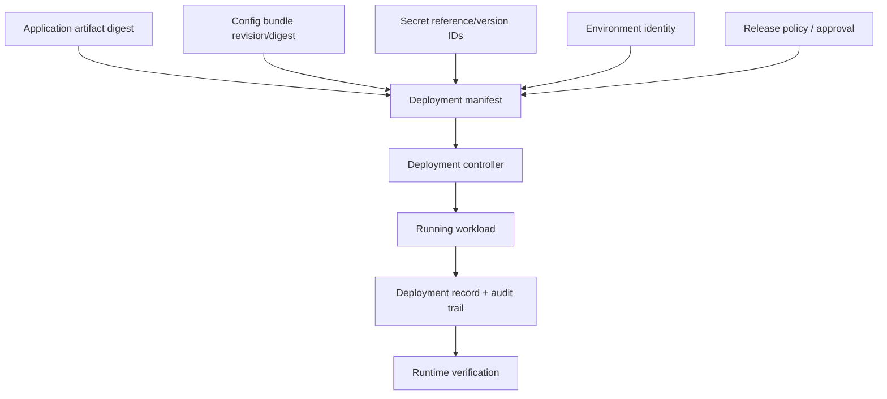
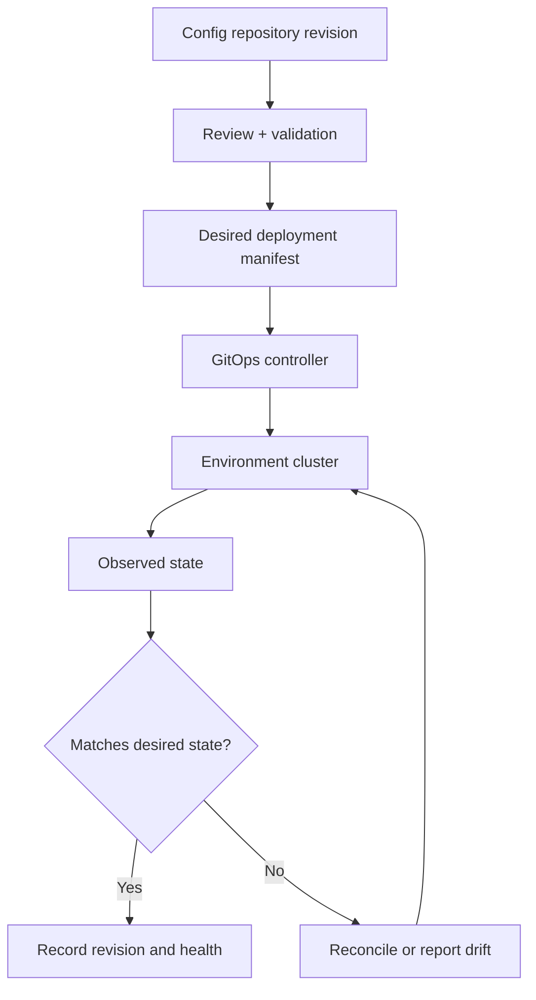

# Linking Deployments to the Exact Configuration Version

## 1. Why Must Configuration Versions Be Managed?

An application is not defined solely by its source code and artifact. At runtime, the application also receives configuration such as service endpoints, feature flags, timeout limits, connection counts, log levels, queue names, business parameters, and credentials. The exact same artifact can behave differently across development, staging, and production because each environment carries its own configuration.

If a team records only the application version without recording the configuration used, deployment history misses a vital half of the picture. When an incident happens, asking "which version is production running?" is not enough. You need to know the exact artifact, configuration, secret versions, and rollout policy applied.

For example, `order-service` version `2.4.1` runs fine in staging yet fails in production. Both environments run the exact same image digest, yet production sets `payment.timeout=2s` while staging uses `5s`. If deployment records store only the image digest, the team cannot faithfully reconstruct production's state at the time of the incident.

Linking deployments to the exact configuration version helps:

- Know the exact effective configuration at a given point in time.
- Reproduce or investigate a past deployment.
- Detect out-of-band configuration changes (configuration drift).
- Ensure staging and production are compared on the same artifact while explicitly documenting intentional configuration differences.
- Roll back both application and configuration under a compatible plan.
- Audit who changed configuration, who approved it, and where the change took effect.

The principle is that every deployment record must link at least three identifiers: the deployed artifact, the applied configuration revision/bundle, and the target environment. When configuration involves secrets, record secret identifiers or versions securely without ever storing secret values in metadata.

## 2. Distinguishing Artifacts, Configuration, and Secrets

These three input categories have distinct lifecycles and protection requirements:

| Component | Content | Examples | Management approach |
|---|---|---|---|
| Application artifact | Built and tested payload | JAR, container image, frontend bundle | Immutable version/digest in an artifact repository |
| Environment configuration | Values controlling behavior per environment | Endpoints, timeouts, replicas, feature flags | Versioned config files, config repository, or config service |
| Secrets | Sensitive values used for authentication or data protection | Passwords, API tokens, private keys, certificates | Secret manager, least privilege, and rotation |

Do not embed all configuration into the artifact. Endpoints and timeouts commonly vary by environment and should be supplied at deployment or application startup. Secrets must never be packaged in plaintext inside images, JARs, source repositories, or deployment manifests.

Some values are build-time configuration, such as public asset paths or compile-time features. When changing them alters the binary, they must be treated as build inputs producing a new artifact. Runtime configuration values can change without rebuilding, yet each change still requires versioning, governance, and deployment evidence.

## 3. Model for Linking a Deployment

A deployment should have a manifest or record describing all applied components. This can be visualized as follows:



The manifest links the artifact, configuration, secret references, environment, and release decision. The deployment controller uses the manifest to apply desired state. After deployment, the system records actual state and verification results.

A manifest may contain:

- Service name and target environment.
- Artifact reference and immutable digest.
- Config bundle revision or digest.
- Configuration schema version supported by the application.
- Secret manager paths and version IDs, without secret values.
- Deployment template/chart/manifest version.
- Release ID, pipeline run ID, and source commit.
- Approver or approving identity, timestamp, and policy version.
- Deployment, health check, and rollout outcomes.

Manifests must be generated from trusted sources and stored with the release record. Never let a deployment job arbitrarily mutate manifests after passing gates without creating a new revision and re-evaluating it.

## 4. Versioning Configuration

Configuration needs an identifier that can be referenced reliably. Depending on organization style, this identifier can be:

- Git commit SHA of the configuration repository.
- Immutable release tag of a config bundle.
- Package or chart version containing the configuration.
- Digest of a normalized configuration file/bundle.
- Revision ID issued by a config service.
- Version ID of each secret in the secret manager.

Environment names like `production` or branch names like `main` are not configuration version identifiers. They describe targets or development streams, whereas their contents change over time.

For instance, instead of recording merely `config=production`, deployment records should capture `configRevision=7f21c9...` or `configDigest=sha256:...`. During investigations, the team can retrieve that exact revision's contents and diff it against prior versions.

Versioning rules:

1. Every configuration change gets a new revision; never mutate contents under a previously released revision.
2. Deployed configuration must carry an immutable identifier or resolve to immutable content.
3. Active configuration must be linked to the deployment record.
4. Rollbacks must target a known revision rather than relying on an unstored "previous value."
5. Changes to key structure or semantics require schema/version management and compatibility checks.

## 5. Separating Shared Configuration from Environment-Specific Configuration

Some configuration can be shared across environments, such as feature names, log formats, or non-sensitive defaults. Values like endpoints, resource sizing, timeout limits, and secrets usually differ by environment.

An illustrative repository layout:

```text
config/
  common/
    application.yaml
    logging.yaml
  development/
    application.yaml
  staging/
    application.yaml
  production/
    application.yaml
  schema/
    application-config.schema.json
```

This is only one pattern. Teams may use a separate repository, Helm values, Kustomize overlays, a configuration service, or another config tool. What matters is clearly defining the merge order and which sources may override others.

When multiple configuration layers merge, record the versions of every contributing layer. For example, effective configuration might result from `common` + `production` + a release override. Recording only the `production` file revision is insufficient if `common` also changed.

Avoid stacking too many override layers. When the same key is defined in multiple places, operators must know where the final value came from. Generate a rendered/resolved configuration, strip secrets, compute its digest, and store it as deployment evidence.

## 6. Determining Effective Configuration After Merging

A deployment can receive configuration from multiple sources:

- Default values inside the application.
- Configuration files packaged in the artifact.
- Mounted ConfigMaps or configuration files.
- Platform-supplied environment variables.
- Command-line arguments.
- Configuration services or feature flag services.
- Secret managers.

Precedence differs across frameworks and platforms. Without documentation, a team might inspect a Git file assuming it is live while an environment variable or config service has overridden it.

To determine effective configuration:

1. Identify every configuration source read by the application.
2. Document precedence/merge order per runtime and framework.
3. Validate the final configuration before rollout.
4. Record sources, revisions, and non-sensitive resolved values.
5. Never record secret values; store only secret references/versions or safe metadata.
6. Provide a protected diagnostic endpoint/command to inspect effective configuration during operations, if needed by the application.

For example, a Java Spring Boot service may read `application.yaml`, the `application-prod.yaml` profile, environment variables, and command-line arguments. Verify precedence rules for the exact framework version in use. Never assume the repository file automatically takes highest priority.

## 7. Schema and Configuration Validation

A revision can be cleanly versioned yet still hold invalid values. Therefore, validate both structure and semantics prior to deployment.

Validation layers can include:

- **Syntax validation:** valid YAML/JSON/TOML without syntax errors.
- **Schema validation:** keys, data types, enums, required fields, and nested structures conform to schema.
- **Semantic validation:** meaningful values, such as positive timeouts and min replicas not exceeding max replicas.
- **Environment validation:** endpoints, namespaces, regions, and target resources belong to the intended environment.
- **Compatibility validation:** the application version supports this schema/config revision.
- **Security validation:** no plaintext secrets, appropriate file permissions, and no unauthorized debug modes enabled in production.
- **Policy validation:** configuration complies with organizational mandates such as mandatory TLS, logging, and network policies.

Simple JSON Schema example:

```json
{
  "type": "object",
  "required": ["payment", "logging"],
  "properties": {
    "payment": {
      "type": "object",
      "required": ["timeoutSeconds"],
      "properties": {
        "timeoutSeconds": {
          "type": "integer",
          "minimum": 1,
          "maximum": 30
        }
      }
    },
    "logging": {
      "type": "object",
      "properties": {
        "level": {
          "type": "string",
          "enum": ["INFO", "WARN", "ERROR"]
        }
      }
    }
  }
}
```

This schema illustrates type and range constraints. Real systems need full schemas, validation tooling, and rules for unknown fields. For production configuration, avoid silently ignoring misspelled keys if the framework supports strict validation.

## 8. Linking Secrets Without Storing Secret Values

Secrets follow their own lifecycle and can rotate independently of artifacts and regular configuration. Deployment records must show which secret and version a workload received, while never storing the secret's content.

A safe record can store:

- Secret manager/provider and path, e.g., `kv/prod/payment-api`.
- Version ID or immutable revision issued by the secret manager.
- Identity/workload authorized to read the secret.
- Credential issuance or refresh timestamp.
- Rotation status and expiration time where applicable.

Never write passwords, tokens, private keys, or private certificate material into manifests, logs, Git, or artifacts. Never include secret values in metadata hashes if those hashes could be used to brute-force low-entropy secrets. Use version IDs or safe references provided by the secret manager.

If an application references a dynamic alias like `current` or `latest`, the alias can shift to a different secret version without modifying the deployment manifest. While helpful for rapid rotation, this makes exact state reconstruction harder. Pick an explicit strategy:

- **Pinned version:** the workload receives a specific version ID; easy to trace and roll back, though references must update on rotation.
- **Dynamic alias:** the workload reads an updated alias; rotation is faster, yet the exact version served at runtime must be recorded.

In either strategy, maintain rotation procedures, overlap windows between old and new credentials, and verification that the application picked up the new credential. Never log secret values into deployment records to prove version identity.

## 9. Configuration as Code and Change Workflows

Configuration as Code (CaC) manages configuration via versioned files, reviews, and deployment workflows similar to source code. This tells you who made a change, what changed, and which environments received it.

A configuration change workflow can include:

1. Open a pull request modifying config files or schemas.
2. Run syntax/schema/semantic validation.
3. Review impact by environment and risk level.
4. Build an immutable config bundle/revision after merge.
5. Verify compatibility with the target application version.
6. Deploy to a test environment and verify.
7. Promote the verified revision to the next environment per policy.
8. Record the deployment record and observe runtime behavior.

Never edit production configuration manually and forget to update the repository. If an emergency change occurs, document it promptly, create a corresponding revision, and verify live state. If runtime configuration changes via a config service UI, maintain audit logs and an export/reconciliation path back to the canonical managed source.

## 10. GitOps and Desired Configuration State

In a GitOps model, Git or a versioned declarative source serves as the source of desired state. A controller watches for changes and reconciles the environment's actual state back to the declared state.



GitOps gives configuration changes history, review, and automated application. However, not all configuration belongs directly in Git. Secrets must be encrypted or referenced via a secret manager; never commit plaintext secrets. Dynamic values like autoscaling counts or runtime state may be owned by other controllers and must be distinguished from release-owned configuration.

When using GitOps, track which revision the controller synced and whether reconciliation succeeded. Committing config to Git does not prove the environment applied it successfully. Deployment records should capture desired revision, observed revision, reconciliation timestamp, and health status.

## 11. Detecting Configuration Drift

Configuration drift is the divergence between approved/declared configuration and live running configuration. Drift can arise from manual edits, out-of-sync controllers, altered environment variables, config service changes, or partially updated rollouts.

Forms of drift include:

- Replica counts or resource limits differing from approved config files.
- Production endpoints changed manually.
- One instance running an older secret version while peers have rotated.
- One group of pods running a new config bundle revision while another runs an old revision.
- A ConfigMap updated without the app reloading, leaving runtime with stale values.
- An environment carrying overrides absent from the repository.

Controls:

- Periodically compare desired state against observed state.
- Annotate workloads or deployment metadata with config revision/digest.
- Collect secret-stripped effective configuration and compare it against intended manifests.
- Alert on changes made outside pipelines or authorized controllers.
- Define drift policies: auto-reconcile, alert, block new rollouts, or require approval.
- Keep audit logs of runtime changes and executing identities.

Not all differences represent harmful drift. Values such as replica counts scaled dynamically by an autoscaler under load are intentional dynamic state. Distinguish valid controller-driven fluctuations from out-of-policy changes.

## 12. Linking Application Versions to Configuration Schemas

Applications and configuration share a compatibility contract. Syntactically valid configuration can still break an application if that application version does not understand a new key or value.

Define:

- Configuration schema version.
- Minimum/maximum application versions supporting that schema, if needed.
- Required keys, optional keys, and default values.
- Handling of deprecated legacy keys.
- Behavior when encountering unknown keys or wrong data types.
- Migrations/config transformations across schemas.

For example, application `2.x` reads `payment.timeoutSeconds`, whereas `3.x` renames it to `payment.requestTimeout`. Updating configuration before every running instance supports the new key creates an incompatible state during rollout.

A safe workflow:

1. Release an application version able to read both old and new keys.
2. Update configuration to add the new key while retaining the old key during the transition window.
3. Roll out and verify every instance reads the expected value.
4. Once no old instances remain, remove the legacy key in a separate configuration revision.

This applies the expand-and-contract mindset to configuration. Never rename or delete keys simultaneously with an application rollout when two versions may coexist.

## 13. Dynamic Configuration Changes and Runtime Reloading

Some applications can pick up new configuration without restarting, via file reloads, APIs, or configuration services. This speeds up updates while complicating determination of effective state.

When supporting dynamic config:

- Define which keys support hot reload and which require a restart.
- Validate schemas and policies before publishing a new revision.
- Record which revision each instance successfully loaded.
- Support phased rollouts by instance group or percentage for risky changes.
- Define behavior when an instance fails to load new configuration.
- Support reverting to the prior revision and verifying adoption.
- Monitor how many instances are running different revisions.

A config service returning success does not prove every instance loaded the configuration. If a subset of instances stays on an older revision, deployment records must reflect the mixed state. For security- or behavior-sensitive keys, verify both the reload event and post-reload behavior.

## 14. Combining Application Rollback and Configuration Rollback

Rolling back is not merely reverting to an older image. The older application may be incompatible with new configuration, and older configuration may be incompatible with migrated data schemas or rotated secrets.

Before rolling back, verify:

- Current and previous artifacts.
- Current and previous config revisions.
- Configuration schema supported by each artifact.
- Which secret versions remain valid and usable by the older application.
- Whether data migrations are reversible or require roll-forward.
- Whether any runtime changes cannot be automatically undone.

A release record should preserve verified compatible pairs, for example:

| Release | Artifact | Config revision | Secret reference/version | Status |
|---|---|---|---|---|
| R-104 | `order-service@sha256:aaa...` | `cfg-31` | `payment-api:v8` | Previously stable |
| R-105 | `order-service@sha256:bbb...` | `cfg-32` | `payment-api:v9` | New release |

If R-105 fails, do not blindly revert only the artifact to `aaa...`. Verify `cfg-31` remains compatible, `payment-api:v8` is still valid, and modified data can be handled. If the old secret was revoked for security reasons, rolling back to that version may be unsafe; you may need a new compatible configuration with the old artifact or a roll-forward fix.

Test rollback scenarios ahead of time across likely artifact/config combinations. Database migrations and secret rotations in particular can make rollback more intricate than code reverts.

## 15. Example Deployment Manifest Linked to Configuration

An illustrative deployment manifest:

```yaml
apiVersion: delivery.example/v1
kind: DeploymentRelease
metadata:
  name: order-service-production
spec:
  environment: production
  application:
    image: "registry.example.com/order-service@sha256:<image-digest>"
    version: "2.4.1"
  configuration:
    bundle: "config://order-service/production/revisions/32"
    digest: "sha256:<config-digest>"
    schemaVersion: "3"
  secrets:
    - name: payment-api
      reference: "secret://production/payment-api"
      version: "9"
  release:
    id: "R-105"
    sourceCommit: "8d3f2a1c..."
    pipelineRun: "ci-1042"
```

This is an illustrative schema. Fields like `image`, `bundle`, `digest`, `schemaVersion`, and secret references must be validated by real deployment tooling. Never put secret values in manifests. If the secret manager uses dynamic aliases instead of version IDs, deployment records need a way to capture the actual version delivered to the workload.

At deploy time, the controller verifies the artifact digest, fetches the exact config revision, checks schema compatibility, and provisions secrets by identity. Afterward, the system saves observed state to confirm which configuration each instance received.

## 16. Example with Kubernetes ConfigMap and Secret

A Kubernetes ConfigMap can store non-sensitive configuration; a Secret is used for sensitive data. Both can be attached to Pods via environment variables or volumes.

Example revision-labeled ConfigMap:

```yaml
apiVersion: v1
kind: ConfigMap
metadata:
  name: order-service-config-r32
  namespace: production
  labels:
    app: order-service
    config-revision: "32"
data:
  application.yaml: |
    payment:
      timeoutSeconds: 5
    logging:
      level: INFO
```

The Deployment can reference the ConfigMap by its specific revision name:

```yaml
apiVersion: apps/v1
kind: Deployment
metadata:
  name: order-service
  namespace: production
spec:
  template:
    metadata:
      annotations:
        config-revision: "32"
    spec:
      containers:
        - name: app
          image: "registry.example.com/order-service@sha256:<image-digest>"
          volumeMounts:
            - name: app-config
              mountPath: /etc/order-service
              readOnly: true
      volumes:
        - name: app-config
          configMap:
            name: order-service-config-r32
```

This is an illustrative example. Naming the ConfigMap with its revision creates an explicit reference and triggers a new Pod rollout when the template updates. If using a fixed name and mutating contents in place, understand how the application picks up changes: mounted volumes update after a propagation delay, whereas environment variables do not update inside already running processes. Many applications require an explicit restart or reload.

Kubernetes Secrets are not inherently securely encrypted in every cluster configuration. Enable appropriate encryption at rest, enforce strict RBAC, restrict read permissions, and consider integrating a secret manager/external secrets operator. Never commit base64-encoded Secret data thinking it is encrypted; base64 is encoding only.

## 17. Managing Emergency Changes and Out-of-Band Configuration

During a production incident, teams may need to adjust a timeout, feature flag, or endpoint rapidly. Emergency actions can be justified, yet failing to record them causes Git and runtime state to diverge.

An emergency change process should:

1. Record the incident, requester, justification, and scope of change.
2. Capture before/after values or revisions without recording secrets.
3. Use controlled emergency privileges with audit logging.
4. Verify the change resolves the issue without unintended side effects.
5. Once stabilized, commit the change back to the repository/config service as an official revision.
6. Run post-incident validation and review per policy.
7. Confirm desired state and observed state are synchronized again.

Never leave emergency changes lingering indefinitely only in a runtime UI. Unrecorded changes can be wiped out during controller reconciliation or environment recreation.

## 18. Tracking and Auditing Configuration History

A configuration management system should answer:

- Which configuration is currently active in each environment?
- Which revision was deployed and when?
- Who authored, reviewed, approved, and applied the change?
- Which artifact ran alongside that configuration revision?
- Which secret references/versions were provisioned to the workload?
- Are any instances running stale configuration or awaiting reload?
- Does runtime configuration diverge from desired state?
- During rollback, which artifact/config/secret combination did the system restore?

Deployment records should link release ID, artifact digest, config revision/digest, secret version references, environment, pipeline run, approval, and health outcomes. Audit logs need identity and timestamps. Sensitive data must be stripped or masked before storage.

For dynamic configuration, record the revision per instance and aggregate rollout percentages. For GitOps, record both desired revision and observed revision. For config services, log the service-issued version and client load confirmation events.

## 19. Common Mistakes

| Mistake | Consequence | Improvement |
|---|---|---|
| Storing only the application version | Cannot reconstruct runtime state | Link artifacts to config revisions and secret references |
| Recording only the environment name like `production` | Unclear which exact configuration contents ran | Store immutable revisions/digests |
| Editing config in place under the same version | Loss of history and inability to identify old content | Create a new revision for every change |
| Not documenting config source precedence | Effective values differ from reviewed files | Document precedence and safely record resolved configuration |
| Committing secrets to config repositories | Credential exposure and prolonged lifetime | Use a secret manager and store references/versions only |
| Using dynamic secret aliases without logging actual versions | Cannot trace which credential version was issued | Pin versions or log actual versions returned by the provider |
| Rolling back artifacts without checking config | Older app may fail to parse newer config | Verify artifact/config pairs and secret/schema compatibility |
| Treating a GitOps commit as a successful deploy | Controller may not have reconciled or rollout failed | Record observed revisions and runtime status |
| Validating config files without validating effective config | Env vars/config services may override values | Validate resolved configuration and check runtime state |
| Leaving emergency changes out of canonical source | Drift recurs or gets overwritten | Create post-incident revision and reconcile desired state |

## 20. Deployment-to-Configuration Linking Checklist

Before releasing, verify:

- [ ] Artifacts have immutable versions/digests linked to release IDs.
- [ ] Config bundles/revisions have explicit identifiers, not just environment names or moving branches.
- [ ] Merged configuration layers follow a clear precedence order.
- [ ] Effective configuration passes syntax, schema, semantic, and policy validation.
- [ ] Configuration schema versions match application version compatibility.
- [ ] Secrets are provisioned via a secret manager; manifests store only safe references/versions.
- [ ] If dynamic secret aliases are used, actual issued versions are recorded.
- [ ] Deployment manifests link artifact, configuration, environment, release, and pipeline run.
- [ ] Staging and production use the exact same artifact; config differences are explicitly declared.
- [ ] Rollback plans account for artifact, config revision, schema, and secret rotation.
- [ ] Desired state and observed state are compared to detect drift.
- [ ] Deployment records and audit logs capture sufficient data without storing secret values.
- [ ] Emergency changes follow post-incident review and sync back to the canonical source.

## 21. Core Practical Principles

1. Treat configuration as a versioned release input, equal to artifacts in traceability.
2. Bind every deployment to an artifact digest, config revision/digest, environment, and release ID.
3. Separate artifacts, runtime configuration, and secrets by lifecycle and access control.
4. Use immutable revisions; never mutate content under a previously deployed version.
5. Record effective configuration after merging all sources while stripping secrets from metadata.
6. Validate schemas, semantics, policies, and application compatibility before rollout.
7. Use Configuration as Code/GitOps or equivalent auditing to control changes and detect drift.
8. Manage secrets via safe references/versions and traceable rotation workflows.
9. Verify compatibility across artifacts, config schemas, and secrets during rollback.
10. Retain deployment records capable of accurately reconstructing running application and configuration state.

When every deployment is linked to its exact artifact and exact configuration revision, teams can explain every environment's state, catch out-of-band modifications, and recover in a controlled manner. This is essential for end-to-end CI/CD traceability from commit to runtime configuration and live application behavior.
