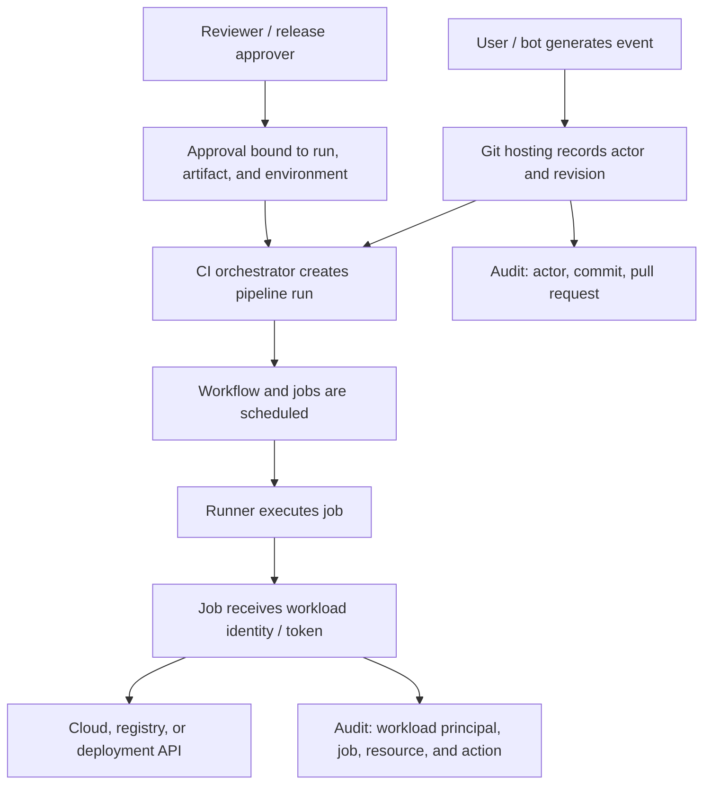
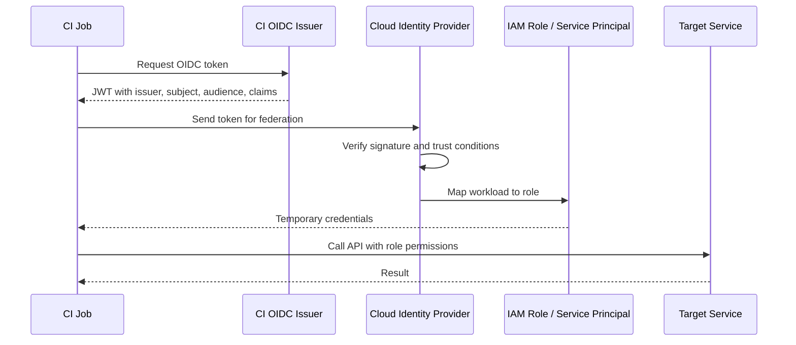

# Distinguishing User Identity from Pipeline Identity

In CI/CD, a person may trigger a pipeline, yet the pipeline should not automatically inherit all of that person's permissions. User and pipeline are two distinct principals: a user is a human identity who takes actions and holds accountability; a pipeline is an automated workload that needs its own identity to read source code, fetch dependencies, publish artifacts, or deploy to target environments.

Separating these two identity types helps accurately answer: who requested the release, which workflow executed, which job accessed resources, which credentials were issued, and what actions occurred. If a personal account or a single broad-privilege token is shared across all jobs, the audit trail cannot clearly identify the real actor, and a compromised pipeline could exercise permissions far beyond its intended scope.

## 1. Two Identity Types and Two Different Responsibilities

**Human/user identity** represents an individual signing in to Git hosting, the CI/CD system, a cloud console, or administrative tools. This identity is typically tied to organizational accounts, groups, roles, MFA, approval workflows, and HR lifecycle events.

**Pipeline/workload identity** represents a specific automated process or workload. It can be a service principal, service account, managed identity, workload identity federation principal, or a short-lived token issued to a job. This identity needs only sufficient permissions to perform its defined task.

| Criterion | Human/User Identity | Pipeline/Workload Identity |
|---|---|---|
| Subject | Human | Workflow, job, or automated workload |
| Purpose | Review, configuration, approval, triggering, investigation | Checkout, build, test, publish, deploy, read/write resources |
| Authentication | SSO, password, MFA, passkey, user certificate | OIDC federation, service principal, service account, workload token or credential |
| Lifecycle | Onboarding, role change, offboarding, account suspension | Created per workload, scoped and time-bound; revoked when workflow/job no longer needs it |
| Typical permissions | Developer, reviewer, release approver, administrator | Read repository, publish package, deploy to an environment, or call a specific API |
| Evidence | User ID, groups, approvals, and interactive actions | Workflow/run/job ID, workload principal, claims, and accessed resources |
| Key risks | Account takeover, privilege abuse, improper approval | Token leakage, workflow tampering, runner compromise, overly broad trust policy |

User identity answers "who requested or approved?". Pipeline identity answers "which workload actually called the API or modified the resource?". Good auditing preserves both relationships rather than collapsing them into a single shared account.

## 2. Do Not Confuse the Triggering Actor with the Executing Identity

A pipeline run can be triggered by multiple sources:

- A developer pushes a commit or opens a pull request.
- A reviewer merges a pull request.
- A release manager clicks a manual run button.
- A recurring schedule triggers a dependency scan or backup.
- A bot opens a pull request to update dependencies.
- A webhook from another system triggers a workflow.

The triggering actor is the entity that generated the event or run request. The pipeline typically executes under a workload identity issued by the platform to the workflow/job, or under a credential requested by the pipeline configuration. Just because a user has deploy permissions does not mean the pipeline should borrow that user's personal access token.

For example: a release manager has permission to approve production. They confirm the release in the CI/CD UI. After approval, the deploy job uses a workload identity scoped to the production environment to call the deployment API. Logs must record both the approver and the deploy job's principal. The approver is not the account that directly called the Kubernetes API.



A single pipeline run can use different identities across different steps. For instance, a test job only needs a token to read source code; a publish job needs write access to a package registry; a staging deploy job needs permission to update staging; a production deploy job needs a different principal and separate approval. Do not use one full-access credential across all jobs merely because they belong to the same workflow.

## 3. Identity Layers in a CI/CD Flow

To enforce proper authorization, separate the following subjects:

1. **User/actor:** the person creating commits, opening PRs, merging, triggering runs, or approving.
2. **Git hosting identity:** the account or bot with permissions on repositories and branch policies.
3. **CI workflow identity:** the executing workflow definition, repository, ref, event, and run.
4. **Runner/agent identity:** the machine or agent connecting to the CI platform to pick up and run jobs.
5. **Job/workload identity:** the token or principal used by a job when calling registries, cloud APIs, or other services.
6. **Target service identity:** the identity of the service or workload after deployment, used to access databases, queues, and APIs at runtime.

These layers are related but not automatically identical. A runner may execute under a dedicated OS account; a job may receive an OIDC token; the deployed application may use its own managed identity. If a job obtains the runner host's credentials or unprotected instance metadata, the boundary between runner identity and workload identity can be broken.

### 3.1. Runner Identity Is Not User Identity

A runner/agent is an execution environment. A self-hosted runner may be installed on a VM, bare-metal host, or Kubernetes. It typically has an identity to register and connect to the CI controller, but that identity should not serve as default access to all target systems.

If multiple untrusted jobs run on a long-lived runner, subsequent jobs might read files, processes, workspaces, or leftover credentials from earlier jobs. Therefore:

- Use ephemeral runners or clean workspaces after every job where appropriate.
- Separate runner pools by trust level and workload type.
- Do not run pull requests from forks on runners with internal network access or production secrets.
- Restrict OS permissions and cloud access of runner hosts.
- Protect registration tokens, runner groups, and runner administration permissions.
- Do not store personal access tokens in runner profiles, home directories, or global variables.

### 3.2. Job Identity Has a Smaller Scope Than Workflow

A workflow may contain multiple jobs with different trust levels. A PR check job may run code supplied by external contributors; a publish or deploy job runs post-merge on a protected branch. When the platform supports it, issue tokens and permissions per job rather than granting broad permissions at the workflow level.

A job that only reads source should not have package write permissions. An artifact publish job does not necessarily need production deploy permissions. A staging deploy job does not need permission to modify production. Separating permissions limits damage if an action, script, or dependency inside a job is compromised.

## 4. Authentication and Authorization Are Two Different Things

**Authentication** verifies who the subject is. **Authorization** determines what that subject is allowed to do on which resources.

For example, a validly signed OIDC token can prove that the token was issued to a workload by a specific issuer. That alone does not mean the workload is allowed to delete a bucket or deploy to production. The trust policy and IAM role on the target system determine what permissions that principal is granted.

A control model should answer:

- Is the subject a user, bot, runner, or job?
- Which issuer issued the token/credential and how is it verified?
- What is the target resource: repository, registry, cloud account, cluster, or environment?
- Is the allowed action read, write, publish, deploy, or administer?
- Are permissions restricted by repository, branch, workflow, environment, audience, and expiration?
- Who can modify the trust policy or grant permissions to the workload?

Do not rely on display names like `deploy-bot` as the sole proof. Require stable identifiers for principal, issuer, subject, audience, and resource scope.

## 5. Traditional Credentials and Risks of Long-Lived Secrets

Traditional pipelines often store credentials in the CI secret store:

- A developer's Personal Access Token (PAT).
- Service account username/password.
- Cloud access key/secret key.
- SSH private key to access hosts or Git servers.
- Kubernetes bearer token or kubeconfig.
- Registry password or API token.

Such credentials may be necessary for legacy systems that do not support federation, but they create lifecycle overhead: generation, storage, distribution, rotation, revocation, and exposure investigation. Long-lived tokens can continue working after their creator has left the team or the workflow is no longer used.

Common risks:

- A personal PAT with broad permissions stored in CI and reused across many pipelines.
- The same access key shared between staging and production.
- Secrets passed via command line, logs, artifacts, or build files.
- A compromised runner reading secrets from environment variables or processes.
- Credentials without expiration or clear ownership.
- A rotated secret where old pipelines retain copies or caches.
- Untrusted pull requests triggering jobs with access to secrets.

If long-lived secrets must be used, create a dedicated principal for the workload, grant least-privilege permissions, enforce expiration/rotation, store them in a secret manager, restrict where they can be used, and monitor audit logs. Do not use personal accounts in place of service identities.

## 6. Workload Identity Federation and OIDC

Workload identity federation enables a pipeline to prove its identity to a cloud provider or target service using short-lived tokens, typically based on OpenID Connect (OIDC). Instead of storing long-lived cloud access keys in CI, a job requests a token from the CI platform's identity provider. The target system verifies the issuer, signature, audience, and claims, then exchanges it for temporary credentials according to a trust policy.

Conceptual flow:

1. The job is authenticated by the CI platform and runs in a specific context.
2. The job requests an OIDC token from the issuer provided by the platform.
3. The token contains claims such as issuer, subject, audience, repository/project, ref, workflow, or environment depending on the platform.
4. The cloud identity provider validates the token and trust policy.
5. If matched, the system issues short-lived credentials for the designated role/service principal.
6. The job uses the temporary credentials to perform authorized actions.
7. The credentials expire; subsequent runs must authenticate again.



OIDC reduces the need to store long-lived secrets, but it does not make a pipeline secure automatically. If a trust policy accepts any repository, branch, or workflow from an issuer, an attacker could modify a workflow to obtain credentials. Specific claims and role permissions must be tightly constrained.

## 7. How Claims and Trust Policies Should Be Restricted

An OIDC token typically contains key claims:

| Claim | General Meaning | Usage in Trust Policy |
|---|---|---|
| `iss` | Token issuer | Accept only trusted issuers and the exact tenant/instance |
| `sub` | Subject representing the workload or context | Bind repository/project, branch, environment, or workflow per platform |
| `aud` | Audience, intended recipient of the token | Accept only the audience designated for the target federation endpoint/role |
| `repository` / project claims | Source repository or project | Restrict to the exact authorized project |
| `ref` / branch claims | Executing Git ref | Restrict to protected branches/tags |
| `workflow` / job claims | Workflow or execution context | Restrict to trusted workflows if the issuer provides the appropriate claim |
| `environment` | Environment attached to the job | Grant deploy access only when the job uses a protected environment |

Claim names, `sub` formats, subject customization options, and issued claims vary across GitHub, GitLab, Azure DevOps, and other systems. Do not copy a trust policy from one platform to another without inspecting real tokens and the issuer's documentation.

A sound trust policy should minimally constrain:

- The exact issuer.
- The exact audience.
- The specific repository/project.
- The protected branch or tag.
- The appropriate workflow or environment if supported by the platform.
- A role granted only the required permissions on target resources.

Do not merely check whether `sub` contains a repository name. Avoid broad wildcards such as `repo:*` or all branches when the workload only needs to deploy from `main` or release tags. For production, require both a protected environment and approval before a job can obtain tokens.

## 8. Workload Identity Examples Across CI/CD Platforms

### 8.1. GitHub Actions

GitHub Actions can request an OIDC token using the `id-token: write` permission. This permission allows the job to obtain a token from the OIDC provider; it does not grant write permissions to the cloud. Actual permissions depend on the trust relationship and IAM role on the target provider side.

```yaml
name: Deploy production

on:
  push:
    branches: [main]

permissions:
  contents: read

jobs:
  deploy:
    runs-on: ubuntu-latest
    environment: production
    permissions:
      contents: read
      id-token: write
    steps:
      - uses: actions/checkout@v4

      - name: Exchange OIDC token for short-lived cloud credentials
        run: ./scripts/federated-login-and-deploy.sh
```

This example shows where the token is acquired and the integration script is invoked. The script should use the cloud provider's SDK/CLI to exchange the token per provider protocol, then deploy only the verified artifact. In production, pin actions to full commit SHAs per policy; configure environment protection and trust policies to accept only authorized repositories/refs/workflows.

`GITHUB_TOKEN` is a separate token issued by GitHub to workflows to access the GitHub API/repository within configured `permissions`. It is neither an OIDC token nor a universal cloud credential. Restrict `permissions` and scope tokens per job.

### 8.2. GitLab CI/CD

GitLab supports job ID tokens via `id_tokens`. A job can request a token for a specific audience and exchange it with a cloud identity provider or OIDC-compatible service.

```yaml
deploy_production:
  stage: deploy
  id_tokens:
    CLOUD_ID_TOKEN:
      aud: https://identity.example.com
  script:
    - ./scripts/federated-login-and-deploy.sh
  rules:
    - if: '$CI_COMMIT_BRANCH == "main"'
```

The audience must match the receiving configuration. The trust policy should constrain the GitLab instance issuer, project path/ID, ref, and protected environment based on the claims emitted by your GitLab version. Do not treat `CI_JOB_TOKEN` as equivalent to OIDC: it is a job token scoped specifically for certain GitLab/API operations and package/container registries.

### 8.3. Azure Pipelines

Azure Pipelines can use service connections with workload identity federation to authenticate to Azure without storing long-lived client secrets. The pipeline references a service connection configured with trust for the appropriate organization/project/pipeline. Restrict service connection authorization, role assignment scopes, and environment checks.

Do not grant permission to use a production service connection to every pipeline in a project. Another pipeline could edit its YAML to invoke the same connection if authorization is overly permissive.

### 8.4. Jenkins

Jenkins typically uses Credentials Store, cloud plugins, and token federation mechanisms depending on configuration. OIDC integration or workload-identity plugins can be used if the Jenkins environment and cloud provider support them. When using static credentials, store them in Credentials Store, bind them only to the required stage/job, and never print their values.

Shared Libraries or plugins can execute logic with the privileges of the Jenkins agent/controller. Therefore, controlling who can edit Jenkinsfiles, Shared Libraries, plugins, and credential bindings is part of controlling pipeline identity.

## 9. Least-Privilege Authorization

Least privilege means each principal receives only the minimum permissions needed for its task, scoped to the appropriate resources and duration.

Example permission matrix:

| Workload/Job | Repository | Artifact Registry | Staging | Production |
|---|---|---|---|---|
| PR validation | Read source | No write | No access | No access |
| Build/test on main | Read source | Publish allowed artifacts | No deploy | No access |
| Deploy staging | Read artifact | Read | Deploy staging | No access |
| Deploy production | Read artifact | Read | No write needed | Deploy production with approval |
| Scheduled dependency scan | Read source and dependency metadata | May read packages | No deploy | No access |

This matrix is an example; actual permissions depend on architecture and platform. Some jobs need to read a package registry to restore dependencies without needing publish permissions. Some deployment jobs need to update a manifest repository, and those permissions should be separated from cluster access whenever possible.

### 9.1. Separating Principals by Environment

Using separate principals for staging and production limits the blast radius. If a staging credential is compromised, it must not be able to deploy to production or read production secrets. Trust policies should also differ: staging may accept multiple testing branches, while production should accept only protected branches/tags and trusted release workflows.

### 9.2. Separating Read and Write Permissions

Dependency-restore jobs usually need read access. Package-publish jobs need write access to a specific namespace. Deploy jobs need permission to update workloads or releases in a specific cluster/namespace. Do not grant `admin` just to avoid configuring granular permissions.

### 9.3. Trust Policy Administration Permissions

Anyone who can edit trust policies, role assignments, runner groups, or environment protections can effectively change who is allowed to deploy. Protect these configurations with review, approval, auditing, and separation of duties. Do not allow a pipeline to modify its own privilege-granting policies without independent oversight.

## 10. User Identity in Reviews and Approvals

Reviews and approvals are human decisions. Pipelines can automate condition checks, but they must never spoof approvals using a bot or shared service account to create the illusion of human accountability.

Distinguish between:

- **Code review:** a qualified person evaluating the diff and design.
- **Merge authorization:** policy governing who may merge into protected branches.
- **Release approval:** an authorized person accepting the release of a specific version/artifact.
- **Deployment approval:** an authorized person permitting changes to a specific environment.
- **Automated gate:** system checks for tests, scans, policies, and technical conditions.

Approvals should be bound to an identifiable release request: commit, artifact digest, environment, config version, change scope, and verification evidence. If the artifact or release content changes after approval, re-evaluate and require a new approval as dictated by policy.

Do not use a pipeline account to self-approve its own pipeline. If policy-based bot approvals are needed, clearly distinguish automated policy-engine decisions from human approvals and record separate identities.

## 11. Audit Trail: Linking Actors to Workload Principals

A useful audit log must connect the full chain:

1. Who created the commit or requested the run?
2. What event triggered the pipeline?
3. Which repository, ref, commit SHA, and pull request were processed?
4. Which workflow revision and run/job ID executed?
5. Which runner/agent ran the job?
6. Which workload principal received the token?
7. Which API did the principal call, on which resource, and with what action?
8. Who approved the release/deployment and what exact target did they approve?
9. Which artifact digest and environment/config version were deployed?

| Event | Fields to Record |
|---|---|
| Git event | Actor ID, repository/project, branch/ref, commit SHA, PR/MR ID, event type |
| Pipeline run | Workflow name/revision, run ID, job ID, start/end time, conclusion |
| Runner | Runner/agent ID, pool, image/OS, workload trust level |
| Token/federation | Issuer, subject, audience, principal/role, token issue/expiry time; never log plaintext tokens |
| Resource action | Cloud account/project, resource ID, API/action, result, request/correlation ID |
| Approval | Approver ID, policy, artifact digest, environment, decision, timestamp |
| Deployment | Artifact digest, config version/fingerprint, target environment, rollout result |

Time synchronization and correlation IDs help link logs across Git hosting, CI platforms, cloud audit logs, and deployment controllers. Never log tokens, private keys, or secrets in audit records. Store only the claims and identifiers required for investigation.

## 12. Identity Anti-Patterns

| Anti-pattern | Risk | Remediation |
|---|---|---|
| Using a personal PAT in pipelines | Tied to user lifecycle, overly broad permissions, poor auditability | Use workload identity or a dedicated service principal |
| One service account for all environments | Staging can access production | Separate principals and roles per environment |
| One full-privilege token for all jobs | Test jobs can publish or deploy | Scope permissions per job and task |
| Assuming the user who clicked Run is the executing principal | Misattributes the API caller in audit logs | Record actor and workload principal separately |
| Trusting OIDC for any branch/repository | Untrusted workflows can assume roles | Constrain issuer, audience, subject, ref, and environment |
| Passing secrets in command lines or logs | Credentials can leak into process listings or logs | Use secure secret binding and avoid echo |
| Running fork PRs on production runners | Untrusted code can steal credentials or access internal networks | Use isolated runners and withhold secrets |
| Credentials without expiry/owner | Hard to revoke and persist after no longer needed | Assign owner, TTL, rotation, and periodic reviews |
| Bot self-approving on behalf of humans | Loss of accountability and separation of duties | Separate automated policy decisions from human approvals |

## 13. When Service Accounts or Static Secrets Are Still Required

Not every target system supports OIDC federation. Some appliances, legacy registries, or internal services only support API keys, usernames/passwords, or SSH keys. In such cases, a dedicated workload service account may be used with these safeguards:

- Ownership belongs to a team/platform group, not an individual.
- Permissions are restricted by API, repository, namespace, or environment.
- Secrets are stored in the CI secret manager or a dedicated vault.
- Expiration/rotation, revocation procedures, and expiration alerts are in place.
- Secrets are bound only to the jobs that need them; never exposed to forks/untrusted code.
- Secrets are never written to artifacts, caches, shared workspaces, or logs.
- Secret reads and actions performed with the credential are audited.
- Periodically check whether the workload still needs the credential or can migrate to federation.

If a credential is suspected of being exposed, revoke or rotate it immediately per procedure, inspect audit logs to determine usage scope, check related artifacts/logs/caches, and issue a new credential with the appropriate scope. Deleting a secret from the current file does not remove copies in Git history or saved logs.

## 14. Pipeline Identity Design Process

### Step 1: Enumerate Resources and Actions

List every repository, package registry, cloud account, cluster, database, deployment API, or external service the pipeline needs to access. For each resource, distinguish read, write, publish, deploy, and administer.

### Step 2: Identify Appropriate Principals

Select workload identities for jobs or job groups sharing the same trust level. Avoid using human identities. Split principals by environment and task whenever permission scopes differ.

### Step 3: Choose Authentication Mechanisms

Prefer federation/short-lived tokens when supported by the platform. If static secrets are required, create a dedicated service account, store it securely, and establish a rotation lifecycle.

### Step 4: Constrain Trust Policies

Restrict issuer, audience, repository/project, ref, workflow, and environment based on real claims. Test edge cases including fork PRs, feature branches, release tags, schedules, and manual runs.

### Step 5: Enforce Least Privilege

Create roles with permissions only on necessary resources. Separate read/write and staging/production. Never grant administrative permissions to routine jobs.

### Step 6: Protect Workflows and Runners

Require reviews for pipeline files, shared actions/plugins, and trust configurations. Isolate runners by trust level, clean workspaces, and restrict network access.

### Step 7: Record and Monitor

Correlate actor, workflow run, job principal, API action, artifact digest, and approval. Alert on unexpected principals, unexpected branches, or anomalous jobs accessing sensitive resources.

### Step 8: Review Lifecycle and Revoke

Periodically review principals, roles, secrets, and trust policies. Remove unused permissions, rotate static credentials, and revoke workload identities when repositories, runners, or workflows are retired.

## 15. Practical Example: Release Manager Approves, Pipeline Deploys

A team releases the `orders` service to production. A sound flow looks like this:

1. A developer commits changes and opens a pull request. Git hosting records the user ID, commit SHA, and PR ID.
2. CI runs unit/integration tests using a job identity that only has permission to read source and fetch dependencies. PR code has no access to production secrets.
3. A reviewer approves the diff and merges. Audit records the reviewer/approver under their personal account.
4. The release pipeline builds the artifact from the merged commit, publishes the image, and records its digest and provenance.
5. The staging job obtains the staging workload identity, pulls the image by digest, and deploys. Smoke tests verify behavior.
6. The release manager uses their personal MFA-protected account to approve the release tied to the digest, production environment, and staging evidence.
7. The production job receives an OIDC token from CI. The trust policy accepts only the repository, `main` branch, release workflow, and protected `production` environment.
8. The cloud identity provider issues short-lived credentials for a role restricted to updating the `orders` service deployment in the production namespace.
9. The deployment controller runs the exact image digest. The pipeline verifies runtime digest, health, metrics, and user flows.
10. Audit connects the approving actor to the workload principal that performed the deployment, along with run ID, digest, and request ID.

If the staging job is compromised, the staging principal has no production permissions. If a developer leaves the organization, revoking their user identity does not break a release pipeline reliant on a personal PAT; workload identities maintain their own lifecycle and ownership. If the workflow is altered, branch protection and trust policies limit its ability to obtain production credentials.

## 16. Pipeline Identity and Permission Review Checklist

- [ ] Event triggers, reviewers, and approvers are recorded under individual user identities.
- [ ] Pipelines/jobs use workload identities instead of borrowing personal PATs or access tokens.
- [ ] Runner identity, job identity, and runtime service identity are clearly separated.
- [ ] Each job has only the permissions required for its task; read/write are separated where appropriate.
- [ ] Staging and production principals are separated.
- [ ] OIDC trust policies restrict issuer, audience, repository/project, ref, workflow, and environment appropriately.
- [ ] Permission to request an OIDC token is not mistaken for permission to access target resources.
- [ ] Tokens/credentials are short-lived; static secrets have owners, rotation, and revocation procedures.
- [ ] Fork pull requests and untrusted code receive no production secrets and do not run on sensitive runners.
- [ ] Workflows, Shared Libraries, actions, plugins, and runner configurations are protected by review.
- [ ] Approvals are bound to a specific artifact digest, environment, and release request.
- [ ] Audit trails link actor, workflow run, job principal, API action, and deployment result.
- [ ] No plaintext secrets exist in source, logs, artifacts, caches, or shared workspaces.
- [ ] Incident response procedures exist for compromised user, runner, workload token, or credential.
- [ ] Principals and trust policies are periodically reviewed and revoked when no longer needed.

User identity and pipeline identity serve two distinct roles within the same release process. Users author changes, review, and bear accountability for decisions; workload identities execute automated operations with bounded permissions. By clearly separating actor, runner, job principal, and runtime service, applying federation or short-lived credentials, tightening trust policies, and maintaining a complete audit trail, CI/CD can automate aggressively while preserving full traceability of who requested and which workload executed every action.
