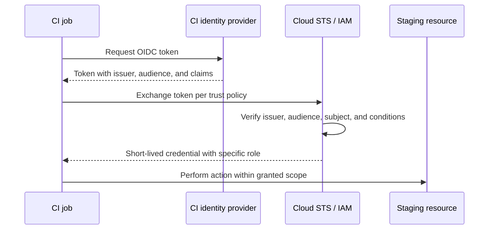

# Least Privilege by Job and Environment

CI/CD pipelines typically perform many types of actions: reading source code, downloading dependencies, running tests, publishing artifacts, running security scans, deploying to staging, and updating production. If every job shares a single credential with broad administrative privileges, a compromised build step or a malicious script can use those privileges to read secrets, modify infrastructure, or release unintended software.

**Least privilege** is the principle of granting an identity only the permissions required to complete its specific job, on the exact resources, within the required scope and duration. In CI/CD, this means a test job only needs permission to read source and dependencies; a publish job needs write access to a specific artifact repository; a staging deploy job may update only staging; and production permissions must be tightly restricted with separate controls.

The goal is not merely reducing the number of secrets. You must design identities, permissions, credential lifetimes, and boundaries between environments so that when a job fails or is compromised, the blast radius is contained and actions remain traceable.

## 1. Distinguishing Authentication from Authorization

Two foundational questions must be addressed separately:

- **Authentication:** who or what identity is the system interacting with? For example, a CI job running under service account `ci-test`.
- **Authorization:** which actions is that identity allowed to perform on which resources? For example, `ci-test` can only read packages from a registry and cannot publish or delete packages.

A valid credential proves identity, but it should not implicitly grant broad permissions. After authentication, the system must enforce policy to decide which actions are permitted.

A permission can be described by its components:

| Component | Question | Example |
|---|---|---|
| Principal/identity | Who is requesting? | Workflow job, service account, workload identity |
| Action | What can it do? | Read, write, deploy, delete, approve |
| Resource | What can it act upon? | An artifact repository or a Kubernetes namespace |
| Scope/condition | Under what conditions? | Staging only, one repository only, main branch only |
| Duration | How long does the access last? | Short-lived token for the job's execution time |

A clear policy must restrict both action and resource. Write access across an entire cloud account has a vastly larger scope than updating a single deployment in a staging namespace.

## 2. Why Every Job Should Have Its Own Identity

A pipeline may consist of multiple jobs with differing requirements. If a shared credential is used, the weakest job's access becomes a path to every resource that credential can touch.

Example for a Java service pipeline:

| Job | Task | Appropriate Permissions |
|---|---|---|
| Checkout and unit test | Read source, download dependencies, run tests | Read repository and package/dependency registry |
| Static/security scan | Read source and submit scan results | Read source, upload reports to the corresponding project |
| Build and publish | Build image and push image to a registry/repository | Read dependencies, write to the exact artifact repository |
| Deploy staging | Update staging service | Deploy to staging namespace or account |
| Deploy production | Update production service | Narrowly scoped production deploy permission, short-lived credential, and required approval |
| Cleanup | Delete expired artifacts per policy | Delete only within the managed repository, with audit and safeguards |

Jobs do not need to share the same token. Each job should receive the appropriate identity and credential right before performing its action. When the job finishes, the short-lived credential expires or is revoked.

Separating jobs also helps control data flow. A build job does not need production secrets just because a downstream deploy job needs them. Artifacts can pass between jobs; production access does not need to travel with the artifact.

## 3. Scoping Permissions by Resource, Action, and Environment

Least privilege requires more specificity than creating roles named `developer`, `ci`, or `admin`. Define actual resources and operations.

Example for a container registry:

- The test job can only pull base images and dependencies.
- The publish job can only push to the `team-a/orders-service` repository.
- The deploy job can only pull approved digests.
- The cleanup job can only delete expired artifacts in its assigned repository and cannot delete currently deployed digests.

Example for Kubernetes:

- The staging job can only update Deployments and read rollout status in the `staging-orders` namespace.
- The production job can only update required resources in the `production-orders` namespace.
- Application jobs must not be granted `cluster-admin` or read access to Secrets across all namespaces.

Do not grant account-wide or cluster-wide permissions when the task only needs a specific namespace, repository, or resource. Even read permissions must be scoped: reading every secret in production can cause major damage even without write permissions.

### Separating Identities by Environment

Development, staging, and production have different trust levels. Separate principals, roles, or workload identities should be used:

- `ci-development` accesses development resources.
- `ci-staging-deploy` deploys only to staging.
- `ci-production-deploy` has permission to deploy to production only per policy.

Never share a single cloud access key or Kubernetes token across all three environments. If a staging credential is exposed, it must not open a path to production.

## 4. Preferring Short-Lived Credentials and Workload Identity

Long-lived credentials such as access keys or tokens stored in repositories/CI variables can remain active long after their creator forgets to revoke them. If leaked in logs, dependencies, runners, or configurations, attackers have ample time to exploit them.

When supported by the platform, prefer:

- **Workload identity:** the job receives an identity based on a platform-verified execution environment.
- **OIDC federation:** CI issues an identity token carrying claims about repository, branch, workflow, or environment; the cloud provider verifies the token and issues temporary permissions.
- **Short-lived credentials:** access tokens with short validity, issued for the specific job and automatically expiring.
- **Credential rotation/revocation:** ability to revoke access if a job or runner is suspected of compromise.

General OIDC flow:



The trust policy must check specific claims, not blindly trust every token from an issuer. For example, a production deploy role should only accept tokens from the designated repository, an approved deploy workflow, the appropriate branch/tag or protected environment, and the exact audience. If the subject is overly broad, such as every repository in an organization, any workflow matching that condition could attempt to assume the role.

OIDC does not automatically enforce least privilege. Final permissions are still governed by trust policies, role policies, and resource policies. Check both the claims issued by CI and the conditions verified by the cloud provider.

## 5. Example of Restricting Token Permissions in GitHub Actions

GitHub Actions supports declaring `GITHUB_TOKEN` scopes via `permissions`. When declaring permissions, grant only the scopes needed:

```yaml
name: verify

on:
  pull_request:

permissions:
  contents: read

jobs:
  test:
    runs-on: ubuntu-24.04
    permissions:
      contents: read
    steps:
      - uses: actions/checkout@<FULL_COMMIT_SHA>
      - name: Run tests
        run: ./gradlew test
```

`FULL_COMMIT_SHA` is a placeholder to replace with a verified full commit SHA. The test job only needs to read the repository, so it does not need permissions to write `contents`, create releases, or administer workflows. For jobs that upload results or publish packages, add the exact required scope to that specific job.

For example, a job that publishes packages can have its own permissions:

```yaml
jobs:
  publish:
    needs: test
    permissions:
      contents: read
      packages: write
    steps:
      - uses: actions/checkout@<FULL_COMMIT_SHA>
      - name: Publish package
        run: ./gradlew publish
```

This snippet illustrates token scoping; registry authentication and target repository configuration must be added according to your actual system. Do not grant `packages: write` to every job just because one publish job requires it.

If a workflow uses OIDC, grant `id-token: write` only to the exact job that requests the token, combined with a trust policy restricting repository, workflow, and environment. `id-token: write` permits the job to request an OIDC token; it does not mean the job already has cloud resource access without proper federation and role policies.

## 6. Controlling Production Access with Protected Environments

Production typically requires stronger control boundaries than staging. One effective pattern is configuring a protected environment in the CI platform:

- Allow deployments only from protected branches or tags.
- Require reviewers or authorized approvers before the job starts.
- Supply production secrets only after environment policies are satisfied.
- Use concurrency controls to prevent two production deployments from colliding.
- Record the approver, commit, artifact digest, and deployment result.

Example GitHub Actions structure:

```yaml
jobs:
  deploy_production:
    environment: production
    permissions:
      contents: read
      id-token: write
    steps:
      - name: Obtain short-lived deployment identity
        run: ./scripts/request-deploy-identity.sh
      - name: Deploy approved artifact
        run: ./scripts/deploy-by-digest.sh
```

The script names above are illustrative placeholders, not built-in commands. The production environment must be configured with protection rules, reviewers, branch restrictions, and secret access controls on the platform. The job should run only after the artifact has passed quality gates and is identified by digest.

Approval does not replace authorization. Approvers authorize the workflow to proceed; IAM roles must still restrict the exact resources and actions the job can execute.

## 7. Never Give Production Secrets to Untrusted Code

Pull requests from forks or unprotected branches may contain code controlled by external parties. Build scripts, tests, package lifecycle hooks, and pipeline actions can all execute arbitrary code. If that job receives production secrets or write-scoped tokens, malicious code can exfiltrate credentials.

Key principles:

- Never provide production secrets to workflows running on pull requests from forks.
- Separate unprivileged validation jobs from high-privilege deployment jobs.
- Do not run scripts modified by a pull request inside a context that has production secrets.
- Restrict `GITHUB_TOKEN` or equivalent tokens to read-only for check workflows.
- Review and pin external actions; an action executing in a job can access the tokens and data available to that job.
- Use protected branches, environments, and approvals on the release path.
- Be cautious with workflows running after a pull request merges or elevated-privilege events; ensure the checked-out revision is verified and trusted.

Not every pull request is malicious, but pipelines must treat untrusted code as capable of arbitrary execution. Permission boundaries are designed so that a failing test or build cannot escalate into production access.

## 8. Managing Secrets by Job and Lifecycle

Secrets are authentication data such as passwords, API keys, private keys, or tokens. Store them in a secret manager or CI security mechanism—never commit them to Git, Docker images, artifacts, logs, or caches.

When a job requires a secret:

1. Identify the exact action and resource requiring the credential.
2. Select the principal/role with the narrowest scope.
3. Provide the secret or credential immediately before the step that uses it.
4. Pass it via the secret store or step/job environment; avoid command-line arguments where process listings could expose it.
5. Avoid printing values, enabling debug output containing secrets, or dumping the entire environment.
6. Revoke or let the credential expire upon completion.
7. Monitor access and rotate immediately if exposure is suspected.

Do not create organization-wide secrets if only one repository or environment needs them. Scope secrets to repositories/environments and restrict who can edit workflows, because anyone able to alter a workflow running with secret access may be able to extract those secrets.

## 9. Application Runtime Identity Differs from Deployment Identity

A common mistake is using the same credential for both the deployment pipeline and the running application. The two identities have distinct responsibilities:

- **Deployment identity** needs permission to update required resources, rollouts, or configurations.
- **Runtime identity** needs permission for the application to access databases, object storage, message brokers, or other services while running.

An application should not inherit the deployment job's permissions. For example, a deploy job might need permission to update a Kubernetes Deployment, while the pod only needs to read one specific secret and write to a dedicated bucket. If the pod is compromised, its permissions must not allow modifying deployments or reading another service's data.

On Kubernetes, prefer a dedicated ServiceAccount per workload and namespace-scoped Roles/RoleBindings. Avoid attaching `cluster-admin` to an application's service account. If the workload runs in the cloud, use the platform's workload identity so pods assume cloud permissions via mapped service accounts instead of storing access keys in Kubernetes Secrets.

## 10. Example Permission Matrix by Job and Environment

A matrix helps quickly spot where granted permissions exceed actual needs:

| Identity | Development | Staging | Production |
|---|---|---|---|
| CI test | Read source/dependencies, run tests | No deploy permissions | No access |
| Artifact publisher | Write to assigned artifact repository | No permission to modify runtime | No deploy permissions |
| Staging deployer | May read artifacts | Deploy to exact staging namespace | No access |
| Production deployer | No permissions needed | No permissions needed | Deploy designated resources after approval |
| Application runtime | Access required dev services | Access required staging services | Access scoped production data |
| Cleanup service | Delete eligible temporary artifacts | Delete eligible staging artifacts | Never delete running artifacts or rollback candidates |

This matrix is only a starting point. For real systems, add principal names, resource ARNs/namespaces/repositories, specific actions, branch/environment conditions, and credential lifetimes. Validate effective permissions using policy simulators, audit logs, or safe test environments where supported.

## 11. Monitoring, Auditing, and Reviewing Permissions

Least privilege must be maintained throughout the project lifecycle. Permissions that once made sense can become excessive as pipelines evolve or services are retired.

Record and review:

- Which principal requested credentials and which job/workflow initiated the request.
- Associated repository, branch, commit, and environment.
- Granted role/policy and executed resources/actions.
- Issuance time, expiration, and revocation time of credentials.
- Approvers for deployments or exceptions.
- Changes to policies, secret scopes, and trust relationships.

Periodically audit unused roles, long-lived tokens, wildcard resources, admin permissions, and overly shared secrets. Remove unneeded permissions, replace compromised credentials, and retain audit records per organizational policy.

A useful alert detects a test job attempting to call deploy APIs, a staging job accessing production resources, or a principal invoking delete permissions outside the cleanup schedule. Monitoring should rely on both CI logs and target-system logs, since pipeline logs alone cannot capture every action performed with a credential.

## 12. Common Mistakes

| Mistake | Consequence | Remediation |
|---|---|---|
| Using one access key for the whole pipeline | Every job shares broad permissions | Separate principals and credentials per job |
| Sharing roles between staging and production | A staging incident can affect production | Separate roles, accounts/projects, or namespaces |
| Storing long-lived credentials in CI | Increases exploitation window if leaked | Use OIDC/workload identity and short-lived tokens |
| Granting write scope to test tokens | Test code can modify repositories or packages | Grant read-only and add write scope only to publish jobs |
| Granting `cluster-admin` to deploy/app | Massive blast radius | Use Role/RoleBinding and specific resource scopes |
| Baking secrets into images or artifacts | Secrets persist long and spread across environments | Inject secrets at runtime from a secret manager |
| Giving production secrets to fork PRs | Untrusted code can steal credentials | Separate validation from deploy and use protected environments |
| Trusting OIDC tokens without restricting claims | Unintended workflows can assume the role | Verify issuer, audience, subject, and explicit conditions |
| Failing to review stale permissions | Excess privileges accumulate over time | Audit periodically and revoke unused permissions |

## 13. Least-Privilege Design Checklist for CI/CD

- [ ] Each job has an identity suited to its task and does not share broad credentials.
- [ ] Policies define principal, action, resource, scope, and duration.
- [ ] Permissions are separated for reading source, publishing artifacts, deploying staging, deploying production, and cleanup.
- [ ] Roles and secrets are separated by environment; staging cannot use production credentials.
- [ ] OIDC/workload identity and short-lived credentials are preferred.
- [ ] Trust policies validate issuer, audience, subject, repository, workflow, and environment appropriately.
- [ ] CI tokens have only required scopes; write permissions are granted only to jobs that write.
- [ ] Production deployments enforce protected environments, approvals, and auditing.
- [ ] Fork workflows or untrusted code receive no secrets or elevated permissions.
- [ ] Application runtime identity is separated from deployment identity.
- [ ] Secrets are fetched just-in-time and never written to logs/images/artifacts/caches.
- [ ] Audit logs, role reviews, and revocation/rotation procedures are established.

Enforcing least privilege by job and environment contains the blast radius when a job, runner, or dependency is compromised. When identities are separated by responsibility, permissions are bound to specific resources, and credentials exist only as long as needed, CI/CD can automate releases while maintaining full control and traceability.
