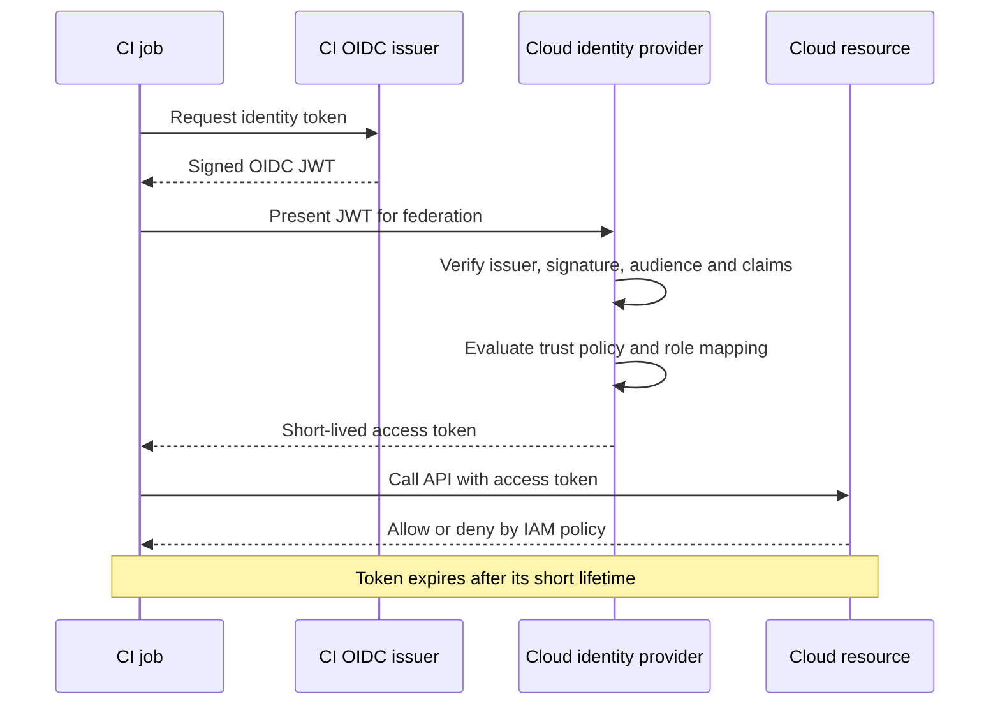
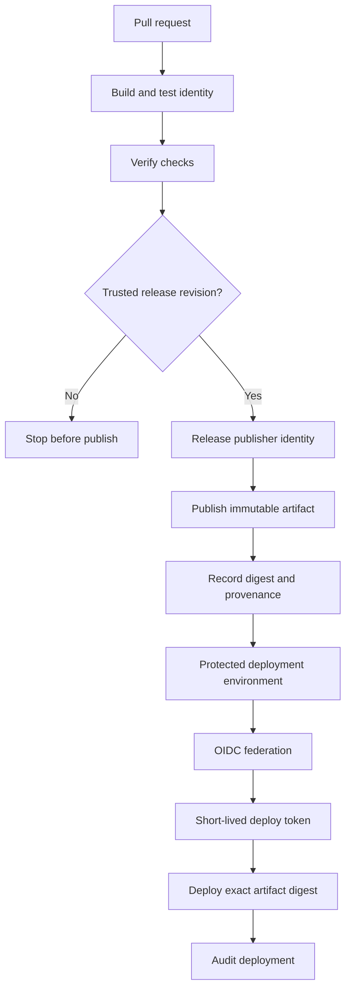

# Using Short-Lived Credentials When Supported by the Platform

A CI/CD pipeline often needs to access resources outside its repository: downloading private dependencies, pushing packages to an artifact registry, reading secrets from a secret manager, building images, or deploying applications to the cloud. The traditional approach is creating an access key or service account password, storing it as a CI secret, and reusing it across many runs.

While this works, it creates a long-lived secret that must be stored, distributed, protected, and rotated. If the token leaks in logs, runners, caches, or an untrusted job, others can use it until it is revoked or expires. When multiple repositories and pipelines share the same credential, tracing usage and limiting blast radius become even harder.

When supported by the platform, use workload identities and short-lived credentials. CI proves a job's identity to the resource provider using an identity federation mechanism, typically based on OpenID Connect (OIDC). The provider verifies the identity and trust conditions, then issues a short-lived token with restricted permissions to the job. The pipeline no longer needs to keep a long-lived access key in its configuration.

The goal is for each workload to receive the exact permissions it needs for the exact duration required, traceable back to the repository, workflow, branch, or environment, and expiring automatically once the work finishes.

## 1. Long-Lived vs. Short-Lived Credentials

Credentials are data or proof used to establish identity or access rights. Examples include passwords, API keys, access tokens, certificates, private keys, or tokens issued via federation.

**Long-lived credentials** typically persist for days, months, or until an administrator actively rotates or revokes them. An example is a static service account access key stored in a CI secret store.

**Short-lived credentials** have a brief validity window and are issued for a specific session or workload. Once expired, the token can no longer be used. A job can request a new token by re-proving its identity per policy.

| Criterion | Long-Lived Credential | Short-Lived Credential |
|---|---|---|
| Lifecycle | Persists until rotated or revoked | Expires automatically after its issued lifetime |
| Storage | Usually requires storing a secret in CI or a secret manager | Can keep only an ephemeral token in job runtime |
| Scope | Easily over-scoped and shared | Can be issued per workload, job, or environment |
| Exposure risk | Can be abused over a long period | Shorter abuse window, though still dangerous while valid |
| Operations | Requires rotation and updating all usage locations | Requires configuring federation, trust policies, and handling token expiry |
| Traceability | Hard to tell which pipeline used a shared credential | Ties identity to repository, workflow, and run |

Short-lived does not mean risk-free. If a still-valid token is stolen, an attacker can use it within its granted permissions until it expires or is revoked. Therefore, combine short lifetimes with least privilege, isolated runners, trigger controls, log protection, and auditing.

## 2. Distinguishing Identity, Authentication, and Authorization

These three concepts are related but answer different questions:

- **Identity:** who or which workload is requesting access?
- **Authentication:** what proof shows that this identity is genuine?
- **Authorization:** what is the authenticated identity allowed to do on which resources?

A pipeline may authenticate successfully and still be denied production deployment. For example, the cloud recognizes that the job comes from the right repository, but the trust policy only allows reading artifacts rather than modifying the cluster.

Clearly separate user identities from workload identities. A developer logging into the cloud interactively is a human principal. A CI runner executing tests or deployments is a workload principal. Do not use an employee's personal access token to represent a pipeline, because their permissions and lifecycle do not match the job's lifecycle.

A sound model assigns distinct identities per purpose: building, publishing artifacts, reading test secrets, and deploying to production. Each identity has different permissions and trust conditions.

## 3. What Is Workload Identity?

Workload identity is an identity assigned to an automated process such as a CI job, service, pod, or background application. It enables the workload to access resources without embedding a long-lived secret in source code or configuration.

In CI/CD, workload identity is typically formed from attributes the CI platform knows about the running job:

- Repository or project.
- Workflow or pipeline definition.
- Branch, tag, or commit.
- Triggering event type, such as push, pull request, or release.
- Target deployment environment.
- Run ID, job ID, or workflow identity.
- Organization or namespace owning the repository.

Resource providers can use these attributes to decide which workloads may assume a role or service account. For example, a job from the `main` branch of a designated repository may publish packages; only a job bound to the `production` environment that has passed approval may deploy to production.

Workload identities should have clear boundaries and never be shared across unrelated projects. If multiple pipelines share a broadly privileged service account, containing the impact of a single compromised pipeline becomes much harder.

## 4. How OIDC and Federation Work

OpenID Connect is an identity layer built on top of OAuth 2.0. In CI/CD, the platform can issue an ID token to a job upon request. The token is typically a JWT containing claims describing the issuer, audience, subject, and workload attributes.

Federation allows one system to trust identities issued by another system without creating and storing a shared password between them. The cloud provider or target service configures trust with the CI platform's issuer, then validates tokens before issuing appropriate credentials.

Conceptual flow:



Key steps:

1. The CI job requests an ID token from the platform's OIDC issuer.
2. The issuer creates a signed token with claims reflecting the job's context.
3. The job sends that token to the federation service of the cloud or resource provider.
4. The recipient checks the signature, issuer, audience, expiration, and claims against the trust policy.
5. If valid, the recipient maps the identity to a role or service account.
6. The job receives a short-lived access token to call APIs.
7. The token expires after its granted duration; the job cannot reuse the old token afterward.

An OIDC ID token and an access token are not the same kind of token. An ID token proves identity to a relying party with a matching audience. An access token is used to access APIs per granted scopes or permissions. Never send an ID token directly to an API merely because it is a JWT; perform the proper token exchange or federation flow supported by the provider.

## 5. Key Claims in an OIDC Token

A JWT contains claims. Trust policies must inspect the right claims to determine which jobs are trusted.

| Claim | Meaning | Usage |
|---|---|---|
| `iss` | Token issuer | Trust only the configured issuer |
| `aud` | Intended audience of the token | Restrict the token to the right relying party or service |
| `sub` | Subject, usually representing workload identity per issuer convention | Bind repository, branch, environment, or context |
| `exp` | Token expiration timestamp | Reject expired tokens |
| `iat` | Token issuance timestamp | Verify freshness and aid investigation |
| `nbf` | Not-before timestamp if used | Reject tokens presented before this time |
| `repository/project` | Repository or project attribute if provided by the issuer | Restrict to the exact code source |
| `ref/branch` | Branch or ref triggering the job | Restrict to release or protected branches |
| `workflow/environment` | Workflow or environment context if provided by the issuer | Restrict to the right pipeline and environment |

Exact claim names depend on the platform. Never assume every issuer emits the same set of claims or the same subject format. Check your CI platform's documentation and the relying party's configuration to see which claims are actually present.

A strong policy checks more than just the repository. If it trusts every job in a repository, jobs triggered by untrusted pull requests or experimental workflows could obtain the same permissions as the release pipeline. Combine repository with branch/ref, event, workflow identity, and environment whenever those claims are available.

## 6. Audience and Subject Must Be Precisely Constrained

**Audience** specifies which recipient the token was issued for. If a token is issued with an overly broad audience or the relying party skips audience validation, the token could be misused in the wrong context.

**Subject** identifies the principal the token represents. Depending on the platform, the subject may encode repository, branch, tag, or environment. Trust policies should match the subject by exact value or a narrow, verified pattern.

For instance, a policy permitting any repository is too broad. A policy permitting only a specific repository and a protected release branch narrows the scope. For production deploys, require a declared and approved production environment in CI.

Do not use broad wildcards for `subject` without understanding every possible matching value. A pattern matching all branches in an organization can unintentionally include experimental branches or branches created by external contributors.

Check the following edge cases:

- Is a forked repository treated as the same identity?
- What subject does a pull request from a fork emit?
- Do jobs triggered from release tags have a different subject than jobs on branches?
- Do reusable workflows or called workflows carry their own identity claims?
- Does the environment claim appear only when the job explicitly declares an environment?
- Do claims change when renaming a repository, organization, or workflow?

Renaming or restructuring pipelines can break trust policy matches. Manage policies through change control and test them after every modification.

## 7. Trust Policies Decide Which Workloads Receive Permissions

A trust policy is a rule on the resource provider side defining which issuers and claims may bind to a role or service account.

A policy typically defines:

- The exact issuer.
- The accepted audience.
- Allowed repositories or projects.
- Allowed branches, tags, or refs.
- Allowed events or workflow types.
- Required environment or deployment context.
- The role/service account mapped to the workload.
- Lifetime and restrictions on the issued credentials.

Trust policies must be enforced on the relying party side, not just via conditions in CI YAML. If there is merely a CI step named `deploy-production` while the cloud role trusts any token from the repository, any workflow capable of requesting a token could attempt to assume that role.

Conceptual policy example:

```yaml
federated_identity:
  issuer: "https://ci.example.com"
  audience: "cloud-deploy"
  subject:
    repository: "team/orders-service"
    ref: "refs/heads/main"
    environment: "production"

role:
  name: "orders-production-deployer"
  permissions:
    - deployment.update
    - deployment.read
  resource_scope:
    - "cluster/orders-production"
```

This is a vendor-neutral model, not direct policy syntax for AWS, Azure, Google Cloud, or any specific platform. Each provider has its own trust conditions, role bindings, and claim mappings.

Never grant account-wide administrative permissions just because a job needs to update one deployment. The trust policy determines who can assume the role; the role's IAM policy further restricts actions and resources.

## 8. Separating Identities by Job Within a Pipeline

A pipeline has multiple stages, and not every stage needs the same permissions.

| Task | Identity to Use | Typical Permissions |
|---|---|---|
| Build and unit test | Build workload | Read dependencies and write output within workspace |
| Read private dependencies | Dependency reader | Pull packages from the required namespace |
| Publish snapshot | Snapshot publisher | Push to the project's snapshot area |
| Publish release | Release publisher | Push releases after conditions are met |
| Read test secrets | Test workload | Read only the test secrets |
| Deploy staging | Staging deployer | Update staging resources |
| Deploy production | Production deployer | Update production resources upon approval |

If all jobs share one role with read, write, artifact delete, and production deploy permissions, a bug in unit tests or a PR workflow can cause far greater impact than its task warrants.

Assign identities by task and restrict permissions by resource. If the platform supports per-job tokens, prefer job scope. If tokens are only issued at the workflow level, minimize the number of jobs with access and avoid passing tokens through outputs or artifacts.

A job that only reads dependencies should not receive publish permissions. A snapshot publish job should not have production deploy permissions. A staging deploy job should not have permission to update production clusters.

## 9. Example: CI Acquiring Identity via OIDC Instead of Static Access Keys

Some CI platforms let jobs request an OIDC token via a dedicated permission or capability. The YAML example below illustrates how a GitHub Actions workflow enables token issuance and restricts triggers:

```yaml
name: Deploy staging

on:
  push:
    branches: [main]

permissions:
  contents: read
  id-token: write

jobs:
  deploy:
    runs-on: ubuntu-latest
    environment: staging
    steps:
      - name: Checkout
        uses: actions/checkout@v4

      - name: Authenticate with cloud using OIDC
        uses: cloud-provider/login@v1
        with:
          audience: cloud-deploy
          role: orders-staging-deployer

      - name: Deploy
        run: ./scripts/deploy-staging.sh
```

The provider action and inputs in this example are illustrative placeholders. Replace them with official actions, organization-approved versions, and real federation configuration. In production environments, pin third-party actions by verified commit SHA rather than relying solely on mutable tags.

Key points:

- The job receives `id-token` permission only when federation is required.
- Triggers are restricted to the `main` branch.
- The `staging` environment can enforce separate protection rules.
- The cloud role permits operations on staging only.
- No static access keys are stored in repository secrets for this flow.

The `id-token: write` permission only allows the job to request a token from the issuer; it does not grant cloud access by itself. Actual access still depends on trust policies and IAM policies on the cloud side.

## 10. Example of Environment-Based Trust for Production

Production deployments usually require stronger conditions than staging deployments. You can require jobs to target the `production` environment, with approvals, reviewers, or branch restrictions enforced by organizational policy.

Conceptual example:

```yaml
jobs:
  deploy-production:
    environment: production
    permissions:
      contents: read
      id-token: write
    steps:
      - name: Obtain federated identity
        run: request short-lived cloud credentials

      - name: Deploy verified artifact
        run: deploy artifact by immutable digest
```

CI approval steps and cloud trust policies complement each other. Approvals control whether the job is allowed to run in the environment; the trust policy verifies that the token genuinely carries an authorized identity and claims. Do not rely solely on job names or environment variables self-declared by the workflow.

When supported by the platform, the subject or claims should bind to the protected environment. If the environment claim is absent or cannot distinguish environments, use another trustworthy condition or redesign the workflow so the relying party can verify the context.

## 11. Token Lifetime, Refresh, and Timing of Use

Short-lived tokens limit the exploitation window if compromised. However, the lifetime must be long enough to finish the expected task without unnecessary extension.

Key principles:

- Request tokens only immediately before calling the service that requires access.
- Do not fetch tokens prematurely at the start of a workflow and hold them across multiple jobs.
- Use the shortest access token lifetime under which the workflow operates reliably.
- For long-running tasks, use refresh or re-federation mechanisms per policy rather than storing long-lived tokens.
- Never write tokens to artifacts, caches, or logs.
- Clean up temporary credential variables and files when the job finishes if tools do not clean them automatically.
- Do not pass tokens via outputs between jobs when downstream jobs can authenticate with their own identities.

Tokens can expire mid-way through a long operation. Clients should handle expiration errors by acquiring fresh credentials via federation and retrying safely if the API supports idempotency. Never blindly retry an operation with side effects without knowing whether the previous attempt completed.

Clock skew can cause tokens to be rejected due to `exp`, `nbf`, or `iat` checks. Runners must maintain synchronized time. When investigating token errors, inspect timestamps and non-sensitive claims without printing the entire token to logs.

## 12. Fetching Secrets from a Secret Manager Using Workload Identity

Federation is not limited to direct cloud resource access. Workload identity can also authenticate pipelines to a secret manager to retrieve only the required secrets.

Example flow:

1. The CI job obtains an OIDC token from the issuer.
2. The secret manager verifies the issuer, audience, and claims.
3. The secret manager maps the job to a policy allowing reads of a specific group of secrets.
4. The job receives the needed secret, potentially as a lease or time-bound secret.
5. The job uses the secret in the target process while keeping it out of logs.
6. The lease or credential expires; the job ends and access is no longer retained long-term.

Distinguish the authentication token from the application secret retrieved afterward. Using OIDC does not automatically make every secret inside the secret manager short-lived. If the secret manager returns a long-lived database password, the pipeline is still handling a long-lived secret. Consider dynamic secrets or temporary credentials when supported by the target system.

Read only the exact secrets required. Build jobs should not read production database passwords; test jobs should read only test credentials; deployers may need permission to update environments without needing to read application business secrets.

## 13. When the Platform Does Not Support Federation

Not every CI platform, registry, or service supports OIDC/workload identity. When federation is unavailable, static credentials may be needed during a transition period.

If long-lived credentials must be used:

- Create a dedicated service account for each project or purpose.
- Grant least-privilege permissions and restrict resources.
- Store secrets in the CI platform's protected secret store.
- Never store secrets in source code, committed config files, images, or artifacts.
- Do not print secrets to logs or pass them in command-line arguments whenever avoidable.
- Rotate on schedule and after any suspected exposure incident.
- Track creation date, owner, usage locations, and expiration date.
- Revoke old credentials once consumers have switched to new ones.
- Separate staging and production credentials.
- Grant access only to trusted workflows and environments.

You can reduce risk by using short-lived tokens issued by a secret manager or broker system, even when the target service does not support federation directly. An internal broker can verify workload identity and issue short-lived credentials per policy if architecture and operational capacity allow.

Do not create a single organization-wide access key just because a few legacy systems lack federation support. Keep scopes small so revocation or rotation does not disrupt unrelated projects.

## 14. Protecting OIDC Tokens and Access Tokens in CI

An OIDC token can be requested by any job holding the appropriate permission. If untrusted code runs in the same job or can inspect the process environment, it can grab the token and use it while valid.

Safeguards:

- Do not grant `id-token` permissions to jobs that do not need federation.
- Separate untrusted PR validation workflows from publish/deploy workflows.
- Do not run scripts from unreviewed pull requests inside jobs with production privileges.
- Use ephemeral runners for untrusted code and avoid reusing filesystems across jobs of different trust levels.
- Never store tokens in workspaces or artifacts.
- Restrict read access to processes, environments, and filesystems between processes.
- Do not enable shell tracing or debug logging when handling tokens.
- Restrict job network egress where possible.
- Pin and review actions, plugins, or reusable workflows that have permission to request tokens.
- Carefully inspect called workflows and the permissions they receive.

Pay special attention to triggers that execute in a privileged context while checking out code from untrusted pull requests. A workflow with write permissions or OIDC tokens can be exploited if it runs scripts controlled by outsiders. Separate untrusted code validation from privileged steps, or require approval and execute only on reviewed revisions.

## 15. Trust Policy Does Not Replace IAM Policy

Federation answers which workload may assume a role. The role's IAM policy or access policy answers what that role is allowed to do.

For example, a trust policy might allow only jobs from the `orders-service` repository, `main` branch, and `staging` environment to assume `orders-staging-deployer`. The role's IAM policy then restricts it to updating only that service's deployment in the `staging` namespace.

If the trust policy is too broad, unwanted workloads can assume the role. If the IAM policy is too broad, even a trusted workload can do far more than necessary. Both layers must be constrained.

Evaluate a configuration from two angles:

- **Who can obtain the identity?** Check issuer, audience, subject, repository, branch, workflow, and environment.
- **What can that identity do?** Check actions, resources, conditions, regions, namespaces, and data boundaries.

Do not use broad administrative privileges merely to avoid identifying specific permissions. If an API requires an additional permission, add only that exact action and resource after verifying why it is needed.

## 16. Identities per System and per Environment

A project typically interacts with multiple targets: artifact registries, cloud accounts, Kubernetes clusters, secret managers, databases, and external APIs. Each system should have its own trust relationships and permissions.

Example:

| Target System | Identity | Scope |
|---|---|---|
| Maven repository | Java package publisher | Push to the project's group/package |
| OCI registry | Image publisher | Push to a specific image repository |
| Test secret manager | Test workload | Read secrets with `test` prefix |
| Staging Kubernetes | Staging deployer | Update `staging` namespace |
| Production Kubernetes | Production deployer | Update `production` namespace after approval |
| Cloud storage | Build artifact writer | Write to build output bucket or prefix |

Do not reuse the same cloud role across all environments just to simplify configuration. Staging and production carry different blast radii. Separate identities allow revoking production access without breaking test pipelines.

If a workflow needs multiple services, it can federate multiple times with different audiences or roles. Request tokens only when reaching the step that needs them and avoid passing one service's credentials to another job.

## 17. Auditing and Traceability

A major advantage of workload identity is that provider-side logs record the exact principal or role used. Combined with CI claims and metadata, teams can trace actions back to the exact run.

Record or correlate:

- Repository and project.
- Workflow/pipeline and revision of the configuration file.
- Run ID, job ID, and trigger event.
- Branch, tag, or environment.
- Verified subject and issuer.
- Mapped role/service account.
- Accessed resources and APIs.
- Token issuance time, usage time, and outcome.
- Related artifact digest or deployment revision.

Never write full JWTs or access tokens to logs purely for traceability. Instead, log only the necessary non-sensitive claims or identifiers for principal, run, and role per logging policy.

Audits should answer: which job published the package, which job read the secret, who deployed to production, and which run performed that action? If all pipelines share one credential, answering these questions may require correlating multiple log sources and still fail to pinpoint the exact workload.

## 18. Revocation, Expiration, and Compromised Token Response

Short-lived credentials expire automatically, yet when a token leaks, assess whether early revocation is possible. Some systems support revoking sessions, disabling roles, updating trust policies, or blocking specific issuers/subjects. Exact mechanisms vary by provider.

An incident response procedure should include:

1. Identifying the potentially affected token or principal, role, and resources.
2. Revoking or disabling the credential/session if supported by the platform.
3. Temporarily tightening the trust policy or role permissions if necessary.
4. Stopping workflows or runners showing signs of compromise.
5. Inspecting audit logs to determine which APIs and resources were accessed.
6. Rotating any long-lived secrets that the workload could have read.
7. Restoring a safe trust policy once the root cause is resolved.
8. Documenting the incident and improving permission boundaries or runner isolation.

Do not assume deleting a token from logs invalidates it. While valid, treat it as a compromised credential. Any long-lived secret that was read must be rotated or revoked immediately per the secret-owning system's procedure.

## 19. Common Federation Configuration Errors

| Error | Symptom | Troubleshooting Step |
|---|---|---|
| Issuer mismatch | Relying party rejects the token | Compare exact issuer URL with trust configuration |
| Wrong audience | Valid token is rejected | Check `aud` requested by the job vs. expected by relying party |
| Subject too broad | Unintended workloads can assume role | Narrow subject by repository, ref, and environment |
| Subject too narrow or wrong format | Legitimate job fails to get credentials | Inspect actual claims issued by the issuer |
| Token expired | API returns authentication error | Check `exp`, job duration, and refresh logic |
| Runner clock skew | Token rejected as not yet valid or already expired | Synchronize runner system clocks |
| Role lacks permissions | Authentication succeeds but API returns deny | Check IAM policy and resource scope |
| Job lacks permission for OIDC token | CI fails to issue ID token | Grant required capability to the specific job |
| Reusable workflow alters claims | Trust policy stops matching | Inspect actual subject/claims and update via review |
| Fork PR granted release permissions | Trust boundary violated | Separate workflows, triggers, and trust conditions |
| Using ID token directly against API | API rejects token or sees wrong audience | Use the proper token exchange mechanism |
| Token leaked in logs | Valid token could be replayed | Stop job, revoke if possible, and investigate |

When debugging, inspect metadata or non-sensitive claims using safe internal tools. Never paste full JWTs into public decoder websites or submit tokens to unapproved tools. A JWT can contain identifying details and remains a usable credential throughout its validity window.

## 20. Example: Least-Privilege Artifact Publish and Deploy Flow

A Java pipeline can be divided into three identities:

- The build job only needs to read dependencies and produce a JAR.
- The publish job assumes a role permitted only to push to the Maven release repository once tests and approvals pass.
- The deploy job assumes a separate role to deploy the verified digest to the target environment.

Conceptual flow:



The build identity has no permission to publish releases. The release publisher has no permission to deploy to production. The deployment identity has no permission to overwrite artifacts. Separating permissions ensures each step can perform only its required action.

If the pipeline fails after publishing but before deployment, the artifact can still be retained and verified. When the deploy job retries, it pulls the exact recorded digest and obtains fresh credentials via federation.

## 21. Plan for Migrating from Static Secrets to Short-Lived Credentials

You do not need to change every pipeline at once. Migrate one target system at a time:

1. **Inventory existing credentials:** identify which secrets are used by which workflows, repositories, environments, and APIs.
2. **Identify issuers and support:** check whether CI, cloud, registries, or secret managers support OIDC/workload identity.
3. **Create trust providers:** configure issuers, audiences, and claim mappings on target services.
4. **Create specialized roles:** grant exact actions and resources for a single task.
5. **Test in staging:** use controlled branches and environments to verify federation works.
6. **Verify audits:** ensure logs accurately identify repository, workflow, run, and role.
7. **Switch workflows:** remove static credentials from jobs once the short-lived flow works reliably.
8. **Revoke old credentials:** only after confirming no consumers still depend on them.
9. **Expand by group:** migrate remaining registries, secret managers, and environments.
10. **Review periodically:** check trust conditions, role permissions, token lifetimes, and unused identities.

Do not delete static secrets before confirming all consumers have migrated. Equally, do not leave old credentials active indefinitely after migration completes. Track owner, deadline, and status for every credential during the transition.

## 22. Short-Lived Credentials Design Checklist

- [ ] Identify workloads and the resources they need to access.
- [ ] Use dedicated workload identities rather than employees' personal tokens.
- [ ] Establish clear trust relationships between the CI platform and target services.
- [ ] Verify issuers accurately.
- [ ] Restrict audiences to the exact relying party.
- [ ] Restrict subjects/claims to the required repository, branch, workflow, or environment.
- [ ] Enforce least privilege in both trust policies and IAM policies.
- [ ] Request tokens only in the job and at the exact time needed.
- [ ] Keep access token lifetimes short and aligned with the task.
- [ ] Provide safe re-authentication mechanisms for long-running jobs.
- [ ] Ensure fork workflows and untrusted PRs receive no release/production permissions.
- [ ] Isolate runners and workspaces by trust level.
- [ ] Ensure tokens never appear in logs, artifacts, caches, or cross-job outputs.
- [ ] Maintain audit logs linking principals to pipeline runs.
- [ ] Maintain procedures for handling leaked tokens and remaining long-lived credentials.
- [ ] Ensure fallback static credentials have owners, narrow scopes, expiry, and rotation schedules.

## Conclusion

Short-lived credentials allow CI/CD to access resources without maintaining long-lived access keys inside pipeline configurations. With OIDC and federation, a job proves its identity via a trusted issuer, the relying party validates audience and claims, and short-lived access tokens bound to narrowly scoped roles are issued.

Effectiveness depends on well-designed trust policies and IAM policies. Restrict trusted repositories, branches, workflows, and environments; separate identities by responsibility; protect tokens on runners; audit usage; and revoke old credentials after migration. Where platforms do not yet support federation, use secret stores and narrowly scoped static credentials with explicit lifetimes and rotation processes until short-lived mechanisms can be adopted.
