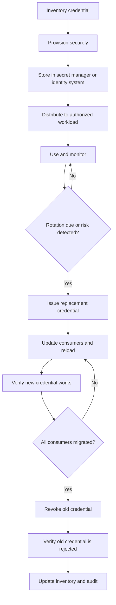
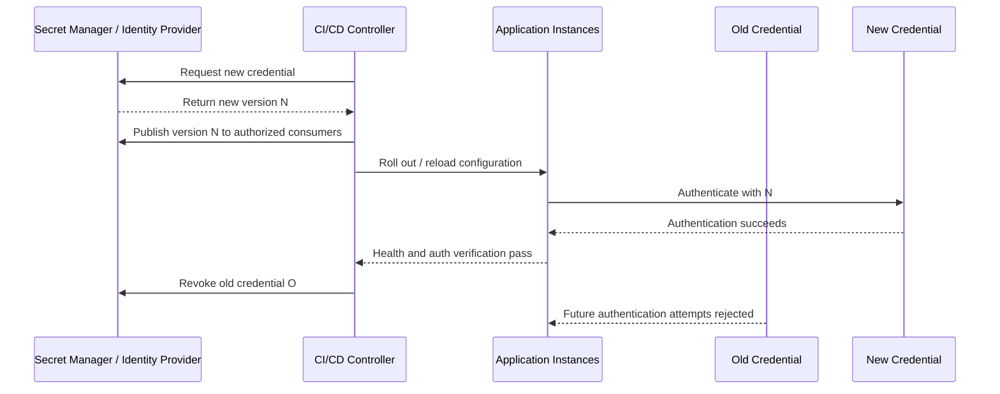
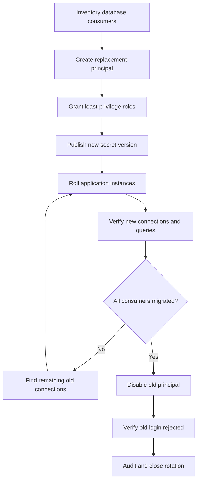
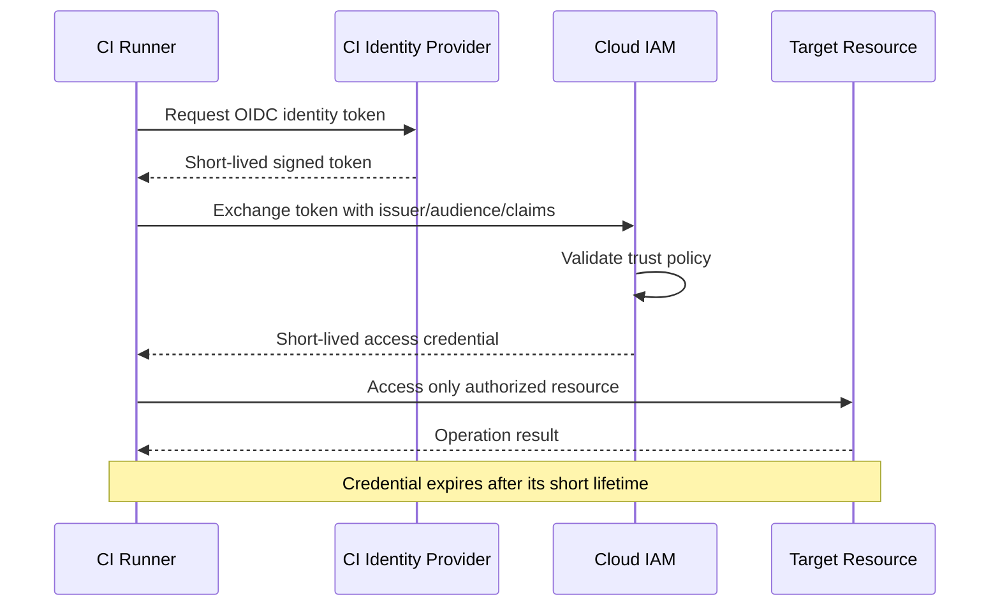

# Credential Rotation, Revocation, and Verification

A token leaked in CI logs, a database password left unchanged for years, or an expired certificate can disrupt an entire release pipeline. In CI/CD, credentials appear across many places: runners, secret managers, registries, cloud accounts, clusters, databases, external APIs, and running applications. Merely changing a value in a pipeline variable is not enough to guarantee the old credential is invalidated or that every component is using the new one.

**Rotation, revocation, and verification are three interconnected activities in the credential lifecycle.** Rotation replaces an active credential with a new one through a controlled process. Revocation ensures a credential is no longer accepted when it expires, is no longer needed, or shows signs of exposure. Verification confirms that workloads, jobs, and services have genuinely switched to the new credential, the old credential is rejected, and operations remain healthy.

A mature process knows which credentials exist, who owns them, where they are used, what permissions they hold, when they must change, how to transition without downtime, and how to handle emergencies upon compromise. The goal is shrinking the window in which credentials can be abused, limiting blast radius, and maintaining traceability throughout delivery.

## 1. Distinguishing Rotation, Revocation, and Verification

These three activities are typically executed together, yet they solve distinct problems.

| Activity | Goal | Example |
|---|---|---|
| Rotation | Replace an active credential with a new one, update consumers, and shift traffic/access to the new credential | Create a new database password, update the secret version, roll out the app, then disable the old password |
| Revocation | Render a credential unacceptable or strip its ability to access resources | Revoke a leaked token, disable an access key, revoke a certificate, or remove service account permissions |
| Verification | Confirm the change took effect and no path remains using the old credential | Verify login succeeds with the new credential, the old credential is rejected, and new workloads reloaded the secret |

Rotation is not synonymous with revocation. In some systems, two credentials may remain valid simultaneously during a transition window to prevent downtime. Once all consumers have migrated to the new credential, the old one is revoked. If the old credential is compromised, that overlap window must be shortened or skipped per containment plans.

Verification is also more than checking that the secret manager saved a new version. Applications may retain old credentials in memory, connection pools, config files, or environment variables of running processes. Verification must happen from the perspective of the actual credential consumer.

## 2. The Credential Lifecycle

Every credential needs a clear lifecycle from creation until revocation and cleanup of related traces.

1. **Inventory:** record credential type, owner, purpose, consumers, permissions, and environment.
2. **Provision:** create credentials from a trusted source, preferring automated generation and sufficiently strong random values.
3. **Store:** save in a secret manager or identity management system with access controls.
4. **Distribute:** provide credentials to workloads just-in-time, within scope, and under least privilege.
5. **Use and monitor:** track usage, access sources, permissions, and anomalous activity.
6. **Rotate:** issue a replacement credential, transition consumers, and verify operation.
7. **Revoke:** invalidate old or compromised credentials.
8. **Retire and audit:** remove unneeded copies, store audit evidence, and update the inventory.



If a credential is suspected of exposure, do not wait for the scheduled rotation date. Switch to incident response: isolate, revoke or disable promptly per system capabilities, issue a replacement credential, investigate trails, and verify unauthorized access has ceased.

## 3. Building a Credential Inventory

You cannot safely rotate a credential if you do not know where it is used. An inventory provides the foundation for scoping updates and avoiding missed consumers.

Each record should include:

| Field | Meaning |
|---|---|
| Credential ID | Identifier containing no secret value |
| Type | API token, database password, cloud key, SSH key, certificate, signing key, etc. |
| Owner | Responsible team or service |
| Consumers | Jobs, runners, applications, or services using it |
| Environment | Development, test, staging, or production |
| Scope/permissions | Accessible permissions and resources |
| Source of truth | Secret manager, identity provider, KMS, or issuing system |
| Created/expiry/last rotated | Creation, expiration, and last rotation timestamps |
| Rotation method | Automated, dual credential, rolling update, or controlled manual procedure |
| Revocation method | Disable key, revoke token, delete role, revoke certificate, etc. |
| Evidence | Change history, last used, verification, and audit events |

Never record real secret values in the inventory. Store only reference names, versions, fingerprints, or system-assigned IDs. Inventories can be partially automated from secret managers, cloud IAM, certificate inventories, and deployment metadata, but owners must confirm actual consumers.

### Detecting Ownerless Credentials

A credential without an owner or unexplained usage is a risk. It may be an old key retaining access, a departed employee's credential, or a key created manually outside standard processes. Attach alerts and a verification deadline; revoke only after evaluating consumers and impact to avoid breaking dependent services.

## 4. Choosing a Rotation Strategy by Credential Type

No single rotation procedure fits every credential type. Transition mechanics depend on the issuing system, support for concurrent credentials, caches, sessions, and how workloads reload values.

| Credential Type | Common Rotation Approach | Points to Verify |
|---|---|---|
| API token | Create new token, update consumers, verify, revoke old token | Scope, audience, expiry, consumers reloaded |
| Database password | Create new principal/password or dual-password setup, update connections, drain pools, revoke old | All instances use new credential; old connections closed |
| Cloud access key | Create new key or migrate to workload identity, roll out consumers, then disable old key | Audit logs show zero old-key usage; new permissions match scope |
| OAuth client secret | Create a second secret if supported by provider, update clients, verify token flow | All client instances switched; old secret disabled |
| SSH key | Add new public key to authorized locations, switch clients, remove old key | No remaining automation or users require old key |
| TLS certificate | Issue new certificate, distribute chain, reload endpoints, revoke old certificate when needed | Chain, hostname, expiry, client trust, and live endpoints |
| JWT signing key | Issue new key, publish public key, sign new tokens, keep old public key until old tokens expire | `kid`, JWKS cache, token lifetime, and consumer validation |
| Encryption key | Use new key version for new writes, re-encrypt old data per plan | Ability to decrypt old data, backups, and key version mapping |
| CI runner credential | Prefer OIDC/short-lived credentials; if static key, issue new and update runners | Runner image, secret scope, active jobs, and audit |

Credentials capable of short-lived issuance via workload identity greatly reduce manual rotation needs. Instead of keeping a long-lived access key in CI, pipelines exchange OIDC tokens for short-lived credentials scoped by repository, branch, environment, or service account.

## 5. Designing Zero-Downtime Rotation

For live services, swapping credentials instantaneously can cause un-updated instances to lose connectivity. A common strategy is establishing a controlled transition window.

### Dual Credential Pattern

If the system supports multiple concurrent credentials, execute:

1. Create a new credential with equivalent or narrower permissions than the old one.
2. Store the new credential in the secret manager under a new version.
3. Update consumers in batches or via rolling deployment.
4. Verify updated consumers authenticate successfully.
5. Monitor audit logs to detect any consumer still using the old credential.
6. Revoke the old credential once all required consumers have switched.
7. Verify the old credential is rejected and update the inventory.



Dual credentials work only when the issuing system allows two credentials to be valid simultaneously. Never assume a database, OAuth provider, or external API supports this. If only one credential is allowed at a time, use an alternative transition such as a secondary principal, a maintenance window, or migration to workload identity.

### Rolling Rotation Pattern

With multiple instances, rotate in batches:

- Update the secret version.
- Restart or reload a batch of instances.
- Verify connectivity and health.
- Proceed to the next batch.
- Once every instance has switched, revoke the old credential.

During the transition window, both credentials may remain valid. Keep this window short, monitored, and strictly time-bound. Never leave an old credential active indefinitely just because an infrequently active consumer has not yet been identified.

## 6. Rotating Database Credentials

Database credentials are often harder to rotate than API tokens because connection pools hold long-lived connections. Changing a password in the secret manager does not automatically switch existing connections to the new password.

### Recommended Procedure

1. Identify every application, migration job, reporting job, and operator using the principal to be replaced.
2. Check whether the database supports multiple principals or concurrent passwords.
3. Create a new principal with least-privilege permissions; where appropriate, grant equivalent access via role inheritance rather than ad-hoc permission copying.
4. Update the secret manager and workload configuration references.
5. Perform a rolling restart or reload connection pools to open fresh connections with the new credential.
6. Verify queries, transactions, migrations, and health checks across instances.
7. Monitor audit logs and connection metadata for connections still using the old principal.
8. Disable or revoke the old principal once confirmed no legitimate consumers remain.
9. Verify a new connection attempt with the old credential is rejected and a connection with the new credential succeeds.

If a database only allows changing the password on a single principal, changing it may immediately break new connections using the old password. Plan synchronized updates, understand how connection pools handle existing connections, and pick a window allowing rollback or recovery. Some platforms support dual passwords or built-in secret rotation; verify exact behavior before adopting.

### Example Deployment Sequence



Do not delete the old principal simply because a single deployment succeeded. Check scheduled jobs, batch processes, migration runners, or low-frequency consumers that might connect only after hours or days.

## 7. Rotating API Tokens and OAuth Client Secrets

API tokens are typically stored in applications, runners, or integrations. Know which identity owns the token, its scope, its audience, and which consumers use it.

Rotation workflow:

- Generate a new token for the exact identity with least-privilege scope.
- Update the secret reference or version in the secret manager.
- Deploy/reload all consumers.
- Verify new requests authenticate with the new token.
- Monitor logs to see whether the old token is still being used.
- Revoke the old token and verify requests using the old token are rejected.

For OAuth client secrets, check whether the authorization server supports multiple active secrets per client. If so, use a short overlap window. If not, coordinate change timing and client rollouts so all instances do not simultaneously hold an invalidated secret.

Tokens should have appropriate expiry, narrow scope, and clear audience. Avoid using one administrative token across multiple pipelines or services, as it obscures which consumers need updating during an incident.

## 8. Rotating SSH Keys and Certificates

### 8.1. SSH Keys

Automation SSH keys may access Git servers, deployment hosts, or bastion/admin servers. Safe rotation typically includes:

1. Generating a new key pair in a protected environment.
2. Registering the new public key on the exact target account or host.
3. Updating the pipeline's secret store or agent to use the new private key.
4. Testing connectivity from runners and verifying the mapped identity.
5. Removing the old public key from authorized locations.
6. Verifying the old key is no longer accepted.

Never place private keys into repositories or artifacts. If an old key leaks, revoke it immediately on every affected host or account and inspect login logs—do not wait for a full new-key rollout while active risk persists.

### 8.2. TLS Certificates

Certificates have expiration dates and trust chains. Rotation must account for issuance time, distribution, endpoint reload, caching, and client trust.

- Issue a new certificate with the proper SANs, key usage, issuer, and validity period.
- Distribute the certificate and private key over a secure channel.
- Install the new certificate on load balancers, ingresses, or services.
- Reload or rolling-restart so endpoints begin serving the new certificate.
- Verify from the client perspective: hostname, chain, expiry, and protocol.
- Monitor whether any endpoint still serves the old certificate.
- Revoke the old certificate when required or per CA policy.

Do not check only the certificate file on disk. A process may retain the old certificate in memory, or another load balancer may remain un-updated. Verify every live endpoint and deployment zone.

### 8.3. Certificate Revocation

Certificate revocation can use CRL or OCSP depending on the CA and ecosystem. Not all clients check revocation uniformly or immediately. When handling a compromised certificate, replace the certificate, update trust stores, and check how clients validate revocation status. If the private key was compromised, issuing a new certificate while reusing the old private key does not solve the problem.

## 9. Rotating JWT Signing Keys and Encryption Keys

Signing keys and encryption keys carry broad blast radius because they may be used by multiple services and embedded in existing tokens or stored data.

### 9.1. JWT Signing Keys

When rotating asymmetric JWT signing keys, the workflow typically includes:

1. Generating a new key pair in KMS or a key management system.
2. Publishing the new public key via JWKS or a trusted distribution mechanism.
3. Waiting for verifiers to fetch the new public key and refresh caches.
4. Switching the issuer to sign new tokens with the new key and matching `kid`.
5. Monitoring verifiers accepting newly signed tokens.
6. Retaining the old public key while previously issued tokens remain valid and may be presented to verifiers.
7. After old tokens and caches expire, removing the old public key from JWKS per policy.

If the old key is compromised, evaluate invalidating tokens signed with that key. Simply removing the public key from JWKS may be insufficient if verifiers cache keys or skip checks. You may need a `kid` denylist, session revocation, shorter token lifetimes, or forced user re-authentication.

### 9.2. Encryption Keys

Encryption keys have a more complex lifecycle because historical data may still be encrypted under previous versions. A common strategy:

- Use the new key version for new writes.
- Keep old keys in decrypt-only mode during transition.
- Batch re-encrypt historical data if required by policy.
- Verify both new and old data remain readable throughout transition.
- Disable/destroy old keys only after confirming no data, backups, or replicas still require them for decryption.

Never revoke or destroy old encryption keys prematurely. If backups still depend on an old key, losing it renders data unrecoverable. Conversely, if a key leaks, evaluate re-encryption and control over data copies per your incident plan.

## 10. Credentials for CI/CD: Prefer Workload Identity

CI/CD frequently needs access to clouds, container registries, package repositories, and deployment environments. A static, broadly privileged access key stored in pipeline variables is an attractive target if a runner or workflow is compromised.

### Workload Identity and OIDC

With OIDC federation, a runner obtains an identity token from the CI platform. The cloud or target service verifies issuer, audience, and claims, then issues short-lived credentials to the job.



Trust policies must enforce sufficiently strict bindings, such as repository, branch, tag, workflow, environment, or subject claims. Never trust a shared issuer blindly when multiple unrelated repositories or workflows use that issuer.

Benefits:

- Reduces or eliminates long-lived secrets in CI.
- Credentials expire automatically after the job or a short window.
- Permissions can be scoped by workload and environment.
- Audit logs can tie operations directly to the job's identity.

OIDC does not guarantee security automatically if the trust policy is overly broad. If an untrusted workflow can request an identity token matching the conditions, it can still obtain permissions. Protect workflows, branches, and environments alongside IAM policies.

### When Static Credentials Are Still Necessary

Some legacy systems or external services do not yet support workload identity. In such cases:

- Create separate credentials per integration or environment.
- Restrict scope, IP, resources, and allowed actions where supported by the service.
- Store them in a secret manager—never in source code.
- Set expiration dates and rotation schedules.
- Never share credentials across multiple repositories or teams.
- Monitor last-used timestamps, audit logs, and alerts for inactive credentials.
- Maintain an emergency revocation runbook and clear ownership.

## 11. Revoking Credentials When Exposed or Suspected of Compromise

Whenever a secret appears in repositories, logs, artifacts, tickets, or chat, treat it as a potential security incident. Deleting the visible text does not invalidate the credential. Copies may persist in Git history, archived logs, caches, artifacts, or downloads.

### Containment Procedure

1. Identify credential type, owner, scope, timestamp, and exposure location.
2. Assess who could have accessed the credential and whether it remains valid.
3. Revoke/disable the exposed credential or restrict its permissions immediately per urgency.
4. If service continuity is required, issue a replacement credential and migrate consumers on an expedited track.
5. Inspect audit logs for anomalous usage, source IPs, accessed resources, and executed actions.
6. Rotate other credentials that may have been exposed via the same access path or privilege level.
7. Remediate copies in repositories, logs, artifacts, and caches per policy.
8. Verify the old credential is rejected and legitimate workloads operate with the new credential.
9. Document the incident, root cause, and preventive actions.

### Deleting Secrets from Git History Does Not Replace Revocation

If a secret was committed, revoke or rotate it first. Only afterward evaluate rewriting Git history and removing copies in forks, clones, caches, or artifacts. Rewriting history can affect commit SHAs, pull requests, and existing clones; coordinate via repository governance procedures. Even after history is scrubbed, the old credential must remain treated as compromised.

### When Immediate Revocation Is Required

- A credential is confirmed exposed publicly or in a location readable by unauthorized parties.
- Signs of anomalous login or API access appear.
- Personnel or workloads are no longer authorized to use the credential.
- A private key is lost or suspected of being copied.
- A broadly privileged credential leaks and exposure scope cannot be bounded.

For high-impact credentials, prioritize containment first and restore service according to plan. Never delay revocation purely to preserve a zero-downtime rotation when abuse risk is high.

## 12. Verification After Rotation and Revocation

A procedure is complete only when evidence exists on both the credential provider side and the consumer side.

### Verifying the New Credential

- The secret manager serves the exact new version to authorized workloads.
- Applications or runners have reloaded/restarted and no longer hold the old value.
- A real, narrowly scoped operation succeeds using the new credential.
- All instances, regions, runner pools, and scheduled jobs have transitioned.
- Audit logs record the new identity or key being used.
- Health checks and business functionality remain passing.

### Verifying the Old Credential

- The provider has disabled/revoked the old key or identity.
- A test authentication attempt with the old credential is rejected in a safe test environment.
- No legitimate requests continue using the old credential after the cutover window.
- No active deployment still references the old secret version.
- No remaining processes, caches, or runners require the old credential.

Never test an exposed credential by passing real values on the command line, into shell history, or into logs. Use safe test environments or provider administrative APIs to verify revoked status without re-exposing the secret.

### End-to-End Verification

Some credentials are cached across multiple layers: processes, sidecars, proxies, connection pools, agents, or service meshes. Checking that the secret manager updated does not prove every layer received the new version. Verify live endpoints, deployment revisions, fresh connections, and access logs.

## 13. Rotation Schedules and Credential Lifetimes

Rotation schedules should be based on credential type, privilege level, availability of short-lived issuance, compliance requirements, and risk. Do not pick one fixed interval for every secret.

| Type | Preferred Risk Reduction | Lifetime Policy Considerations |
|---|---|---|
| Workload token | Short-lived tokens auto-issued per job | Lifetime just long enough for task, with narrow audience/scope |
| Static API key | Replace with OAuth/OIDC if possible; otherwise periodic rotation | Interval based on privilege, exposure, and rotation feasibility |
| Database credential | Dedicated principal per service, secret manager, and auto-rotation | Balance rotation schedule against connection lifecycle |
| SSH automation key | Prefer certificates / short-lived SSH certificates | Short lifetime and clear host/account inventory |
| TLS certificate | Automated issuance and renewal prior to expiry | Per CA policy and endpoint reload capabilities |
| Signing key | Managed via KMS/HSM, key versioning, and controlled overlap | Per threat model, algorithm, and token/data lifetime |
| Encryption key | Versioning, decrypt-only old keys, and re-encryption plan | Depends on data retention and backups |

Beyond scheduled intervals, trigger event-driven rotation upon: staff departures, permission changes, runner compromise, secret commits, vendor changes, or detected anomalous activity.

## 14. Managing Caches, Sessions, and Long-Lived Connections

A common reason rotation fails is that consumers do not re-query the credential provider after a secret updates.

Places to inspect:

- Environment variables loaded only at process startup.
- Mounted config files where the application does not watch for changes.
- Connection pools retaining previously authenticated connections.
- OAuth access tokens cached in memory or on disk.
- JWKS clients caching old public keys.
- Sidecars or proxies holding their own certificates and credentials.
- Runner services holding tokens past job completion.
- Cron jobs or infrequent workers fetching secrets only at task start.

Each cache type needs a refresh policy, TTL, and invalidation mechanism. Rotation may require rolling restarts, reload signals, draining connection pools, or waiting for old tokens to expire. Do not delete an old secret version before confirming consumers have stopped reading it.

For JWTs, retention of old public keys must account for token lifetime plus verifier caches. For databases, distinguish already-open connections from new authentication attempts: an old credential may keep an existing session alive while failing for new connections. Verification must cover both cases.

## 15. Protecting Secrets in Logs, Artifacts, and Pipelines

Rotation manages credentials over time; leak prevention must be built into how pipelines consume secrets.

- Never echo secrets or enable debug logging on commands that could print credentials.
- Avoid passing secrets directly via CLI arguments where process lists or logs can capture them.
- Prefer temporary files with restricted permissions or platform-supported secret mounts.
- Log masking is a risk-reduction layer, not a guarantee; encoding or splitting strings can bypass masking.
- Never upload entire workspaces without filtering secrets and sensitive data.
- Avoid placing credentials in Docker build arguments or image layers whenever avoidable.
- Never share credential-bearing caches across repositories or trust boundaries.
- Clean up temporary credential files and revoke sessions after jobs finish.
- Run secret scanning on diffs and periodically across repositories.

If a secret prints to logs, determine where logs are stored, replicated, or forwarded externally. Revoke the credential first, then remediate log records per retention and incident policies.

## 16. Example Automated Rotation Flow in CI/CD

The following YAML describes a conceptual workflow. It is not direct syntax for a specific CI/CD platform:

```yaml
credential_rotation:
  trigger:
    - scheduled_rotation_due
    - security_incident
    - manual_approved_request

  jobs:
    inventory:
      steps:
        - resolve_credential_owner
        - list_authorized_consumers
        - inspect_current_version_and_expiry

    issue_replacement:
      needs: [inventory]
      steps:
        - create_replacement_credential
        - assign_least_privilege_scope
        - store_new_secret_version

    migrate_consumers:
      needs: [issue_replacement]
      steps:
        - update_secret_reference
        - roll_or_reload_consumers
        - verify_new_authentication
        - inspect_consumer_coverage

    revoke_previous:
      needs: [migrate_consumers]
      condition: all_required_consumers_verified
      approval: rotation_policy
      steps:
        - revoke_previous_credential
        - verify_previous_credential_rejected

    close_rotation:
      needs: [revoke_previous]
      steps:
        - update_credential_inventory
        - publish_audit_evidence
        - alert_on_remaining_old_usage
```

In real systems, jobs that issue and revoke credentials must use narrowly scoped identities. Never store secret values in pipeline outputs or reports. The migration job must support configuration rollback if the new credential fails, yet never automatically re-enable an old credential confirmed to be compromised.

For secret exposure incidents, the `security_incident` trigger can bypass long overlaps and perform emergency revocation/disabling. In that scenario, stopping unauthorized access takes top priority; workload recovery proceeds using replacement credentials and the incident plan.

## 17. End-to-End Example: Rotating `orders-api` Credentials

Suppose `orders-api` uses database principal `orders_app_old` to access production PostgreSQL. The credential is due for rotation. There are six service replicas, two order-processing workers, and one scheduled migration job.

**Step 1 — Inventory:** the team identifies all consumers, the owner, current permissions, and last usage. The migration job is noted because it runs only during releases with schema changes.

**Step 2 — Provision:** create principal `orders_app_next` with the roles required by the service. Grant no database administrative permissions. Store the secret as a new version in the secret manager.

**Step 3 — Migrate:** update the secret reference and rolling-restart replicas and workers in batches. Each instance opens fresh connections using the new principal; health checks and business queries are verified.

**Step 4 — Coverage:** audit logs show replicas and workers using the new principal. The team inspects the migration job and scheduled tasks, confirming they reference the new secret too. Old connection pools are drained.

**Step 5 — Revoke:** disable the old principal once the owner confirms no legitimate consumers remain. A test connection with the old principal is rejected; connections with the new principal continue succeeding.

**Step 6 — Audit:** the inventory records the new version, rotation timestamp, approver, consumer list, and verification evidence. The old secret is marked revoked; unneeded local copies are cleaned up.

If a replica fails to authenticate with the new principal in Step 3, the pipeline halts rollout and preserves evidence. For routine scheduled rotation, the old credential may stay active briefly during remediation if policy permits. For a compromised credential, evaluate urgency and do not extend overlap merely to preserve availability.

## 18. Measuring Credential Management Effectiveness

A rotation process should be measured by coverage, response speed, and revocation evidence.

| Metric | Meaning | Question to Answer |
|---|---|---|
| Inventory coverage | Percentage of credentials with clear owner, consumers, and expiry | Are there credentials with unknown purpose or owner? |
| Rotation compliance | Percentage of credentials rotated per policy | Are any secrets overdue or forgotten? |
| Time to revoke | Time from exposure detection to credential invalidation | Can the system contain incidents fast enough? |
| Consumer migration coverage | Percentage of workloads switched to the new version | Have scheduled jobs or low-activity instances failed to switch? |
| Old credential usage | Count of old-credential uses after cutover | Was any consumer missed? |
| Rotation failure rate | Percentage of rotations failing or causing disruption | Is the issue in secret distribution, reload, or permissions? |
| Short-lived credential adoption | Percentage of workloads using short-lived credentials | Where can static secrets still be eliminated? |
| Expired/revoked credential attempts | Attempts to use expired or revoked credentials | Are stale consumers or anomalous activities present? |

Never optimize solely for rotation count. Rotating overly frequently without inventory or verification adds failure modes without reducing risk. Focus on credentials with clear ownership, appropriate permissions, explicit lifetimes, migrated consumers, and genuinely invalidated old credentials.

## 19. Common Anti-Patterns

| Anti-Pattern | Consequence | How to Improve |
|---|---|---|
| Changing a secret in the secret manager and calling it done | Processes and connection pools keep using old credentials | Reload/roll out consumers and verify from the workload side |
| Revoking old keys before knowing consumers | Causes outages for un-migrated jobs or services | Inventory, time-bound overlap, and consumer coverage checks |
| Keeping two keys valid indefinitely | Old credential remains vulnerable to abuse | Set a revocation deadline and alert on old-key usage |
| Deleting a secret from Git without revoking | Old credential remains valid | Revoke/rotate first, then address history and copies |
| Using one key across multiple services | Hard to bound blast radius and revoke cleanly | Separate credentials by service, environment, and purpose |
| Overly broad credential permissions | Single leak impacts many resources | Least privilege and narrow scope |
| Using long-lived access keys for CI | Increases risk if runner/workflow is compromised | OIDC/workload identity and short-lived credentials |
| Checking only the new secret version | Unclear whether every instance reloaded | Check deployment revisions, auth logs, and live functionality |
| Revoking encryption keys too early | Loses ability to decrypt historical data or backups | Versioning, decrypt-only phase, and re-encryption plan |
| Deleting public signing keys immediately on rotation | Valid in-flight tokens fail verification | Account for token lifetime, JWKS cache, and overlap window |
| Treating file deletion as credential revocation | Tokens or keys on the provider remain active | Disable/revoke on the issuing system and verify rejection |
| Skipping verification that old credentials fail | No proof revocation took effect | Perform safe negative verification and inspect audit logs |

## 20. Rotation, Revocation, and Verification Checklist

Before closing a rotation, teams can verify:

- [ ] Credential has clear owner, purpose, consumers, environment, and scope.
- [ ] Credential type and provider rotation capabilities are verified.
- [ ] New credential is generated from a trusted source with least-privilege permissions.
- [ ] New secret is stored in a secret manager—never in source, logs, or artifacts.
- [ ] An appropriate dual-credential, rolling update, or maintenance window plan exists.
- [ ] All consumers, including scheduled jobs and low-frequency workers, are inventoried.
- [ ] Applications, runners, sidecars, and connection pools have reloaded the new credential.
- [ ] Live verification with the new credential and health/functional checks pass.
- [ ] Audit logs show no legitimate consumers still using the old credential post-cutover.
- [ ] Old credential is revoked/disabled at the provider, not merely deleted from files.
- [ ] Old credential is safely verified to be rejected.
- [ ] Tokens, sessions, caches, connections, and certificates have aligned lifetimes.
- [ ] Encryption/signing keys have plans for existing data or tokens from older versions.
- [ ] Upon secret exposure, containment, log investigation, and copy cleanup are completed.
- [ ] Inventory, owner, expiry, version, and audit evidence are updated.
- [ ] Alerts exist for overdue, ownerless, or unexpectedly used credentials.

## 21. Conclusion

Rotating, revoking, and verifying credentials is a lifecycle process—not simply replacing a string in an environment variable. Teams must know where credentials live, who uses them, what permissions they hold, how new versions are issued, how every consumer transitions, and when old credentials lose validity.

A secure workflow combines complete inventory, least privilege, short-lived credentials, type-appropriate rotation, controlled cutovers, real revocation at the issuing system, and workload-side verification. When signs of secret exposure appear, containment takes priority; teams then inspect audit logs, clean up copies, recover with replacement credentials, and fix the root cause. Together, these steps let CI/CD maintain delivery velocity while minimizing the risk of stale credentials continuing to be abused.
