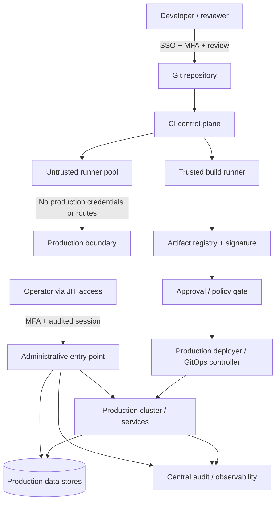
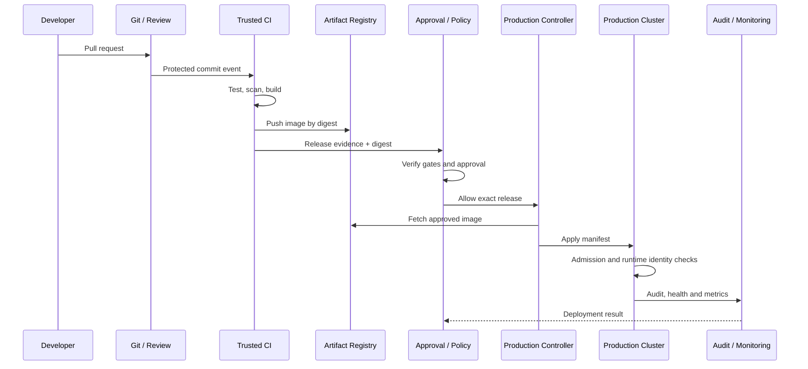

# Defining Access Boundaries for Production Environments

The production environment hosts the application version serving live users, real data, and resources that directly impact business operations. Therefore, the security question is not simply "who has the production password?" but rather: **which identity is permitted to cross the production boundary, from where, to perform which actions, on which resources, for how long, and with what evidence?**

A production access boundary is the set of rules governing identities, permissions, networks, runners, workloads, secrets, and deployment controls designed to restrict paths from outside into production resources. A strong boundary ensures users, pipelines, and applications receive only the minimum required permissions; changes happen through controlled channels; and every critical action is traceable.

## 1. Identifying What Lies Inside the Production Boundary

Production is more than a single server or cluster. The scope requiring protection may include:

- Cloud accounts, subscriptions/projects, resource groups, and management services.
- VPCs/VNets, subnets, firewalls, load balancers, private endpoints, and DNS.
- Kubernetes clusters, namespaces, nodes, control planes, and admission policies.
- Databases, object storage, message brokers, caches, search clusters, and backup systems.
- Secret managers, KMS/HSMs, certificate authorities, and artifact signing keys.
- Container registries, package repositories, and release stores.
- CI/CD control planes, GitOps controllers, runners with deploy permissions, and configuration management systems.
- Logs, metrics, traces, audit events, and alerting systems.

A resource located outside the production subnet can still fall inside the trust boundary if it holds credentials, has control over the cluster, or can modify artifacts that production will run. For example, a runner authorized to fetch production secrets or a registry with write access for release images is part of the production protection chain.

### Common Trust Zones

| Zone | Examples | Typical Trust Level and Permissions |
|---|---|---|
| Developer endpoint | Laptops, personal workstations | No standing production admin access; access via SSO/MFA and controlled mechanisms |
| Source/control plane | Git repositories, CI/CD control plane, approval systems | Can initiate workflows; only protected workflows and branches may request production actions |
| Untrusted execution | Runners handling fork pull requests or unreviewed code | No production secrets, deploy credentials, or direct network routes into production |
| Trusted build/release | Runners building protected revisions, signing services, artifact registries | Authorized to build and sign artifacts per policy; write access scoped by repository/project |
| Production deployment plane | GitOps controllers or scoped deployers | Applies only verified releases to assigned namespaces/resources |
| Production runtime/data plane | Workloads, databases, and user-facing services | Accepts connections only from authorized workloads and operators |
| Administrative plane | Bastions, privileged access management, cloud/Kubernetes admins | Elevated privileges, time-bound issuance, and full auditing |



This diagram illustrates the primary access paths. Each organization may use a different architecture, yet it must know precisely which components can modify production, read production data, or grant permissions to other components.

## 2. Building Boundaries Around Identity and Permissions

Network segmentation helps, but it is not enough. A connection originating from an internal subnet is not inherently trustworthy. Every critical access request should be authenticated and authorized by resource, action, and context.

### Categorizing Principals

A principal is the identity performing an action. Production environments typically involve these groups:

- **Human identity:** developers, SREs, DBAs, security reviewers, incident commanders.
- **CI/CD identity:** workflows, runners, release automation, and deploy jobs.
- **Workload identity:** service accounts or application identities calling databases, queues, or cloud APIs.
- **Platform identity:** GitOps controllers, operators, monitoring agents, backup services.
- **External/vendor identity:** third-party vendors or integrated systems granted bounded access.

Never share a single account across multiple people or multiple pipelines. When identities are shared, logs cannot pinpoint which person or workflow performed an action, and revoking access can break unrelated systems.

### Applying Least Privilege

Permissions should be constrained across four dimensions:

1. **Principal:** the exact person, service account, or workload identity.
2. **Action:** only required actions, such as reading logs, updating a deployment, or calling one specific API.
3. **Resource:** only the exact account, project, cluster, namespace, database, or secret.
4. **Context/time:** only from authorized workflows, branches, environments, devices, or time windows.

For example, a job deploying the orders service only needs to update workloads in the `orders-production` namespace. That job does not need cluster-wide admin rights, read access to secrets across all namespaces, or direct database access. An on-call operator needing to inspect logs can be granted log-read and status-view permissions without permission to modify deployments.

### RBAC and ABAC

- **RBAC (Role-Based Access Control):** assigns permissions via roles, such as `production-viewer`, `service-deployer`, or `database-operator`.
- **ABAC (Attribute-Based Access Control):** evaluates decisions based on attributes such as service, environment, owner, branch protection, ticket, device posture, or time.

RBAC simplifies managing standard roles; ABAC helps when permissions must depend on context. Both can be combined. Regardless of model, enforce default deny and open permissions only for clearly defined needs.

## 3. Separating Human Permissions from Automation Permissions

Human operators and pipelines serve different purposes. Operators may need to investigate, inspect logs, or handle incidents; pipelines need permissions to execute a well-defined set of deployment steps. Never grant pipelines privileges equivalent to human administrator accounts.

| Role | Appropriate Permissions | Permissions to Avoid Granting by Default |
|---|---|---|
| Developer | Read status, allowed logs, open PRs, and request releases | Modifying production directly or reading production secrets |
| Reviewer/approver | Inspect evidence, approve/reject within scope | Automatically holding deploy rights or reading all secrets |
| CI build job | Check out source, download dependencies, produce artifacts and reports | Accessing production databases or production clusters |
| Release signer | Sign artifacts/provenance per policy | Modifying source code or deploying arbitrary services |
| Deployment controller | Apply verified manifests/images to assigned resources | Unrestricted cloud/cluster admin privileges |
| SRE/operator | Observe, restart, or adjust services per role and procedure | Using shared admin accounts or unnecessary standing privileges |
| DBA | Perform approved database operations | Broad access to unrelated secrets and applications |

One person may hold multiple roles in a small team, yet high-risk actions require separation of duties and independent auditing per policy.

## 4. Protecting the Path from Git to Production

Pipelines are a critical entry point into production. If someone can alter a workflow, run arbitrary code on a runner holding production secrets, or swap artifacts after approval, the production boundary can be bypassed even if the cluster network is locked down.

A secure release flow should control:

- **Repository:** protect release branches/tags, require reviews, restrict force-pushes, and govern who can edit workflows.
- **Workflow definition:** review pipeline files as privileged code; restrict third-party actions/plugins and pin trusted versions.
- **Triggers:** validate events, branches, tags, repositories, and actors; never grant production privileges to arbitrary pull requests.
- **Runner selection:** separate untrusted runners from trusted/release runners; control tags, groups, and runner registration permissions.
- **Artifacts:** build from identified commits, recording digests, provenance, SBOMs, and signatures as required by policy.
- **Approval:** approve the exact digest, environment, configuration, and validity window.
- **Deployment:** deploy only verified artifacts using narrowly scoped identities.
- **Verification:** verify rollouts, health, metrics, and record deployment logs.

### Never Grant Production Secrets to Untrusted Pull Requests

Pull requests from forks or unreviewed branches can alter scripts and workflows to read environment variables, print secrets to logs, or exfiltrate data. Therefore:

- PR validation jobs receive only read-only tokens and minimal permissions.
- Never attach production environments or production secrets to PR workflows.
- Never run unreviewed PR code on self-hosted runners with internal network access or sensitive credentials.
- Use ephemeral runners and clean workspaces for untrusted workloads.
- Separate protected build/release runner pools from pools running arbitrary code.
- Review changes to workflows, deployment scripts, and policies before merging.

A runner tagged `production` does not create security by itself. Restrict who can dispatch jobs onto that runner, which workflows may run, which secrets are injected, and which networks the runner can reach.

### Use Workload Identity Instead of Static Keys

If the cloud and CI platforms support federation/OIDC, workflows can obtain short-lived identity tokens and exchange them for temporary cloud permissions. Trust policies must validate issuer, audience, and appropriate claims such as repository, organization/project, branch/tag, workflow, or environment.

Workflow-level GitHub Actions example:

```yaml
name: Deploy production

on:
  workflow_dispatch:

permissions:
  contents: read
  id-token: write

jobs:
  deploy:
    runs-on: ubuntu-latest
    environment: production
    steps:
      - uses: actions/checkout@v4
      - name: Obtain short-lived cloud identity
        run: ./ci/exchange-oidc-token.sh
      - name: Deploy approved artifact
        run: ./ci/deploy-by-digest.sh
```

`id-token: write` only permits the job to request an OIDC token; it does not grant cloud permissions automatically. Actual permissions are governed by the trust relationship and IAM role on the cloud side. Trust policies should restrict to the exact allowed repository, workflow, and environment rather than accepting every token from the same issuer. In practice, configure environment protections, required reviewers, branch restrictions, and pin actions per organizational policy.

On GitLab CI or other platforms, the same principle applies: use ID tokens with constrained audiences and claims, checking platform documentation to configure trust policies accurately.

## 5. Choosing a Deployment Model Aligned with Production Boundaries

Two patterns are common:

| Model | Access Path | Control Points |
|---|---|---|
| Push-based deployment | CI runner connects to production API/cluster and pushes changes | Runner holds network path and deploy credentials; requires runner isolation, short-lived identity, allowlists, and auditing |
| Pull-based/GitOps | CI updates release manifests in repository/registry; an in-cluster production controller pulls and applies changes | Controller holds in-cluster permissions; requires protecting manifest sources, signatures/provenance, policies, and repository write access |

With push-based deployments, runners must reach production endpoints. Place runners in a dedicated deployment zone, restrict egress to exact APIs, use short-lived identities, and scope permissions per namespace/service. Never use shared PR runners to deploy to production.

With pull-based deployments, production does not need inbound access opened from every runner. The GitOps controller inside the cluster pulls desired state from a protected source. This shrinks the direct access surface, yet the config repository and controller become privileged components requiring strict protection. If an attacker can alter manifests or if controller permissions are overly broad, they can still modify production.

Regardless of model, deploy by immutable digest, verify signatures/provenance per policy, and record configuration commits alongside deployment revisions.

## 6. Segmenting Networks and Restricting Connection Paths

Network boundaries constrain where connections can originate and which services can be called. However, never treat internal networks as unconditionally trusted; every critical connection still requires authentication and authorization.

Common control layers include:

- Separating VPCs/VNets, accounts/projects, or subnets by environment and trust tier.
- Placing databases, caches, and control planes on private networks; never expose management endpoints publicly unnecessarily.
- Enforcing firewalls/security groups/network policies with allowlists for source, destination, and port.
- Restricting egress from runners and workloads; disallow unnecessary internet or internal network access.
- Using private endpoints/service endpoints where supported by the platform.
- Enforcing TLS on connections; consider mTLS for service-to-service traffic requiring mutual identity.
- Separating administrative traffic planes from user-serving data planes.
- Logging denied connections and alerting on anomalous behavior.

For example, build runners may need access to Git and package registries without needing access to production databases. Deployers may need to call the Kubernetes API or deployment controller without needing direct database connections. The `orders` workload only needs connectivity to the `orders` database and explicitly defined dependencies.

### NetworkPolicy in Kubernetes

The following example illustrates an ingress policy allowing only pods labeled `app: gateway` to connect to pods labeled `app: orders` on TCP 8080:

```yaml
apiVersion: networking.k8s.io/v1
kind: NetworkPolicy
metadata:
  name: orders-ingress
  namespace: production
spec:
  podSelector:
    matchLabels:
      app: orders
  policyTypes:
    - Ingress
  ingress:
    - from:
        - podSelector:
            matchLabels:
              app: gateway
      ports:
        - protocol: TCP
          port: 8080
```

`NetworkPolicy` requires a supporting network plugin. This policy illustrates ingress only; design egress, DNS, health checks, and other dependencies according to real traffic flows. The `podSelector` above applies within the same namespace; if the source resides in another namespace, use appropriate `namespaceSelector` and `podSelector` rules. Never roll out default-deny policies without first inventorying required traffic flows, as doing so can cause outages.

## 7. Restricting Permissions in Production Kubernetes

In Kubernetes, distinguish permissions for humans, CI deployers, GitOps controllers, and workload service accounts. Never grant `cluster-admin` to routine application deployment jobs.

Example creating a ServiceAccount and Role permitted only to manage Deployments in the `production-orders` namespace:

```yaml
apiVersion: v1
kind: ServiceAccount
metadata:
  name: orders-deployer
  namespace: production-orders
automountServiceAccountToken: false
---
apiVersion: rbac.authorization.k8s.io/v1
kind: Role
metadata:
  name: orders-deployment-writer
  namespace: production-orders
rules:
  - apiGroups: ["apps"]
    resources: ["deployments"]
    verbs: ["get", "list", "watch", "create", "update", "patch"]
  - apiGroups: [""]
    resources: ["pods"]
    verbs: ["get", "list", "watch"]
---
apiVersion: rbac.authorization.k8s.io/v1
kind: RoleBinding
metadata:
  name: orders-deployer-binding
  namespace: production-orders
subjects:
  - kind: ServiceAccount
    name: orders-deployer
    namespace: production-orders
roleRef:
  apiGroup: rbac.authorization.k8s.io
  kind: Role
  name: orders-deployment-writer
```

This Role illustrates namespace-level scoping; real systems may also require read access to ReplicaSets, Jobs, or supporting resources depending on the deployment tool. Add only the exact required resources after observing tool behavior. Do not grant read access to `secrets` if the deployer does not need it; note that permission to create Pods or modify Deployments can also indirectly expose secrets mounted by workloads, so evaluate workload creation/update rights carefully.

For workloads running inside the cluster:

- Create a dedicated ServiceAccount per application or privilege group.
- Disable automatic token mounting (`automountServiceAccountToken: false`) when workloads do not call the Kubernetes API.
- If API access is required, use short-lived tokens and RBAC limited to reading/writing only needed resources.
- Enforce Pod Security Standards or admission policies restricting privileged containers, `hostPath`, and excess Linux capabilities.
- Restrict allowed image registries, image digests, signatures, and provenance per policy.
- Use `NetworkPolicy` to constrain connectivity across namespaces and services.

## 8. Protecting Secrets and Keys in Production

Secrets form part of the access boundary because anyone able to read a secret inherits the privileges that secret represents. A database password can allow reading or altering data; a cloud key can allow provisioning resources; a signing key can make forged artifacts appear trusted.

Key principles:

- Store secrets in a secret manager or dedicated secrets system—never in Git, images, or pipeline logs.
- Provision secrets based on identity and resource scope; workloads read only the secrets they need.
- Prefer short-lived credentials, workload identity, and dynamic database credentials.
- Separate secrets by environment and service; never reuse production credentials in staging.
- Use KMS/HSM or appropriate key management services for encryption/signing keys.
- Rotate secrets systematically, verify applications received new values, and revoke old values.
- Audit secret access and alert on anomalous reads.
- Never pass secrets via command-line arguments, URLs, exception messages, or artifacts.

### Reading Secrets Does Not Equal Deployment Permission

Separate secret reader, deployer, and operator roles whenever possible. For example, a pipeline may request a short-lived credential to call the deployment API without being permitted to read database passwords. Runtime workloads fetch database credentials via their own identities. Developers inspect logs without permission to read production secrets.

If a tool must read a secret to deploy, restrict that secret to a single job, a single environment, and a brief window; never place it into global variables shared across an entire pipeline.

## 9. Policy Gates Before Workloads Enter Production

The production boundary should be enforced at multiple checkpoints, not solely at the approval step:

1. **Source policy:** protected branches/tags, mandatory reviews, and controls on workflow edits.
2. **Build policy:** building from identified commits on trusted runners with controlled dependencies.
3. **Artifact policy:** digest, signature, provenance, SBOM, and scans passing required criteria.
4. **Approval policy:** right person, right role, exact artifact and environment; decision still valid.
5. **Deployment policy:** deployer identity holds least privilege; manifests are validated.
6. **Admission policy:** cluster admits only workloads meeting image, signature, privilege, namespace, and resource rules.
7. **Runtime policy:** workloads access only assigned dependencies and secrets.
8. **Detection policy:** audits, metrics, logs, and alerts flag anomalous behavior.

For instance, an admission controller can reject images using mutable tags, images from unapproved registries, privileged containers, or Pods using unapproved service accounts. Policy engines include Kyverno, OPA Gatekeeper, or platform-native admission controls. Policies should go through audit/dry-run evaluation, testing, and staged rollout before enforcing across all of production.

## 10. Human Operational Access

Not every production operation should run through a pipeline. SREs or operators may need to investigate incidents, inspect logs, check state, or perform emergency actions. Human access paths must be designed separately and tightly controlled.

A sound model typically includes:

- Centralized SSO and phishing-resistant MFA for high-privilege accounts.
- Role-based permission groups aligned with service ownership.
- Just-in-time (JIT) or Privileged Identity Management (PIM): granting elevated permissions only with an explicit request, justification, and expiration.
- Device posture or managed device checks where required by policy.
- Bastion/session brokers or zero-trust access mechanisms instead of exposing SSH/RDP directly to the internet.
- Session recording or command/audit logging for sensitive operations per policy.
- Read-only access by default; write or admin privileges elevated temporarily.
- Offboarding processes to revoke permissions upon role changes, departures, or completed assignments.

Never share admin accounts among team members. Individual accounts tie actions to identities and aid investigations. Break-glass accounts must be separately protected, monitored, and periodically tested.

### Just-in-Time Access

Example when an operator needs access to a production database to investigate an incident:

1. Create a request linked to an incident/ticket, specifying the target resource and required action.
2. An authorized approver approves the scope and duration.
3. The system grants a temporary role or short-lived credential.
4. The operator connects through a managed channel; actions are audit-logged.
5. When the time expires, permissions are automatically revoked.
6. The system records outcomes and justification; extensions require re-evaluation.

JIT eliminates standing privileges, yet it does not replace limiting allowed actions. An account-wide admin role granted even for 15 minutes still carries huge blast radius; keep temporary roles as narrow as possible.

## 11. Break-Glass for Emergencies

Break-glass is an emergency access path used when normal procedures cannot handle an urgent crisis, such as restoring service, preventing data loss, or containing an active security incident.

A secure design requires:

- Defining explicit activation criteria and eligible roles.
- Using dedicated identities/credentials protected by strong MFA and stored securely.
- Restricting permissions, resources, and duration; avoiding unrestricted access wherever possible.
- Triggering immediate alerts whenever a break-glass account or privilege activates.
- Recording incident ID, operator, reason, timestamp, and actions taken.
- Revoking temporary permissions/credentials immediately after resolution.
- Conducting an independent post-incident review, auditing logs, and updating processes to reduce future need.

Never use break-glass for routine work or to bypass approval delays. Whenever possible, emergency actions should favor tested runbooks such as rolling back to a known-good digest, scaling a service, or blocking a specific network flow.

## 12. Logging and Monitoring Every Access Path

Boundaries can only be verified when an organization knows who accessed what, from where, with which permissions, and which resources were modified.

Events that must be logged:

- Logins, MFA challenges, group changes, and privilege escalations.
- Secret issuance, reads, rotations, and revocations.
- Runner registrations, runner group changes, executor configuration edits, and credential access.
- Workflow runs, approval decisions, artifact digests, and deployment IDs.
- Kubernetes API audits, cloud control-plane activity, and network policy modifications.
- Database administrative actions and sensitive data access per system capabilities.
- Break-glass activations, sessions, and post-incident reviews.
- Policy denials, admission rejections, and anomalous network connections.

Logs should stream to centralized storage with separated read/write permissions, appropriate retention, and tamper resistance. Never write secret values or sensitive payloads into logs. Maintain synchronized clocks to correlate events across CI, cloud, clusters, secret managers, and application systems.

### Critical Alert Signals

- A developer or non-production runner attempting to reach production APIs/databases.
- Tokens presented from unauthorized repositories, branches, audiences, or networks.
- A principal suddenly reading an unusual number of secrets or namespaces.
- Out-of-band changes to IAM/RBAC, network policies, admission policies, or protected environments.
- Deploying artifacts lacking valid provenance/signatures or with digests mismatched from approvals.
- Use of admin or break-glass privileges outside declared incidents.
- Production runners appearing from unmanaged hosts or groups.
- Workloads initiating outbound connections to endpoints outside allowlists.

## 13. Example: Production Deployment Flow with Clear Boundaries

Suppose the `orders` service runs on Kubernetes. A well-bounded flow can work as follows:

1. A developer opens a PR; CI runs on untrusted runners with no production secrets and no route to the production cluster.
2. A reviewer approves the code; branch protection allows merging into `main`.
3. A trusted build runner checks out the merged commit, runs tests/scans, and builds the container image.
4. Signing/provenance steps generate attestation for the artifact digest; the image is pushed to a registry writable only by the release pipeline.
5. A release summary links ticket, commit, digest, SBOM, scan results, migrations, and rollback plan.
6. An authorized approver for the `production` environment approves the exact digest and configuration.
7. The production GitOps controller pulls reviewed manifests and applies the image digest to the `production-orders` namespace; alternatively, a dedicated deployer performs the update with narrowly scoped permissions.
8. Admission policies verify the registry, digest/signature, and workload security context.
9. Workloads use dedicated service accounts and workload identity to access only their assigned secrets/databases.
10. Health checks, smoke tests, metrics, and audit records confirm the outcome; if checks fail, rollout halts or rolls back per policy.



The crucial point is that each stage has its own identity and permissions. PR runners hold zero production permissions; trusted builds create artifacts without needing database permissions; approvers make decisions without necessarily deploying directly; controllers apply only explicitly authorized workloads.

## 14. Anti-Patterns to Avoid

- **One admin credential across all pipelines:** enlarges blast radius and obscures action attribution.
- **Sharing PR runners with production runners:** untrusted code can reach secrets or internal networks.
- **Opening production APIs to all runners:** network boundaries fail to reflect job trust levels.
- **Using IP allowlists instead of authentication:** source IP proves neither identity nor intent.
- **Granting `cluster-admin` to deploy jobs:** a single workflow bug can impact the entire cluster.
- **Running workloads on broadly privileged default service accounts:** compromising one pod spreads to other resources.
- **Storing long-lived cloud keys in CI variables:** credentials risk leakage and cannot be scoped per run.
- **Sharing secrets between staging and production:** non-production incidents can spill into production.
- **Relying on manual approvals without locking artifacts:** deployed contents can diverge from what was approved.
- **Leaving third-party workflows/actions uncontrolled:** a dependency change can execute code with production permissions.
- **Exposing SSH/RDP directly to the internet:** widens administrative attack surface.
- **Omitting audit events or storing logs under the same privileges as actors:** hinders detecting and investigating unauthorized actions.
- **Using break-glass routinely:** turns exceptions into normal operations and erodes controls.

## 15. Production Access Boundary Checklist

When designing or reviewing a production boundary, verify:

1. Are all production-scope resources, control planes, runners, registries, secret stores, and management systems inventoried?
2. Are human, CI/CD, workload, and platform identities clearly separated?
3. Does each principal hold permissions only on the exact resources, actions, environments, and durations required?
4. Are untrusted runners separated from trusted/release runners, and are PRs prevented from receiving production secrets?
5. Do release workflows enforce branch protection, reviews, and dependency/action controls?
6. Does CI use workload identity/OIDC or short-lived credentials with constrained trust claims?
7. Do artifacts carry digests, provenance/signatures, and deploy the exact tested/approved contents?
8. Does production access use private networks, allowlists, TLS, and network policies tailored to required flows?
9. Are deployers/GitOps controllers scoped by namespace/service rather than `cluster-admin`?
10. Do workloads have dedicated service accounts, dedicated secrets, and least-privilege workload identities?
11. Do admission policies verify images, signatures, privileges, and configurations before execution?
12. Do human operators use SSO/MFA, JIT/PIM, default read-only access, and audited sessions?
13. Does break-glass enforce activation criteria, alerts, time limits, revocation, and post-incident reviews?
14. Are secret access, IAM/RBAC changes, deployments, network denials, and administrative actions centrally audited?
15. Do alerts fire when out-of-scope principals or runners attempt to access production?
16. Are drills conducted for credential revocation, compromised runner response, and recovery from bad deployments?

A resilient production boundary does not rely on a single firewall, an approve button, or one protected admin account. It combines verified identities, least privilege, network segmentation, trusted runners, verified artifacts, scoped secrets, deployment-time policies, and continuous auditing. When every path into production is explicitly defined and controlled, organizations can automate releases while bounding exactly who or what can affect live user-facing systems.
