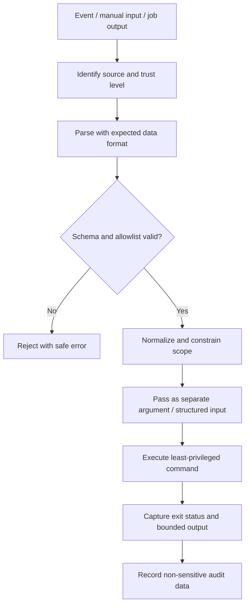

# Validating Code and Input Parameters Before Passing Them to Shell Commands

## 1. Why Must Pipeline Inputs Be Validated?

CI/CD pipelines frequently receive data from many sources: branch names, tags, commit messages, pull request titles, manual run parameters, webhook payloads, package names, file paths, outputs from previous jobs, or metadata retrieved from registries. This data may be used to select environments, name artifacts, construct paths, assemble build commands, or invoke deployment scripts.

Risk arises when a pipeline treats that data as part of executable code. If a value controlled by a user or an external system is concatenated directly into a shell string, special characters can alter how the shell parses the command. The consequences can include running unintended commands, reading sensitive files, corrupting artifacts, deleting data, or abusing the runner's privileges to access other systems.

For example, suppose a job wants to print the pull request title and writes:

```yaml
steps:
  - name: Print pull request title
    run: echo "${{ github.event.pull_request.title }}"
```

If the title is interpolated directly into the script body before the shell executes, a value containing shell syntax can alter the command itself. This is a form of injection caused by mixing data with code.

The core principle is to **keep data as data along the entire path from input source to invoked program**. Identify the source, validate against the allowed domain, pass parameters in structured form, and restrict job permissions. Quoting prevents certain ways the shell interprets data, but it does not replace validation, least-privilege access control, or safe data-flow design.

## 2. Common Input Sources in CI/CD

Explicit form inputs are not the only untrusted data. Any value that can be influenced by an event sender, contributor, dependency, or external system must be examined.

| Source | Examples | Risk When Used Directly |
|---|---|---|
| Git metadata | Branch name, tag, commit message, author name/email | Shell injection, option injection, invalid filenames or tags |
| Pull request | Title, body, label, head branch, contributor name | Contributor-controlled content injected into scripts or log commands |
| Manual dispatch | Environment input, version, module, path | Wrong environment selected, out-of-scope command execution, path traversal |
| Webhook/API | JSON field, URL, repository name, event type | Malformed schema data, forged payloads, or command strings built from payloads |
| Files in repository | Filename, generated manifest, config value | Special filenames, symlinks, paths escaping the workspace |
| Output of another job | Version string, artifact path, status, generated variable | Manipulated or malformed output trusted by downstream jobs |
| Dependency/tool output | Package metadata, compiler output, script result | External data reinterpreted as commands or expressions |
| Artifact/registry | Image tag, package coordinate, digest, download URL | Downloading from the wrong source, option injection, or calling unauthorized endpoints |

A value that looks internal may still be untrusted. For instance, a branch name comes from Git, yet a contributor can choose the branch name. Output from an earlier job is not inherently safe if that job executed code from an untrusted pull request. Classify inputs by who can actually control them and which trust boundaries they cross—not by where the data happens to surface.

## 3. Understanding Shell Injection

Shell injection occurs when data is concatenated into a command string and the shell interprets part of that data as syntax. Characters with special meaning depend on the shell and can include semicolons, pipes, quotes, dollar signs, backticks, parentheses, newlines, redirection operators, and wildcard characters.

Dangerous example:

```bash
BRANCH_NAME="$INPUT_BRANCH"
sh -c "git checkout $BRANCH_NAME"
```

`sh -c` instructs a shell to parse a brand-new string. If `INPUT_BRANCH` contains shell syntax, the data can become part of the executed program. Assigning it to an intermediate variable earlier does not remove the risk because the value is still interpolated into the string passed to the second shell.

Shells normally parse command syntax before performing expansion; data expanded from a variable is not automatically re-parsed as shell syntax during that same parse pass. However, if the result is passed into `eval`, `sh -c`, `bash -c`, or another shell, it will be re-parsed. Moreover, unquoted expansion can trigger word splitting and pathname expansion, turning a single value into multiple arguments or matching unexpected files.

Not every dangerous character sequence is shell injection. A string might not spawn a second command yet still cause option injection, path traversal, or selection of the wrong resource. Therefore, understand the specific risk class rather than merely scanning for semicolons.

## 4. Avoid Concatenating Data Directly into Command Strings

Do not construct a shell command by concatenating strings from inputs. Avoid patterns like these:

```bash
# Unsafe: concatenating input into a command string
eval "deploy-tool --environment $TARGET_ENV --version $RELEASE_VERSION"

# Unsafe: spawning a new shell to parse a concatenated string
bash -c "deploy-tool --environment '$TARGET_ENV'"

# Unsafe: input can alter command structure
    sh -c "printf '%s\n' $PULL_REQUEST_TITLE"
```

`eval` is especially dangerous because it instructs the shell to re-evaluate data as code. `bash -c` and `sh -c` also create a new shell parsing pass. Unless there is a genuine need to run a controlled shell script, never use these mechanisms to pass parameters.

Instead, invoke the program directly and pass each parameter as a separate argument. Bash example:

```bash
deploy-tool --environment "$TARGET_ENV" --version "$RELEASE_VERSION"
```

Written this way, the shell passes the expanded values as distinct arguments; it does not combine them into a new command string to be re-parsed. However, you must still validate `TARGET_ENV` and `RELEASE_VERSION` against their allowed domains, because the target program itself may interpret parameter values specially.

## 5. Proper Quoting in Bash

In Bash, wrap variables in double quotes when passing them as a single argument:

```bash
printf '%s\n' "$RELEASE_VERSION"
mkdir -p -- "$OUTPUT_DIR"
```

Double quotes prevent word splitting and pathname expansion on variable values. Use `printf` instead of `echo` when printing arbitrary data, because `echo` handles options and escape sequences differently across shells.

Key points to remember:

- `"$VALUE"` keeps the value as a single argument, even if it contains spaces or wildcard characters.
- Unquoted `$VALUE` can be split into multiple arguments and undergo wildcard expansion.
- `'$VALUE'` is a literal string in the shell and does not expand the variable.
- Double quotes do not make every value valid for the target program; option injection can still occur.
- Do not try to write your own shell-escaping function by replacing a few characters. Pass structured arguments instead of building scripts out of data.

Example of a safe logging function:

```bash
log_value() {
  printf 'Input value: %s\n' "$1"
}

log_value "$PULL_REQUEST_TITLE"
```

The value is passed as a single argument and printed as data. Keep in mind that log contents can still contain sensitive data or control characters that confuse log viewers; for untrusted data, bound the length and sanitize display characters if needed.

## 6. Using Arrays to Build Argument Lists

When a command has optional parameters, use a Bash array rather than concatenating them into a single string:

```bash
args=(--environment "$TARGET_ENV" --version "$RELEASE_VERSION")

if [ "$DRY_RUN" = "true" ]; then
  args+=(--dry-run)
fi

deploy-tool "${args[@]}"
```

`${args[@]}` passes each element as a separate argument. Conversely, if all parameters are stored in a single string and passed to `eval` or `sh -c`, the shell can re-parse the contents and introduce injection.

Arrays also help separate options from values. Avoid using a variable such as `EXTRA_ARGS` containing an arbitrary string and passing it into a command. If options must be configurable, declare each input with a name, type, and allowed values, then append the corresponding elements to the array.

## 7. Validating Inputs with Allowlists

The strongest validation starts by defining the allowed value domain. An allowlist is usually safer and easier to audit than a blocklist of forbidden characters.

For example, if a pipeline deploys to only three environments, allow only those exact three names:

```bash
case "$TARGET_ENV" in
  development|staging|production)
    ;;
  *)
    printf 'Invalid target environment\n' >&2
    exit 2
    ;;
esac
```

A blocklist such as "forbid semicolons and dollar signs" can still miss other shell syntax, newlines, or tool-specific interpretations. An allowlist defines upfront what inputs are meaningful and rejects everything else.

Common validation types:

| Input Type | Validation Example |
|---|---|
| Enum | Accept only `development`, `staging`, `production` |
| Integer | Validate numeric syntax and min/max bounds |
| Version | Use a SemVer parser or published version rules |
| Git ref | Validate with Git rules and verify the ref exists in an allowed repository |
| Repository | Match against an allowed repository list, not merely checking URL syntax |
| URL | Allow only approved schemes, hosts, ports, and paths |
| Filename/path | Constrain within the workspace or allowed directory after path normalization |
| Boolean | Accept only explicit values such as `true` or `false` |
| Feature/operation | Choose from a predefined list of allowed actions |

Validation must happen before using the input to construct paths, invoke commands, select credentials, or access the network. When a value is invalid, fail with a clear error message without printing secrets.

## 8. Validating Numbers, Versions, and Git References

Structured inputs should be parsed with appropriate tools rather than checked only with an overly broad regex.

Example of validating an integer in Bash:

```bash
if [[ ! "$REPLICA_COUNT" =~ ^[0-9]+$ ]]; then
  printf 'Replica count must be an integer\n' >&2
  exit 2
fi

if (( REPLICA_COUNT < 1 || REPLICA_COUNT > 20 )); then
  printf 'Replica count must be between 1 and 20\n' >&2
  exit 2
fi
```

Example of verifying a Git ref exists:

```bash
if ! git check-ref-format --branch "$BRANCH_NAME" >/dev/null 2>&1; then
  printf 'Invalid branch name\n' >&2
  exit 2
fi

git show-ref --verify --quiet "refs/heads/$BRANCH_NAME" ||
  git show-ref --verify --quiet "refs/remotes/origin/$BRANCH_NAME" || {
    printf 'Branch does not exist in the expected repository\n' >&2
    exit 2
  }
```

The example above assumes the repository has already fetched the refs being checked. For tags, commit SHAs, or remote refs, verify the exact namespace and origin. A syntactically valid Git string is not necessarily a ref authorized for deployment.

For versions, prefer a SemVer parser or ecosystem version library. A naive regex can accept strings that violate version comparison rules or mishandle pre-release/build metadata. After parsing, still verify that the version has a corresponding artifact in an allowed registry.

## 9. Preventing Option Injection

Option injection occurs when a data value starts with a hyphen and the target program interprets it as a flag or option. This can happen even when the variable is properly quoted.

Example:

```bash
rm "$USER_PROVIDED_FILE"
```

If the value starts with `-`, the program may treat it as an option. For tools that support it, use `--` to mark the end of options:

```bash
rm -- "$USER_PROVIDED_FILE"
grep -- "$SEARCH_TEXT" "$INPUT_FILE"
git checkout -- "$PATH_IN_REPOSITORY"
```

The meaning of `--` depends on the program; not every command supports it. Check the command's documentation before relying on it. For parameters with a fixed set of choices, allowlist validation remains the primary safeguard.

For tools with subcommand or URL syntax, validate the input type according to the tool's contract. Never place an arbitrary string in a position that can select a plugin, executable, config file, or endpoint.

## 10. Protecting Paths and Filenames

An input might contain no shell syntax yet still be dangerous when used as a path. Path traversal uses components like `../` or absolute paths to escape the intended directory. Symlinks can also cause a path that appears to stay inside the workspace to resolve elsewhere.

Avoid doing the following:

```bash
rm -rf "$WORKSPACE/$INPUT_PATH"
```

Quoting the variable alone does not prevent `../` or symlinks. Before performing file operations:

1. Define the allowed root directory.
2. Reject absolute paths if only relative paths are allowed.
3. Canonicalize the path and verify it remains under the root directory.
4. Account for symlinks and file types; never follow untrusted symlinks when deleting or writing.
5. Operate only inside the job's isolated workspace.
6. Use filesystem APIs capable of scoping operations by directory handle when writing high-risk tooling.

Example of validating a relative path in Bash/Linux using `realpath`:

```bash
ROOT="$(realpath -e -- "$WORKSPACE")"
TARGET="$(realpath -m -- "$ROOT/$INPUT_PATH")"

case "$TARGET" in
  "$ROOT"/*)
    ;;
  *)
    printf 'Path escapes the allowed workspace\n' >&2
    exit 2
    ;;
esac
```

This illustrates an environment with GNU `realpath`; behavior and options can differ on other operating systems. `realpath -m` canonicalizes paths even when the target does not yet exist, but post-canonicalization string checks do not automatically eliminate every race condition or concurrently modified symlink. For destructive deletions, prefer directory-root-safe APIs, job-owned temporary directories, and ensure untrusted processes cannot alter directory structures during cleanup.

## 11. Avoiding Direct Expression Interpolation in Pipeline Files

Some platforms evaluate pipeline expressions before generating the shell script. If an event value is interpolated directly into a `run` block, it can alter the script before the shell executes.

Unsafe GitHub Actions example:

```yaml
steps:
  - name: Print title
    run: printf '%s\n' "${{ github.event.pull_request.title }}"
```

A safer approach is to bind the value to an environment variable and reference the variable as data:

```yaml
steps:
  - name: Print title
    env:
      PR_TITLE: ${{ github.event.pull_request.title }}
    run: printf '%s\n' "$PR_TITLE"
```

In the second example, the title content is passed via the environment instead of being injected into the shell code. The shell does not re-parse the expanded value as syntax in the same pass; quoting keeps it as a single argument. If the title is used to construct a filename, tag, or tool parameter, it must still be validated against the allowed domain for that purpose.

The same principle applies to other platforms: never interpolate event data into shell, PowerShell, or script source code. Use structured inputs/outputs or separately passed environment variables. Check the exact syntax and semantics of the platform in use.

## 12. Passing Multiline Data and Safe Delimiters

Some pipelines use special files to pass outputs between steps or jobs. When writing arbitrary data to a file using `NAME=value` syntax, multiline content or embedded delimiters can corrupt the file structure and inject unintended variables.

Do not manually format strings like this when `VALUE` comes from an untrusted source:

```bash
printf 'RESULT=%s\n' "$VALUE" >> "$CI_OUTPUT_FILE"
```

If `VALUE` contains a newline, it can inject extra lines or fields according to the output file syntax. Use the platform's structured output mechanism, a randomized/controlled delimiter following platform guidance, or write the data to a separate file and pass a verified artifact ID/path.

For JSON data, use a serializer instead of concatenating JSON strings manually. For YAML data, use a YAML library and schema validation. For multiline data, never rely on a fixed delimiter if the input could contain that same delimiter.

Do not pass executable commands through outputs for a downstream job to run. Outputs should be schema-bound data—such as `artifact_digest`, `release_version`, or `test_status`—and the consuming job must validate the values before using them.

## 13. PowerShell and Other Shells

Quoting and argument passing differ across Bash, PowerShell, `cmd.exe`, and runner-specific shells. Bash escaping rules cannot be applied verbatim to PowerShell.

In PowerShell, avoid building strings and calling `Invoke-Expression`:

```powershell
# Unsafe: re-parses string as PowerShell code
$command = "deploy-tool --environment $TargetEnvironment"
Invoke-Expression $command
```

Invoke the executable using the call operator and pass arguments separately:

```powershell
$arguments = @(
    '--environment', $TargetEnvironment,
    '--version', $ReleaseVersion
)

& deploy-tool @arguments
if ($LASTEXITCODE -ne 0) {
    throw "Deployment command failed with exit code $LASTEXITCODE"
}
```

How arguments are passed to native executables also depends on the PowerShell version and native argument-passing behavior. With PowerShell 5.1 on Windows, verify how arguments are serialized when values contain quotes or special characters; use controlled process-invocation APIs when passing complex data. Regardless of shell, still validate enums, versions, paths, and permissions before invoking commands.

Avoid using `cmd /c`, `Invoke-Expression`, or `Start-Process` with a concatenated command-line string or subshell unless strictly necessary. Every new parser boundary introduces another potential injection surface.

## 14. Handling URLs, Repositories, and Endpoints

Pipelines sometimes download scripts, packages, or artifacts from input-supplied URLs. Quoting does not stop a syntactically valid URL from pointing to an unauthorized host, internal endpoint, or dangerous scheme.

Checks to include:

- Allow only necessary schemes, typically HTTPS.
- Allowlist permitted hosts, registries, and repositories.
- Restrict ports and paths according to purpose.
- Disallow following redirects to hosts outside the allowlist if the tool supports redirect control.
- Verify checksums or signatures of downloaded files.
- Avoid downloading and executing scripts directly from mutable URLs like `latest` or moving branches.
- Prevent PR inputs from selecting endpoints capable of reaching metadata services or sensitive internal networks.

For example, if a pipeline should only pull images from `registry.example.com`, validate the registry host before calling the container tool. After pulling, reference the verified digest rather than relying solely on a tag.

When using `curl` or `wget`, pass the URL as a quoted argument and verify the response. `--` can be used to end options if the tool version supports it. Never concatenate a URL into a shell command or pipe a downloaded script straight into `sh` without verifying both source and content.

## 15. Secrets and Sensitive Data in Shell Commands

Even when a command is free of injection, parameters can expose secrets. Passing tokens directly on the command line can leak them via process listings, debug logs, shell traces, or runner diagnostics.

Practices to adopt:

- Fetch secrets from a secret manager or platform secret store just in time and only in jobs that need them.
- Prefer short-lived, least-privilege credentials.
- Use stdin, file descriptors, restricted-permission temporary files, or environment variables as recommended by the tool; evaluate process and environment exposure for each approach.
- Never enable `set -x` or shell tracing when commands might touch secrets.
- Never print the entire environment or full command lines to logs.
- Never place secrets into cache keys, artifacts, outputs, or deployment manifests.
- Log masking is a supplementary layer; it does not replace keeping secrets out of logs in the first place.
- Revoke and rotate credentials if accidental printing or storage is suspected.

Example using an environment variable for a tool that supports reading tokens from stdin:

```bash
set +x
(
  token="$REGISTRY_TOKEN_FROM_SECRET_STORE"
  unset REGISTRY_TOKEN_FROM_SECRET_STORE
  printf '%s' "$token" | registry-client login --token-stdin
  unset token
)
```

This example only applies if `registry-client` supports reading the token from stdin. Not every tool offers that flag. If a tool only accepts tokens via arguments, use a credential helper or the tool's official authentication mechanism instead of assuming the shell can hide the command line. Avoid writing token values into output files or logs.

## 16. Untrusted Inputs and Job Permissions

Validation does not replace isolation. A script might be free of shell injection yet still execute arbitrary code from the repository. Pull requests from forks can alter build scripts, test scripts, Dockerfiles, and even pipeline definitions.

For workflows executing untrusted code:

- Never provide production secrets, registry write tokens, or deployment permissions.
- Use ephemeral runners or an isolated pool containing no sensitive data.
- Restrict networking, filesystem mounts, processes, CPU, memory, and execution time.
- Grant only necessary read permissions on repositories or artifacts.
- Separate PR validation jobs from high-privilege publish/release jobs.
- Never use outputs from untrusted jobs as commands or policies without verification.
- If PR artifacts are needed, mark them clearly as experimental and prevent automatic promotion.

A trusted job must never take output from an untrusted job and use it to select an arbitrary executable, credential, environment, or path. Validate the schema, origin, and allowed values. For sensitive decisions like production deployment, data sources and identities must come from protected systems.

## 17. Secure Input Handling Flow

A sound flow preserves clear boundaries between input data, validation, decision-making, and execution:



Steps to preserve:

1. Identify who can control the input and which jobs it traverses.
2. Parse according to the expected format; reject schema violations.
3. Check allowlists, length limits, and value domains.
4. Normalize values for the intended use, such as canonicalizing a version or resolving a path inside the workspace.
5. Pass data via separate arguments, environment variables, or structured APIs.
6. Run commands with least privilege and timeouts.
7. Check exit codes, bound logs, and avoid leaking secrets.
8. Record the source, normalized non-sensitive values, and outcome for traceability.

Not every input needs to be logged verbatim. Pull request titles or webhook payloads may contain personal data, inappropriate content, or strings that confuse logs. Log only necessary fields and cap their length.

## 18. Complete Example: Selecting an Environment and Deploying Safely

Suppose a pipeline accepts two manual inputs: target environment and release version. Only `staging` and `production` are allowed; the version must follow basic SemVer format; the deploy tool is invoked directly with separate arguments.

```bash
#!/usr/bin/env bash
set -euo pipefail

TARGET_ENV="${INPUT_TARGET_ENV:?Target environment is required}"
RELEASE_VERSION="${INPUT_RELEASE_VERSION:?Release version is required}"

case "$TARGET_ENV" in
  staging|production) ;;
  *)
    printf 'Unsupported deployment environment\n' >&2
    exit 2
    ;;
esac

if [[ ! "$RELEASE_VERSION" =~ ^[0-9]+\.[0-9]+\.[0-9]+$ ]]; then
  printf 'Release version must use numeric major.minor.patch\n' >&2
  exit 2
fi

ARTIFACT_REF="registry.example.com/order-service:$RELEASE_VERSION"

if ! registry-client artifact exists --reference "$ARTIFACT_REF"; then
  printf 'Requested artifact was not found\n' >&2
  exit 3
fi

deploy_args=(
  --environment "$TARGET_ENV"
  --artifact "$ARTIFACT_REF"
)

if [ "$TARGET_ENV" = "production" ]; then
  deploy_args+=(--require-approval)
fi

deploy-tool "${deploy_args[@]}"
```

This is an illustrative example and assumes tools with matching interfaces. The regex accepts only `major.minor.patch` without prerelease/build metadata; if the project uses full SemVer, use a dedicated parser. `registry-client artifact exists` only checks artifact existence; in a real workflow, retrieve the digest, verify provenance, and check quality gates before deploying. Production approval must be enforced by the platform or a protected policy—not merely via a flag passed by the caller.

The example shows three distinct layers: inputs are allowlisted/parsed; the artifact is looked up in an allowed registry; the command receives separate arguments. Job permissions must still be scoped to the target environment.

## 19. Testing and Reviewing Commands That Consume Inputs

When reviewing a pipeline or script, trace every path where input reaches a command. You can test the following cases in a sandbox environment with no secrets:

- Values containing spaces: `release candidate`.
- Values starting with a hyphen: `--help` or `-rf`.
- Values containing single or double quotes.
- Values containing wildcard characters such as `*` or `?`.
- Values containing semicolons, pipes, `$()`, or backticks.
- Values containing newlines or control characters.
- Paths containing `../`, absolute paths, or symlinks.
- URLs with hosts, ports, or schemes outside the allowlist.
- Overly long, malformed, or nonexistent versions.

The objective is to confirm that data is passed as a single literal value, rejected when outside the valid domain, and never alters command structure. Never run test payloads on runners with production privileges or real secrets.

Static analysis and secret scanning tools can catch common dangerous patterns, but they do not fully understand the semantics of every shell and command. Manual review is still needed to verify how inputs are passed, job permissions, and target executable behavior.

## 20. Responding When Injection or Input Manipulation Is Detected

If you suspect an input altered a command or caused unauthorized access:

1. Stop the affected job or pipeline; do not proceed to publish or deploy artifacts.
2. Identify the input source, triggering event, commit, run ID, and executing runner.
3. Inspect logs, processes, modified files, and network access within authorized bounds; preserve necessary evidence.
4. Revoke or rotate any secrets/tokens accessible to the job if exposure is possible.
5. Identify artifacts, caches, outputs, and environments that may have been impacted.
6. Isolate the runner if lingering processes or tampered state are suspected; rebuild runners from trusted images.
7. Fix input passing, validation, and job permissions; add regression tests for the failing case.
8. Audit similar runs and document the blast radius.

Do not merely delete logs or rename variables as a fix. You must determine whether unintended commands executed, which credentials could have been accessed, and from what state any artifacts were built or published.

## 21. Common Anti-Patterns

| Anti-Pattern | Consequence | Improvement |
|---|---|---|
| Interpolating event data directly into `run:` | Data can become script syntax | Pass via structured environment/inputs and quote on use |
| Using `eval` or `sh -c` with input | Shell re-parses data as code | Invoke executable directly and pass separate arguments |
| Quoting without validating | Values can still select unintended options, paths, or resources | Domain allowlists and `--` when supported by the tool |
| Using character blocklists | Easy to miss alternative syntax or interpretations | Define schemas and allowlists of valid values |
| Concatenating `EXTRA_ARGS` into one string | Cannot control argument counts or boundaries | Declare individual inputs and use arrays |
| Using input as a path then running `rm -rf` | Path traversal or symlinks can delete data outside workspace | Resolve/validate paths, enforce root, and use isolated workspaces |
| Writing multiline data to output files via `NAME=value` | Newlines/delimiters can inject unintended outputs | Use structured output mechanisms or separate files/artifacts |
| Dumping full environment/commands to logs | Can expose secrets | Allowlist logs, disable tracing, and use a secret manager |
| Granting untrusted PRs deploy/publish permissions | Arbitrary code can abuse high runner privileges | Separate jobs, runner pools, and permissions by trust domain |
| Trusting upstream job outputs without verification | Manipulated data can steer sensitive jobs | Verify origin, schema, digest, and allowlist before use |

## 22. Input Review Checklist Before Shell Execution

Before merging a pipeline or script, check:

- [ ] The source and trust level of each input have been identified.
- [ ] Inputs are parsed against the expected schema/data type.
- [ ] Enums, versions, numbers, URLs, and paths have appropriate allowlists/bounds.
- [ ] Inputs are never concatenated directly into shell strings.
- [ ] `eval`, `sh -c`, or `Invoke-Expression` are never used with dynamic data.
- [ ] Variables are quoted and passed as separate arguments; Bash uses arrays for dynamic lists.
- [ ] `--` is used to terminate options when supported by the executable.
- [ ] Paths are canonicalized and constrained within the workspace/allowed directory; symlinks are handled.
- [ ] Pipeline expressions do not interpolate event data directly into shell source code.
- [ ] Multiline outputs are passed via structured mechanisms rather than fixed custom delimiters.
- [ ] Secrets do not appear unnecessarily in arguments, logs, caches, artifacts, or outputs.
- [ ] Jobs have least privilege, timeouts, and runner isolation appropriate to the input source.
- [ ] Tests cover whitespace, quotes, option prefixes, shell metacharacters, newlines, and path traversal.
- [ ] When input is invalid, the pipeline rejects safely without partially executing sensitive operations.

## 23. Core Practical Principles

1. Treat all data controllable by event senders, contributors, or external systems as untrusted until verified.
2. Maintain the boundary between data and code; never interpolate arbitrary data into shell scripts.
3. Avoid `eval`, subshells, and dynamic command strings; invoke executables directly with separate arguments.
4. Use proper shell quoting, Bash arrays, and structured data-passing mechanisms.
5. Validate against allowlists, schemas, value domains, and intended purpose before invoking commands.
6. Defend against option injection, path traversal, symlinks, and non-allowlisted URLs in addition to shell metacharacters.
7. Never pass secrets via command lines or logs; use secret stores and short-lived credentials.
8. Isolate jobs executing untrusted code and withhold sensitive publish/deploy permissions.
9. Test edge-case inputs in a sandbox and record results without sensitive data.
10. At any sign of injection, halt the release flow, investigate runners/credentials/artifacts, and fix the root cause.

Validating inputs before passing them to shell commands is an essential part of pipeline security. When data is verified against allowed domains, passed across structured boundaries, and executed inside least-privileged jobs, the pipeline drastically reduces the risk of turning an externally supplied value into unintended command execution.
