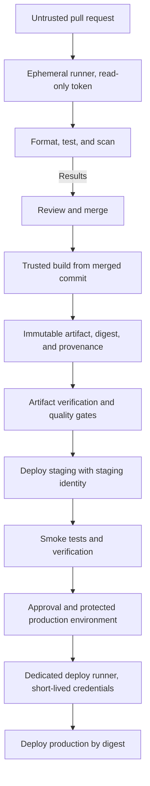

# Isolating Untrusted Code from Runners and Privileged Credentials

A CI/CD pipeline does not only execute commands written by the operations team. During builds and tests, it can execute external build scripts, tests, plugins, package lifecycle hooks, Dockerfiles, and actions. A pull request from a fork or a compromised dependency can inject arbitrary code into those steps. If that code runs on a runner with access to production secrets, cloud credentials, or internal networks, a routine test run can become an entry point into the system.

The core security principle is to **isolate untrusted code from privileged runners, credentials, and resources**. Code under test can run in a restricted-privilege environment, while actions capable of altering release artifacts or production must take place in higher-trust jobs and environments with separate identities and permissions.

In CI/CD, this boundary must be designed end-to-end across Git events, workflows, runners, tokens, secrets, networks, caches, and artifacts. Hiding secrets from log UIs or requiring an approval at the end of the pipeline is not enough if untrusted code already had an opportunity to read credentials earlier.

## 1. Identifying Untrusted Code

Trust should never be assessed solely on whether code resides in the same repository. Trust depends on the change's origin, review controls, and how the executed contents are governed.

Sources that must typically be treated as untrusted or low-trust include:

- Pull requests from forks or external contributors.
- Unprotected branches, unreviewed commits, or contributor-modified workflows.
- Recently modified build scripts, tests, plugins, package hooks, or Dockerfiles.
- Actions, reusable workflows, dependencies, or tools fetched from external sources.
- Artifacts and caches generated by jobs running untrusted code.
- Input data from issues, pull request titles, branch names, commit messages, or webhooks controllable by users.

Even a change that appears to modify only a test can add commands to exfiltrate data over the network. A new dependency can execute code during installation. Therefore, whenever a job runs code from a pull request, assume that code can execute arbitrary commands with every privilege and piece of data visible to the job.

## 2. Understanding Protected Assets and Attack Paths

Critical assets in a pipeline include:

| Asset | Examples | Consequence of Unauthorized Access |
|---|---|---|
| Credentials | Cloud keys, registry tokens, deploy tokens, SSH keys | Unauthorized system access or releases |
| Secrets | Database passwords, API keys, signing keys | Data exposure, spoofing, or account takeover |
| Runner host | Workspace, processes, filesystem, Docker socket | Lateral movement, reading other jobs' data, or persistence |
| Internal network | Metadata endpoints, control planes, production databases | Access to unauthorized resources |
| Cache | Shared dependency/build caches | Poisoning inputs to trusted jobs |
| Artifacts | Packages, images, release bundles | Introducing malicious code into the release chain |
| Workflows and policies | CI YAML, reusable workflows, deployment rules | Altering check conditions or execution privileges |

An attack may begin with a pull request, execute code inside the job, read tokens or data on the runner, and exfiltrate them or tamper with artifacts consumed by downstream steps. Defenses must break multiple links: reducing token permissions, withholding secrets from untrusted jobs, isolating runners, restricting networks, and verifying artifacts before promotion.

## 3. Isolating Runners by Trust Level

Runners are where build and test code actually executes. If jobs with differing trust levels share the same machine, one job can leave behind processes, files, credentials, or system modifications that impact the next job.

### Prefer Ephemeral Runners for Untrusted Code

For pull requests from forks or untrusted sources, use ephemeral runners: provision a fresh environment for the job, grant only required resources, and destroy the machine or execution environment afterward. Never reuse workspaces or writable filesystems across jobs of different trust levels.

Hosted runners typically provide a fresh environment per job. For self-hosted runners, actively design a single-use lifecycle: provision from a clean image, register an ephemeral runner, execute exactly one job, and destroy the VM or instance. Simply deleting the checkout directory is insufficient if processes, services, credential caches, or OS modifications persist.

### Separating Runner Pools by Trust Level

Runners can be partitioned into tiers:

- **Untrusted/PR runners:** run only pull request checks, hold no production secrets, lack permission to write release artifacts, and have no production network access.
- **Trusted build runners:** run on commits merged into protected branches, producing artifacts and build evidence according to policy.
- **Deployment runners:** run only approved deployment jobs, have access strictly to the target environment, and use short-lived credentials.

Runner groups must restrict which repositories or workflows can use them. Do not allow every repository to arbitrarily select privileged runners. Where a platform supports labels or groups, labels are merely a selection mechanism; administrative policies must still enforce who can use that group.

### Containers Are Not Automatically Strong Isolation Boundaries

Containers package user space and reduce environment drift, but standard containers still share the host kernel. When executing hostile code, overly privileged container configurations, host filesystem mounts, or Docker socket mounts can enable container escapes or host compromise.

For untrusted code:

- Avoid privileged containers and never mount the host Docker socket.
- Never mount directories containing credentials or data from other jobs.
- Run as an unprivileged user whenever possible.
- Enforce CPU, memory, process count, and execution time limits.
- Use VMs or stronger sandboxes when the threat model requires kernel-level isolation.
- Destroy the environment after the job rather than merely cleaning the workspace.

## 4. Never Grant Privileged Credentials to Jobs Running Untrusted Code

A clean runner is not enough if the job still receives a high-privilege token. Design permissions per job:

- Pull request validation receives only a read-only token to check out source and read required dependencies.
- Test jobs receive no cloud credentials, production secrets, or publish permissions.
- Build jobs receive write permissions solely to a dedicated artifact repository if publishing is actually required.
- Staging deploy jobs use a staging principal and cannot reach production.
- Production deploy jobs receive short-lived credentials only after branch, workflow, and approval conditions are satisfied.

Do not define secrets at the organization or repository level and allow every workflow to reference them. Secret scope should be restricted by repository, environment, and job. Anyone permitted to edit a workflow that runs in a context with secrets must effectively be treated as having access to those secrets.

### Limiting CI Tokens

GitHub Actions example for a pull request needing only repository read access:

```yaml
name: validate-untrusted-change

on:
  pull_request:

permissions:
  contents: read

jobs:
  validate:
    runs-on: ubuntu-24.04
    permissions:
      contents: read
    steps:
      - name: Checkout pull request revision
        uses: actions/checkout@<FULL_COMMIT_SHA>
      - name: Run checks
        run: ./gradlew --no-daemon clean test
```

`<FULL_COMMIT_SHA>` is a placeholder and must be replaced with the action's verified full commit SHA. This job declares no production secrets, grants no `packages` write permission, and grants no `id-token` write permission. In practice, enable checkout options such as `submodules` or `LFS` only when the repository requires them.

Read-only permissions on `GITHUB_TOKEN` reduce the ability to modify the repository, but do not stop code from sending data it can read over the network. Runner isolation, network controls, and keeping other secrets out of the job remain essential.

## 5. Separating Pull Request Checks from High-Privilege Workflows

An easily governed design separates two flows:

1. **PR validation:** runs on untrusted code, using dedicated runners, read-only tokens, no secrets, and no deployment permissions.
2. **Trusted build/release:** runs on commits merged into protected branches or controlled release tags; builds fresh artifacts, stores provenance, and enforces quality gates.

Never take an artifact produced by an untrusted pull request and push it straight to production simply because a privileged workflow downloaded that artifact. The artifact may contain tampered code, swapped binaries, or poisoned inputs.

### Caution with `pull_request_target`

In GitHub Actions, `pull_request_target` executes the workflow in the context of the target repository and may receive target repository tokens or secrets depending on configuration. This is a sensitive event. Never check out and execute untrusted pull request head code inside this job, never run build scripts from the pull request, and never pass contributor-controlled data directly into shell commands.

If you only need to apply labels, post comments, or manipulate pull request metadata, use a minimal workflow that never checks out untrusted code and grants only the exact permission required for that action. If you need to build/test pull request code, use `pull_request` in a job with no secrets and low privileges.

Workflows triggered by `workflow_run` must also be examined carefully. A workflow triggered after another workflow completes may run in a higher-privilege context. Never implicitly trust artifacts, caches, or data generated by an upstream workflow if that workflow could have executed untrusted code. Always verify origin, revision, digest, and provenance before use.

## 6. Separating Build Jobs from Privileged Deploy Jobs

Build/test jobs and deploy jobs serve different purposes. Never run an entire pipeline on a runner with production privileges simply because the final step deploys.

Reference flow:



This flow keeps pull request code running in an unprivileged environment. After changes are reviewed and merged, the trusted build creates a fresh artifact from the accepted revision. The deploy job receives only the identified artifact and credentials scoped to the target environment.

Example production job in GitHub Actions:

```yaml
jobs:
  deploy_production:
    if: github.ref == 'refs/heads/main'
    environment: production
    runs-on: [self-hosted, production-deploy]
    permissions:
      contents: read
      id-token: write
    steps:
      - name: Verify release artifact
        run: ./scripts/verify-approved-digest.sh
      - name: Deploy
        run: ./scripts/deploy-by-digest.sh
```

This structure is illustrative; configure protected environments, required reviewers, branch restrictions, runner groups, and OIDC trust policies on the platform. The two scripts are project placeholders. The job should retrieve the approved digest from release metadata, verify signatures/provenance if required by policy, and deploy that exact digest.

`id-token: write` only permits the job to request an OIDC token. The cloud provider issues credentials only when its trust policy verifies the expected issuer, audience, subject, repository, workflow, and environment. The assumed role must still be restricted to specific resources and actions.

## 7. Protecting Caches and Artifacts Against Poisoning

Caches and artifacts act as data channels across runs or between jobs. If an untrusted job can write data that a trusted release job consumes, an attacker can poison the pipeline's inputs.

### Cache Poisoning

Caches may hold downloaded dependencies, build outputs, or intermediate files. If an untrusted pull request writes to a cache shared with the main branch, a trusted job can restore tampered data.

Mitigations:

- Partition cache namespaces or keys by repository, branch, and trust level.
- Prevent untrusted PRs from writing to caches trusted by release workflows.
- Never cache secrets, credentials, or token directories.
- Key caches on lockfiles, toolchains, and impactful build inputs.
- Beware of overly broad prefix restore keys that could restore caches from a lower-trust source.
- When poisoning is suspected, invalidate affected caches and rebuild from verified inputs.

### Artifact Poisoning

Artifacts generated by a PR are not inherently trustworthy for release. For releases, build from merged commits or approved release revisions. Record the digest, commit SHA, pipeline run, test reports, and provenance. The deploy job must verify that the artifact came from the trusted build and that its digest matches the release record.

Never use predictable artifact filenames as proof of origin. Filenames can collide or be overwritten; cryptographic digests and signed metadata verify content and provenance.

## 8. Restricting Runner Network Access

Untrusted code may attempt to exfiltrate data or reach internal services. Filesystem and token isolation must be paired with network policies:

- Allow outbound traffic only to Git hosts, dependency registries, test services, and required endpoints.
- Block access to production networks from PR runners.
- Block or restrict access to cloud metadata endpoints so code cannot obtain unexpected instance credentials.
- Prevent untrusted runners from reaching the Kubernetes API, internal databases, or control planes.
- Restrict inbound connections and never allow runners to serve as jump hosts into private networks.
- Log DNS/proxy/firewall activity per policy to investigate anomalous access.

If dependencies require Internet access, use a controlled egress proxy or internal mirror. Maintain allowlists based on actual need; leaving outbound traffic wide open undermines network isolation.

## 9. Avoiding Injection via Pull Request Data

Branch names, titles, commit messages, labels, and issue contents can all be user-controlled. Concatenating those values directly into shell scripts allows special characters to alter command execution.

Unsafe example:

```yaml
steps:
  - name: Print pull request title
    run: echo "${{ github.event.pull_request.title }}"
```

A contributor-controlled value is interpolated directly into the shell script. A safer method passes the data via an environment variable and quotes it:

```yaml
steps:
  - name: Print pull request title
    env:
      PR_TITLE: ${{ github.event.pull_request.title }}
    run: printf '%s\n' "$PR_TITLE"
```

This example reduces shell injection risk from direct script interpolation. Data must still be handled appropriately for its context when passed into SQL, HTML, JSON, or other commands; shell quoting does not automatically protect every sink. Never use pull request data to construct command names, paths, or privileged expressions without validation and normalization.

## 10. Securing Self-Hosted Runners

Self-hosted runners may be required when builds need specialized hardware, private networks, or custom tools. However, self-managed runners also increase security responsibilities:

- Use dedicated machines or VMs; never place runners on personal workstations or servers holding unrelated sensitive data.
- Never run untrusted jobs on long-lived runners with internal network access.
- Prefer ephemeral runners and destroy instances after every job.
- Separate runner groups for PRs, trusted builds, and deployments; restrict which repositories/workflows can use each group.
- Keep the OS, runner software, container runtime, and tools patched; monitor vulnerabilities.
- Never store cloud keys, SSH keys, or long-lived secrets on the runner filesystem.
- Restrict OS privileges of the runner service and isolate the job-execution user.
- Terminate or rebuild instances upon any sign of compromise instead of merely wiping the workspace.
- Monitor new runner registrations, unexpected offline runners, and out-of-schedule jobs.

If a runner must reach internal resources, place it in a dedicated network segment with firewall rules opening only the exact required endpoints. Never use runners as general-purpose bridges between the Internet and production.

## 11. Approval Is a Control Layer, Not Isolation

Required reviewers or manual approvals control when a deployment occurs, but cannot undo data access that already happened earlier. If a job received production secrets prior to approval, malicious code can exfiltrate them even before an operator clicks approve.

Therefore:

- Provision production credentials only after the protected environment permits the job to proceed.
- Use short-lived identities issued at deployment time.
- Separate validation jobs from high-privilege jobs.
- Verify artifacts and provenance before deploying.
- Record reviewers, commits, digests, and environments in audit records.

Approval should complement authorization and isolation. It never replaces restricting runner and token permissions.

## 12. Responding When a Runner or Pipeline Compromise Is Suspected

When untrusted code may have accessed a runner or credentials:

1. Stop the job and disable the affected runner/runner group.
2. Revoke potentially exposed tokens, credentials, and sessions; rotate necessary secrets.
3. Quarantine the runner to collect forensic evidence per incident response procedures; never reuse an unverified machine.
4. Inspect audit logs across cloud providers, registries, Git hosts, Kubernetes, and target services.
5. Identify artifacts, caches, images, or releases produced during the exposure window.
6. Mark suspected artifacts as quarantined/revoked; do not promote or deploy them.
7. Purge affected caches and rebuild from verified commits and dependencies on clean runners.
8. Fix the trust policy, permissions, network rules, or workflow that opened the access path.

Never simply clear logs or reset the workspace and resume runs. If a runner may have been compromised, audit the entire machine and every credential it could have seen.

## 13. Common Mistakes

| Mistake | Consequence | Adjustment |
|---|---|---|
| Running fork PRs on self-hosted runners with internal access | Arbitrary code can access internal networks and data | Use dedicated ephemeral runners with no route to production |
| Using containers with the Docker socket mounted | Jobs can control the container engine/host | Do not mount the socket; use VMs or isolated builders |
| Providing secrets to every job | Test code or dependencies can steal credentials | Separate jobs and provide credentials only to steps that need them |
| Using `pull_request_target` to build PR code | Untrusted code runs in a privileged context | Use read-only `pull_request` for validation |
| Trusting PR-built artifacts | Artifact poisoning can enter releases | Rebuild from trusted commits and verify digests/provenance |
| Sharing caches between PRs and releases | Cache poisoning alters trusted build inputs | Partition caches along trust boundaries |
| Requiring approval only at the end of the pipeline | Secrets may already be read before approval | Provision credentials only behind protected environments |
| Allowing PR runners to reach cloud metadata | Code can steal instance credentials | Block metadata or use runners without instance roles |
| Sharing persistent runners across trust levels | Leftover code or files affect subsequent jobs | Use single-job runners and destroy them after execution |

## 14. Untrusted Code Isolation Checklist

- [ ] Code sources and workflows classified by trust level.
- [ ] Pull requests/forks run with read-only tokens, no production secrets, and no publish/deploy permissions.
- [ ] Untrusted code runs on ephemeral runners or appropriate sandboxes; workspaces are never shared with privileged jobs.
- [ ] PR runners cannot reach production networks, cloud metadata, or control planes.
- [ ] Docker sockets, sensitive host filesystems, and credentials are never mounted into untrusted jobs.
- [ ] Runner groups, identities, and credentials are separated for validation, trusted builds, and deployments.
- [ ] `pull_request_target` is never used to check out/execute untrusted head code.
- [ ] Caches and artifacts from PRs are never implicitly trusted in release workflows.
- [ ] Release artifacts are built from accepted revisions with verifiable digests and provenance.
- [ ] OIDC trust policies constrain issuer, audience, subject, repository, workflow, and environment.
- [ ] Production credentials are issued only after protected environment/approval gates and are short-lived.
- [ ] User-controlled data is passed and processed safely, preventing shell injection.
- [ ] Procedures exist to revoke credentials, isolate runners, quarantine artifacts, and purge caches during incidents.

Isolating untrusted code is an end-to-end pipeline design. When PR validation lacks privileged permissions, runners are single-use, networks and caches are restricted, and build/release/deploy stages run in jobs with distinct identities, malicious changes cannot easily cross from validation into production systems. These boundaries must be verified regularly through policies and audit logs rather than relying on defaults.
