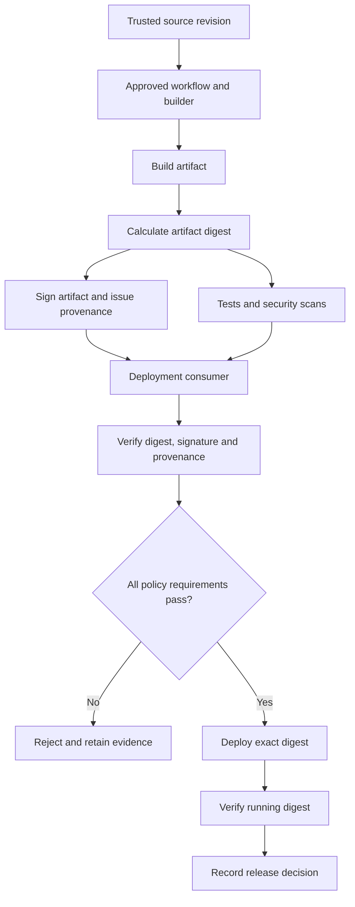

# Verifying Artifacts and Build Evidence Before Deployment

A green pipeline is not enough to prove that the package about to be deployed to production was built and verified properly. An artifact might be pulled by mistake from a different run, modified after testing, created by an untrusted workflow, or lack a clear link to the source commit. If the deploy step simply takes a tag name or file path and executes, the system is relying on implicit trust rather than evidence.

Before deploying, the pipeline must verify both the **artifact contents** and the **origin and build process of the artifact**. The digest identifies the bytes; the signature authenticates the signing identity; provenance/attestation describes the builder, source, and process; test/security evidence records which checks passed; and policy decides whether that evidence satisfies release requirements. Everything must be bound to the exact same artifact digest.

This is part of *software supply chain security*. The goal is to admit only policy-compliant artifacts into the next environment while retaining sufficient evidence to trace from production back to the repository, commit, workflow, and build run that created it.

## 1. Why Verify Before Deployment?

Pipelines often span multiple jobs and data transfer boundaries: a build runner produces a package, an artifact store holds the file, a scanner downloads the package for analysis, a registry publishes an image, staging deploys the image, and production promotes the approved version. Drift or tampering can occur at any boundary.

Common failure modes:

- The deploy job downloads an artifact with the same name but from a different workflow run.
- A container tag is moved after testing, causing deployment to pull a new image.
- An artifact is substituted in the registry or in transit.
- A workflow from an untrusted pull request produces a file that passes into a job with production privileges.
- An image is rebuilt after scanning, so the scan results no longer describe the deployed image.
- A signature is valid, yet was created by an identity unauthorized to release that service.
- Provenance lists the right source commit, but the builder or workflow is not on the trusted list.
- Test reports belong to a different commit or artifact yet still get aggregated into a green gate.
- The artifact lacks an SBOM or has a stale SBOM, leaving the team blind to actual dependencies.

Pre-deployment verification creates an explicit control point: the consumer accepts an artifact only when it can prove the artifact is the exact expected object, originates from an allowed source, and carries complete evidence meeting policy.

## 2. Distinguishing Artifacts, Digests, and Build Evidence

Three concepts—and their related records—must be kept distinct:

| Component | Question Answered | Examples |
|---|---|---|
| Artifact | Which file or image will be deployed? | JAR, ZIP, OCI image |
| Digest | What are the exact byte contents? | `sha256:ab12...89ef` |
| Build provenance | Where and by what process was the artifact built? | Repository, commit, builder, workflow, build invocation |
| Signature | Which identity signed the artifact or attestation? | Workload identity of the release workflow |
| Test/security evidence | Which checks ran on which artifact? | Test reports, scan results, policy evaluations |
| Deployment record | Which artifact digest was deployed to which environment? | `staging`, image digest, timestamp, and verification result |

A digest is a content identifier, not proof of origin. Provenance describes how an artifact was built, yet the consumer must still verify signatures and policy. A signature authenticates the signer and signed content, without by itself proving the artifact is secure. Test reports record check outcomes, but are only valid when bound to the exact digest and issued by a trusted test system.

A trustworthy deployment decision combines all of these elements rather than relying on a `2.4.1` label, `latest`, a filename, or the green status of an arbitrary job.

## 3. Trust Chain from Source to Production

The trust chain starts at the repository and ends at runtime. Every step must preserve the identifiers of the preceding step:

1. **Source:** identify the repository, event, ref, and commit SHA authorized for build.
2. **Builder:** identify the trusted workflow, runner/builder identity, and build configuration.
3. **Build:** create the artifact and record inputs, dependencies, and critical parameters.
4. **Attestation:** issue provenance bound to the artifact's digest.
5. **Verification:** validate digest, signature, identity, provenance, and policy.
6. **Testing/scanning:** test and scan the exact artifact digest and emit verifiable results.
7. **Promotion:** promote the identical digest through staging and production.
8. **Runtime verification:** confirm the environment is running the exact approved digest.
9. **Audit:** store the decision, evidence, approvers, and deployment record.



If any step alters the artifact bytes, a new digest must be computed and prior evidence no longer applies automatically. Never scan one image and then rebuild another image to deploy under the same tag without re-running verification.

## 4. Pinning the Exact Source Revision

Provenance must pinpoint the exact source code that built the artifact. A repository URL or branch name is insufficient because branches are mutable references. Record:

- Repository identity, including host/organization/project and a stable identifier if provided by the platform.
- Event type that triggered the build.
- Ref at trigger time.
- Full checked-out commit SHA.
- For pull requests: head SHA, base SHA, and merge-result SHA if the pipeline tests the merge result.
- Workflow path/ID and run ID/attempt.
- Submodule revisions or critical source dependencies if applicable.

The runner should verify the actual revision after checkout, for instance with `git rev-parse HEAD`. Never allow a build step to switch onto `main` or fetch the latest source after the event has already fixed the commit. When building from a pull request's merge result, provenance must capture both head and base so readers understand the exact revision tested.

For release tags, resolve the tag to a commit SHA and enforce tag protection policies. A name like `v2.4.1` is release metadata; the source SHA identifies what was actually built.

## 5. Builder Identity and Workflow Identity

The builder is the system performing the build. It may be a CI-hosted runner, a dedicated build service, or an organization-managed builder. Provenance must identify the builder clearly enough for consumers to distinguish trusted workflows from arbitrary ones.

Attributes to verify may include:

- Organization/project/repository owning the workflow.
- Workflow file or workflow ID authorized to produce releases.
- Refs or branches permitted to run release builds.
- Runner/builder identity and execution environment.
- Build tool, container base image, and critical plugin versions.
- How the builder obtains credentials and publish privileges.
- Workflow run ID, attempt, and build timestamp.

Never trust provenance merely because it claims `builder: trusted`. That claim must be authenticated via signature/attestation and evaluated against the consumer's trust policy. Workflow names can be spoofed inside a JSON file supplied by the artifact itself; evidence must be signed by an independently authenticated identity.

## 6. Provenance and Attestation

Provenance describes the origin and creation process of an artifact. An attestation is a structured statement about a subject, typically signed or issued through a verifiable system. In the software supply chain, an attestation may carry provenance, an SBOM, or check results.

Useful provenance typically captures:

| Information Group | Required Contents |
|---|---|
| Subject | Artifact name and digest described by the attestation |
| Builder | Identity of the system that created the artifact |
| Build definition | Workflow, build type, and execution configuration |
| Invocation | Run ID, parameters, and execution details |
| Source materials | Repository, commit SHA, and source inputs |
| Dependencies/materials | Dependencies or inputs affecting the build when recorded |
| Metadata | Timestamps, schema version, and traceability data |

SLSA provenance is one example of a supply chain provenance model. An in-toto Statement is a structured attestation format containing a subject and predicate. When adopting a specific format, specify the schema version and assurance level provided by the builder; do not assume every JSON file labeled provenance offers the same level of trust.

Attestations must reference the artifact's digest. If an attestation describes a movable tag without locking a digest, consumers cannot be certain the downloaded content matches what was attested.

## 7. Signatures and Verifying Signer Identity

Digital signatures enable consumers to verify that signed content was not altered after signing and that the signature was produced by the corresponding key or identity. Modern CI can use centrally managed keys or OIDC-based workload identity/keyless signing.

During verification, check at least:

1. Is the signature valid over the exact digest or attestation payload?
2. Was the certificate/key issued by an accepted trust root or issuer?
3. Does the signer identity match repository, workflow, branch/tag, and environment policies?
4. Are the certificate or credentials within their validity period and status per policy?
5. Does the attestation's subject digest match the artifact about to be deployed?

Checking only that a signature exists is not enough. A workflow from an unauthorized repository can also produce a valid signature using its own identity. Consumers must verify *who signed* and *whether that identity is authorized to sign artifacts for this service*.

Private signing keys must never reside in source code, artifacts, or logs. Prefer workload identity and short-lived permissions; when long-lived keys are required, store them in a KMS/HSM or controlled key management system with auditing and rotation procedures.

## 8. Distinguishing Checksums, Signatures, and Provenance

These mechanisms answer different questions:

| Mechanism | Purpose | Limitation |
|---|---|---|
| SHA-256 digest | Identifies byte contents | Does not authenticate origin |
| Digital signature | Verifies content/attestation signed by a given identity | Does not prove the signer is authorized to release without a trust policy |
| Provenance | Describes source, builder, and creation process | Claims require signatures and policies to become trusted evidence |
| SBOM | Inventories software components in an artifact | Does not prove the artifact passed tests or is secure |
| Test report | Records test outcomes | Requires verifying issuer and digest binding |
| Deployment record | Records deployed artifact and outcome | Must be emitted by a trusted deploy/runtime system |

For example, a matching SHA-256 proves only that the downloaded file matches the file referenced by that digest. If an attacker can overwrite both the file and the checksum file in the same writable location, the comparison still passes. Signatures or an independent digest source protect the expected value. Provenance further answers which commit and builder created the file.

## 9. Verifying SBOMs Before Deployment

A Software Bill of Materials (SBOM) inventories the packages, libraries, and components inside an artifact. SBOMs can be published in SPDX or CycloneDX format. They support dependency inventory, license review, and matching against known vulnerabilities.

Consumers should check:

- The SBOM was generated for the exact artifact digest.
- The format and schema version are supported.
- The SBOM was issued by a trusted builder or scanner identity.
- Components include names, versions, and package URLs sufficient for vulnerability database matching.
- Prohibited licenses or packages are handled according to policy.
- The SBOM is not stale relative to the artifact being deployed.

An SBOM is not a security certification. A complete SBOM can still list vulnerable dependencies, and a scanner might fail to detect every component or vulnerability. Pair SBOMs with vulnerability scanning and risk acceptance policies.

If an image is rebuilt or layers change, generate a new SBOM bound to the new digest. Never reuse an SBOM merely because the image tag or release version did not change.

## 10. Verifying Test and Security Evidence

Build provenance proves origin and build process; it does not automatically prove unit tests, integration tests, or security scans passed. If deployment decisions depend on those gates, the pipeline must emit separate evidence or a signed consolidated attestation.

Each piece of test/security evidence should record:

- Inspected artifact subject digest.
- Test suite or scanner and tool version.
- Policy/ruleset or test suite version.
- Execution timestamp and workflow run identity.
- Explicit outcome: pass, fail, skipped, inconclusive, or waived.
- Summary of findings and access-controlled link to detailed reports.
- Evidence-issuing identity and signature if required by policy.

Do not treat the green status of a pipeline run as sole proof if the run included optional jobs, skipped jobs, or jobs with `continue-on-error`. Quality gates must distinguish mandatory results from advisory ones. A skipped test must never count as a pass by default.

If a scanner analyzes an image by tag, confirm which digest the scanner resolved that tag to and record that digest in the report. If the pipeline rebuilds after scanning, the evidence must be treated as inapplicable to the new artifact.

## 11. Trust Policy: Defining Which Artifacts Are Allowed to Deploy

A trust policy defines the conditions an artifact must meet before a consumer accepts it. Policies should be managed as code, reviewed, and versioned as part of the release process.

A policy for a production service might require:

- Repository belongs to an approved organization and project.
- Source revision comes from a protected release branch or tag.
- Builder identity matches an approved release workflow.
- Provenance uses a supported schema and predicate type.
- Subject digest in the attestation equals the digest being deployed.
- Signature is valid and signer identity is in the allowlist.
- SBOM is present and passes dependency/license policies.
- Mandatory test, integration, contract, and security gates pass.
- Artifact was not built from an untrusted pull request workflow.
- Artifact resides in an allowed registry/namespace.
- No revocation status or expired policy exception applies.

Policies must separate mandatory conditions from optional ones. For production, missing critical evidence must typically fail closed: reject deployment until valid evidence or a formally approved exception exists. Never bypass verification automatically when an attestation server is temporarily unreachable.

Exceptions must record the approver, justification, artifact digest, environment scope, expiration date, and accepted risk. Never use permanent exceptions or wildcard policies to work around a specific failure.

## 12. Consumers Must Verify Independently

Producers are responsible for generating artifacts and evidence; consumers are responsible for verifying them before use. Never assume a producer checked every condition required by the consumer. For instance, staging may accept builds from experimental branches, whereas production accepts only builds from release workflows on protected branches.

Consumer-side verification should proceed in order:

1. Resolve the artifact reference to an immutable digest.
2. Download the exact artifact by digest or specific artifact ID.
3. Recompute the digest on the received bytes and compare.
4. Fetch signatures and attestations from a trusted source.
5. Verify signatures, issuers, and signer identities.
6. Parse provenance and verify schema, subject, and source materials.
7. Match builder/workflow/ref against the trust policy.
8. Fetch the SBOM and test/security evidence for the same digest.
9. Evaluate policy and record the decision.
10. Deploy only the verified digest; write a deployment record.

Verification should occur at the deploy or promotion boundary, even if an earlier scan job ran. Consumers must validate the data they are about to consume rather than trusting filenames or in-memory results from another job.

## 13. Example: Verifying a Container Image with Cosign

Cosign is a tool in the Sigstore ecosystem that supports signing and verifying container images and attestations. The example below illustrates verifying an image by digest and authorized identity:

```bash
IMAGE="registry.example/team/order-service@sha256:ab12...89ef"

cosign verify \
  --certificate-identity="https://github.com/acme/order-service/.github/workflows/release.yml@refs/heads/main" \
  --certificate-oidc-issuer="https://token.actions.githubusercontent.com" \
  "$IMAGE"

cosign verify-attestation \
  --type slsaprovenance \
  --certificate-identity="https://github.com/acme/order-service/.github/workflows/release.yml@refs/heads/main" \
  --certificate-oidc-issuer="https://token.actions.githubusercontent.com" \
  "$IMAGE"
```

The registry, digest, repository, and workflow values in the example are placeholders. Syntax and predicate types must match your Cosign version, attestation format, and platform certificate issuance. Exact identity strings depend on the workflow and issuer; obtain them from your actual OIDC configuration rather than copying the example directly into production.

These two commands demonstrate verifying an image signature and attestation. A production workflow must also inspect the predicate, validate source commit, builder, workflow, and subject digest, and evaluate the trust policy. A successful verify command does not automatically enforce all organizational policies.

## 14. Example Provenance Structure

An in-toto Statement attestation can conceptually look like this:

```json
{
  "_type": "https://in-toto.io/Statement/v1",
  "subject": [
    {
      "name": "registry.example/team/order-service",
      "digest": {
        "sha256": "ab12...89ef"
      }
    }
  ],
  "predicateType": "https://slsa.dev/provenance/v1",
  "predicate": {
    "buildDefinition": {
      "buildType": "https://ci.example/builders/gradle-container/v1",
      "externalParameters": {
        "repository": "https://github.com/acme/order-service",
        "ref": "refs/heads/main"
      },
      "internalParameters": {},
      "resolvedDependencies": [
        {
          "uri": "git+https://github.com/acme/order-service",
          "digest": {
            "gitCommit": "9f4c...e81a"
          }
        }
      ]
    },
    "runDetails": {
      "builder": {
        "id": "https://ci.example/builders/release"
      },
      "metadata": {
        "invocationId": "run-1842-attempt-1",
        "startedOn": "2026-11-18T08:00:00Z",
        "finishedOn": "2026-11-18T08:04:00Z",
        "completeness": {
          "parameters": true,
          "environment": true,
          "materials": true
        }
      }
    }
  }
}
```

This is a condensed example illustrating the relationship between subject digest, source dependencies, and builder. Real SLSA attestations must conform to the corresponding schema/predicate version; never treat this illustrative JSON as a valid release file without validation. `...` values are placeholders and must be replaced with real digests/commits.

Consumers must verify the signature wrapping the attestation before trusting the JSON payload. Only then should they check predicate type, schema version, subject digest, source repository, commit, build type, and builder identity.

## 15. Building a Deploy Gate in CI/CD

A deploy gate should consolidate verification outcomes into a single auditable decision. Conceptual logic example:

```text
function authorizeDeployment(artifact, targetEnvironment):
    digest = resolveImmutableDigest(artifact)
    require(digest.algorithm == "sha256")

    downloaded = fetchByDigest(artifact.location, digest)
    require(sha256(downloaded) == digest.value)

    signature = fetchSignature(digest)
    require(verifySignature(signature, trustedIssuers))
    require(identityAllowed(signature.identity, targetEnvironment))

    provenance = fetchAndVerifyProvenance(digest)
    require(provenance.subjectDigest == digest)
    require(provenance.repository in allowedRepositories)
    require(provenance.commit is a full immutable revision)
    require(provenance.builder in trustedBuilders)
    require(provenance.workflow in allowedWorkflows)

    evidence = fetchEvidence(digest)
    require(evidence.requiredTests == "passed")
    require(evidence.securityPolicy == "passed")
    require(evidence.sbom is valid and policyCompliant)

    return DeploymentAuthorization(digest, evidence, policyVersion)
```

This is decision pseudocode; functions must be implemented using your organization's verifier, registry API, and policy engine. Never parse JSON and blindly trust `verified: true` fields written by the producer itself without verifying signatures and issuers.

The gate output should record the artifact digest, target environment, policy version, inspected evidence, timestamp, outcome, and rejection reason. If policies change later, you can still see which rule set approved an earlier release.

## 16. Distinguishing Build-Time and Deploy-Time Verification

Some checks run at build time, yet the deploy consumer must still verify the artifact before using it.

| Stage | Checks | Goal |
|---|---|---|
| Source/PR | Workflow review, lint, static analysis, secret scan | Reduce risk of untrusted changes entering the builder |
| Build | Record source revision, toolchain, dependencies, and generate provenance | Produce origin and build process evidence |
| Publish | Compute digest, sign artifact/attestation, enforce registry policies | Protect content identity and release origin |
| Test/scan | Run tests and scanners on the published digest | Verify the exact artifact to be promoted |
| Deploy | Verify digest, signature, provenance, and evidence | Block artifacts that fail trust policy |
| Runtime | Verify running digest and monitor health | Detect post-deployment drift |

Build-time validation fails fast and saves cost. Deploy-time verification is the final boundary before admitting an artifact into a sensitive environment. Never skip deploy-time verification simply because the build workflow contains a job named `verify`.

## 17. Separating Untrusted Build Workflows from Release Workflows

Pull requests from forks or unprotected branches can alter source code, build scripts, and workflows. If those jobs hold permission to sign releases, write to production registries, or read deploy secrets, untrusted code can seize those privileges.

A secure design typically separates:

- **Untrusted validation:** checks out and tests PR code with a read-only token, no production secrets, and no release publish permissions.
- **Trusted build/release:** runs on protected branches/tags or independently managed workflows with dedicated builder identities and publish rights.
- **Verification/consumer:** verifies artifacts and attestations against policy without executing scripts extracted from unverified artifacts.
- **Deployment:** accepts only gate-approved digests, uses environment-scoped identities, and enforces risk-appropriate approvals.

On GitHub Actions, exercise special caution with `pull_request_target`: this event executes in the context of the base repository and may hold elevated permissions. Never check out and run code from an untrusted head in a workflow with secrets or privileged tokens. `workflow_run` can establish a privilege boundary between workflows, yet upstream artifacts remain untrusted data until verified.

Release workflows must be protected like high-privilege code: review workflow edits, pin actions by commit SHA per policy, restrict `permissions`, protect environments, and constrain OIDC identities.

## 18. Protecting Runners and Build Environments

Provenance is trustworthy only when the builder and environment that created it are protected. Shared runners can retain workspaces, credentials, or processes from previous jobs. Untrusted build code can read leftover files or interfere with subsequent jobs.

Key safeguards:

- Prefer ephemeral runners for jobs handling untrusted code.
- Clean workspaces, processes, containers, and credentials after every job.
- Never run untrusted jobs and privileged release jobs on the same persistent runner without strong isolation boundaries.
- Restrict builder network egress; allow access only to required dependencies and registries.
- Pin build images, toolchains, and actions/plugins per policy.
- Never fetch scripts from mutable URLs and execute them without content verification.
- Scope source read, artifact publish, signing, and deployment permissions by job.
- Record builder identity and environment configuration in provenance.
- Update runner images in a controlled manner and track vulnerabilities.

Self-hosted runners may be needed for internal networks or specialized hardware, but must be treated as sensitive infrastructure. Allow only trusted workflows to use runners with production access; group runners by trust level and restrict which repositories can invoke them.

## 19. Protecting Artifact Stores and Registries

The artifact store/registry is part of the trust boundary. Consumers must be sure artifacts come from the right namespace and were not altered after publishing.

Enforce:

- Separate push/pull/delete permissions; build jobs must not be able to delete published releases.
- Separate namespaces for temporary, snapshot, and release artifacts.
- Immutable release tags or version policies preventing overwrites.
- Digest-based retrieval for all scan and deploy steps.
- Audit logging for publishes, tag updates, deletions, and permission changes.
- TLS, short-lived credentials, and proper secret management.
- Sufficient retention for rollbacks, investigations, and audit requirements.
- Digest-verified replication across deployment regions.
- Quarantine/revocation workflows for problematic artifacts.

Never use `latest`, `stable`, or mutable tags as proof that contents were tested. Tags can assist humans, whereas deployment references should use verified digests.

## 20. Handling Missing Test Reports and Evidence

A deploy gate must distinguish states rather than collapsing everything into a simple pass/fail:

| Status | Meaning | Recommended Handling |
|---|---|---|
| Passed | Check ran and succeeded | May proceed if other gates pass |
| Failed | Check ran and found failures | Block deployment per policy |
| Skipped | Did not run | Accept only if policy explicitly marks as not applicable |
| Cancelled | Job was cancelled | Do not count as pass; re-run or decide per policy |
| Timed out | Did not finish within allowed time | Block mandatory gates and investigate root cause |
| Inconclusive | Scanner/test could not produce a definitive result | Handle per policy; never auto-promote to pass |
| Waived | Approved exception exists | Verify approver, rationale, scope, and expiry |
| Missing | No evidence found | Fail closed on mandatory gates |

Reports must include the subject digest and producer identity. Storing an isolated `test-results.xml` file without knowing which run or artifact it belongs to cannot serve as release evidence.

Never reuse stale reports for a new artifact. If a scanner re-runs on the same digest using a newer vulnerability database, record the timestamp and database/ruleset version to interpret the outcome. Some policies require re-scanning before production if evidence is too old or threat intelligence has changed significantly.

## 21. Policies by Environment and Risk Level

Not every environment requires the same level of verification. Development may accept builds from experimental branches in an isolated namespace; production requires stricter source, builder, signer, and evidence guarantees.

Example:

| Condition | Development | Staging | Production |
|---|---|---|---|
| Source | Permitted branch/PR | Integration or release candidate branch | Protected branch or signed release tag |
| Builder | Registered CI builder | Trusted CI builder | Strictly allowlisted builder identity |
| Signature | Recommended or required by data sensitivity | Required by policy | Mandatory |
| Provenance | Minimum source and builder | Full source/workflow/materials | Full and policy-verified |
| Tests | Relevant unit/component tests | Required integration/contract/E2E tests | Mandatory release evidence |
| Security | Baseline scans | Scans per release policy | Scans meeting production thresholds |
| Approval | May be automated | Risk-based review | Environment approval or change control when required |
| Artifact reference | Digest | Digest | Promoted digest |

This table is illustrative, not a universal standard. Verification depth must reflect data sensitivity, blast radius, and recoverability. Regardless of environment, preserve the digest to know exactly what is running.

## 22. Promotion: Do Not Rebuild After Verification

Once an artifact has been tested and verified, staging and production should receive the identical digest. Promotion changes the release state or usage authorization of an artifact—it does not rebuild from source.

A sound flow:

1. Build the artifact and publish digest `D`.
2. Sign artifact `D` and issue provenance `P(D)`.
3. Run tests/scans on `D`; store evidence `E(D)`.
4. Deploy `D` to staging.
5. Verify staging runtime is running `D` and post-deploy checks pass.
6. Evaluate policy over `P(D)` and `E(D)`.
7. Promote the exact same `D` to production.
8. Verify production runtime is running `D`.

If a rebuild is needed due to changes in source, toolchain, or build configuration, the output is a new artifact with a new digest. New provenance must be issued and required checks re-run. Never attach evidence from `D1` to `D2` merely because both share the same release version.

## 23. Post-Deploy Runtime Verification

A deploy tool returning exit code 0 proves only that the platform API accepted the deployment operation. It does not prove workloads pulled the right image, rollout finished, or traffic is reaching the new version.

After deployment, verify:

- Actual image/package digest in deployment specs or runtime metadata.
- Pods/tasks/instances are ready with no lingering wrong-version replicas per rollout policy.
- Health/readiness endpoints and smoke tests pass.
- Error rates, latency, saturation, and logs/traces remain within thresholds.
- Feature flags and environment configs match the deployment record.
- Rollout did not stall midway or leave an unintended mix of versions.

If the runtime digest differs from the approved digest, halt the rollout and investigate. Causes may include mutable tags, registry mirrors, platform manifests, deployment controllers, or pipelines passing the wrong reference. Record both expected digest and actual digest in the release record.

## 24. Revoking and Handling Untrusted Artifacts

An artifact may be discovered post-publish to contain a dangerous dependency, originate from a compromised workflow, or carry invalid provenance. Organizations need a quarantine/revocation workflow:

1. Identify the digest and all releases/environments using it.
2. Mark the artifact ineligible for promotion; update policies or audited registry metadata.
3. Block new deployments and halt pending rollouts.
4. Assess production impact and choose rollback or roll-forward.
5. Produce a replacement artifact from verified source/builder.
6. Re-run tests, scans, signatures, and provenance verification.
7. Record the incident log and the link between the revoked digest and the replacement digest.

Deleting a tag is insufficient to revoke an artifact if workloads have already pulled the image or can fetch by digest. Deployment policies must check revocation status, potentially backed by registry denylists, admission policies, or release authorization systems.

## 25. Audit Trails and Evidence for Deployment Decisions

Each deployment decision should produce an immutable or properly audited record containing:

- Artifact URI, version, and digest.
- Source repository, commit SHA, and event.
- Builder/workflow identity, run ID, and attempt.
- Signature verification result and signer identity.
- Provenance/attestation reference plus schema/predicate version.
- SBOM reference and policy outcome.
- Test/security evidence references, statuses, and timestamps.
- Applied trust policy version.
- Target environment and approver or automation identity.
- Expected and actual post-deploy runtime digests.
- Rollout result, smoke test result, and any rollback actions.

Audit trails answer which artifact ran, why it was permitted, who or which workflow made the decision, and what evidence was evaluated. Storing only a link to a report may be insufficient if reports can be deleted or altered; enforce appropriate retention and integrity policies.

## 26. Common Anti-Patterns

| Anti-Pattern | Risk | Remediation |
|---|---|---|
| Deploying by mutable tag | Tag can point to different content | Resolve and deploy by digest |
| Trusting filenames or release versions | Does not identify exact bytes | Verify digest on actual artifact |
| Trusting provenance without verifying signature | Attackers can forge claims | Verify signer/issuer and trust policy |
| Checking only that a signature exists | Signer may be unauthorized | Allowlist identities by repo/workflow/environment |
| Skipping subject digest checks | Attestation may describe a different artifact | Compare subject digest with deployed digest |
| Reusing test reports from another run | Green gate does not apply to current artifact | Bind evidence to specific run and digest |
| Scanning image by tag then deploying tag | Image can change between scan and deploy | Scan and deploy the exact same digest |
| Rebuilding after testing | Evidence no longer describes new output | Build once, promote same digest |
| Treating SBOM as a security certification | SBOM is only an inventory | Pair with vulnerability/license policies |
| Granting untrusted PRs sign/publish permissions | Can issue forged artifacts or steal secrets | Separate untrusted validation and trusted releases |
| Skipping evidence when a service is temporarily down | Unverified artifacts can still deploy | Fail closed or use time-bound waivers |
| Skipping post-deploy runtime verification | Wrong digest can run despite green deploy job | Read actual digest and check health |

## 27. Pre-Deployment Artifact Verification Checklist

Before allowing an artifact into staging or production, check:

- [ ] Artifact is referenced by immutable digest.
- [ ] Recomputed digest from downloaded bytes matches expected digest.
- [ ] Artifact originates from an allowed registry/namespace or workflow run.
- [ ] Source repository and commit SHA are explicitly identified.
- [ ] Pull requests include head/base/merge SHAs matching the test target.
- [ ] Builder and workflow identities comply with trust policy.
- [ ] Provenance uses a supported schema/predicate with a valid signature.
- [ ] Subject digest in provenance matches the artifact digest.
- [ ] Signer identity, issuer, and trust root are verified.
- [ ] SBOM describes the exact digest and passes dependency/license policies.
- [ ] Test reports and security evidence belong to the same digest.
- [ ] All mandatory gates pass; skipped, missing, timeout, and inconclusive states are handled explicitly.
- [ ] Artifact is not revoked and evidence satisfies freshness policy.
- [ ] Artifact was not rebuilt or modified after verification.
- [ ] Staging/production promotion uses the identical digest.
- [ ] Deploy job has least privilege and never executes scripts from unverified artifacts.
- [ ] Post-deploy runtime is verified for actual digest and health.
- [ ] Deployment decision, evidence, and policy version are recorded.
- [ ] Quarantine/revocation and rollback procedures exist when an artifact is no longer trusted.

## 28. Conclusion

Verifying artifacts before deployment is the control point between software creation and live environments. Digests identify contents; signatures authenticate signers; provenance links artifacts to sources and builders; SBOMs inventory dependencies; test/security evidence proves which checks ran; and trust policies combine them into allow or deny release decisions.

Consumers must independently verify evidence against the exact artifact digest they are about to deploy. Pipelines should separate untrusted workflows from release workflows, protect builders and registries, fail closed when mandatory evidence is missing, promote the identical digest across environments, and verify runtime after deployment. When every decision is bound to a digest, identity, and audit trail, teams can explain exactly why an artifact entered production and trace accurately during investigations or revocations.
