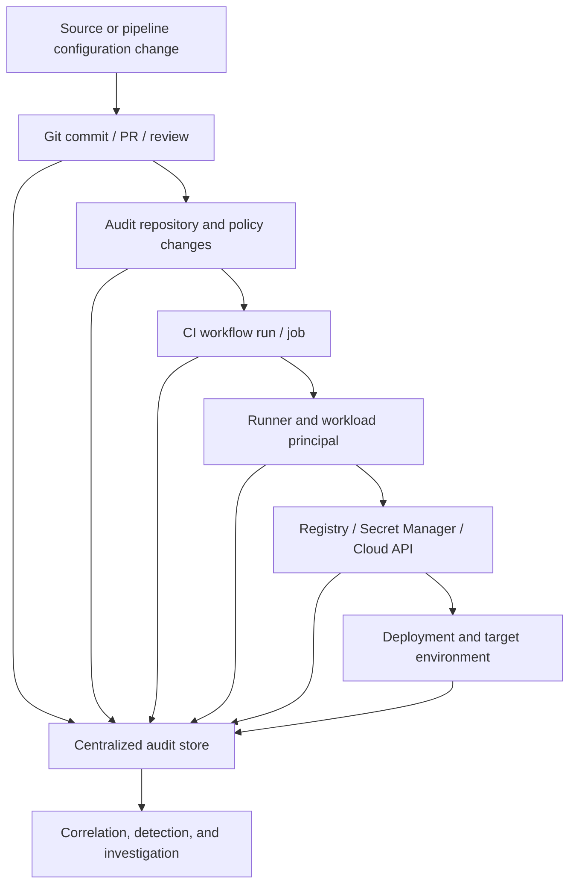

# Recording Pipeline Changes and Permission Usage

CI/CD pipelines can read source code, fetch dependencies, produce artifacts, access secrets, and modify production environments. Therefore, pipeline security does not depend solely on configuring permissions properly; teams must also know who modified configurations, which changes were approved, which jobs actually exercised permissions, and which resources were affected.

Activity recording (audit logging) produces traceable evidence of changes and actions. A commit shows that a pipeline file changed; Git hosting audit events show who altered branch protection or repository permissions; the CI control plane records which workflow run executed; cloud audit logs show which workload principal called an API; and the deployment system records which artifact digest entered an environment. Rarely does any single log source answer the entire chain on its own.

The goal is to connect three questions: **who changed the pipeline's capabilities, which pipeline/job used which permissions, and which resources those actions impacted**. When data is normalized, protected against unauthorized modification or deletion, and paired with risk-based alerting, teams can detect privilege abuse, investigate incidents, and prove release governance.

## 1. What Should Pipeline Auditing Record?

Pipeline auditing should cover both configuration changes and runtime execution activity. These two groups are related yet distinct:

- **Configuration/change audit:** who edited workflows, token permissions, runners, secret references, environment protections, service connections, trust policies, or branch rules; before/after values; and associated approvals.
- **Execution/access audit:** which pipeline runs/jobs executed, which principals received tokens, which permissions were used, which APIs/resources were accessed, which artifacts were published, and which deployments occurred.

For example, a pull request changing a workflow's `permissions` from source read-only to package write is configuration change evidence. When a job actually publishes a package, registry audit logs show which principal wrote which package and when. Both events are needed to evaluate whether the action was legitimate.



### 1.1. Which Changes Should Be Tracked?

At a minimum, track:

- Workflow/pipeline files such as `.github/workflows/**`, `.gitlab-ci.yml`, `Jenkinsfile`, `azure-pipelines.yml`, `.circleci/**`, and deployment scripts.
- Reusable workflows, actions, orbs, Jenkins Shared Libraries, plugins, templates, and tasks invoked by pipelines.
- `permissions`, token scopes, service connections, cloud roles, OIDC trust policies, and credential bindings.
- Secrets created, updated, rotated, deleted, or having access permissions changed; log only required metadata, never secret values.
- Runners/agents registered, removed, relabeled, moved between groups, re-imaged, or reconfigured for networking.
- Branch protections, rulesets, CODEOWNERS, required status checks, webhooks, and repository settings.
- Environment protections, deployment approvals, concurrency rules, release conditions, and policy gates.
- Registry policies, artifact retention, immutability, push/pull/delete rights, and tag modifications.
- IAM role assignments, permission policies, service accounts, managed identities, and related admin rights.

A seemingly minor change—such as dropping a required check or adding a `write` permission—can alter the pipeline's entire security boundary. Changes must therefore be classified by impact, not merely by diff line count.

### 1.2. Which Runtime Actions Should Be Tracked?

Record events such as:

- Pipeline triggers: push, pull request, tag, schedule, bot, or manual trigger.
- Human or bot initiating, cancelling, retrying, approving, or rerunning a workflow.
- Workflow revision, commit SHA, run ID, job ID, and executing runner/agent.
- Requested tokens, federated principals, assumed roles, and credential lifetimes.
- Secret references/versions accessed by workloads, by which principal, and from which job.
- Registry artifact read/write/delete operations; digest, package version, and target repository.
- Cloud, Kubernetes, or deployment API calls; action, resource, outcome, and request ID.
- Deployed artifact digest, environment config, and release.
- Pipeline auditing disabled, retention altered, or audit logs exported/accessed by administrators.

Not every platform emits every event at the same granularity. Verify the actual data sources, retention limits, plan tiers, and API quotas of each system.

## 2. Distinguishing Audit Logs, Pipeline Logs, and Application Logs

These log types answer different questions:

| Data Type | Records | Question Answered |
|---|---|---|
| Platform audit logs | Changes to settings, permissions, policies, users, runners, approvals, and admin actions | Who altered configurations or performed administrative actions? |
| Pipeline/job logs | Commands run, steps, output, test status, errors, and execution duration | What did the job do while executing? |
| Cloud/resource audit logs | API calls, principals, actions, resources, source IP/request context, and outcomes | Which workload accessed or modified the target resource? |
| Deployment/release records | Artifact digest, environment, rollout, approvals, and status | Which version was deployed where and when? |
| Application/operational logs | Application behavior, requests, business errors, and runtime events | How is the application behaving after deployment? |

Pipeline logs can be tampered with or withheld if a runner is compromised. Cloud audit logs are normally recorded on the target system independently of the runner, making them crucial evidence for verifying real API calls. Git hosting audit logs capture repository setting changes, though not necessarily every shell command inside a job. Combine multiple sources.

### 2.1. Auditing Does Not Replace Observability

Metrics, traces, and application logs illuminate system health and performance. Audit logs focus on actor, action, resource, and timestamp. For example, metrics reveal rising deployment error rates; traces pinpoint request timeouts; audit logs identify which principal just updated the deployment or changed a policy. All three complement one another.

## 3. Event Sources and Correlating Evidence

A complete audit trail typically ingests data from multiple systems:

| Source | Events to Collect | Correlation Identifiers |
|---|---|---|
| Git hosting | Commits, PRs/MRs, reviews, merges, branch rules, repository settings, webhooks | Repository/project, commit SHA, PR/MR ID, actor ID |
| CI control plane | Workflow runs, jobs, triggers, reruns, cancellations, approvals, workflow revisions | Run ID, job ID, workflow path/revision, event ID |
| Runner/agent | Registration, image, labels, pool, start/stop, network/security posture | Runner ID, agent ID, machine/container ID |
| Identity provider/IAM | Token federation, role assumption, policy changes, service principal updates | Issuer, subject, audience, principal/role ID, session ID |
| Secret manager | Secret create/update/delete, access attempts, version reads, policy changes | Secret reference, version, principal, request ID |
| Artifact registry | Push, pull, delete, tag changes, retention/immutability changes | Repository, package/version, digest, principal |
| Cloud/platform API | API calls, resource changes, permission changes, denied requests | Account/project, resource ID, action, request ID |
| Deployment platform | Approvals, rollouts, rollbacks, environment/config updates | Release ID, environment, artifact digest, deployment ID |
| SIEM/audit storage | Ingestion, queries, exports, retention changes, audit data access | Event ID, source, storage object, reader identity |

### 3.1. Using Correlation IDs and Immutable Identifiers

Do not correlate events solely by display names like `deploy-prod` or `release-123`. Those names can collide or change. Prefer stable identifiers:

- Commit SHA and repository ID.
- Pull request / merge request ID.
- Workflow run ID, job ID, and workflow revision.
- Runner/agent ID.
- OIDC issuer, subject, audience, and cloud principal/session ID.
- Artifact digest, package version, and registry repository.
- Deployment/release ID, environment ID, and resource ID.
- Request ID / correlation ID returned by target services.

If a platform does not automatically propagate run IDs into cloud audit logs, the pipeline can pass correlation metadata in session names, deployment annotations, or request tags where supported. Such metadata does not replace platform-authenticated principals; it merely links events together. Never place secrets or unnecessary personal data into tags.

### 3.2. Normalizing Time

Systems may use different time zones and timestamp precisions. Store normalized UTC timestamps, retain original timestamps if needed, and keep clocks on runners/agents and self-managed systems synchronized via appropriate time synchronization mechanisms. During investigations, distinguish event occurrence time, source log-write time, and SIEM ingestion time; ingestion lag can reorder displayed events relative to reality.

## 4. Designing Audit Event Structure

Audit events should follow a stable, searchable schema independent of any single platform's presentation format. A record can include:

| Field | Purpose |
|---|---|
| `event_id` | Unique identifier for the event |
| `event_time` | UTC timestamp when the event occurred |
| `ingest_time` | Timestamp when the audit system received the event |
| `event_type` | Action category: `permission_changed`, `workflow_run`, `secret_accessed`, `deployment_created`, etc. |
| `actor` | User/bot that initiated or requested the action |
| `workload` | Repository, workflow, run, job, runner, and executing principal |
| `target` | Resource accessed or modified |
| `action` | Specific action and outcome |
| `change` | Before/after values or diff reference for configuration changes |
| `authorization` | Role, scope, policy revision, and allow/deny decision |
| `correlation` | Commit, PR, run, session, request, artifact digest, and deployment ID |
| `source` | Originating system, tenant/account/project, and original event ID |
| `integrity` | Signature, checksum, or metadata proving origin and integrity if available |

Example normalized record (illustrative data):

```json
{
  "event_id": "evt-7f21",
  "event_time": "2026-11-18T08:30:12Z",
  "ingest_time": "2026-11-18T08:30:14Z",
  "event_type": "pipeline.permission_changed",
  "actor": {
    "type": "user",
    "id": "user-184",
    "display_name": "release-admin"
  },
  "target": {
    "type": "repository_workflow",
    "id": "repo-42/.github/workflows/release.yml"
  },
  "action": {
    "name": "update_workflow_file",
    "result": "success"
  },
  "change": {
    "field": "permissions.packages",
    "before": "read",
    "after": "write",
    "commit_sha": "a1b2c3d"
  },
  "correlation": {
    "pull_request": "PR-318",
    "review_id": "review-91"
  },
  "source": {
    "system": "git-hosting",
    "event_id": "source-evt-551"
  }
}
```

The sample record contains no tokens or secrets. In real systems, preserve original source IDs and schemas for cross-referencing rather than keeping only a normalized interpretation and discarding raw evidence.

## 5. Tracking Pipeline Configuration Changes

### 5.1. Managing Pipelines as Code

Workflows, Jenkinsfiles, templates, and deployment scripts belong in version control so diffs, commit histories, reviews, and rollbacks exist. Changes must go through pull requests/merge requests, required checks, and appropriate code owners. For sensitive files like release workflows, trust policies, or deployment scripts, require reviewers from the platform/security teams.

Audit records should link:

- Commit author actor and PR author actor.
- Commit SHA, branch/ref, and list of modified files.
- Reviewers, approvals, conversation resolutions, and merge actor.
- Required check outcomes and executed workflow revision.
- Final merged commit, including composite revisions produced by merge queues or merge commits.
- Which pipeline runs executed the new configuration.

Commit history shows changes stored in Git; Git hosting audit logs capture administrative actions such as changes to branch protection, repository permissions, or webhooks. Both sources complement each other.

### 5.2. Protecting High-Impact Changes

Treat the following changes as high-risk:

- Adding `write`, `admin`, or deploy permissions to tokens/jobs.
- Removing required status checks, CODEOWNERS, or approval rules.
- Changing triggers to run on events with higher-privilege contexts.
- Switching runner labels/pools to self-hosted runners with internal network access.
- Pointing actions, orbs, plugins, or reusable workflows to untrusted sources/revisions.
- Disabling secret masking, environment protection, audit exports, or log retention.
- Expanding OIDC trust policies, IAM roles, or service connections.
- Allowing workflows from untrusted branches/forks to access secrets.

For high-impact changes, require independent review, owner approval, and inspection of before/after diffs. Never allow the person modifying a policy to be the sole approver of their own change when separation of duties applies.

### 5.3. Recording Effective Permissions and Configuration

Saving only the YAML file diff is insufficient. Effective permissions also depend on repository settings, organization policies, cloud IAM, environment protections, runner groups, and service connections. Record a snapshot or revision of effective settings at job runtime to the extent supported by the platform.

For example, a workflow might declare `contents: read`, while an organization policy or token scope further expands or restricts behavior through its own mechanisms. A job using a service connection can inherit privileges from cloud role assignments. Auditing must capture both pipeline configuration and target-side policies, not just one line of YAML.

## 6. Tracking Actual Permission Usage

Configured permissions tell you what a job *could* do; target resource audit logs tell you what a principal *did* do. Compare the two.

For example, a job holds `packages: write` yet never publishes a package—indicating permissions are broader than needed. Conversely, a job intended only to read artifacts appearing in cloud audit logs with delete or IAM policy change calls is a clear trigger for investigation.

### 6.1. Recording Permission Snapshots

At job start, where supported by the platform, record:

- Token permissions/scopes granted to the job.
- Repository/project, ref, event, and workflow revision.
- Necessary OIDC claims: issuer, subject, audience, and relevant context; never store raw bearer tokens.
- Assumed cloud role/service principal and policy revision.
- Service connection, environment, and runner group used.
- Issuance and expiration timestamps of temporary credentials.

Snapshots enable investigating the exact permissions active at runtime even if policies change afterward.

### 6.2. Recording Actions on Target Resources

Collect audit logs from registries, secret managers, cloud control planes, Kubernetes audits, databases, and deployment services. Focus on impactful actions such as:

- Reading/writing/deleting artifacts or altering tags.
- Reading secrets, creating secret versions, modifying policies, or exporting secrets.
- Creating/modifying/deleting IAM roles, bindings, service accounts, or trust relationships.
- Creating/modifying/deleting cluster resources, deployments, namespaces, network rules, or storage policies.
- Disabling logging, altering retention, deleting logs, or changing audit store read permissions.
- Accessing resources outside the expected project/environment.

Not every package read or API call is high-risk. Correlate principal, resource, action, timestamp, and run context to reduce false alarms.

### 6.3. Reconciling Granted vs. Used Permissions

Build a per-job comparison table:

| Job | Granted Permissions | Observed Actions | Assessment |
|---|---|---|---|
| PR validation | Read source, read dependencies | Checkout and dependency fetch | Appropriate |
| Unit test | Read source, read test services | Reads test database, no production writes | Appropriate if test data is isolated |
| Publish artifact | Read source, write one registry namespace | Pushes image and metadata | Appropriate if digest and origin are verified |
| Deploy staging | Read artifact, update staging namespace | Pulls digest and rolls out staging | Appropriate |
| Deploy production | Read artifact, update production deployment | Rolls out production post-approval | Verify actor, approval, and release ID |

If granted permissions are significantly broader than observed actions, narrow the scope. If observed actions exceed the job's intended mission, investigate token compromise, workflow tampering, or misconfigured trust policies.

## 7. Auditing Secret Access Without Exposing Secrets

Secret manager audit logs should record which human or workload principal requested which secret, which version, from which app/job, at what time, and whether access was allowed or denied. Never write secret values, private keys, tokens, or sensitive payloads to logs.

Useful fields:

- Secret reference/path and version ID.
- Principal, workload, job/run ID, and environment.
- Action: read, create, update, rotate, delete, policy change.
- Result and request/correlation ID.
- Associated approval or policy if applicable.
- Access origin such as account, project, network zone, or runner pool when provided by the system.

A single secret read may be legitimate, whereas reading a production secret from a pull request job or an untrusted runner pool is anomalous. Alert rules should evaluate secret type, principal, ref, event, environment, and timing together.

## 8. Protecting Audit Logs Against Tampering and Deletion

If someone authorized to alter pipelines can also delete the logs proving their actions, auditing loses all credibility. Send logs to a storage system independent of runners and pipeline admin roles.

### 8.1. Centralizing Logs in a Separate Administrative Domain

- Ship events from Git hosting, CI, IAM, secret managers, registries, and cloud providers to a centralized audit sink/SIEM.
- Use a separate storage account or project isolated from workload execution accounts.
- Grant runners write-only log-shipping rights via controlled channels, with no rights to modify or delete ingested logs.
- Restrict audit log readers by role; log reads and exports must themselves be audited.
- Retain raw events or original event IDs alongside normalized records for verification.

### 8.2. Append-Only Storage and Retention

When audit or forensic demands are high, use immutable/WORM storage, object locks, or appropriate retention locks. Separate permissions to alter retention or delete data from pipeline operators. Set retention based on legal, contractual, organizational policy, and cost requirements; avoid indefinite retention without justification.

### 8.3. Integrity and Detecting Missing Logs

Use signatures, checksums, hash chains, signed checkpoints, or storage platform integrity controls to detect log tampering. These mechanisms do not prove an event's content is truthful if the originating source was already compromised; they primarily detect post-collection tampering.

Monitor ingestion health too: sources that stop emitting, delayed events, exceeded quotas, failing collectors, or altered retention settings. Missing logs can signal an incident, not merely "zero activity."

### 8.4. Protecting Sensitive Audit Contents

Audit logs can contain usernames, IP addresses, private repositories, resource IDs, and release metadata. Restrict access, mask unnecessary fields, and enforce appropriate retention. Never log raw secrets or bearer tokens "for troubleshooting."

## 9. Detecting Anomalous Changes and Behavior

Auditing is only useful when events are searchable and turned into actionable signals. Alert on high-risk changes and behaviors while establishing baselines to avoid alert fatigue.

Scenarios worth alerting on:

- Branch protection or required checks disabled/altered outside normal workflows.
- Workflows granted additional write/admin permissions or expanded OIDC trust.
- Release pipeline files modified without required approvals.
- New runners registered in sensitive pools or runner labels/network policies altered.
- Production secrets read by pull requests, unauthorized branches, or unauthorized jobs.
- Service connections, IAM roles, or production policies modified by unusual principals.
- Release artifacts deleted, immutable tags altered, or production digests mismatching release records.
- Production deployments lacking approvals or unlinked from verified artifacts.
- Audit logging, export, retention, or audit store access controls weakened.
- Principals accessing resources outside their designated project, namespace, or environment.
- A workload triggering bursts of authentication failures or administrative actions.

### 9.1. Correlating Multiple Signals

A single event in isolation may be benign. For instance, editing a workflow is normal inside a reviewed pull request. Yet if branch protection is disabled, an unknown runner is registered, and a production secret is read around the same time, risk spikes sharply.

A strong detection rule correlates:

- Actor/principal and historical activity baseline.
- Repository, branch/ref, workflow, and event type.
- Permission scope and target resource.
- Associated approvals/reviews.
- Timing, network origin, and runner identity.
- Artifact digest, release ID, and deployment state.

## 10. Example: Auditing When a Workflow Gains Package Publish Permissions

Suppose a pull request modifies a build workflow from source read-only to having package publish permissions.

**Before the change:** the build job only checks out source, restores dependencies, and runs tests. The workflow holds repository read permissions.

**Proposed change:** adds write permission to the package registry. The audit trail should record commit, PR ID, actor, reviewers, permission diff, and required checks. Pipeline/security code owners review why the new permission is needed.

**At execution time:** CI logs run ID, job ID, workflow revision, ref, runner ID, and permission snapshot. If the job obtains an OIDC token, record issuer/subject/audience and assumed principal—never the raw token.

**On publish:** registry audit logs record principal, package namespace, version/digest, push action, and outcome. The release record links the digest to the commit/build run.

**Post-execution:** the system reconciles jobs authorized to write packages against actual publish actions. If a different job or untrusted ref also writes packages, raise an alert. If write permissions are no longer required after publishing, split the job or narrow the scope.

Example normalized record for the publish action:

```json
{
  "event_type": "artifact.published",
  "event_time": "2026-11-18T09:15:00Z",
  "actor": {
    "type": "workload",
    "principal_id": "ci-publisher-prod"
  },
  "workload": {
    "repository_id": "repo-42",
    "workflow_run_id": "run-781",
    "job_id": "publish-1",
    "commit_sha": "a1b2c3d"
  },
  "target": {
    "registry": "registry.example.com",
    "package": "orders",
    "digest": "sha256:abc123..."
  },
  "action": {
    "name": "push",
    "result": "success"
  },
  "authorization": {
    "role": "package-publisher",
    "scope": "orders-release"
  },
  "correlation": {
    "pull_request": "PR-318",
    "build_run": "run-781"
  }
}
```

This record is illustrative. Real systems must retain the event ID and principal ID issued by the registry/identity provider rather than assigning `principal_id` solely from workflow names.

## 11. Investigating Incidents Using the Audit Trail

When an unauthorized deployment or altered artifact is discovered, investigate along the chain of evidence:

1. **Identify resource and timeframe:** which deployment, package, secret, or policy was affected; when it happened and when it was detected.
2. **Query cloud/resource audits:** locate principal, API action, resource ID, request ID, and outcome.
3. **Trace the workload session:** identify OIDC subject/audience, role, token issue/expiry, and corresponding job/run.
4. **Trace back to CI run:** retrieve workflow revision, commit SHA, event type, actor, runner, and logs/reports.
5. **Inspect pipeline changes:** diff workflows, permissions, reusable components, runner settings, and branch protection before/after.
6. **Verify approvals:** who reviewed/approved, which artifact digest was approved, and which conditions were bypassed.
7. **Determine blast radius:** which other packages/artifacts, secrets, environments, and resources could have been accessed.
8. **Preserve evidence:** retain raw events, logs, digests, policy snapshots, and timelines in an independent store.
9. **Containment and recovery:** revoke tokens/roles, disable affected runners or workflows, restore policies, and deploy verified artifacts.
10. **Lessons learned:** identify missing controls, add detections, tighten permissions, and test response procedures.

Do not immediately wipe a runner or workspace upon discovery if forensic evidence must be preserved; isolate it from networks and sensitive resources according to incident response procedures. Evidence preservation requires coordination across platform, security, and system owners.

## 12. Implementing Auditing Across CI/CD Platforms

Feature names and event coverage vary by product, edition, and pricing tier. Verify actual capabilities before treating any single source as complete.

### 12.1. GitHub Actions

Sources to combine include:

- Git commits, pull requests, reviews, branch protections/rulesets, and repository/organization settings.
- Organization/enterprise audit logs for administrative events supported by your plan.
- Workflow run/job metadata, actor, event, ref, commit, and outcome.
- Declared `permissions` for `GITHUB_TOKEN`, OIDC `id-token`, and per-job rights.
- Cloud audit logs and registry audit logs to verify real workload actions.

Set explicit `permissions` at workflow/job level to reduce defaults. Protect `.github/workflows/**` with reviews/code owners and branch rules. Where organization audit logs do not capture every execution detail, supplement with job metadata and target-system logs.

Example minimal permission config for a source read-only job:

```yaml
permissions:
  contents: read

jobs:
  verify:
    permissions:
      contents: read
    runs-on: ubuntu-latest
    steps:
      - uses: actions/checkout@v4
      - run: ./gradlew check
```

This is a permission example, not an audit collector. Audits must pull events from GitHub and target systems; you cannot rely on a job self-reporting in a log line that it only used read permissions.

### 12.2. GitLab CI/CD

Combine instance/group/project audit events (depending on edition/tier), pipeline/job metadata, merge request approvals, protected branches/environments, CI/CD variables, and job token events where provided by the platform. With cloud federation, correlate GitLab ID token claims with cloud IAM audit logs.

Track edits to `.gitlab-ci.yml`, `include`, CI/CD components, runner registrations, protected variables, and project/group permissions. Do not assume job logs reveal every secret read; rely on secret manager or target-system audit logs.

### 12.3. Azure Pipelines

Sources may include Azure DevOps organization audit logs, pipeline run/job timelines, repository/branch policies, service connection authorizations, environment approvals/checks, agent pools, and Azure Activity Log / Entra audit logs. Workload identity federation links service connections to Azure principals; correlate service connection IDs with role assignments.

Service connections can be authorized for pipeline consumption. Changes to authorizations or role assignments are sensitive events and must be tracked independently of YAML diffs.

### 12.4. Jenkins

Jenkins may require combining SCM history, Jenkins controller logs, appropriate security/audit plugins, job configuration history, credential store events, plugin/Shared Library edits, agent logs, and cloud audit logs. Detailed auditability depends on plugins, configuration, and Jenkins administration.

Control write access to Jenkinsfiles, job configurations, credentials, plugins, Shared Libraries, and nodes/agents. Separate controller/admin privileges from regular build rights. Forward controller and audit logs off the controller to reduce the risk of log loss if the server is compromised.

## 13. Governing Access to Audit Data

Audit logs contain sensitive information about system architecture, users, repositories, resource IDs, and administrative actions. Protect the audit data itself:

- Separate reader, investigator, exporter, and administrator roles.
- Pipeline operators must not be able to delete audit logs or shorten audit retention.
- Accessing and exporting audit data must itself generate audit events.
- Require MFA/SSO for administrators, restricting network and session access.
- Mask unnecessary details; never store tokens, secrets, or sensitive payloads.
- Encrypt in transit and at rest with separately managed encryption keys.
- Define retention, legal hold, and deletion workflows per approved policy.
- Test backup/restore and log searchability ahead of incidents.

Not every employee needs access to all audit logs. Investigators may need detailed access during an investigation window; developers generally need only job logs relevant to their work.

## 14. Metrics for Evaluating Audit Quality

Measure audit effectiveness with operational metrics:

- **Source coverage:** percentage of critical sources emitting events with valid timestamps and identities.
- **Ingestion latency:** time from event occurrence until searchable in the audit store.
- **Correlation coverage:** percentage of events linkable to actor, run/job, principal, and resource.
- **Detection time:** time from anomalous event to alert generation.
- **Investigation time:** time to determine actor, permissions, resources, and blast radius.
- **Permission drift:** count of permissions altered outside baseline or without approval.
- **Unowned principal count:** number of workload principals/service accounts lacking clear owners.
- **Audit gap:** duration or sources with lost logs, ingestion errors, or unmet retention.
- **High-risk change review coverage:** percentage of sensitive pipeline/IAM changes with policy-compliant reviewers and approvals.

Do not optimize metrics by logging everything indiscriminately. Excessive, duplicate, or context-free events inflate costs and trigger alert fatigue. Prioritize sources and actions affecting source integrity, secrets, artifacts, and production.

## 15. Common Anti-Patterns

| Anti-Pattern | Consequence | Mitigation |
|---|---|---|
| Keeping only job console logs | Lacks evidence from Git hosting, IAM, and target resources | Combine multiple independent audit sources |
| Runner serves as the sole audit writer | Compromised runner can alter/delete evidence | Ship logs to an isolated audit sink |
| Tracking YAML files without tracking setting changes | Misses changes to branch protection, service connections, or IAM | Collect platform administrative audit events |
| Failing to log workflow revision and commit | Unknown which configuration actually ran | Bind runs/jobs to workflow revision and source SHA |
| Logging raw tokens for debugging | Exposes credentials in the log store | Log only issuer, subject, audience, principal, and lifetime |
| Failing to distinguish human actor from workload | Misattributes who called an API | Record user actor and workload principal separately |
| Audit admins able to delete logs | Undermines evidence integrity | Separate duties, immutable storage, and access auditing |
| Not monitoring log ingestion | Silent log loss goes unnoticed | Alert when sources go quiet or collectors fail |
| Alerting identically on every change | Alert fatigue | Classify by risk and correlate context |
| Failing to link artifact digest to deployments | Cannot prove production runs the tested artifact | Record digests in release/deployment records |

## 16. Pipeline Audit Design Checklist

- [ ] Inventory of audit sources exists: Git hosting, CI control plane, runners, IAM, secret managers, registries, cloud, and deployment platforms.
- [ ] Changes to workflows, actions/plugins, permissions, branch rules, runners, secret policies, and environment protections are tracked.
- [ ] Actors, reviewers, approvers, and workload principals are recorded separately.
- [ ] Every run/job records run ID, job ID, workflow revision, commit SHA, event, and runner ID.
- [ ] Permission snapshots or policy revisions at job runtime are captured where supported.
- [ ] Actual API actions are collected from target resources rather than relying solely on pipeline logs.
- [ ] Secret accesses are audited by reference/version/principal without logging plaintext secrets.
- [ ] Artifact push/pull/delete events and deployments capture digest, principal, environment, and release ID.
- [ ] Events include UTC timestamps, source event IDs, and appropriate correlation IDs.
- [ ] Audit logs ship to an independent store with risk-appropriate retention and tamper/deletion protection.
- [ ] Read, export, admin, and delete permissions on audit data are separated and audited.
- [ ] Alerts exist for high-privilege changes, unknown runners, anomalous secret access, and unapproved deployments.
- [ ] Ingestion/health monitoring detects sources that stop emitting logs.
- [ ] Procedures exist for investigation, evidence preservation, containment, and recovery.
- [ ] Granted permissions are periodically reconciled against actual usage and excess rights are pruned.

Recording pipeline changes and permission usage turns CI/CD configurations into an auditable chain of actions. Git records which changes were proposed and reviewed; CI records which workflows/jobs ran; IAM and target resource audits record which principals invoked APIs; and registries and deployment records capture which artifacts were released. When these sources are linked by stable identifiers, stored independently, and protected against modification or deletion, teams can detect dangerous changes, investigate privilege abuse, and prove release compliance.
